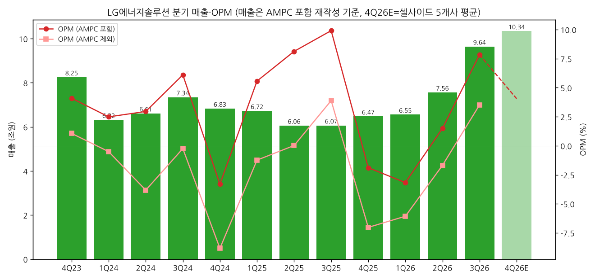
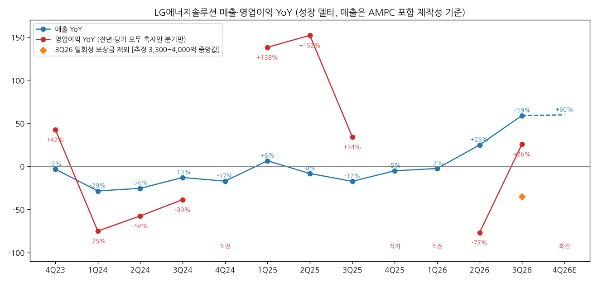
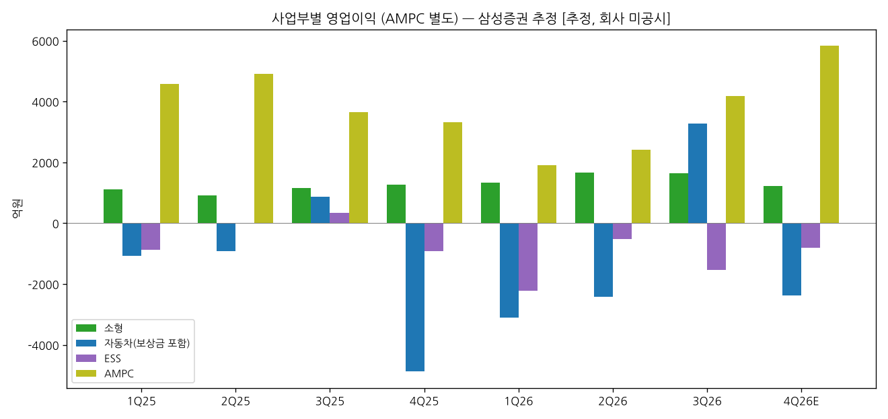

> 모드: 실적 리뷰 (v11)
> 종목: LG에너지솔루션 (373220)
> 섹터: 배터리
> 서브섹터: 배터리 셀
> 분기: 2026-Q3
> 발표일: 2026-11-03 (잠정 10/8, 확정·컨퍼런스콜 11/3 — 날짜는 셀사이드 리포트 기준)
> 작성 시각: 2026-11-14 21:00 KST
> 분석 소스: 회사 「2026.3Q 실적설명회」 IR PT(2026-11-03) + 국내 7개사(삼성 11/3, 미래에셋 11/3, 하나 11/4, LS 11/4, 다올 11/4, 상상인 11/4) + 해외 6개사 9건(Goldman Sachs 11/3·The 720 11/4, Citi 11/3·11/4, HSBC 11/3, Bernstein 11/3, J.P. Morgan 11/4, Morgan Stanley 11/5) — 첨부 15건 전부 / 과거 분기는 본 세션 기업개요(OpenDART + IR 재작성) / 글로벌 피어는 본 세션 CATL·Panasonic·SK온 리뷰
> 리뷰 깊이: 풀 | 리서치 첨부 15건

# LG에너지솔루션 3Q26 실적 리뷰

## 0. 한 줄 판정

> 성장 델타: 가속 (매출 주도·이익은 일회성 제외 시 아직 YoY 마이너스) | 내러티브: 약화 → 경계 구간 (물량은 확인, ESS 마진·4Q 이익 확인 후 진입)

→ 숫자: 매출 9조 6,434억 (YoY +59.0%, QoQ +27.6%), 영업이익 7,560억 (YoY +25.7%, OPM 7.8%). 매출 YoY가 −2.5% → +24.8% → **+59.0%** 로 2개 분기 연속 가속, 영업이익 YoY는 2Q −77.0% → 3Q +25.7%로 플러스 전환. 컨센(FnGuide 3,217억, 삼성 인용) 대비 **+135%**
→ 쟁점 ①: 서프라이즈의 질 — 자동차 고객 일회성 물량 보상금(삼성 추정 약 4,000억, 미래에셋 약 3,300억)과 AMPC 4,169억을 빼면 **본업은 손익분기(BEP) 안팎**. 보상금을 빼면 영업이익 YoY는 약 −35% [추정]
→ 쟁점 ②: ESS는 물량 +60% QoQ, 매출 비중 30% 초반까지 왔지만 **AMPC 제외 적자 지속**(삼성 추정 OPM −4.9%). TP 하향 6건의 공통 원인은 2027년 ESS 마진 가정 하향
→ 쟁점 ③: 영업외손실 9,872억(파생 평가손·이자·소형 IT 파우치 손상)으로 순손실 −2,969억, 영업현금흐름 −3,380억, 순차입금비율 82% — 이익이 현금으로 안 넘어온다
→ 다음 분기 관건: 4Q 가이던스(매출 +10% QoQ, 마진 하락) 하에서 **보상금 없는 4Q26 영업이익이 4,000억대(셀사이드 평균 4,193억)를 지키는지**, 그리고 ESS AMPC 제외 손익이 적자폭을 −2% 안쪽으로 줄이는지

---

## 1. 숫자

① 연결 분기 표 (억원, 매출은 2026년부터 회사가 바꾼 표시 방식 = **북미 생산 보조금(AMPC) 포함 재작성** 기준)

| 항목 | 4Q23 | 1Q24 | 2Q24 | 3Q24 | 4Q24 | 1Q25 | 2Q25 | 3Q25 | 4Q25 | 1Q26 | 2Q26 | **3Q26** | 4Q26E |
|---|---|---|---|---|---|---|---|---|---|---|---|---|---|
| 매출액 | 82,514 | 63,177 | 66,097 | 73,438 | 68,285 | 67,227 | 60,562 | 60,654 | 64,743 | 65,550 | 75,602 | **96,434** | 103,410 |
| 영업이익 | 3,382 | 1,573 | 1,953 | 4,483 | −2,255 | 3,747 | 4,922 | 6,013 | −1,220 | −2,078 | 1,133 | **7,560** | 4,193 |
| OPM | 4.1% | 2.5% | 3.0% | 6.1% | −3.3% | 5.6% | 8.1% | 9.9% | −1.9% | −3.2% | 1.5% | **7.8%** | 4.1% |
| AMPC | 2,501 | 1,890 | 4,478 | 4,660 | 3,773 | 4,577 | 4,908 | 3,655 | 3,328 | 1,898 | 2,410 | **4,169** | 5,831 (삼성) |
| AMPC 제외 영업이익 | 881 | −317 | −2,525 | −177 | −6,028 | −830 | 14 | 2,358 | −4,548 | −3,976 | −1,277 | **3,391** | −1,961 (삼성) |
| 매출 YoY | −3.4% | −28.6% | −25.6% | −13.0% | −17.2% | +6.4% | −8.4% | −17.4% | −5.2% | −2.5% | +24.8% | **+59.0%** | +59.7% |
| 영업이익 YoY | +42.5% | −75.2% | −57.6% | −38.7% | 적전 | +138.2% | +152.0% | +34.1% | 적지 | 적전 | −77.0% | **+25.7%** | 흑전 |
| **매출 YoY 델타 (%p)** | — | −25.2 | +3.0 | +12.6 | −4.2 | +23.6 | −14.8 | −9.0 | +12.2 | +2.7 | +27.3 | **+34.2** | +0.7 |
| **영업이익 YoY 델타 (%p)** | — | −117.7 | +17.6 | +18.9 | — | — | +13.8 | −117.9 | — | — | — | **+102.7** | — |

→ (출처: 2025~3Q26 회사 IR PT Appendix 요약 손익계산서(2025 재작성 포함), 2023~2024는 본 세션 기업개요 — OpenDART 연결 + AMPC 가산 재작성, 4Q22 영업이익 2,374억은 OpenDART. 4Q26E 매출·영업이익 = 삼성·하나·다올·상상인·J.P. Morgan 5개사 발표 후 추정 평균, AMPC·AMPC 제외는 삼성 추정)
→ 컨센 대비: 영업이익 **+135%** (FnGuide 3,217억, 삼성증권 인용 / LS는 공정공시일 기준 3,264억), 매출 +9.3% (삼성 인용). 18개사 커버
→ 2026년 2분기 IR부터 AMPC를 매출에 합쳐 표시 — 과거 분기도 같은 기준으로 다시 썼다. 일부 증권사(상상인·하나)는 2025년을 옛 기준(AMPC 미포함 매출)으로 표기해 YoY가 +69%로 나온다. 본 리뷰는 회사 재작성 기준(+59%)

**해석**
→ 매출 YoY는 1Q26 바닥(−2.5%)에서 2분기 연속 가속. ESS 물량(QoQ +60%+)과 유럽 고전압 미드니켈(+10%+), GM JV 재가동이 동시에 들어왔다. 4Q26E도 +60% 수준으로 **매출 델타의 정점 구간은 3Q26~4Q26** — 2027년엔 기저가 높아져 YoY는 자연 둔화 [판단]
→ 영업이익 YoY +25.7%는 보상금이 만든 숫자. 보상금 3,300~4,000억을 빼면 3Q26 영업이익은 3,560~4,260억, YoY **−29%~−41%** [추정]. 그래도 2Q26(−77%)보다는 개선이라 조정 기준으로도 "가속" 방향은 맞다
→ 4Q26은 전년 기저가 적자(−1,220억)라 표면상 흑자전환 — 진짜 시험은 보상금이 없는 4Q26 숫자 자체(셀사이드 3,530~4,695억)

→ (출처: 회사 IR, OpenDART, 셀사이드 5개사 평균 — 4Q26E는 연한 막대·점선)

→ (출처: 동일. 주황 마름모 = 일회성 보상금 제외 3Q26 영업이익 YoY [추정])

② 사업부별 매출·영업이익 — **회사 미공시**(DART 단일 사업부문). 아래는 삼성증권 추정치 [추정]

| 사업부 (억원) | 3Q25 | 2Q26 | **3Q26** | 4Q26E | 3Q26 매출 YoY | 3Q26 매출 QoQ | 3Q26 매출 비중 |
|---|---|---|---|---|---|---|---|
| 소형 전지 매출 | 16,530 | 24,570 | **24,590** | 22,590 | +48.8% | +0.1% | 26% |
| 소형 영업이익 (OPM) | 1,150 (7.0%) | 1,660 (6.8%) | **1,650 (6.7%)** | 1,220 (5.4%) | | | |
| 자동차 전지 매출 | 37,840 | 30,240 | **40,500** | 39,600 | +7.0% | +33.9% | 42% |
| 자동차 영업이익 (OPM) | 870 (2.3%) | −2,420 (−8.0%) | **3,280 (8.1%)** — 보상금 약 4,000억 포함 | −2,380 (−6.0%) | | | |
| ESS 전지 매출 | 6,280 | 20,790 | **31,340** | 40,190 | +399.0% | +50.7% | 32% |
| ESS 영업이익 (OPM, AMPC 제외) | 340 (5.4%) | −520 (−2.5%) | **−1,540 (−4.9%)** | −800 (−2.0%) | | | |
| AMPC | 3,650 | 2,410 | **4,170** | 5,830 | | | |

→ (출처: 삼성증권 2026-11-03 「3Q26 review」 실적 추이 표. 회사 공시 아님 — 사업부 영업이익 합 + AMPC = 연결 영업이익으로 맞춘 증권사 모델)
→ 하나증권 추정도 방향은 같다: 3Q26 ESS OPM(AMPC 제외) −4.2%(상반기 −10% 내외 → 축소), 소형 7.6%, 대형 EV 8.0%(보상금 포함). 4Q26F ESS −2.3% (하나 2026-11-04)
→ 회사 확인 정성 지표: ESS 매출 비중 1H26 20% 후반 → **3Q26 30% 초반**, ESS 출하 QoQ +60%+, 4Q 가이던스 ESS 출하 +40% QoQ (회사 컨콜, GS·Citi 인용)

**해석**
→ 델타를 끄는 건 **ESS 매출(+399% YoY)과 자동차의 일회성**. 소형(원통형)은 매출이 QoQ 보합으로 성장이 멈췄고, 중국 배터리 소비세 재부과(9/1~)로 4Q 마진이 내려갈 전망 (J.P. Morgan: 2027 소형 OPM 8% → 6%로 하향)
→ ESS는 매출은 가장 빠르게 크는데 **AMPC를 빼면 이익을 깎는 사업부**. 2Q에 반영된 관세 환급(약 800억, 삼성 추정)이 빠지고 북미 유통비용이 늘어 3Q 적자가 오히려 커졌다는 게 삼성의 분해, 하나는 "적자폭 축소"로 본다 — 증권사마다 부호는 같고 폭이 갈린다

→ (출처: 삼성증권 2026-11-03 추정 — 회사 미공시)

③ 연간 (억원, AMPC 포함 재작성 기준)

| 항목 | 2023 | 2024 | 2025 | 2026E | 2027E |
|---|---|---|---|---|---|
| 매출액 | 344,224 | 270,997 | 253,186 | 약 340,000 | 약 420,000 |
| 영업이익 | 21,632 | 5,754 | 13,461 | 10,915 | 32,541 |
| OPM | 6.3% | 2.1% | 5.3% | 3.2% | 7.7% |
| 매출 YoY | — | −21.3% | −6.6% | +34% | +24% |
| 영업이익 YoY | — | −73.4% | +133.9% | −18.9% | +198% |

→ (출처: 2023~2025 본 세션 기업개요·회사 IR, 2026E·2027E 영업이익 = 발표 후 8개사 평균(삼성 1.049조·하나 1.131조·미래 1.128조·상상인 1.082조·LS 1.038조·Citi 1.115조·JPM 1.015조·HSBC 1.174조 / 2027E 범위 **2.33조(상상인)~4.01조(HSBC)**), 매출은 삼성·하나·상상인·Citi·HSBC 범위 중간값 반올림)
→ 발표 전 FnGuide 컨센(하나 표기) 2026 1.021조 / 2027 3.679조 → 발표 후 8개사 평균 1.092조 / 3.254조 — **2026은 +7%(3Q 서프라이즈 반영), 2027은 −12% 하향**

---

## 2. 시장 쟁점

### 2-0. 지난 리뷰(1Q26)에서 "봐야 할 것"으로 남긴 항목

| 1Q26 리뷰 4번 항목 | 3Q26 결과 | 판정 |
|---|---|---|
| ESS 팩 조립 병목 해소 시점 (3Q26부터) | 회사 "점진 해소, 4Q 팩·링크 Capa 추가 확대". ESS 매출 +51% QoQ지만 AMPC 제외 OPM −4~−5% [추정] | 일부 확인 (물량 O, 마진 X) |
| AMPC 제외 본업 흑전 (3Q26 +100억 이상) | AMPC 제외 3,391억 흑자 — 단 보상금 3,300~4,000억 포함, 빼면 BEP 안팎 | 형식상 확인, 실질 미확인 |
| 46시리즈 수주잔고 440 → 500GWh+ | 3Q 말 **440GWh 유지**(Citi·GS·Bernstein 인용), 애리조나 연말 양산 시작 | 미확인 |
| 정책 (IAA·미국) | EU IAA 수정권고안 — 역내산 기준을 EU27로 좁혀 비중국 현지 생산자 유리(회사·GS), 12월 세부규칙 | 우호 방향, 진행 중 |
| 유럽 EV 회복 속도 | 유럽 고전압 미드니켈 출하 QoQ +10%+, 폴란드 가동률 상승, 차세대 미드니켈 공급 증량 계약 | 확인 |

### 2-1. 이번 분기 쟁점

① **서프라이즈의 질 — 일회성 보상금을 빼면 본업 이익은 얼마인가** (13건 중 11건 언급)
② **ESS 수익성 — 물량은 터졌는데 왜 AMPC 제외 적자가 이어지나** (10건)
③ **영업외손실 9,872억과 현금흐름 — 이익이 왜 현금이 안 되나** (6건)
④ **ESS 수주 모멘텀과 공급 과잉 — 160GWh는 충분한가** (6건)

### 2-2. 쟁점별 분해

#### ① 일회성 보상금 — 본업 이익의 실체

(1) 회사 설명
→ "ESS 출하량 확대·고전압 미드니켈 EV 파우치 출하 증가·유럽 가동률 개선·원통형 물량 증가, 북미 ESS Capa 안정화로 고정비 부담 완화되며 영업이익 개선" (IR PT p.5). 컨콜에서 **고객 일회성 물량 보상금**을 언급했지만 금액·반복 여부는 밝히지 않음 (LS·Bernstein 인용)
→ 4Q 가이던스: 매출 QoQ 약 +10%, 수익성은 보상금 소멸 + Honda JV ESS 초기 고정비로 소폭 하락 (GS·Citi·Bernstein 인용)

(2) 증권사별 해석 편차

| 증권사 | 보상금 추정 | 보상금·AMPC 제외 본업 판단 | 4Q26E 영업이익 |
|---|---|---|---|
| 삼성 (11/3) | **약 4,000억** (자동차 부문, 장기 판매계획 조정 대가) | 흑전의 주요 배경 | **3,870억** (컨센 6,126억 대비 −37%) |
| 미래에셋 (11/3) | **약 3,300억** (북미 OEM 물량 미이행) | "일회성·AMPC 제외 BEP 추정" | 약 4,670억 [연간 추정 역산] |
| 다올 (11/4) | 언급(금액 없음) | "AMPC 제외 3,390억 → 보상금 감안 시 소폭 적자" | 4,671억 (AMPC 5,400억 포함) |
| 하나 (11/4) | 언급(금액 없음) | AMPC 제외 OPM 3.5% → 4Q −1.1%로 **BEP 근접** | 4,695억 |
| LS (11/4) | "금액·반복 여부 미제시로 불확실성" | AMPC와 보상금이 영업손익 상당 부분 견인 → 수익성 취약 | — |
| J.P. Morgan (11/4) | 언급 | 4Q OPM 3%로 하향 (전 부문 마진 하락) | **3,530억** |
| GS (11/3) | 언급 | EBITDA 마진(AMPC 제외) 15% → 17% — 보상금·폴란드 가동률·원통형이 기여 | — |
| Bernstein (11/3) | 4Q 반복 안 됨 | "마진 회복은 고르지 않다" | — |

(3) 공통 결론 vs 갈리는 지점
→ 공통: 3Q 흑자의 절반 가까이는 보상금, 4Q엔 사라진다. 4Q 영업이익은 3Q 대비 감소
→ 갈림: 보상금 크기(3,300억 vs 4,000억)에 따라 3Q 본업이 **소폭 흑자(+90억)냐 소폭 적자(−600억)냐**. 4Q26E도 3,530억(JPM)~4,695억(하나)로 1,200억 벌어짐 — 차이는 대부분 4Q AMPC 가정(5,400~5,830억)과 소형 마진 가정

(4) [판단]
→ 4Q26E 평균 4,193억 중 AMPC가 5,400~5,800억이면 **AMPC 제외 4Q는 −1,200 ~ −2,000억 적자**가 셀사이드 기본값이다. 즉 "본업 흑전"은 아직 증권사 모델에도 없다. 3Q 숫자를 추세로 읽으면 안 된다
→ 결론을 바꿀 데이터: 4Q26 실적에서 AMPC 제외 손실이 −1,000억 안쪽이면 BEP 도달을 인정할 수 있다

#### ② ESS 수익성 — 물량 +60%에도 AMPC 제외 적자

(1) 회사 설명
→ "북미 ESS Capa 단계적 증설을 통한 공급 대응력 제고", Link 신규 라인 SOP 완료·Pack Capa 순차 확대, NVIDIA 'DSX Ready' BESS 파트너 선정, 빅테크향 첫 BTM BESS 직접 공급 확보 (IR PT p.9)
→ 북미 ESS Capa 2026년 말 50GWh+ → 2027년 말 70GWh+ (파우치 라인 추가 전환·신규 각형 라인), 2027 ESS 목표 마진 한 자릿수 중반 (삼성 인용)

(2) 증권사별 해석 편차

| 증권사 | 3Q26 ESS 수익성 | 2027 ESS 가정 | 논리 |
|---|---|---|---|
| 삼성 | OPM −4.9% (AMPC 제외), 관세 환급 800억 소멸·북미 유통비 증가 | **ESS OPM 0.3%** (회사 목표 한 자릿수 중반 대비 보수) | "ESS 수익성 정상화가 주가 반등 선결조건" → TP 50만 → 46만 |
| 하나 | −5% 미만 (상반기 −10% → 축소) | ESS OPM 1.5% (AMPC 제외), 매출 19.8조 | 이미 확보한 수주·완공 공장·확정 AMPC로 2028 순익 3.1조 "실현 가능성 매우 높음" |
| Morgan Stanley | — | **2% (기존 3.1%)** | ESS 마진 가정 하향이 EPS −7% (2027)의 주원인 |
| HSBC | AMPC 제외 적자, 램프업·부분 병목 | 2027 ESS 매출 +57%, AMPC 포함 이익이 연결의 61% | 4Q 추가 라인 램프업·2H27 각형 LFP 첫 양산 → 마진 우려 지속 |
| 다올 | 오하이오 등 신규 사이트 고정비로 마진 상승 지연 | 북미 ESS 출하 37GWh(2026) → 55GWh(2027), ESS 매출 9.2조 → 12.2조 | 수익성 턴어라운드 1Q27(오하이오 팩 설비 정상화) |
| J.P. Morgan | 4Q도 AMPC 제외 적자 가능 | 2027 중국 공장·ESS 수익성 하향 | 미국 ESS 수요 2027/2030 155/240GWh로 하향(BNEF 태양광 하향 반영) |
| Bernstein | 여러 사이트 동시 램프업 고정비로 개선 지연 | — | Market-Perform 유지 |

(3) 공통 결론 vs 갈리는 지점
→ 공통: ESS 매출은 4Q에도 +30~40% QoQ, 2027년 15조~19.8조로 커진다. 3Q 적자 원인은 **수요가 아니라 램프업 고정비·외주 공정(팩·링크) 병목**
→ 갈림: 2027 ESS 마진 가정 **0.3%(삼성) ~ 2%(MS) ~ 한 자릿수 중반(회사)** — 이 가정 차이가 2027E 영업이익 2.3조~4.0조 편차의 대부분

(4) [판단]
→ 3Q는 물량이 +60% 늘었는데 적자는 줄지 않았다(삼성 기준 오히려 확대). 고정비 문제라면 물량이 늘면 적자가 줄어야 하므로, **변동비(유통·팩 외주 단가) 문제가 섞여 있다**는 삼성의 분해가 숫자와 더 맞는다 [판단]
→ 결론을 바꿀 데이터: 4Q 팩·링크 내재화 후 ESS 적자율이 −2% 안쪽(하나 −2.3%, 삼성 −2.0% 가정)으로 들어오는지. 들어오면 2027 가정이 위로 열린다

#### ③ 영업외손실 9,872억과 현금흐름

(1) 회사 설명
→ 영업외손실 대부분은 외화 파생상품 평가손실, 이어서 이자비용과 **소형 IT 파우치 자산 손상** (JPM·Bernstein 인용). 세전이익 −2,312억, 당기순이익 −2,969억 (IR PT Appendix)
→ 3Q 영업활동현금흐름 −3,380억(운전자본 −1조 220억), Capex −1조 670억, 9M Capex 3.8조(YoY −53%), 2027 Capex 추가 축소 (IR PT p.7, GS)
→ 순차입금비율 72%(2Q) → **82%**(3Q), 부채비율 171%, 자본 30.3조 → 26.0조 (IR PT p.6)

(2) 증권사별 해석 편차

| 증권사 | 해석 | 반영 |
|---|---|---|
| J.P. Morgan | "예상보다 큰 영업외손실이 OP 서프라이즈를 상쇄", 2027 이자비용 부담 | **Overweight → Neutral 하향**, TP 47만 → 38만, 2027 EPS 컨센 대비 −20%+ |
| Bernstein | 현금 창출 약함, 순차입/자본 82% | Market-Perform 유지 |
| LS | 소형 IT 파우치 손상 = 가동률·감가상각 조정 위한 Capa 축소 — 배터리 업계 공통 대응. ROE 마이너스인데 PBR 3배대 → 고평가, 모회사 LG화학 PRS 오버행 | **Hold, TP 29만** (PBR 2.3배) |
| Citi | 파생 평가손 대부분 비현금 | 2027~28 EPS 소폭 하향, TP 50만 유지 (DCF) |
| 상상인 | 2027 Capex 6조 vs EBITDA 8.2조 → 순차입 유지, 재무구조 개선 국면 진입 | TP 64.5만 유지 |

(3) 공통 결론 vs 갈리는 지점
→ 공통: 손상·파생은 상당 부분 비현금·일회성. Capex는 2025년이 정점
→ 갈림: 2027년 **FCF 플러스 전환**을 믿느냐(상상인·Citi FCF +1.9조) vs 이자비용·운전자본이 계속 갉아먹느냐(JPM)

(4) [판단]
→ 순차입금 2Q 29.1조 → 3Q 25.6조로 줄었지만 현금도 7.2조 → 4.3조로 줄어 순차입은 오히려 늘었다(비율 72% → 82%). 영업이익이 흑자로 돌아선 분기에 OCF가 마이너스인 건 ESS 매출 급증에 따른 매출채권·재고 증가(재고 6.4조 → 6.9조, 채권 6.0조 → 6.8조) 영향이 크다 — 성장통이지만 **4Q OCF 플러스 전환이 없으면 멀티플 디스카운트 논리가 강해진다** [판단]

#### ④ ESS 수주 모멘텀과 공급 과잉 우려

(1) 회사 설명
→ ESS 수주잔고 **160GWh**(2025년 말 140GWh), 2028년까지 계획 Capa 물량 대부분 확보, AI 데이터센터·하이퍼스케일러 고객 비중 상승 (GS·Citi 인용)
→ 미국 전력망 안보 행정명령(지정 외국 주체 장비 구매·설치 금지, 12월 세부 시행규칙) → "탈중국 정책 기반 현지 생산 ESS 수요 모멘텀 지속" (IR PT p.10)

(2) 증권사별 해석 편차

| 증권사 | 판단 | 근거 |
|---|---|---|
| 하나 | **"확실한 공급자 우위 시장"** | 전력망 효율 + 보조금용 탈중국이 맞물려 한국 셀로 수주 집중 |
| 미래에셋 | 수주 모멘텀 유효 | 연초 140GWh + 연간 출하 감안 시 연중 누적 40GWh 신규 수주 [추정], 북미 ESS 수주 시계열 확대 |
| Citi | 다소 뒤처짐 | 연중 잔고 증가 약 20GWh로 삼성SDI(60GWh+)에 못 미침. 다만 셀이 양극재보다 미국 ESS 테마에 낫다 |
| J.P. Morgan | **목표 미달** | 연말 230GWh 목표 대비 160GWh — 2025년보다 수주 속도 둔화. 중국산 수출은 대부분 밀려남(8M26 −54% YoY) |
| LS | **Capa 과잉 우려** | 셀 3사 Capa(LGES 300·SK온 179·SDI 140GWh) 대비 2030 미국 ESS 수요(2~3배 가정)는 32~49% 수준 |

(3) 공통 결론 vs 갈리는 지점
→ 공통: 미국 ESS 수요는 2027년에도 성장, 중국산은 규제로 밀려나는 중
→ 갈림: 수요 크기(JPM 2027 155GWh / 2030 240GWh vs 업계 응답 2030 2배~3배) 그리고 **LGES의 수주 점유율**(SDI 대비 뒤처짐)

(4) [판단]
→ 하나의 "공급자 우위"와 JPM의 "목표 미달"은 둘 다 맞다 — 시장은 한국 셀에 우호적이지만, LGES 몫은 2026년에 SDI보다 덜 늘었다. 본 세션 CATL 리뷰 기준 1H26 북미 ESS 출하 점유율은 **CATL 38.8% / LGES 13.6% / SDI 6.1%**(SNE)로, 규제 효과가 출하 데이터에 반영되기 전 단계다 — "한국 독점"은 아직 숫자로 확인 전 [판단]
→ 결론을 바꿀 데이터: 4Q 중 빅테크·유틸리티 대형 수주(10GWh+) 1건 이상, 연말 잔고 180GWh+

### 2-3. 낙관 vs 보수 — 논리 대비

→ **가장 낙관: 상상인(TP 64.5만)·다올(62만)** — ESS 매출 2026 12조 → 2027 15조+(상상인), 2027 EPS에 P/E 63배(다올). 가정의 핵심은 "ESS 물량이 늘면 가동률·고정비 효과로 마진은 따라온다" + 46시리즈·Tabless 2170의 원통형 마진. 2027 EBITDA 추정을 오히려 **+19.7% 상향**(상상인)
→ **가장 보수: LS(Hold, TP 29만)·J.P. Morgan(Neutral, 38만)** — "AMPC와 보상금 빼면 남는 게 없다"(LS) + 영업외·이자·중국 소비세·ESS 마진이 2027 EPS를 컨센 대비 20%+ 낮춘다(JPM). 가정의 핵심은 **ESS 마진이 물량을 따라오지 않는다**
→ 둘을 가르는 변수는 하나 — 2027 ESS 영업이익률(AMPC 제외)이 0%대(보수)냐 한 자릿수 중반(회사·낙관)이냐
→ 셀사이드 vs 시장: 11/3 확정 발표일 주가 356,000 → 338,000원(−5.1%), 11/5 346,000원 — 서프라이즈에도 하락. 셀사이드 13건 중 매수 9건이지만 주가는 12개월 KOSPI 대비 −47%p(삼성 표기)로, **시장은 이미 "본업 마진 확인 전엔 안 산다" 쪽** [판단]

### 2-4. 추정치·TP 변화

| 증권사 | 의견 | 직전 TP | 현재 TP | 4Q26E 영업이익 | 2026E / 2027E 영업이익 | 핵심 변화 한 줄 |
|---|---|---|---|---|---|---|
| 상상인 (11/4) | BUY | 645,000 | 645,000 | 4,201억 | 1.08조 / 2.33조 | 2026~27 EBITDA +7.7% / +19.7% 상향 |
| 다올 (11/4) | BUY | 620,000 | 620,000 | 4,671억 | — | 2027 EPS × P/E 63배 유지, 턴어라운드 1Q27 |
| 미래에셋 (11/3) | 매수 | 510,000 | 510,000 | 약 4,670억 | 1.13조 / 3.59조 | ESS 매출 2027 18조·2028 22조 |
| Citi (11/3·4) | Buy | 500,000 | 500,000 | 약 4,540억 | 1.12조 / 3.04조 | 2027~28 EPS 소폭 하향, DCF 유지 |
| 하나 (11/4) | BUY | 480,000 | 480,000 | 4,695억 | 1.13조 / 3.25조 | 2028 순익 3.1조 × P/E 35배 유지 |
| HSBC (11/3) | Buy | 500,000 | **470,000** | — | 1.17조 / 4.01조 | 2026 OP +5%, 2027 EPS −18% (ESS 마진 정상화 지연) |
| GS (11/3) | Buy | 480,000 | **470,000** | — | EBITDA −6% / −3% | 4Q 마진 하향, 2027 EV 마진 하향 |
| 삼성 (11/3) | BUY | 500,000 | **460,000** | 3,870억 | 1.05조 / 3.68조 | 2027 EPS −17.9%, ESS OPM 0.3% 가정 |
| Bernstein (11/3) | Market-Perform | 403,000 | 403,000 | — | — | 유지 |
| Morgan Stanley (11/5) | Equal-weight | 410,000 | **400,000** | — | EPS −14% / −7% | 2027 ESS 마진 3.1% → 2% |
| J.P. Morgan (11/4) | **OW → Neutral** | 470,000 | **380,000** | 3,530억 | 1.02조 / 2.76조 | 2027 EPS −15%, 영업외·이자·소비세 |
| LS (11/4) | Hold | (하향, 직전 미표기) | **290,000** | — | 1.04조 / 3.37조 | PBR 2.3배, 고평가·PRS 오버행 |

→ 평균 TP(12개사) **469,000원**. 직전 TP 확인 11개사 평균 501,600원 → 485,300원(**−3.3%**). 하향 6건(삼성·HSBC·GS·MS·JPM·LS), 유지 6건, 상향 0건. 등급 하향 1건(JPM)
→ 하향 원인은 **실적(2027 EPS) 하향**이 주도 — 멀티플은 대부분 유지(MS EV/EBITDA 16.5배, 하나 P/E 35배, 다올 P/E 63배). 하향 폭을 가른 건 2027 ESS 마진 가정과 영업외손익(이자·파생)
→ 발표 전 대비 연간 컨센: 2026E 영업이익 +7%(1.021조 → 1.092조), **2027E −12%(3.679조 → 3.254조)** — 올해는 올렸지만 내년은 깎았다

---

## 3. 내러티브 점검

① 스토리 정의
→ **"EV 침체를 미국 ESS(탈중국·AI 데이터센터 전력)로 메우며, 2027년 본업 흑전 → 2028년 이익 레버리지"** — 시장이 LGES를 사는 이유는 비중국 1위 셀 메이커의 북미 ESS 독점적 지위와 AMPC

② 이번 분기가 스토리에 준 영향
→ 강화된 것: 물량. ESS 매출 비중 30% 초반, ESS 매출 YoY +399%, 북미 ESS Capa 70GWh+ 로드맵, 빅테크 BTM 직접 공급, 유럽 EV(미드니켈) 회복과 GM JV 재가동
→ 약해진 것: 마진의 타이밍. 보상금이 없으면 본업은 BEP, ESS는 AMPC 제외 적자 지속, 2027 ESS 마진 가정이 0.3~2%로 내려왔다. 수주 속도는 목표(230GWh)에 못 미쳤고, 영업외손실·OCF 마이너스로 재무 부담 논리가 더해졌다
→ 판정: 스토리의 전제(미국 ESS 수요·탈중국)는 깨지지 않았지만 **이익 실현 시점이 뒤로 밀리며 추정치(2027E −12%)가 내려갔다 → 내러티브 "약화"**
→ 국면: 매출 델타는 가속(정점 구간), 이익 델타는 일회성 제외 시 아직 마이너스 → **"경계 구간"** — 숫자 확인 전 추격하지 않는 구간 [판단]

③ 다시 강해질 트리거
→ 4Q26 ESS 적자율 −2% 이내 + AMPC 제외 연결 적자 −1,000억 이내 (보상금 없이)
→ 빅테크·유틸리티 대형 ESS 수주(10GWh+) — 연말 잔고 180GWh+
→ 46시리즈 신규 대형 수주(440GWh → 500GWh+), 애리조나 46시리즈 양산 개시

④ 스토리를 깨뜨릴 리스크
→ 4Q 이익이 3,500억 아래(JPM 경로) + ESS 적자 확대 → 2027 ESS 마진 가정 추가 하향
→ 미국 ESS 수요 하향(BNEF 태양광 하향, JPM 2027 155GWh) 또는 중국계의 비PFE 우회(지분 구조조정) 확산
→ 4Q OCF 마이너스 지속 + 모회사 LG화학 PRS 오버행

---

## 4. 향후 봐야 할 것

① **4Q26 보상금 없는 영업이익과 AMPC 제외 손익** — 1순위 (델타 판정을 바꾸는 변수)
→ 무엇을: 영업이익 4,000억 이상(셀사이드 평균 4,193억) 유지, AMPC 제외 손실 −1,000억 이내면 본업 BEP 인정 / 3,500억 아래면 "꺾임" 재검토
→ 어떤 데이터로: 4Q26 잠정실적 공시(1월 초), 확정 IR PT·컨콜(1월 말)
→ 언제: 2027-01 초(잠정) ~ 1월 말(확정)

② **ESS 사업부 마진(AMPC 제외)**
→ 무엇을: 적자율 −2% 이내(하나 −2.3%, 삼성 −2.0% 가정 대비), 팩·링크 내재화 효과, Honda JV ESS 초기 비용
→ 어떤 데이터로: 컨콜 ESS 코멘트, 셀사이드 사업부 추정 갱신, 삼성SDI·Panasonic(DC ESS) 4Q 마진 비교
→ 언제: 2027-01 말

③ **ESS 수주잔고와 북미 점유율**
→ 무엇을: 연말 잔고 160GWh → 180GWh+, 빅테크·유틸리티 단일 10GWh+ 수주, 북미 ESS 출하 점유율(1H26 13.6%)의 CATL 대비 변화
→ 어떤 데이터로: 회사 수주 공시·보도, SNE 분기 ESS 출하 트래커, 미국 전력망 안보 행정명령 12월 세부 시행규칙
→ 언제: 12월(규칙) ~ 2027-02(SNE 연간)

④ **원통형(소형) 마진과 46시리즈**
→ 무엇을: 중국 소비세 비용 분담 이후 소형 OPM 6%대 방어 여부, 46시리즈 수주 440GWh → 500GWh+, 애리조나 46시리즈 양산 개시, Tabless 2170 BBU 2Q27 진입
→ 어떤 데이터로: 컨콜, 테슬라·리비안 판매, 수주 보도
→ 언제: 연말(애리조나 SOP) ~ 2027-01

⑤ **현금흐름과 재무**
→ 무엇을: 4Q OCF 플러스 전환, 순차입금비율 82%에서 하락, 2027 Capex 가이던스(6조 내외)
→ 어떤 데이터로: 4Q IR PT 현금흐름표, 2027 가이던스
→ 언제: 2027-01 말
