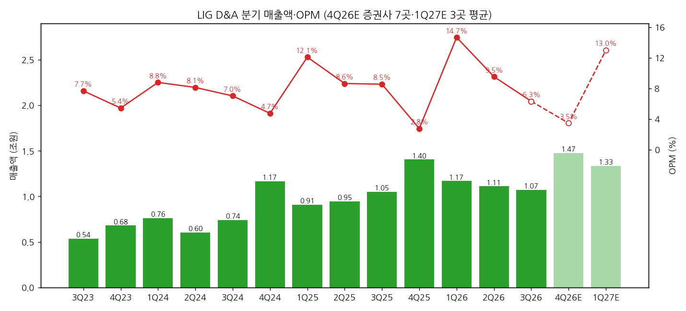
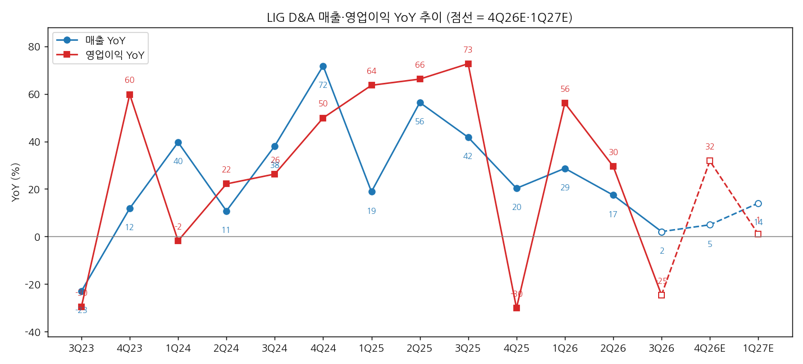
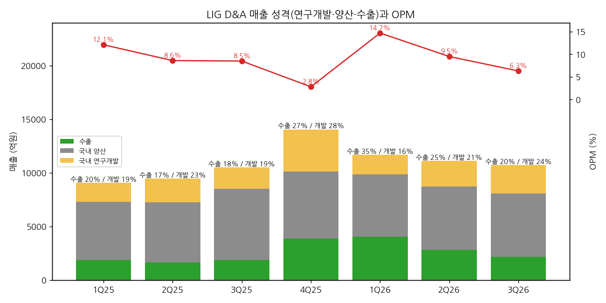

> 모드: 실적 리뷰 (v11)
> 종목: LIG D&A (079550, DART명 LIG디펜스앤에어로스페이스, 구 LIG넥스원)
> 섹터: 방산
> 서브섹터: 방산
> 분기: 2026-Q3
> 발표일: 2026-11-06
> 작성 시각: 2026-11-14 16:20 KST
> 분석 소스: 회사 3Q26 영업(잠정)실적 IR(2026-11-06) + 셀사이드 9곳 — KB(11/06)·JP모간(11/07)·다올(11/08)·DS(11/09)·삼성(11/09)·신한(11/09, 컨콜 Q&A 정리 포함)·SK(11/09)·미래에셋(11/09)·LS(11/11) + LIG D&A 기업개요 v1.1(IR 22분기 사업부·수주잔고 시계열). 웹서치 보완 없음

# LIG D&A 3Q26 실적 리뷰

## 0. 한 줄 판정

> 성장 델타: 꺾임 | 내러티브: 약화 → 매매 제외 구간 (11/20 집행정지 결정과 4Q 중동 천궁-II 수주 확인 전까지 관망)

→ 숫자: 매출 1조 713억(+2.1% YoY), 영업이익 676억(-24.6%), OPM 6.3%. 컨센 대비 매출 -13.3%, 영업이익 -34.6%. 영업이익 YoY가 1Q26 +56.1% → 2Q26 +29.5% → 3Q26 **-24.6%로 마이너스 전환**. 일회성(충당금 90억·Ghost Robotics 손실 100억)을 빼도 866억으로 3Q25(896억) 대비 -3%다
→ 미스의 절반은 타이밍: 협력사 한화 대전사업장 사고로 UAE 천궁-II 납품이 늦어져 매출 400~500억이 이연됐다(신한 컨콜 정리). 나머지 절반은 구조 — 저마진 국내 연구개발 매출 비중 24.5%(+5.7%p)와 환율 하락에 따른 수출 마진 약 5%p 하락(SK·DS)
→ 쟁점의 중심은 **프리미엄 해체**: 방사청 입찰참가자격 2년 제한(집행정지 결정 11/20 전후), 지연되는 수출 수주, 방산 섹터 멀티플 하락이 겹쳐 9곳 전부 TP를 내렸다. 평균 TP 104.3만 → 58.0만 원(-44%). 2027E 영업이익은 발표 전 컨센 6,197억 → 9곳 평균 5,591억(-10%)이라 **하향의 대부분은 멀티플**이다
→ 반대 방향 신호: 회사가 연간 신규수주 가이던스를 5조 → 6조+로, 연말 수주잔고를 25조 → 26~28조로 올렸다(SK·LS·JP모간·신한). 3Q 누계 1.14조라 4Q에만 3~5조 수주가 필요하다 — 카타르·쿠웨이트 천궁-II(DS 추정 각 1.5조)
→ 다음 분기 관건: 11/20 법원 집행정지 인용 여부와 연내 중동 천궁-II 수주 공시. 둘 다 확인되면 2027E 영업이익 +40%(컨센 경로)가 다시 "가속" 그림으로 읽힌다

## 1. 숫자

① 연결 분기 표 (억원)

| 항목 | 3Q23 | 4Q23 | 1Q24 | 2Q24 | 3Q24 | 4Q24 | 1Q25 | 2Q25 | 3Q25 | 4Q25 | 1Q26 | 2Q26 | **3Q26** | 4Q26E | 1Q27E |
|---|---|---|---|---|---|---|---|---|---|---|---|---|---|---|---|
| 매출액 | 5,360 | 6,800 | 7,635 | 6,047 | 7,403 | 11,678 | 9,076 | 9,454 | 10,492 | 14,048 | 11,679 | 11,101 | **10,713** | 14,744 | 13,320 |
| 영업이익 | 411 | 369 | 670 | 491 | 519 | 553 | 1,096 | 816 | 896 | 387 | 1,711 | 1,057 | **676** | 510 | 1,729 |
| OPM | 7.7% | 5.4% | 8.8% | 8.1% | 7.0% | 4.7% | 12.1% | 8.6% | 8.5% | 2.8% | 14.7% | 9.5% | **6.3%** | 3.5% | 13.0% |
| 매출 YoY | -22.9% | 11.9% | 39.6% | 10.8% | 38.1% | 71.7% | 18.9% | 56.3% | 41.7% | 20.3% | 28.7% | 17.4% | **2.1%** | 5.0% | 14.1% |
| 영업이익 YoY | -29.5% | 59.7% | -1.8% | 22.1% | 26.3% | 49.9% | 63.6% | 66.2% | 72.6% | -30.0% | 56.1% | 29.5% | **-24.6%** | 31.8% | 1.1% |
| **매출 YoY 델타 (%p)** | -34.2 | +34.8 | +27.8 | -28.8 | +27.3 | +33.6 | -52.9 | +37.5 | -14.6 | -21.4 | +8.4 | -11.3 | **-15.3** | +2.8 | +9.1 |
| **영업이익 YoY 델타 (%p)** | -14.7 | +89.2 | -61.5 | +23.9 | +4.1 | +23.6 | +13.7 | +2.6 | +6.4 | -102.7 | +86.1 | -26.6 | **-54.1** | +56.3 | -30.7 |

→ (출처: 3Q22~2Q26 회사 IR 최신 재작성치(기업개요 v1.1 표 — 4Q24 553·1Q25 1,096·2Q25 816·4Q25 387억은 Ghost Robotics PPA 재작성 반영), 3Q26 회사 3Q26 IR p.3 (2026-11-06, K-IFRS 연결 잠정). 4Q26E = 다올·DS·신한·SK·LS·미래에셋·JP모간 7곳 평균(매출 범위 1조 2,873억~1조 6,040억, 영업이익 253억~640억). 1Q27E = 다올·DS·SK 3곳 평균 — 소수 의견)
→ 컨센 대비: 매출 -13.3%, 영업이익 -34.6% (FnGuide QuantiWise 컨센 매출 1조 2,360억 / 영업이익 1,034억 — 신한·SK 인용, 커버 20곳 — 삼성 인용). 지배순이익 -46억으로 적자전환 — 외환 손실 400~500억과 구미 3하우스 철거 손상차손 약 220억(회사 IR p.6)
→ 영업이익 YoY 정점은 3Q25(+72.6%)였다. 4Q25(-30%, 연구개발 충당금 약 500억)에 한 번 꺾였다가 1Q26 천궁 조기납품으로 반등했지만, 2Q26 +29.5% → 3Q26 -24.6%로 다시 꺾였다 `[판단]`
→ 3Q 누계는 매출 3조 3,492억(+15.4%), 영업이익 3,443억(+22.6%), OPM 10.3%(회사 IR p.3·6). 회사는 연간 OPM 8% 가이던스를 유지했다(신한·SK 컨콜 정리) — 9곳 평균 2026E 매출 4.84조에 8%를 적용하면 4Q 영업이익은 약 430억이다 `[추정]`
→ 컨센 경로: 4Q26E +32%는 4Q25 충당금 기저효과다. 1Q27E는 +1%로 1Q26 고점(14.7%) 기저에 막힌다. 2027E 연간은 +40%(9곳 평균) — **다음 YoY 가속 구간은 2Q27 이후, 천궁 3국 동시 생산(2H27)과 증설(2028)에 걸려 있다** `[전망]`

→ (출처: 회사 IR, 4Q26E 증권사 7곳·1Q27E 3곳 평균)

→ (출처: 회사 IR, 4Q26E 증권사 7곳·1Q27E 3곳 평균)

② 사업부별 매출 (억원)

| 사업부 | 3Q25 | 4Q25 | 1Q26 | 2Q26 | **3Q26** | 비중 | QoQ | YoY |
|---|---|---|---|---|---|---|---|---|
| PGM 유도무기 | 4,934 | 6,550 | 6,890 | 6,531 | **6,038** | 56.4% | -7.5% | +22.4% |
| AEW 항공전자·전자전 | 1,631 | 1,829 | 1,884 | 1,841 | **2,001** | 18.7% | +8.7% | +22.7% |
| ISR 감시정찰 | 1,186 | 1,646 | 1,082 | 1,250 | **1,385** | 12.9% | +10.8% | +16.8% |
| C4I 지휘통제 | 2,566 | 3,524 | 1,566 | 1,209 | **944** | 8.8% | -21.9% | -63.2% |
| 기타 | 176 | 498 | 257 | 269 | **345** | 3.2% | +28.3% | +96.0% |
| 계 | 10,492 | 14,048 | 11,679 | 11,101 | **10,713** | | -3.5% | +2.1% |

→ (출처: 회사 3Q26 IR p.5. 3Q25는 3Q26 IR의 전년동기 재분류치 — 직전 IR 기준 PGM 5,042·AEW 1,523에서 약 108억이 PGM → AEW로 이동. 4Q25~2Q26은 기업개요 v1.1(각 분기 IR) 값이라 같은 재분류가 반영됐는지 IR에 설명 없음 — QoQ는 참고용)
→ **사업부별 영업이익은 미공개.** 회사가 컨콜에서 밝힌 매출 성격별 마진은 수출 15~20%, 양산 6~7%, 연구개발 0~-4%(신한 Q&A 정리). SK는 수출 마진이 전분기 20~25%에서 15~20%로 약 5%p 내려갔다고 정리했고, JP모간은 수출 OPM 25%로 전분기와 같다고 적었다 — 쟁점 (2)
→ 델타를 끄는 건 **C4I -63%**(TMMR 2차 양산 종료, 1,622억 감소)와 **PGM의 QoQ 감소**(-493억, UAE 천궁 납품 지연)다. PGM·AEW·ISR은 YoY +17~23%로 여전히 성장 중이다. C4I 기저가 4Q26(전년 3,524억)까지 이어져 매출 YoY는 4Q에도 낮게 나온다 `[판단]`

(2-1) 매출 성격 3분법 — 개발 비중이 마진을 누른다 (억원)

| | 1Q25 | 2Q25 | 3Q25 | 4Q25 | 1Q26 | 2Q26 | **3Q26** | 3Q26 YoY |
|---|---|---|---|---|---|---|---|---|
| 국내 연구개발 | 1,764 | 2,191 | 1,973 | 3,932 | 1,827 | 2,377 | **2,624** | +33.0% |
| 국내 양산 | 5,462 | 5,616 | 6,648 | 6,267 | 5,800 | 5,906 | **5,914** | -11.0% |
| 수출 | 1,850 | 1,647 | 1,871 | 3,850 | 4,052 | 2,818 | **2,174** | +16.2% |
| 연구개발 비중 | 19.4% | 23.2% | 18.8% | 28.0% | 15.6% | 21.4% | **24.5%** | +5.7%p |
| 수출 비중 | 20.4% | 17.4% | 17.8% | 27.4% | 34.7% | 25.4% | **20.3%** | +2.5%p |
| OPM | 12.1% | 8.6% | 8.5% | 2.8% | 14.7% | 9.5% | **6.3%** | -2.2%p |

→ (출처: 회사 IR 각 분기 p.4, 기업개요 v1.1 (2-2) 표)
→ 수출 2,174억 중 천궁-II는 약 1,000억(UAE 약 800억 + 사우디 약 200억, 회사 IR p.4). JP모간 추정상 천궁-II 수출 매출은 1Q26 1,700억 → 2Q26 990억 → 3Q26 1,000억으로 정체됐고, 비천궁 수출이 2Q26 1,830억 → 3Q26 1,170억으로 줄었다
→ OPM 패턴은 단순하다: **수출 비중이 오르면 OPM이 오르고, 연구개발 비중이 오르면 OPM이 내린다.** 1Q26(수출 35%·개발 16%) 14.7% vs 3Q26(수출 20%·개발 24%) 6.3%. 연구개발 수주잔고가 2Q25 2.80조 → 3Q26 4.81조로 늘어 있어 개발 비중은 2027년까지 높게 유지될 가능성이 크다(신한) `[판단]`

→ (출처: 회사 IR 각 분기)

(2-2) 수주잔고 — 수출은 늘고 내수는 줄고 (조원)

| 분기말 | 중동 천궁-II | 수출 기타 | 수출 계 | 내수 개발 | 내수 양산 | 내수 계 | 합계 | 분기 신규수주 |
|---|---|---|---|---|---|---|---|---|
| 3Q25 | 10.24 | 4.34 | 14.58 | 2.84 | 6.01 | 8.85 | 23.42 | 0.44 |
| 4Q25 | 10.17 | 4.23 | 14.39 | 5.25 | 6.59 | 11.84 | 26.23 | 4.16 |
| 1Q26 | 9.99 | 4.17 | 14.17 | 5.08 | 6.06 | 11.14 | 25.31 | 0.21 |
| 2Q26 | 9.89 | 4.16 | 14.04 | 4.89 | 5.63 | 10.52 | 24.57 | 0.33 |
| **3Q26** | **10.03** | **4.53** | **14.56** | **4.81** | **5.17** | **9.98** | **24.54** | **0.61** |

→ (출처: 회사 3Q26 IR p.7, 기업개요 v1.1. 3Q26 누계 신규수주 1조 1,440억)
→ 3Q 신규수주 6,125억 중 약 5,000억이 수출(SK). 수출 잔고는 2분기 만에 늘었고(14.04 → 14.56조), 내수 양산 잔고는 4Q25 6.59조 → 5.17조로 3분기 연속 감소 중이다. 잔고 24.54조는 2027E 매출(9곳 평균 5.75조)의 약 4.3년치 `[판단]`

③ 연간 (억원)

| 항목 | 2022 | 2023 | 2024 | 2025 | 2026E | 2027E |
|---|---|---|---|---|---|---|
| 매출액 | 22,207 | 23,086 | 32,763 | 43,069 | 48,416 | 57,490 |
| 영업이익 | 1,791 | 1,864 | 2,233 | 3,195 | 4,002 | 5,591 |
| OPM | 8.1% | 8.1% | 6.8% | 7.4% | 8.3% | 9.7% |
| 매출 YoY | — | 4.0% | 41.9% | 31.5% | 12.4% | 18.7% |
| 영업이익 YoY | — | 4.1% | 19.8% | 43.1% | 25.3% | 39.7% |

→ (출처: 2022~2025 회사 IR 분기 합산(재작성치) / 2026E·2027E = 발표 후 증권사 9곳 평균 — KB·다올·DS·삼성·신한·SK·LS·미래에셋·JP모간)
→ 발표 전 컨센(QuantiWise, SK·KB 인용) 2026E 영업이익 4,410억 / 2027E 6,197억 → 발표 후 9곳 평균 4,002억(-9.2%) / 5,591억(-9.8%). 매출은 2026E -5.2%, 2027E -5.4%
→ 2027E 영업이익 범위는 신한 4,636억(+20%) ~ DS·JP모간 5,990억(+50%)으로 넓다. 2028E는 9곳 평균 7,452억(+33%, 범위 6,045~8,410억). 신한을 빼면 2027E +31~50%, JP모간(2028E 매출 -11% 가정)을 빼면 2028E +30~48% — **2년 연속 30%대 증익이 셀사이드 기본 경로**다 `[판단]`

## 2. 시장 쟁점

① 2-0 지난 분기 체크

→ 첫 리뷰 — 직전 체크 없음 (2Q26 리뷰 미작성)

② 이번 분기 쟁점 5개

| # | 쟁점 | 언급 증권사 |
|---|---|---|
| (1) | 3Q 미스 분해 — 타이밍(납품 지연) vs 구조(개발 비중·환율) | 9/9 |
| (2) | 수출 마진은 내려갔나 — 환율 5%p 하락 vs 25% 유지 | 7/9 |
| (3) | 천궁-II 매출 인식 속도와 2027 이익 경로 | 7/9 |
| (4) | 4Q 수주 가이던스 상향 — 연말 잔고 26조 vs 28조 | 8/9 |
| (5) | 방사청 입찰참가자격 제한과 "미사일 프리미엄" 해체 | 7/9 |

③ 쟁점별 분해

(1) **3Q 미스 분해 — 타이밍 vs 구조**

(1-1) 회사 설명
→ IR p.6: 영업이익 220억 감소(-24.6%) 사유 ① 연구개발 매출 비중 증가(18.8% → 24.5%) ② 판관비(연구개발비·인건비·운송료) 증가 ③ 손실충당금 약 90억 ④ Ghost Robotics 영업손실 약 100억
→ 컨콜(신한 정리): UAE 천궁-II 분기 매출은 통상 1,000~1,200억인데 협력사 한화 대전사업장 사고로 납품이 늦어져 3Q 약 800억(400~500억 영향). 경상개발비는 전년 대비 약 45% 증가. 충당금·Ghost 제외 시 영업이익 866억(OPM 8.1%)

(1-2) 증권사별 해석

| 증권사 | 핵심 가정·추정 | 논리 |
|---|---|---|
| 다올 | 환율 영향 약 500억(매출 기준), 수출 QoQ 감소 = 한화 사고에 따른 고체연료 수급 차질 | 국내 개발/양산 믹스 2:8 → 3:7 + 충당금 + 환율 + 수출 감소 4중 요인. 경상개발비 QoQ 영향은 없음 |
| SK | UAE 천궁 매출 400~500억 이연, 수출 마진 5%p 하락 | 환율·납품 이연·일회성 비용 비중이 커서 펀더멘털 훼손 아님 |
| DS | UAE 천궁 기대 1,200억 vs 실제 800억 | 수출 마진 하락 + 내수 개발 비중 + 충당금 |
| 신한 | 일회성 제외 866억(8.1%) | 개발 비중 확대·경상개발비 증가로 **수익성 둔화가 2027년까지** |
| 삼성 | 영업이익 컨센 -35%, QoQ -36% | 고마진 수출 비중 감소 + 저마진 개발 매출 증가 + Ghost 손실이 예상보다 큼 |
| KB | 환율 하락 + TMMR 종료로 C4I 감소 | 매출 증가폭 제한, 개발 비중·Ghost·충당금이 이익을 누름 |
| JP모간 | 수출 매출 JPMe 대비 -45%, 핵심 OPM 8.1%(JPMe 8.5%) | 수출 매출 미달이 핵심, 일회성 제외 마진은 예상과 비슷 |
| 미래에셋 | 천궁 1,000억+α(2Q 990억+α)로 정체 | 경상개발비·환영향(영업이익의 약 5%)·충당금·Ghost |

(1-3) 공통 vs 갈림
→ 공통: 일회성(충당금 90억·Ghost 100억)을 빼면 OPM 8.1%로 컨센 수준에 가깝다. 미스의 "매출" 쪽은 UAE 천궁 납품 이연이라 2027년에 만회된다
→ 갈림: 개발 비중 상승이 **일시적인지 구조적인지**. 신한은 2027년까지 이어진다고 보고 2027E OPM 8.4%만 줬고, JP모간·DS는 2027E 10%대 회복을 유지했다

(1-4) [판단]
→ 이연(400~500억 매출 × 수출 마진 15~20% ≈ 60~100억 영업이익)과 일회성(190억)을 다 더해도 3Q 영업이익은 약 950~970억이다. 3Q25(896억) 대비 +6~8%로, 2Q26 +29.5%에서 확실히 둔화된 숫자다 `[추정]`. 즉 "타이밍만의 문제"는 아니다. 개발 잔고가 4.81조로 1년 전(2.84조)보다 70% 많아 개발 비중 상승은 구조 쪽에 가깝다 `[판단]`

(2) **수출 마진은 내려갔나**

(2-1) 회사 설명
→ 매출 성격별 마진 수출 15~20%, 양산 6~7%, 연구개발 0~-4%로 "기존과 같다"(신한 Q&A). 외화 순자산이 플러스라 환율 하락 시 손실, 외화 순자산의 50% 이상을 헤지했는데도 3Q 영업외 환손실 400~500억 — 앞으로 더 적극 헤지하겠다. 영업이익 단의 환율 영향은 추후 공지(신한 Q&A)

(2-2) 증권사별 해석

| 증권사 | 수출 마진 해석 | 논리 |
|---|---|---|
| SK | 20~25% → 15~20% (약 -5%p) | 환율 하락이 수출 마진을 직접 깎음 |
| DS | 약 -5%p | 환율 반영해 수출 마진 재조정, TP 하향 근거 |
| 미래에셋 | 환영향 제거 시 중동 천궁 마진 20% 이상 견조 | 3Q 예정원가 조정으로 4Q 환영향은 제한적 |
| JP모간 | 수출 OPM 25%, 전분기와 같음 | 마진은 견조, 효율화·레버리지로 상방 여지 |
| 다올 | 환율 영향 500억 | 수출 감소와 함께 3Q 부진의 핵심 원인 |

(2-3) 공통 vs 갈림
→ 공통: 환율이 3Q 이익을 깎았다(영업·영업외 모두)
→ 갈림: 마진 **수준**. SK·DS는 15~20%대로 내려앉았다고 보고, JP모간·미래에셋은 환영향만 빼면 20~25%가 유지된다고 본다. 회사 Q&A의 "수출 15~20%"는 SK 쪽 숫자와 같다

(2-4) [판단]
→ 회사가 말한 15~20%를 기준으로 쓰는 게 맞다. 원화 강세가 이어지면 2027년 천궁 매출이 늘어도 마진은 2025년 수준(20%대)으로 돌아가지 않을 수 있다. 4Q 컨콜에서 회사가 약속한 "영업이익 단 환율 영향" 수치가 확인 포인트 `[판단]`. 현대로템 리뷰의 "원화 강세 → 수출 마진 하향" 시그널과 같은 방향이다

(3) **천궁-II 매출 인식 속도와 2027 이익 경로**

(3-1) 회사 설명 (컨콜, 신한·JP모간·다올 정리)
→ UAE: 2026년 매출 5,000억 가이던스에 하방 위험, 2027년 정상화와 함께 만회. 사우디: 3Q부터 양산 단계(약 200억), 홍해 운송 차질로 운반비 증가. 이라크: 2027년 하반기 본격 매출
→ 4Q 매출은 최소 전년 수준(1.40조), 매출 연평균 15% 이상 성장 기조 유지. 김천·구미 3하우스 증설은 2028년경 상당 부분 가동. 향후 2~3년 연 CAPEX 2,000~3,000억(JP모간). Ghost Robotics는 4Q에도 적자, 2027년 손익분기 목표
→ C4I: TMMR 2차 양산 종료로 -63%, 2027년 예산 편성 여부는 다음 분기에 확인(신한)

(3-2) 증권사별 2027E

| 증권사 | 2027E 매출 | 2027E 영업이익 | YoY | 핵심 가정 |
|---|---|---|---|---|
| DS | 5.93조 | 5,988억 | +50% | 수출 2.10조(+59%), 2H27 천궁 3국 동시 생산 |
| JP모간 | 5.50조 | 5,990억 | +49% | UAE·사우디·이라크 천궁 매출 가정 하향, 2027E 영업이익 -18% |
| 미래에셋 | 6.01조 | 5,900억 | +50% | 수출 1.81조(+41%), OPM 9.8% |
| KB | 6.01조 | 5,950억 | +48% | 수정 폭 -2.7%로 가장 작음 |
| LS | 5.67조 | 5,670억 | +39% | 수출 1.99조(+34%) |
| 삼성 | 5.82조 | 5,660억 | +31% | 2027E EPS -12% |
| SK | 5.90조 | 5,622억 | +38% | 2028E 영업이익 8,302억(+48%) |
| 다올 | 5.36조 | 4,902억 | +32% | 수출 비중 28% → 39%, 고체연료 수급 정상화 |
| 신한 | 5.55조 | 4,636억 | +20% | 개발 비중 확대로 OPM 8.4%, 2027E 영업이익 -32% |

(3-3) 공통 vs 갈림
→ 공통: 2027년은 UAE 만회 + 사우디 램프업 + 이라크(2H27)로 **수출이 1.8~2.1조로 늘어 증익**한다. 9곳 모두 2027E 영업이익 증가(신한 +20% ~ DS +50%)
→ 갈림: 증익 폭. 수출 성장(대부분 동의)보다 **국내 개발 비중이 마진을 얼마나 희석하느냐**에서 신한(+20%)과 나머지(+31~50%)가 갈린다

(3-4) [판단]
→ 2027E 증익의 엔진은 이미 계약된 천궁 3국(잔고 10.03조)이라 "수주 없이도 증익"이 가능한 구조다. 현대로템(2027 감익)과 다른 점이다. 다만 이번 분기에 확인된 것처럼 진행률 인식은 협력사 납품·운송에 흔들린다. 1Q27 UAE 천궁 분기 매출이 1,000억 이상으로 돌아오는지가 2027 경로의 첫 검증이다 `[판단]`

(4) **4Q 수주 가이던스 상향 — 연말 잔고 26조 vs 28조**

(4-1) 회사 설명
→ 연간 신규수주 가이던스 5조 → 6조 이상, 연말 수주잔고 25조 → 28조 수준(SK·LS·DS). 신한 Q&A 정리는 "26조 이상, 대부분 수출, 국내는 평년 수준", JP모간은 "최대 28조"로 적었다. 모로코·태국·필리핀·말레이시아·인도 등 수출 지역 다변화 중(SK). 동남아·아프리카로 신궁 수출 시작(신한)
→ 경쟁사의 중동 주계약 발언에 대해: 누가 주계약을 맡든 주된 계약업체는 당사(신한 Q&A)

(4-2) 증권사별 해석

| 증권사 | 4Q 수주 가정 | 논리 |
|---|---|---|
| DS | 카타르 천궁-II 1.5조·쿠웨이트 1.5조·UAE L-SAM 교전통제 1조 | 4Q에 수출만 3~4조 이상 → 중동 2개국 연내 수주 신호 |
| SK | 4Q 신규 5조 가까이 | 수주 모멘텀 전 저가 매수 기회 |
| LS | 4Q 신규 약 5.06조, 연말 잔고 28조 | 쿠웨이트·카타르 구매 요청, 이란전쟁 실전 검증 |
| 다올 | 4Q 3조 이상(잔고 26조 상회 기준) | 신규 천궁 도입국 등장 + 동남아 PGM 수요 확대 추정 |
| 신한 | 2026 신규 4.1조, 연말 잔고 26.0조 | 회사 가이던스 하단만 반영 |
| JP모간 | 2026E 잔고 28.3조 | 중동 천궁 수주가 4Q 안에 확정될 가능성 시사 |
| KB | Base 2026 신규 5~7조 | 5조 하회가 Bear 조건 |

(4-3) 공통 vs 갈림
→ 공통: 수요는 확실하다. 미국산 방공미사일 공급이 수년간 제한돼 한국 외 대안이 없다(KB)는 데 이견이 없다
→ 갈림: 숫자를 추정치에 넣느냐. 신한은 26조(하단), DS·LS·JP모간은 28조를 쓴다. 다올은 기대이익을 1.8조 → 0.7조로 깎아 가치에서 상당 부분 뺐다

(4-4) [판단]
→ 3Q 누계 1.14조에서 연 6조+를 맞추려면 4Q에 약 5조가 필요하다 — 천궁-II 수출 2건 규모다. 회사가 실적이 부진한 분기에 오히려 가이던스를 올렸다는 점은 협상이 막바지라는 신호로 읽힌다 `[판단]`. 반대로 연말까지 공시가 없으면 "또 밀렸다"가 되어 내러티브는 한 단계 더 약해진다. 결론이 가장 빨리 갈리는 쟁점이다

(5) **방사청 입찰참가자격 제한과 "미사일 프리미엄" 해체**

(5-1) 회사 설명
→ 방사청이 2026.10 임원의 방사청 평가위원 뇌물공여 혐의를 근거로 입찰참가자격 2년 제한(2026.10.29~2028.10.28)을 의결(기업개요 v1.1). 회사는 법원에 집행정지를 신청했고 11월 20일경까지 인용될 것으로 예상, 사업에 큰 영향은 없다는 입장(신한 Q&A). 주주환원은 검토 중이나 공시할 정책은 없음

(5-2) 증권사별 해석

| 증권사 | 평가 | 밸류에이션 처리 |
|---|---|---|
| LS | 형사 1심 전 처분이라 방사청 입증 부담 큼, 장거리 공대공 유도탄 권한 상실 등 회복 어려운 손해 → 인용 가능성 높음. 기각 시 11/21부터 제한, 대법원 판결은 2028~29년 | 글로벌 방산 배수 하락만 반영 |
| DS | 집행정지 결정이 11/20로 미뤄짐. EPS 영향 미미, 심리 부담 | 11/20 결정 + 수주 가이던스 달성이 재평가 트리거 |
| 삼성 | 실적 영향은 제한적이나 국책과제 참여(장기 실적) 영향 확인 필요 | 프리미엄 제거, 국내외 방산 평균 P/E 20.5배 |
| 신한 | 국내 신규 수주 불확실성 확대. 위험 요인에 방산업체 지정 취소까지 | 할증 130% → 60% |
| 미래에셋 | 본안 판결까지 국내 영향 제한적, 추가 제재 가능성은 미정 | 목표 P/E에 40% 할인(33.8 → 20.3배) |
| KB | 입찰제한 리스크로 Peer 대비 할증 논리 약화 | 할증 제거, KAI·한화시스템 평균 P/E 29.4배 |
| JP모간 | 국내 이슈에 대한 주가 반응은 과도 | 목표 P/E 34 → 22배 |

(5-3) 공통 vs 갈림
→ 공통: 기존 잔고 매출과 수출은 제재 대상이 아니라 **단기 실적 영향은 작다.** 하지만 프리미엄을 줄 근거가 사라졌다 — KB·삼성(할증 제거), 신한(축소), 미래에셋(할인), JP모간(P/E 34 → 22배) 5곳이 멀티플 자체를 낮췄다
→ 갈림: 인용 확률. LS는 높다고 보고, 신한·미래에셋은 추가 제재(방산업체 지정 취소 등)까지 열어 둔다

(5-4) [판단]
→ 이번 TP 하향(-44%)의 대부분은 이 쟁점에서 나왔다. 2027E 영업이익은 -10%만 내려갔다(1번 ③). 집행정지가 인용되면 "실적은 그대로인데 멀티플만 깎인" 상태가 되어 되돌림 여지가 생기고, 기각되면 KF-21 장거리 공대공 유도탄(약 1.9조, 기업개요 v1.1) 등 국내 신규 사업이 2028년까지 막혀 내수 양산 잔고 감소(3분기 연속)가 가속된다 `[판단]`

④ 낙관 vs 보수

→ 낙관(다올 84만·SK 70만): 다올은 실적 추정을 바꾸지 않고 파이프라인 기대이익만 1.8조 → 0.7조로 깎아 적정 PER 30배를 유지했다. "단기 선호주에서는 빼지만 장기는 Buy & Forget"이다. SK는 2028E EPS × 22배로, 4Q 수주 모멘텀 전 저가 매수 기회라고 본다
→ 보수(신한 43만·삼성 43만): 신한은 개발 비중 확대로 수익성 둔화가 2027년까지 간다고 보고 2027E 영업이익을 -32% 깎고 할증도 130% → 60%로 낮췄다. 삼성은 할증을 아예 없애고 국내외 방산 평균 P/E 20.5배를 2027E EPS에 적용했다
→ 차이의 본질은 **어느 해 이익에 어떤 멀티플을 쓰느냐**다. 낙관 쪽은 2028E 이익(천궁 3국 + 증설)에 20~30배, 보수 쪽은 2027E 이익에 할증 축소 배수를 쓴다
→ 셀사이드 vs 주가: 9곳 모두 매수·OW 유지, 새 평균 TP 58만 원은 11/6 종가 32.6만 원 대비 +78%다. 그런데 주가는 최근 1개월 -54%(KOSPI 대비 상대 -25%p, JP모간 11/6 기준. 입찰 제한 의결 다음 날 10/21 -9.03%, 기업개요 v1.1), 실적 발표일 11/5 35.85만 → 11/6 32.6만 원(-9.1%, 52주 최고 102만 원 대비 -68%). JP모간은 하락 이유로 국내 수주 제재, 방산 3Q 실적 부진, 수주 업데이트 부재, 우선주 발행 지연 4가지를 꼽았다. 바이사이드는 "11/20 결정과 수주 공시를 보고 산다"는 쪽이다 `[판단]`

⑤ 추정치·TP 변화

| 증권사 | 직전 TP | 현재 TP | 4Q26 영업이익 E | 2026E / 2027E 영업이익 | 핵심 변화 한 줄 |
|---|---|---|---|---|---|
| KB (11/06) | 1,000,000 | 550,000 | 약 570억 | 4,030 / 5,950억 | 2026E -7.8%·2027E -2.7%, 할증 제거 → P/E 29.4배 |
| JP모간 (11/07) | 1,000,000 | 500,000 | 580억 | 4,020 / 5,990억 | 2027E 영업이익 -18%, P/E 34 → 22배 |
| 다올 (11/08) | 980,000 | 840,000 | 253억 | 3,697 / 4,902억 | 2026E -13%·2027E -10%, 파이프라인 1.8 → 0.7조 |
| DS (11/09) | 1,250,000 | 600,000 | 542억 | 3,989 / 5,988억 | 2026E -8.2%·2027E -7.8%, 2028F EPS × 20배 |
| 삼성 (11/09) | 855,000 | 430,000 | — | 4,310 / 5,660억 | 2026E EPS -28%·2027E -12%, 할증 제거 P/E 20.5배 |
| 신한 (11/09) | 980,000 | 430,000 | 427억 | 3,870 / 4,636억 | 2026E -21%·2027E -32%, 할증 130 → 60% |
| SK (11/09) | 900,000 | 700,000 | 631억 | 4,074 / 5,622억 | 추정치 -1%, Peer 멀티플 하향만 반영 |
| 미래에셋 (11/09) | 1,120,000 | 570,000 | 496억 | 3,940 / 5,900억 | 2026E -14%·2027E -8%, 목표 P/E 40% 할인 |
| LS (11/11) | 1,300,000 | 600,000 | 640억 | 4,090 / 5,670억 | 글로벌 방산 평균 배수 하락 반영 |

→ (출처: 각 증권사 리포트 본문·투자의견 변동 내역. KB 4Q는 "매출 1.5조·OPM 3.8%" 문구로 계산 `[추정]`. DS 3Q 리뷰 표의 OPM 7.7%는 오기로 보이며 실제 6.3%)
→ 평균 TP: 직전 104.3만 원 → 현재 58.0만 원(-44.4%). 하향 9건, 상향·유지 0건. 발표 전 컨센 TP 103.95만 원(KB·삼성 인용)
→ **하향의 원인은 대부분 멀티플이다.** 2027E 영업이익은 발표 전 컨센 대비 -10% 내려갔는데 TP는 -44% 내려갔다. 나머지 약 4/5는 할증 제거·축소(KB·신한·삼성·미래에셋)와 글로벌 방산 피어 배수 하락(SK·LS·JP모간)에서 나왔다 `[판단]`

## 3. 내러티브 점검

① 성장 스토리 정의
→ "이란전쟁 실전 검증으로 수요가 폭발한 방공 미사일(천궁-II)의 한국 유일 체계종합사. 중동 3국 10조 잔고가 진행률로 매출화되며 수출 비중과 OPM이 오르고, 카타르·쿠웨이트 등 추가 수출이 붙는다. 국내 유도무기 독점 지위가 바닥을 받친다"

② 이번 분기가 스토리에 준 영향
→ 강화된 것: 수요 쪽. 회사가 실적 부진 분기에 수주 가이던스를 5조 → 6조+로 올렸고, 수출 잔고가 다시 늘었다(14.04 → 14.56조)
→ 약화된 것: 매출화 속도(UAE 천궁 2026 가이던스 5,000억 하방, 이라크 2H27), 수출 마진(환율 -5%p), 국내 지위(입찰 제한 → "국내 독점이 바닥을 받친다"는 전제에 균열). 시장이 부여하던 "미사일 프리미엄"은 셀사이드 5곳이 목표 배수에서 공식적으로 걷어냈다
→ 훼손은 아니다: 수요(중동·동남아)와 기존 잔고는 그대로이며 9곳 모두 2027~2028 연 30%대 증익을 유지한다

③ 국면 판단
→ 델타 꺾임(영업이익 YoY +29.5% → -24.6%, 일회성 제외로도 -3%) + 내러티브 약화(프리미엄 해체·TP -44%·국내 제재) → **매매 제외 구간**
→ 다만 현대로템과 달리 **컨센 경로상 다음 가속(2027E +40%)이 이미 계약된 잔고로 그려져 있고**, 결론을 바꿀 이벤트 두 개(11/20 집행정지, 연내 중동 수주)가 몇 주 안에 몰려 있다. 둘 다 긍정으로 나오면 "델타 회복 대기 + 내러티브 재강화"로 국면이 빠르게 바뀔 수 있는 종목이다 `[판단]`

④ 트리거와 리스크
→ 트리거: ① 11/20 전후 법원 집행정지 인용 ② 4Q 카타르·쿠웨이트 천궁-II 수주 공시(각 1.5조 추정, DS) → 연말 잔고 28조 ③ 1Q27 UAE 천궁 분기 매출 1,000억+ 회복
→ 리스크: ① 집행정지 기각 → 2028.10까지 국내 신규 입찰 불가, 추가 제재(방산업체 지정 취소) 논의 ② 연내 수주 공시 부재 → 2027E 수출 수주 가정 하향 ③ 원화 강세 지속 + 개발 비중 확대로 2027E OPM 8%대 고착(신한 시나리오)

## 4. 향후 봐야 할 것

① **4Q 중동 천궁-II 수주와 연말 수주잔고 26~28조** (델타·내러티브를 함께 바꿀 1순위)
→ 무엇을: 카타르·쿠웨이트 천궁-II(각 약 1.5조, DS 추정)·UAE L-SAM 교전통제(약 1조) 계약 여부, 연간 신규수주 6조+·연말 잔고 28조 달성
→ 어떤 데이터로: DART 단일판매·공급계약 체결 공시, 4Q26 IR 수주잔고 표, 뉴스 키워드 "천궁-II 카타르", "쿠웨이트 M-SAM"
→ 언제: 2026.12 (회사 "4Q 확정" 목표) / 4Q26 IR 2027.2 초

② **입찰참가자격 제한 집행정지 결정**
→ 무엇을: 법원 집행정지 인용·기각, 기각 시 KF-21 장거리 공대공 유도탄(약 1.9조) 등 국내 신규 사업 참여 가능 여부, 추가 제재 논의
→ 어떤 데이터로: 회사 공시, 방사청 발표, 법원 결정 보도
→ 언제: 2026.11.20 전후 (LS: 기각 시 11/21부터 제한 개시)

③ **천궁-II 매출 인식 회복 — UAE 분기 1,000억 이상**
→ 무엇을: UAE 천궁 분기 매출 1,000~1,200억(정상 수준) 회복, 사우디 램프업(3Q 200억 → ?), 4Q 매출 1.40조 이상(회사 최소치)·연 OPM 8%(4Q 영업이익 약 430억 이상)
→ 어떤 데이터로: 4Q26 잠정실적·IR p.4 해외매출 문구, 한화에어로스페이스 대전사업장 정상화 보도
→ 언제: 2027.2 초 4Q26 잠정실적 / 1Q27 실적(2027.5)

④ **수출 마진과 환율**
→ 무엇을: 회사가 공지하기로 한 영업이익 단 환율 영향 수치, 수출 마진 15~20% vs 20~25% 어느 쪽인지, 헤지 확대 후 영업외 환손익
→ 어떤 데이터로: 4Q26 컨콜 Q&A, 원/달러 환율
→ 언제: 2027.2 초

⑤ **국내 개발 비중과 C4I 후속 예산**
→ 무엇을: 연구개발 매출 비중 24.5%의 추이(20% 이하 복귀 여부), TMMR 후속 2027 예산 편성, Ghost Robotics 적자 축소(2027 손익분기 목표)
→ 어떤 데이터로: 4Q26 IR 매출 성격 표, 국회 2027 국방예산 확정, IR Ghost Robotics 문구
→ 언제: 2026.12 국회 예산 확정 / 2027.2 초 4Q26 IR
