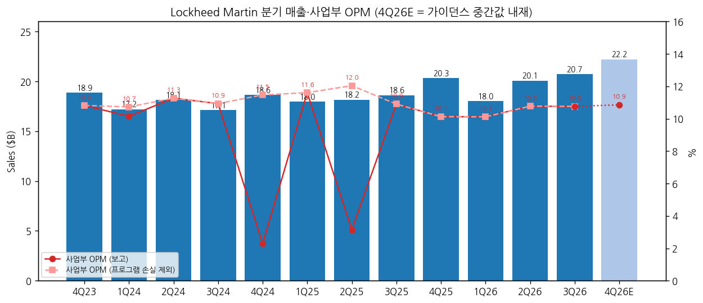
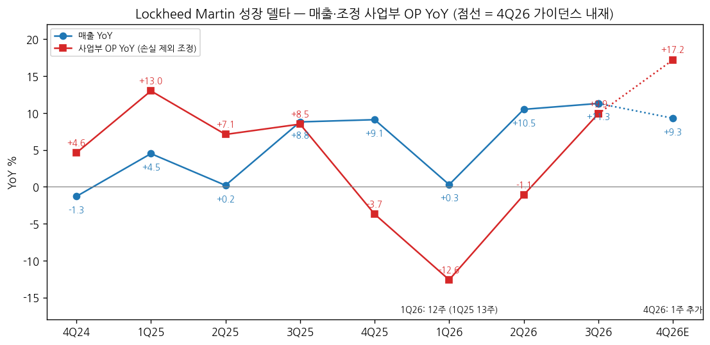
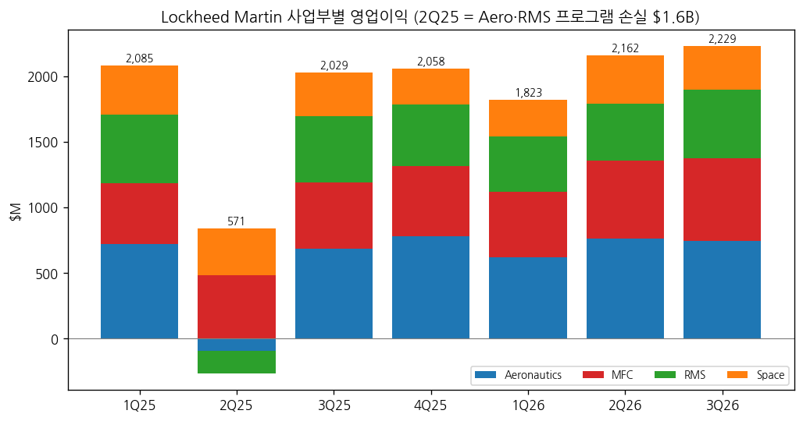
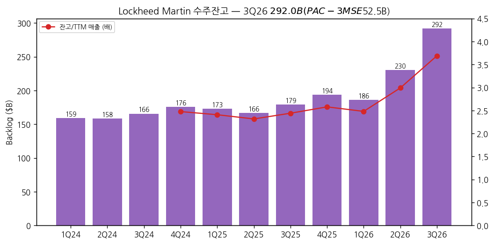

> 모드: 실적 리뷰 (v11)
> 종목: Lockheed Martin (LMT)
> 섹터: 방산
> 서브섹터: 방산 글로벌
> 분기: 2026-Q3 (캘린더 = 회계 분기, 2026-09-27 종료. 1Q26은 12주·4Q26은 1주 추가 — 회사 회계 주차)
> 발표일: 2026-10-22 (목, 장 전 — 보도자료·10-Q·컨퍼런스콜 동시)
> 작성 시각: 2026-11-14 KST
> 분석 소스: 회사 자료 — 3Q26 보도자료(news.lockheedmartin.com, 10/22), 3Q26 10-Q(SEC, 10/22), 1Q23~2Q26 10-Q·10-K(SEC XBRL), 3Q26 컨퍼런스콜(EarningsWhispers 트랜스크립트 요약 — 애널리스트 Q&A 6건: UBS·BofA·Goldman·Jefferies·Wolfe·Citi). 셀사이드 리포트 첨부 없음. 웹 보완 — 컨센(Newsquawk 10/22, TIKR 10/22, StockAnalysis 10/26 S&P Global 집계), 등급·TP 변경(Stocktwits 10/26, Motley Fool 11/10), 주가(Yahoo Finance 일봉, 11/13 종가까지). 직전 분기 LMT 리뷰 없음 (첫 리뷰)
> 다음 발표: 4Q26·2027 가이던스 — 2027-01 하순 예정 (회사 일정 미공시, 예년 1월 말 패턴) [추정]

# Lockheed Martin 3Q26 실적 리뷰 — 손실 기저를 벗어난 이익 성장 재가속, 잔고는 PAC-3 하나로 $292B

> 성장 델타: 가속 | 내러티브: 강화 → 델타 가속 + 내러티브 강화 → 적극 구간 (단, 사업부 OPM 10.8%로 마진 레벨은 제자리 — 성장은 매출 볼륨에서 나온다)

→ **숫자**: 매출 $20.71B(+11.3% YoY), 사업부 영업이익 $2.23B(+9.9%, OPM 10.8%), GAAP 영업이익 $2.44B(+7.1%). 프로그램 손실을 뺀 조정 사업부 OP YoY는 4Q25 -3.7% → 1Q26 -12.6% → 2Q26 -1.1% → **3Q26 +9.9%**로 2개 분기 연속 확대됐다. 매출 YoY도 +10.5% → +11.3%로 올라 "가속"이다. 컨센 대비 매출 +1.1%, EPS +6.0% 비트

→ **쟁점 ①**: 잔고가 한 분기에 $230.4B → $292.0B(+$61.6B)로 늘었다. 그중 $52.5B가 PAC-3 MSE 7년 다년계약이다. MFC 매출은 +24%로 전사 성장을 끌었고, 애널리스트는 램프 비용을 누가 대는지(현금중립 조건)를 물었다

→ **쟁점 ②**: F-35는 10년·최소 850대 프레임워크가 합의됐지만 Lot 20 이상 확정계약은 아직이다. 3Q부터 Lot 20 선행계약 원가가 승인 예산을 넘었고, 차기 Lot 매출 반영은 2027년으로 밀렸다

→ **쟁점 ③**: 주가는 발표일 +7.0%, 10월 +25.1% 뒤 11/13 $596으로 10/29 고점 대비 -7.4%다. TP는 4곳 모두 올랐다(평균 +8%). 실적 추정 상향과 멀티플 확장이 함께 반영됐다

→ **다음 분기 관건**: 4Q26 가이던스 내재 사업부 OP $2.41B(조정 YoY +17%, 1주 추가 효과 포함), F-35 Lot 20 확정계약 시점, 2027-01 가이던스의 "high single digit" 매출 성장과 마진 수준이 델타 지속 여부를 정한다

---

## 1. 숫자

① 연결 기준 분기 표 (단위: $M, %)

| 항목 | 4Q23 | 1Q24 | 2Q24 | 3Q24 | 4Q24 | 1Q25 | 2Q25 | 3Q25 | 4Q25 | 1Q26 | 2Q26 | **3Q26** | 4Q26E (가이던스 내재) | 4Q26E (컨센) |
|---|---|---|---|---|---|---|---|---|---|---|---|---|---|---|
| 매출액 | 18,874 | 17,195 | 18,122 | 17,104 | 18,622 | 17,963 | 18,155 | 18,609 | 20,321 | 18,021 | 20,063 | **20,711** | 22,205 (21,205~23,205) | 22,515 |
| 영업이익 (GAAP) | 2,293 | 2,029 | 2,148 | 2,140 | 696 | 2,372 | 748 | 2,280 | 2,331 | 2,063 | 2,479 | **2,443** | 2,585 (2,535~2,635) | — |
| OPM (GAAP) | 12.1 | 11.8 | 11.9 | 12.5 | 3.7 | 13.2 | 4.1 | 12.3 | 11.5 | 11.4 | 12.4 | **11.8** | 11.6 | — |
| 매출 YoY | -0.6 | +13.7 | +8.6 | +1.3 | -1.3 | +4.5 | +0.2 | +8.8 | +9.1 | +0.3 | +10.5 | **+11.3** | +9.3 | +10.8 |
| 영업이익 YoY (GAAP) | — | -0.4 | +0.6 | +4.8 | -69.6 | +16.9 | -65.2 | +6.5 | +234.9 | -13.0 | +231.4 | **+7.1** | +10.9 | — |
| **매출 YoY 델타 (%p)** | — | +14.3 | -5.1 | -7.2 | -2.7 | +5.8 | -4.3 | +8.6 | +0.3 | -8.8 | +10.2 | **+0.8** | -2.0 | — |
| **영업이익 YoY 델타 (%p, GAAP)** | — | — | +1.0 | +4.2 | -74.4 | +86.6 | -82.1 | +71.7 | +228.4 | -247.9 | +244.4 | **-224.3** | +3.7 | — |
| 사업부 OP (회사 주 지표, Non-GAAP) | 2,042 | 1,745 | 2,042 | 1,870 | 426 | 2,085 | 571 | 2,029 | 2,058 | 1,823 | 2,162 | **2,229** | 2,411 (2,361~2,461) | — |
| 사업부 OPM | 10.8 | 10.1 | 11.3 | 10.9 | 2.3 | 11.6 | 3.1 | 10.9 | 10.1 | 10.1 | 10.8 | **10.8** | 10.9 | — |
| 프로그램 손실 (사업부) | — | 100 | — | — | 약 1,710 | — | 1,615 | — | — | — | — | **—** | — | — |
| 조정 사업부 OP (손실 제외) | 2,042 | 1,845 | 2,042 | 1,870 | 약 2,136 | 2,085 | 2,186 | 2,029 | 2,058 | 1,823 | 2,162 | **2,229** | 2,411 | — |
| 조정 사업부 OP YoY | -1.3 | +9.7 | +10.1 | +3.3 | +4.6 | +13.0 | +7.1 | +8.5 | -3.7 | -12.6 | -1.1 | **+9.9** | +17.2 | — |
| **조정 사업부 OP YoY 델타 (%p)** | — | +10.9 | +0.4 | -6.8 | +1.3 | +8.4 | -6.0 | +1.5 | -12.2 | -8.9 | +11.5 | **+11.0** | +7.3 | — |
| 희석 EPS ($) | — | 6.39 | 6.85 | 6.80 | 2.27 | 7.28 | 1.46 | 6.95 | 5.80 | 6.44 | 7.94 | **7.97** | 약 8.19 (가이던스 중간) | 8.32 |

→ (출처: 매출·GAAP 영업이익·EPS는 SEC XBRL(각 분기 10-Q, 4Q는 10-K 연간 − 9M [계산]), 사업부 OP는 각 분기 10-Q 사업부 표. 프로그램 손실은 10-Q·10-K — 1Q24 MFC 기밀 약 $100M, 4Q24 MFC 기밀 $1.31B + Aero 기밀 등 약 $0.4B(회사 4Q24 합계 약 $1.7B에서 역산 [추정]), 2Q25 Aero 기밀 $950M·CMHP $570M·TUHP $95M. 4Q24·4Q25 EPS는 연간 − 9M [계산]. 4Q26 가이던스 내재 = 2026 가이던스(10/22) − 9M26 [계산]. 컨센 4Q26E = StockAnalysis 2026 연간 컨센(매출 $81.31B, EPS $30.68, 10/26) − 9M26 [계산])
→ 3Q26 서프라이즈: 매출 컨센 대비 +1.1%, EPS +6.0% (컨센 매출 $20.48B·EPS $7.52, Newsquawk·TIKR 10/22). 사업부 OP 컨센은 확보하지 못했다
→ GAAP 영업이익 YoY는 4Q24·2Q25 손실 분기가 기저에 끼어 +235%·-13%·+231%처럼 튄다. 판정은 **프로그램 손실을 뺀 조정 사업부 OP**로 한다 (스킬 기준 "일회성 왜곡 시 조정 기준")
→ 회계 주차 효과: 1Q26은 12주(1Q25 13주)라 1Q26 YoY(-12.6%)가 눌렸고, 4Q26은 1주가 더해져 4Q26 내재 YoY(+17.2%)가 부풀어 있다 (3Q26 10-Q 주차표, 3Q26 컨콜). 3Q26은 양쪽 모두 13주라 왜곡이 없다
→ YoY 경로: 조정 사업부 OP YoY는 1Q25 +13.0%가 직전 고점이었다. 4Q25~2Q26 마이너스 구간을 지나 3Q26 +9.9%로 돌아섰다. 4Q26은 주차 효과로 +17%대가 나온 뒤, 2027 컨센(매출 +6.9%, EPS +8.3%, StockAnalysis)은 **한 자릿수 후반 성장으로 복귀**하는 경로다. 즉 컨센이 그리는 YoY 정점은 4Q26(주차 효과)이고, 기조 성장률은 high single digit 고원이다 [판단]
→ **[판단] 델타 = 가속**: 조정 사업부 OP YoY가 -1.1% → +9.9%로 11.0%p 확대됐고 매출 YoY도 +0.8%p 올랐다. 다만 마진(사업부 OPM 10.8%)은 전년 동기(10.9%)와 같아, 가속의 원천은 MFC 볼륨이다

→ (출처: SEC XBRL·10-Q, 4Q26E는 10/22 가이던스 중간값 내재 [계산]. 연한 막대·점선 = 4Q26E)

→ (출처: 동일. 사업부 OP는 프로그램 손실 제외 조정 기준)

② 사업부별 매출·영업이익 (단위: $M, %, 사업부 OP = Non-GAAP)

| 사업부 | 항목 | 3Q25 | 4Q25 | 1Q26 | 2Q26 | **3Q26** | 9M26 |
|---|---|---|---|---|---|---|---|
| Aeronautics | 매출 | 7,256 | 8,524 | 6,953 | 8,112 | **8,214** | 23,279 |
| | 영업이익 | 682 | 782 | 619 | 760 | **743** | 2,122 |
| | OPM | 9.4 | 9.2 | 8.9 | 9.4 | **9.0** | 9.1 |
| | 매출 YoY | +11.9 | +6.4 | -1.5 | +9.3 | **+13.2** | +7.1 |
| | 영업이익 YoY | +3.5 | +80.2 | -14.0 | 흑전 | **+8.9** | +62.7 |
| Missiles and Fire Control | 매출 | 3,624 | 4,020 | 3,649 | 4,101 | **4,501** | 12,251 |
| | 영업이익 | 510 | 535 | 500 | 594 | **631** | 1,725 |
| | OPM | 14.1 | 13.3 | 13.7 | 14.5 | **14.0** | 14.1 |
| | 매출 YoY | +14.1 | +17.8 | +8.2 | +19.5 | **+24.2** | +17.5 |
| | 영업이익 YoY | +11.8 | 흑전 | +7.5 | +24.0 | **+23.7** | +18.6 |
| Rotary and Mission Systems | 매출 | 4,373 | 4,616 | 3,991 | 4,354 | **4,511** | 12,856 |
| | 영업이익 | 506 | 468 | 423 | 437 | **524** | 1,384 |
| | OPM | 11.6 | 10.1 | 10.6 | 10.0 | **11.6** | 10.8 |
| | 매출 YoY | +0.1 | +8.3 | -7.8 | +9.0 | **+3.2** | +1.3 |
| | 영업이익 YoY | +4.8 | -8.8 | -18.8 | 흑전 | **+3.6** | +61.9 |
| Space | 매출 | 3,356 | 3,161 | 3,428 | 3,496 | **3,485** | 10,409 |
| | 영업이익 | 331 | 273 | 281 | 371 | **331** | 983 |
| | OPM | 9.9 | 8.6 | 8.2 | 10.6 | **9.5** | 9.4 |
| | 매출 YoY | +9.1 | +7.5 | +7.0 | +5.7 | **+3.8** | +5.5 |
| | 영업이익 YoY | +21.7 | -3.5 | -25.9 | +2.5 | **0.0** | -8.3 |
| **방산 합계 (= 전사)** | **매출** | **18,609** | **20,321** | **18,021** | **20,063** | **20,711** | **58,795** |
| | **사업부 OP** | **2,029** | **2,058** | **1,823** | **2,162** | **2,229** | **6,214** |
| | **GAAP 영업이익** | **2,280** | **2,331** | **2,063** | **2,479** | **2,443** | **6,985** |

→ (출처: 각 분기 10-Q·10-K 사업부 표, YoY [계산]. 3Q26 매출 비중 Aero 39.7%·MFC 21.7%·RMS 21.8%·Space 16.8%)
→ **섹터 합산에 쓸 방산 기준**: LMT는 4개 사업부 전부 방산·정부 사업 → **방산 합계 = 전사**. 3Q26 매출 $20,711M, 영업이익은 GAAP $2,443M (회사 주 지표 사업부 OP $2,229M 병기 — 차이 $214M은 FAS/CAS 연금 조정 등 Unallocated)
→ **델타를 끄는 것은 MFC다**. 매출 +24%, OP +24%로 전사 OP 증가분 $200M 중 $121M(60%)을 냈다 [계산]. PAC-3·THAAD +$480M, GMLRS·PrSM +$330M (보도자료). OPM 14.0%는 램프 중에도 유지됐다
→ **Aero는 볼륨은 늘고 마진은 정체**. F-35 +$710M, C-130 +$270M(계약 전 선투입 원가 회수)로 매출 +13%지만 F-16·C-130 불리한 조정(각 $40M)으로 OPM 9.0%. 회사는 2026 Aero OP 가이던스를 소폭 낮췄다 (컨콜)
→ **RMS·Space는 한 자릿수 초반**. RMS OP에는 계약 분쟁 해결 이익 +$40M이 있고 Heavy Lift·Seahawk -$45M이 상쇄. Space는 OPIR 프로그램 종료로 성장 둔화, OP 증가 0

→ (출처: 10-Q 사업부 표)

(1) 수주잔고 — 선행지표 (단위: $B)

| 항목 | 4Q24 | 1Q25 | 2Q25 | 3Q25 | 4Q25 | 1Q26 | 2Q26 | **3Q26** |
|---|---|---|---|---|---|---|---|---|
| 잔고 (전사) | 176.0 | 173.0 | 166.5 | 179.1 | 193.6 | 186.4 | 230.4 | **292.0** |
| 잔고 QoQ 증감 | — | -3.0 | -6.5 | +12.6 | +14.5 | -7.2 | +44.0 | **+61.6** |
| 잔고/TTM 매출 (배) | 2.5 | 2.4 | 2.3 | 2.4 | 2.6 | 2.5 | 3.0 | **3.7** |
| 그중 MFC 잔고 | — | — | — | — | 46.7 | — | — | **142.5** |

→ (출처: SEC XBRL RPO(10-Q·10-K), 사업부 잔고는 3Q26 보도자료. 잔고/TTM 매출 [계산]. 회사 제시 3Q 수주/매출(book-to-bill) 약 4배 (컨콜))
→ 3Q26 잔고 증가 $61.6B 중 $52.5B가 PAC-3 MSE 다년계약이다 (10-Q). 향후 12개월 매출 전환 비율은 23%(FY25말 37%)로 낮아졌다 — 잔고가 장기 다년계약으로 길어졌다는 뜻이다
→ 잔고 사업부 구성: Aero $57.3B(FY25말 $59.4B, 감소 — F-35 Lot 20 미계약), MFC $142.5B, RMS $49.4B, Space $42.7B

→ (출처: SEC XBRL RPO, 3Q26 보도자료)

③ 연간 (단위: $M, %)

| 항목 | 2022 | 2023 | 2024 | 2025 | 2026E (가이던스 중간) | 2026E (컨센) | 2027E (컨센) |
|---|---|---|---|---|---|---|---|
| 매출액 | 65,984 | 67,571 | 71,043 | 75,048 | 81,000 | 81,310 | 86,930 |
| 영업이익 (GAAP) | 8,348 | 8,507 | 7,013 | 7,731 | 9,570 | — | — |
| OPM (GAAP) | 12.7 | 12.6 | 9.9 | 10.3 | 11.8 | — | — |
| 사업부 OP | 7,467 | 7,389 | 6,083 | 6,743 | 8,625 | — | — |
| 사업부 OPM | 11.3 | 10.9 | 8.6 | 9.0 | 10.6 | — | — |
| 매출 YoY | -1.6 | +2.4 | +5.1 | +5.6 | +7.9 | +8.3 | +6.9 |
| 영업이익 YoY (GAAP) | -8.5 | +1.9 | -17.6 | +10.2 | +23.8 | — | — |
| 희석 EPS ($) | 21.66 | 27.55 | 22.31 | 21.49 | 30.55 | 30.68 | 33.23 |

→ (출처: 2022~2025 SEC XBRL(10-K), 2026E 가이던스 중간값(10/22 보도자료: 매출 $80~82B, 사업부 OP $8,575~8,675M, GAAP OP $9,520~9,620M, EPS $30.35~30.75), 컨센은 StockAnalysis(S&P Global, 2026E 21명, 10/26))
→ 가이던스 변화: 매출 중간값 $80.75B → $81.0B(+0.3%), EPS 중간값 $30.30 → $30.55(+0.8%), FCF $7.1B → $7.9B(+11%), 사업부 OP 중간값 $8,600M → $8,625M(+0.3%) [계산, 7월 vs 10월 가이던스]. 2분기 연속 상향이나 이익 상향폭은 작고 현금(세금 혜택) 상향이 크다
→ 발표 전 연간 컨센 집계치는 확보하지 못했다. 2026 EPS 컨센 $30.68은 가이던스 상단 근처다

---

## 2. 시장 쟁점 — 회사 자료·컨콜 Q&A·웹 기사 종합

> 범위: 셀사이드 리포트 첨부 없음. 컨콜 애널리스트 질문 6건(UBS Gavin Parsons, BofA Ron Epstein, Goldman Noah Poponak, Jefferies Sheila Kahyaoglu, Wolfe Myles Walton, Citi (애널리스트명 요약본 표기 불확실) — 트랜스크립트 요약 기준) + 웹 기사(TIKR·Stocktwits·Motley Fool·StockAnalysis·Newsquawk)로 구성

① 지난 분기 체크 (2-0)

→ 첫 리뷰 — 직전 체크 없음

② 이번 분기 쟁점 4개

| # | 쟁점 | 등장 (컨콜 질문 / 기사) |
|---|---|---|
| (1) | PAC-3·THAAD 다년계약 — MFC 성장 지속성과 램프 비용·현금 부담 | 컨콜 2건 (UBS·Goldman) / 기사 3건 |
| (2) | F-35 — 10년 850대 프레임워크 vs Lot 20 확정계약 지연 | 컨콜 1건 (Jefferies) / 기사 4건 |
| (3) | 2027 성장률·현금흐름 (연금 출연·세금 혜택 축소) | 컨콜 2건 (Wolfe·Citi) / 기사 1건 (BofA) |
| (4) | 마진 정체·손실 재발 리스크 (Aero 불리 조정, 기밀 프로그램) + 차세대기(Vectis) | 컨콜 1건 (BofA) / 10-Q |

③ 쟁점별 분해

(1) **PAC-3·THAAD 다년계약 — 잔고 $52.5B가 매출·이익으로 어떻게 넘어오나**

(1-1) 회사 설명
→ PAC-3 MSE 7년 계약 총액 최대 $58.6B, 3Q 잔고 반영 $52.5B. THAAD도 7년 계약 (컨콜). 공급사 계약: Boeing $14.7B(시커), L3Harris $4.7B(추진), Northrop $1.6B
→ 2030년까지 증설 $8B, 8개 사업장 200만 sq ft, 2026년 3,000명+ 채용. MFC는 2026년 매출·이익 약 20% 성장, 5년 프레임 "mid-teens" 매출 성장 (CFO)
→ 계약 조건: 물가지수 연동 연간 에스컬레이터, 램프 기간 현금중립, 물량 축소 시 회수 장치. 목표 마진은 "기존 수준 이상" (CEO, Goldman 질문 답변)

(1-2) 시장 해석 편차

| 출처 | 핵심 가정·추정 | 논리 |
|---|---|---|
| Morgan Stanley (Kristine Liwag, TP $690 → $835) | 장기계약이 미래 현금흐름 리스크를 낮춤 | 다년계약 = 매출 가시성 + 현금 리스크 완화 → 멀티플 상향 정당화 (Motley Fool 11/10) |
| Morningstar (FV $650 → $680) | 국방비 증가가 미사일·우주 수요 지지 | 장기 수요 확인, 공정가치 소폭 상향 (Stocktwits 10/26) |
| Goldman (컨콜 질문) | 램프 투자를 누가 부담하나 | 고정가 장기계약에서 원가 상승 시 마진 리스크 확인 |

(1-3) 공통 결론 vs 갈리는 지점
→ 공통: MFC가 향후 수년 전사 성장의 엔진이고, 잔고 가시성은 사상 최고다
→ 갈림: **7년 고정가(에스컬레이터 포함) 계약의 마진** — 회사는 "기존 이상"이라 했지만 구체 수치는 없다. 현금중립 조항이 실제 CapEx 부담을 얼마나 덜어주는지도 미공개

(1-4) [판단]
→ 숫자는 낙관 쪽과 맞는다. MFC OPM이 매출 +24% 램프 중에도 14.0%를 유지했다. 다만 MFC는 2024년에 고정가 옵션 계약(기밀)에서 $1.4B 손실을 낸 사업부다. **고정가 다년계약 = 원가 리스크를 LMT가 진다는 뜻**이므로, 2027년 MFC OPM이 13% 아래로 내려가면 결론이 바뀐다

(2) **F-35 — 프레임워크는 생겼는데 확정계약은 없다**

(2-1) 회사 설명
→ 10년간 최소 850대 생산·유지 프레임워크 (TIKR 10/22, Motley Fool: 연 156대 생산능력 보장). LMT 자체 자금 $7B+ 투입 (Stocktwits)
→ Lot 20 이상 생산계약은 협상 중. 3Q26부터 Lot 20 선행계약 원가가 계약 승인·예산을 초과 → 추가 승인 없으면 손익·현금흐름에 악영향 (10-Q, 보도자료)
→ 차기 Lot 계약 시점이 2027년으로 밀려 2026 매출 가정에서 빠졌다 (IR 부사장). F-35 생산은 Aero·전사 마진에 accretive (CFO)
→ 3Q26 F-35 인도 43대 (3Q25 46대), 9M26 94대 (9M25 143대) — 2025년 TR-3 인도 재개분 기저 (보도자료)

(2-2) 시장 해석 편차

| 출처 | 핵심 가정·추정 | 논리 |
|---|---|---|
| Jefferies (Sheila Kahyaoglu, Hold, TP $595 → $615) | F-35 = 매출 약 30%, 연 156대 10년 유지 | 3Q가 F-35 생산 불확실성을 덜었다 — 다만 Hold 유지 (Stocktwits 10/26) |
| TIKR (10/22) | Lot 20+ 협상 중 | 프레임워크는 숫자(금액·Lot별) 미공개 |

(2-3) 공통 결론 vs 갈리는 지점
→ 공통: "850대·10년"으로 F-35 물량 꼬리 위험(감산)은 줄었다
→ 갈림: Lot 20 가격·마진. Aero 잔고는 FY25말 $59.4B → $57.3B로 오히려 줄었다 — 프레임워크는 아직 잔고가 아니다

(2-4) [판단]
→ 이번 분기 F-35는 "물량 리스크 해소, 가격·현금 리스크 잔존"이다. Lot 20 계약이 4Q26~1Q27에 체결되면 Aero 잔고가 크게 늘고 선투입 원가가 회수된다. 반대로 2027 상반기까지 미체결이면 Aero 현금흐름이 먼저 꺾인다

(3) **2027 — 성장은 high single digit, 현금은 역풍**

(3-1) 회사 설명
→ 2027년 4개 사업부 모두 성장, 전사 "high single digit" 매출 성장 가시성. 마진은 1월 가이던스에서 (CFO, Wolfe 질문)
→ 세금 혜택(OBBBA·CAMT 미적용)은 2027년에도 남지만 줄어듦 → 현금 YoY는 "약간의 순풍". 연금 의무 출연 $1B+ (2027), 2026년 선출연 여부 연말 결정
→ 성장은 "향후 수년"(CEO, Citi 질문) — 중국·러시아·이란 위협, Golden Dome 미사일방어

(3-2) 시장 해석 편차

| 출처 | 핵심 가정·추정 | 논리 |
|---|---|---|
| BofA (Neutral, TP $600 → $620) | 2026 FCF $7.8~8.0B에 리스크 | 3Q·가이던스는 좋았지만 현금 가이던스가 낙관적 (Stocktwits 10/26) |
| 컨센 (StockAnalysis 10/26) | 2027 매출 +6.9%, EPS +8.3% | 회사 "high single digit"보다 매출 성장을 다소 낮게 본다 |

(3-3) 공통 결론 vs 갈리는 지점
→ 공통: 2027 매출 성장 6~9%
→ 갈림: 현금 — 연금 출연·Lot 20 선투입·탄약 CapEx가 겹치면 2027 FCF가 2026($7.9B)보다 낮을 수 있다

(3-4) [판단]
→ 컨센 매출 +6.9%는 회사 언급(high single digit, 통상 7~9%)의 하단이다. 1월 가이던스가 매출 +8%+를 주면 컨센 상향 여지가 있다. 이익률은 F-35 Lot 20 마진과 MFC 램프 마진이 정한다

(4) **마진 정체와 손실 재발 리스크**

(4-1) 회사 설명
→ 9M26 불리한 조정: F-16 $170M, C-130 $175M (Aero), Heavy Lift $125M, Seahawk $95M (RMS) (10-Q). 2026 Aero OP 가이던스 소폭 하향 (컨콜)
→ Aero 기밀 프로그램 누적 손실 약 $1.8B, 미지급 잔여 $394M — "추가 손실 가능성" 문구 유지 (10-Q). CMHP는 캐나다 정부와 재협상 중
→ 차세대: Vectis(무인 협동전투기) 5대 자체 투자, CCA Increment 2 경쟁, F-22 개량·F-35 안정화·Vectis 3축 (CEO, BofA 질문)

(4-2) [판단]
→ 2026년 들어 대형 손실은 없었지만, 분기마다 $40~175M 단위의 불리한 조정이 이어진다. 사업부 OPM은 10.1% → 10.8% → 10.8%로 손실 이전(2023년 10.9%) 수준에 머문다. **이익 성장은 마진이 아니라 볼륨에서만 나오는 구조**라, 매출 성장이 high single digit 아래로 내려가면 이익 델타도 바로 꺾인다

④ 낙관 vs 보수 — 논리 대비

→ **낙관 (Morgan Stanley $835)**: 다년계약(PAC-3 7년·THAAD 7년·F-35 10년)이 매출·현금 가시성을 바꿨다 → 방산 프라임 중 리레이팅 대상
→ **보수 (Jefferies $615·BofA $620, 모두 Hold/Neutral)**: 숫자는 좋지만 F-35 의존(약 30%)·현금 가이던스 리스크·고정가 계약 → 주가가 이미 반영
→ 주가 심리: 발표일 +7.0%(10/21 $551.51 → 10/22 $589.91), 10/29 $643.59까지 상승 후 11/13 $596.04 (-7.4%) — 실적 직후 랠리분 절반을 반납 [Yahoo Finance, 계산]

⑤ 추정치·TP 변화 (압축 표)

| 증권사 | 직전 TP | 현재 TP | 등급 | 핵심 변화 한 줄 |
|---|---|---|---|---|
| Morgan Stanley | $690 | $835 | Overweight (기사에 따라 상향 언급) | 장기계약이 현금 리스크 축소 |
| Jefferies | $595 | $615 | Hold | F-35 생산 불확실성 완화 |
| Bank of America | $600 | $620 | Neutral | 3Q 호조, FCF 가이던스 리스크 |
| Morningstar (FV) | $650 | $680 | — | 국방비 증가로 미사일·우주 수요 |

→ (출처: Motley Fool 11/10, Stocktwits 10/26. Morgan Stanley 직전 TP는 Motley Fool 기준, Stocktwits는 Equal Weight → Overweight 상향으로 보도)
→ 평균 TP 변화 +8.1% [계산], 상향 4건·하향 0건. 컨센 평균 TP $645.48 (23명, StockAnalysis 10/26) — 11/13 주가 대비 +8.3%
→ TP 상향의 원인: 2026 EPS 가이던스 +0.8%, FCF +11% 상향에 비해 TP 상향폭(평균 +8%, Morgan Stanley +21%)이 커 **멀티플 확장(다년계약 가시성 프리미엄)이 주된 원인** [판단]. Forward P/E는 발표 전 약 18배 → 약 19배 (TIKR)

---

## 3. 내러티브 점검

→ **성장 스토리 (시장이 LMT를 사는 이유)**: "F-35 독점 + 미사일방어(PAC-3·THAAD·NGI)·탄약 재고 재건으로 장기 고정 수요를 확보한 미국 방산 1위, 2024~25 프로그램 손실을 털고 이익 정상화"

→ **이번 분기 평가 — 강화**: ① 손실 없는 분기에서 조정 이익 YoY +9.9%로 정상화 확인 ② 잔고 $292B(+27% QoQ)·PAC-3 다년계약으로 MFC 성장의 다년 가시성 확보 ③ F-35 10년 850대 프레임워크로 물량 꼬리 위험 축소 ④ 가이던스 2분기 연속 상향, TP 4/4 상향

→ 1번 델타 판정(가속)과 합쳐 **적극 구간**. 다만 마진 레벨이 오르지 않아 "이익 정상화 + 볼륨 성장" 이상의 서프라이즈는 아직 없다 [판단]

→ 스토리를 더 강하게 만들 트리거: ① F-35 Lot 20+ 확정계약 (Aero 잔고 증가·선투입 원가 회수) ② 2027 가이던스 매출 +8%+·사업부 OPM 11%+ ③ Golden Dome 예산·NGI·우주 요격 계약

→ 깨뜨릴 리스크: ① 고정가 계약 신규 손실 (Aero 기밀·MFC 다년계약 원가) ② F-35 Lot 20 지연 장기화 → 현금 역풍 ③ FY27 계속결의안(CR) 장기화·예산 조정 불발

---

## 4. 향후 봐야 할 것

(1) **4Q26 사업부 OP $2.41B (가이던스 내재 중간값) 달성과 사업부 OPM 10.9%**
→ 무엇을: 조정 사업부 OP YoY +17%대(1주 추가 효과 포함) 달성 여부, 신규 reach-forward loss 유무. $2.36B(하단) 미만이면 델타 판정 재검토
→ 어떤 데이터로: 4Q26 보도자료·10-K, 사업부 표
→ 언제: 2027-01 하순 [추정]

(2) **F-35 Lot 20+ 확정계약 체결과 Aero 잔고**
→ 무엇을: 계약 체결 시점, Lot당 대수·단가, Aero 잔고 $57.3B → 증가 전환 여부, 선투입 원가(미승인 초과분) 해소
→ 어떤 데이터로: 미 국방부 계약 공시(defense.gov), 회사 보도자료, 4Q26 10-K 잔고
→ 언제: 4Q26~1H27

(3) **2027 가이던스 — 매출 "high single digit"·사업부 OPM·FCF**
→ 무엇을: 매출 성장 +8% 이상(컨센 +6.9% 대비), 사업부 OPM 11% 이상, FCF $7.9B 대비 증감(연금 출연 $1B+ 반영)
→ 어떤 데이터로: 4Q26 실적 발표 가이던스 표, 컨센 변화(S&P Global·LSEG)
→ 언제: 2027-01 하순 [추정]

(4) **MFC 램프 마진 — PAC-3·THAAD 다년계약 하 OPM 13~14% 유지**
→ 무엇을: MFC 매출 +20%대 지속 + OPM 13% 이상. 2026 MFC 가이던스 매출 $17.25~17.45B·OP $2.395~2.425B 달성
→ 어떤 데이터로: 분기 사업부 표, 10-Q 이익률 조정(profit booking rate) 표
→ 언제: 4Q26·1Q27 실적

(5) **미 국방예산 — FY2027 계속결의안 해소·Golden Dome 예산**
→ 무엇을: 정식 세출법 통과 시점, 미사일방어(Golden Dome) 예산 규모
→ 어떤 데이터로: 의회 세출법 진행, 국방부 예산 문서, 뉴스 키워드 "FY27 appropriations", "Golden Dome"
→ 언제: 2026-12 ~ 2027-1Q
