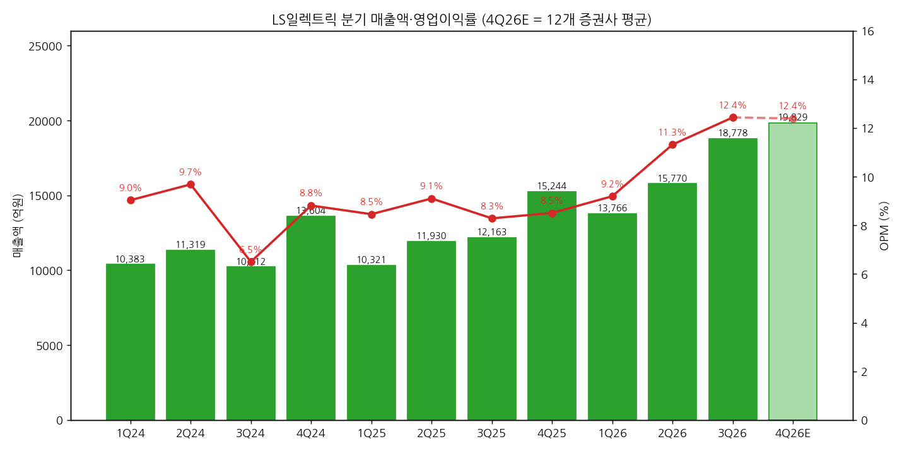
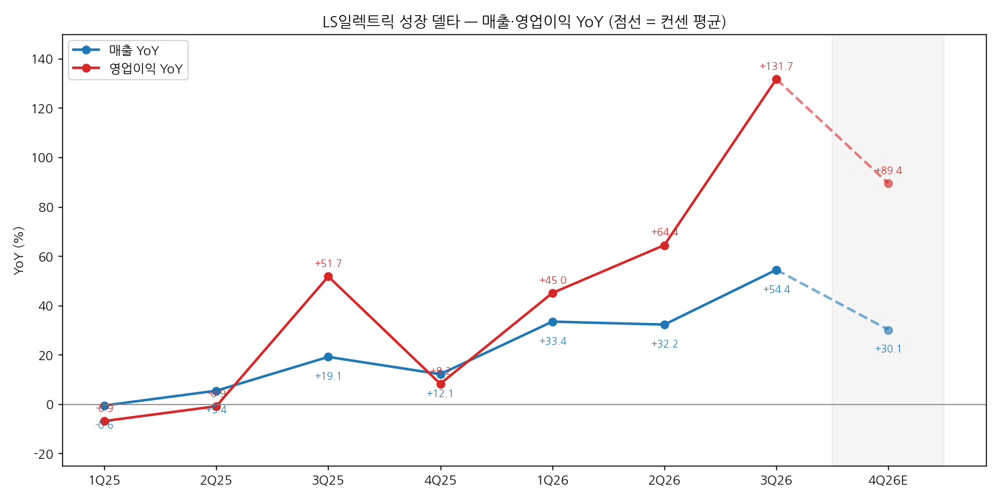
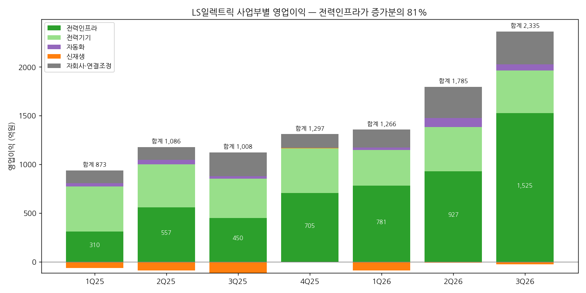

> 모드: 실적 리뷰 (v11)
> 종목: LS일렉트릭 (010120)
> 섹터: 전력 인프라
> 서브섹터: 송변전
> 분기: 2026-Q3
> 발표일: 2026-10-21 (잠정실적 + 컨퍼런스콜)
> 작성 시각: 2026-11-03 15:30 KST
> 분석 소스: 셀사이드 12개 첨부 (모두 10/22 발간) — LS증권(성종화), 하나증권(유재선), 다올투자증권(이정우), 유안타증권(손현정), 미래에셋증권(김태형), BNK투자증권(이상현), NH투자증권(이민재), SK증권(나민식), 한화투자증권(김예인), 신한투자증권(이동헌), 삼성증권(한영수, 이미지형 PDF 렌더 판독), 현대차증권(신동현). 같은 내용 중복 파일 4쌍(미래에셋·유안타·SK·한화, 파일 해시 동일)은 1개로 처리. 회사 설명은 증권사 리포트의 10/21 컨퍼런스콜 Q&A 정리로 인용. 4월 1Q26 리포트(파일명 `LS+ELECTRIC［010120］_202604xx`)는 사용하지 않음. 웹서치 보완 없음 — 4번 (3)항의 중간선거·FERC 데이터는 2026-Q3 효성중공업 리뷰(Axios 10/31·Forbes 11/2·Ballotpedia 11/2·대신증권)에서 재사용. 직전 분기는 2026-Q1 리뷰 + 2026-Q2 팔로업 기준 (2Q26 리뷰 미작성)

# LS일렉트릭 3Q26 실적 리뷰 — 영업이익 +132%, 배전반이 끌어올린 분기 최대 실적과 YoY 정점

> 성장 델타: 가속 | 내러티브: 강화 → 델타 가속 + 내러티브 강화 → 적극 구간 (단, 컨센 경로상 YoY 정점은 3Q26 — 4Q부터 기저 부담)

→ **숫자**: 매출 1조 8,778억원(+54.4% YoY), 영업이익 2,335억원(+131.7% YoY, OPM 12.4%)으로 둘 다 분기 최대다. 영업이익 YoY가 2Q26 +64.4%에서 +131.7%로 67%p 뛰었고, 매출 YoY도 +32.2%에서 +54.4%로 커졌다. FnGuide 컨센(매출 1조 6,748억원, 영업이익 1,939억원) 대비 매출 +12.1%, 영업이익 +20.4% 서프라이즈다
→ **쟁점 ①**: 미국 관세 환급(+)과 중국 법인 구조조정 손실(-485억원)이 비슷한 규모로 상쇄됐다. 12곳 모두 OPM 12.4%를 "경상 수준"으로 보지만, 환급 금액과 반영 부문은 공개되지 않았다. 전력인프라 OPM 17.1%는 그대로 외삽하기 어렵다 [판단]
→ **쟁점 ②**: 수주잔고는 7.04조원으로 QoQ +0.6%에 그쳤고, 초고압변압기 잔고는 3.35조원에서 3.17조원으로 줄었다. 증권사들은 원화 강세(달러 잔고 환산 감소)와 2Q로 당겨진 발주를 이유로 든다. 미국 수주 비중 66%, 3분기 누적 수주 중 데이터센터 비중 50% 이상이라 수요 자체는 견조하다
→ **쟁점 ③**: 12곳의 2026·2027 영업이익 추정은 발표 전 컨센 대비 각각 +8.8%, +9.7% 올랐다. 반면 TP는 4곳이 하향해 평균 28.2만원에서 27.0만원(-4.2%)으로 내려갔다. 이익은 오르는데 멀티플은 내려가는 구간이다. 주가는 52주 고점(31.85만원) 대비 -48%다
→ **다음 분기 관건**: 4Q26 컨센 평균 영업이익 2,457억원은 YoY +89%로, 3Q보다 YoY가 42%p 낮아진다. 4Q 수치가 이 수준을 지켜야 "기저 탓의 둔화"로 볼 수 있다. LS일렉트릭은 미국 데이터센터 배전 비중이 높아, 11/3 중간선거에서 12월 FERC·ERCOT 결론으로 이어지는 일정에 전력 3사 중 가장 직접 노출돼 있다

---

## 1. 숫자

① 연결 기준 분기 표 (단위: 억원, %)

| 항목 | 1Q24 | 2Q24 | 3Q24 | 4Q24 | 1Q25 | 2Q25 | 3Q25 | 4Q25 | 1Q26 | 2Q26 | **3Q26** | 4Q26E |
|---|---|---|---|---|---|---|---|---|---|---|---|---|
| 매출액 | 10,383 | 11,319 | 10,212 | 13,604 | 10,321 | 11,930 | 12,163 | 15,244 | 13,766 | 15,770 | **18,778** | 19,829 |
| 영업이익 | 938 | 1,096 | 664 | 1,199 | 873 | 1,086 | 1,008 | 1,297 | 1,266 | 1,785 | **2,335** | 2,457 |
| OPM | 9.0 | 9.7 | 6.5 | 8.8 | 8.5 | 9.1 | 8.3 | 8.5 | 9.2 | 11.3 | **12.4** | 12.4 |
| 매출 YoY | — | — | — | — | -0.6 | +5.4 | +19.1 | +12.1 | +33.4 | +32.2 | **+54.4** | +30.1 |
| 영업이익 YoY | — | — | — | — | -6.9 | -0.9 | +51.7 | +8.2 | +45.0 | +64.4 | **+131.7** | +89.4 |
| **매출 YoY 델타 (%p)** | — | — | — | — | — | +6.0 | +13.7 | -7.0 | +21.3 | -1.2 | **+22.2** | -24.3 |
| **영업이익 YoY 델타 (%p)** | — | — | — | — | — | +6.0 | +52.6 | -43.5 | +36.8 | +19.4 | **+67.3** | -42.3 |

→ (출처: 1Q25~3Q26은 LS증권 표3·신한·SK 분기 실적표(회사 발표치). 1Q24~4Q24는 증권사들이 제시한 2025년 분기 YoY로 역산한 값 [계산]이며, 합계가 2024년 연간 KRX 재무추이(매출 45,518억원·영업이익 3,897억원)와 일치한다. 4Q26E는 12개 증권사 추정치 단순평균 [계산]. 삼성증권 4Q26E는 연간 추정에서 1~3Q 실적을 빼 산출)
→ 3Q26 서프라이즈: 매출은 컨센 대비 +12.1%, 영업이익은 +20.4%다 (컨센 매출 1조 6,748억원·영업이익 1,939억원, FnGuide, LS증권 표2·SK·BNK 인용. 컨센 집계 18곳, 삼성증권)
→ 영업이익 YoY는 4Q25(+8.2%)를 바닥으로 +45% → +64% → +132%로 3개 분기 연속 확대됐다. 매출 YoY도 같은 기간 +12% → +33% → +32% → +54%로 올라 매출과 이익이 함께 가속했다
→ 컨센 경로상 YoY 정점은 3Q26이다. 4Q26E +89%, LS증권 기준 1Q27E +75% → 2Q27E +43% → 3Q27E +25%로 내려간다. 기저(2026년 분기 이익)가 높아지면서 생기는 둔화라, 절대 이익은 계속 분기 최대를 갱신하는 경로다
→ **기저 점검**: 3Q25 영업이익(1,008억원)은 직전 분기보다 낮은 기저였다. 2년 전 대비로 보면 3Q26/3Q24 영업이익은 3.5배, 2Q26/2Q24는 1.6배다 [계산]. 기저를 감안해도 가속은 실재한다
→ **기준 단절 점검**: 2026년 연결 범위 변경은 없다. 12개 리포트 어디에도 신규 인수·편입 언급이 없고, KOC전기(현 LS파워솔루션)는 4Q24부터 연결돼 2025년 기준에 이미 들어 있다(LS증권 표22). 따라서 2026E 매출 +37%는 유기적 성장이다. 1Q25~3Q25 YoY에는 KOC전기 편입 효과가 일부 섞여 있다(연간 capa 기준 1,000억원 수준이라 영향은 작음). 철도신호 사업 매각으로 2025년 매출이 일부 재분류됐다(LS증권 표기 2025년 매출 49,622억원 vs KRX 49,658억원, 차이 0.1%)
→ **[판단] 델타 = 가속 (강한 가속)**: 영업이익 YoY가 직전 분기 대비 +67%p 확대됐고 매출 YoY도 +22%p 확대됐다. 관세 환급과 중국 손실이 상쇄돼 일회성 조정 후 기준도 같다

→ (출처: LS일렉트릭, 12개 증권사 추정 평균. 4Q26E는 연한 막대·점선. 2024년 분기는 역산치 [계산])

→ (출처: 동일. 4Q26E 구간은 점선)

(1) 환율 분해 — "환율에 가려지지 않은 성장"인가 (단위: 원/달러, 억원)

| 구분 | 3Q25 | 2Q26 | 3Q26 | 판단 |
|---|---|---|---|---|
| 원/달러 환율 | 평균 1,383 | 4월 공시 계약 환율 1,473~1,481 | 공시 계약 환율 8/21 1,393, 9/30 1,358 | YoY는 거의 같고, QoQ로 원화 6~8% 강세 |

→ (출처: 3Q25 평균은 2026-Q1 리뷰 수록, 2026년은 LS증권 표16~20의 수주 공시 계약일 환율)
→ **YoY 기준**: 3Q25와 3Q26의 환율 수준이 비슷하다. 따라서 매출 +54%, 영업이익 +132%는 환율 효과가 거의 없는 물량·믹스 성장이다 [판단]
→ **QoQ 기준**: 원화가 6~8% 강해졌다. 본사 매출 1조 3,785억원 중 해외 비중을 50%대(LS증권 그림5)로 보면, 환율 하락이 3Q 매출을 약 450억원(매출의 2.4%) 깎았다 [추정]. 환율 중립 QoQ 매출 증가율은 +19%가 아니라 약 +22%다 [추정]
→ **마진**: 전력기기(배전기기, 양산형)는 환헤지가 구조적으로 어려워 OPM이 15.6% → 14.3%로 내려갔다. 수주형인 전력인프라는 회사가 적극 헤지해 OPM이 올랐다 (삼성증권)
→ **수주잔고**: 달러 잔고를 전체의 약 50%(3.5조원)로 가정하면, 원화 6~8% 강세는 잔고를 약 2,100~2,800억원 줄이는 효과다 [추정]. 이 경우 환율 중립 잔고 증가율은 QoQ +0.6%가 아니라 +4~5%다 [추정]. 다만 회사 수주 표는 "기초 + 수주 − 매출 = 기말"이 정확히 맞아(7.00 + 1.59 − 1.55 = 7.04조원), 환산 차이가 3Q 수주액(1.59조원) 안에 섞여 있을 가능성이 있다 [판단]

② 사업부별 매출·영업이익 (단위: 억원, %)

| 사업부 | 항목 | 1Q25 | 2Q25 | 3Q25 | 4Q25 | 1Q26 | 2Q26 | **3Q26** |
|---|---|---|---|---|---|---|---|---|
| 전력인프라 | 매출 | 3,730 | 5,060 | 4,587 | 5,731 | 6,432 | 7,252 | **8,918** |
| 전력인프라 | 영업이익 | 310 | 557 | 450 | 705 | 781 | 927 | **1,525** |
| 전력인프라 | OPM | 8.3 | 11.0 | 9.8 | 12.3 | 12.1 | 12.8 | **17.1** |
| 전력인프라 | 매출 YoY | +8.9 | +32.0 | +27.2 | +34.2 | +72.4 | +43.3 | **+94.4** |
| 전력인프라 | 영업이익 YoY | +40.5 | -8.1 | +132.0 | +59.0 | +152.2 | +66.4 | **+238.9** |
| 전력기기 | 매출 | 2,312 | 2,414 | 2,324 | 2,423 | 2,677 | 2,916 | **3,058** |
| 전력기기 | 영업이익 | 463 | 444 | 404 | 458 | 365 | 455 | **437** |
| 전력기기 | OPM | 20.0 | 18.4 | 17.4 | 18.9 | 13.6 | 15.6 | **14.3** |
| 전력기기 | 매출 YoY | -4.0 | +3.7 | +5.9 | +15.2 | +15.8 | +20.8 | **+31.6** |
| 전력기기 | 영업이익 YoY | -21.2 | -14.5 | +4.5 | +39.0 | -21.3 | +2.4 | **+8.3** |
| 신재생 | 매출 / 영업이익 | 571 / -63 | 649 / -90 | 457 / -115 | 1,035 / 5 | 475 / -89 | 747 / -8 | **947 / -27** |
| 자동화 | 매출 / 영업이익 | 769 / 34 | 863 / 45 | 879 / 24 | 824 / -7 | 821 / 27 | 979 / 94 | **861 / 64** |
| 자회사·연결조정 | 매출 / 영업이익 | 2,939 / 130 | 2,945 / 131 | 3,916 / 245 | 5,195 / 142 | 3,360 / 183 | 3,876 / 318 | **4,992 / 337** |

→ (출처: 하나증권 도표 1, LS증권 표5. YoY는 유안타증권 실적표. 자회사·연결조정은 하나증권의 자회사 + 조정 합산 [계산]. 3Q26 매출 비중은 전력인프라 47.5%, 전력기기 16.3%, 신재생 5.0%, 자동화 4.6%, 자회사·조정 26.6%)
→ **델타를 끄는 것은 전력인프라 하나다**. 3Q26 영업이익 YoY 증가분 1,327억원 중 전력인프라가 1,075억원(81%)이다 [계산]. 영업이익 비중은 65%다
→ 전력인프라 안에서는 배전반 매출 5,416억원(+120% YoY)과 초고압 송전변압기 1,830억원(+106%)이 끌었다. 중저압 배전변압기는 931억원(+16%), 초고압 GIS는 548억원(+77%)이다 (LS증권 표13)
→ **꺾이는 쪽은 전력기기 마진이다**. 매출은 +32%로 가속했지만 OPM은 2025년 17~20%에서 2026년 13.6~15.6%로 내려앉았다. 1월 은 가격 급등을 국내·미국은 판가로 넘겼지만 유럽·동남아는 넘기지 못했고, 3Q엔 원화 강세가 겹쳤다. 10월부터 추가 판가 인상이 적용된다 (NH·다올·한화)
→ 자회사는 중국 법인이 -485억원 손실(구조조정 대손 선반영)로 적자 전환했지만, 기타 국내외 자회사 영업이익이 148억원으로 흑자 전환했다. 기타 법인 성장의 90% 이상은 미국 법인이다 (LS증권 표1, BNK Q&A)

→ (출처: 하나증권 도표 1. 자회사·연결조정은 합산 [계산])

(1) 수주·잔고 — 선행지표 (단위: 억원, 본사 기준)

| 항목 | 1Q25 | 2Q25 | 3Q25 | 4Q25 | 1Q26 | 2Q26 | **3Q26** |
|---|---|---|---|---|---|---|---|
| 신규수주 | 8,520 | 6,080 | 6,840 | 15,730 | 10,860 | 20,840 | **15,930** |
| 수주잔고 | 38,890 | 38,560 | 40,680 | 50,150 | 56,430 | 70,000 | **70,430** |
| 배전반 잔고 | 10,200 | 8,950 | 9,070 | 9,540 | 10,360 | 18,560 | **20,830** |
| 초고압변압기 잔고 | 16,220 | 17,780 | 19,070 | 26,980 | 31,020 | 33,450 | **31,670** |

→ (출처: LS증권 표8·표9·표12, 신한 실적표)
→ 3Q26 수주 1조 5,928억원(+133% YoY) 중 미국이 1조 570억원(66.4%, +483% YoY)이고, 미국 배전반만 6,294억원(39.5%, +734% YoY)이다 (LS증권 표10). 3분기 누적 수주 4조 7,626억원은 이미 2025년 연간 수주를 28% 넘었다 (삼성증권). 연간 가이던스는 6.0~6.5조원이다
→ 수주 QoQ -24%는 하이퍼스케일러 요청으로 하반기 물량 일부가 2Q로 당겨진 영향이다 (LS증권·신한 Q&A). 3Q 수주잔고/매출 비율(book-to-bill)은 1.03배다 [계산, 1.593조 / 1.550조]

③ 연간 (단위: 억원, %)

| 항목 | 2022 | 2023 | 2024 | 2025 | 2026E | 2027E |
|---|---|---|---|---|---|---|
| 매출액 | 33,771 | 42,305 | 45,518 | 49,658 | 68,141 | 84,252 |
| 영업이익 | 1,875 | 3,249 | 3,897 | 4,264 | 7,841 | 11,422 |
| OPM | 5.6 | 7.7 | 8.6 | 8.6 | 11.5 | 13.6 |
| 매출 YoY | +26.6 | +25.3 | +7.6 | +9.1 | +37.2 | +23.6 |
| 영업이익 YoY | +21.0 | +73.3 | +19.9 | +9.4 | +83.9 | +45.7 |

→ (출처: 2022~2025 KRX 재무추이(BT 제공), 2022 YoY는 NH 2021년 실적(매출 2.668조원·영업이익 1,550억원) 기준. 2026E·2027E는 12개 증권사 발표 후 추정치 단순평균 [계산]. BT 제공 컨센(2026E 67,768/7,752, 2027E 83,871/11,331)과 1% 내외 차이)
→ 2026E 매출 +37%에 연결 범위 변경 효과는 없다 (1-1 기준 단절 점검 참조)
→ 발표 후 연간 영업이익 추정치는 2026E가 FnGuide 발표 전 컨센 7,206억원에서 12곳 평균 7,841억원(+8.8%), 2027E가 1조 415억원에서 1조 1,422억원(+9.7%)으로 올라갔다 (발표 전 컨센 출처: 하나증권 Consensus Data. LS증권은 2026E 발표 전 컨센 7,186억원 제시)
→ 2026E 12곳 평균 기준 4Q26 내재 영업이익은 2,455억원이다 (9개월 누적 5,386억원 차감, [계산]). 회사 연초 가이던스(매출 5조 9,546억원, 영업이익 5,763억원)는 이미 9개월 누적으로 영업이익의 93%를 채웠다 [계산]

---

## 2. 시장 쟁점

① 지난 분기 체크 (2026-Q2 팔로업의 "봐야 할 것" 5개 기준. 2Q26 리뷰는 미작성)

| 직전 팔로업 항목 | 2Q26~3Q26 결과 | 판정 |
|---|---|---|
| (1) 빅테크 B사(신재생 온사이트) 수주 5,000억원+ | Bloom Energy 연료전지 데이터센터향 4/29 3,190억원 + 10/13 1,853억원 = 누적 5,043억원. 단일 건으로는 미달 | 확인 (누적 기준) |
| (2) 미국 관세 환급 3Q26 인식 | 3Q26에 원가 차감 방식으로 인식. 예상액의 80~90% 이상 현금 수령 (BNK). 금액은 미공개, 중국 손실 485억원과 "비슷한 규모" | 확인 |
| (3) 2차 갱신 TP 250,000원+ 정착 | 12곳 평균 TP 270,167원, 12곳 중 10곳이 25만원 이상 | 확인 |
| (4) 2Q26 OPM 10%+ 회복 + 부산공장 가동률 90% | 2Q26 OPM 11.3%, 3Q26 12.4%. 부산공장 가동률은 3Q 리포트에 수치 언급 없음 | OPM 확인, 가동률 미확인 |
| (5) DC SST 첫 수주 | 수주 없음. LG유플러스·GS건설과 데이터센터 실증 단계 진입 (BNK) | 미확인 |

② 이번 분기 쟁점 4개

| # | 쟁점 | 언급 증권사 수 |
|---|---|---|
| (1) | 서프라이즈의 질 — 관세 환급과 중국 손실을 빼면 정상 OPM은 몇 %인가 | 12/12 |
| (2) | 수주잔고 정체와 초고압변압기 잔고 감소 — 피크아웃인가, 환율·타이밍인가 | 11/12 |
| (3) | 데이터센터 우려(모라토리엄·AI capex) 속 수주와 증설 — 수요는 정말 꺾이지 않았나 | 12/12 |
| (4) | 추정치는 오르는데 TP는 왜 내려가나 — 멀티플과 기준연도 | 12/12 |

③ 쟁점별 분해

(1) 서프라이즈의 질 — 일회성을 빼면 정상 OPM은 몇 %인가

(1-1) 회사 설명 (10/21 컨퍼런스콜, 신한·BNK·LS증권 정리)
→ 미국 관세 환급(+)과 중국 구조조정 손실·대손 선반영(-)이 비슷한 규모로 상쇄돼, OPM 12.4%는 본업 성과다 (신한 Q&A)
→ 관세 환급은 매출에 반영되지 않고 원가 차감 방식이다 (LS증권). 예상 환급액의 80~90% 이상이 현금으로 들어왔다 (BNK)
→ 중국 자산 클린징은 이번 분기로 마무리됐다. 철도신호 사업 매각으로 내년부터 연간 약 50억원 적자가 사라진다. 4Q에는 인력 이관 비용 수십억원이 나올 수 있다 (BNK)
→ 4분기는 확정 물량이 3분기보다 많아 손익 개선이 예상된다 (신한·BNK)

(1-2) 증권사별 해석 편차

| 증권사 | 핵심 가정·추정 | 논리 |
|---|---|---|
| 신한 | 전력인프라 OPM 17.1%, 4Q26 전력인프라 OPM 17.0% 유지 | 일회성 미미, 본업 실적. 26~27년 영업이익 21~36% 상향 |
| LS증권 | 4Q26 전력인프라 OPM 15.5% | 고수익·단납기 미국 배전제품 매출 집중 → 수익성 호조는 구조적 |
| NH | 전력기기+전력인프라 OPM 16.4%(자체 추정 15.1% 초과), 4Q 전력인프라 14.0% | 물량 증가에 따른 실적 개선 |
| 한화 | 전력인프라 OPM 17.1%에 관세 환급금 효과 포함, 4Q 13.7% | 순효과는 제한적이나 전력인프라 마진에 환급이 섞임 |
| 하나 | 12.4%는 경상 수치, 4Q 전력인프라 13.5% | 관세 환급과 구조조정이 상쇄 |
| 미래에셋 | 4Q 전력인프라 OPM 12.9%, 4Q 영업이익 2,200억원(12곳 중 최저) | 4Q 마진은 보수적으로 정상화 |
| 삼성 | 전력사업(신재생 제외) OPM 16.4% | 일회성 이익을 제거해도 전력사업은 QoQ 성장 |

(1-3) 공통 결론 vs 갈리는 지점
→ 공통: 12곳 모두 연결 기준 일회성 순효과는 0에 가깝고, 4Q26도 분기 최대 실적을 이어간다고 본다 (4Q 영업이익 추정 2,200~2,671억원)
→ 갈림: 전력인프라 OPM 17.1%의 지속성이다. 4Q 전력인프라 OPM 추정이 12.9%(미래에셋)에서 17.0%(신한)까지 4%p 벌어져 있다. 대다수(하나·NH·다올·한화·미래에셋)는 13~14%로 정상화를 가정한다

(1-4) **[판단]** — 숫자로 분해
→ 관세 환급 금액은 공개되지 않았다. "중국 손실과 비슷한 규모"를 받아들여 약 485억원으로 두고, 한화 해석처럼 전액 전력인프라에 들어갔다고 가정하면, 전력인프라 경상 영업이익은 약 1,040억원, OPM 약 11.7%다 [추정]. 2Q26(12.8%)보다 오히려 낮다
→ 같은 가정으로 전력 사업 전체(전력기기·전력인프라·신재생) 경상 OPM은 약 11.2%로 2Q26(12.6%)보다 낮다 [추정]. 반대로 자회사·조정은 중국 손실을 빼면 약 820억원으로 크게 좋아진다 [추정]. 연결 OPM 12.4%는 "본사 마진 정체 + 자회사 정상화"의 합일 수 있다
→ 다만 관세 환급은 1~2Q에 비용으로 냈던 관세를 되돌려받은 것이다. 이전 분기 마진이 그만큼 눌려 있었다는 뜻이라, 2Q26 OPM 12.8%를 "경상"으로 보는 것도 과소평가다. 경상 전력인프라 OPM은 12~14% 구간으로 보는 편이 숫자와 맞고, 대다수 증권사의 4Q 가정(13~14%)과 일치한다
→ 결론: **연결 OPM 12.4% 자체는 경상 수준으로 볼 수 있지만, 전력인프라 17.1%는 일회성이 섞인 숫자다**. 중국 법인 손실이 4Q25(-435억원), 1Q26(-83억원), 3Q26(-485억원)으로 반복돼 왔다는 점에서, "중국 정리 완료"가 4Q에 확인되는지가 연결 마진 레벨을 정한다
→ 결론이 바뀌는 조건: 4Q26 연결 OPM이 12% 아래로 내려가거나 중국 법인에서 추가 손실이 나오면 "3Q 12.4% = 경상"이라는 해석이 약해진다

(2) 수주잔고 정체와 초고압변압기 잔고 감소 — 피크아웃인가

(2-1) 회사 설명 (신한·SK·다올·미래에셋 정리)
→ 잔고 물량은 늘었지만 환율 하락으로 원화 환산액 증가가 작았다 (SK·다올)
→ 초고압변압기 잔고 감소는 수주와 매출 시점 차이에 따른 일시적 감소로, 펀더멘털 이슈가 아니다. 마진 특이사항이나 시장 둔화 트렌드도 없다 (신한 Q&A)
→ 빅테크에는 초고압·배전 변압기를 묶어 판매하고 2030년까지 장기 계약을 협의 중이다. 최대 고객 넥스테라에너지는 24년 말 2천억원대, 25년 말 4천억원대를 발주했고, 올해도 2~4천억원 규모를 협의 중이다(미확정) (신한 Q&A)
→ 수주잔고 7조원 중 약 75%가 2028년까지, 90%가 2029년까지 매출로 인식된다 (BNK·신한)

(2-2) 증권사별 해석 편차

| 증권사 | 핵심 가정·추정 | 논리 |
|---|---|---|
| 신한 | 잔고 7.04조원 중 2.86조원이 2027년, 75%가 2028년까지 매출화. 2026 수주 6.26조원 | 잔고만으로 2027 손익 달성 무리 없음. 잔고 소진 기간 배전반 평균 17개월, 초고압 41개월 |
| 미래에셋 | 4Q26 수주 2.32조원, 2027 수주 10.6조원(+50%) | 발주 시점 차이일 뿐, 가이던스 상단 상회 여력 충분 |
| 하나 | 4Q 신규수주 1조원 후반 | 10월 3건의 대규모 계약이 공시로 확인 |
| 다올 | 4Q26 수주 1.8조원 | 배전반·분전반 잔고 2조원(QoQ +12.3%) |
| BNK | 2026 수주 6.42조원, 2027 7.60조원 | 가이던스 상단 육박 또는 상회 |
| SK·다올·BNK | — | 원화 환산 감소가 물량 증가를 상당 부분 상쇄 |

(2-3) 공통 결론 vs 갈리는 지점
→ 공통: 11곳이 잔고 정체를 환율·타이밍 문제로 본다. 4Q 수주는 이미 공시된 3,542억원(10/13 Bloom 1,853억원 + 10/16 하이퍼스케일러 2027년 납품분 1,689억원)으로 출발한다
→ 갈림: 2027년 수주 경로다. 미래에셋은 10.6조원(+50%)을, BNK는 7.6조원(+18%)을 가정한다. 차이는 배전반 LTA가 저압 배전반·변압기로 확장되는 속도에 대한 가정이다

(2-4) **[판단]**
→ 잔고 정체의 직접 원인은 수주와 매출이 같은 속도로 움직였기 때문이다(3Q 수주 1.59조원 vs 매출 1.55조원). 단납기 배전반이 빠르게 매출로 빠져나가는 구조라, LS일렉트릭은 효성·HD처럼 "잔고 증가"로 평가하면 안 되는 회사다. 배전반 잔고는 오히려 2.08조원으로 QoQ +12%다
→ 초고압변압기 잔고 감소(-1,780억원)는 3Q 초고압 수주 2,961억원이 인식 매출보다 적었기 때문이다. 9/30 계약·10/1 공시된 하이퍼스케일 데이터센터향 초고압 1,812억원과 넥스테라 협의분(2~4천억원)이 4Q에 들어오면 반등 가능하다
→ 환율 효과(1-1 (1) 참조)를 감안한 환율 중립 잔고 증가율은 QoQ +4~5%로 추정되나 [추정], 회사가 환산 효과를 따로 공시하지 않아 검증은 안 된다
→ 결론이 바뀌는 조건: 4Q 수주가 1.2조원을 밑돌아 연간 6.0조원에 못 미치거나, 초고압변압기 잔고가 2개 분기 연속 감소하면 "타이밍" 해석이 "피크아웃"으로 바뀐다

(3) 데이터센터 우려 속 수주와 증설 — 수요는 꺾이지 않았나

(3-1) 회사 설명 (SK·BNK·신한·미래에셋 정리)
→ 미국 데이터센터 인허가 중단(모라토리엄) 우려와 관련해 영업상 특이 동향이 없다 (SK·BNK)
→ 3분기 누적 신규수주 중 데이터센터 비중이 50%를 넘고, 3분기에도 미국 빅테크 신규 고객이 추가돼 반기마다 1곳씩 늘어나는 흐름을 유지했다. 내년 수주는 올해보다 강할 전망이다 (신한)
→ 현재 MV(중압) 스위치기어 중심의 LTA가 LV(저압) 스위치기어·변압기로 확대될 전망이다 (미래에셋)
→ 미국 전력기기 매출은 2025년 1,200억원에서 2026년 3,500억원으로 약 3배, 2028년까지 연평균 35% 성장이 목표다 (BNK·신한)
→ 빅테크 배전반 리드타임 10~12개월을 내년에도 유지한다. 이를 위해 배전반 capa를 내년과 후년 최소 30% 이상 앞당겨 늘리고, 미국 유타 공장(2027년 8월 준공 목표)도 일정을 단축 중이다. LS파워솔루션 변압기 capa는 2,000억원에서 6,500억원으로 3배 이상 늘린다(투자 1,600억원, 배전변압기 2H27·초고압 2H28 가동) (BNK·LS증권)

(3-2) 증권사별 해석 편차

| 증권사 | 핵심 가정·추정 | 논리 |
|---|---|---|
| 유안타 | 배전반 매출 2026 1.94조원 → 2027 3.61조원(+86%), 2027 영업이익 1.32조원(12곳 중 최고) | 빅테크 고객·제품 확대 + capa 증설 가속 → 추정치 상향은 이제 시작 |
| 미래에셋 | 밸류 기준연도 2030년으로 이연, 2030 매출 16조원 | 증설 효과가 온전히 반영되는 시점 기준, "데이터센터 capex 둔화 징후 부재" |
| 현대차 | 글로벌 배전 피어 PER 하락 반영(56.0배 → 44.2배) | 데이터센터 모라토리엄 우려로 피어 멀티플 하락. 다만 시장 위축은 체감되지 않음 |
| 신한 | 리스크로 데이터센터 투자 속도 둔화·빅테크 수주 공백 명시 | 주가는 피크아웃을, 실적은 레벨업을 말한다 |
| NH | 국내 데이터센터(SK·GS·삼성·현대차) 투자 + 800V DC 전환 | 북미 외 국내·DC 전환이 성장 가속 요인 |

(3-3) 공통 결론 vs 갈리는 지점
→ 공통: 3Q까지 수주 데이터로는 데이터센터 수요 둔화가 보이지 않는다. 10월에도 데이터센터향 대형 수주 3건(1,812억원·1,853억원·1,689억원)이 공시됐다
→ 갈림: 수요는 같게 보면서도 "얼마나 먼 미래까지 믿을지"가 다르다. 유안타·미래에셋은 증설 효과까지 반영해 2027~2030년 이익을 높게, 현대차·삼성은 피어 멀티플 하락을 그대로 반영한다

(3-4) **[판단]**
→ LS일렉트릭의 강점이자 약점은 단납기다. 배전반 리드타임이 6~12개월이라 데이터센터 수주가 2~4분기 안에 매출로 들어온다. 이번 분기 서프라이즈가 바로 이 구조에서 나왔다. 반대로 데이터센터 발주가 멈추면 효성·HD(초고압 리드타임 3년)보다 훨씬 빨리 실적에 반영된다
→ 3Q 수주의 66%가 미국, 39.5%가 미국 배전반이고, 잔고의 50% 이상이 데이터센터향이다. 이익 성장의 대부분이 "미국 데이터센터 배전"이라는 하나의 엔진에 걸려 있다 [판단]
→ 결론이 바뀌는 조건: 4Q 공시 수주에서 데이터센터향 신규 계약이 끊기거나, 빅테크가 배전반 납기 연기를 요청하면 수요 둔화 신호다. 4번 (3)항의 12월 FERC·ERCOT 결론이 가장 큰 외부 변수다

(4) 추정치는 오르는데 TP는 왜 내려가나

(4-1) 회사 설명
→ 해당 없음 (밸류에이션 쟁점)

(4-2) 증권사별 해석 편차

| 증권사 | 적용 멀티플 | TP 변화 이유 |
|---|---|---|
| 신한 | 2028E EPS × PER 32.8배 (국내 전력기기 3사 22~24년 평균에 80% 할증, 기존 150%) | 26~27년 영업이익 21~36% 상향, 업종 멀티플 하락으로 할증 축소 → TP 유지 |
| NH | DCF (자기자본비용 10.1%) | 금리 상승에 따른 자기자본비용 인상 → 32.5만원 → 30만원 |
| BNK | 2027E EPS × 과거 2개년 고점 평균 PER 45.5배 | 실적 기준을 27~28년 → 27년으로 보수화 → 30만원 → 26만원 |
| 현대차 | 2027F EPS × PER 44.2배 (글로벌 배전 피어 PEG) | 모라토리엄 우려로 피어 P/E 하락 반영(56.0배 → 44.2배) → 28만원 → 23만원 |
| 삼성 | 2028년 이익 할인 + 산업재 섹터 평균 | 시장 전반 밸류 하락만 반영 → 26만원 → 23.2만원 |
| 한화 | 2028E EPS × PER 35배 (피어 2027E 평균 +70% 할증) | 유지, 업종 내 최선호주 |
| 미래에셋 | 2030F EPS × PER 22.1배 (AIDC 배전 피어 30F 평균) | 기준연도 2030년 이연, TP 유지 |

(4-3) 공통 결론 vs 갈리는 지점
→ 공통: 2026E 영업이익은 12곳 중 11곳이 올렸다(+6~21%). TP를 내린 4곳도 이익 추정은 올렸거나(현대차 2027 EPS +5.3%) 유지했다. TP 하향은 전부 멀티플·할인율·기준연도에서 나왔다
→ 갈림: 할증의 크기다. 같은 전력기기 업종인데도 신한은 국내 3사 대비 80% 할증, 한화는 피어 대비 70% 할증, 현대차는 피어 PEG 그대로를 쓴다

(4-4) **[판단]**
→ 이번 TP 변화는 **실적 상향 + 멀티플 하향**이다. 이익이 9~10% 오르는 동안 평균 TP는 4% 내렸으니, 적용 멀티플은 약 12% 낮아진 셈이다 [계산]
→ 효성중공업(이익 -2~8%, TP -15%)과 비교하면 LS일렉트릭은 이익이 오르는 쪽이라 질이 다르다. 셀사이드가 멀티플을 깎는 이유는 회사가 아니라 "미국 데이터센터 모라토리엄 우려에 따른 피어 멀티플 하락"(현대차)이다
→ 현재 2027F PER은 24배(유안타), 2028년 PER 21배(신한)다. 결론이 바뀌는 조건: 데이터센터 규제 이벤트가 우려를 해소하는 방향으로 끝나면 할증 축소가 되돌려질 수 있고, 반대면 이익 상향에도 멀티플 하향이 이어진다

④ 낙관 vs 보수 — 논리 대비
→ **가장 낙관(SK TP 31만원, 유안타·LS증권 30만원)**: 유안타는 2027년 매출 9.6조원(+40%)·영업이익 1.32조원을 잡았다. 배전반 매출이 2027년 3.61조원으로 거의 두 배가 된다는 가정이다. LS증권은 미국 AI발 배전 모멘텀과 공격적 증설로 "상당 수준의 밸류 할증이 합당"하다고 본다
→ **가장 보수(현대차 23만원, 삼성 23.2만원)**: 둘 다 이익은 컨센 수준(2027E 영업이익 1.07~1.11조원)으로 두고, 글로벌 피어와 산업재 멀티플 하락을 그대로 반영했다. 2027E 영업이익은 유안타가 현대차보다 23% 높다. 차이의 핵심 변수는 배전반 capa 증설 속도다
→ 셀사이드 vs 시장: 12곳 모두 매수, 평균 TP 대비 상승여력은 +63%다(10/21 종가 166,100원 기준). 그러나 주가는 52주 고점(31.85만원, 5/7) 대비 -48%, 1개월 -20.5%다. 셀사이드는 실적 레벨업을, 시장은 데이터센터 피크아웃을 보고 있다. 신한의 표현대로 "주가는 피크아웃을 걱정하고, 실적은 레벨업을 말하는" 상태다

⑤ 추정치·TP 변화 (단위: 원, 억원)

| 증권사 | 직전 TP | 현재 TP | 4Q26 영업이익 E | 2026 / 2027 영업이익 E | 핵심 변화 한 줄 |
|---|---|---|---|---|---|
| SK | 310,000 | 310,000 (유지) | 2,520 | 7,900 / 10,730 | 2026E 영업이익 +9.0%, 환율 하락에도 수주 물량 증가 |
| NH | 325,000 | 300,000 (-7.7%) | 2,490 | 7,880 / 12,520 | 2027E +22.5% 상향, 자기자본비용 인상으로 TP 하향 |
| LS증권 | 300,000 | 300,000 (유지) | 2,520 | 7,906 / 11,086 | 2026E +6.1%, 밸류 할증 합당 |
| 유안타 | 300,000 | 300,000 (유지) | 2,481 | 7,867 / 13,186 | 2027E +14.1%, 추정치 상향은 이제 시작 |
| 미래에셋 | 280,000 | 280,000 (유지) | 2,200 | 7,584 / 10,964 | EPS 상향 + 기준연도 2030년 이연, 적정가치 동일 |
| 하나 | 270,000 | 270,000 (유지) | 2,671 | 8,058 / 11,956 | 앞을 보면 지금이 제일 나쁜 실적 |
| BNK | 300,000 | 260,000 (-13.3%) | 2,620 | 8,000 / 11,140 | 실적 기준연도 보수화(27~28년 → 27년) |
| 한화 | 260,000 | 260,000 (유지) | 2,500 | 7,880 / 11,500 | 2026E +10%, 업종 최선호주 |
| 신한 | 250,000 | 250,000 (유지) | 2,407 | 7,793 / 11,176 | 26~27E +21~36%, 할증 150% → 80% 축소 |
| 다올 | 250,000 | 250,000 (유지) | 2,403 | 7,789 / 10,995 | 4Q 수주 1.8조원 기대 |
| 삼성 | 260,000 | 232,000 (-10.8%) | 2,234 [계산] | 7,620 / 11,110 | 시장 밸류 하락만 반영 |
| 현대차 | 280,000 | 230,000 (-17.9%) | 2,440 | 7,820 / 10,700 | 피어 P/E 56.0배 → 44.2배 |

→ (출처: 각 증권사 10/22 리포트. 삼성 4Q26 영업이익은 연간 추정 7,620억원에서 9개월 누적 5,386억원을 뺀 값. 다올 4Q26E는 Fig.5 기준(Fig.4 열 표기 오류로 판단))
→ 평균 TP는 282,083원 → 270,167원(-4.2%)이다. 하향 4건(NH·BNK·현대차·삼성), 유지 8건, 상향 0건이다
→ 발표 전 대비 연간 영업이익 컨센은 2026E +8.8%, 2027E +9.7%다 (FnGuide 발표 전 vs 12곳 평균)
→ **TP 하향의 원인 = 멀티플 하향 (전부)**. 실적 하향은 0건이다. 이익 추정이 오르는데 TP가 내려간 것은 할인율 인상(NH), 기준연도 단축(BNK), 피어 멀티플 하락(현대차·삼성), 할증 축소(신한) 때문이다

---

## 3. 내러티브 점검

① 성장 스토리 정의
→ 미국 하이퍼스케일러 AI 데이터센터에 배전반·배전변압기·초고압변압기를 패키지로, 경쟁사보다 짧은 납기(10~12개월)로 공급해 점유율을 넓힌다. 단납기라 수주가 2~4분기 안에 고마진 매출로 바뀌고, capa 증설이 그 속도를 정한다. 시장은 "미국 데이터센터 배전 수주 → 단납기 매출 전환 → 미국 믹스 → 마진 확장"의 연결고리를 산다

② 이번 분기 평가
→ **강화된 부분**: 연결고리의 모든 단계가 숫자로 확인됐다. 미국 수주 +483%, 미국 배전반 수주 +734%, 배전반 매출 +120%, 전력인프라 영업이익 +239%, 분기 최대 영업이익을 1개 분기 만에 다시 갱신했다. 빅테크 신규 고객 추가와 LTA 범위 확대(MV → LV·변압기)도 나왔다. 12곳 중 11곳이 이익 추정을 올렸다
→ **약해진 부분**: 전력기기 마진(14.3%)이 2025년 수준(17~20%)을 회복하지 못했고, 초고압변압기 잔고가 줄었다. 멀티플은 4곳이 하향했다. 다만 이는 회사가 아니라 미국 데이터센터 규제 우려에 따른 업종 멀티플 문제다
→ **[판단] 내러티브 = 강화**: 기존 스토리가 숫자로 확인되고 추정치 상향이 이어졌다. 기준표의 "강화" 정의에 해당한다. TP 평균 -4%는 멀티플 요인이라 내러티브 판정을 바꾸지 않는다
→ 1번 델타 "가속"과 합치면 **적극 구간**이다. 단, 컨센 경로상 3Q26이 YoY 정점이라, 4Q26부터는 YoY 델타가 기계적으로 마이너스(-42%p)가 된다. 4Q 영업이익이 컨센(2,457억원)을 지키면 "기저로 인한 둔화(절대 이익은 최대)"로, 크게 밑돌면 "둔화 + 정점 통과"로 2개 분기 연속 둔화 시 "꺾임" 판정 경로에 들어간다

③ 스토리를 다시 강하게 만들 트리거
→ 4Q26 영업이익 2,450억원 이상, 전력기기 OPM 16% 이상 회복 (2027년 1월 말~2월 초 잠정실적)
→ 12월 FERC·ERCOT 대형부하 접속 제도가 데이터센터 접속을 허용하는 방향으로 결론 (멀티플 할증 회복)
→ 빅테크 LTA의 LV 스위치기어·변압기 확대 공시, 넥스테라 등 초고압 대형 수주, SST 첫 수주

④ 스토리를 깨뜨릴 리스크
→ 11/3 중간선거 데이터센터 반대 주민투표 연쇄 통과 → 12월 FERC 결론이 데이터센터 접속 비용·재무보증 강화 쪽으로 기울어 빅테크 발주 지연
→ 원화 강세 지속(원/달러 1,350원 이하)으로 전력기기 마진 회복 지연, 달러 잔고 환산 감소
→ 중국 법인 추가 손실, 배전반 증설 지연으로 리드타임 12개월 초과 (단납기 경쟁력 훼손)

---

## 4. 향후 봐야 할 것 (우선순위 순)

(1) **4Q26 영업이익 2,450억원 이상, OPM 12.5% 이상** — 델타 판정을 바꾸는 1순위 변수
→ 무엇을: 영업이익 2,450억원(컨센 평균 2,457억원, YoY +89%) 이상이면 "기저로 인한 둔화, 내러티브 유지 이상". 2,200억원(최저 추정, 미래에셋) 미만이면 YoY +70% 아래로 둔화 폭이 커져 1Q27에 "꺾임" 판정 위험. 전력기기 OPM이 14.3%에서 16% 이상으로 회복하는지(10월 유럽·동남아 판가 인상 효과)와 중국 법인 손실 재발 여부
→ 어떤 데이터로: 4Q26 잠정실적·컨퍼런스콜 부문별 손익, 원/달러 환율(4Q 평균)
→ 언제: 2027년 1월 말~2월 초

(2) **연간 수주 6.5조원 초과, 초고압변압기 잔고 반등**
→ 무엇을: 3Q 누적 4.76조원 + 4Q 기공시 0.35조원. 4Q 수주 1.75조원 이상이면 가이던스 상단(6.5조원) 초과. 초고압변압기 잔고가 3.17조원에서 다시 늘어나는지(넥스테라 2~4천억원 협의분, 하이퍼스케일 초고압 1,812억원 반영). 1.2조원 미만이면 "피크아웃" 해석이 힘을 얻는다
→ 어떤 데이터로: DART 수주 공시, 뉴스 키워드 "LS ELECTRIC 데이터센터 수주", "LS ELECTRIC 넥스테라", "LS ELECTRIC LTA", "Bloom Energy LS"
→ 언제: 11~12월 수시, 4Q 실적 발표 시 확정

(3) **11/3 중간선거 → 11월 RTO 보고 → 12월 FERC·ERCOT 결론** — 멀티플 방향을 정하는 섹터 공통 이벤트 구간
→ 무엇을: 세 이벤트 모두 "데이터센터 전력 비용을 누가 내나"를 다룬다. 중간선거에서 데이터센터 반대 주민투표가 연이어 통과하면, 12월 FERC 결론도 비용 전가 차단·재무 보증 강화 쪽으로 기울 가능성이 커진다
→ LS일렉트릭 영향 구분 [판단]: 전력 3사 중 가장 직접 노출된다. 리포트 숫자로 검증하면, 효성중공업의 하이퍼스케일러 직접 발주는 345~765kV 변압기 4억달러+(약 0.55조원)로 수주잔고 18.9조원의 약 3%다 [계산]. LS일렉트릭은 수주잔고 7.04조원의 50% 이상(약 3.5조원+)이 데이터센터향이고(미래에셋), 3Q 수주의 66%가 미국, 39.5%가 미국 배전반이다 (LS증권 표10). 게다가 리드타임이 6~12개월이라 데이터센터 착공·접속 지연이 2~4분기 안에 매출로 반영된다. 효성에게 12월 결론은 "데이터센터향 일부 물량의 할인율" 문제지만, LS일렉트릭에게는 2027년 수주·매출 경로 자체의 문제다
→ 부분 헤지 [판단]: 2026년 수주 중 Bloom Energy 연료전지(누적 5,043억원)와 마이크로그리드 가스발전향 배전(5/20 960억원 등)은 계통에 붙지 않는 온사이트(behind-the-meter) 전원이다. FERC·ERCOT가 대형부하 계통접속 비용·재무보증을 강화하면 온사이트 전원 수요는 오히려 늘 수 있다. 반면 지역 주민투표는 데이터센터 건설 자체를 막으므로 전원 방식과 무관하게 직접 악재다
→ 어떤 데이터로: (1) 11/3 데이터센터 관련 지역 주민투표 결과(10~13개 주 41~50건, 오하이오 21건 최다, 2026년 기결정 6건은 모두 개발 반대로 결론) + 9개 주 공공요금위원회 선거 결과 (2) FERC 대형부하 소명명령 관련 RTO 보고(11/16~20) (3) ERCOT 적격성 감사 완료(12/10)·본심사 재개 (4) FERC 이해관계자 반론 시한(12/16)
→ 언제: 11/3 ~ 12월 중순, 제도 시행은 1H27. 효성중공업·HD현대일렉트릭과 같은 섹터 공통 일정
→ (출처: 2026-Q3 효성중공업 리뷰 4번 (3)항 데이터 재사용 — 대신증권 표 2·본문, Axios 10/31, Forbes 11/2, Ballotpedia 11/2. LS일렉트릭 노출 수치는 LS증권·미래에셋·신한 10/22)

(4) **원화 강세와 전력기기 마진, 배전반 증설 속도**
→ 무엇을: 원/달러가 3Q 수준(1,340~1,390원)에 머물 때 전력기기 OPM이 회복되는지. 배전반 capa 2027년 +30% 이상 증설 일정, 유타 공장 준공(2027년 8월 목표) 앞당김 여부. 리드타임 10~12개월 유지 여부
→ 어떤 데이터로: 원/달러 환율, 관세청 개폐기·배전반 대미 수출(월별), 회사 증설 공시·컨콜
→ 언제: 매월(수출 통계), 4Q 실적 발표 시

(5) **중국 법인 정리 완료와 SST 첫 수주**
→ 무엇을: 자회사 부문 영업이익이 4Q에 흑자를 유지하는지(중국 -485억원 재발 없음, 철도신호 이관 비용 수십억원 수준), SST·SSCB 데이터센터 실증(LG유플러스·GS건설)에서 첫 상업 수주가 나오는지
→ 어떤 데이터로: 4Q26 부문별 손익, 뉴스 키워드 "LS ELECTRIC SST", "800V DC LS ELECTRIC"
→ 언제: 2027년 1월 말~2월 초, SST는 2027년 중
