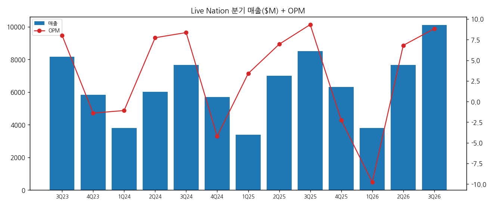
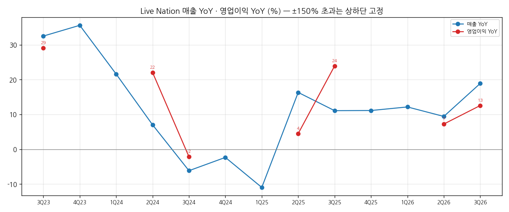

> 모드: 실적 리뷰 (v11)
> 종목: Live Nation Entertainment (LYV, NYSE)
> 섹터: 엔터
> 서브섹터: 공연 글로벌
> 분기: 2026-Q3
> 발표일: 2026-11-05 (AMC)
> 작성 시각: 2026-11-22 23:30 KST
> 분석 소스: SEC 8-K Ex.99.1(3Q26 실적 보도자료)·10-Q(3Q26) 및 과거 10-Q/10-K XBRL (company-data MCP) / 웹 보완 — Music Business Worldwide(2026-11-05), Earnings Whispers(컨콜 요약·트랜스크립트), Benzinga 트랜스크립트, 24/7 Wall St.(컨센), Pollstar(3Q 공연장 통계). 셀사이드 리포트 첨부 없음
> 리뷰 깊이: 숫자 중심 | 리서치 첨부 0건 (1차 출처: SEC 8-K·10-Q / 보도 인용은 "보도" 표기)
> 비영업 요인: 없음 (3Q26 기준). 참고 — 1Q26 반독점 소송 충당금으로 영업손실 −$371M, 4Q는 계절적 적자 분기

# Live Nation 3Q26 실적 리뷰

## 0. 한 줄 판정

> 성장 델타: 가속 | 내러티브: 강화 → 적극 구간 (분기 매출 첫 $10B 돌파·관객 +19%, 영업이익 YoY +7.2% → +12.6%. 단 AOI 마진은 11.7%로 전년보다 낮아 '양은 강하고 질은 정체')

→ 숫자: 매출 $10,105M (+18.9% YoY), GAAP 영업이익 $892M (+12.6%, OPM 8.8%), AOI $1,179M (+14.2%). 매출 YoY 11.1%(4Q25) → 12.1% → 9.4% → **18.9%**, 영업이익 YoY(흑자 분기끼리) 7.2%(2Q26) → **12.6%**
→ 쟁점 ①: **해외가 성장 엔진** — 해외 관객 +29%(북미 +13%), 연초 이후 해외가 관객·스폰서십 모두 미국 추월 (8-K, 보도)
→ 쟁점 ②: **마진 정체** — AOI 마진 11.7%(3Q25 12.2%) [계산]. 스타디움 믹스·공연장 신설 비용 (보도)
→ 쟁점 ③: 반독점 — 4월 배심 패소, 구제(구조 조치) 단계 진행 중
→ 다음 분기 관건: 2027년 선판매(GTV 두 자릿수 증가)와 이연매출($3.8B, +8%)이 2027년 1H 매출 가속을 받쳐 주는지, 반독점 구제 판결 내용

## 1. 숫자

① 연결 분기 표 ($M, GAAP 영업이익 — 회사 주 지표 AOI는 ② 사업부 표의 Consolidated AOI 행)

| 항목 ($M) | 3Q23 | 4Q23 | 1Q24 | 2Q24 | 3Q24 | 4Q24 | 1Q25 | 2Q25 | 3Q25 | 4Q25 | 1Q26 | 2Q26 | **3Q26** |
|---|---|---|---|---|---|---|---|---|---|---|---|---|---|
| 매출 | 8,155 | 5,819 | 3,800 | 6,023 | 7,651 | 5,682 | 3,382 | 7,007 | 8,499 | 6,314 | 3,793 | 7,667 | 10,105 |
| 영업이익 | 654 | -82 | -41 | 466 | 640 | -239 | 115 | 487 | 792 | -143 | -370 | 522 | 892 |
| OPM | 8.0% | -1.4% | -1.1% | 7.7% | 8.4% | -4.2% | 3.4% | 6.9% | 9.3% | -2.3% | -9.8% | 6.8% | 8.8% |
| 매출 YoY | +32.5% | +35.6% | +21.6% | +7.0% | -6.2% | -2.4% | -11.0% | +16.3% | +11.1% | +11.1% | +12.1% | +9.4% | +18.9% |
| 영업이익 YoY | +29.1% | n.m. | n.m. | +22.1% | -2.2% | n.m. | n.m. | +4.5% | +23.9% | n.m. | n.m. | +7.2% | +12.6% |
| **매출 YoY 델타** | n.m. | +3.1%p | -14.0%p | -14.6%p | -13.2%p | +3.8%p | -8.6%p | +27.3%p | -5.2%p | +0.0%p | +1.0%p | -2.7%p | +9.5%p |
| **영업이익 YoY 델타** | n.m. | n.m. | n.m. | n.m. | -24.2%p | n.m. | n.m. | n.m. | +19.4%p | n.m. | n.m. | n.m. | +5.3%p |

→ 컨센 대비: 매출 $10.11B vs 컨센 $9.58B (+5.5%), GAAP EPS $1.69 vs $1.50 (+12.6%) (24/7 Wall St., 보도)
→ 4Q는 매년 영업적자(4Q24 −$239M, 4Q25 −$143M) → YoY는 n.m. 1Q26은 반독점 충당금으로 적자 → YoY n.m. 판정은 2Q26 → 3Q26 연속 비교
→ [판단] 영업이익 YoY의 직전 정점은 3Q25(+23.9%). 2Q26 +7.2%에서 3Q26 +12.6%로 반등했지만 매출(+18.9%)보다 낮다 — **매출 가속 > 이익 가속**, 마진이 따라오지 못하는 구조. 다음 분기 회사 가이던스는 분기 숫자 없음 (연간 관객 1.8억 접근·Concerts AOI 두 자릿수 성장만 제시)

→ (출처: SEC 10-Q/10-K XBRL, company-overview-source LYV data.json)

→ (출처: 같은 자료로 계산. 4Q·1Q26 적자 분기는 n.m.로 선이 끊김)

② 사업부별 ($M, 사업부 이익은 AOI — 회사 공시)

| 항목 ($M) | 3Q25 | 4Q25 | 2Q26 | 3Q26 | QoQ | YoY |
|---|---|---|---|---|---|---|
| Concerts 매출 | 7,282.5 | 5,147.8 | 6,444.4 | 8,746.4 | +35.7% | +20.1% |
| Ticketing 매출 | 797.6 | 846.2 | 852.2 | 870.3 | +2.1% | +9.1% |
| Sponsorship & Advertising 매출 | 442.7 | 329.9 | 383.0 | 505.7 | +32.0% | +14.2% |
| Concerts AOI | 514.2 | -192.3 | 309.6 | 602.9 | +94.7% | +17.3% |
| Ticketing AOI | 285.9 | 305.3 | 331.0 | 315.7 | -4.6% | +10.4% |
| Sponsorship & Advertising AOI | 313.1 | 168.6 | 256.9 | 350.2 | +36.3% | +11.8% |
| Consolidated AOI | 1,033.0 | 194.0 | 817.0 | 1,179.3 | +44.3% | +14.2% |

→ 3Q26 YoY: Concerts 매출 +20.1%·AOI +17.2%, Ticketing 매출 +9.1%·AOI +10.4%, Sponsorship 매출 +14.2%·AOI +11.8% [계산]
→ 델타를 끄는 건 **Concerts**(AOI 증가분 $89M — 전사 AOI 증가 $146M의 61% [계산]). Ticketing은 95% 성장이 공연에서 나옴, 2차 시장(리세일) 콘서트 거래는 단속 강화로 감소·스포츠가 상쇄 (컨콜, 보도)
→ 마진: Concerts AOI 마진 6.9%(3Q25 7.1%), Ticketing 36.3%(35.8%), Sponsorship 69.2%(70.7%) [계산]

③ 연간 ($M)

| 항목 | FY2023 | FY2024 | FY2025 | 9M26 | 9M25 |
|---|---|---|---|---|---|
| 매출 | 22,726 | 23,156 | 25,201 | 21,565 | 18,888 |
| 영업이익 | 1,085 | 825 | 1,251 | 1,043 | 1,394 |
| OPM | 4.8% | 3.6% | 5.0% | 4.8% | 7.4% |
| AOI | 1,881 | 2,146 | 2,366 | 2,367 | 2,173 |
→ (출처: 분기 XBRL 합산 [계산], AOI는 세그먼트 표 합산) 9M26 GAAP 영업이익이 9M25보다 −25%인 건 1Q26 반독점 충당금 때문 — AOI 기준으로는 +9.0% [계산]
→ 회사 2026 가이던스(3Q26 8-K): 관객 약 1.8억 명 접근(두 자릿수 성장), Concerts AOI 두 자릿수 성장, Ticketing AOI 한 자릿수 후반 성장 (3분기 연속 Ticketing 가이던스 상향, 보도)

## 2. 시장 쟁점 (숫자 중심 — 회사 설명 + 컨콜 반복 질문)

① 지난 분기 체크
→ 첫 리뷰 — 직전 체크 없음

② 이번 분기 쟁점

(1) **해외 시장이 미국을 추월** — 성장 엔진의 이동
(1-1) 회사 설명: 3Q 해외 관객 +29%, 모든 지역(중남미·유럽·아시아) +15% 이상, 해외가 관객 증가분의 60%. 연초 이후 해외가 관객·스폰서십 모두 미국 추월. 해외 아레나 관객이 미국 앰피시어터를 넘어섬 (8-K, 보도)
(1-2) 북미는 스타디움·앰피시어터가 관객 증가의 90%, 제3자 스타디움 관객 +40% 이상이 전사 관객 증가의 절반 이상 (8-K)
(1-3) [판단] 해외·스타디움 중심 성장은 매출은 크게 키우지만 마진이 낮은 믹스(제3자 공연장 대관) — 쟁점 (2)와 연결

(2) **매출 대비 마진 정체** — 컨콜 첫 질문(JPMorgan)이 3Q 결과 분해·개장 전 비용
(2-1) 숫자: AOI 마진 11.7%(3Q25 12.2%), Concerts AOI 마진 6.9%(7.1%) [계산]
(2-2) 보도 해석: "수요 엔진은 예상보다 뜨겁지만 스타디움 믹스와 공연장 신설 비용으로 마진은 기껏해야 보합" (Earnings Whispers)
(2-3) [판단] 영업이익 YoY(+12.6%)가 매출 YoY(+18.9%)를 밑도는 상태가 2개 분기째. Venue Nation(자체 공연장) 개장이 2027년 마진을 올릴지가 관건

(3) **2027년 가시성** — 선판매·이연매출
(3-1) 회사 설명: 3Q 기준 이벤트 이연매출 $3.8B(+8%, 3분기 기준 최대). 2027년 공연 1차 티켓 GTV 두 자릿수 증가(북미 1차 티켓 물량 두 자릿수), 2027년 선지급 광고비 두 자릿수 증가. 3Q에 Harry Styles·Bruno Mars·Oasis·Metallica 대형 2027 공연 판매 개시 (8-K, 컨콜)
(3-2) [판단] 2027년 1H 매출 가속의 선행지표는 양호. 다만 이연매출 증가율(+8%)이 3Q 매출 증가율(+19%)보다 낮다는 점은 2027년 성장률이 2026년보다 낮아질 수 있다는 신호로도 읽힌다

(4) **반독점 리스크**
(4-1) 경과: 2026년 3월 DOJ와 합의(주 정부 기금 $280M + 구조적 구제, 법원 승인 전), 4월 15일 잔여 주 정부·DC와의 배심 평결 패소 — 1차 콘서트 티켓팅 등 독점 인정. 손해배상은 티켓당 금액 확정, 적용 티켓 수 미산정. 판결불복 신청·구제 단계 남음 (기업 개요, 보도)
(4-2) [판단] 실적 델타와 별개의 이벤트 리스크. 구제 판결이 티켓마스터 분리·독점 계약 금지로 나오면 Ticketing AOI(전사 이익의 약 43%) 스토리가 흔들린다

## 3. 내러티브 점검

→ 성장 스토리: **'경험 소비'의 구조적 성장 + 티켓마스터·스폰서십이라는 고마진 플라이휠** — 공연 관객이 늘면 티켓 수수료·스폰서십 이익이 따라 늘어나는 구조
→ 이번 분기: 관객 +19%·매출 +19%로 수요 스토리는 숫자로 확인, 2027년 선판매도 두 자릿수. 마진은 정체지만 성장률 자체가 가속 → **델타 가속 + 내러티브 강화 → 적극 구간**
→ 다시 강하게 만들 트리거: 2027년 가이던스(관객·AOI 두 자릿수 성장 지속) / Venue Nation 개장 효과로 마진 반등 / 반독점 구제가 행위 조치(구조 분리 아님)로 결론
→ 깨뜨릴 리스크: 반독점 구조 분리 판결 / 소비 둔화로 2027년 판매율 하락 / 스타디움 대형 투어 공백(2027년 라인업 의존)

## 4. 향후 봐야 할 것

① **4Q26·연간 가이던스 달성** — 2026년 관객 1.8억 명, Concerts AOI 두 자릿수 성장 / 4Q26 실적 보도자료 / 2027년 2월 말
② **2027년 가이던스와 이연매출 증가율** — 이연매출 YoY가 +8%에서 두 자릿수로 회복하는지 (2027년 1H 매출 선행) / 4Q26 8-K / 2027년 2월
③ **AOI 마진** — 11%대 정체에서 12% 이상 회복하는지 (스타디움 믹스 vs 자체 공연장) / 분기 세그먼트 AOI / 분기별
④ **반독점 구제 판결** — 티켓마스터 분리 여부, 손해배상 총액 / 법원 판결·DOJ 합의 승인 / 2027년 상반기 예상
⑤ **K-pop 투어 사이클** — BTS 등 대형 스타디움 투어가 2027년 해외 관객에 주는 기여 (하이브 공연 매출과 교차 확인) / 하이브 IR, Pollstar / 분기별
