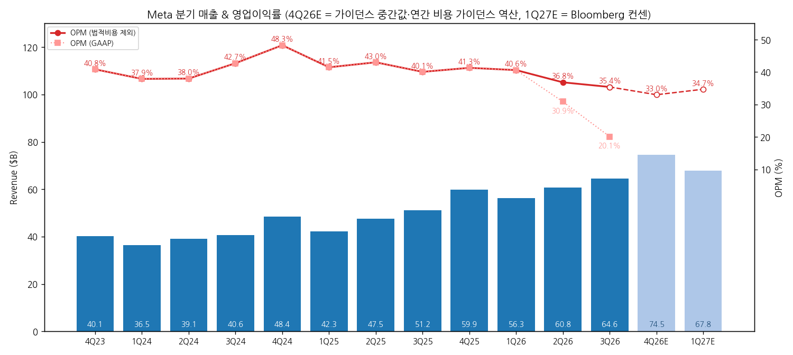
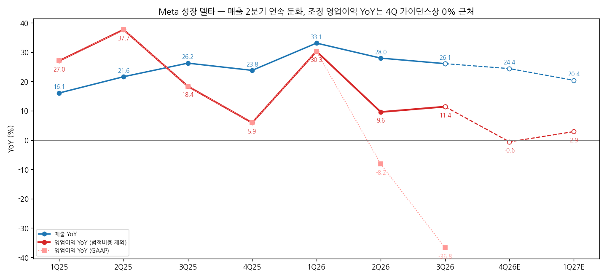
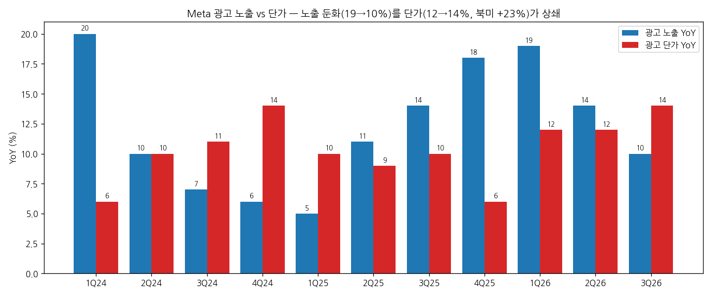
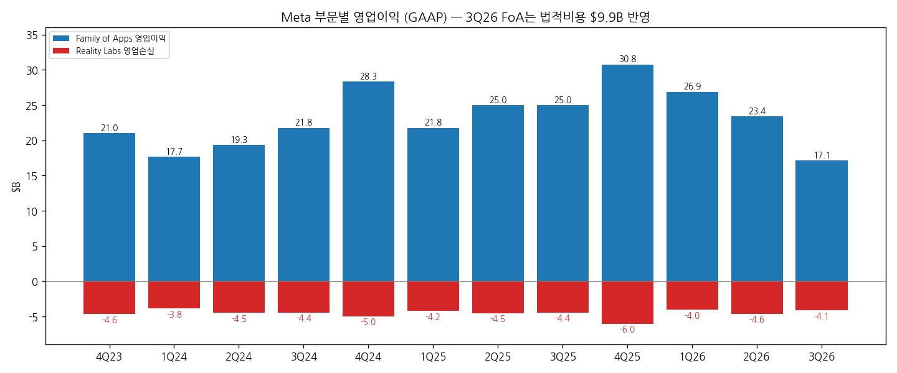

# Meta 3Q26 실적 리뷰

> 모드: 실적 리뷰 (v11)
> 종목: Meta Platforms (META)
> 섹터: 미국 빅테크
> 분기: 2026-Q3
> 발표일: 2026-10-21 (미 동부 장 마감 후)
> 작성 시각: 2026-11-01 13:30 KST
> 분석 소스: 국내 셀사이드 14건 — 실적 리뷰 10건(대신 10/21 · IBK 10/22 · NH 10/22 · KB 10/22(AI 속보) · 삼성 10/22 · SK 10/23 · 신한 10/23 · 다올 10/23 · 키움 10/23 · 미래에셋 10/27) + 대신 이벤트 코멘트 4건(뉴멕시코 판결 10/22 · Class C 10/23 · 공모·ATM 10/26 · 유상증자 10/27). 웹 보완: 해외 IB TP 변경(MarketBeat 10/27·Benzinga), 공모 조건·주가(Yahoo Finance·TIKR 10/26~27, MarketBeat 10/29 종가). 회사 IR 원본·컨콜 원문은 첨부되지 않아 경영진 발언은 증권사 Q&A 정리에서 인용

---

## 0. 한 줄 판정

> 성장 델타: **유지 (꺾임 경계)** | 내러티브: **형성** (Muse) — 단 주당 가치는 희석 부담 → **관찰 구간. 4Q 이익 YoY 0% 근처가 가이던스에 들어 있다**

→ **숫자**: 매출 $64.6B(+26.1%, 컨센 +2.0%). GAAP 영업이익 $13.0B(-36.8%, OPM 20.1%)는 52개 주 법무장관 합의 비용 $9.9B 반영 결과. 이를 빼면 $22.9B(+11.4%, OPM 35.4%)로 컨센 +9.7~13%. 조정 영업이익 YoY는 2Q +9.6% → 3Q +11.4%로 소폭 확대, 매출 YoY는 28.0% → 26.1%로 둔화 → 방향이 엇갈려 "유지"
→ **꺾임 경계인 이유**: 4Q 매출 가이던스 중간값 $74.5B와 연간 비용 가이던스($175~179B)를 역산하면 4Q 영업이익 약 $24.6B, **YoY -0.6%**. 매출은 20%대 성장인데 비용(인프라·감가상각·Muse 연산)이 같은 속도로 늘어 이익 성장이 멈추는 구간
→ **쟁점 ①**: Muse(개인 AI 에이전트)가 출시 6주 만에 북미 1,000만 명 설정, DAU 약 25%, 쇼핑 이용 25%·평균 결제 $200+. 신규 수익 스토리가 처음 숫자로 확인 — 다만 연산 비용 때문에 글로벌 출시 보류
→ **쟁점 ②**: FCF -$2.1B로 2012년 이후 첫 분기 적자, 순부채 전환. 비의결권 Class C 신설(2027.1.19 효력) → 10/26 **$35B 공모(보통주 $22.5B + 전환우선주 $12.5B) + 2027년 최대 $60B ATM 예고, 합계 $95B**(시총의 약 5.8%)
→ **주가와 TP**: 주가는 발표 전 $697.52 → 10/23 $642.62(-7.9%) → 10/28 $612.49 → 10/29 $624.52로 **-10.5%**. 반면 발표 후 해외 IB 신규 TP 평균은 약 $858(MarketBeat)로 컨센 $833보다 높다 — 셀사이드는 Muse를 사고, 시장은 희석·현금을 팔았다

---

## 1. 숫자

### ① 연결 기준 분기 표

| 항목 ($M) | 4Q24 | 1Q25 | 2Q25 | 3Q25 | 4Q25 | 1Q26 | 2Q26 | **3Q26** | 4Q26 가이던스 | 4Q26E 컨센 | 1Q27E 컨센 |
|---|---|---|---|---|---|---|---|---|---|---|---|
| 매출액 | 48,385 | 42,314 | 47,516 | 51,242 | 59,893 | 56,311 | 60,801 | **64,601** | 73,000~76,000 | 73,617 | 67,803 |
| 영업이익 (GAAP) | 23,365 | 17,555 | 20,441 | 20,535 | 24,745 | 22,872 | 18,775 | **12,988** | ≈24,600 (중간값 역산) | 25,174 | 23,533 |
| 영업이익 (법적비용 제외) | 23,365 | 17,555 | 20,441 | 20,535 | 24,745 | 22,872 | ≈22,400 | **22,878** | ≈24,600 | 25,174 | 23,533 |
| OPM (GAAP) | 48.3% | 41.5% | 43.0% | 40.1% | 41.3% | 40.6% | 30.9% | **20.1%** | 33.0% | 34.2% | 34.7% |
| OPM (법적비용 제외) | 48.3% | 41.5% | 43.0% | 40.1% | 41.3% | 40.6% | 36.8% | **35.4%** | 33.0% | 34.2% | 34.7% |
| 매출 YoY | 20.6% | 16.1% | 21.6% | 26.2% | 23.8% | 33.1% | 28.0% | **26.1%** | 24.4% (중간값) | 22.9% | 20.4% |
| 영업이익 YoY (GAAP) | 42.6% | 27.0% | 37.7% | 18.4% | 5.9% | 30.3% | -8.2% | **-36.8%** | -0.6% | 1.7% | 2.9% |
| 영업이익 YoY (조정) | 42.6% | 27.0% | 37.7% | 18.4% | 5.9% | 30.3% | 9.6% | **11.4%** | -0.6% | 1.7% | 2.9% |
| **매출 YoY 델타 (%p)** | +1.7 | -4.5 | +5.5 | +4.6 | -2.4 | +9.3 | -5.1 | **-1.9** | -1.7 | -3.2 | -2.5 |
| **영업이익 YoY 델타 (조정, %p)** | +16.4 | -15.6 | +10.7 | -19.3 | -12.5 | +24.4 | -20.7 | **+1.8** | -12.0 | -9.7 | +1.2 |

→ (출처: 실적 = 삼성증권 손익계산서 요약(Meta 공시, GAAP). 3Q26 조정 영업이익 = 회사 법적비용 $9.89B 제외 기준(키움·대신). 2Q26 조정 영업이익 ≈ $22.4B는 다올 표(OPM 36.8%) 기준 `[추정]` — 대신은 2Q 법적비용을 $2.4B로 언급해 출처 간 차이 존재. 4Q26 가이던스 영업이익 = 매출 중간값 $74.5B − (연간 비용 가이던스 중간값 $177B − 1~3Q 비용 $127.1B) 역산. 컨센 = Bloomberg 10/21(키움). 4Q24 YoY는 4Q23 $16.4B 기준)
→ 3Q26 서프라이즈: **매출 컨센 대비 +2.0%(FactSet $63.3B), 조정 영업이익 +9.7%(Bloomberg $20.8B)~+13.3%(LSEG $20.2B), 조정 EPS $7.40은 컨센 $6.53 대비 +13%**. GAAP EPS $3.83은 FactSet $6.54 대비 -41%(법적비용 미반영 컨센), Bloomberg $3.57 대비 +7%
→ 4Q 가이던스: 매출 $73~76B, 중간값 $74.5B는 컨센 대비 +1.0~1.2%. 연간 총비용 $175~179B(기존 $165~169B, 법적비용 반영). 연간 CapEx $135~145B(하단 +$5B, 6개 분기 연속 상향) → 4Q에만 $49~59B 집행 필요 (키움)

→ (출처: 삼성증권(Meta 공시), 4Q26E = 매출 가이던스 중간값·연간 비용 가이던스 역산, 1Q27E = Bloomberg 컨센 10/21)

→ (출처: 동일. 조정선은 2Q26 다올 조정치·3Q26 회사 조정치 기준)

(1) YoY는 어디에 있나
→ 매출 YoY 정점은 **1Q26 +33.1%**, 이후 28.0 → 26.1%로 2분기 연속 둔화. 컨센 경로 4Q +22.9% → 1Q27 +20.4%로 둔화가 이어진다
→ 조정 영업이익 YoY 정점도 1Q26 +30.3%. 2Q·3Q는 +10% 안팎이고, 4Q 가이던스 역산치는 **-0.6%**, 1Q27 컨센 +2.9%. 즉 **이익 성장은 2026년 하반기부터 사실상 멈춘다**
→ `[판단]` 매출은 여전히 빅테크 최상위(+26%)지만 OPM이 41% → 35% → 33%로 내려오며 이익 델타를 지운다. 판정 기준상 "유지"지만 4Q가 가이던스 중간값으로 나오면 조정 기준으로도 YoY 마이너스 = **꺾임**

### ② 사업부별 매출·영업이익

(1) 부문

| 부문 ($M) | 3Q25 | 2Q26 | **3Q26** | 매출 YoY | 매출 비중 | 영업이익 3Q25 | 영업이익 2Q26 | **영업이익 3Q26** | OPM 3Q26 | 영업이익 YoY |
|---|---|---|---|---|---|---|---|---|---|---|
| Family of Apps | 50,772 | 60,370 | **64,158** | +26.4% | 99.3% | 24,967 | 23,394 | **17,117** (조정 ≈27,000) | 26.7% (조정 ≈42%) | -31.4% (조정 ≈+8%) |
| └ 광고 | 50,082 | 59,363 | **63,061** | +25.9% | 97.6% | — | — | — | — | — |
| └ 기타(WhatsApp 유료 메시징·구독) | 690 | 1,007 | **1,097** | +59.0% | 1.7% | — | — | — | — | — |
| Reality Labs | 470 | 431 | **443** | -5.7% | 0.7% | -4,432 | -4,619 | **-4,129** | — | 적자 축소 |

→ (출처: 삼성·신한(Meta 공시). FoA 조정치는 법적비용 $9.89B가 전액 FoA에 반영됐다는 가정의 계산 `[추정]`)

(2) 광고 KPI 추이

| 지표 | 3Q25 | 4Q25 | 1Q26 | 2Q26 | **3Q26** |
|---|---|---|---|---|---|
| 광고 노출 YoY | +14% | +18% | +19% | +14% | **+10%** |
| 광고 단가 YoY | +10% | +6% | +12% | +12% | **+14%** |
| 북미 광고 단가 YoY | +13% | +9% | +14% | +20% | **+23%** |
| 북미 광고 매출 YoY | +22.7% | +22.2% | +29.6% | +31.4% | **+33.3%** |
| 아태 광고 매출 YoY | +24.5% | +20.9% | +29.3% | +18.6% | **+15.1%** |
| DAP (억 명) | 35.4 | 35.8 | 35.6 | 36.0 | **36.4** (+2.8%) |
| ARPP ($) | 14.46 | 16.56 | 15.66 | 16.86 | **17.72** (+22.5%) |

→ (출처: 삼성증권 광고·유저 메트릭(Meta 공시), 지역 광고 매출 YoY는 계산)
→ `[판단]` **델타를 끄는 건 북미 단가다.** 북미 광고 매출은 3분기 연속 가속(+33%)해 전체 광고 증가분의 55%를 차지(키움). 반면 노출 증가율은 19% → 10%로 반토막 — 10월 TikTok 광고 게재 중단과 소송 합의에 따른 미국 10대 1일 2시간 기본 사용 제한이 원인(키움). 아태는 둔화

→ (출처: 삼성증권(Meta 공시))

→ (출처: 삼성증권(Meta 공시))

(3) 현금흐름

| 항목 ($B) | 3Q25 | 4Q25 | 1Q26 | 2Q26 | **3Q26** |
|---|---|---|---|---|---|
| CapEx | 19.4 | — | 19.8 | 31.1 | **34.9** (+80% YoY) |
| 영업현금흐름 | 30.0 | — | — | — | **32.8** (분기 최대) |
| FCF | 10.6 | 14.8 | 13.2 | 0.8 | **-2.1** (컨센 -9.4~-9.5) |

→ (출처: KB·대신·IBK·삼성(Meta 공시), 3Q25 CapEx·OCF는 YoY 증가율 역산. 4Q25 CapEx 분기치는 첨부 리포트에 없음)
→ 분기말 현금·유가증권 $82.5B vs 장기부채 $80.9B~83.7B → **순부채 약 -$1.3B로 첫 전환**(신한). 자사주 매입은 3Q25($3.3B) 이후 재개되지 않음(대신)

### ③ 연간

| 항목 ($B) | 2022 | 2023 | 2024 | 2025 | 2026E | 2027E |
|---|---|---|---|---|---|---|
| 매출액 | 116.6 | 134.9 | 164.5 | 201.0 | 254.4 → 256.1 | 306.8 → 311.3 |
| 영업이익 (GAAP) | 28.9 | 46.8 | 69.4 | 83.3 | 85.6 → 83.9 | 104.0 → 105.9 |
| OPM | 24.8% | 34.7% | 42.2% | 41.4% | 32.8% | 34.0% |
| 매출 YoY | -1.1% | 15.7% | 21.9% | 22.2% | 27.4% | 21.6% |
| 영업이익 YoY | -38.1% | 61.5% | 48.4% | 20.0% | 0.7% | 26.2% |

→ (출처: 실적 = 삼성 포괄손익계산서, 추정 = 발표 전 Bloomberg 10/21(키움) → 발표 후 LSEG I/B/E/S 10/26(대신). OPM·YoY는 발표 후 기준)
→ 발표 전 → 발표 후 연간 컨센: **2026E 영업이익 $85.6B → $83.9B(-2.0%, 법적비용 반영)**, **2027E $104.0B → $105.9B(+1.8%)**, 2027E 매출 +1.5%. 2027E FCF 컨센은 -$28.6B → -$36.5B로 악화(대신 인용 LSEG)

---

## 2. 시장 쟁점

### ⓪ 지난 분기에 "봐야 할 것"으로 남긴 항목 체크

> 직전 분기(2Q26) 리뷰가 없어 **1Q26 리뷰 기반 팔로업(`2026-Q2_META_팔로업.md`, 대상 2Q26)** 항목을 2Q·3Q 누적 결과로 체크

| 직전 팔로업 항목 | 2Q26 → 3Q26 결과 | 판정 |
|---|---|---|
| 2Q 매출 $58~61B, $61B+면 강세 | 2Q $60.8B(상단 근접) → 3Q $64.6B(가이던스 $61~64B 상회) | 확인 |
| Muse Spark 매출 기여·차기 모델 | 첫 프론티어 모델 Muse Wonder 출시, Muse 에이전트 1,000만 명. 매출 기여는 2027년부터 | 확인 (매출은 미확인) |
| FY26 CapEx $125~145B, FY27 정량화 | FY26 $135~145B(하단 2회 상향), FY27 수치는 4Q 실적 때 제시 예정 | 부분 확인 |
| AI 광고 ARR 확대 | Partnership Ads 연환산 $15B 돌파(+97%), 광고 단가 +14% | 확인 |
| AI 글래스·Reality Labs 회복 | RL 매출 -5.7%, 글래스 이용량 3배. 2027 RL 손실 약 $15B 첫 수치화 | 부분 확인 |
| 5월 인력 감축·영업 레버리지 | 인원 -15% YoY, 법적비용 제외 총비용 QoQ 보합 (대신) | 확인 |
| 청소년 법적 사안 "material loss" | 3Q 법적비용 $9.9B(합의 최대 $18.6B) + 뉴멕시코 판결 $25B | 확인 (리스크 현실화) |
| MTIA·AMD 비중 | 첨부 리포트에서 언급 없음 | 미확인 |

### ① 이번 분기 쟁점 5개

| # | 쟁점 | 한 줄 정의 | 언급 |
|---|---|---|---|
| 1 | Muse — 새 수익원인가 비용 블랙홀인가 | 1,000만 명·쇼핑 25%는 강하다, 그런데 쓸수록 연산비가 든다 | 10/10 |
| 2 | FCF 적자와 $95B 주식 조달 | 첫 FCF 적자·순부채 전환 → 사상 최대 주식 발행, 희석은 얼마나 | 10/10 + 이벤트 4건 |
| 3 | 법적 비용의 끝은 어디인가 | $9.9B 반영 후에도 뉴멕시코 $25B 판결, 일회성인가 반복인가 | 7/10 + 이벤트 1건 |
| 4 | 광고 본업 — 노출 둔화를 단가가 언제까지 메우나 | 노출 +10%로 둔화, 북미 단가 +23% | 6/10 |
| 5 | 이익 정체 — OPM 35% → 33%의 바닥은 | 매출 +24%인데 4Q 영업이익 YoY 0%, 2027 비용 가이던스 미제시 | 5/10 |

### ② 쟁점별 분해

#### 쟁점 1. Muse — 새 수익원인가 비용 블랙홀인가

(1) 회사 설명
→ "한 달 반 만에 미국·캐나다에서 1,000만 명 이상이 Muse 개인 에이전트를 설정했다. Threads 초기 수준의 두 배를 넘는다" (대신). 설정 대비 일간 사용 약 25%, 쇼핑 이용 25%+, 평균 구매액 $200+ (신한·삼성)
→ 수익원 5가지: 거래 수수료, 고급 모델·추가 토큰 개인 구독(월 $20·$100), 비즈니스 구독, 콘텐츠·광고 개인화 연계, SMB·엔터프라이즈 서비스. "미국 Muse 사용자의 FoA ARPU는 연 수백 달러이며 Muse는 장기적으로 더 높아질 것" (신한·키움)
→ "가장 중요한 제약은 컴퓨팅 용량". 1년 내 연산 효율 10배 이상 개선 목표, 그 사이에도 총 서빙 비용은 증가. 사용자 1인당 비용은 비공개. 향후 수년 내 10억 명 서비스 용량 구축 중 (NH·신한·IBK)
→ 신규 AI 매출은 2027년부터 기여, 유의미한 확대는 그 이후 (신한)

(2) 증권사별 해석

| 증권사 | 핵심 가정·추정 | 논리 |
|---|---|---|
| SK | 2028년 말 Muse ARR Base $40B(MAU 3억·쇼퍼 60%·월 $350·수수료 5%) / Bull $193B | 첫 히트 소비자 에이전트. 단 매출만 추정했고 비용·경쟁·가맹점 수수료 수용성(OpenAI 4% 결제는 6개월 만에 철수)이 한계 |
| 키움 | 매출원가율 7개 분기 18% → 3Q 21% | "양날의 검" — 광고는 이용자가 늘어도 비용이 거의 안 들지만 Muse는 쓸 때마다 연산비. 수익성은 비용과 이용자 증가의 속도 차이에 달림 |
| 삼성 | 모델 API·Muse Code·비즈니스 에이전트 수익화는 상대적으로 빠름 | 모델·배포력(36억 명)·인프라가 결합된 플라이휠 가동 — "구조적 변화의 시작점", 리레이팅 구간 |
| 미래에셋 | TP $760 → $820, 12MF EPS → 2027 EPS로 이동(PER 21배 유지) | Muse가 체류시간·광고 노출·단가까지 끌어올리는 신규 동력 |
| 신한 | 기존 방식(사용자 선확보 후 수익화)보다 빠른 수익화 | 글로벌 미출시가 당장의 성장 제약 |
| 대신 | 투자의견 중립 | 신규 AI 수익원의 회수 시차가 아직 숫자로 없다 |
| Citi·Deutsche (웹) | Muse 2030년 매출 Citi $27B / DB Bull $36B·Bear $2.4B | — |

(3) 공통 결론 vs 갈리는 지점
→ 공통: 초기 지표는 경쟁 AI 앱 대비 압도적이고(첫 40일 미국 다운로드 1,020만 vs ChatGPT 370만, 키움), Meta의 신규 성장 스토리가 처음 숫자로 생겼다
→ 갈림: **단위 경제성** — 삼성·미래에셋·SK는 매출 잠재력에, 키움·대신은 이용자당 비용(미공개)과 매출원가율 상승에 무게

(4) `[판단]`
→ 매출원가율 18% → 21%는 Muse가 이미 손익에 비용으로 들어오기 시작했다는 증거다. **회사가 이용자당 비용을 공개하지 않는 한 Muse는 "매출 없는 비용"으로 2027년 상반기까지 이익 델타를 누른다**
→ 결론이 바뀌는 조건: 4Q 실적에서 유료 구독자 수·거래 수수료 첫 수치 공개 또는 글로벌 출시 발표(= 연산 효율 목표 달성 신호)

#### 쟁점 2. FCF 적자와 $95B 주식 조달 — "희석은 얼마나"

(1) 회사 설명
→ 3Q CapEx $34.9B(+80%)가 영업현금흐름 $32.8B를 넘어 FCF -$2.1B. 비의결권 Class C를 신설해 기존 1주당 1주 배당(2:1 분할 효과, 2027.1.19 효력). "자금 조달·직원 보상·M&A에 활용", 콜 시점엔 "구체적 자금 조달 계획은 없다" (신한·IBK)
→ 저커버그는 Class C의 최대 20%를 매도할 권리, 대신 8년간 CEO·의장 유지 약속 (대신)
→ 10/26: 보통주 $22.5B(선도매매) + 의무전환우선주 $12.5B = 약 $35B 공모, Class C 거래 개시 후 최대 $60B ATM 예고. NVIDIA·AMD·Broadcom이 보통주 최대 $5B 매입 관심 (대신·Yahoo). 이후 보통주 $25B(주당 $625)로 증액 보도

(2) 증권사별 해석

| 증권사 | 핵심 가정·추정 | 논리 |
|---|---|---|
| 대신 | 현금·유가증권 $82.5B ≈ 장기부채 $80.9B, 향후 데이터센터·AI 인프라 총 $825B 투자 계획. 2027E FCF 컨센 -$36.5B | 현금흐름이 CapEx를 감당 못 하는 구조. 공급사가 고객에 자본을 대는 순환 구조는 해석에 신중해야. 10년물 5.12% 금리 환경에서 희석·자본비용 부담 |
| SK | 4Q FCF 적자 폭 심화 | "1년 내 현금 부족이 유력" — 내년 내 추가 조달 필요 |
| 키움 | 4Q CapEx $49~59B 필요 | 투자가 줄어든 게 아니라 4Q로 연장. 조달 수단이 영업현금흐름 → 회사채 → 데이터센터 합작법인 → 주식으로 확대(알파벳 6월 $80B 주식 조달과 같은 흐름) |
| 신한 | 순부채 약 -$1.3B | FCF 적자·순부채 전환 시점에 무의결권 주식 발표 = 주식 기반 조달 옵션 확보 의도. 그래도 신성장 동력에 더 집중할 때 |
| 미래에셋 | $95B = 시총의 약 5.8% | 오버행 부담은 작지 않지만 현금흐름 불확실성을 제거했다는 점에서 긍정적 |
| 삼성 | FCF -$2.1B vs 컨센 -$9.4B | FCF 감소폭(-$2.9B)이 2Q(-$11.6B)보다 축소된 게 고무적 |

(3) 공통 결론 vs 갈리는 지점
→ 공통: Meta는 이제 영업현금흐름만으로 CapEx를 감당하지 못하고, 주식이 조달 수단에 들어왔다
→ 갈림: **희석을 "불확실성 제거"(미래에셋·삼성)로 보느냐 "주당 가치 훼손 + 자본비용 상승"(대신·SK)으로 보느냐**

(4) `[판단]`
→ $95B 전액 발행 시 희석률은 약 5.8%로, 2027E EPS 성장 컨센(+14.6%)의 약 40%를 지운다. 컨센 EPS에는 아직 희석이 반영되지 않았다(대신 "발행가·주식수 확정 후 EPS 희석 규모 확인 필요") — **2027E EPS 하향 여지**
→ 결론이 바뀌는 조건: 2027 CapEx 가이던스(4Q 실적)가 OCF 범위로 제시되거나 ATM 실제 집행이 예고보다 작을 경우

#### 쟁점 3. 법적 비용의 끝은 어디인가

(1) 회사 설명
→ 52개 주·지역 법무장관과의 청소년 정신건강 관련 합의, 최대 $18.59B 중 $9.89B를 3Q 비용 인식. 연간 총비용 가이던스를 $10B 올려 반영. "법적비용 제외 기준 2026년 영업이익은 2025년 대비 증가 유지" (신한·대신·KB)
→ 10/22 뉴멕시코 법원, 데이터 프라이버시 소비자 기만으로 벌금 $25B 부과(1심, 항소 예상). 3월 같은 배심원단의 청소년 보호 판결($3.75억 + $5.67억)에 이은 두 번째 패소 (대신)

(2) 증권사별 해석

| 증권사 | 핵심 가정·추정 | 논리 |
|---|---|---|
| 대신 | 장기부채 반년 만에 +$25B → $83.7B | 벌금이 CapEx와 현금 유출을 경합 → 추가 발행 압력. 다만 항소로 감액·집행 지연 가능, 장기 펀더멘털을 바꿀 사건은 아님 |
| 미래에셋·다올·KB | 일회성 | 일회성 비용 제외 시 견조한 실적 |
| 키움 | 소송 합의 → 미국 10대 1일 2시간 기본 사용 제한 | 법적 사안이 비용뿐 아니라 광고 노출(Q)까지 건드리기 시작 |

(3) 공통 결론 vs 갈리는 지점
→ 공통: 3Q $9.9B는 일회성으로 보고 조정 기준으로 평가
→ 갈림: 대신·키움은 반복성과 영업(노출) 영향을, 나머지는 일회성으로 정리

(4) `[판단]`
→ 2Q·3Q 연속으로 법적비용이 나왔고, 합의 잔여분(최대 $8.7B) + 뉴멕시코 $25B가 남아 있다. **"일회성"이 2개 분기 연속이면 반복 비용으로 봐야 한다.** 더 중요한 건 10대 사용 제한이 노출 증가율을 낮추는 실질 영향이라는 점(쟁점 4와 연결)

#### 쟁점 4. 광고 본업 — 노출 둔화를 단가가 언제까지 메우나

(1) 회사 설명
→ 노출 +10%, 단가 +14%. Instagram 1인당 이용시간 사상 최고, Facebook Reels·Threads 1인당 이용시간 +20% 이상. Meta Generative Recommender를 Facebook에 처음 적용해 전환율 +2% (SK·신한)
→ Partnership Ads 연환산 $15B 돌파(+97%), Gen AI 광고 크리에이티브 툴 약 1,000만 광고주 사용 (신한)

(2) 증권사별 해석

| 증권사 | 핵심 가정·추정 | 논리 |
|---|---|---|
| 키움 | 미국 노출 +13% → +8%, 미국 단가 +9% → +23%. 노출 증가율 10%는 시장 기대 12.3% 하회 | AI 타겟팅으로 단가 상승(AI 광고 비서 권고를 따른 광고주는 같은 비용에 성과 +5%, 집행 +9%). 4Q 가이던스가 컨센을 웃돈 건 단가가 노출 감소를 상쇄한다는 회사 판단 |
| SK | 노출·단가 각각 +10%·+14% | "당연한 것처럼 계속되는 본업 개선" |
| 미래에셋 | 단가 +14%로 2년래 최고 | 광고 매출 증가율 전망 상향 |
| 삼성 | DAP 36.4억 명은 컨센 36.6억 명 하회 | 본업 성장·수익성 양호 |

(3) 공통 결론 vs 갈리는 지점
→ 공통: AI 추천·광고 모델이 단가를 끌어올리고 있고 4Q 가이던스도 이를 반영
→ 갈림: 노출 둔화(TikTok 광고 중단·10대 제한·DAP 성장 3% 미만)가 일시적인지 구조적인지는 리포트들이 명시적으로 다루지 않음

(4) `[판단]`
→ DAP 성장률이 7.6% → 2.8%로 떨어진 상태라 노출은 사용자 수가 아니라 체류시간으로만 늘릴 수 있다. **단가 단독으로 매출 +20%대를 받치는 구조는 경기·광고 경매 경쟁에 민감하다.** 4Q에 노출 +10% 아래 + 단가 둔화가 겹치면 매출 델타도 꺾인다

#### 쟁점 5. 이익 정체 — OPM의 바닥은

(1) 회사 설명
→ 매출총이익률 79.3%로 최근 8개 분기 밴드 하회. 인프라 비용(제3자 클라우드 사용료·감가상각·데이터센터 운영비)과 AI 토큰 비용 증가 (대신·IBK)
→ 2026 RL 손실 $18~19B, 2027 약 $15B로 축소 후 흑자 전환 방향. "2027년 내내 견조한 전사 매출 성장을 지속할 수 있는 위치", 2027 비용·CapEx 구체 수치는 4Q에 제시 (대신·신한)

(2) 증권사별 해석

| 증권사 | 핵심 가정·추정 | 논리 |
|---|---|---|
| 대신 | 법적비용 제외 총비용 QoQ 보합, 매출 +$3.8B, 인원 -15% YoY | 펀더멘털 강함, 밸류에이션 적정(12MF PER 21배 ≈ 5년 평균) → 중립 |
| 신한 | 2026F/2027F OPM 34.0% / 34.3% | 비용 불안은 여전한 리스크 |
| 키움 | 2026E/2027E OPM 33.6% / 33.9% (컨센) | 연산비가 원가율을 올림 |
| 미래에셋 | 2027F OPM 38.2% | 가장 낙관 — Muse·광고 효율로 마진 회복 |

(3) 공통 결론 vs 갈리는 지점
→ 공통: 2026~27년 OPM은 34% 안팎으로 2025년(41%)보다 7%p 낮은 수준이 새 기준
→ 갈림: 2027년 마진 반등 여부 — 미래에셋(38%)만 반등, 컨센은 34% 횡보

(4) `[판단]`
→ RL 손실 축소(약 $3~4B)는 2027 이익에 플러스지만, 감가상각(2026 CapEx $140B의 상각 시작)과 Muse 연산비가 그 이상을 먹을 가능성이 크다. 4Q 실적에서 나올 **2027 비용 가이던스가 이익 델타의 다음 방향을 결정**

### ③ 낙관 vs 보수 — 논리 대비

| 구분 | 증권사 | 무엇을 다르게 가정했나 |
|---|---|---|
| 가장 낙관 | 삼성("구조적 변화의 시작점") · 미래에셋(TP $820↑, 2027 OPM 38%) · SK(Muse ARR Bull $193B) | Muse를 광고에 이은 두 번째 수익 엔진으로 보고, 모델·배포·인프라 플라이휠이 리레이팅을 이끈다고 가정. 희석은 불확실성 제거 |
| 가장 보수 | 대신(중립) · 키움("양날의 검") | Muse 단위 경제성 미공개, FCF 적자·$95B 희석·반복되는 법적 비용. 신규 수익원의 회수 시차가 숫자로 없다 |

→ 셀사이드와 바이사이드의 어긋남: 발표 직후 시간외는 상승했지만 다음 날 약 -7%, 공모 발표 후 추가 하락해 10/28 $612.49까지 -12.2%. 셀사이드 신규 TP 평균은 약 $858로 오히려 올라갔다(MarketBeat). **셀사이드는 Muse 매출을, 시장은 희석과 현금을 가격에 넣고 있다** `[판단]`

### ④ 추정치·TP 변화

| 증권사 | 직전 TP | 현재 TP | 4Q26 영업이익 E | 2026E / 2027E 영업이익 | 핵심 변화 한 줄 |
|---|---|---|---|---|---|
| Wedbush | $700 | $730 | — | — | Neutral 유지 |
| TD Cowen | $865 | $830 | — | — | 하향, Buy 유지 — 2027 CapEx 부담 |
| Scotiabank | $600 | $650 | — | — | 발표 후 최저 TP |
| Rosenblatt | — | $900 | — | — | 상향 |
| KeyBanc | — | $905 | — | — | 상향, 조정 EPS $7.40 강조 |
| Cantor Fitzgerald | — | $860 | — | — | 상향 |
| Wells Fargo | — | $995 | — | — | 하향했지만 발표 후 최고 TP |
| BMO·Susquehanna·Mizuho·DA Davidson·Barclays | — | 각각 $100+ 상향 | — | — | MarketBeat 집계 |
| 미래에셋 (국내) | $760 | **$820** | — | $83.1B / $119.5B | 매수 유지, 12MF → 2027 EPS 적용 |
| 신한 (국내) | — | 컨센 $811.9 인용 | — | $86.6B / $105.1B | ★★★★☆, 재무 우려보다 신성장 동력 |
| 대신 (국내) | — | 컨센 $841.8 인용 | — | $83.9B / $105.9B (컨센) | 중립 유지 |
| 국내 기타 7사 | — | 자체 TP 없음 | NH 컨센 $25.3B | NH $87.3B / $102.3B | 삼성: 12MF P/E 19배로 3년 평균 20.7배 하회 |

→ (출처: 해외 = Benzinga·MarketBeat(10/27), 국내 = 각사 리포트. 해외 IB 개별 추정치는 원문 미입수)
→ 직전 TP가 확인된 해외 3개사(Wedbush·TD Cowen·Scotiabank) 평균 $721.7 → $736.7(+2.1%). MarketBeat 집계 발표 후 신규 TP 평균 약 **$858**, 하향은 TD Cowen·Piper Sandler·Wells Fargo 3곳($5~25 폭)뿐. 컨센 평균 TP는 $816(삼성, 발표 전 Bloomberg) → $833(MarketBeat 10/29), 범위 $650~1,000
→ **TP 상향의 원천은 이익이 아니라 Muse 옵션 가치**: 2026E 영업이익은 -2.0%(법적비용), 2027E는 +1.8%로 거의 그대로인데 TP는 상향 우위. 미래에셋처럼 평가 연도를 2027년으로 옮긴 효과도 섞임. 반면 $95B 희석은 아직 EPS 컨센에 반영되지 않음

---

## 3. 내러티브 점검

(1) 성장 스토리 정의
→ **"AI 추천·광고로 광고 단가를 끌어올려 20%대 성장을 지키고, 그 현금으로 Muse 같은 신규 AI 수익원을 키운다"**

(2) 이번 분기가 스토리에 준 영향

| 축 | 방향 | 근거 |
|---|---|---|
| 광고 본업 성장 | 유지 | 매출 +26%, 북미 단가 +23%. 단 노출 +10%로 둔화, DAP +2.8% |
| 신규 AI 수익원 (Muse) | 형성 | 6주 1,000만 명, 쇼핑 25%, 수익 모델 5가지 제시. 매출 기여는 2027년부터 |
| "그 현금으로" | 훼손 | FCF 첫 적자, 순부채 전환, $95B 주식 조달 — 광고 현금이 더 이상 투자를 감당하지 못한다 |
| 이익 성장 | 약화 | 조정 OPM 41% → 35%, 4Q 영업이익 YoY 0% 근처, 법적비용 2분기 연속 |

(3) 국면 판단
→ 성장 델타 **유지(꺾임 경계)** × 내러티브 **형성**(Muse라는 새 스토리 등장, 셀사이드가 TP에 반영 시작) → **관찰 구간**
→ 새 스토리가 생긴 건 맞지만, 그 스토리를 사는 비용(연산비·CapEx)을 주주가 희석으로 내는 구조로 바뀌었다. 모멘텀 관점에서 "형성" 단계는 숫자 확인 전이라 변동성이 크다 — 진입 근거는 Muse 첫 매출 수치와 2027 비용 가이던스가 나오는 4Q 실적(2027년 1월 말) `[판단]`

(4) 트리거와 리스크

| 다시 강하게 만들 트리거 | 깨뜨릴 리스크 |
|---|---|
| Muse 유료 구독자·거래 수수료 첫 공개, 글로벌 출시(= 연산 효율 10배 목표 진척) | 4Q 영업이익 YoY 마이너스 + 2027 비용 가이던스가 매출 성장률 상회 → 이익 꺾임 확정 |
| 2027 CapEx 가이던스가 OCF 범위 내, ATM 실제 집행이 $60B보다 작음 | ATM 조기·대규모 가동, 추가 법적비용(뉴멕시코 $25B 항소 실패) |
| 노출 +10% 이상 회복 + 단가 +14% 유지 | 노출 한 자릿수 + 단가 둔화 동시 발생 → 매출 델타까지 꺾임 |

---

## 4. 향후 봐야 할 것 (4Q26)

| 순위 | 무엇을 (변수·임계값) | 어떤 데이터로 | 언제 |
|---|---|---|---|
| 1 | **4Q 영업이익 YoY** — 가이던스 역산 $24.6B(-0.6%)면 조정 기준 꺾임, 컨센 $25.2B(+1.7%) 이상이면 유지. **2027 비용·CapEx 가이던스**가 매출 성장률(컨센 +21%)보다 빠르면 이익 델타 꺾임 확정 | 4Q26 실적·2027 가이던스 | 2027년 1월 말 |
| 2 | **Muse 수익화 첫 숫자** — 유료 구독자 수, 거래 수수료, 글로벌 출시 일정, 이용자당 비용 | 4Q 컨콜, Meta Glasses Muse 탑재(11월), 앱 다운로드 데이터(Sensor Tower) | 11월~2027년 1월 말 |
| 3 | **주식 조달 집행과 희석** — $35B 공모 확정 주식 수, Class C 거래 개시(1/19) 후 ATM 가동 속도, 4Q FCF 적자 폭(4Q CapEx $49~59B) | SEC 424B·8-K, 4Q 현금흐름표 | 수시 / 2027년 1월 |
| 4 | **광고 노출 +10% 유지 + 단가 +14%** — 노출 한 자릿수 + 단가 둔화면 매출 델타도 꺾임. 4Q 매출 $74.5B(중간값) 달성 | 4Q 광고 KPI, 블랙프라이데이 광고 집행, TikTok 광고 중단 효과 | 2027년 1월 말 |
| 5 | **법적 비용 추가 인식** — 합의 잔여(최대 $8.7B), 뉴멕시코 $25B 항소, 타 주 확산 | 법원 판결·항소 뉴스, 4Q 충당금 | 수시 |

→ 이 목록이 다음 분기 리뷰의 ⓪ 체크 대상, `earnings-followup/2026-Q4_META_팔로업.md`, 캘린더 시그널로 이어진다
