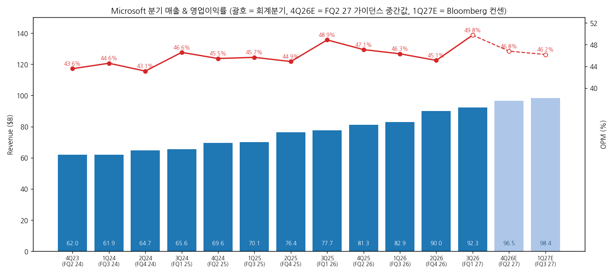
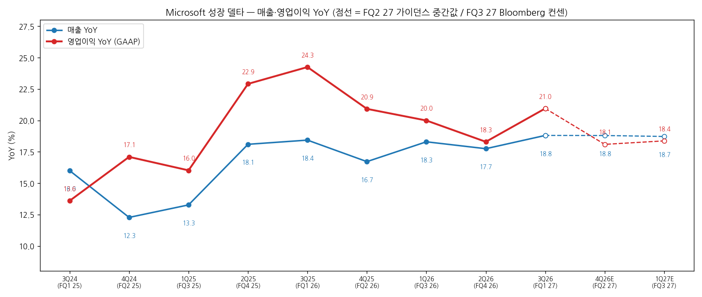
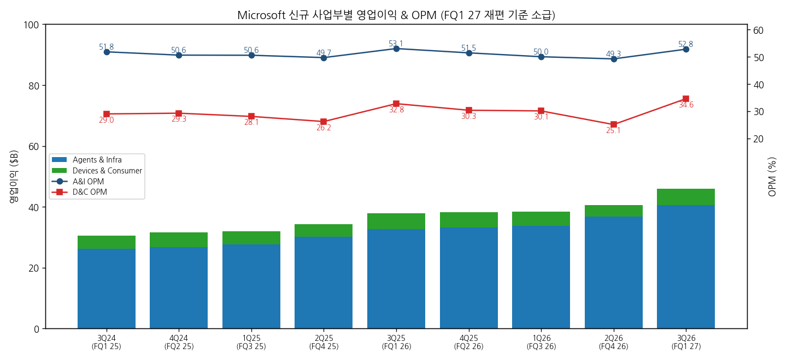
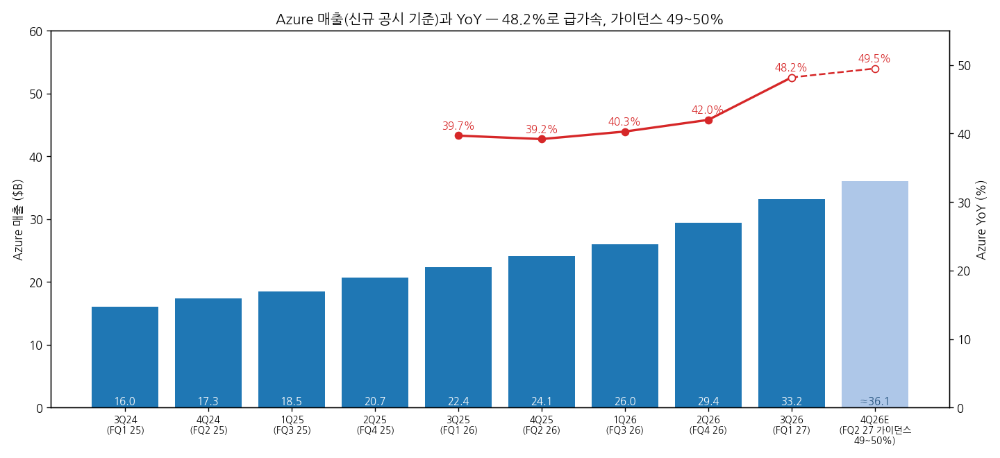
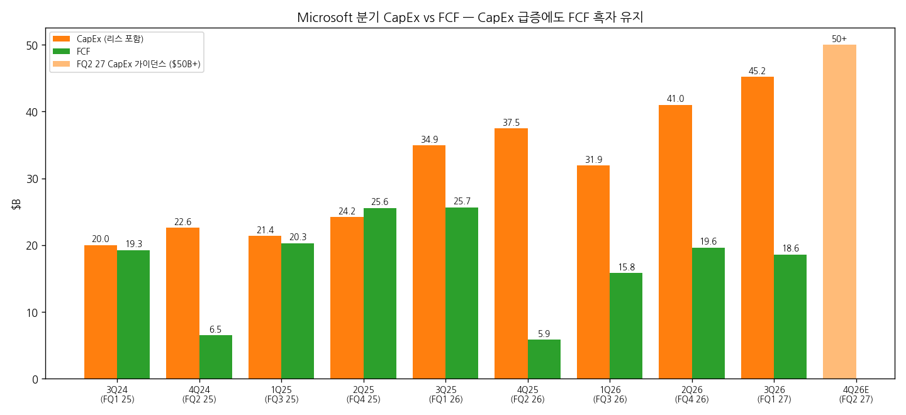

# Microsoft 3Q26 (FQ1 27) 실적 리뷰

> 모드: 실적 리뷰 (v11)
> 종목: Microsoft (MSFT)
> 섹터: 미국 빅테크
> 서브섹터: 하이퍼스케일러
> 분기: 2026-Q3 (회계 FQ1 27, 2026.7~9월)
> 발표일: 2026-10-28 (미 동부 장 마감 후)
> 작성 시각: 2026-11-01 12:30 KST
> 분석 소스: 국내 셀사이드 7개사(키움 10/29 · SK 10/29 · 한화투자 10/29 · 하나 10/29 · KB 10/29(AI 속보) · 삼성 10/29 · 신한투자 10/30) + 웹 보완: 해외 IB TP 변경(TokenPost·MarketBeat·Investing.com 10/29~31), 주가 반응(CNBC·Investing.com 10/28 시간외, MarketBeat 10/30 종가). 회사 IR 원본·컨콜 원문은 첨부되지 않아 경영진 발언은 증권사 Q&A 정리에서 인용

---

## 0. 한 줄 판정

> 성장 델타: **가속 (완만)** | 내러티브: **강화** → **적극 구간. 다만 주가는 숫자에 반응하지 않았다 — FQ2 Azure 49~50% 실현이 확인 포인트**

→ **숫자**: 매출 $92.3B(YoY +18.8%), 영업이익 $45.9B(+21.0%), OPM 49.8%. 컨센 대비 매출 +1.8%, 영업이익 +4.2~4.6%. 영업이익 YoY는 18.3% → 21.0%(+2.7%p), 매출 YoY 17.7% → 18.8%(+1.1%p)로 둘 다 확대. 다만 변화폭이 ±5%p 안이고 FQ2 가이던스 중간값 기준 영업이익 YoY는 +18.1%로 되돌아온다 → 강한 가속이 아닌 "완만한 가속"
→ **쟁점 ①**: Azure +48.2%(가이던스 44~45%, 컨센 45%)로 6%p 급가속. 외부 데이터센터 인도가 늦었는데도 **기존 GPU·CPU 효율 개선과 토큰당 단가 상승**으로 만든 성장이고, FQ2 가이던스는 49~50%(컨센 46%)
→ **쟁점 ②**: CapEx $45.2B로 가이던스($50B+)를 밑돌고 CY26 전망 $175B → $170B. 투자 이연으로 FCF $18.6B 흑자 유지, FY27 FCF 흑자 재확인. 같은 주 알파벳(FCF -$9.1B)·아마존(-$33.5B)과 정반대
→ **해외 IB 6개사 TP 전원 상향, 평균 +8.5%**($586.8 → $636.7). 그러나 주가는 시간외 +4.3% → 10/29 -0.2% → 10/30 -1.6%($521.91)로 발표 전보다 낮게 마감 — 셀사이드와 시장 반응이 엇갈림
→ **다음 분기 관건**: Azure 49~50% 실현(QoQ 증분 약 $2.9B) + 하반기 CapEx 재가속 구간에서 FCF 흑자 유지. OpenAI 매출 비중(10.8%)과 RPO 정체가 내러티브의 약한 고리

---

## 1. 숫자

### ① 연결 기준 분기 표

| 항목 ($M) | 2Q24 (FQ4 24) | 3Q24 (FQ1 25) | 4Q24 (FQ2 25) | 1Q25 (FQ3 25) | 2Q25 (FQ4 25) | 3Q25 (FQ1 26) | 4Q25 (FQ2 26) | 1Q26 (FQ3 26) | 2Q26 (FQ4 26) | **3Q26 (FQ1 27)** | 4Q26 가이던스 (FQ2 27) | 4Q26E 컨센 | 1Q27E 컨센 (FQ3 27) |
|---|---|---|---|---|---|---|---|---|---|---|---|---|---|
| 매출액 | 64,727 | 65,585 | 69,632 | 70,066 | 76,441 | 77,673 | 81,273 | 82,886 | 90,007 | **92,279** | 96,000~97,100 | 95,819 | 98,404 |
| 영업이익 | 27,925 | 30,552 | 31,653 | 32,000 | 34,323 | 37,961 | 38,275 | 38,398 | 40,603 | **45,915** | ≈45,200 (중간값) | 44,962 | 45,452 |
| OPM | 43.1% | 46.6% | 45.5% | 45.7% | 44.9% | 48.9% | 47.1% | 46.3% | 45.1% | **49.8%** | 46.8% | 46.9% | 46.2% |
| 매출 YoY | 15.2% | 16.0% | 12.3% | 13.3% | 18.1% | 18.4% | 16.7% | 18.3% | 17.7% | **18.8%** | 18.8% | 17.9% | 18.7% |
| 영업이익 YoY | 15.1% | 13.6% | 17.1% | 16.0% | 22.9% | 24.3% | 20.9% | 20.0% | 18.3% | **21.0%** | 18.1% | 17.5% | 18.4% |
| **매출 YoY 델타 (%p)** | -1.8 | +0.8 | -3.7 | +1.0 | +4.8 | +0.3 | -1.7 | +1.6 | -0.6 | **+1.1** | 0.0 | -0.9 | +0.8 |
| **영업이익 YoY 델타 (%p)** | -8.3 | -1.5 | +3.5 | -1.1 | +6.9 | +1.4 | -3.4 | -0.9 | -1.7 | **+2.7** | -2.9 | -3.5 | +0.9 |

→ (출처: 실적 = 삼성증권 손익계산서 요약(Microsoft 공시, GAAP, 회계연도 기준을 캘린더 분기로 재배열). 4Q26 가이던스 = 회사 FQ2 27 가이던스(매출 $96.0~97.1B, COGS $32.7~32.9B, 영업비용 $18.5~18.6B, 하나 정리) 중간값 기준 영업이익 계산(한화 동일 $45.2B). 컨센 = Bloomberg 10/28(키움). 2Q24 영업이익 YoY는 FQ4 23 영업이익 $24.3B 기준 계산)
→ 3Q26 서프라이즈: **매출 컨센 대비 +1.8%, 영업이익 +4.2%(FactSet $44.1B)~+4.6%(Bloomberg $43.9B), GAAP EPS $4.92는 +4.2%, Non-GAAP EPS $4.89는 +3.5%** (FactSet·Bloomberg). OPM 49.8%는 컨센 48.5~48.6% 대비 +1.3%p
→ FQ2 27 가이던스: 매출 중간값 $96.55B는 컨센 대비 +0.8~1.0%, Azure 49~50%(cc)는 컨센 46% 대비 +3.5%p. 전사 OPM은 "전년 대비 소폭 하락", Microsoft Cloud GPM 약 65% (하나·KB)

→ (출처: 삼성증권(Microsoft 공시), 4Q26E = FQ2 27 가이던스 중간값, 1Q27E = Bloomberg 컨센 10/28)

→ (출처: 동일)

(1) YoY는 어디에 있나
→ 영업이익 YoY의 이번 사이클 정점은 **3Q25(FQ1 26) +24.3%**. 이후 20.9 → 20.0 → 18.3%로 3개 분기 연속 둔화했다가 이번에 21.0%로 반등
→ FQ1은 계절적으로 영업비용이 가장 낮은 분기(마케팅 $5.7B로 전년과 동일)라 OPM이 매년 튄다(FQ1 26 48.9% → FQ1 27 49.8%). 동일 분기 비교로도 +0.9%p 개선이라 계절성만으로 설명되지는 않는다
→ 컨센 경로: FQ2 27 +17.5~18.1% → FQ3 27 +18.4%. **영업이익 YoY는 17~21% 박스에 머물고, 정점(24.3%)을 다시 넘는 경로는 컨센에 없다.** 반면 매출 YoY는 18~19%로 상단 유지 `[판단]` 이익보다 매출(Azure)이 델타를 끄는 국면

### ② 사업부별 매출·영업이익

> FQ1 27부터 사업부가 3개 → 2개로 재편: **Agents & Infra**(Azure + M365 + 생산성·서버 + 산업 솔루션) / **Devices & Consumer**(Windows·기기 + Xbox + 검색·광고). 회사가 FQ1 25까지 소급 공시. 재편으로 Azure와 M365의 개별 수익성은 더 이상 볼 수 없다 (SK)

(1) 사업부

| 사업부 ($M) | 3Q25 (FQ1 26) | 2Q26 (FQ4 26) | **3Q26 (FQ1 27)** | 매출 YoY | 매출 비중 | 영업이익 3Q25 | 영업이익 2Q26 | **영업이익 3Q26** | OPM 3Q26 | 영업이익 YoY |
|---|---|---|---|---|---|---|---|---|---|---|
| Agents & Infra | 61,672 | 74,576 | **76,795** | +24.5% | 83.2% | 32,718 | 36,732 | **40,558** | 52.8% | +24.0% |
| Devices & Consumer | 16,001 | 15,431 | **15,484** | -3.2% | 16.8% | 5,243 | 3,871 | **5,357** | 34.6% | +2.2% |

(2) 사업부 YoY 추이

| 지표 | 3Q25 (FQ1 26) | 4Q25 (FQ2 26) | 1Q26 (FQ3 26) | 2Q26 (FQ4 26) | **3Q26 (FQ1 27)** | 4Q26E (FQ2 27 가이던스) |
|---|---|---|---|---|---|---|
| A&I 매출 YoY | +22.2% | +22.1% | +23.1% | +22.7% | **+24.5%** | +24~25% |
| A&I 영업이익 YoY | +25.0% | +24.1% | +21.8% | +21.5% | **+24.0%** | — |
| A&I OPM | 53.1% | 51.5% | 50.0% | 49.3% | **52.8%** | — |
| D&C 매출 YoY | +5.9% | -0.2% | +0.9% | -1.5% | **-3.2%** | -2.5~-5.5% |
| D&C 영업이익 YoY | +19.7% | +3.5% | +8.2% | -5.6% | **+2.2%** | — |
| D&C OPM | 32.8% | 30.3% | 30.1% | 25.1% | **34.6%** | — |

→ (출처: 삼성·신한·하나(Microsoft 공시), D&C 가이던스 $15.9~16.4B는 하나)

→ (출처: 삼성증권 신규 사업부 기준 손익계산서)

(3) 주요 제품 라인

| 제품 ($M) | 3Q26 매출 | 3Q25 YoY | 4Q25 YoY | 1Q26 YoY | 2Q26 YoY | **3Q26 YoY** |
|---|---|---|---|---|---|---|
| Azure | 33,165 | +39.7% | +39.2% | +40.3% | +42.0% | **+48.2%** |
| M365 클라우드 | 27,778 | +18.4% | +18.3% | +21.2% | +16.5% | **+17.2%** |
| 생산성·서버 라이선스 | 8,407 | +7.8% | +6.1% | +0.3% | +7.1% | **-3.1%** |
| 검색·광고 | 6,554 | +15.2% | +10.7% | +11.6% | +10.9% | **+10.3%** |
| Xbox | 5,379 | -2.0% | -9.5% | -6.6% | -9.9% | **-2.3%** |
| Windows OEM·기기 | 3,551 | +5.1% | -0.7% | -2.5% | -7.3% | **-22.0%** |

→ (출처: 신한·삼성(Microsoft 공시, 신규 기준). Azure 신규 기준 매출은 이번 분기 처음 공시)
→ `[판단]` **델타를 끄는 건 Azure 하나다.** Azure 증분(YoY +$10.8B)이 전사 매출 증분($14.6B)의 약 74%. M365 클라우드는 17%대에서 정체, 유료 이용자 증가율은 7% → 5%로 낮아지고 이용자당 매출(+약 11%)이 받치는 구조(키움). Windows OEM·기기 -22%는 메모리 가격 상승에 따른 PC 출하 부담

→ (출처: 삼성·신한(Microsoft 공시). 4Q26E ≈ $36.1B = 4Q25 $24.13B × 1.495)

### ③ 연간

| 항목 ($B, 6월 결산) | FY23 | FY24 | FY25 | FY26 | FY27E | FY28E |
|---|---|---|---|---|---|---|
| 매출액 | 211.9 | 245.1 | 281.7 | 331.8 | 390.9 | 467.9 |
| 영업이익 | 88.5 | 109.4 | 128.5 | 155.2 | 183.3 | 218.1 |
| OPM | 41.8% | 44.6% | 45.6% | 46.8% | 46.9% | 46.6% |
| 매출 YoY | 6.9% | 15.7% | 14.9% | 17.8% | 17.8% | 19.7% |
| 영업이익 YoY | 6.2% | 23.6% | 17.4% | 20.8% | 18.1% | 19.0% |

→ (출처: 실적 = 삼성 포괄손익계산서, FY27E·FY28E = Bloomberg 컨센 10/28(키움))
→ 발표 후 FY27E 영업이익: FQ1 Beat(+$2.0B vs Bloomberg) + FQ2 가이던스 중간값의 컨센 상회(+$0.2B)를 기계적으로 반영하면 약 **$185.5B(+1.2%)**. 발표 후 집계 컨센은 확인 불가

→ (출처: 신한투자증권(FactSet·회사 공시), CapEx는 금융리스 포함)

---

## 2. 시장 쟁점

### ⓪ 지난 분기에 "봐야 할 것"으로 남긴 항목 체크

> 직전 분기(2Q26 = FQ4 26) 리뷰가 없어 **1Q26 리뷰 기반 팔로업(`2026-Q2_MSFT_팔로업.md`, 대상 FQ4 26)** 항목을 FQ4 26·FQ1 27 누적 결과로 체크

| 직전 팔로업 항목 | FQ4 26 → FQ1 27 결과 | 판정 |
|---|---|---|
| Azure +41% 이상 재가속 | 42.0% → **48.2%** (신규 기준) | 확인 (초과) |
| Microsoft Cloud GPM 64% 가이드, 65%+면 변곡 | 65% → 66% | 확인 |
| CapEx CY26 $190B 페이스, FY27 정량 가이드 | CY26 $175B → **$170B로 하향**, FY27 연간 CapEx 미제시 | 반대로 나옴 (외부 용량 인도 지연) |
| M365 Copilot 좌석 25M+ | FQ4 26 30M+ 공시 → **FQ1 27 좌석 수 미공시**, DAU +50% QoQ로 대체 | 확인 후 공시 중단 |
| VRP 흡수·헤드카운트 감축 | 영업비용 +6.2% YoY로 레버리지 확인, VRP 실비용은 미확인 | 부분 확인 |
| 소비자 BU 바닥 통과 | Windows OEM·기기 -7.3% → **-22.0%** | 반대로 나옴 |

### ① 이번 분기 쟁점 5개

| # | 쟁점 | 한 줄 정의 | 언급 |
|---|---|---|---|
| 1 | Azure 가속의 원천 | 공급이 늦었는데 어떻게 48%가 나왔나, 효율 개선은 지속 가능한가 | 7/7 + 해외 다수 |
| 2 | CapEx 이연과 FCF | CapEx 미달은 좋은 소식인가, 하반기 재가속 때 FCF는 버티나 | 7/7 |
| 3 | OpenAI 집중도와 RPO 정체 | 매출 10.8%가 OpenAI, RPO는 QoQ 정체 — 성장의 질은 | 5/7 |
| 4 | Copilot·M365 수익화의 측정 | 좌석 수 미공시·사업부 재편 — 숫자로 검증하기 어려워졌다 | 5/7 |
| 5 | 마진 지속성과 소비자 부문 | OPM 49.8%는 지속되나, Windows -22%는 바닥인가 | 4/7 |

### ② 쟁점별 분해

#### 쟁점 1. Azure 가속의 원천 — "공급 없이 어떻게 48%인가"

(1) 회사 설명
→ "수요는 여전히 공급을 초과". GPU 플릿 효율 개선으로 남은 용량을 Foundry에 추가 배분, CPU 플릿에서는 엔지니어링으로 저활용 용량을 찾아 수익화, 토큰당 매출이 예상보다 높음. GB300 가동 소요 기간 20% 단축, 신규 DC 24곳 추가 (신한·하나·삼성)
→ FQ2 49~50%는 "추가 효율 개선이 필요", 외부 컴퓨팅 용량 인도는 FY27 하반기로 지연 → 분기 변동성 가능 (하나·삼성)
→ Foundry 고객 12만+(전분기 10만), 매출 3배 이상, 오픈소스 모델 매출 10배 (삼성·신한)

(2) 증권사별 해석

| 증권사 | 핵심 가정·추정 | 논리 |
|---|---|---|
| 키움 | 같은 설비로 더 많은 사용량 × 더 높은 단가 | 증설 지연을 효율로 보완. FQ2 QoQ 증분은 $2.8~3.0B로 이번($3.75B)보다 작지만 하반기 외부 용량 유입 시 재확대 |
| SK | 효율화를 일회성이 아니라 가이던스에 반영할 만큼 지속 가능한 것으로 회사가 인식 | GPU 공급 일부 지연에도 효율화만으로 눈높이를 넘었다. Astra(9월 출시) 효과로 토큰당 매출 상승은 FQ2에 더 기여 |
| 신한 | Azure 성장률 39.7 → 39.2 → 40.3 → 42.0 → 48.2% → 49%+ | 신사업이 아니라 기존 자산의 생산성 개선에서 나왔다는 점에 주목 |
| 하나 | 가이던스 상단 대비 +3%p, FQ2 컨센 대비 +3.5%p | 신규 설비 가동 시점·규모에 따라 분기 변동성 예상 |
| 삼성 | Foundry 성장과 CPU 수익화가 주동력 | 서드파티 용량 지연으로 분기 변동성 가능 |
| UBS (웹) | TP → $700 | Azure 48%·50% 성장률이 근거 |

(3) 공통 결론 vs 갈리는 지점
→ 공통: 이번 가속은 증설이 아닌 **효율(처리량)과 단가**에서 나왔고, 수요 > 공급 구조는 그대로
→ 갈림: 효율 개선이 몇 분기나 이어질 수 있는지. SK·키움은 "구조적 효율"로, 하나·삼성은 분기 변동성을 경계

(4) `[판단]`
→ 증설 없이 만든 6%p 가속이라 질이 좋다. 하반기에 지연된 외부 용량이 들어오면 "효율 + 증설"이 겹치는 구간이 열린다 — 성장 델타 측면에서 가장 강한 신호
→ 다만 회사가 "49~50%에는 추가 효율 개선이 필요"라고 직접 말했다. FQ2에서 48% 이하로 나오면 "효율 1회성" 해석으로 바뀐다

#### 쟁점 2. CapEx 이연과 FCF — "미달은 좋은 소식인가"

(1) 회사 설명
→ FQ1 CapEx $45.2B(리스 포함, +30% YoY)로 가이던스 $50B+ 미달 — 외부 컴퓨팅 용량 인도 지연. 약 75%가 CPU·GPU 등 단기 자산(전분기 66%), 메모리·스토리지 단가 상승분 포함. 금융리스 약 $7.4B (신한·삼성)
→ FQ2 $50B+, CY26 약 $170B(종전 $175B), FY27 하반기 재가속. FY27 FCF 흑자 유지. "매력적인 조건이면 추가 자금원 활용 — 리스는 이미 쓰고 있고, 채권은 신용등급상 접근 가능하나 아직 미사용" (신한·하나)

(2) 증권사별 해석

| 증권사 | 핵심 가정·추정 | 논리 |
|---|---|---|
| 키움 | OCF $58.0B(+29%) > 현금 CapEx $39.4B(+103%), FCF $18.6B. 회사채 $4.85B 상환 | 자체 현금으로 투자 감당 — 알파벳(FCF -$9.1B)·메타(주식 조달)와 대비. 단 CY26 역산 시 FQ2에만 약 $51.9B, 이번 흑자엔 투자 이연 효과가 섞여 하반기 흑자 폭 축소 가능 |
| 신한 | FQ2 FCF 추정 -$0.6B, FQ3 +$5.1B | 리스 포함 CapEx가 $50B+로 빨라지면 분기 FCF 단기 훼손 가능. 첫 자금 조달 언급 → 내년 초 재무 변동성 유의. 그래도 빅테크 중 최선호 |
| 삼성 | CapEx 컨센 $50.7B·현금 CapEx 컨센 $46.5B 하회 | CapEx 1달러당 매출·이익 상승 자신감 + FY27 FCF 흑자 유지가 긍정적 |
| 하나 | FCF $18.6B(-27%) | 높은 신용등급으로 채권 조달 여력 충분 |
| 한화 | — | FCF 흑자 유지 전망으로 AI 투자 부담 완화 → 시간외 +2.9% (vs 알파벳 -10%) |

(3) 공통 결론 vs 갈리는 지점
→ 공통: 빅테크 중 유일하게 **현금으로 CapEx를 감당**하는 구조. FY27 FCF 흑자 가이던스가 핵심 차별점
→ 갈림: 이번 흑자의 "질" — 키움·신한은 투자 이연 효과로 FQ2~FQ3 FCF가 일시 0 근처까지 갈 수 있다고 보고, 삼성·하나는 회수 효율 개선에 무게

(4) `[판단]`
→ 신한 추정(FQ2 FCF -$0.6B)처럼 **한 분기 적자가 나와도 FY27 연간 흑자 가이던스만 지키면 내러티브는 유지**된다. 위험한 건 첫 회사채 발행과 FQ2 적자가 동시에 나오는 경우 — 시장이 "MSFT도 다른 하이퍼스케일러와 같다"로 재분류할 수 있다

#### 쟁점 3. OpenAI 집중도와 RPO 정체

(1) 회사 설명
→ OpenAI 관련 매출(수익 배분 포함) $10B, 전사 매출의 약 11%. Azure 기여분은 미공개 (하나·키움)
→ 상업 RPO $677B(+73% YoY), 가중평균 2.3년, 12개월 내 인식 약 30%(+29%), 12개월 이후 +98% (KB·신한·삼성)
→ 자체 MAI 모델 목표: 선도 모델 출시 3~6개월 안에 비슷한 성능을 훨씬 낮은 학습 비용으로 (신한·SK)

(2) 증권사별 해석

| 증권사 | 핵심 가정·추정 | 논리 |
|---|---|---|
| 키움 | OpenAI 비중 10.8%(FY26 7.3%), RPO $677B로 QoQ 정체·시장 예상 $705.6B 하회 | 증가분 대부분이 OpenAI 대형 약정(12M 이후 +98%)에 몰림. Anthropic 최소 $44.9B 구매 약정(2026.11~2033.5, 분기 약 $1.7B)도 고객 분산보다 대형 AI 기업 의존 확대 |
| SK | OpenAI 비중 약 11% | 성장이 앱·플랫폼 수익화인지 GPU 임대 수요인지 외부에서 가려내기 어렵다 |
| 하나 | 대형 AI 고객 의존도 높음 | 기업용 AI가 다양한 산업으로 확산 중이라 장기 기회는 확대 |
| 신한 | 상업 Bookings -12%는 전년 대형 계약 역기저 | MAI로 OpenAI 의존도 축소 전략 진행 중 |
| 삼성 | RPO -$1B QoQ, cRPO 비중 30% 유지 | 모델 경쟁이 심해져도 멀티모델 플랫폼으로 수혜를 보는 위치 |

(3) 공통 결론 vs 갈리는 지점
→ 공통: OpenAI 의존도는 올라갔고, RPO는 FQ2 26의 대형 약정 이후 정체
→ 갈림: 키움·SK는 "집중도 리스크", 하나·삼성·신한은 "멀티모델·기업 확산으로 희석 중"

(4) `[판단]`
→ 이번 분기 Azure 가속을 이끈 건 Foundry(멀티모델)와 CPU 수익화라는 회사 설명이 맞다면 OpenAI 의존과는 다른 축이다. 하지만 **OpenAI 매출이 Azure에 얼마나 들어있는지 공개되지 않는 한 확인할 방법이 없다.** RPO가 FQ2에도 $680B 근처에 머물면 "신규 대형 계약 공백"으로 읽힐 수 있다

#### 쟁점 4. Copilot·M365 수익화 — "숫자로 검증하기 어려워졌다"

(1) 회사 설명
→ Copilot 최대 규모 업데이트: Chat·Cowork·Autopilot·Code를 하나로 통합, 기업용·소비자용 통합, Office 기본 내장. 과금은 좌석 구독 + 사용량(소비형) 병행 (신한·삼성)
→ Copilot DAU +50% QoQ(+5배 YoY), 사용량 크레딧 소비 고객 +75% QoQ, 5만 좌석 이상 고객 8배. GitHub는 사용량 과금 전환 후 크레딧 소비 2배 이상. "코딩 밖에서는 종량 과금 확산이 더딜 것" (신한·하나)
→ M365 상업 클라우드 +17%(cc 18%), FY27 중 가속 전망 유지. E7 유료 좌석 수백만 (하나)

(2) 증권사별 해석

| 증권사 | 핵심 가정·추정 | 논리 |
|---|---|---|
| SK | 좌석 수 첫 미공시 + 사업부 재편 | 기업 AI 스택을 빈틈없이 채우는 "왕국"이지만 성과를 숫자로 검증하기는 오히려 어려워졌다 |
| 키움 | 유료 이용자 증가율 7% → 5%, ARPU +약 11% | 인력이 줄어드는 국면에서 좌석 비례 구독은 한계 → 사용량 과금은 그 대응 |
| 하나 | M365 cc +18%로 예상 +1%p 상회 | 좌석 수 미공개는 아쉽고, 사용량 과금 확대 속도는 추가 확인 필요 |
| 삼성 | DAU·자동화 작업 수·만족도 개선 | 양과 질 모두 개선 신호 |
| 신한 | 소비형은 현업 예산, 구독은 IT 예산 | 과금 모델 확장이 TAM·ARPU 성장 수단 |

(3) 공통 결론 vs 갈리는 지점
→ 공통: 지표가 "좌석"에서 "사용량"으로 바뀌는 중이고, 이 전환은 방향상 맞다
→ 갈림: 좌석 수 미공시를 전략 전환의 결과(삼성·신한)로 보느냐, 둔화를 가리는 공시 변경(SK·하나)으로 보느냐

(4) `[판단]`
→ M365 상업 클라우드가 17~18%에 머무는 한 Copilot은 아직 "델타를 끄는 엔진"이 아니다. 회사가 약속한 **FY27 중 M365 가속**이 FQ2(cc 약 19% 가이던스)부터 숫자로 나오는지가 검증 지점

#### 쟁점 5. 마진 지속성과 소비자 부문

(1) 회사 설명
→ Microsoft Cloud GPM 66%(QoQ +1%p, YoY -2%p). Azure 비중 확대로 YoY 하락했지만 제품별 효율 개선으로 QoQ 상승. FQ2 Cloud GPM 약 65%, 전사 OPM은 전년 대비 소폭 하락 (하나·KB)
→ "추가 비용 없이 기존 인프라 활용도를 높여 수익성 개선, 영업비용은 신규 제품·보안·품질에 집중" (하나 Q&A)

(2) 증권사별 해석

| 증권사 | 핵심 가정·추정 | 논리 |
|---|---|---|
| 하나 | Azure 50% 근접 + 전사 OPM 50% 수준 동시 달성 | 기존 인프라 효율 개선이 성장과 수익성에 동시 기여 — 추정치 상향 가능성 높음 |
| 삼성 | OPM 49.8% vs 컨센 48.6% | AI 인프라 투자의 단기 클라우드 마진 부담에도 전사 마진 유지 |
| KB | GPM 67.8%(-1.3%p YoY), Cloud GPM 66%(-2%p) | Azure 비중 확대가 수익성 부담 |
| 키움 | Bloomberg FY27E OPM 46.9%(FY26 46.8%) | 컨센은 마진 개선을 거의 반영하지 않음 |

(3) 공통 결론 vs 갈리는 지점
→ 공통: GPM은 Azure 믹스로 구조적 하락, OPM은 영업비용 통제(+6% YoY)로 방어
→ 갈림: FQ1의 49.8%를 새 수준으로 볼지(하나), 계절적 고점으로 볼지 — 회사 FQ2 가이던스(46.8%)는 후자

(4) `[판단]`
→ 감가상각이 본격적으로 늘어나는 하반기(단기 자산 비중 75%)가 진짜 시험대. 컨센 FY27 OPM 46.9%는 보수적이라 상향 여지가 있지만 크지는 않다
→ D&C는 Windows OEM·기기 -22%로 바닥 신호가 없다. 메모리 가격 상승이 PC 수요를 누르는 한 D&C 매출은 FQ2에도 감소(가이던스 -2.5~-5.5%). 비중 17%라 전사 델타에 대한 영향은 제한적

### ③ 낙관 vs 보수 — 논리 대비

| 구분 | 증권사 | 무엇을 다르게 가정했나 |
|---|---|---|
| 가장 낙관 | UBS ($700) · 하나 · 신한(빅테크 최선호) | 효율 개선을 구조적으로 보고 "효율 + 하반기 증설"이 겹치는 성장 구간을 가정. FCF 흑자가 하이퍼스케일러 중 유일한 재무 안정성 |
| 가장 보수 | 키움 · SK | 이번 FCF엔 투자 이연 효과가 섞임, OpenAI 집중도 상승·RPO 정체, 좌석 수 미공시·사업부 재편으로 수익화 검증이 어려워짐 |

→ 셀사이드와 바이사이드의 어긋남: TP는 6개사 전원 평균 +8.5% 상향했지만, 주가는 시간외 +4.3%($554.25)에서 10/29 정규장 -0.2%($530.14), 10/30 -1.6%($521.91)로 발표 전 종가($531.01)보다 낮다. 직전 3개월 +35% 상승(한화)으로 기대가 먼저 반영된 데다 10/30 나스닥 전반 약세가 겹쳤다 `[판단]`

### ④ 추정치·TP 변화

| 증권사 | 직전 TP | 현재 TP | FQ2 27 영업이익 E | FY27E / FY28E 영업이익 | 핵심 변화 한 줄 |
|---|---|---|---|---|---|
| TD Cowen | $625 | $650 | — | — | 성장 가속과 마진 상회로 랠리 지속 근거 |
| Piper Sandler | $610 | $650 | — | — | Overweight 유지 |
| D.A. Davidson | $550 | $650 | — | — | 최대 상향 (+18.2%) |
| Citizens JMP | $550 | $625 | — | — | Market Outperform 유지 |
| Morgan Stanley | $600 | $650 | — | — | 매출 성장·OPM·Azure 근거 |
| Guggenheim | $586 | $595 | — | — | 소폭 상향 |
| UBS | — | $700 | — | — | Azure 48%·50% |
| Cantor Fitzgerald | — | $630 | — | — | 상향 |
| 신한 (국내) | — | 컨센 $608.3 인용 | $44.8B(컨센) | $183.3B / $219.1B | 빅테크 최선호 유지, 12MF PER 25배 |
| 키움 (국내) | — | 컨센 $605.3 인용 | $45.0B(컨센) | $183.3B / $218.1B (컨센) | FQ2 이후 FCF 흑자 폭 축소 가능성 |
| 하나 (국내) | — | 컨센 $555.2 인용 | $44.7B | $181.2B / $216.4B | 추정치 상향 가능성 높음 |
| 국내 기타 4사 | — | 자체 TP 없음 | — | — | 삼성: 12MF P/E 26배로 생성 AI 이후 평균 28.4배 대비 할인 |

→ (출처: 해외 = TokenPost(10/31)·Investing.com·Futu(MS)·MarketBeat, 직전 TP 확인된 6개사 기준. 국내 = 각사 리포트. 해외 IB 개별 추정치는 원문 미입수)
→ 직전 TP가 확인된 6개사 평균 **$586.8 → $636.7 (+8.5%), 상향 6 · 하향 0**. 전체 컨센 평균 TP는 $601.8(한화, 발표 전) → $609.5(MarketBeat, 10/30)
→ **TP 상향의 원천은 대부분 멀티플**: FY27E 영업이익은 기계적 반영 시 +1.2% 상향에 그치는데 TP는 +8.5%. 12MF P/E 25~26배로 생성 AI 이후 평균(28.4배, 삼성) 대비 할인돼 있던 멀티플을 일부 되돌리는 논리

---

## 3. 내러티브 점검

(1) 성장 스토리 정의
→ **"Azure가 AI 수요로 가속하고, 그 투자를 자체 현금으로 감당하면서 마진까지 지키는 유일한 하이퍼스케일러"**

(2) 이번 분기가 스토리에 준 영향

| 축 | 방향 | 근거 |
|---|---|---|
| Azure 가속 | 강화 | 48.2%(+6%p), FQ2 가이던스 49~50%로 컨센 46% 상회. 증설 없이 효율로 만든 가속 |
| 현금으로 CapEx 감당 | 강화 | FCF $18.6B 흑자, FY27 흑자 재확인. 같은 주 GOOGL·AMZN은 FCF 적자 |
| 마진 방어 | 강화 | OPM 49.8%, Cloud GPM QoQ +1%p |
| 수익화 투명성 | 약화 | Copilot 좌석 미공시, 사업부 재편, OpenAI 비중 10.8%·Azure 내 비중 미공개, RPO 정체 |

(3) 국면 판단
→ 영업이익 YoY 18.3% → 21.0%(**완만한 가속**) × 핵심 3축 모두 강화(**강화**) → **적극 구간**
→ 다만 주가가 TP 상향에도 발표 전보다 낮다는 점은 "좋은 숫자는 이미 가격에 있다"는 신호. 모멘텀 관점의 진입 근거는 FQ2 Azure 49~50%가 확인되는 시점(2027년 1월 말)에 더 강해진다 `[판단]`

(4) 트리거와 리스크

| 다시 강하게 만들 트리거 | 깨뜨릴 리스크 |
|---|---|
| FQ2 Azure 50% 이상 + 하반기 외부 용량 유입 → "효율 + 증설" 동시 구간 | FQ2 Azure 48% 이하 → 효율 개선 일회성 해석, 가속 내러티브 종료 |
| M365 상업 클라우드 cc 19%+로 가속 시작, Copilot 사용량 지표의 매출 연결 | 첫 회사채 발행 + 분기 FCF 적자가 동시에 → "현금으로 감당" 차별점 소멸 |
| RPO가 신규 기업 계약으로 $700B+ 재증가 | OpenAI 약정·관계 변화 → 매출 11%·RPO 상당분 동시 타격 |

---

## 4. 향후 봐야 할 것 (4Q26 = FQ2 27)

| 순위 | 무엇을 (변수·임계값) | 어떤 데이터로 | 언제 |
|---|---|---|---|
| 1 | **Azure cc 49~50% 실현 (QoQ 증분 약 $2.9B, 매출 약 $36.1B)** — 48% 이하면 가속 종료 | FQ2 27 실적, Ignite(11월) Foundry·Copilot 발표, AWS·GCP 4Q 클라우드 성장률 | Ignite 11월 / 실적 2027년 1월 말 |
| 2 | **FQ2 FCF와 첫 외부 자금 조달 여부** — CapEx $50B+ 구간에서 분기 FCF 0 이상 유지, 회사채 발행 시점·규모 | FQ2 현금흐름표, SEC 8-K·424B(채권 발행), 금융리스 규모 | 수시 / 2027년 1월 말 |
| 3 | **M365 상업 클라우드 cc 약 19% 가이던스 달성 → FY27 중 가속 시작** | FQ2 M365 클라우드 성장률, Copilot DAU·사용량 과금 고객 지표 | 2027년 1월 말 |
| 4 | **RPO $680B 정체 탈피 + OpenAI 매출 비중** (11% 상회 여부) | FQ2 상업 RPO·cRPO, OpenAI·Anthropic 계약 뉴스 | 수시 / 2027년 1월 말 |
| 5 | **OPM 46.8% 가이던스 대비 위치 + Cloud GPM 65%** — 감가상각 증가 구간의 마진 방어 | FQ2 실적, 메모리 가격(DRAM 계약가) | 2027년 1월 말 |

→ 이 목록이 다음 분기 리뷰의 ⓪ 체크 대상, `earnings-followup/2026-Q4_MSFT_팔로업.md`, 캘린더 시그널로 이어진다
