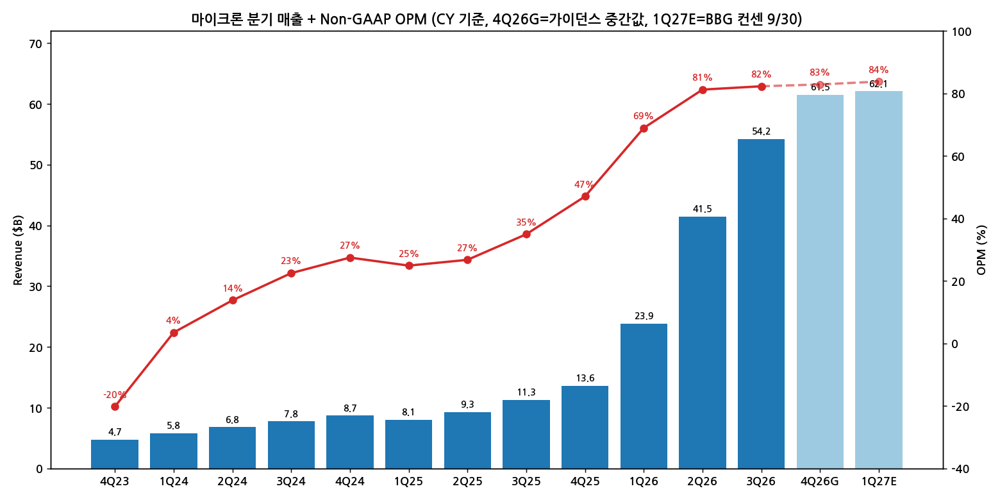
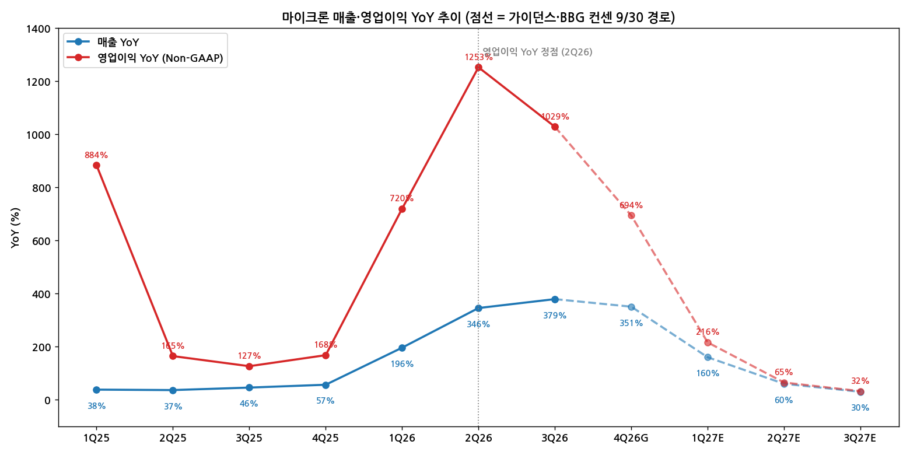

> 모드: 실적 리뷰 (v11)
> 종목: Micron Technology (MU)
> 섹터: 반도체
> 서브섹터: 메모리
> 분기: 2026-Q3 (마이크론 회계 FY26 Q4, 2026년 6~8월)
> 발표일: 2026-09-29 (ET, AMC) / 2026-09-30 KST
> 작성 시각: 2026-11-01 KST
> 분석 소스: 회사 실적·컨콜 내용(첨부 리포트 인용 기준) + 첨부 셀사이드 8개 — IBK투자증권(10/01), KB증권(10/01), NH투자증권(10/01), 메리츠증권(10/01), 신한투자증권(10/01), 키움증권(10/01), 하나증권(10/02), 한화투자증권(10/02) + 웹서치 보완(10월 중순 주가·외국계 TP 1건)

# Micron 3Q26 (FQ4 26) 실적 리뷰 — 이익 레벨은 또 올랐고, 델타는 정점을 지났다

## 0. 한 줄 판정

> 성장 델타: **둔화 (영업이익 YoY 정점 2Q26 통과)** | 내러티브: **강화** → **이익 레벨업은 진행 중이지만 델타 매매 구간은 지나간 '고점권 경계 구간'** [판단]

→ 숫자: 매출 $54.2B(+379% YoY), Non-GAAP 영업이익 $44.6B(+1,029% YoY), OPM 82.3%. 매출 YoY는 +34%p 확대됐지만 영업이익 YoY는 1,253% → 1,029%로 −224%p 축소. QoQ 기준으로도 영업이익 증가율 +105% → +33% → 가이던스 +14%로 3분기 연속 감속
→ 쟁점 ①: FQ1 27 GPM 가이던스 86.25%가 컨센 87%를 하회 — 성과급 재고자산화·신규 팹 초기비용 같은 일회성인지, HBM 믹스로 인한 구조적 천장인지
→ 쟁점 ②: FY27 CapEx 2배 이상(>$50B) — "건설비 중심이라 2028 공급과잉은 시기상조"가 8개사 공통 결론. 다만 주가는 "2028~29 범용 메모리 업황 확신"을 요구하는 단계로 이동
→ 쟁점 ③: SCA 16 → 26건, 2030년까지 매출 35%+ 확보, RPO $150B — 사이클 지속 기간 가시성은 강화
→ 다음 분기 관건: 2Q27 GPM이 회사 말대로 반등하는지(86.25% → 87%+), 12/9 이사회 주주환원 규모, 2028 공급 계약(SCA 연장) 체결 여부

---

## 1. 숫자

① 연결 기준 분기 표 (캘린더 분기 기준, 회계분기 괄호 병기)

단위: $M, %, Non-GAAP 기준 (마이크론이 Non-GAAP을 주 지표로 사용. 3Q26 GAAP 영업이익 $42,036M — KB증권)

| 항목 | 4Q23 (FQ1 24) | 1Q24 (FQ2 24) | 2Q24 (FQ3 24) | 3Q24 (FQ4 24) | 4Q24 (FQ1 25) | 1Q25 (FQ2 25) | 2Q25 (FQ3 25) | 3Q25 (FQ4 25) | 4Q25 (FQ1 26) | 1Q26 (FQ2 26) | 2Q26 (FQ3 26) | **3Q26 (FQ4 26)** | 4Q26 가이던스 (FQ1 27) | 1Q27E (FQ2 27) |
|---|---|---|---|---|---|---|---|---|---|---|---|---|---|---|
| 매출액 | 4,726 | 5,824 | 6,811 | 7,750 | 8,709 | 8,053 | 9,301 | 11,315 | 13,643 | 23,860 | 41,456 | **54,229** | 61,500 (±1,500) | 62,104 |
| 영업이익 | -955 | 204 | 941 | 1,745 | 2,394 | 2,007 | 2,490 | 3,955 | 6,419 | 16,455 | 33,681 | **44,636** | 약 50,980 [계산] | 52,053 |
| OPM | -20.2 | 3.5 | 13.8 | 22.5 | 27.5 | 24.9 | 26.8 | 35.0 | 47.0 | 69.0 | 81.2 | **82.3** | 약 82.9 | 83.8 |
| 매출 YoY | +15.7 | +57.7 | +81.5 | +93.3 | +84.3 | +38.3 | +36.6 | +46.0 | +56.7 | +196.3 | +345.7 | **+379.3** | +350.8 | +160.3 |
| 영업이익 YoY | 적지 | 흑전 | 흑전 | 흑전 | 흑전 | +883.8 | +164.6 | +126.6 | +168.1 | +719.9 | +1,252.7 | **+1,028.6** | 약 +694 | +216.3 |
| **매출 YoY 델타 (%p)** | — | +42.0 | +23.8 | +11.8 | −9.0 | −46.0 | −1.7 | +9.4 | +10.7 | +139.6 | +149.4 | **+33.6** | −28.5 | −190.5 |
| **영업이익 YoY 델타 (%p)** | — | — | — | — | — | — | −719.2 | −38.0 | +41.5 | +551.8 | +532.8 | **−224.1** | 약 −335 | 약 −478 |

→ (출처: 4Q24~3Q26 하나증권·신한투자증권·키움증권 정리 회사 발표치, 4Q23~3Q24 회사 발표치. 4Q26 가이던스 = 회사 매출 $60~63B·GPM 86.25%·OpEx $2.06B로 영업이익 계산 [계산]. 1Q27E = Bloomberg 컨센, 2026-09-30 기준 — 키움증권. 발표 전 기준이라 상향 여지 있음)
→ 키움증권은 가이던스 영업이익을 $51.7~54.3B로 적었으나 이는 매출 × GPM(매출총이익)으로 보이며, OpEx 차감 시 약 $49.7~52.3B

서프라이즈: 매출 컨센 대비 **+5.3%** ($51.49B), 영업이익 **+4.4%** ($42.76B), EPS $33.42 vs $31.83 **+5.0%** (Bloomberg 컨센 — 한화투자증권). 가이던스 중간값은 매출 컨센 $56.8B 대비 **+8.3%**, EPS $38.15 vs $36.02 **+5.9%**

(1) YoY 위치
→ 영업이익 YoY는 **2Q26(+1,253%)이 정점**, 3Q26 +1,029%로 첫 축소. 가이던스 기준 4Q26 약 +694%, 컨센 경로상 1Q27 +216% → 2Q27 +65% → 3Q27 +32%로 수렴 (Bloomberg 컨센, 한화투자증권 표)
→ 매출 YoY는 3Q26(+379%)이 정점. 4Q26 가이던스로 +351%로 꺾임 시작

(2) 기저효과 조정 — QoQ로 다시 보기
→ 1년 전 영업이익이 $3~4B대였기 때문에 YoY 수치 자체는 왜곡이 크다. 같은 흐름을 QoQ로 보면 영업이익 증가율 **+156% (1Q26) → +105% (2Q26) → +33% (3Q26) → 약 +14% (4Q26G)**, 분기 증가액 **+$17.2B → +$11.0B → 약 +$6.3B**
→ 즉 YoY·QoQ 어느 기준으로도 2Q26이 가속의 꼭대기. 이익 레벨은 계속 신고점이지만 "올라가는 속도"는 이미 3분기째 줄고 있다 [판단]
→ 판정 기준상 '꺾임'(2개 분기 연속 둔화 + YoY 정점 통과)은 아직 아님 — 4Q26이 가이던스대로 나오면 다음 리뷰에서 기계적으로 '꺾임' 조건 충족

→ (출처: 회사 발표치, 하나·신한·키움증권 정리, 4Q26G = 가이던스 중간값, 1Q27E = Bloomberg 컨센 9/30)

→ (출처: 동일. 4Q26G 이후 점선 = 가이던스·Bloomberg 컨센 경로, 한화투자증권 표 기준)

② 사업부별 매출·매출총이익

단위: $M, %. 사업부 영업이익은 첨부 리포트에 미기재 → **매출총이익(GP) 기준**으로 대체 (출처: 하나증권 사업부 GP 표, 한화투자증권 비중)

(1) 이번 분기 스냅샷

| 사업부 | 3Q26 매출 | 비중 | 매출 QoQ | 매출 YoY | 3Q26 GPM | 2Q26 GPM | 3Q25 GPM | GP QoQ | GP YoY |
|---|---|---|---|---|---|---|---|---|---|
| CMBU (클라우드 메모리, HBM 포함) | 16,283 | 30.0 | +18 | +258 | 83 | 83 | 59 | +18 | +404 |
| **CDBU (코어 데이터센터)** | **18,002** | **33.2** | **+56** | **+1,042** | **90** | 87 | 41 | **+62** | **+2,404** |
| MCBU (모바일·클라이언트) | 13,114 | 24.2 | +14 | +249 | 90 | 87 | 36 | +18 | +772 |
| AEBU (자동차·임베디드) | 6,824 | 12.6 | +47 | +376 | 84 | 79 | 31 | +57 | +1,188 |
| **합계** | **54,229** | 100 | +31 | +379 | 87.0 | 84.9 | 45.7 | +34 | +813 |

(2) 사업부별 매출 YoY 추이

| 사업부 | 4Q25 | 1Q26 | 2Q26 | **3Q26** | 방향 |
|---|---|---|---|---|---|
| CMBU | +100 | +163 | +307 | **+258** | 첫 감속 |
| CDBU | +4 | +211 | +653 | **+1,042** | 가속 |
| MCBU | +63 | +245 | +254 | **+249** | 정체 |
| AEBU | +49 | +162 | +311 | **+376** | 가속 |

→ (4Q25 YoY는 4Q24 대비 계산. 출처: 하나증권 사업부 매출 시계열 [계산])

(3) 해석 — 누가 델타를 끌고 누가 꺾이나
→ **델타를 끄는 곳 = CDBU (서버 범용 DRAM·데이터센터 SSD)**. 매출 비중 1위로 올라섰고(33%), GP 증가분 $6.2B로 전사 GP 증가분($12.0B)의 절반 이상. DC SSD가 분기 약 $10B(YoY 10배 이상, NAND 매출의 2/3 이상)
→ **먼저 꺾인 곳 = CMBU (HBM 포함)**. 매출 YoY +307% → +258%로 4개 사업부 중 유일하게 감속, GPM도 83%로 정체. 한화: "상대적으로 원가가 높은 HBM이 오히려 전체 이익 개선 폭을 희석"
→ MCBU는 **비트 출하 감소에도 가격으로 매출 +14%** — 수요가 아니라 가격이 매출을 끌고 있는 사업부 [판단]
→ 정리하면 이번 사이클은 "HBM이 끄는 사이클"에서 "범용 DRAM·NAND 가격이 끄는 사이클"로 무게중심이 이동했다. 이익 레벨에는 유리하지만, 가격 의존도가 높아진 만큼 델타의 민감도도 커졌다 [판단]

(4) 반도체 KPI — 볼륨 vs 가격 분해 (쟁점 ①과 직결)

| 제품 | 3Q26 매출 | QoQ | Bit QoQ | ASP QoQ | 비고 |
|---|---|---|---|---|---|
| DRAM | 39,771 | +27 | mid-single (약 +5) | high-teens (+17~19) | 컨센 $38.2B 상회 (IBK) |
| NAND | 14,102 | +42 | 약 +10 | 약 +30 | 컨센 $12.3B 상회 (IBK), 마이크론 NAND ASP가 시장 평균 크게 상회 (키움) |

→ 매출 성장의 대부분이 여전히 가격. 비트는 공급 제약으로 한 자릿수(DRAM)~10%(NAND)
→ (KB증권은 DRAM ASP를 약 +10%로 표기 — 다른 6개사와 다름. 회사 표현 "high-teens"가 다수 기재)

③ 연간 (회계연도 FY, 8월 결산)

단위: $M, %, Non-GAAP

| 항목 | FY24 | FY25 | **FY26** | FY27E | FY28E |
|---|---|---|---|---|---|
| 매출액 | 25,111 | 37,378 | **133,188** | 253,316~261,273 | 285,284~298,894 |
| 영업이익 | 1,935 | 10,846 | **101,191** | 208,796~216,676 | 222,009~238,828 |
| OPM | 7.7 | 29.0 | **76.0** | 81.8~83.2 | 77.8~79.9 |
| 매출 YoY | +62 | +49 | **+256** | +90~96 | +12~15 |
| 영업이익 YoY | 흑전 | +460 | **+833** | +106~114 | +5~10 |

→ (출처: FY24·FY25·FY26 분기 합산 [계산]. FY27E·FY28E 범위 = NH투자증권(상단), 신한투자증권(LSEG), 하나·한화증권(Bloomberg), 키움증권(Bloomberg))
→ 컨센 경로는 **FY28 영업이익 YoY 한 자릿수**, OPM은 FY27 정점 후 하락. 즉 시장은 이미 "FY27이 이익 증가율의 마지막 큰 해"를 그리고 있다 [판단]
→ 연간 컨센 변화: 직전 리뷰 시점(2026-05-02) FY27 영업이익 컨센 약 $115B → 현재 약 $209~217B (**+82~88%**). 이번 발표 직후 증권사별 상향 폭은 첨부 리포트에 미기재. 메리츠는 "연말~연초 메모리 업체 2027 이익 추정치가 일제히 재상향" 전망

---

## 2. 시장 쟁점

① 2-0. 지난 리뷰에서 "봐야 할 것"으로 남긴 항목 체크

> 직전 분기(2026-Q2, FQ3 26) 리뷰는 작성되지 않음. 2026-Q1 리뷰 기반 팔로업(`earnings-followup/2026-Q2_MU_팔로업.md`) ④번 항목을 두 분기 누적으로 체크

| 직전 팔로업 항목 | 이번까지 결과 | 판정 |
|---|---|---|
| GPM 81% 가이던스 달성 + Q4 이후 GPM 톤 | 2Q26 GPM 84.9% → 3Q26 87.0%. 다만 FQ1 27 가이던스 86.25%로 처음 하락 가이던스, "1Q27이 FY27 저점" 언급 | **확인** (기대 초과) — 단 GPM 정체 신호가 새 쟁점으로 |
| HBM4 12H ramp·점유율 | HBM 매출이 회사 평균보다 빠르게 성장, 2027 HBM 비트 대부분 계약(큰 폭 가격 인상), NVIDIA와 커스텀 HBM4E(NVHBM). 점유율 수치는 미공개 | **부분 확인** |
| 추가 SCA 체결 | 16건 → **26건**(모바일 포함), 2030년까지 매출 35%+ 확보, 2건은 2031년까지 연장 | **확인** |
| FY27 첫 가이던스 시그널 + CapEx 우려 | "FY27 매 분기 매출 성장·연간 신기록" 언급. CapEx FY27 >$50B로 2배 이상 → 우려도 예상대로 부각 | **확인** (양방향 모두) |
| NAND 수급 갭 + 싱가포르 팹 | NAND ASP +30% QoQ, DC SSD 10배 성장. 싱가포르 NAND 팹 CY2028 하반기 초기 생산 일정 유지 | **확인** |

→ 지난 체크리스트는 모두 긍정적으로 확인됐다. 바뀐 건 시장의 질문 — "이번 분기 얼마나 좋은가"에서 **"2028~29년에도 좋은가"**로 이동 (키움 "단기 실적보다는 '28~'29년 호황 지속 여부에 더 관심")

② 2-1. 이번 분기 쟁점

| # | 쟁점 | 한 줄 정의 | 언급 증권사 |
|---|---|---|---|
| 1 | GPM 가이던스 하회 | 가격은 계속 오르는데 왜 다음 분기 GPM은 내려가나 — 일회성인가 HBM 믹스의 구조적 천장인가 | 8/8 |
| 2 | CapEx 2배 & 2028 공급과잉 | FY27 >$50B 투자가 2028~29 범용 메모리 공급과잉을 부르는가 | 8/8 |
| 3 | SCA 26건과 사이클 지속 기간 | 장기계약 확대가 "이번 사이클은 길다"를 증명하는가 | 8/8 |
| 4 | 주가 무반응 — 주주환원·서프라이즈 피로 | 4개 분기 연속 대형 비트에도 주가가 왜 안 오르나 | 5/8 (메리츠·하나·한화·키움·KB) |

③ 2-2. 쟁점별 분해

(1) 쟁점 1 — FQ1 27 GPM 가이던스 86.25% vs 컨센 87%

(1-1) 회사 설명
→ "FQ1 27 GPM 약 86.25%. 성과급(bonus) 증가분 일부가 재고자산으로 자본화되고, 신규 시설 초기 가동비용(start-up)이 반영. **1Q가 FY27 GPM의 저점**이며 2Q 이후 메모리 가격 상승률이 완만해지더라도 원가 절감으로 GPM은 더 높아질 것" (컨콜, KB·한화증권 인용)
→ HBM: "HBM과 범용 제품 간 마진 격차가 좁혀지고 있다", 일부 고객은 HBM 사양을 낮췄지만 HBM 수요는 여전히 DRAM 공급보다 크다 (컨콜, 메리츠·NH 인용)

(1-2) 증권사별 해석 편차

| 증권사 | 핵심 가정·추정 | 논리 |
|---|---|---|
| 한화 | 일회성 (성과급·초기 가동비·재고 판매) | 시간외 미온적 반응의 원인 1순위로 GPM 가이던스 하회 지목. 2Q부터 원가 절감으로 개선 |
| 하나 | 믹스 요인 비중 큼 | HBM 비중 상승에 따른 믹스 희석. P(가격)·Q(물량) 모두 제한된 가운데 기대치 상회는 지속 |
| KB | 회사 설명 그대로 (1Q 저점) | 수급 균형 시점은 가시성 없음 — 마진 레벨보다 지속 기간이 변수 |
| 메리츠 | 일회성, 마진 레벨 문제 아님 | AI B2B 수요는 가격 비탄력적 → 가격 상승 여력 남음 |
| 키움 | 가이던스는 자체 추정에 부합 | 컨센이 유독 낮았을 뿐, GPM 자체보다 2028~29 업황이 핵심 |
| Bloomberg 컨센 경로 (한화 표) | GPM 87.0% → 86.7% → 86.9% → 86.8% → 86.5% | 컨센 자체가 이미 GPM **고원(plateau)** 을 가정 |

(1-3) 공통 결론 vs 갈리는 지점
→ 공통: 86.25%의 대부분은 성과급 자본화·초기 가동비라는 비현금·일시 요인이며, GPM 87% 근처는 사실상 천장권이라는 인식은 공유
→ 갈림: "GPM이 2Q27 이후 다시 올라간다"(회사·한화·메리츠) vs "HBM 믹스로 87%가 구조적 상한"(하나). 숫자로 보면 CMBU(HBM 포함) GPM 83%가 CDBU·MCBU 90%보다 7%p 낮다는 점이 하나 쪽 논리를 지지

(1-4) [판단]
→ 이익 레벨 관점에서는 0.75%p는 사소하다 ($61.5B × 0.75%p ≈ $0.46B). 의미는 **"GPM 상승이 멈췄다"는 신호**다. 1Q26 74.9 → 2Q26 84.9 → 3Q26 87.0 → 4Q26G 86.25로 GPM 델타가 +10.0 → +2.1 → −0.75%p로 꺾였다 [판단]
→ 2Q27(FQ2 27) GPM이 87% 이상으로 반등하면 일회성 해석이 맞는 것이고, 86%대 정체면 "가격 상승의 이익 기여가 끝물" 해석이 힘을 얻는다

(2) 쟁점 2 — CapEx 2배와 2028 공급과잉 우려

(2-1) 회사 설명
→ FY26 CapEx $27.4B, FQ1 27 $11.5B, 1H FY27 약 $25B, 2H 더 증가 → FY27 >$50B (KB·한화)
→ "증액분 대부분은 **CY2028 말 이후** 클린룸 공간 확보를 위한 건설" — 웨이퍼 생산능력을 바로 늘리는 장비가 아님. 일본 팹 2028 말 초기 생산, 대만 Tongluo 2027 중반 출하, 싱가포르 HBM 패키징 2027 초, 싱가포르 NAND 팹 CY2028 하반기
→ "2027·2028년 수급은 2026년보다 **더 타이트**". 균형 시점은 가시성 없음

(2-2) 증권사별 해석 편차

| 증권사 | 핵심 가정·추정 | 논리 |
|---|---|---|
| 한화 | 2027 DRAM 생산 증가 20% 초반 | 건설 중심 투자 → 초과 공급 우려 제한적. 리포트 제목 그대로 "초과 공급 우려는 제한적" |
| NH | 2028 공급과잉 우려는 시기상조 | 클린룸 선확보는 2028 말 이후 대비. 방향성은 뚜렷 |
| 메리츠 | 2027까지 공급 제약 상수화 | 서버 2026·27 10%대 후반 성장, 메모리 탑재량 증가 → 2027·28 수급격차 확대 |
| 신한 | CapEx 증가 = 밸류체인 수혜 | 장비·소재 등 밸류체인 전반 훈풍 — 공급과잉보다 투자 수혜에 무게 |
| IBK | 공급 부족 2028까지 | 서버 유닛 17% 성장 전망(타 기관 약 10% 대비 공격적)이 근거 |
| 키움 | 판단 유보 | 주가 탄력이 강해지려면 2028~29 범용 메모리 업황 확신이 필요. HBM 사양 하향 → 범용 DRAM 공급 과잉 가능성도 컨콜 질문으로 나옴 |
| KB | 판단 유보 | 수급 균형 시점에 대한 가시성 없음 |

(2-3) 공통 결론 vs 갈리는 지점
→ 공통(8/8): 2027년까지는 공급 부족이 확정적. FY27 CapEx는 건설 비중이 커서 2027년 비트 공급을 크게 늘리지 않음
→ 갈림: **2028년 하반기 이후**. 낙관(메리츠·IBK·NH)은 수요(서버 유닛 17%·탑재량)가 공급을 계속 앞선다고 보고, 유보(키움·KB)는 3사 동시 클린룸 확보가 2028 말~2029에 비트로 전환되는 시점을 위험으로 본다
→ 업계 비트 성장률 전망은 리포트마다 DRAM/NAND가 뒤바뀌어 기재됨(메리츠·NH: DRAM 2026 20% 중반 → 2027·28 20% 초반 / KB·IBK: DRAM 2026 20% 초반 → 2027·28 20% 중반). 회사 원문 확인 필요한 지점

(2-4) [판단]
→ 2027 공급 부족은 숫자(고객 약정 75%+, SCA 26건)로 뒷받침되므로 낙관 쪽이 맞다. 다만 "건설비 중심"이라는 말은 **2028 말 이후 장비 투자가 따라온다**는 뜻이기도 하다. 우려가 사라진 게 아니라 1년 뒤로 밀린 것 [판단]
→ 결론을 바꿀 데이터: 삼성·SK하이닉스의 2027 CapEx 가이던스(1월 실적), 3사 2028 장비 발주 뉴스, HBM 사양 하향(de-spec) 확산 여부

(3) 쟁점 3 — SCA 26건과 사이클 지속 기간

(3-1) 회사 설명
→ SCA 16 → 26건(모바일 고객 포함 +10건). 2030년까지 예상 매출의 35% 이상(DRAM은 약간 하회, NAND는 약간 상회), 2건은 2031년까지 연장
→ 약 75%는 가격 하한·상한 밴드, 나머지는 주기적 시장가격 연동. 신규 계약은 더 높은 가격
→ 고객 재무 약정 $32B(대부분 현금 선수금), RPO $150B (키움). 장기 SCA 비중 목표 약 50% 유지. 2027 생산량의 75% 이상 이미 약정, 2028 협상 중

(3-2) 증권사별 해석 편차

| 증권사 | 핵심 가정·추정 | 논리 |
|---|---|---|
| 메리츠 | 사이클 중반을 아직 지나지 않음 | 장기계약 = 고객이 공급 확보에 돈을 미리 내는 구조 → "더 높고, 더 긴 사이클" |
| 키움 | 자체 시장 전망과 부합 | SCA·RPO·$32B 약정 모두 예상 범위. 서프라이즈는 아님 |
| 한화 | 시장이 가장 주목한 항목 | 2030년까지 35% 조기 확보 → 이익 가시성 개선 |
| NH·IBK | 2028까지 부족 지속의 근거 | 2028 계약 협상 중이라는 점 자체가 수요 신호 |

(3-3) 공통 결론 vs 갈리는 지점
→ 공통: SCA 확대는 이익의 바닥을 높이고 사이클을 길게 만든다
→ 갈림: 75%가 가격 **상한**도 있다는 점. 메리츠는 바닥 효과를, 키움은 "이미 예상된 숫자"라는 점을 강조. 상한이 있는 계약 비중이 커지면 업황이 더 좋아져도 마이크론 ASP 상승은 시장보다 둔해진다 [판단]

(3-4) [판단]
→ SCA는 모멘텀 트레이더 관점에서 양날이다. **하방(꺾임 폭)은 줄이지만, 상방(델타 재가속)도 제한**한다. 이익 변동성이 낮아지는 대신 밸류에이션이 '경기민감주 PER'에서 벗어날 수 있느냐가 관건 — 현재 12개월 선행 PER 6.7배(2년 평균 12.9배), PBR 3.9배(5년 평균 2.3배)로 시장은 아직 사이클 피크 PER을 적용 중 (한화)

(4) 쟁점 4 — 주가 무반응: 주주환원과 서프라이즈 피로

(4-1) 회사 설명
→ 분기 FCF $33.2B, 기말 순현금 $68.3B(흑자 전환). 자사주 매입 한도 $2.2B 잔여 — CHIPS법 보조금 수령에 따른 자사주 매입 제약 (한화). **12/9 이사회 승인 후 주주환원 확대** 계획, KB는 "잉여 FCF의 최대 100%" 가능성 언급. 분기 배당 $0.15 유지

(4-2) 증권사별 해석 편차

| 증권사 | 핵심 가정·추정 | 논리 |
|---|---|---|
| 한화 | 주가 부진 원인 = GPM 가이던스 + 주주환원 구체성 부족 | 순현금이 엔비디아의 약 3배인데 환원 규모 미제시 |
| 메리츠 | "서프라이즈에 무감각해지는 구간" | 실적보다 사이클 길이 논쟁이 주가를 결정 |
| 키움 | 컨콜 질문 1순위가 주주환원 | 쌓일 현금이 얼마나 환원될지가 주가 탄력 변수 |
| 하나 | 기대치 상회는 지속 | P·Q 제약 속에서도 숫자 자체는 긍정적 |

(4-3) 공통 결론 vs 갈리는 지점
→ 공통: 실적 서프라이즈 크기(+5%)가 과거(1Q26 가이던스 대비 +27%)보다 작아졌고, 시장 반응도 그만큼 무뎌졌다
→ 갈림: 12/9 주주환원이 "새 촉매"가 될 수 있다(한화·KB·키움) vs 사이클 논쟁이 정리되기 전엔 환원으로 멀티플이 안 바뀐다(메리츠 함의)

(4-4) [판단]
→ 주가는 9/30 $1,065 → 10/1 $1,097(+3.0%, 한화) → 10월 중순 약 $982 (웹서치 — 24/7 Wall St. 10/15 기사 인용가)로, 발표 후 오히려 밀렸다. 52주 고점 $1,255(6/25) 대비 약 −22%. **고점이 직전 실적(6/25) 날이었다**는 점이 델타 정점(2Q26)과 정확히 겹친다 — 주가는 이익 레벨이 아니라 이익 델타를 따라갔다 [판단]

④ 2-3. 낙관 vs 보수 — 논리 대비

| 구분 | 증권사 | 무엇을 다르게 가정했나 |
|---|---|---|
| 가장 낙관 | 메리츠 | AI B2B 수요의 가격 비탄력성 → 2027·28 수급격차 확대 → 사이클 중반 미통과. 2027 추정치 재상향 예상 |
| 낙관 | IBK | 서버 유닛 성장 17%(타 기관 약 10%) → 공급 부족 2028까지 |
| 보수 | 키움 | 실적은 이미 자체 추정에 부합 → 서프라이즈 아님. 2028~29 범용 메모리 확신 전까지 주가 탄력 제한 |
| 보수 | KB | 수급 균형 시점 가시성 없음 — 판단 유보 |

→ 핵심 차이는 **서버 유닛 성장률(10% vs 17%)** 과 **2028 하반기 이후 신규 클린룸의 비트 전환 속도** 두 변수
→ 셀사이드 vs 바이사이드: 셀사이드는 8/8 긍정(국내사는 Not Rated지만 논조 전부 긍정), 컨센 TP $1,450~1,614로 주가 대비 +36~52% 업사이드. 그런데 주가는 3M −7.7%, 발표 후 −8% 수준. **셀사이드는 레벨, 바이사이드는 델타를 보고 있다** [판단]. 외국계 일부는 이미 보수적 — Goldman Sachs TP 약 $400(사이클 리스크), 24/7 Wall St. 12개월 목표 $1,059.58 (웹서치)

⑤ 2-4. 추정치·TP

단위: $, $M. 국내 8개사 모두 자체 TP 없음(해외기업 Not Rated) → 리포트에 인용된 컨센 TP 기재

| 증권사 | 인용 컨센 TP (출처) | 다음 분기 영업이익 E | FY27E 영업이익 | FY28E 영업이익 | 핵심 변화 한 줄 |
|---|---|---|---|---|---|
| NH | 1,614.4 (Buy 29 / Sell 1, 최고 2,700 / 최저 900) | 49,846 | 216,676 | 238,828 | 2028 공급과잉 우려 시기상조 |
| 하나 | 1,607.94 (Bloomberg) | — | 210,733 | 222,009 | GPM 미스는 HBM 믹스, 기대치 상회 지속 |
| 한화 | 1,599.35 (Bloomberg, 61개사, 매수 93.4%, 최고 2,200) | 48,560 (발표 전 컨센) | 210,733 | 222,009 | 초과 공급 우려 제한적, 비중확대 유지 |
| KB | 1,580.9 | — | — | — | 수급 균형 시점 가시성 없음 |
| 신한 | 1,450.8 (LSEG, ★5) | — | 208,796 | 230,273 | 밸류체인 수혜 기대 |
| 키움 | 1,450.84 (매수 94%) | 48,560 (발표 전 컨센) | 210,831 | 230,787 | 2028~29 업황 확신이 다음 관건 |
| 메리츠 | — | — | — | — | 2027 추정치 재상향 예상 |
| IBK | — | — | — | — | 공급 부족 2028까지 |

→ 평균 인용 TP 약 $1,551 (6개사 단순평균 [계산]), 9/30 종가 $1,065 대비 +46%. 직전 리뷰(5/2) 평균 PT $517 대비 약 3배
→ 직전 TP·발표 전 TP는 첨부 리포트에 없어 이번 발표에 따른 상향·하향 건수는 집계 불가
→ 다음 분기 영업이익 컨센 $48.6B(발표 전) → 가이던스 계산치 약 $51.0B로 **+5% 상향 압력**
→ **TP 하향 없음. 주가 하락의 원인은 실적 하향이 아니라 멀티플 압축** — 12개월 선행 PER 6.7배로 2년 평균의 절반 (한화) [판단]

---

## 3. 내러티브 점검

① 성장 스토리 정의
→ "AI 데이터센터가 HBM뿐 아니라 범용 DRAM·NAND까지 빨아들이면서 메모리가 경기민감 원자재에서 **장기계약 기반 인프라 부품**으로 바뀐다" — 시장이 MU를 사는 이유

② 이번 분기 평가 — **강화**
→ 숫자: 매출·영업이익·가이던스 모두 컨센 상회, FY27 영업이익 컨센 $209~217B로 5개월 새 거의 2배
→ 구조: SCA 26건, RPO $150B, 2027 물량 75%+ 약정, 2027·28 "2026보다 더 타이트" — 스토리의 핵심 전제(장기계약·지속 기간)가 이번 분기에 가장 많이 확인됐다
→ 균열 신호(아직 훼손 아님): GPM 상승 정지, HBM의 상대 마진 열위, 상한 있는 가격 밴드

③ 국면 — 델타 둔화 × 내러티브 강화
→ 비유하면 차의 **속도(이익 레벨)는 계속 신기록**인데 **가속 페달(델타)은 2Q26부터 떼고 있는** 상태. 모멘텀 매매가 가장 잘 먹히는 구간은 가속 구간이었고, 지금은 스토리가 좋아도 주가가 델타를 따라 횡보·조정하는 구간 [판단]
→ 이 판정이 다음 분기에 '꺾임'으로 넘어갈지 '유지'로 돌아설지는 아래 트리거·리스크로 결정

④ 다시 강해질 트리거
→ 12/9 이사회 대규모 주주환원 (FCF 100% 환원 등) — 멀티플 재평가 촉매
→ 2028 물량 SCA 체결 발표 + 2Q27 GPM 87%+ 반등 — "델타는 줄어도 마진 천장 없음" 확인
→ 컨센 재상향 (메리츠 예상: 연말~연초)으로 1Q27 이후 YoY 경로가 위로 이동

⑤ 깨뜨릴 리스크
→ 삼성·SK하이닉스의 2027 CapEx 급증·장비 발주 → 2028 하반기 공급과잉 논리 현실화
→ HBM 사양 하향(de-spec) 확산 → HBM용 웨이퍼가 범용으로 돌아오며 범용 DRAM 가격 둔화
→ 계약 가격 밴드 상한 도달 → ASP 상승률 급감, GPM 하락 전환

---

## 4. 향후 봐야 할 것

| 순위 | 무엇을 (변수·임계값) | 어떤 데이터로 | 언제 |
|---|---|---|---|
| 1 | **4Q26(FQ1 27) 영업이익 QoQ +14% 이상 & 2Q27 GPM 가이던스 87%+ 반등** — 미달이면 델타 '꺾임' 확정 | 마이크론 FQ1 27 실적·가이던스, 컨콜 GPM 코멘트 | 2026-12 중하순 |
| 2 | **12/9 이사회 주주환원 규모** — 자사주 한도 $2.2B → 대폭 확대, FCF 환원율 50%↑ 여부 | 마이크론 IR 보도자료, 8-K | 2026-12-09 |
| 3 | **DRAM·NAND 계약가 상승률 둔화 속도** — 4Q26 DRAM 계약가 QoQ 두 자릿수 유지 여부 | TrendForce·DRAMeXchange 월간 계약가, 현물가(DDR5 16Gb) | 매월 말, 11~12월 |
| 4 | **2028 공급: 3사 2027 CapEx 가이던스·장비 발주** — 메모리 3사 합산 CapEx 증가율, HBM de-spec 확산 | 삼성·SK하이닉스 4Q26 실적(1월), ASML·LRCX·AMAT 메모리 수주 코멘트 | 2027-01 |
| 5 | **SCA 추가·2028 물량 계약** — 26건 → 30건+, 2028 약정 비중 공개 여부 | 마이크론 컨콜, 고객사(하이퍼스케일러) 발표 | 2026-12 FQ1 27 컨콜 |

→ 1순위가 델타 판정을 직접 바꾸는 변수. 가이던스 대비 비트 폭이 직전 4개 분기처럼 +5% 이상이면 '둔화 유지', 가이던스 수준 또는 하회면 '꺾임'으로 전환 [판단]

---

> Sources: IBK투자증권(2026-10-01), KB증권(2026-10-01), NH투자증권(2026-10-01), 메리츠증권(2026-10-01), 신한투자증권(2026-10-01), 키움증권(2026-10-01), 하나증권(2026-10-02), 한화투자증권(2026-10-02) — 원문은 비공개 보관. 웹서치: [24/7 Wall St. 2026-10-15](https://247wallst.com/investing/2026/10/15/micron-stock-has-some-eye-popping-analyst-targets-heres-my-price-prediction/)
