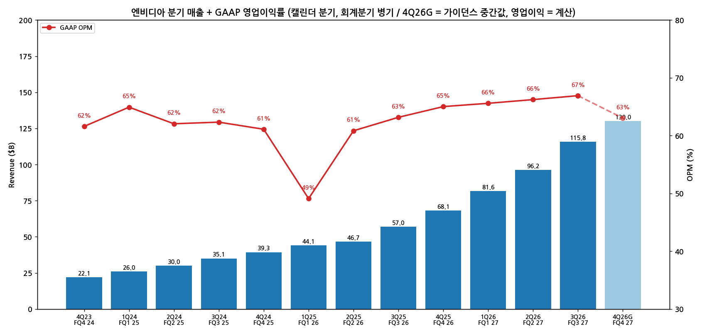
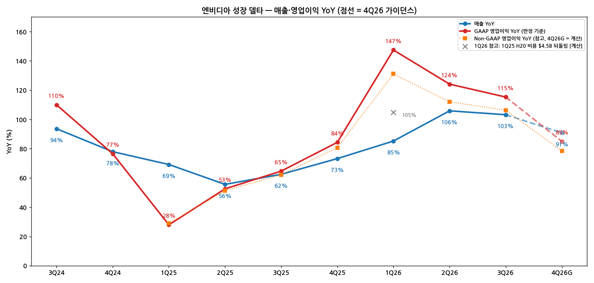

> 모드: 실적 리뷰 (v11)
> 종목: NVIDIA (NVDA)
> 섹터: 반도체
> 서브섹터: 로직·CPU
> 분기: 2026-Q3 (엔비디아 회계 FY27 Q3, 2026년 8～10월)
> 발표일: 2026-11-17 (ET, AMC) / 2026-11-18 KST
> 작성 시각: 2026-11-22 KST
> 분석 소스: SEC XBRL(10-Q·10-K, 1Q24～2Q26 GAAP 분기 매출·영업이익) + EDGAR 제출 목록(11/17 8-K Item 2.02, 11/12 8-K Item 5.02. 3Q 10-Q는 11/22 기준 미제출) + 첨부 셀사이드 14개 — Goldman Sachs(11/17), Morgan Stanley(11/18), HSBC(11/18), J.P. Morgan 아시아 테크(11/18), IBK투자증권(11/18), SK증권(11/18), 삼성증권(11/18), 대신증권(11/18), KB증권(11/18), 신한투자증권(11/18), NH투자증권(11/18), 하나증권(11/19), 유진투자증권(11/19), KB증권(11/20). 웹서치 보완 없음
> 리뷰 깊이: 풀 | 리서치 첨부 14건
> 비영업 요인: 저기저(1Q25 H20 재고·구매약정 비용 $4.5B → 1Q26 영업이익 YoY 부풀림) · 4Q26 가이던스 14주 분기(1주 추가)·경영진 교체 비용 · 비상장 지분 손상 $1.8B(영업외)

# NVIDIA 3Q26 (FQ3 FY27) 실적 리뷰 — 숫자는 또 이겼고, 시장은 숫자가 아니라 CEO 자리를 보고 있다

## 0. 한 줄 판정

> 성장 델타: **꺾임 (규칙 판정 — GAAP 영업이익 YoY +147% → +124% → +115%, 2개 분기 연속 둔화 + 4Q 가이던스 내재 약 +85%로 정점(1Q26) 통과. 매출 YoY는 +106% → +103%로 고원)** | 내러티브: **유지** (FY28 +75% 상향·추정치 상향 ↔ CEO 공백·조사·수출통제로 멀티플 하향이 상쇄) → **델타 꺾임 + 내러티브 유지 → 매매 제외(관찰) 구간. 이익 레벨과 추정치는 계속 올라가지만, 재진입 조건은 1Q FY28 가이던스의 이익 YoY 재가속 + CEO 선임** [판단]

> ⚠ 비영업 요인 플래그: 판정을 '꺾임'으로 만든 정점 1Q26 YoY +147%는 1Q25(FQ1 FY26) H20 재고·구매약정 비용 $4.5B가 만든 저기저 효과다. 이 비용을 되돌리면(1Q25 GAAP 영업이익 약 $26.1B) 1Q26 YoY 약 +105% → 2Q26 +124% → 3Q26 +115%로 '가속 후 1회 둔화' = 둔화 판정 [계산, 참고만 — 판정은 보고 기준]. 반대로 4Q26 가이던스는 1주가 더 있는 14주 분기인데도 이익 YoY가 약 +85%로 내려간다

→ 숫자: 매출 $115.8B(+103.2% YoY, +20.4% QoQ, 순증 $19.6B 역대 최대), GAAP 영업이익 $77.5B(+115.3% YoY, OPM 66.9%), Non-GAAP 영업이익 $77.9B(+106.3%, OPM 67.2%). 컨센 대비 매출 +6.2%, Non-GAAP 영업이익 +7.8%, EPS $2.68(+8.4%). Vera Rubin 출하 첫 분기 약 $20B
→ 가이던스: 4Q FY27 매출 $130B ±3%(+90.8% YoY, 컨센 $125.3B 대비 +4%, 14주), GPM 71～72%(저점), 내재 GAAP 영업이익 약 $82.0B(+85%) [계산]. **FY28(CY27) 매출 성장률 전망 +70% → +75%**(FY28 매출 약 $740B, 컨센 $695～700B 대비 +6～7%)
→ 쟁점: ① 젠슨 황 퇴진 후 첫 실적 — 이사회는 복귀 불가 명시, 후임 시한 없음 ② FY28 +75%는 신규 BIS 수출통제·중국 Hopper 중단 후에도 유효한가 ③ 4Q GPM 71～72% 저점 → FY28 72～73% 회복 ④ 네오클라우드 지원 '선별' 전환과 총 약정 $518B vs 잔여 자사주 $227B
→ 주가: 11/17 종가 $155.46(1개월 −27%), 시간외 +4.6% → 11/19 $145.98(KB). 12MF P/E 10.8배(5년 평균 33.5배, 대신)
→ 다음 분기 관건: 4Q $130B·영업이익 약 $82B 달성과 1Q FY28 가이던스 내재 GAAP 영업이익 YoY가 +85%를 다시 넘는지(1Q FY28 영업이익 $99B 이상), CEO 선임 시점

---

## 1. 숫자

① 연결 기준 분기 표 (캘린더 분기, 회계분기 병기)

단위: $M, %. **영업이익 = GAAP** (SEC XBRL. 4Q는 연간 − 1～3Q. 3Q26은 10-Q 미제출로 모건스탠리·HSBC가 정리한 회사 발표치 $77,520M). Non-GAAP은 FactSet 기준(삼성증권·신한투자증권 정리)

| 항목 | 4Q23 (FQ4 24) | 1Q24 (FQ1 25) | 2Q24 (FQ2 25) | 3Q24 (FQ3 25) | 4Q24 (FQ4 25) | 1Q25 (FQ1 26) | 2Q25 (FQ2 26) | 3Q25 (FQ3 26) | 4Q25 (FQ4 26) | 1Q26 (FQ1 27) | 2Q26 (FQ2 27) | **3Q26 (FQ3 27)** | 4Q26 가이던스 |
|---|---|---|---|---|---|---|---|---|---|---|---|---|---|
| 매출액 | 22,103 | 26,044 | 30,040 | 35,082 | 39,331 | 44,062 | 46,743 | 57,006 | 68,127 | 81,615 | 96,221 | **115,844** | 130,000 (±3%) |
| 영업이익 (GAAP) | 13,615 | 16,909 | 18,642 | 21,869 | 24,033 | 21,638 | 28,440 | 36,010 | 44,299 | 53,536 | 63,734 | **77,520** | 약 81,950 [계산] |
| OPM (GAAP) | 61.6 | 64.9 | 62.1 | 62.3 | 61.1 | 49.1 | 60.8 | 63.2 | 65.0 | 65.6 | 66.2 | **66.9** | 약 63.0 |
| 매출 YoY | +265.3 | +262.1 | +122.4 | +93.6 | +77.9 | +69.2 | +55.6 | +62.5 | +73.2 | +85.2 | +105.9 | **+103.2** | +90.8 |
| 영업이익 YoY (GAAP) | +984.0 | +690.1 | +174.1 | +109.9 | +76.5 | +28.0 | +52.6 | +64.7 | +84.3 | +147.4 | +124.1 | **+115.3** | 약 +85.0 |
| **매출 YoY 델타 (%p)** | — | −3.2 | −139.7 | −28.8 | −15.7 | −8.7 | −13.6 | +6.9 | +10.7 | +12.0 | +20.7 | **−2.7** | −12.4 |
| **영업이익 YoY 델타 (%p)** | — | −293.9 | −516.0 | −64.2 | −33.4 | −48.5 | +24.6 | +12.1 | +19.6 | +63.1 | −23.3 | **−8.8** | 약 −30.3 |
| Non-GAAP 영업이익 (참고) | — | — | — | — | — | 23,275 | 30,165 | 37,752 | 46,107 | 53,783 | 63,956 | **77,883** | 약 82,250 [계산] |
| Non-GAAP 영업이익 YoY (참고) | — | — | — | — | — | +28.9 | +51.3 | +62.2 | +80.7 | +131.1 | +112.0 | **+106.3** | 약 +78.4 |
| 영업이익 YoY (참고: 1Q25 H20 비용 $4.5B 되돌림) | — | — | — | — | — | — | — | — | — | 약 +104.8 | +124.1 | **+115.3** | 약 +85.0 |

→ (출처: SEC XBRL companyfacts — 4Q22 매출 $6,051M·영업이익 $1,256M은 FY23 연간 − 1～3Q로 계산. 3Q26 GAAP = 모건스탠리·HSBC 정리 회사 발표치. Non-GAAP 시계열 = 삼성증권·신한투자증권(FactSet). 4Q26 = 회사 가이던스 매출 $130.0B × GPM 71.5%(GAAP·Non-GAAP 동일 범위, 대신) − 영업비용 GAAP 약 $11.0B / Non-GAAP 약 $10.7B [계산])
→ 기준 주의: Non-GAAP 3Q25 기준치는 출처별로 다르다 — FactSet $37,752M(삼성·신한·SK) vs Visible Alpha $36,097M(HSBC·NH). 그래서 3Q26 Non-GAAP YoY가 +106.3%(삼성·신한)와 +115.8～116%(NH·HSBC·KB 11/20)로 갈린다. 이 표는 FactSet 기준

서프라이즈: 매출 컨센 $109.0～109.5B 대비 **+5.8～6.3%**(FactSet·LSEG·Visible Alpha — 삼성·대신·GS·HSBC), Non-GAAP 영업이익 $71.3～72.2B 대비 **+7.8～9.7%**(삼성·NH·GS), EPS $2.68 vs $2.44～2.48 **+8～10%**. 회사 가이던스 중간값($108B) 대비 매출 +7.3% — 직전 5개 분기 초과폭 3.9～5.7%를 처음 넘었다(대신). 4Q 가이던스 매출은 컨센 $124.8～125.3B 대비 **+3.8～4.2%**, GPM 71.5%는 컨센 71.5～72.2%와 같거나 소폭 하회(GS·MS·삼성)

(1) YoY 위치
→ GAAP 영업이익 YoY 정점은 1Q26(+147%)이다. 다만 이 정점은 1Q25 H20 비용 $4.5B가 만든 저기저 — 비용을 되돌리면 실질 정점은 2Q26(+124%) [계산]. 어느 기준이든 3Q26(+115%)은 정점 이후 두 번째 분기, 4Q26 가이던스(+85%)는 세 번째 감속
→ 매출 YoY는 2Q26 +106% → 3Q26 +103%로 고원, 4Q26 가이던스 +91%(14주 포함). 주 수를 보정하면 4Q 주당 순차 증가율은 4%대(대신)
→ 컨센 경로상 YoY는 계속 내려간다 — GAAP 영업이익 YoY 1Q27E: 모건스탠리 +72%($92.1B), HSBC +91%($102.1B). HSBC 경로라면 1Q27에 한 번 재가속, 모건스탠리 경로라면 감속 지속 [전망]. FY28 연간 매출은 회사 +75%, 모건스탠리 +56%

(2) QoQ로 다시 보기
→ 매출 QoQ: +19.8%(1Q26) → +17.9%(2Q26) → **+20.4%**(3Q26) → +12.2%(4Q26G). 분기 순증 +$13.5B → +$14.6B → **+$19.6B**(역대 최대) → +$14.2B
→ GAAP 영업이익 QoQ: +20.9% → +19.0% → **+21.6%** → 약 +5.7%(4Q26G). 4Q는 GPM이 3.4%p 내려가고(74.9% → 71.5%) 영업비용이 +20%(1주 추가·경영진 교체 비용, 대신) 늘어 이익 증분이 매출 증분의 3분의 1 수준으로 줄어든다 [계산]
→ 즉 3Q26 자체는 QoQ 가속 분기였고, 꺾임 판정은 YoY 기저(직전 1년의 고성장)와 4Q 마진 저점이 만든다 [판단]

→ (출처: SEC XBRL, 3Q26 모건스탠리·HSBC 정리 회사 발표치, 4Q26G = 가이던스 중간값·영업이익 계산)

→ (출처: 동일. 주황 = Non-GAAP(FactSet, 참고), 회색 × = 1Q25 H20 비용 되돌림 참고치 [계산])

② 사업부별 매출·영업이익

단위: $M, %. FY27(2026-Q1)부터 시장 플랫폼 기준으로 재편 — Data Center(Hyperscale + ACIE) + Edge Computing. 구 Gaming·ProViz·Auto·OEM은 Edge Computing으로 통합돼 첨부 리포트에 개별 수치 없음. **사업부 영업이익 미공개**(10-Q 미제출, 리포트에도 없음)

(1) 이번 분기 스냅샷

| 부문 | 3Q26 매출 | 비중 | 매출 QoQ | 매출 YoY | 2Q26 매출 | 3Q25 매출 |
|---|---|---|---|---|---|---|
| **Data Center** | **107,610** | **92.9** | +20.9 | +110.1 | 89,023 | 51,215 |
| └ Hyperscale | 60,136 | 51.9 | **+23.5** | +71.1 | 48,710 | 35,140 |
| └ ACIE (AI Cloud·Industrial·Enterprise) | 47,474 | 41.0 | +17.8 | **+195.3** | 40,313 | 16,075 |
| └ (참고) Networking | 21,000 이상 | 약 18 | — | +156 이상 [계산] | 미확인 | 8,187 |
| Edge Computing | 8,234 | 7.1 | +14.4 | +42.2 | 7,198 | 5,791 |
| **합계** | **115,844** | 100 | +20.4 | +103.2 | 96,221 | 57,006 |
| 영업이익 (GAAP) | 77,520 | OPM 66.9 | +21.6 | +115.3 | 63,734 | 36,010 |

→ (출처: 회사 발표치, 삼성증권 부문 표·모건스탠리·KB(11/18). Networking "210억 달러 초과"는 KB 11/18·11/20, 3Q25 Networking·Compute 분리는 SK증권 표. 중국향 라이선스 Hopper 매출 $2.4B 포함 — 4Q부터 출하 중단)
→ 분류 기준 주의: 하이퍼스케일·ACIE의 전년 기준치는 출처별로 다르다. 삼성·SK 시계열(3Q25 Hyperscale $35.1B)은 회사 발표 YoY(+71%/+195%, 모건스탠리·KB)와 맞고, 하나·신한·IBK 시계열(3Q25 Hyperscale $30.3B)로 계산하면 +98%/+127%. 회사가 과거 고객 분류를 재작성한 것으로 보인다 [판단]. 이 표는 회사 발표 YoY와 맞는 삼성·SK 기준

(2) 부문별 매출 YoY 추이

| 부문 | 1Q25 | 2Q25 | 3Q25 | 4Q25 | 1Q26 | 2Q26 | **3Q26** | 방향 |
|---|---|---|---|---|---|---|---|---|
| Data Center | +73.3 | +56.4 | +66.4 | +75.1 | +92.4 | +116.6 | **+110.1** | 고원(정점 2Q26) |
| └ Hyperscale | +103.7 | +80.1 | +124.7 | +111.6 | +93.4 | +101.5 | **+71.1** | 둔화(고기저) — QoQ는 +23.5%로 가속 |
| └ ACIE | +44.9 | +31.7 | +6.2 | +28.6 | +91.1 | +138.1 | **+195.3** | 가속 지속 |
| Edge Computing | +42.2 | +49.9 | +34.3 | +55.0 | +28.7 | +27.5 | **+42.2** | 재가속 |

→ (출처: 삼성증권 부문 표(FactSet·회사), 회사 재작성 기준)

(3) 해석 — 누가 델타를 끌고 누가 꺾이나
→ **YoY 델타를 끄는 곳 = ACIE.** +195%(전년 3배)는 주요 네오클라우드향 Vera Rubin 출하와 프런티어 랩의 자체 데이터센터 구축 시작(KB·하나). 소버린 AI 매출 YoY 3배 이상, 피지컬 AI 매출 YoY 3배 가까이·연간 $25B 초과 전망, 금융 서비스 온프렘 최근 12개월 약 $5B(2배 이상)(KB 11/20)
→ **QoQ 증분을 끄는 곳 = Hyperscale.** 3Q 매출 순증 $19.6B 중 하이퍼스케일 +$11.4B(58%) [계산]. Vera Rubin 램프 + Grace Blackwell 강세(대신). YoY가 +71%로 낮아 보이는 건 3Q25 기저(+125%)가 높아서다
→ **엇갈리는 신호**: SK증권은 ACIE QoQ 성장률이 2Q +25% → 3Q +18%로 둔화하고 데이터센터 내 하이퍼스케일 비중이 1%p 오른 점을 "하이퍼스케일 쏠림"으로 읽었다. 신한은 "신제품 초기 물량 배정 차이"로 추정. 4Q는 ACIE가 성장 최대 기여 부문이라는 회사 설명(모건스탠리)
→ **Networking**: $21B 초과(3Q25 $8.2B 대비 2.5배 이상), CPO 스케일아웃 스위치 양산 — Lambda가 GB300 1만 개 이상을 CPO 스위치로 연결(KB 11/20). 데이터센터 매출의 약 20%로 Compute 다음 성장 축 [계산]
→ **Edge Computing**: 블랙웰 워크스테이션·피지컬 AI 엣지 수요로 +42%. 반면 메모리·시스템 가격 상승으로 소비자 PC 수요는 약해졌다(KB 11/20) — AMD Client 감소(AMD 리뷰)와 같은 원인

(4) 섹터 KPI — 제품·공급 지표
→ Vera Rubin: 출하 첫 분기 약 $20B(데이터센터의 약 19%, 유진·KB). Blackwell 첫 분기 $11B 대비 약 2배, 100만 개 이상 GPU 출하 추정(JPM). 하이퍼스케일러 양산 전환 1개월(Grace Blackwell의 절반, 대신)
→ 구매 약정(Supply commitments): $279B → **$390B**(+40%, 대부분 다년 메모리, GS·KB). 재고 $31.6B → $39.7B(DOI 124일), 매출채권 $63.1B → $81.0B(DSO 64일, GS·KB)
→ 가격: Hopper 다년 재계약 단가 최초 대비 최대 2배, B300 임대료 출시 후 +60% 이상, 전 고객 가동률 최대(대신·KB). 토큰 가격은 5월 이후 약 −60%(대신)

③ 연간

단위: $M, %. 회계연도(1월 결산) — FY27 ≈ CY2026

| 항목 | FY23 (CY22) | FY24 (CY23) | FY25 (CY24) | FY26 (CY25) | **FY27E (CY26)** | FY28E (CY27) |
|---|---|---|---|---|---|---|
| 매출액 | 26,974 | 60,922 | 130,497 | 215,938 | **약 423,680** | 660,423～759,565 |
| 영업이익 (GAAP) | 4,224 | 32,972 | 81,453 | 130,387 | **약 276,740** | 421,395～482,240 |
| OPM (GAAP) | 15.7 | 54.1 | 62.4 | 60.4 | **약 65.3** | 63.8～65.1 |
| 매출 YoY | +0.2 | +125.9 | +114.2 | +65.5 | **+96.2** | +56～79 |
| 영업이익 YoY (GAAP) | −57.9 | +680.6 | +147.0 | +60.1 | **+112.2** | +52～74 |
| Non-GAAP 영업이익 (참고) | — | 37,134 | 86,788 | 137,299 | 276,435 (컨센) | 472,775 (컨센) |

→ (출처: FY23～FY26 SEC XBRL 10-K. FY27E = 1～3Q 실적 + 4Q 가이던스 중간값·계산 영업이익 합산 [계산]. FY28E 매출 범위 = 모건스탠리 $660.4B ～ GS(CY27) $759.6B, 회사 +75% 적용 시 약 $741B(대신·KB 11/20 계산). GAAP 영업이익 범위 = 모건스탠리 ～ HSBC. Non-GAAP 컨센 = FactSet(KB 11/20), 신한(FY24～26 Non-GAAP))
→ 연간 컨센 변화(Non-GAAP 영업이익): FY27 $268.9B(Visible Alpha, 발표 전, HSBC) → $276.4B(FactSet, 11/20, KB) **+2.8%**, FY28 $459.7B → $472.8B **+2.9%**. 하우스 추정은 HSBC FY28 영업이익 +6.9%($452.4B → $483.5B), GS CY27 Non-GAAP 영업이익 +5.7%($474.8B → $502.0B), 모건스탠리 FY28 EPS +14.6%($13.37 → $15.32). 집계 출처 서로 다름 — 추정치는 **전부 상향**

---

## 2. 시장 쟁점

① 2-0. 지난 리뷰에서 "봐야 할 것"으로 남긴 항목 체크

> 직전 분기(2026-Q2) 리뷰는 작성되지 않음. 2026-Q1 리뷰 기반 팔로업(`earnings-followup/2026-Q2_NVDA_팔로업.md`) 4번 항목을 두 분기 누적 체크

| 직전 팔로업 항목 | 이번까지 결과 | 판정 |
|---|---|---|
| Vera Rubin 시점·디테일 (1순위) | 8월 양산 출하 시작, 3Q 첫 분기 약 $20B(사내 최단기 램프). Rubin Ultra(2027)·Feynman(2028) 로드맵 유지(유진·삼성) | **확인** (기대 초과) |
| 3Q 가이던스 $100B+ 진입 | 2Q 발표 시 3Q 가이던스 $108B → 실적 $115.8B. 4Q 가이던스 $130B | **확인** (기대 초과) |
| 자사주 분기 $20B+ 페이스 | 3Q 자사주 $22.1B + 배당 $6.0B = 사상 최대 $28.1B. 9월 한도 $150B 추가 승인, 잔여 $227.3B를 FY28 말까지 소진 | **확인** |
| China 재개 (H20·C200/B30) | 3Q 라이선스 Hopper 중국 매출 $2.4B 있었으나 **출하 중단**, 가이던스 6개 분기 연속 제외. 신규 BIS 수출통제(제한 지역 데이터센터 렌털) 발표 | **반대로 나옴** |
| ACIE 소버린 AI 메가딜 | ACIE +195% YoY, 소버린 AI 매출 YoY 3배 이상, 호주 최대 2GW 부지·전력·건물 개발(KB 11/20) | **확인** |

→ 성장 축(Rubin·가이던스·ACIE)은 기대 이상, 중국 옵션은 사실상 소멸. 직전 팔로업이 예상하지 못한 변수 — **CEO 퇴진**(11/12 공시)이 이번 분기 최대 쟁점이 됐다

② 2-1. 이번 분기 쟁점

| # | 쟁점 | 한 줄 정의 | 언급 증권사 |
|---|---|---|---|
| 1 | 젠슨 황 없는 엔비디아 | 창업자 퇴진·이사회 복귀 불가 선언·조사 진행 속에서 사업 연속성과 멀티플은 어떻게 되나 | 12/14 |
| 2 | FY28 +75% — 수요·공급·수출통제 | 70% → 75% 상향은 신규 BIS 규제·중국 중단·네오클라우드 축소를 다 빼고도 유효한가 | 14/14 |
| 3 | 마진 4Q 저점 | GPM 74.9% → 71～72% → FY28 72～73%, 메모리 원가와 ASIC 경쟁 속 가격결정력 | 13/14 |
| 4 | 생태계 금융 지원 vs 주주환원 | 네오클라우드 '선별' 전환, 총 약정 $518B·보증 $118B·매출채권 $81B와 잔여 자사주 $227B의 균형 | 12/14 |

③ 2-2. 쟁점별 분해

(1) 쟁점 1 — 젠슨 황 없는 엔비디아

(1-1) 회사 설명 (리포트가 전한 그대로)
→ 경위: 11/12 창업자 CEO 젠슨 황의 CEO·이사직 사임(EDGAR 8-K Item 5.02, 11/12 제출). 표현은 리포트마다 다르다 — "자진 사임"(KB 11/18), "사임이 수용돼 복귀 계획 없음"(대신), "이사회가 젠슨 황 해임에 대해 만장일치로 동의"(삼성, 이사회 의장 발언 인용)
→ 이사회 입장: 의장이 컨콜에서 "젠슨 황을 CEO로 복귀시킬 의사가 없다"고 명시(GS·HSBC·JPM·삼성). 콜 직전 젠슨 황이 X를 통해 복귀 의사를 밝혔고(삼성), 테크 동맹들의 압박과 복귀 의사 보도(WSJ 11/17)가 있었다(HSBC)
→ 후임: 콜레트 크레스 CFO가 임시 CEO. Heidrick & Struggles를 통해 내·외부 후보 검토, "첨단 반도체 기술과 국가안보 환경 변화를 함께 이해하는 인물", 시한 제시 없음·서두르지 않음(GS·NH·KB)
→ 거버넌스: 이사회에 국가안보·수출통제 감독위원회 신설, 기존 국가안보팀·글로벌 무역 컴플라이언스팀이 위원회와 임시 CEO에 직접 보고(GS). 정부 조사에 협조 중(GS). 모건스탠리는 DOJ·SEC 조사 보도와 CEO 교체 관련 회사 내부 조사를 함께 언급, 대신은 보도자료 면책 조항에 경영진 교체·이사회 독립위원회 조사·규제 문의가 나열됐다고 적었다
→ 사업: "사업은 평소대로" — 고객·공급사·파트너 지지, TSMC 경영진 금주 방문, 메모리·첨단 패키징 확보 완료, 제품 로드맵(CPO·Rubin Ultra·Feynman) 기존 일정(KB·삼성·NH·유진)

(1-2) 증권사별 해석 편차

| 증권사 | 핵심 가정·추정 | 논리 |
|---|---|---|
| GS (Buy, TP $220 유지) | 12～18개월 재무 영향은 "제한적", 멀티플 영향은 더 큼 | 백로그 12～24개월·로드맵 2～3년이 이미 실행 단계. 하방 리스크 1순위로 경영진 교체 불확실성 |
| 모건스탠리 (OW, TP $267 → $260) | 멀티플 20배 → 12배(FY29로 이월) | 리더십 변화에 따른 불확실성으로 멀티플 소폭 하향. "영구 CEO 없이는 투자자가 완전히 사기 어렵다", 다만 가장 큰 멀티플 압축은 지나갔다 |
| HSBC (Hold, TP $170 유지) | 목표 P/E 11배 → 10배 | ① 영구 승계 계획 ② 새 리더십의 로드맵 실행력이 확인될 때까지 의미 있는 재평가 어려움. "CEO 불확실성을 감안하면 지금이 최선" |
| SK증권 | 3가지 경계 지점 | ① 밸류체인 지배력(TSMC와 30년 계약서 없는 신뢰 관계) → ASIC·AMD 침투 용이 ② 인재 유지(임원 60여 명 직보 조직, 'Stand with Jensen' 청원에 현직 직원이라 밝힌 6,700명 이상/전체 약 4만 명) ③ AI 랩 권위 강화 |
| 대신 | 단기 주가는 실적보다 CEO 선임 시점이 좌우 | FactSet 평균 TP 30일 새 −16%($334.45 → $280.78), 리비전 상향 2·하향 28 — 실적 외 요인이 할인에 반영 |
| 삼성 | "시간이 많이 걸릴 것" | 12MF P/E 10.7배(5년 −2SD 이하, "폭탄 세일") — 다만 수출규제·차기 CEO·전략 변화 가능성 해소 후에도 데이터센터 지연·AI 수요 우려가 남는다 |
| 유진 | "충분히 반영된 우려" | 다년 로드맵·시장 지배력 감안 시 리스크 상당 부분 주가 반영, 손익비 우호 |
| 신한·KB·NH | 성장 가이던스 상향이 CEO 우려 상쇄 | "CEO 사임 이후 성장 가시성 축소 우려 상쇄"(신한) |

(1-3) 공통 결론 vs 갈리는 지점
→ 공통(12/12): 단기 실적·FY28 숫자에는 영향이 없거나 제한적. 불확실성은 멀티플로 간다
→ 갈림: **얼마나 오래, 어디까지 가나.** 모건스탠리·유진은 "멀티플 압축은 대부분 끝났다", HSBC·삼성·대신은 "선임과 실행 확인 전까지 재평가 없음", SK는 밸류체인 지배력·인재 이탈이라는 **사업 자체의 경로**를 리스크로 든다

(1-4) [판단]
→ 숫자로 보면 CEO 공백은 아직 실적에 없다 — 3Q는 가이던스 초과폭 역대 최대, FY28 상향. 다만 이번 분기 숫자는 젠슨 황 체제가 수주·공급을 확보해 둔 결과다(백로그 12～24개월, GS). **CEO 공백의 실적 영향은 FY28 하반기 이후 신규 공급 계약·차세대(Feynman) 실행에서 처음 나타날 수 있다** [판단]
→ 결론을 바꿀 데이터: ① 후임 CEO 발표(내부 vs 외부, 기술 리더 여부) ② 핵심 임원·엔지니어 이탈 보도 ③ DOJ·SEC·내부 조사 결과 ④ 1Q FY28 가이던스가 FY28 +75% 경로를 유지하는지

(2) 쟁점 2 — FY28 +75%, 수요·공급·수출통제

(2-1) 회사 설명
→ "수요가 계속 늘고 공급망 지원으로 추가 물량을 확보해 70% → 75% 상향. FY27 기반이 이미 높아진 상태라 의미가 크다. 이번 주 발표된 새 수출통제는 검토 중이지만 확보한 수요·공급을 감안하면 75%는 달성 가능"(컨콜, KB 11/20·NH). 실제 수요가 100% 수준인지는 확답 없음(대신)
→ 수요 근거: 클라우드 업계 수주잔고 $2.0T → $2.5T, 하이퍼스케일러 클라우드 매출 성장률 6개 분기 연속 가속, 오픈라우터 주간 토큰 YoY 35배·3개월 3.5배(80%가 에이전틱), 에이전틱 수요가 2028년까지 이월(KB·NH·JPM)
→ 공급 근거: 구매 약정 $390B(+$111B), Kinsus·삼성전기(기판)·SPIL(첨단 패키징) 신규 계약. Kinsus는 엔비디아 전용 ABF 기판 생산능력 3.5배 이상 확대(HSBC)
→ 중국: 3Q 라이선스 Hopper $2.4B, 이후 출하 중단·가이던스 미반영. BIS 신규 규정 = 엔비디아 고객의 제한 지역(중국 포함) 데이터센터 렌털 제한(GS)
→ 제품: FY28 CPU 매출·엔터프라이즈 매출 각각 2배 이상(모건스탠리·KB). 프런티어 랩은 FY27 데이터센터 매출의 약 15%(JPM·KB)

(2-2) 증권사별 해석 편차

| 증권사 | FY28 (CY27) 매출 YoY | 논리 |
|---|---|---|
| GS | CY27 +78.3% ($759.6B, 직전 +74%) | 신규 고객군(AI 랩·네오클라우드·소버린) 채택 증거. 회사는 BIS 영향을 반영하고도 CY27 상방을 본다 |
| HSBC | +74.5% ($740.3B, 직전 +68%) | CoWoS 배정 상향으로 이미 FY28 DC 추정 +8%. 수출통제 강화 시 FY28 매출 최대 −11% 민감도 |
| 대신·KB | 약 +75% (약 $740B) | 회사 전망 그대로 적용 시 컨센 $694.9B 대비 +7% 안팎 |
| 삼성 | FactSet 컨센 대비 약 +7% | 성장률이 '현재' 올해 매출 전망 기준이라 실제 증액 폭은 더 큼. 직전 발표에서 수요대로면 100%도 가능했다고 언급 |
| 모건스탠리 | +55.7% ($660.4B, 직전 +53.5%) | 상향하되 보수적 유지 — BIS 규제·금리 상승이 수요에 영향 줄 수 있다고 회사도 인정 |
| JPM 아시아 | 투자자 예상(의미 있는 하향)과 반대 | 수급 격차가 커서 중국·BIS·네오클라우드 할인 후에도 상향. 공백은 동남아 클라우드 출하·원격 클라우드 접속 제외 규모 |

(2-3) 공통 결론 vs 갈리는 지점
→ 공통(14/14): 발표 전 시장은 하향을 걱정했는데 상향이 나왔다. 성장 제약은 수요가 아니라 공급
→ 갈림: **+75%를 그대로 믿느냐.** GS·HSBC·국내사는 회사 가이던스를 반영(+74～78%), 모건스탠리만 +56%로 20%p 가까이 할인. 핵심 변수는 BIS 렌털 규제의 범위와 동남아 물량(JPM)

(2-4) [판단]
→ 회사가 CEO 공백·조사·신규 규제라는 최악의 타이밍에 가이던스를 올렸다는 것 자체가 정보다 — 모건스탠리도 "업데이트를 안 할 가능성이 크다고 봤다"고 적었다. 구매 약정 +$111B로 공급을 먼저 묶어 둔 만큼 FY28 매출 하단은 단단하다 [판단]
→ 다만 델타 관점에서 +75%는 FY27 +96% 대비 감속이다. 분기 YoY는 4Q +91% → FY28 평균 +75%로 내려가는 경로 — 이익 YoY 재가속은 매출보다 마진 회복(쟁점 3)과 기저(1Q27 1Q26 $53.5B)에 달렸다 [전망]
→ 결론을 바꿀 데이터: BIS 규정 세부(렌털 범위), 동남아 클라우드 출하, 하이퍼스케일러 4Q 실적의 2027 CapEx 가이던스(1～2월)

(3) 쟁점 3 — 마진 4Q 저점, FY28 회복

(3-1) 회사 설명
→ 3Q GPM 74.9%(GAAP 74.8%) — 가이던스 74.0% 상회, Rubin 초기 램프로 QoQ −0.1%p(KB 11/20)
→ "지난 분기 공급 원가가 크게 올라 FY27 하반기·FY28 전망을 다시 짰고 원가 상승분의 상당 부분을 흡수해 반영. 4Q는 기존 주문을 이전 가격으로 이행해 저점(71～72%), 새 가격이 적용되는 FY28은 72～73% — 달성 자신 있음"(컨콜, KB 11/20·NH)
→ 장기 가격은 "시스템 성능과 전체 로드맵이 주는 가치를 반영해 계속 검토"(NH). 4Q 영업비용 GAAP 약 $11.0B·Non-GAAP 약 $10.7B(+20% QoQ, 1주 추가·경영진 교체 비용)(대신)

(3-2) 증권사별 해석 편차

| 증권사 | 핵심 가정·추정 | 논리 |
|---|---|---|
| 유진 | FY28 GPM 72.5% 회복 | 부품 가격 상승분 반영해 2027년 초 출하분부터 **ASP 15% 이상 인상** 예정. 4Q GPM 하락은 2Q 발표 때 이미 예고 → 영향 제한 |
| 하나 | 가시성 높은 가이던스 | 고객사와 가격 협상이 마무리됐기 때문 |
| GS | CY27 72.5%, CY28 72.0%(직전 72.9%, −94bp) | 매출은 올리고 장기 마진은 낮춤 |
| 모건스탠리 | FY28 GAAP GPM 72.3% | "Gross margins, all as advertised" |
| IBK | 4Q 하락 원인 = Rubin 초기 생산 비용 + 메모리 원자재 가격 | 구매 약정 증가분 상당 부분은 메모리 LTA로 추정 → HBM4·SOCAMM 수요 |
| SK | ASIC 장기 마진 질문에 답 듣기 어려웠다 | 모델사들은 엔비디아의 높은 마진을 좋아하지 않는다 |
| 대신 | 4Q 저점 재확인, 8월에 열어둔 경로 이탈 없음 | Hopper 재계약 단가 최대 2배·B300 대여료 +60% = 가격결정력 |

(3-3) 공통 결론 vs 갈리는 지점
→ 공통: 4Q 71～72%가 저점, FY28 72～73% 회복은 신뢰(가격 재협상·ASP 인상)
→ 갈림: **2028년 이후.** GS는 CY28 72.0%로 낮췄고, SK는 ASIC·AI 랩의 마진 압력을 구조적 리스크로 본다

(3-4) [판단]
→ 메모리 섹터 리뷰의 "HBM 2027 가격 큰 폭 인상"이 엔비디아에게는 원가다. 엔비디아가 AMD와 다른 점은 이를 **판가 15% 인상으로 넘길 수 있다**는 것 — AMD가 HBM 원가를 고객과 '분담'하며 GPM 55%에 묶인 것과 대비된다(AMD 리뷰) [판단]
→ 이익 YoY 관점: GPM이 74.9%에서 71.5%로 3.4%p 내려가는 4Q가 이익 델타의 바닥이고, 1Q FY28 GPM이 72%대로 돌아오면 이익 YoY가 매출 YoY에 다시 붙는다 [전망]
→ 결론을 바꿀 데이터: 1Q FY28 GPM 가이던스(72% 이상 여부), HBM4 2027 계약가 보도, ASIC(TPU·Trainium) 신규 대형 수주

(4) 쟁점 4 — 생태계 금융 지원 vs 주주환원

(4-1) 회사 설명
→ 약정: 총 미래 약정 $518B(직전 $366B) = 공급·생산능력 $390B + 데이터센터 임차 $74B + 클라우드 서비스 $28B + 지분투자 $20B + CapEx $6B(GS). 네오클라우드 약정 $32B, 보증 최대 노출 $118B(PORTS-Pike 캠퍼스 토지·전력·건물 신용보강 $105B 포함 — 약 4.25GW, OpenAI 20년 리스, 첫 효력 FY29)(KB 11/18·HSBC)
→ 새 공시 문구: "네오클라우드 약정은 네오클라우드가 인프라·컴퓨트 구매 자금을 확보해야만 효력이 생기며, 그렇지 못하면 축소·소멸될 수 있다"(CFO 코멘터리) → 크레스 "바뀐 것은 없고 질문이 많아 명확히 적은 것"(KB 11/20·NH)
→ 기조: "시장이 성숙하고 다른 자금원이 늘어나는 만큼 향후 투자·약정·보증은 엄격히 평가. 지원은 부지·전력·건물(LPS) 확보 우선, 인프라 금융 파트너와 투자등급 고객 선급금 활용. 공급 배분은 가동 준비도·자금 조달·오프테이크 기준, 가격은 모든 고객 동일"(KB·NH·대신)
→ 환원: 3Q $28.1B(자사주 $22.1B·배당 $6.0B), 연초 이후 FCF의 65%. "전략적 용도를 뺀 초과 FCF 전액 환원", 잔여 $227.3B를 FY28 말까지 소진. 자본 배분 1순위는 공급사 선급금(KB 11/20)
→ 현금흐름: 3Q FCF $43.8B(2Q $21.3B의 2배), FCF/조정 순이익 40% → 67%. 매출채권 $81.0B(DSO 60 → 64일 — Rubin 출하 시점·투자등급 대형 고객 결제 기간 연장), 비상장 지분 $65.5B, 3Q 비상장 지분 손상 $1.8B(KB 11/18)

(4-2) 증권사별 해석 편차

| 증권사 | 핵심 가정·추정 | 논리 |
|---|---|---|
| SK | "네오클라우드 선 긋기" | 보증 범주를 '수요 부족'으로 좁히고 지원 대상을 "매우 엄격히(very strong look)" 검토 → 신생 업체 조달 어려워짐. 하이퍼스케일 쏠림 심화 |
| KB 11/18 | 축소가 아닌 선별 | 실적 후 시간외 네비우스 +11.3%·아이렌 +10.2%·코어위브 +9.0%. GPU 임대가 상승 = 추가 CapEx 없는 매출 |
| 유진 | 상위(코어위브·네비우스) 우호 유지, 중소형 제한 | 재무구조·실행력 기준 선별 |
| NH·하나 | 건전한 투자 환경 구축 | 안전장치 명문화는 시장 우려 대비 긍정적 |
| 모건스탠리 | 약정·보증 합계 $668B(직전 $530B) = 양날의 검 | 마진 가시성의 근거이자 AI 수요 둔화 시 부담. 소형 고객 백스톱 의지는 줄지 않았다 |
| KB 11/20 | 잔여 한도 소진 = 분기 평균 약 $45.5B(3Q의 2.1배) | 지분투자(분기 $15～20B)가 줄면 환원 여력 확대. FY28 FCF 약 $290B 추정으로 충분 |
| KB 11/18 | 주가 하락으로 같은 한도로 발행주식 5.8% 매입 가능 | FY28 말까지 누적 EPS 증대 약 4.8%(직전 3.1%) |
| GS | 초과 현금 전액 환원 = 경영진이 주가 저평가로 본다는 신호 | 생태계 투자와 환원의 균형 |

(4-3) 공통 결론 vs 갈리는 지점
→ 공통: 네오클라우드 지원은 '중단'이 아니라 '선별', 주주환원 우선순위는 강해졌다
→ 갈림: **선별이 ACIE 성장에 주는 영향.** SK는 네오클라우드 성장 둔화·하이퍼스케일 의존 심화로, KB·유진은 상위 네오클라우드 중심의 질적 개선으로 읽는다

(4-4) [판단]
→ 이번 분기 가장 눈에 띄는 숫자 변화는 현금이다 — FCF 2배, 환원 사상 최대. 그러나 매출채권(+$17.9B QoQ)·재고(+$8.1B)가 매출(+$19.6B)과 비슷한 속도로 늘고 있다 [계산]. 이익의 질은 4Q·1Q의 DSO가 64일에서 멈추는지로 확인해야 한다 [판단]
→ ACIE +195%의 일부는 엔비디아 자신의 약정·보증이 받친 수요다. 지원이 '선별'로 바뀐 첫 분기인 4Q에서 ACIE가 회사 말대로 최대 성장 기여 부문이 되는지가 이 쟁점의 검증 지점 [판단]
→ 결론을 바꿀 데이터: 4Q ACIE QoQ 성장률(3Q +17.8%), 매출채권·DSO, 분기 자사주 매입액($45B 페이스 여부), 네오클라우드 자금 조달 뉴스

④ 2-3. 낙관 vs 보수 — 논리 대비

| 구분 | 증권사 | 무엇을 다르게 가정했나 |
|---|---|---|
| 가장 낙관 | GS (Buy, TP $220) | CY27 매출 +78%·Non-GAAP 영업이익 $502B — 회사 가이던스보다도 높다. 12～18개월 재무 영향 제한, 멀티플(정상화 EPS $10 × 22배) 유지 |
| 낙관 | KB(운용 비중 확대) | 12MF ROE 68.8%(S&P 500의 3배)인데 P/B 9.9배(2019년 수준), PEG 0.2배. 자사주 효율 상승 |
| 보수 | HSBC (Hold, TP $170) | 숫자는 올리되(FY28 EPS +7%) 목표 P/E 10배로 낮춤 — 승계·실행 확인 전 재평가 없음 |
| 보수 | 모건스탠리 (OW, TP $260) | 등급은 긍정이지만 FY28 매출 +56%로 회사 +75%를 크게 할인, 멀티플 12배 |
| 보수 (국내) | 삼성 | 실적·밸류는 매력적이나 수출규제·CEO·데이터센터 지연·AI 수요 조정 우려까지 "시간이 걸릴 것" |

→ 핵심 차이는 **멀티플 가정**이지 숫자가 아니다. FY28(CY27) EPS 추정은 $15.3～18.0(모건스탠리·HSBC·GS)으로 상대적으로 좁은데 TP는 $170～260으로 넓다 — 차이는 거의 전부 적용 P/E(10배 vs 12배 vs 정상화 22배)
→ 셀사이드 vs 시장: 셀사이드는 숫자 상향 일색인데 주가는 실적 후 시간외 +4.6%에서 이틀 만에 $145.98(11/17 종가 대비 −6.1%, KB 11/20)로 밀렸다. JPM은 발표 전 테크 투자자 심리를 "4년 내 가장 약세"로, GS는 투자자 포지셔닝을 "중립～부정"으로 적었다 — 바이사이드는 아직 숫자보다 불확실성을 가격에 넣고 있다 [판단]

⑤ 2-4. 추정치·TP 변화

단위: $, $B. 국내 증권사는 자체 TP 없음 → 인용 컨센 TP 기재

| 증권사 | 의견 / TP | TP 변화 | 4Q FY27 영업이익 E | FY27E / FY28E 영업이익 | 핵심 변화 한 줄 |
|---|---|---|---|---|---|
| GS | Buy / **$220** | 유지 | EPS $2.81 (가이던스 내재) | Non-GAAP CY26 280.0 / CY27 502.0 | CY27 영업이익 +5.7%, EPS +7.8% — 정상화 EPS $10 × 22배 유지 |
| 모건스탠리 | OW / **$260** | $267 → $260 (−2.6%) | GAAP 82.3 | GAAP 277.1 / 421.4 | FY28 EPS $13.37 → $15.32, 멀티플 20배 → 12배(FY29 EPS $21.04 기준) |
| HSBC | Hold / **$170** | 유지 | Non-GAAP 82.6 | Non-GAAP 278.2 / 483.5 | FY28 EPS +7%, 목표 P/E 11배 → 10배 |
| JPM (아시아 테크) | NVDA OW (Harlan Sur 커버) | — | — | — | 공급망 이익 하향 우려 대비 주문 취소 증거 없음 |
| 대신 | 비중확대 / FactSet $280.78 | 30일 전 $334.45 (−16%) | — | 268.9 / 454.4 (LSEG) | FY28 회사 전망은 컨센 +7% |
| KB 11/18 | 운용 비중 확대 / — | — | — | — | 자사주 속도 2배, P/B 9.9배 |
| KB 11/20 | 운용 비중 확대 / FactSet $244.01 | — | — | 276.4 / 472.8 (FactSet) | 분기 환원 약 $51.5B 필요 |
| 신한 | ★★★★★ / LSEG $262.5 | — | Non-GAAP 79.7 | 275.3 / 453.1 | 불안감 완화 |
| 삼성 | — / Bloomberg $263.86 | — | — | — | 시간은 걸릴 것 |
| NH | — / FactSet $249.7 | — | 79.4 (발표 전 컨센) | 268.6 / 453.1 | 견조한 수요·Rubin 조기 안착 |
| 하나 | — / 컨센 $256.1 | — | — | GAAP 272.6 / 463.1 (Bloomberg) | 과락 구간에서 회복 |
| 유진 | NR | — | — | 269.3 / 455.7 (Bloomberg) | 충분히 반영된 우려 |
| SK | — | — | — | 269.3 / 455.7 (Bloomberg) | 젠슨황 없는 엔비디아 |
| IBK | — | — | — | — | HBM4·SOCAMM 본격화 |

→ 하우스 TP 3곳(GS·MS·HSBC): 평균 $216.7(직전 $219.0 대비 −1.1%), 상향 0·하향 1·유지 2. 인용 컨센 TP $244～281(6개 출처), 11/17 종가 $155.46 대비 +57～81%
→ 4Q FY27 영업이익: 발표 전 컨센 Non-GAAP $79.4～79.8B(NH·SK·신한) → 가이던스 내재 약 $82.3B(**+3～4%**)
→ **TP 하향은 실적이 아니라 멀티플 하향이다** — 모건스탠리는 EPS를 +15% 올리고 멀티플을 깎았고, HSBC는 EPS +7%·P/E −1배로 TP를 유지했다. FactSet 평균 TP 30일 −16%(하향 28건)도 같은 기간 EPS 추정은 오히려 올랐다(대신) [판단]

---

## 3. 내러티브 점검

① 성장 스토리 정의
→ "AI 컴퓨트 수요가 공급을 계속 웃도는 가운데, GPU·CPU·네트워킹·소프트웨어를 묶은 랙 단위 시스템으로 데이터센터 매출의 90% 이상을 가져가고, 그 이익을 공급망 선점과 주주환원에 동시에 쓴다"

② 이번 분기 평가 — **유지** (두 축이 반대로 움직여 상쇄)
→ 강화된 축(숫자): 가이던스 초과폭 역대 최대, Rubin 첫 분기 $20B, FY28 +75% 상향, 구매 약정 $390B, 추정치 전원 상향, FCF 2배·환원 사상 최대
→ 약화된 축(멀티플·지배구조): 창업자 퇴진과 복귀 불가 선언, DOJ·SEC·내부 조사 보도, 신규 BIS 수출통제와 중국 Hopper 중단, 네오클라우드 지원 '선별' 전환. 하우스 TP는 멀티플 하향으로 정체, 컨센 TP 30일 −16%
→ 훼손은 아니다: 스토리의 핵심 전제(수요 > 공급, 엔비디아 점유율·가격결정력)는 숫자로 재확인됐다. 다만 SK가 든 '밸류체인 지배력·인재'는 전제 자체에 대한 첫 질문이다 [판단]

③ 국면 — 델타 꺾임(규칙) × 내러티브 유지
→ 비유하면 엔비디아는 여전히 가장 빠른 차지만, 지난 1년간 가속 페달을 끝까지 밟아 온 탓에 속도계(YoY)의 바늘은 정점에서 내려오는 중이고, 운전석(CEO)이 비어 있다. 차는 잘 달리지만(QoQ +20%), BT 프레임이 보는 것은 '속도가 더 붙느냐'다
→ 판정 기준상 GAAP 영업이익 YoY 2개 분기 연속 둔화 + 정점 통과 = 꺾임. 단 첫 번째 둔화는 1Q25 H20 비용 저기저 효과이고(⚠ 플래그), 3Q 자체는 QoQ 가속 분기였다. 보정 기준이면 '둔화'
→ 로직·CPU 서브섹터 안에서: 엔비디아 3Q 매출 $115.8B는 CPU 3사(AMD·Intel·Arm) 3Q26 합산 $31.3B의 3.7배, 4사 합산의 약 79% [계산, 섹터 리뷰]. 영업이익 YoY +115%는 AMD(Non-GAAP +75%)·TSMC(NT$ +75%)보다 높지만 방향은 AMD(4Q 재가속 가이던스)와 반대로 내려가는 중 [판단]
→ BT 프레임: 이익 레벨·추정치가 오르는데 델타가 내려가는 '고점권 이익 성장주' — 델타 매매 구간이 아니라 밸류에이션(12MF P/E 10.8배)·이벤트(CEO 선임) 매매 구간에 가깝다 [판단]

④ 다시 강해질 트리거
→ 1Q FY28 가이던스가 GPM 72%대 회복과 함께 GAAP 영업이익 YoY +85% 이상(약 $99B 이상)을 내재 — 델타 재가속
→ 후임 CEO 선임(특히 기술·공급망 연속성을 보여주는 인물)과 조사 종결 — 멀티플 정상화
→ BIS 규정 영향이 제한적으로 확인되고 FY28 +75%가 유지·상향

⑤ 깨뜨릴 리스크
→ CEO 공백 장기화 + 핵심 인력 이탈 → 차세대(Feynman) 일정·공급 계약 협상력 약화(SK)
→ 수출통제 강화로 FY28 매출 최대 −11%(HSBC 민감도), 동남아·원격 렌털까지 확대
→ 네오클라우드 자금 경색 → ACIE 둔화, 매출채권·보증 부담이 현실화

---

## 4. 향후 봐야 할 것

| 순위 | 무엇을 (변수·임계값) | 어떤 데이터로 | 언제 |
|---|---|---|---|
| 1 | **4Q FY27 매출 $130B·GAAP 영업이익 약 $82B 달성 & 1Q FY28 가이던스 내재 영업이익 YoY +85% 이상($99B 이상)** — 충족 시 델타 '둔화/재가속'으로 복귀, 미달 시 '꺾임' 지속 | 엔비디아 4Q FY27 실적·컨콜, 1Q FY28 컨센(모건스탠리 $92.1B·HSBC $102.1B) | 2027-02 하순 |
| 2 | **CEO 후임 선임과 조사 결과** — 후임 발표 시점·내부/외부, DOJ·SEC·내부 조사, 핵심 임원 이탈 | 8-K Item 5.02, 회사 보도자료, 뉴스 키워드 "NVIDIA CEO search", "NVIDIA investigation" | 시점 미제시 (상시) |
| 3 | **GPM 저점 확인** — 4Q 71～72% 실현, 1Q FY28 가이던스 72% 이상, 2027 초 ASP 15%+ 인상 반영 | 4Q 실적·가이던스, HBM4 계약가(SK하이닉스·삼성전자 4Q 컨콜 1월, 마이크론 FQ1 12월) | 2026-12 ～ 2027-02 |
| 4 | **수출통제 영향 정량화** — BIS 렌털 규정 범위, 동남아 클라우드 출하, FY28 +75% 유지 여부 | 상무부 규정 세부, 4Q 컨콜, TSMC·대만 공급망 월매출 | 2026-12 ～ 2027-02 |
| 5 | **현금·생태계 균형** — 분기 자사주 약 $45B 페이스, DSO 64일 이하·재고 증가 둔화, 4Q ACIE QoQ 성장(3Q +17.8%) | 4Q 실적·10-K, 코어위브·네비우스 자금 조달·실적 | 2027-02 ～ 03 |

→ 1순위가 델타 판정을 바꾼다. 4Q는 GPM 저점 + 14주 분기라 이익 YoY가 가장 낮게 나올 분기이고, 1Q FY28 가이던스가 '저점 이후 재가속'을 보여주느냐가 다음 리뷰의 판정 분기점이다
→ 캘린더 시그널: `1Q28 이익 재가속, CEO 후임 선임, GPM 72% 회복, BIS 수출통제, 자사주 분기 $45B`

---

> Sources: SEC XBRL companyfacts(CIK 0001045810), EDGAR 제출 목록(8-K 2026-11-17 Item 2.02, 8-K 2026-11-12 Item 5.02). Goldman Sachs(2026-11-17), Morgan Stanley·HSBC·J.P. Morgan(2026-11-18), IBK투자증권·SK증권·삼성증권·대신증권·KB증권·신한투자증권·NH투자증권(2026-11-18), 하나증권·유진투자증권(2026-11-19), KB증권(2026-11-20) — 원문은 비공개 보관. 피어 비교: `earnings-review/2026-Q3_AMD_리뷰.md`·`2026-Q3_TSM_리뷰.md`, `sector-review/로직·CPU_섹터리뷰.md`
