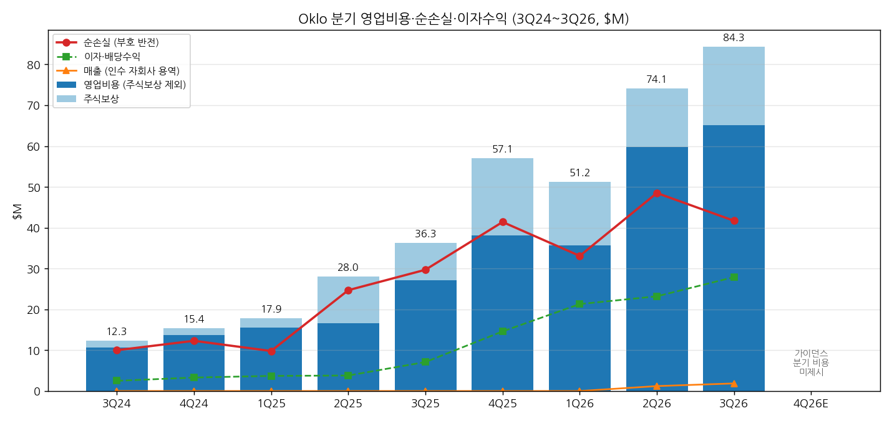
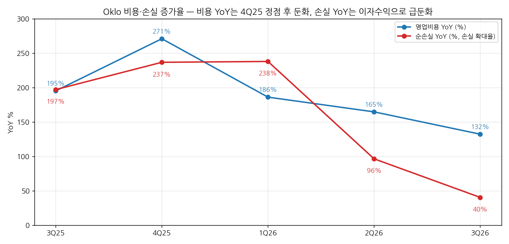
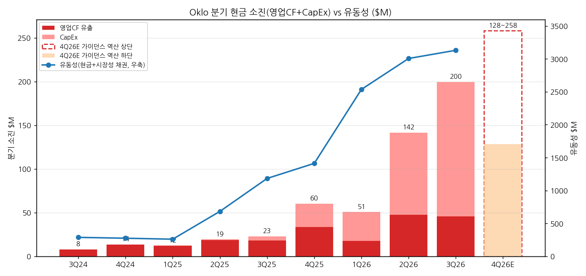
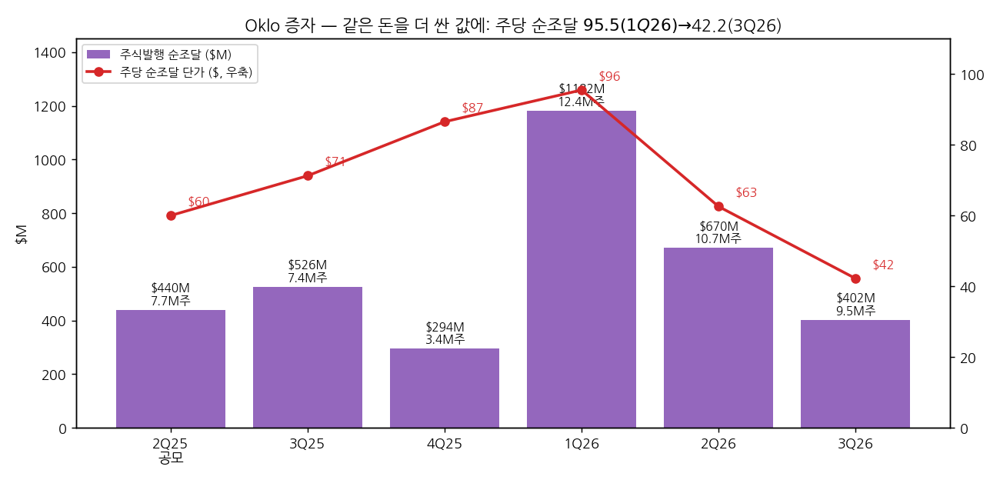

> 모드: 실적 리뷰 (v11)
> 종목: Oklo (OKLO, NYSE)
> 섹터: 원전
> 서브섹터: SMR·차세대 원자로
> 분기: 2026-Q3
> 발표일: 2026-11-06 (BMO 06:30 ET 실적 공개·10-Q 제출, 컨콜 08:30 ET)
> 작성 시각: 2026-11-16 15:40 KST
> 분석 소스: [1차 — SEC] 10-Q 3Q26(2026-11-06)·2Q26(2026-08-07)·1Q26(2026-05-12), 10-K FY2025(2026-03-17), 8-K 2026-05-13·2026-09-11(ATM 계약), XBRL companyfacts / 기업개요 OKLO v1.0(2026-11-15) 마일스톤·현금 트래커 [2차 — 보도 인용, 비공식] 컨콜 요약: MarketBeat(11/7)·EarningsWhispers/Finviz(11/6)·Quartr(11/6) — 회사 실적 보도자료는 8-K 미제출이라 원문 미확보, 컨콜 원문 미확보 / 컨센·TP: FactSet(Finimize 인용), TIKR(11/3·11/7·11/9), Stocktwits(11/9) / 주가: Yahoo Finance. 셀사이드 리포트 첨부 0건
> 리뷰 깊이: 숫자 중심 | 리서치 첨부 0건 (매출 없는 개발사 변형 — 섹터 델타 합산 제외, 마일스톤·현금 추적)
> 다음 발표: 4Q26·FY2026 10-K 2027-03 중순 (FY2025 10-K는 2026-03-17 제출)

# Oklo 3Q26 실적 리뷰 — 마일스톤 & 현금 판정

## 0. 한 줄 판정

> 성장 델타: 합산 제외 — 마일스톤 판정: 정체 | 내러티브: 약화 → 매매 제외 구간 (Groves 임계·연료 계약은 진전, 핵심인 Aurora 첫 발전은 2028 → 2028\~2029로 후퇴, 구속력 PPA 여전히 0건)

→ 판정 방식: 매출이 없는 개발사라 성장 델타(매출·영업이익 YoY) 대신 **마일스톤 진전/정체/후퇴 × 내러티브**로 판정한다. 워치리스트 원칙(2026-11-14)대로 원전 섹터 델타 합산에는 넣지 않는다

→ 숫자: 매출 $1.86M (인수 자회사 용역), 영업비용 $84.3M (+132% YoY), 순손실 −$41.7M (EPS −$0.22, FactSet 컨센 −$0.27 대비 양호). 분기 현금 소진(영업CF+CapEx) **$199.5M로 사상 최대**, 유동성 $3.13B, 차입 0 (10-Q)

→ 마일스톤: 진전 4 (Groves 첫 임계 8/5, Centrus HALEU 본계약 9/30 + Meta 자금 11/2 집행, Aurora-INL 구조물 공사, NRC 규칙 확정) vs 후퇴 4 (Aurora 가동 일정, 동위원소 첫 납품 2027로 이연, 7/4 DOE 임계 목표 미포함, PJM·FERC 패소). **발전 사업 일정이 후퇴하고 상업 계약은 그대로라 "정체"**

→ 현금: 3Q 증자 $401.8M을 주당 $42.2에 조달 (1Q26 $95.5의 44%) — 같은 돈을 절반 이하 가격에 찍는 구조. 유동성은 +$125M 늘었을 뿐 [계산]

→ 다음 분기 관건: ① 4Q CapEx가 가이던스($400\~500M) 하단을 채우는지 = 공사 속도 ② Meta 1.2GW의 **구속력 PPA 전환** 또는 Aurora-INL 공사비 공개 (FY2026 10-K, 2027-03)

## 1. 숫자

① 분기 표 ($M) — 매출·이익 대신 비용·손실·현금·희석 지표로 치환

| 항목 | 3Q24 | 4Q24 | 1Q25 | 2Q25 | 3Q25 | 4Q25 | 1Q26 | 2Q26 | **3Q26** | 4Q26E |
|---|---|---|---|---|---|---|---|---|---|---|
| 매출 | 0 | 0 | 0 | 0 | 0 | 0 | 0 | 1.2 | **1.9** | — |
| 영업비용 | 12.3 | 15.4 | 17.9 | 28.0 | 36.3 | 57.1 | 51.2 | 74.1 | **84.3** | — |
| (주식보상) | 1.6 | 1.7 | 2.3 | 11.4 | 9.1 | 19.0 | 15.6 | 14.4 | **19.2** | — |
| 영업손실 | −12.3 | −15.4 | −17.9 | −28.0 | −36.3 | −57.1 | −51.2 | −73.2 | **−71.0** | — |
| 이자·배당수익 | 2.5 | 3.3 | 3.7 | 3.8 | 7.1 | 14.6 | 21.3 | 23.2 | **27.9** | — |
| 순손실 | −10.0 | −12.3 | −9.8 | −24.7 | −29.7 | −41.4 | −33.1 | −48.5 | **−41.7** | — |
| EPS ($) | −0.08 | −0.11 | −0.07 | −0.18 | −0.20 | −0.27 | −0.19 | −0.28 | **−0.22** | −0.27 |
| 영업비용 YoY | — | — | 142% | 57% | 195% | 271% | 186% | 165% | **132%** | — |
| **영업비용 YoY 델타 (%p)** | — | — | — | −85 | +138 | +76 | −85 | −21 | **−32** | — |
| 순손실 YoY (손실 확대율) | — | — | — | — | 197% | 237% | 238% | 96% | **40%** | — |
| 영업CF | −7.9 | −13.5 | −12.2 | −18.5 | −18.0 | −33.4 | −17.9 | −47.6 | **−45.5** | −9\~−39 |
| CapEx | 0.1 | 0.1 | 0.3 | 0.9 | 5.0 | 27.0 | 32.8 | 94.1 | **154.0** | 119\~219 |
| **분기 소진 (영업CF+CapEx)** | 8.0 | 13.6 | 12.5 | 19.4 | 23.0 | 60.4 | 50.7 | 141.7 | **199.5** | 128\~258 |
| 유동성 (현금+시장성 채권, 말) | 288.5 | 275.3 | 260.7 | 683.0 | 1,183.6 | 1,412.5 | 2,536.9 | 3,006.3 | **3,130.8** | — |
| 발행주식 (M, 말) | 122.1 | 137.7 | 139.2 | 147.6 | 156.2 | 160.5 | 173.9 | 185.1 | **195.2** | — |
| 주식발행 순조달 | — | — | — | 440.1 | 526.1 | 294.2 | 1,181.9 | 670.0 | **401.8** | — |
| 주당 순조달 단가 ($) | — | — | — | 60.0 (공모) | 71.3 | 86.5 | 95.5 | 62.6 | **42.2** | — |

→ (출처: 10-Q 3Q26·2Q26·1Q26, 10-K FY2025, XBRL companyfacts — 분기값은 누적 차감 [계산]. 2Q25는 공모 7.67M주 @$60 gross, 3Q25\~3Q26은 ATM 순조달·주식수(자본변동표). 4Q26E: EPS는 2026E 컨센 −$0.96(TIKR 11/3 인용, 3Q 발표 전) − 9M 실적 −$0.69 [계산], 영업CF·CapEx·소진은 2026 가이던스(영업CF −$120\~150M, CapEx $400\~500M) − 9M 실적 역산 [계산])

→ 컨센 대비: EPS −$0.22 vs FactSet −$0.27 (손실 19% 적음), 매출 $1.86M vs FactSet $1.0M (Finimize·TIKR 인용). 다른 집계(EarningsWhispers)는 매출 컨센 $2.17M → −14% 미스 — **매출이 $2M 미만이라 서프라이즈 자체에 의미가 없다**. 손실이 적게 나온 건 토지 매각익 $11.4M(일회성)과 이자수익 $27.9M 덕분 — 매각익을 빼면 영업손실 −$82.4M으로 2Q(−$73.2M)보다 커졌다 [계산]

→ 델타 해석: 영업비용 YoY는 4Q25 +271%가 정점이고 3개 분기 연속 둔화(186 → 165 → 132%). 하지만 이건 "성장 둔화"가 아니라 **비용이 손익계산서에서 CapEx(현금흐름표)로 옮겨가는 단계** — 분기 소진은 3Q25 $23M → 3Q26 $200M로 8.7배 [계산]. 손실 YoY 급둔화(238 → 40%)도 3Q 이자수익 $27.9M(영업CF 유출의 61%)이 만든 착시다

→ 4Q 경로: 2026 CapEx 가이던스 $400\~500M을 채우려면 4Q CapEx $119\~219M — 3Q $154M 수준이 이어지면 중간값, 하단이면 공사 속도 둔화 신호 [계산]

→ (출처: 10-Q·10-K, XBRL companyfacts. 2Q24 이전은 기업개요 OKLO 15Q 표)

→ (출처: 10-Q·10-K, XBRL companyfacts, YoY [계산]. 매출이 없어 매출 YoY·OPM 차트 대신 영업비용 YoY·손실 YoY로 대체)

② 사업 라인별 — 단일 보고 부문, 마일스톤 상태로 대체

(1) 매출 구성

→ 9M26 매출 $3.07M 전부 2026-06 인수한 ARMEC(정밀가공)·CEI(소듐·알칼리금속 화학공정)의 엔지니어링·컨설팅 용역 (10-Q Note "Revenue Recognition"). 발전·연료·동위원소 매출은 0

→ 회사는 CODM(CEO)이 순손실 기준으로 관리하는 **단일 부문** (10-Q Note 12) — 사업부별 손익 미공개

(2) 사업 라인별 마일스톤 (2Q26말 → 3Q26말·발표일)

| 사업 라인 | 2Q26말 상태 | 3Q26·발표일 상태 | 판정 |
|---|---|---|---|
| 발전 — Aurora-INL 75MWe | DOE PDSA 승인(6/11), 가동 목표 "2028" | 굴착 완료 → 안전등급 철근·구조 철골 시공, 공급사 선정. **가동 목표 "2028\~2029"**, DSA(최종 안전분석) 승인 2028경 | **후퇴** |
| 발전 — 오하이오 1.2GW (Meta) | 선급 계약(1/5), PJM 절차 진행 | Meta 자금 1차분 에스크로 해제 → Centrus에 직접 지급(11/2). CEO "원자로 건설에는 비구속" | 정체 |
| 발전 — 계통연계 | 버지니아·오하이오 PJM 신청 | **PJM 버지니아 신청 철회 → FERC가 Oklo 이의 기각** (10-Q 위험요인 신규). 오하이오는 별건, 약 24개월 | **후퇴** |
| 연료 | Centrus HALEU LOI(6월), 연료가공시설 PDSA | **Centrus 본계약(9/30)**, ARPA-E $6.8M(10/29), 첫 A3F 연료집합체 2027 목표 | **진전** |
| 동위원소 | Groves 가동 승인 대기 | **Groves 첫 임계(8/5)** — RPP 과제 중 민간 부지 첫 임계. Groves-2 Forge NRIC Launch Pad 선정. **첫 계약 납품 2026\~27초 → 2027** | 진전 (납품은 이연) |
| 공급망 | Kiewit·Siemens Energy | U.S. Forged Rings — **Aurora 27기분** 원자로 용기 등 생산능력 예약 (2030\~2035) | 진전 |
| 인허가 (NRC) | PDC 토피컬 승인(4월) | NRC 최종규칙(10/26 공표, 11/25 시행) — DOE 인가 원자로 데이터를 NRC 상업 인허가에 활용 가능. NRC 신청 시점은 "평가 중" | 진전 (시점 미정) |

→ (출처: 10-Q 3Q26 MD&A "Plan of Operations"·위험요인, 컨콜 요약 MarketBeat·EarningsWhispers·Quartr [보도 인용, 비공식])

③ 가이던스 (이전 → 이번)

| 항목 | 1Q26 | 2Q26 | **3Q26** |
|---|---|---|---|
| 2026 영업CF 유출 | $80\~100M | $120\~150M (상향) | **$120\~150M (유지)** |
| 2026 CapEx | $350\~450M | $400\~500M (상향) | **$400\~500M (유지)** |
| Aurora-INL 첫 가동 | 2028 | 2028 | **2028\~2029** |
| 첫 계약 동위원소 납품 | 2026\~2027초 | 2026\~2027초 | **2027** |
| Aurora-INL 공사비 | 미공개 | 미공개 | **미공개** (Groves-1은 공사 약 $65M + 연료 약 $10M 공개) |

→ (출처: 10-Q 각 분기 MD&A, 컨콜 요약 [보도 인용]. Piper Sandler는 10/19 Aurora 건설비 추정을 $4,000 → $7,000/kW로 올림 — 75MWe면 약 $525M [계산, TIKR 11/3 인용])

④ 연간 (간략, $M)

| 항목 | FY22 | FY23 | FY24 | FY25 | 9M26 | 2026E | 2027E |
|---|---|---|---|---|---|---|---|
| 매출 | 0 | 0 | 0 | 0 | 3.1 | 수백만 달러 | 수백만 달러 |
| 영업비용 | 10.0 | 18.6 | 52.8 | 139.3 | 209.7 | — | — |
| 순손실 | −10.0 | −32.2 | −73.6 | −105.7 | −123.3 | — | — |
| EPS ($) | n/m | n/m | −0.74 | −0.72 | −0.69 | −0.96 | −1.03 → −1.13 |
| 영업CF + CapEx (소진) | 10.2 | 16.1 | 38.7 | 115.4 | 391.8 | 520\~650 (가이던스) | — |
| 유동성 (말) | 9.7 | 9.9 | 275.3 | 1,412.5 | 3,130.8 | — | — |

→ (출처: 기업개요 OKLO(424B3·10-K·10-Q). 2026E·2027E EPS 컨센은 TIKR 인용 — 2027E는 90일 전 −$0.96 → 발표 전 −$1.03 → 발표 후 −$1.13로 **손실 추정 확대**. 매출 컨센은 2028E $39.2M, 2029E 약 $122M (TIKR 11/7·11/9 인용))

→ 셀사이드 집계 FCF 유출 2026\~2030 약 **$6.3B** = 현재 유동성의 2배 (TIKR 인용) → 추가 증자 없이는 2030년까지 못 간다는 게 컨센 경로 [판단]

→ (출처: 10-Q·10-K, XBRL. 4Q26E는 2026 가이던스 − 9M 실적 역산 [계산])

⑤ 현금·희석·런웨이

(1) 런웨이

→ 유동성 $3,130.8M ÷ 2026 가이던스 소진 $520\~650M = **4.8\~6.0년** / 3Q 소진 연환산 $798M 기준 **3.9년** / 셀사이드 2026\~30 소진 연평균 약 $1.26B 기준 **약 2.5년** [계산]

→ 별도 제한현금 $81.9M (신용장 담보 $58M은 10/13 해제, 10-Q 후속사건). 회사 문구는 "향후 1년 운영자금 충분" — 장기 공사비(오하이오 1.2GW, 테네시 재활용 최대 $1.68B)는 가이던스 밖

(2) 희석·ATM 단가

→ 3Q: ATM 9.52M주, 순 $401.8M (주당 $42.2). 2026 ATM 1($1.0B) 완료 후 9/11 ATM 2($1.0B, 10개 증권사) 개시, 3Q말 사용 $88.8M → **잔여 약 $911M** [계산]

→ 발행주식 195.2M주: QoQ +5.5%, YoY +25.0%, 상장 직후(2024-05, 122.1M) 대비 +60% [계산]

→ 9M26 순조달 $2,253.7M인데 같은 기간 유동성 증가는 $1,718.3M — 차이 $535M은 소진 $391.8M + 인수 $25.7M + 제한현금 등 [계산]

→ 10/1\~11/4 발행주식 증가 0.13M주 — 주가 $20\~25 구간에서 ATM은 사실상 멈춤 (10-Q 표지 vs 9/30 자본변동표)

(3) 이자수익 완충

→ 3Q 이자·배당 $27.9M = 영업CF 유출 $45.5M의 61%. 현금이 소진되면 이 완충도 같이 줄어든다 — 손실 YoY 둔화를 실적 개선으로 읽으면 안 되는 이유

→ (출처: 10-Q·10-K 자본변동표 "Issuance of common stock in at-the-market offering, net" [계산: 순조달 ÷ 주식수])

## 2. 시장 쟁점

> 셀사이드 리포트 첨부 0건. 쟁점은 10-Q 원문 + 컨콜 요약(비공식, 보도 인용) + 보도된 TP 변경으로 구성. 컨콜 원문에서 질문자 소속은 확인하지 못했다

① 지난 분기 체크

→ 첫 리뷰 — 직전 체크 없음 (2Q26 리뷰 미작성. 기업개요 v1.0의 "분기 재평가 트리거"를 4번에 이어받음)

② 이번 분기 쟁점 6개

| # | 쟁점 | 한 줄 정의 | 다룬 출처 수 |
|---|---|---|---|
| 1 | Aurora 일정 후퇴 | "2028" → "2028\~2029" — 신중함인가 첫 슬립인가 | 10-Q + 요약 4건 |
| 2 | 7/4 임계 미달 vs Groves 첫 임계 | 경쟁사 4곳이 먼저 임계, Oklo는 한 달 늦었지만 민간 부지 첫 임계 | 10-Q + 보도 3건 |
| 3 | 구속력 PPA 0건 | Meta·Switch·Equinix 모두 비구속 — 27기분 단조품만 예약 | 10-Q + 요약 4건 |
| 4 | PJM·FERC 패소 | 버지니아 계통연계 철회, 오하이오 영향은? | 10-Q + 요약 3건 |
| 5 | Centrus HALEU·연료 | Meta 자금이 연료로 흘러간 첫 구속력 고리 | 10-Q + 보도 2건 |
| 6 | 자금 소요 vs 희석 | $6.3B 소진 경로 vs $3.1B 현금, 주당 $42 ATM — TP 하향의 실제 원인 | 보도 5건 |

③ 쟁점별 분해

(1) 쟁점 1 — Aurora-INL 가동 2028 → 2028\~2029

(1-1) 회사 설명

→ 10-Q: "our ambitious target of deploying our first powerhouse in 2028-2029 … amidst a range of supply chain, geopolitical, macroeconomic, and design complexities" (Plan of Operations). FY2025 10-K\~2Q26 10-Q까지는 "2028"

→ 컨콜(요약): CEO DeWitte는 Groves-1의 시운전 경험 — 장비 재보정, 통합, 시운전, 원자력 계측계통의 전기 노이즈 관리 — 때문에 일정 여유를 뒀다고 설명. 남은 DOE 절차는 DSA 승인 → 가동 준비 검토 → 가동 승인, **DSA는 공사 완료 즈음인 2028경** [MarketBeat·Quartr 요약, 비공식]

(1-2) 시장 시각

| 출처 | 해석 |
|---|---|
| EarningsWhispers (11/6) | 2025 4Q\~2026 2Q 반복한 "확정 2028"에서 넓힌 것 — 투자자는 신중함보다 첫 슬립으로 읽을 수 있음 |
| Citi (2025-11, 참고) | DOE 인가 경로 전환이 일정을 더 밀 수 있다고 이미 경고 (당시 2027\~28 기준, TP $68 중립) |
| Wedbush (11/2, 커버리지 승계) | Groves 착공 11개월 만의 임계 = 미국 차세대 원전 중 실행이 가장 앞섬 (Outperform, TP $36) |

(1-3) 공통 vs 갈림

→ 공통: 2028 단일 목표는 사실상 1년 범위로 넓어졌고, DSA 2028이면 2028 상반기 가동은 어렵다

→ 갈림: "Groves 교훈을 반영한 현실화"(Wedbush 계열) vs "FOAK 첫 슬립의 시작"(EarningsWhispers·Citi 계열)

(1-4) [판단]

→ DSA를 공사 완료 즈음(2028)에 받는 구조라 **2028 가동은 공사·DSA·시운전이 모두 일정대로 갈 때만 가능**. Groves(100W 시험로)에서 착공→임계 11개월이 걸렸고 7/4 목표도 한 달 늦었다 — 75MWe 발전로에서 "2029"가 기본값이라고 보는 게 숫자와 맞다. 결론이 바뀌는 조건: 2027 중 주요 기기 설치(회사 2027 목표) 완료 + DSA 제출 일정 공개

(2) 쟁점 2 — DOE 7/4 임계 목표 미포함 vs Groves 첫 임계

(2-1) 회사 설명

→ 10-Q: DOE가 6/30 최종 안전분석, 7/23 가동 승인 → **8/5 첫 임계**. "privately owned land, financed with private capital" — RPP 과제 중 민간 부지 첫 임계. Groves-1 건설비 약 $65M + 연료 약 $10M (컨콜 요약)

→ Groves-2 Forge(동위원소 생산 파일럿, 원자로 조사 + 핫셀)는 NRIC Launch Pad 선정, Framatome 연료 구매 완료 (EarningsWhispers 요약)

(2-2) 시장 시각

→ DOE RPP "7/4까지 3기 임계" 목표는 Antares(6/4)·Valar(6/18)·Deployable Energy(6/30)·Aalo(7/4) **4기 달성, Oklo 미포함** (Environment+Energy Leader 2026-07, 기업개요 재인용)

→ Canaccord(11/9, TP $100 → $66 Buy): "원전 종목의 바람이 바뀌었다" — 피로감의 상당 부분은 **스타트업이 너무 많은 경쟁 구도** (Stocktwits 인용)

(2-3) 공통 vs 갈림

→ 공통: Groves 임계는 Oklo가 "설계만 하는 회사"에서 "원자로를 실제로 돌려본 회사"로 넘어간 첫 실물 증거

→ 갈림: 임계 속도 경쟁에서 마이크로로 스타트업에 졌다는 점(희소성 하락) vs Oklo만 발전·연료·동위원소 통합 플랫폼이라는 점

(2-4) [판단]

→ 7/4 미포함은 **"첫 번째 원자력 스타트업" 프리미엄을 지웠다**. Groves는 100W 시험로라 매출·발전과 무관하고, 가치는 Aurora 일정 리스크를 줄이는 학습 효과에 있다 — 그런데 이번 분기 회사는 바로 그 학습을 근거로 Aurora 일정을 넓혔다. 진전이지만 주가 촉매로서는 소진됐다

(3) 쟁점 3 — 구속력 PPA 0건 (Meta·Switch·Equinix)

(3-1) 회사 설명

→ 10-Q: Equinix·Diamondback·Prometheus는 "non-binding letters of intent", Switch는 12GW "Master Power Agreement", Meta는 "Prepayment Agreement … provides a framework for Meta to prepay for power". Plan of Operations에 "converting such preliminary agreements"가 여전히 과제

→ 컨콜(요약): CEO "Meta 계약은 원자로 건설에는 구속력이 없다(not binding to build the reactor)". CFO는 Meta가 용량 예약 자본을 낸 부분 등 **구속력 있는 요소도 있다**고 보완. Aurora-INL의 첫 전력 고객은 국립연구소가 될 것 (CFO) [MarketBeat 요약, 비공식]

→ Equinix $25M 선급의 ROFR은 36개월, 2027-02 만료 (10-Q Note 7)

(3-2) 시장 시각

| 출처 | 해석 |
|---|---|
| TIKR (11/7) | U.S. Forged Rings로 Aurora 27기분 단조품을 예약했지만 "서명한 구매자는 없다" — 주문 없는 수주 대비 |
| TIKR (11/9, Craig-Hallum 인용 기사) | 구속력 PPA(특히 Meta 오하이오) 또는 첫 호기 공사비 공개 전까지 적정가 |
| Craig-Hallum (11/9, TP $53 → $27 Hold) | 전력·공급망·연료·동위원소 실물 진전은 인정. 재무가 너무 얇게 퍼져 있거나 한 회사가 감당하기엔 자본 소요가 너무 크다는 우려 |

(3-3) 공통 vs 갈림

→ 공통: 확정 PPA 0건은 2024 상장 이후 변하지 않았다. 파이프라인(Switch 12GW 등)의 GW 숫자는 가치 산정에서 할인되고 있다

→ 갈림: Meta 선급 자금이 실제로 연료에 집행(11/2)된 것을 "사실상 구속력"으로 볼지 여부

(3-4) [판단]

→ Meta 자금의 첫 실집행은 의미 있는 변화지만, 원자로 건설·전력 구매 의무가 없는 한 **매출 가시성은 0**. 공급망을 27기분 예약하면서 수요는 0기 확정인 비대칭이 이 종목 할인의 핵심이다. 결론이 바뀌는 조건: Meta 오하이오 1단계 구속력 PPA 또는 Equinix ROFR(2027-02 만료) 행사

(4) 쟁점 4 — PJM·FERC 계통연계 패소

(4-1) 회사 설명

→ 10-Q 위험요인(신규 문구): "We have experienced an adverse outcome in this process. FERC denied our complaint challenging PJM … withdrawal of an interconnection request for an early-stage potential project in Virginia. That proceeding concerned a request separate from the Ohio campus application"

→ 같은 위험요인에 "발전소를 고객 옆·계량기 뒤(behind-the-meter)에 둬도 FERC·주 규제·RTO 요건이 없어지지 않는다"고 추가 — 데이터센터 공동입지 규제 리스크를 회사가 직접 명시

→ 컨콜(요약): 오하이오 PJM 절차 약 24개월(CFO 추정), 버지니아 건은 오하이오에 영향 없음 [비공식]

(4-2) 시장 시각

→ EarningsWhispers/Finviz(11/6): 헤드라인 자체가 "Aurora 슬립과 PJM 차질이 공사 진전을 가렸다". 발표 전일 52주 최저 $18.53

(4-3) 공통 vs 갈림

→ 공통: 버지니아는 초기 단계 후보지라 직접 손실은 작다

→ 갈림: 개별 건으로 볼지, PJM 지역(미국 데이터센터 최대 밀집)의 대형 부하·공동입지 규제 강화 신호로 볼지

(4-4) [판단]

→ 오하이오 1.2GW도 PJM 관할이다. 24개월 절차면 2028년 전후 결론 — Aurora-INL 가동 시점과 겹친다. 계통연계는 원자로 인허가와 별개의 **두 번째 병목**이 됐다 (원전 운영 피어 Constellation·Vistra의 PJM 공동입지 이슈와 같은 축 [판단])

(5) 쟁점 5 — Centrus HALEU 공급계약

(5-1) 회사 설명

→ 10-Q: 6월 LOI(최대 5기 수년치, 2029 납품 개시) → **9/30 HALEU 공급계약 체결** (Meta 프로젝트용, 조건부). **11/2 Meta 자금 1차분이 에스크로에서 Centrus로 직접 지급**, 연료 주문 크레딧. 추가 HALEU 공급처와도 협의 중

→ 연료 경로 병행: EBR-II 회수 HALEU 5톤(첫 노심), 연료가공시설 PDSA 승인, 테네시 재활용(상업 가동 2030년대 초), DOE 잉여 플루토늄 우선협상, 첫 A3F 연료집합체 2027·재활용 파일럿 시운전 2027 목표 (10-Q, Quartr 요약)

(5-2) 시장 시각

→ 보도는 "Oklo·Centrus, 오하이오 Aurora 배치용 연료 공급 확보"(Business Wire 11/12 헤드라인)로 다뤘다. TP 변경 논리에 연료는 거의 등장하지 않음 — 시장의 관심은 수요·자금에 있다

(5-3) 공통 vs 갈림

→ 공통: 2호기 이후의 연료 병목(러시아산 HALEU 대체)에 처음으로 구속력 있는 해법이 생겼다

→ 갈림: 계약이 "Meta 프로젝트 조건부"라 Meta PPA가 확정되지 않으면 물량도 확정이 아니다

(5-4) [판단]

→ 이번 분기 유일하게 **돈이 실제로 움직인 상업 계약**. 다만 그 돈은 Meta가 내고 Centrus가 받았다 — Oklo 손익·현금에는 아직 안 잡힌다. 원전 연료 서브섹터(Centrus) 리뷰와 교차 확인할 항목: Centrus 측 수주잔고에 Oklo 물량 반영 여부

(6) 쟁점 6 — 자금 소요 vs 희석 (TP 하향의 실제 원인)

(6-1) 회사 설명

→ 10-Q: 2026 가이던스 유지 (영업CF −$120\~150M, CapEx $400\~500M). "existing cash … sufficient to fund our operations for the one-year period". Aurora-INL 공사비는 공개하지 않음

→ 9/11 ATM 2($1.0B) 개시 — 2026년에만 세 번째 $1B급 ATM

(6-2) 시장 시각

| 출처 | 핵심 가정·추정 | 논리 |
|---|---|---|
| Craig-Hallum (11/9) | TP $27 (Hold) | 자본 소요가 한 회사가 감당하기엔 과다 |
| Canaccord (11/9) | TP $66 (Buy) | 원전 테마 수급 피로·경쟁 과밀 → 멀티플 하향 |
| Wedbush (11/2) | TP $36 (Outperform) | 실행 1등 프리미엄은 인정, 이전 TP $110에서 대폭 하향 |
| H.C. Wainwright | TP $90 (Buy 유지) | 장기 플랫폼 가치 (보도상 세부 논리 미확인) |
| TD Cowen (10/26 개시) | TP $26 (Hold) | — (세부 미확인) |
| 셀사이드 집계 (TIKR) | 2026\~30 FCF 유출 약 $6.3B | 현금 $3.1B의 2배 → 추가 조달 불가피 |

(6-3) 공통 vs 갈림

→ 공통: 이번 분기 TP 하향은 **실적 하향이 아니라 멀티플·자본비용 하향**. 손실 추정(2027E EPS −$1.03 → −$1.13)은 오히려 소폭 확대

→ 갈림: 순현금(주당 $16)을 하방으로 볼지(Wedbush·HCW) vs 소진 경로상 순현금이 매 분기 줄고 저가 증자가 반복되니 하방이 아니라는 시각(Craig-Hallum)

(6-4) [판단]

→ 주가 $23.92 중 주당 순현금 $16.03(67%) [계산]. 그런데 셀사이드 경로대로 2030년까지 $6.3B를 쓰려면 $3B 이상을 더 조달해야 하고, 주당 $24에 조달하면 약 1.3억주(현재 발행주식의 약 2/3) 추가 [계산: ($6.3B − $3.13B) ÷ $24]. **순현금 하방 논리는 "추가 증자 없음"을 전제할 때만 성립**한다. 결론이 바뀌는 조건: 프로젝트 파이낸싱(DOE 대출·고객 선급) 같은 비주식 조달이 나오는지

④ 낙관 vs 보수 — 논리 대비

→ 낙관(H.C. Wainwright $90, Canaccord $66): 실물 원자로(Groves) 운영 경험 + 연료·동위원소까지 통합한 유일한 플랫폼, 현금 $3.1B로 2028\~29까지 버틴다

→ 보수(Craig-Hallum $27, TD Cowen $26): 수요 확정 0건 + 공사비 미공개 + $6.3B 소진 경로 → 주가는 순현금 + 소폭 옵션 가치 이상을 정당화 못 함

→ 셀사이드 vs 주가: 발표일 11/6 +22.7% ($19.20 → $23.55, NuScale 같은 날 +16.3%), 11/9 $26.84까지 올랐다가 11/13 $23.92로 반납. 발표 직전 6주 연속 하락 뒤 손실 축소 서프라이즈에 대한 숏커버성 반등 — 쟁점(일정·PPA·희석)은 하나도 해소되지 않았다 [판단]. 2Q 발표일(8/7)도 +14.8% 뒤 이후 3개월간 −60%

⑤ 추정치·TP 변화 (압축, 보도 인용)

| 증권사 | 직전 TP | 현재 TP | 4Q26 EPS E | 2026E / 2027E EPS | 핵심 변화 한 줄 |
|---|---|---|---|---|---|
| Wedbush (11/2) | $110 | $36 | — | — | 커버리지 승계, Outperform 유지·TP −67% |
| Craig-Hallum (11/9) | $53 | $27 | — | — | Hold, 자본 소요 우려 (3월에도 $87 → $71) |
| Canaccord (11/9) | $100 | $66 | — | — | Buy, 섹터 수급 피로 |
| H.C. Wainwright | $90 | $90 | — | — | Buy 유지 |
| TD Cowen (10/26) | — | $26 | — | — | Hold 개시 |
| Citi / Truist (발표 전) | — | $33 / $31 | — | — | — |
| 컨센 (TIKR) | 평균 $65 (11/3) | 평균 $56 (11/9, 25명) | −$0.27 [계산] | −$0.96 / −$1.13 | 2027E 손실 확대 |

→ (출처: TIKR 11/3·11/7·11/9, Stocktwits 11/9 — 보도 인용, 리포트 원문 미확인)

→ 발표 후 하향 3건(Wedbush 발표 직전 포함), 상향 0건. 평균 TP $65 → $56 (−14%), 연초 $105·1월 고점 $117 대비 절반 이하

→ **TP 하향 원인은 멀티플(자본비용·수급) 하향** — 매출 추정은 2028년까지 수백만 달러 수준이라 실적 하향으로 설명되는 부분이 거의 없다

## 3. 내러티브 점검

① 성장 스토리 정의

→ "AI 데이터센터에 원전 전기를 직접 파는 첫 차세대 원자로 — 소유·운영(PPA) 모델로 반복 매출을 만들고, 사용후연료 재활용과 동위원소로 연료·매출을 수직계열화한다"

② 이번 분기가 스토리에 준 영향

→ 강화: Groves 첫 임계(실물 운영 경험), Centrus 연료 본계약 + Meta 자금 첫 집행, Aurora 27기분 공급망 예약, NRC의 DOE 데이터 활용 규칙

→ 약화: 첫 발전 일정 후퇴(2028\~29), 동위원소 첫 납품 이연(2027), 구속력 PPA 0건 재확인("not binding to build the reactor"), PJM·FERC 패소, 주당 $42 증자

→ 시장 반응: 실행 진전은 인정하지만 **"언제·누구에게·얼마에 파는가"가 하나도 확정되지 않았다**는 쪽으로 이동 — TP는 멀티플 하향, 손실 추정은 확대

③ 국면 판단

→ 마일스톤 정체(발전 일정 후퇴 + 상업 계약 불변, 연료·동위원소는 진전) + 내러티브 약화(TP 평균 −14%, 2027E 손실 확대, 원전 테마 수급 피로) → **매매 제외 구간**

→ BT 프레임상 주의: 3Q 발표일 +22.7%·2Q 발표일 +14.8%처럼 **이벤트성 급반등은 반복**되지만 추세로 이어지지 않았다. 순현금 $16/주가 하방처럼 보여도 ATM 잔여 $911M·소진 경로 $6.3B 때문에 하방이 매 분기 낮아진다 [판단]

④ 트리거와 리스크

→ 트리거: ① Meta 오하이오 1단계 **구속력 PPA** (또는 Switch 12GW 중 첫 개별 PPA) ② Aurora-INL 공사비 공개 + 비주식 조달(DOE 대출·고객 선급) ③ 2027 주요 기기 설치 완료로 "2028" 복귀

→ 리스크: ① Aurora 2차 후퇴(2030 이후) 또는 DSA 지연 ② 주가 $20 이하에서 ATM 재개(분기 순조달 $500M+) ③ Equinix ROFR 2027-02 미행사 만료 / 고객의 대체 전원(가스터빈·기존 원전 PPA) 선택

## 4. 향후 봐야 할 것

① **4Q26 CapEx·소진과 Aurora-INL 공사비 공개** (마일스톤 판정 1순위)

→ 무엇을: 4Q CapEx $119\~219M(가이던스 역산) 중 어디인지 — 하단 미달이면 공사 지연 신호. FY2026 10-K에서 Aurora-INL 총공사비(Piper 추정 $7,000/kW ≈ $525M) 공개 여부, 2027 소진 가이던스

→ 어떤 데이터로: FY2026 10-K 현금흐름표·MD&A, 4Q 컨콜

→ 언제: 2027-03 중순

② **구속력 PPA 첫 체결 (Meta 오하이오 / Switch / Equinix ROFR)**

→ 무엇을: "non-binding" 문구가 빠진 전력구매계약 1건 이상, Equinix ROFR(2027-02 만료) 행사 여부, Meta 선급 2차분 집행

→ 어떤 데이터로: 8-K Item 1.01, 10-K "Commercialization Developments", Meta·Equinix 발표

→ 언제: 2027-02 (ROFR) \~ 2027-03 (10-K)

③ **Aurora-INL 일정 — 주요 기기 설치와 DSA 제출**

→ 무엇을: 원자로 용기·주요 기기 설치 착수(회사 2027 목표), 첫 A3F 연료집합체(2027), 가동 목표가 "2028\~2029"에서 더 밀리는지(2030 문구 등장 = 후퇴 판정)

→ 어떤 데이터로: 10-K/10-Q Plan of Operations 문구, DOE 인가 공지, 컨콜

→ 언제: 2027-03 \~ 2027-08

④ **희석 — ATM 2 잔여 $911M 사용 속도와 단가**

→ 무엇을: 분기 순조달·주당 단가($42.2 → $30 이하 여부), 발행주식 200M주 돌파, 비주식 조달 등장

→ 어떤 데이터로: 10-K 자본변동표·표지 주식수, 8-K(새 ATM·전환사채)

→ 언제: 2027-03

⑤ **계통연계·동위원소 첫 매출**

→ 무엇을: 오하이오 PJM 절차 진행(약 24개월), 추가 FERC·PJM 분쟁, Groves-2 착공과 첫 계약 동위원소 납품(2027) — 분기 매출 $10M+면 기업개요 Secondary "초기 매출" 추가 트리거

→ 어떤 데이터로: 10-Q 위험요인 문구, PJM 대기열·FERC 도켓, 매출 구성 Note

→ 언제: 2027 내내
