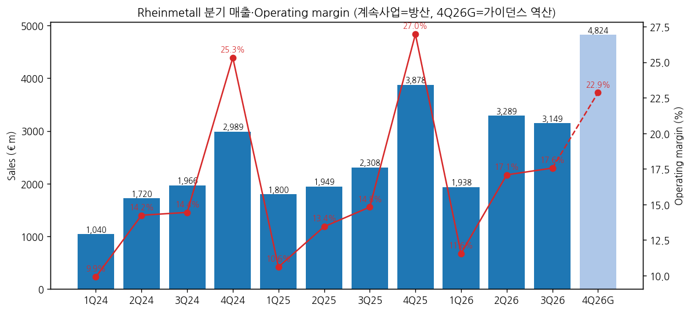
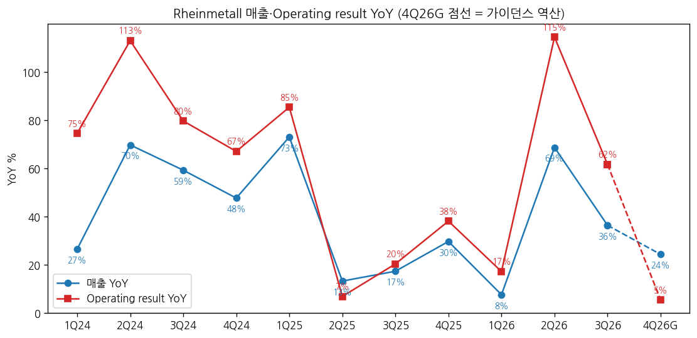
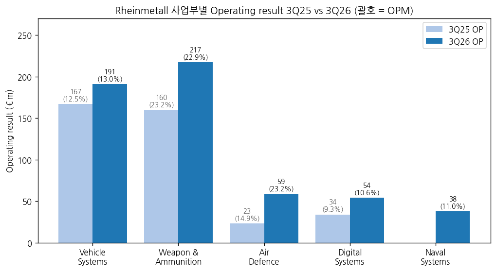

> 모드: 실적 리뷰 (v11)
> 종목: Rheinmetall AG (RHM)
> 섹터: 방산
> 서브섹터: 방산 글로벌
> 분기: 2026-Q3
> 발표일: 2026-11-05 (가이던스 하향은 11/04 장 마감 후 선공시)
> 작성 시각: 2026-11-14 18:30 KST
> 분석 소스: 회사 Quarterly Statement Q3 2026(2026-11-05, 독어 원본) + Half-Year Report 2026 + Q1·Q3 2025 / H1 2025 / 2024 분기 보고서 + FY2025 보도자료 + Q3 Pre-close Recap(2026-10-05). 셀사이드 리포트 첨부 없음 — 컨센은 Vara Research 집계(Finwire 인용), 쟁점·TP는 웹 기사(Reuters 경유 SRN, Börsen-Zeitung 11/05, Forbes.it 11/05, kapitalmarktexperten 11/06~07, Finimize)로 구성. Q3 컨퍼런스콜 트랜스크립트 미게시(11/14 기준)

# Rheinmetall 3Q26 실적 리뷰

## 0. 한 줄 판정

> 성장 델타: 둔화 | 내러티브: 약화 → 경계 구간 (Arminius 확정·CMD 2030 목표 확인 전까지 관망)

→ 숫자: 매출 €3,149m(+36.4% YoY), Operating result €553m(+61.7%), OPM 17.5%. Vara 컨센 대비 매출 -3.2%, OP +4.1%. OP YoY는 2Q26 +114.5% → 3Q26 +61.7%로 축소, **가이던스 역산 4Q26 OP YoY는 +5%**에 그친다
→ M&A 제외 시: Naval(NVL) €345m·€38m를 빼면 매출 +21.5%, OP +50.6% [계산]. 9M 유기 매출 성장 +26.1%(회사)
→ 쟁점의 중심은 **2026 가이던스 2차 하향**(매출 €13.7~14.2bn → ~€13.2bn, OPM ~19% → ~18.5%, CCR >40% → >0%). 원인은 Arminius(Boxer) 계약 2027 이연 + 155mm 포탄 로트 인수 지연 + Destinus 신사업 매출 미달
→ 수주 공백: 3Q Rheinmetall Nomination €2.89bn으로 매출보다 작다(book-to-bill 0.92 [계산]). Backlog €78.0bn은 6월말 €80.5bn보다 줄었다(F126 €2.15bn 제거 포함). 회사의 연말 €100bn 목표는 Arminius 없이 사실상 불가 `[판단]`
→ 주가 11/05 -16.1%(장중 -18.4%, €818.7), 11/13 €765.5로 연초 대비 약 -51%. 다음 관건은 **11/26~27 CMD의 2030 목표**와 **12월 독일 의회 예산위의 Arminius 상정 여부**

## 1. 숫자

① 계속사업(=방산) 분기 표 (€m)

| 항목 | 1Q24 | 2Q24 | 3Q24 | 4Q24 | 1Q25 | 2Q25 | 3Q25 | 4Q25 | 1Q26 | 2Q26 | **3Q26** | 4Q26G |
|---|---|---|---|---|---|---|---|---|---|---|---|---|
| 매출 (Sales) | 1,040 | 1,720 | 1,966 | 2,989 | 1,800 | 1,949 | 2,308 | 3,878 | 1,938 | 3,289 | **3,149** | ~4,824 |
| Operating result | 103 | 245 | 284 | 757 | 191 | 262 | 342 | 1,046 | 224 | 562 | **553** | ~1,103 |
| OPM | 9.9% | 14.2% | 14.4% | 25.3% | 10.6% | 13.4% | 14.8% | 27.0% | 11.6% | 17.1% | **17.6%** | ~22.9% |
| 매출 YoY | 26.5% | 69.8% | 59.3% | 47.8% | 73.1% | 13.3% | 17.4% | 29.7% | 7.7% | 68.8% | **36.4%** | ~24.4% |
| OP YoY | 74.6% | 113.0% | 79.7% | 67.1% | 85.4% | 6.9% | 20.4% | 38.2% | 17.3% | 114.5% | **61.7%** | ~5.4% |
| **매출 YoY 델타 (%p)** | | +43.3 | -10.5 | -11.5 | +25.3 | -59.8 | +4.1 | +12.3 | -22.0 | +61.1 | **-32.4** | -12.0 |
| **OP YoY 델타 (%p)** | | +38.4 | -33.3 | -12.6 | +18.3 | -78.5 | +13.5 | +17.8 | -20.9 | +97.2 | **-52.8** | -56.3 |

→ (출처: 1Q25~3Q26 회사 2026 분기 보고서의 계속사업 restated 값. 4Q25 = FY2025 계속사업(€9,935m / €1,841m, 2026-03-11 보도자료) − 9M25 [계산]. 1Q24~3Q24·2023 기준치는 당시 그룹 보고값 − Power Systems 사업부 [계산], 4Q24 = FY2024 계속사업 restated(€7,715m / €1,389m) − 9M [계산]. 3Q26 OPM은 반올림 전 값 17.56%, 회사 표기 17.5%. **4Q26G = 2026 가이던스(~€13.2bn × ~18.5%) − 9M26 역산** [계산] — 분기 컨센 미확보)
→ 컨센 대비: 매출 -3.2% (컨센 €3,252.8m), Operating result +4.1% (컨센 €531.4m), OPM 17.5% vs 16.3%, Operating FCF €-82m vs 컨센 +€123.1m (Vara Research, Finwire 인용). 조정 EPS는 컨센 미달(kapitalmarktexperten, 수치 미기재)
→ YoY 정점: 분기 OP YoY는 2Q26 +114.5%가 정점이었다. 2Q는 기저(2Q25 +6.9%)가 낮았던 효과가 커서 2개 분기 평균으로 보면 1H26 +73.5% → 3Q +61.7% → 4Q26G +5.4% [계산] — **4Q가 가이던스대로 나오면 연간 OP YoY는 +33%로 2025(+33%)와 같고, 분기 YoY는 한 자릿수로 내려간다** `[전망]`
→ 이익 계절성: 4Q가 연간 OP의 50~57%를 차지한다(2024 55%, 2025 57% [계산]). 2026도 가이던스 달성에 4Q OP €1.1bn이 필요해 **연간 판정은 4Q 한 분기에 걸려 있다** `[판단]`

→ (출처: 회사 분기 보고서, 4Q26G는 가이던스 역산)

→ (출처: 회사 분기 보고서, 4Q26G 점선은 가이던스 역산)

② 사업부별 매출·Operating result (€m)

| 사업부 | 항목 | 3Q25 | 4Q25 | 1Q26 | 2Q26 | **3Q26** | QoQ | YoY |
|---|---|---|---|---|---|---|---|---|
| Vehicle Systems | 매출 | 1,338 | 1,756 | 985 | 1,446 | **1,467** | +1.5% | +9.6% |
| | OP | 167 | 236 | 95 | 180 | **191** | +6.1% | +14.4% |
| | OPM | 12.5% | 13.4% | 9.6% | 12.4% | **13.0%** | +0.6%p | +0.5%p |
| Weapon and Ammunition | 매출 | 691 | 1,518 | 601 | 1,156 | **949** | -17.9% | +37.3% |
| | OP | 160 | 597 | 119 | 298 | **217** | -27.2% | +35.6% |
| | OPM | 23.2% | 39.3% | 19.8% | 25.8% | **22.9%** | -2.9%p | -0.3%p |
| Air Defence | 매출 | 154 | 321 | 193 | 285 | **254** | -10.9% | +64.9% |
| | OP | 23 | 75* | 30 | 46 | **59** | +28.3% | +156.5% |
| | OPM | 14.9% | 23.4%* | 15.5% | 16.1% | **23.2%** | +7.1%p | +8.3%p |
| Digital Systems | 매출 | 367 | 735 | 349 | 471 | **509** | +8.1% | +38.7% |
| | OP | 34 | 161* | 18 | 45 | **54** | +20.0% | +58.8% |
| | OPM | 9.3% | 21.9%* | 5.2% | 9.6% | **10.6%** | +1.0%p | +1.3%p |
| Naval Systems | 매출 | — | — | 77 | 257 | **345** | +34.2% | 신규 |
| | OP | — | — | 8 | 25 | **38** | +52.0% | 신규 |
| | OPM | — | — | 10.4% | 9.7% | **11.0%** | +1.3%p | |
| **방산 합계 (연결)** | 매출 | 2,308 | 3,878 | 1,938 | 3,289 | **3,149** | -4.3% | +36.4% |
| | OP | 342 | 1,046 | 224 | 562 | **553** | -1.6% | +61.7% |

→ (출처: 회사 Q3 2026 QS·H1 2026 보고서 segment report. 1Q26 = H1 − Q2 [계산]. 4Q25 = FY2025 − 9M25 [계산], \*AD·DS 4Q25 OP는 FY2025 사업부 마진(17.4%·13.0%, Q3 2026 QS 가이던스 표의 2025 실적 컬럼) 역산 [계산]. 사업부 매출은 내부거래 포함이라 합이 연결보다 크다. Naval은 2026-02-27 인수 — 1Q26은 3월분)

→ (출처: 회사 Q3 2026 QS segment report)

→ **섹터 합산에 쓸 방산 기준 = 계속사업 연결 합계** (민수 Power Systems는 2025-12-17부터 중단사업, 9M26 중단사업 손익 -€144m는 제외). 3Q26 €3,149m / €553m, 3Q25 €2,308m / €342m
→ 델타를 끄는 건 **W&A·Air Defence·Digital**(매출 +37~65%)이고, **VS가 가장 느리다**(매출 +9.6%) — VS 매출 둔화가 Arminius 이연의 직접 영향이다(회사: VS 2026 OPM 12~13% → ~12%, 매출 €5.9~6.0bn → €5.8~5.9bn)
→ W&A는 매출 +37%인데 OPM 22.9%로 전년(23.2%)과 같고 2Q(25.8%)보다 낮다. 회사는 W&A 연간 가이던스를 매출 €4.9~5.0bn → **€4.4~4.5bn**, OPM 29~30% → **28~29%**로 낮췄다. 이 가이던스를 맞추려면 4Q W&A 매출 €1.70~1.80bn, OP €0.60~0.67bn(4Q25 €0.60bn 수준)이 필요하다 [계산]
→ Air Defence는 유일하게 가이던스가 올라갔다 (매출 €0.9~1.0bn → €1.0~1.1bn, OPM ~19% 유지). Skynex·Skyranger 생산 진척

(2-1) 수주·잔고 (€m)

| | 3Q25 | 2Q26 | **3Q26** | 9M25 | 9M26 |
|---|---|---|---|---|---|
| Rheinmetall Nomination (수주+신규 프레임) | 3,326 | 11,371 | **2,893** | 16,015 | 19,131 |
| └ Order intake (확정 수주) | 2,721 | 10,909 | **3,311** | 7,880 | 18,257 |
| Backlog (기말, 수주잔고+프레임잔고) | 56,660 | 80,467 | **78,012** | | |
| └ Order backlog (확정) | 32,675 | 56,342 | **54,318** | | |
| └ Frame backlog | 23,985 | 24,126 | **23,694** | | |
| Nomination / 매출 [계산] | 1.44 | 3.46 | **0.92** | 2.64 | 2.28 |

→ (출처: 회사 Q3 2026 QS, H1 2026 보고서)
→ 3Q 사업부별 Nomination: VS €1,217m, W&A €1,445m, AD €200m, DS €198m, NS €157m. 9M 지역: 독일 43.6%(전년 74.3%), **독일 외 유럽 47.2%**(전년 16.2%) — 루마니아 SAFE €5.7bn이 다변화를 이끌었다
→ 백로그 감소는 F126 하도급 해지(€2,153m, 7월 제거)가 주원인이고, 3Q 신규 수주가 매출을 못 메운 것이 겹쳤다. 회사가 10/5 pre-close에서 유지한 **연말 €100bn 목표**는 Arminius(~€12.4bn) 없이는 €22bn 이상의 4Q 순증이 필요하다 [계산] → 사실상 이연 `[판단]`

③ 연간 (€m)

| 항목 | 2023 | 2024 | 2025 | 2026G (11/5) | 2026G (종전, 8/6) | 2027E |
|---|---|---|---|---|---|---|
| 매출 | 5,092 [계산] | 7,715 | 9,935 | ~13,200 | 13,700~14,200 | 미확보 |
| Operating result | 785 [계산] | 1,389 | 1,841 | ~2,442 [계산] | ~2,650 [계산] | 미확보 |
| OPM | 15.4% | 18.0% | 18.5% | ~18.5% | ~19% | |
| 매출 YoY | | 51.5% | 28.8% | ~32.9% | 37~42% | |
| OP YoY | | 76.9% | 32.5% | ~32.6% | ~44% | |

→ (출처: 2024·2025 계속사업 restated — FY2025 보도자료, 2023 그룹 − Power Systems [계산]. 2026G는 회사 가이던스, OP는 매출 × 마진 중간값 [계산]. 연초 가이던스(AR 2025)는 €14.0~14.5bn·~19%)
→ 2026 매출 가이던스는 연초(€14.0~14.5bn) 대비 -€0.8~1.3bn(-6~9%), OP는 연초 ~€2.71bn → ~€2.44bn(-10%) 하향 [계산: 매출 중간값 × 마진]. 2027 컨센·가이던스는 미확보 — 회사는 Arminius 매출·선수금과 포탄·Destinus 매출이 2027로 넘어간다고만 밝혔다

## 2. 시장 쟁점

① 2-0 지난 분기 체크

→ 첫 리뷰 — 직전 체크 없음 (2Q26 리뷰 미작성)

② 이번 분기 쟁점 5개

| # | 쟁점 | 언급 소스 |
|---|---|---|
| (1) | Arminius(Boxer) 이연 — 2026 수주·선수금 공백과 가격 재협상 | 회사 QS·Pre-close + 기사 6/6 |
| (2) | 탄약(W&A) 둔화 — 포탄 인수 지연·Destinus 미달, 마진 28~29%는 가능한가 | 회사 QS + 기사 4/6 |
| (3) | 현금흐름과 순차입 — CCR >40% → >0% | 회사 QS + 기사 4/6 |
| (4) | 가이던스 신뢰도와 2030 목표 (CMD 11/26~27) | 기사 5/6 |
| (5) | 수주 모멘텀 — 3Q book-to-bill 1 미만, 백로그 €100bn 목표 | 기사 3/6 + 회사 수치 |

③ 쟁점별 분해

(1) **Arminius(Boxer) 이연 — 2026 수주·선수금 공백**

(1-1) 회사 설명
→ Q3 QS: Arminius 발주가 늦어질 가능성이 커져 VS의 관련 선수금·매출 기여가 2027년으로 넘어간다. VS 2026 OPM 가이던스 ~12%로 하향
→ 10/5 Pre-close: "연내 확정 계약 기대, 서명 시 최대 30% 선수금, 12월 초 예산위 검토" — 한 달 만에 시점이 바뀌었다
→ 3월 Bilanz-PK: 첫 확정 주문 €12.5bn(2Q~3Q26 기대), 총 잠재 €37.5bn(2035까지). 8월 CEO는 첫 주문 몫 ~€12.4bn·선수금 >€3bn이라고 언급(Reuters)

(1-2) 시장 해석

| 소스 | 핵심 가정·추정 | 논리 |
|---|---|---|
| Metzler (Finimize) | 최종 계약 2027 초 예상, TP €1,750·긍정 유지 | 정부가 가격 공식 일부를 재검토 → 수주 단가 하향 가능성. "2027 초까지 인도·가격 시험대" |
| Citi (Forbes.it·kapitalmarktexperten) | Buy, TP €1,374 | 실망은 "지연"일 뿐 수요 훼손 아님 |
| RBC (Forbes.it) | "명백히 부정적" | Boxer 시점과 중기 영향, 전통 방산 기술 vs 신기술 논쟁을 키울 수 있다 |
| WSJ 인용 애널 | Rheinmetall 몫 >€12bn | 수요 규모는 그대로 |

(1-3) 공통 vs 갈림
→ 공통: 수요는 그대로이고 계약 시점·현금이 밀렸다
→ 갈림: **가격**. Metzler는 가격 공식 재검토로 마진이 얇아질 수 있다고 본다. 이 경우 단순 이연이 아니라 2027~2028 이익 수준이 낮아진다

(1-4) [판단]
→ Arminius는 2026 수주·현금의 "단일 변수"가 됐다. 12월 예산위 상정이 확인되면 이연, 2027 1H로 더 밀리면 2027 VS 가이던스까지 흔들린다. 가격 조건(선수금 30% 유지 여부)이 다음 체크 포인트다

(2) **탄약(W&A) 둔화 — 마진 28~29%는 가능한가**

(2-1) 회사 설명
→ 4Q에 신사업(특히 네덜란드 Destinus 협력)의 매출 일부가 실현되지 않고, 포탄 로트 인수(Losabnahme) 지연이 예상된다 → W&A 매출 €4.4~4.5bn, OPM 28~29%로 하향
→ Pre-close(10/5): 포병 계약의 70~80%가 장사거리탄 — 단가가 높아 중기 믹스에 우호적

(2-2) 시장 해석

| 소스 | 핵심 가정 | 논리 |
|---|---|---|
| Börsen-Zeitung (11/05) | 포탄 호출 매출 상당액 2027로 이월 | Destinus 무기 매출도 2027로 |
| Reuters (SRN) | 포탄 인수 지연 | 수요보다 생산·검수 병목 |
| 회사 수치 [계산] | 4Q W&A OP €0.60~0.67bn 필요 | 4Q25(€0.60bn)와 같은 수준을 매출 €1.7~1.8bn으로 다시 내야 함 |

(2-3) 공통 vs 갈림
→ 공통: 지연은 검수·인도 일정 문제다
→ 갈림: 3Q W&A OPM 22.9%(전년 23.2%)를 "4Q 집중의 계절성"으로 볼지, "가격·믹스 정점"으로 볼지

(2-4) [판단]
→ 9M W&A OPM 23.4%는 전년 9M(21.9%)보다 높다. 4Q 집중은 2024·2025에도 반복됐다(4Q25 W&A OPM 39.3% [계산]). **3Q 숫자만으로 탄약 마진 정점을 말하긴 이르다.** 다만 4Q W&A OP가 €0.6bn을 못 넘으면 "탄약 정점" 해석이 우세해진다

(3) **현금흐름과 순차입**

(3-1) 회사 설명
→ 9M Operating FCF €-1,698m(전년 €-798m). 전년엔 고객 선수금이 컸고, 올해는 매출 성장 대비 재고를 먼저 쌓았다. Arminius 선수금 이연으로 CCR 가이던스 >40% → **>0%**
→ 순차입 €-2,901m(2025말 순현금 +€369m) — NVL 인수, 클럽딜 €1.0bn, 회사채 €0.5bn, 단기차입 €0.8bn

(3-2) 시장 해석

| 소스 | 핵심 | 논리 |
|---|---|---|
| Vara 컨센 | 3Q FCF +€123m 기대 → 실제 €-82m | 현금 미스가 매출 미스보다 컸다 |
| Reuters 인용 트레이더 | "Boxer만의 문제가 아닌 듯" | 약한 수주, 마이너스 FCF, 백로그 가이던스 부재 |

(3-3) [판단]
→ 재고 €6.8bn(2025말 €4.7bn)은 미래 매출의 재료이기도 하다. 현금 문제는 **선수금 타이밍**의 문제이고, Arminius 선수금(>€3bn)이 들어오면 한 번에 뒤집힌다. 반대로 2027 상반기까지 선수금이 없으면 순차입이 €3bn을 넘어 배당·투자 여력 논쟁이 나온다 `[전망]`

(4) **가이던스 신뢰도와 2030 목표**

(4-1) 회사 설명
→ 2030 비전(2026-03 Bilanz-PK): 매출 ~€50bn (VS 13~15 · W&A 14~16 · DS 8~10 · AD 3~4 · Naval ~5 + M&A), OPM 20%+ (Börsen-Zeitung). CMD 11/26~27 Hamburg

(4-2) 시장 해석

| 소스 | 등급·TP | 논리 |
|---|---|---|
| J.P. Morgan (David Perry) | Neutral, €1,350 → €1,150 | 11개월간 5번째 경고. JV 목표 달성 의문, 2030 목표 "아마도 크게" 하향 |
| Bernstein (Adrien Rabier) | Outperform €1,200 (11/05) → Market-Perform €1,000 (이후) | 회사 목표·경영진 신뢰 훼손, 목표 하향 사이클이 끝나야 저평가 해소 |
| Oddo BHF | Outperform → Neutral, €1,670 → €1,200 | 가이던스 하향 |
| Jefferies | Buy, €1,350 유지 | 연말 직전 하향 폭에 놀람, 수주 가이던스 미제시 지적 |

(4-3) 공통 vs 갈림
→ 공통: 2026 숫자보다 **2030 목표가 CMD에서 얼마나 깎이는지**가 주가 변수
→ 갈림: Citi·Jefferies·Metzler는 "지연", JPM·Bernstein·Oddo는 "신뢰 문제"로 본다

(4-4) [판단]
→ 2030 €50bn은 2026G €13.2bn 대비 연 39% 성장이 필요하다 [계산]. CMD에서 목표를 낮추더라도 **연 20%대 성장 + OPM 20% 경로**가 남으면 디레이팅은 멈출 수 있다. 목표를 유지하면서 근거(Arminius·XM30·Naval)가 약하면 신뢰 할인이 이어진다

(5) **수주 모멘텀**

(5-1) 회사 수치
→ 3Q Nomination €2.89bn < 매출 €3.15bn. 9M Nomination €19.1bn(+19.5%)이지만 2Q 루마니아(€5.7bn)·Puma 몰림 효과. 3월에 CEO는 2026 수주 잠재력 ~€80bn을 언급(stock3, FY25 콜)

(5-2) [판단]
→ 9M 누계 €19bn은 연초 언급(€80bn)의 1/4이다. 4Q에 Arminius·SATCOMBw(~€10bn, OHB JV)·탄약 프레임이 동시에 밀리면 **2026은 "수주 레코드의 해"가 아니라 "수주 이연의 해"**로 끝난다. Air Defence(9M 수주 +439%)만 예외

④ 낙관 vs 보수

→ 낙관(Metzler €1,750·Citi €1,374·Jefferies €1,350): 수요는 그대로, 지연은 2027 초에 해소. Metzler는 Arminius 2027 초 계약을 가정
→ 보수(Bernstein €1,000·JPM €1,150·Oddo €1,200): 반복된 가이던스 하향 → 2030 목표 하향 → 멀티플 할인. JPM은 JV 다수의 목표 실현 가능성을 의심
→ 차이의 본질은 **"지연 vs 신뢰"**. 숫자(9M OP +69%, OPM +2.9%p)는 낙관 쪽 근거, 가이던스 경로·현금은 보수 쪽 근거다
→ 셀사이드 vs 주가: 낙관 TP 평균 ~€1,490 [계산] 대비 주가 €765.5. 기사상 대부분 매수·중립 유지인데 주가는 발표 후 1주일 -24% [계산: €1,003.4 → €765.5]. 바이사이드는 "계약 확인 전까지는 안 산다"는 쪽 `[판단]`

⑤ 추정치·TP 변화

| 증권사 | 직전 TP | 현재 TP | 등급 | 핵심 변화 한 줄 |
|---|---|---|---|---|
| J.P. Morgan | €1,350 | €1,150 | Neutral | 2030 목표 하향 예상, JV 목표 의문 |
| Bernstein | €1,200 | €1,000 | Outperform → Market-Perform | 목표 신뢰 훼손 |
| Oddo BHF | €1,670 | €1,200 | Outperform → Neutral | 가이던스 하향 |
| Metzler | 미기재 | €1,750 | 긍정 유지 | Arminius 2027 초 계약 가정, 가격 리스크 |
| Citi | 미기재 | €1,374 | Buy | 지연일 뿐 |
| Jefferies | €1,350 | €1,350 | Buy | 하향 폭에 놀람 |

→ (출처: kapitalmarktexperten 11/06~07, Börsen-Zeitung 11/05, Finimize. 일부 기사는 AI 보조 작성 표기·날짜 표기 불일치 — 날짜는 11/05~11/07로 범위 표기)
→ 직전 TP가 확인된 4곳 평균 €1,393 → €1,175 (-16% [계산]). 하향 3건·유지 1건, 등급 하향 2건
→ **TP 하향의 원인은 멀티플 쪽이 크다** `[판단]`: 2026 OP 가이던스는 8월 대비 약 -8% [계산: ~€2.65bn → ~€2.44bn] 내려갔는데 주가는 -24%, Bernstein·Oddo는 "신뢰"를 이유로 등급을 내렸다. 2027E 추정치 변화는 미확보

## 3. 내러티브 점검

① 성장 스토리 정의
→ "유럽 재무장의 최대 수혜주 — 독일 국방예산(2029년 ~€152bn)과 NATO 목표로 탄약·차량·대공이 동시에 늘고, 2030년 매출 €50bn·OPM 20%+로 간다"

② 이번 분기가 스토리에 준 영향
→ 강화된 것: 마진(3Q OPM 17.5%, 컨센 +1.2%p), Air Defence 성장(+65%, 가이던스 상향), 독일 외 유럽 수주 비중 47%(SAFE)
→ 약화된 것: 2026 가이던스 2회 하향(J.P. Morgan 집계 5번째 경고), Arminius·SATCOMBw·포탄 호출 등 **독일 내 대형 계약 집행이 예상보다 느리다**는 점, FCF·순차입 악화
→ 훼손은 아니다: 계약 취소(F126 제외)는 없고, 예산은 확보돼 있다. 다만 "예산 = 즉시 매출"이라는 전제가 깨졌다 `[판단]`

③ 국면 판단
→ 델타 둔화(OP YoY 2Q +115% → 3Q +62% → 4Q26G +5%) + 내러티브 약화(가이던스 하향 반복, TP -16%, 등급 하향 2건) → **경계 구간**
→ 4Q26 실적에서 OP YoY가 가이던스대로 한 자릿수면 2개 분기 연속 둔화 + YoY 정점 통과로 **꺾임** 판정 전환 조건 충족 `[전망]`

④ 트리거와 리스크
→ 트리거: ① 12월 독일 의회 예산위 Arminius 승인(선수금 >€3bn) ② CMD에서 2030 목표의 근거 있는 재설정 ③ XM30 1차 결정(2027 초)
→ 리스크: ① 4Q W&A 매출 €1.7bn 미달 → 3차 하향 ② 우크라이나 휴전 → 탄약 단기 수요 논쟁 ③ 순차입 확대에 따른 자본 조달

## 4. 향후 봐야 할 것

① **Arminius 예산위 상정·계약** (델타 판정을 바꿀 1순위)
→ 무엇을: 독일 연방의회 예산위 25-Mio-Vorlage 상정·승인, Rheinmetall 몫 ~€12.4bn·선수금 20~30% 유지 여부, 가격 공식 변경
→ 어떤 데이터로: 독일 의회 예산위 의사일정, 회사 수주 공시, 뉴스 키워드 "Arminius", "Boxer Bundestag"
→ 언제: 2026-12 초 예산위 → 미상정 시 2027 1Q

② **CMD 2030 목표 재설정**
→ 무엇을: 2030 매출 ~€50bn·OPM 20%+ 유지/하향, 2027 가이던스 초안, 사업부별 목표(W&A €14~16bn·Naval ~€5bn)
→ 어떤 데이터로: CMD 발표자료·웹캐스트
→ 언제: 2026-11-26~27 (Hamburg)

③ **4Q26 W&A 매출 €1.7~1.8bn·연간 OP ~€2.44bn 달성**
→ 무엇을: 4Q OP ~€1.1bn(YoY +5%) 달성 여부, W&A OPM 28~29%, 포탄 로트 인수 진척 → 미달 시 3차 하향
→ 어떤 데이터로: FY2026 실적, 1월 pre-close call
→ 언제: 2027-01 pre-close / 2027-03-11 Annual Report

④ **현금흐름·순차입**
→ 무엇을: 연간 CCR >0% 달성(4Q Operating FCF > €+1.7bn 필요 [계산]), 순차입 €2.9bn → 연말 수준, 민수 매각(€350m) 종결
→ 어떤 데이터로: FY2026 실적, 매각 종결 공시
→ 언제: 4Q26 (민수 매각), 2027-03-11

⑤ **수주 모멘텀 — 4Q Nomination·연말 백로그**
→ 무엇을: 4Q Nomination이 매출을 넘는지(book-to-bill >1), 연말 백로그 €78bn → 회사 목표 €100bn 대비 위치, SATCOMBw(~€10bn)·탄약 프레임 확정
→ 어떤 데이터로: 회사 수주 보도자료, OHB 공시
→ 언제: 2026-12 ~ 2027-03
