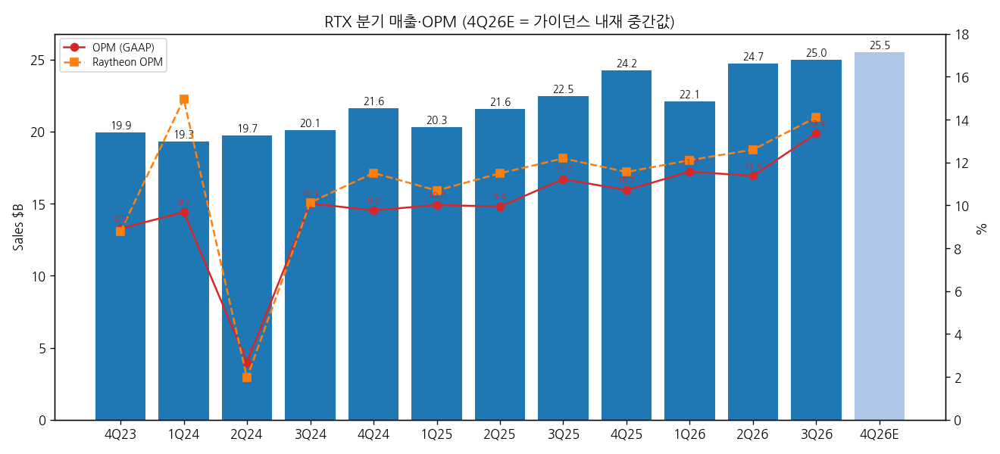
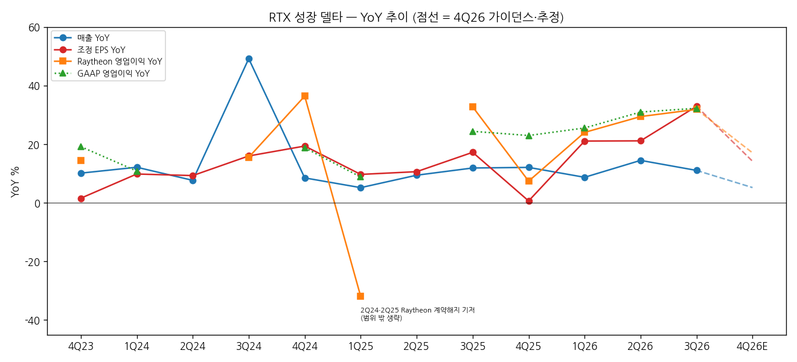
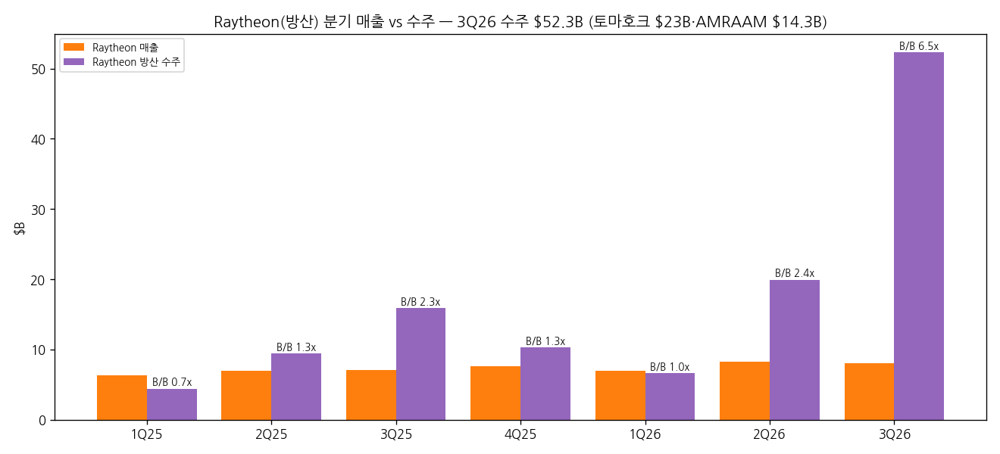

> 모드: 실적 리뷰 (v11)
> 종목: RTX Corporation (RTX)
> 섹터: 방산
> 서브섹터: 방산 글로벌
> 분기: 2026-Q3 (캘린더 = 회계 분기, 9/30 종료)
> 발표일: 2026-10-20 (화, 장 전 — 보도자료·10-Q·컨퍼런스콜 동시)
> 작성 시각: 2026-11-14 18:30 KST
> 분석 소스: 회사 자료 — 3Q26 10-Q(SEC 2026-10-20), 1Q24~2Q26 10-Q·FY23~FY25 10-K(분기 시계열), 3Q26·4Q25 보도자료(rtx.com), 3Q26 컨퍼런스콜 트랜스크립트(Webull 게재본, Q&A 애널리스트 12명). 셀사이드 리포트 첨부 없음(BT 확정 — 숫자 중심 리뷰). 웹서치 보완: 컨센 대비·발표일 주가(Finviz 10/20), 사업부 코멘트(Leeham News 10/21), 주가(Yahoo Finance 일간). 발표 후 IB 목표가 변경 기사는 확보 실패(검색 결과가 2025년 건뿐). RTX 기업개요 v1.0(2026-11-14) 참조
> 다음 발표: 4Q26 + 2027 가이던스 — 2027-01 하순 예정 (회사 "1월에 2027 전망", 3Q26 컨콜)

# RTX 3Q26 실적 리뷰 — 방산 수주 $59B로 잔고가 한 분기 만에 +$51B, 이익은 30%대 증가율 고원 유지

## 0. 한 줄 판정

> 성장 델타: 유지 | 내러티브: 강화 → 관심 구간 (이익 YoY 30%대 고원 유지·방산 수주 폭증, 단 4Q 가이던스 내재 매출 +5%·조정 EPS +14%로 둔화 예고)

→ 숫자: 매출 $24,965M(+11.1% YoY), GAAP 영업이익 $3,337M(+32.3%, OPM 13.4%), 조정 EPS $2.26(+32.9%). GAAP 영업이익 YoY가 2Q26 +31.0% → +32.3%로 +1.3%p — 판정 기준(±5%p) 안이라 **유지**. 조정 EPS는 +11.8%p 가속처럼 보이지만 관세 환급 $0.25를 빼면 $2.01(+18%)로 오히려 소폭 둔화다 [계산]
→ 방산 기준(Raytheon): 매출 $8,031M(+14.0%), 영업이익 $1,133M(+31.9%), OPM 14.1%(+1.9%p, 출범 후 분기 최고 — 1Q24 매각이익 분기 제외). 방산 수주 $52.3B, B/B **6.5배** [계산]
→ 쟁점의 중심은 **수주가 언제 매출이 되나**: 토마호크 약 $23B·AMRAAM $14.3B 다년 계약으로 회사 방산 잔고가 $119B → $164B. 회사는 "생산율 2~4배, 2030년 최대 생산율, 2027부터 매출 램프"라고 했다
→ 다음 분기 관건: 2027-01 가이던스 — 회사가 "매출·EPS 증가, 마진 개선, 현금 증가"를 예고했지만 숫자는 없다. 4Q 내재치(매출 +5%)가 2027 성장률의 하한선 논쟁을 만든다 [판단]

## 1. 숫자

① 연결 기준 분기 표 (단위: $M, %)

| 항목 | 4Q23 | 1Q24 | 2Q24 | 3Q24 | 4Q24 | 1Q25 | 2Q25 | 3Q25 | 4Q25 | 1Q26 | 2Q26 | **3Q26** | 4Q26 가이던스 내재 |
|---|---|---|---|---|---|---|---|---|---|---|---|---|---|
| 매출액 | 19,927 | 19,305 | 19,721 | 20,089 | 21,623 | 20,306 | 21,581 | 22,478 | 24,238 | 22,076 | 24,708 | **24,965** | 25,501 (25,251~25,751) |
| 영업이익 (GAAP) | 1,777 | 1,870 | 529 | 2,028 | 2,111 | 2,035 | 2,146 | 2,523 | 2,596 | 2,555 | 2,811 | **3,337** | 미제시 |
| OPM (GAAP) | 8.9 | 9.7 | 2.7 | 10.1 | 9.8 | 10.0 | 9.9 | 11.2 | 10.7 | 11.6 | 11.4 | **13.4** | — |
| 매출 YoY | +10.1 | +12.1 | +7.7 | +49.2 | +8.5 | +5.2 | +9.4 | +11.9 | +12.1 | +8.7 | +14.5 | **+11.1** | +5.2 |
| 영업이익 YoY | +19.2 | +10.8 | -64.6 | 흑전 | +18.8 | +8.8 | +305.7 | +24.4 | +23.0 | +25.6 | +31.0 | **+32.3** | — |
| **매출 YoY 델타 (%p)** | — | +2.0 | -4.5 | +41.5 | -40.7 | -3.3 | +4.2 | +2.5 | +0.2 | -3.4 | +5.8 | **-3.4** | -5.9 |
| **영업이익 YoY 델타 (%p)** | — | -8.3 | -75.4 | — | — | -10.0 | +296.8 | -281.3 | -1.4 | +2.6 | +5.4 | **+1.3** | — |
| 조정 EPS ($, 주 지표) | 1.29⚠️ | 1.34⚠️ | 1.41⚠️ | 1.45⚠️ | 1.54 | 1.47⚠️ | 1.56⚠️ | 1.70 | 1.55 | 1.78 | 1.89 | **2.26** | 1.77 (1.72~1.82) |
| 조정 EPS YoY | +1.6 | +9.8 | +9.3 | +16.0 | +19.4 | +9.7 | +10.6 | +17.2 | +0.6 | +21.1 | +21.2 | **+32.9** | +14.2 |
| **조정 EPS YoY 델타 (%p)** | — | +8.3 | -0.5 | +6.7 | +3.4 | -9.7 | +0.9 | +6.6 | -16.6 | +20.4 | +0.1 | **+11.8** | -18.7 |

→ (출처: 매출·GAAP 영업이익 = 각 분기 10-Q, 4Q = 10-K 연간 − 9M [계산], 4Q22~3Q23 YoY 기준치는 2024 10-Q 재작성 비교치. 조정 EPS = 회사 보도자료 — ⚠️는 이번 세션 원문 미대조(공개 보도치). 4Q26 내재 = 10/20 상향 가이던스(조정 매출 $97.0~97.5B, 조정 EPS $7.65~7.75) − 9M 누계(매출 $71,749M, 조정 EPS $5.93) [계산]. RTX는 분기 GAAP 영업이익 가이던스를 주지 않는다)
→ 컨센 대비: 매출 +3.9%, 조정 EPS +27.0% (컨센 매출 $24.03B·EPS $1.78, Finviz 10/20 인용). EPS 컨센은 가이던스 대비 낮게 잡혀 있었던 것으로 보이며, 관세 환급($0.25)·투자 평가이익($0.09)이 비트의 약 절반 [판단]
→ 일회성 정리 (10-Q): 관세 환급 +$0.4B(세전, EPS +$0.25 — Collins·P&W), 항공 고객 파산 충당 -$0.4B(세전, P&W, GAAP만 — 조정 제외), 투자 평가이익 +$0.2B. **GAAP 영업이익에서 환급과 파산 충당이 서로 상쇄돼 +32%는 체력에 가깝다** [판단]
→ 2Q24(법적 합의 $0.9B·Raytheon 계약해지)·2Q25 기저 때문에 GAAP 영업이익 YoY가 크게 튄다. 판정은 1Q26 이후 연속 구간(+25.6 → +31.0 → +32.3)으로 본다
→ YoY 정점: 이익 YoY는 3Q26(+32%)이 이번 사이클 최고. 4Q26 내재 조정 EPS +14%, 매출 +5%로 내려가고, 4Q25 매출 기저(+12%)가 높아 **YoY 정점은 3Q26일 가능성이 크다** [전망]. 회사는 4Q에 관세 환급 소멸·R&D 증가로 Collins 마진이 3Q보다 낮아진다고 했다

→ (출처: 10-Q·10-K, 4Q26E는 가이던스 내재 중간값 [계산])

→ (출처: 동일. Raytheon 4Q26E 영업이익은 컨콜 FY 증가 가이드 역산 [추정])

② 사업부별 매출·영업이익 (단위: $M, %, GAAP 사업부 영업이익)

| 사업부 | 항목 | 3Q25 | 4Q25 | 1Q26 | 2Q26 | **3Q26** | QoQ | YoY |
|---|---|---|---|---|---|---|---|---|
| Collins Aerospace | 매출 | 7,621 | 7,736 | 7,602 | 8,210 | **8,382** | +2.1 | +10.0 |
| | 영업이익 | 1,260 | 1,402 | 1,307 | 1,306 | **1,789** | +37.0 | +42.0 |
| | OPM | 16.5 | 18.1 | 17.2 | 15.9 | **21.3** | +5.4%p | +4.8%p |
| Pratt & Whitney | 매출 | 8,423 | 9,496 | 8,173 | 8,889 | **9,231** | +3.8 | +9.6 |
| | 영업이익 | 751 | 773 | 710 | 738 | **608** | -17.6 | -19.0 |
| | OPM | 8.9 | 8.1 | 8.7 | 8.3 | **6.6** | -1.7%p | -2.3%p |
| **Raytheon (방산)** | 매출 | 7,045 | 7,657 | 6,945 | 8,269 | **8,031** | -2.9 | **+14.0** |
| | 영업이익 | 859 | 885 | 841 | 1,042 | **1,133** | +8.7 | **+31.9** |
| | OPM | 12.2 | 11.6 | 12.1 | 12.6 | **14.1** | +1.5%p | +1.9%p |
| | 매출 비중 | 30.5 | 30.8 | 30.6 | 32.6 | **31.3** | | |
| 사업부 합계 | 매출 / 영업이익 | 23,089 / 2,870 | 24,889 / 3,060 | 22,720 / 2,858 | 25,368 / 3,086 | **25,644 / 3,530** | | +11.1 / +23.0 |
| **방산 매출 (회사 공시 3항목 합)** | 매출 | 11,753 | 12,455 | 11,298 | 13,036 | **12,748** | -2.2 | **+8.5** |
| | 연결 매출 대비 | 52.3 | 51.4 | 51.2 | 52.8 | **51.1** | | |

→ (출처: 10-Q 사업부 표, 4Q25 = 10-K − 9M [계산]. 방산 매출 = 미국 정부 + FMS + 해외정부 직접 판매 (10-Q 고객유형 표) [계산]. 사업부 OPM·비중 [계산])
→ **조정 사업부 영업이익 (회사 주 지표, 보도자료)**: Collins $1,788M(21.3%), P&W $968M(10.5% — 파산 충당 $0.36B 제외), Raytheon $1,134M(14.1%), 합계 $3,890M(15.2%, +39%)
→ **델타를 끄는 건 Collins와 Raytheon**이다. Collins는 민항 OE·애프터마켓(유기 +$0.9B)과 관세 환급 약 $0.25B로 영업이익 +42%. Raytheon은 해군(SM·토마호크 +$0.5B)·지상방공(패트리어트 +$0.3B)·AMRAAM(+$0.1B)으로 매출 +14%, EAC 개선 +$0.1B·패트리어트 믹스로 마진 +1.9%p (10-Q)
→ P&W는 GAAP로 -19%지만 파산 충당을 빼면 조정 +29%다. 민항 애프터마켓 +$0.9B가 끌고, 대형 엔진 OE 믹스가 깎았다

(2-1) **섹터 합산용 방산 기준** (섹터 리뷰가 이 값을 가져감)

| 기준 | 3Q25 | 3Q26 | YoY | 4Q26E |
|---|---|---|---|---|
| **Raytheon 매출 ($M)** | 7,045 | **8,031** | +14.0% | 약 8,730 [추정] |
| **Raytheon 영업이익 ($M, GAAP 사업부)** | 859 | **1,133** | +31.9% | 약 1,036 (1,011~1,061) [추정] |
| Raytheon OPM | 12.2% | **14.1%** | +1.9%p | 약 11.9% [추정] |
| (참고) 회사 방산 매출 합계 | 11,753 | 12,748 | +8.5% | — (영업이익 미공시) |

→ **섹터 합산 방산 기준 = Raytheon 사업부 매출·영업이익 (GAAP 사업부 영업이익, USD $M)**. Collins 방산·P&W 군용(3Q26 약 $4.9B)은 영업이익이 공시되지 않아 합산에서 제외하고, 회사 방산 매출 합계($12,748M, 51%)는 노출도 참고값으로만 쓴다
→ 4Q26E 근거: 영업이익 = 컨콜 "Raytheon 2026 영업이익 +$800~850M" 가이드를 FY25 Raytheon 이익 $3,227M(조정 ≈ GAAP 가정)에 더한 뒤 9M26 $3,016M을 뺀 값 / 매출 = 4Q25 $7,657M × 9M26 YoY(+14.0%) [추정]

(2-2) 수주·잔고 — 선행지표 (단위: $B)

| 항목 | 4Q24 | 1Q25 | 2Q25 | 3Q25 | 4Q25 | 1Q26 | 2Q26 | **3Q26** |
|---|---|---|---|---|---|---|---|---|
| 총 수주잔고 | 218 | 217 | 236 | 251 | 268 | 271 | 289 | **340** |
| 방산 잔고 | 93 | 92 | 92 | 103 | 107 | 109 | 119 | **164** |
| 민항 잔고 | 125 | 125 | 144 | 148 | 161 | 162 | 170 | **176** |
| 회사 방산 수주 | ~14 | 9 | 12 | 23 | ~17 | 14 | 23 | **59** |
| Raytheon 방산 수주 | 9.5 | 4.4 | 9.4 | 15.9 | 10.3 | 6.6 | 19.9 | **52.3** |
| Raytheon B/B (배) | 1.33 | 0.69 | 1.34 | 2.25 | 1.35 | 0.96 | 2.41 | **6.51** |

→ (출처: 10-Q·10-K MD&A. 4Q 수주 = 연간 − 9M [계산], 회사 방산 수주 4Q24·4Q25는 연간 $61B 기준 근사. B/B [계산])
→ Raytheon 잔고 $130B(2025말 $75B). 3Q 주요 수주: 토마호크 $23B, AMRAAM $14.3B, 영국 육군 훈련(ACTS) $3.1B, SPY-6 $1.8B, SM-3 $0.7B, NASAMS 유지 $0.6B, LIDS 대드론 $0.6B (10-Q). 9M 누계로는 우크라이나 GEM-T $3.7B·폴란드 GEM-T $1.0B·LTAMDS $0.8B·네덜란드 패트리어트 $0.6B 포함
→ **총잔고 $340B = 2026 매출 가이던스의 3.5배** [계산]. 방산 잔고 YoY +59%($103B → $164B)

→ (출처: 10-Q·10-K Raytheon 방산 수주)

③ 연간 (단위: $M, %)

| 항목 | 2022 | 2023 | 2024 | 2025 | 2026 가이던스 |
|---|---|---|---|---|---|
| 매출액 | 67,074 | 68,920 | 80,738 | 88,603 | 97,000~97,500 |
| 영업이익 (GAAP) | 5,504 | 3,561 | 6,538 | 9,300 | 미제시 (9M 8,703) |
| OPM | 8.2 | 5.2 | 8.1 | 10.5 | — |
| 매출 YoY | +4.2 | +2.8 | +17.1 | +9.7 | +9.5~10.0 |
| 영업이익 YoY | +11.0 | -35.3 | +83.6 | +42.2 | — |
| 조정 EPS ($) | — | 5.06⚠️ | 5.73⚠️ | 6.29 | 7.65~7.75 (+22~23%) |
| Raytheon 매출 / 영업이익 | 25,176 / 2,448 | 26,350 / 2,379 | 26,713 / 2,594 | 28,043 / 3,227 | 영업이익 +$800~850M (컨콜) |

→ (출처: 10-K, 보도자료. YoY [계산]. 2027 컨센은 확보하지 못했다)
→ **2026 가이던스 3회 상향** (보도자료 기준): 1월 매출 $92~93B·EPS $6.60~6.80·FCF $8.25~8.75B → 4월 매출 $92.5~93.5B → 7월 $95~96B·$7.10~7.25·$8.50~8.75B → 10월 $97.0~97.5B·$7.65~7.75·$9.0~9.2B. 연초 대비 EPS 중간값 +15% [계산]

## 2. 시장 쟁점

① 2-0 지난 분기 체크
→ 첫 리뷰 — 직전 체크 없음 (2Q26 리뷰 미작성)

② 이번 분기 쟁점 4개 (소스: 3Q26 컨콜 Q&A 12개 질문 + 웹 기사)

| # | 쟁점 | 관련 질문 (애널리스트) |
|---|---|---|
| (1) | 방산 수주 $59B는 언제·얼마의 마진으로 매출이 되나 | Jefferies(Kahyaoglu)·Morgan Stanley(Liwag)·BofA(Epstein)·Melius(Mikus) — 4/12 |
| (2) | Raytheon 마진 14.1%의 질 — 일회성인가 믹스인가 | Jefferies·Baird(Arment, 현금 전환) — 2/12 |
| (3) | 해외 방공 수요와 경쟁 — 잔고의 37%가 해외 | TD Cowen(Khanna) — 1/12, 보도 다수 |
| (4) | 비트의 질과 4Q·2027 둔화 — 관세 환급·파산 충당·P&W 마진 | Wolfe(Walton)·Deutsche(Deuschle)·Citi(Godyn)·RBC(Herbert)·Vertical(Stallard) — 5/12 |

③ 쟁점별 분해

(1) **방산 수주 $59B는 언제·얼마의 마진으로 매출이 되나**

(1-1) 회사 설명
→ 약 $70B 규모 프레임 계약 전환으로 "거의 10년의 가시성", 품목별 생산율 2~4배, 현재보다 높은 마진 여지 (CEO, Jefferies 답변)
→ 2026년에 일부 매출 인식, **2027년부터 증설과 함께 램프, 2030년 최대 생산율**. 국방예산 결과가 핵심 변수 (Morgan Stanley 답변)
→ 프레임 계약은 2027년 현금 기준 대략 중립, 예산·물량 변동 보호 조항 포함(조건 비공개). 최대 병목은 공급망 — 일부 부품은 AI 데이터센터 투자와 경쟁 (BofA 답변). 고체 로켓 모터 업체 인수 계획은 없고 파트너십·Asheville 주조 투자로 대응 (Melius 답변)
→ 핵심 유도탄 생산 YTD +90%, 2025년 협력사 150곳 추가 (컨콜·Leeham)

(1-2) 질문 포인트 vs 회사 답변

| 질문 | 회사 답변의 숫자 | 남은 공백 |
|---|---|---|
| 생산율·마진 | 2~4배, 마진 상향 여지 | 품목별 연도별 매출 경로 미제시 |
| 매출 인식 타이밍 | 2027 램프 → 2030 최대 | 2027 Raytheon 매출 성장률 미제시 (1월) |
| 계약 보호 | 예산·물량 변동 보호 있음 | 조건 비공개 |
| 공급망 | 협력사 +150, 주조 내재화 | 고체 로켓 모터 외부 의존 지속 |

(1-3) 공통 vs 갈림
→ 공통: 수요(잔고)는 확정적이고 병목은 생산 능력이다. 질문 4개가 모두 "얼마나 빨리"를 물었고 "수요가 있나"를 묻지 않았다
→ 갈림: 매출 전환 속도. 토마호크·AMRAAM은 미 정부 다년 계약이라 연간 집행이 예산(CR 여부)에 묶인다 [판단]

(1-4) [판단]
→ 3Q26 Raytheon B/B 6.5배는 대부분 다년 계약의 일괄 계상이라, **매출 성장률은 수주만큼 뛰지 않는다**. Raytheon 매출 YoY는 2026년 +9.5% → +18.1% → +14.0%로 10%대 중반이 현실적 상한이고, 2027년에 생산율이 오르면서 같은 수준이 유지되는 그림이다. 1월 가이던스에서 Raytheon 2027 매출 성장률이 10% 이상이면 결론이 강화된다

(2) **Raytheon 마진 14.1%의 질**

(2-1) 회사 설명
→ 마진 +190bp의 원인: 생산성 +$104M(해외 계약 변경·오프셋 조정 약 $85M 포함), 물량 증가, 패트리어트 중심 믹스 (컨콜)
→ 10-Q 분해: 유기 영업이익 +$274M = EAC 개선 약 $0.1B + 물량 약 $0.1B + 믹스·기타 약 $0.1B. 회사 전체 순EAC는 +$48M(전년 -$35M)

(2-2) 숫자로 본 해석

| 구분 | 영업이익 ($M) | OPM |
|---|---|---|
| 3Q26 보고 | 1,133 | 14.1% |
| 해외 계약 변경·오프셋 약 $85M 제외 | 약 1,048 | 약 13.0% [계산] |
| 2Q26 / 1Q26 | 1,042 / 841 | 12.6% / 12.1% |
| 4Q26E (가이던스 역산) | 약 1,036 | 약 11.9% [추정] |

(2-3) 공통 vs 갈림
→ 공통: 일회성 약 $85M을 빼도 13%로 상승 추세(12.1 → 12.6 → 13.0%)는 유지된다
→ 갈림: 4Q 가이던스 역산상 OPM이 12%로 다시 낮아지는 경로 — 회사가 보수적으로 잡았는지, 4Q에 신규 다년 계약 초기 원가가 반영되는지 확인 필요 [판단]

(2-4) [판단]
→ Raytheon 마진은 "11% 박스 → 12~13% 박스"로 한 단계 올라선 것으로 본다. 14%대 정착은 패트리어트·GEM-T 해외 물량 비중이 유지되는지에 달려 있다. 참고로 한국 수출형(현대로템 방산 28%, 한화에어로 지상방산 20%대)보다 낮지만, 미 정부 원가가산형 비중이 높아 변동성이 작다

(3) **해외 방공 수요와 경쟁**

(3-1) 회사 설명
→ Raytheon 잔고의 해외 비중 37%, 토마호크·AMRAAM 제외 시 52%. 3Q Raytheon 해외 수주 $9B, 해외 수주 YTD 약 2.5배 (TD Cowen 답변)
→ 패트리어트·GEM-T는 현지 파트너와 지역 생산 확대. Etihad Engineering과 중동 MRO·미사일 서비스 협력 (Leeham·컨콜)
→ 고객유형 매출: FMS $2,135M(+14%)·해외정부 직접 $1,738M(+18%) — 미국 정부(+6%)보다 빠르다 (10-Q) [계산]

(3-2) 한국 5사와의 교차점

| RTX 제품 | 3Q26 확인된 숫자 | 한국 경쟁·연관 |
|---|---|---|
| 패트리어트 (GEM-T·시스템) | 9M 수주: 우크라이나 GEM-T $3.7B, 폴란드 GEM-T $1.0B, 네덜란드 시스템 $0.6B | LIG D&A 천궁-II + 한화시스템 MFR — 중동(UAE·사우디·이라크·카타르·쿠웨이트)에서 경쟁 |
| LTAMDS | 9M 수주 $0.8B (미 육군), 2025 폴란드 LRIP | 한화시스템 MFR (천궁-II 레이더) |
| NASAMS | 3Q 유지 $0.6B·9M 시스템 $0.8B (해외) | 천궁-II (중거리) |
| AMRAAM | 3Q $14.3B (미 공군 다년) | LIG D&A (유도무기), 한국군은 구매처 |
| F135 (P&W 군용) | 3Q F135 유지 $1.1B, 9M 생산 $3.8B | 한화에어로 (엔진 부품, GE F414 라이선스 — 공급망 파트너 겸 경쟁) |

(3-3) 공통 vs 갈림
→ 공통: 유럽(GEM-T·패트리어트)과 중동 수요가 동시에 열려 있다. RTX는 해외 수주를 2.5배로 늘렸다
→ 갈림: 중동 방공 시장에서 RTX는 미국 동맹·실전 검증, 한국(천궁-II)은 납기·가격으로 경쟁. RTX 생산 능력이 병목인 동안에는 한국 업체의 납기 우위가 유효하다 [판단]

(3-4) [판단]
→ RTX의 해외 수주 급증은 한국 방공 업체에 "시장이 커지고 있다"는 확인이지 점유율 위협 신호는 아직 아니다. 패트리어트 증산이 2027~2030에 걸쳐 진행되는 만큼, **그 사이 중동 신규 방공 사업에서 천궁-II 납기 우위가 살아 있는 창**이다. 반대로 RTX가 GEM-T·LTAMDS 현지 생산을 중동에 확대하면 이 우위가 좁아진다

(4) **비트의 질과 4Q·2027 둔화**

(4-1) 회사 설명
→ Collins 3Q는 "특이 요인 없는 깨끗한 분기"지만 4Q는 관세 환급 소멸, R&D·디지털 지출 증가, OE 물량 약 40bp 역풍으로 마진이 내려간다 (Wolfe 답변)
→ P&W 장기 마진 목표 10% 초중반, GTF MRO·GTF Advantage·HS Plus 전환이 동력 (Citi 답변). GTF 계약의 약 80%가 장기, 정비 시 대금 수취 구조 → 계약자산 3~5년에 걸쳐 감소 (Deutsche 답변). 2026 정비 약 800회 (RBC 답변)
→ 2027: 매출·EPS 증가, 마진 개선, 현금 증가 — 숫자는 1월 (컨콜). P&W 분말금속 관련 2027년 약 $0.5B 순풍 (Leeham)
→ FCF 대비 조정 순이익 전환율 90~100% 유지 (Baird 답변). 3Q FCF $2.1B(-47% YoY)는 Raytheon 선수금 감소·P&W 청구 타이밍 (10-Q·보도자료)
→ 고객 파산 충당 약 $0.4B는 10-Q에 "3Q 중 고객 파산"으로만 기재, 고객명 미공개

(4-2) 숫자로 본 해석

| 항목 | 3Q26 | 영향 |
|---|---|---|
| 관세 환급 | +$0.4B 세전 (Collins 약 $0.25B, P&W 약 $0.16~0.17B), EPS +$0.25 | 조정 EPS 비트의 약 절반 |
| 고객 파산 충당 | -$0.4B 세전 (P&W), EPS -$0.20 | GAAP만 반영, 조정 제외 |
| 투자 평가이익 | +$0.2B, EPS +$0.09 | GAAP·조정 모두 (보도자료 기준 확인 필요) |
| 4Q 내재 조정 EPS | $1.72~1.82 (+11~17% YoY) | 3Q +33% 대비 둔화 |
| 4Q 내재 매출 | $25.25~25.75B (+4~6% YoY) | 9M +11.5% 대비 둔화 [계산] |

(4-3) 공통 vs 갈림
→ 공통: 3Q 조정 EPS +33%는 관세 환급을 빼면 +18%로, 1~2Q의 +21%와 비슷한 "체력"이다
→ 갈림: 4Q 내재 매출 +5%가 보수적 가이던스인지(RTX는 올해 세 번 올렸다) 실제 둔화인지. Leeham은 P&W 생산이 Airbus 증산 속도를 다 맞추지 못할 수 있다고 지적했다

(4-4) [판단]
→ RTX는 2026년 내내 가이던스를 보수적으로 냈다가 올린 패턴이라 4Q 내재치는 하한선으로 보는 게 맞다. 다만 매출 성장률이 9M +11.5%에서 4Q +5%로 반 토막 나는 경로가 실제로 나오면 2027 가이던스 기대도 낮아진다. **4Q 매출 YoY 8% 이상이면 델타 유지 판정, 5% 근처면 둔화 판정**으로 넘어간다

④ 낙관 vs 보수 — 논리 대비 (셀사이드 리포트 미첨부, 컨콜·기사 기준)
→ 낙관: 방산 잔고 $164B(+59%)와 민항 애프터마켓(+16% 유기, 컨콜)이 동시에 성장하는 드문 조합. 생산율 2~4배가 2027~2030 매출로 이어지면 Raytheon은 10%대 중반 성장 + 마진 상승
→ 보수: 4Q 내재 매출 +5%, 관세 환급이라는 일회성, P&W GTF 장기 부담(정비 수요·고객 신용). 다년 계약 수주는 매출로 천천히 바뀐다
→ 주가: 발표 전일(10/19) $192.11 → 10/20 $193.34(+0.6%) → 11/13 $198.58(+3.4%). 2026-08 고가 $226.88 대비 -12.5% (Yahoo Finance) [계산]. 큰 비트와 세 번째 상향에도 반응이 작았다 — 기대가 이미 높았다는 뜻 [판단]

⑤ 추정치·TP 변화
→ 발표 후 IB 목표가 변경 기사는 확보하지 못했다 (검색 결과가 2025년 건). 발표일 기준 커버리지 26곳 중 매수 이상 17·보유 8·강력 매도 1 (Finviz 10/20 인용)
→ 회사 가이던스 기준 2026 조정 EPS 중간값 $7.18 → $7.70(+7.3%) — **추정치 방향은 위쪽, 하향 요인은 없다** [계산]

## 3. 내러티브 점검

① 성장 스토리 정의
→ "세계 최대 유도탄·방공 생산자(Raytheon)가 재무장 수요로 다년 수주를 쌓고, 민항 엔진·부품(P&W·Collins)은 애프터마켓으로 현금을 낸다"

② 이번 분기가 스토리에 준 영향
→ 강화: 방산 수주 $59B·잔고 $164B(사상 최대), 해외 수주 2.5배, Raytheon 마진 14.1%(일회성 제외 13%), 가이던스 세 번째 상향
→ 약화 요인(작음): 4Q 내재 성장 둔화, P&W 고객 파산 충당, 관세 환급 의존 비트
→ 훼손 없음

③ 국면 판단
→ 델타 유지(GAAP 영업이익 YoY +31% → +32%, Raytheon +29% → +32%) + 내러티브 강화 → **관심 구간**
→ 다만 3Q26이 이익 YoY 정점일 가능성이 크고(4Q 내재 +14%), 주가는 발표에 거의 반응하지 않았다. BT 프레임에서는 "강한 숫자가 이미 가격에 있는 고원 구간" — 2027 가이던스가 성장률 재가속을 보여줘야 적극 구간으로 바뀐다 [판단]

④ 트리거와 리스크
→ 트리거: ① 2027 가이던스에서 Raytheon 매출 +10% 이상·마진 개선 ② 미 국방예산(FY27) 유도탄 다년 조달 확정 ③ 중동·유럽 패트리어트/LTAMDS 추가 대형 수주
→ 리스크: ① 4Q 매출 +5% 수준 현실화 ② 지속 결의안(CR)으로 다년 계약 집행 지연 ③ GTF·항공사 신용 이슈 추가 충당

## 4. 향후 봐야 할 것

① **2027 가이던스 — Raytheon 성장률과 연결 EPS** (델타 판정을 바꿀 1순위)
→ 무엇을: 2027 조정 매출 성장률(9M26 +11.5% 대비), 조정 EPS 성장률(2026 +22%대 대비), Raytheon 매출 +10% 이상·마진 13%대 여부
→ 어떤 데이터로: 4Q26 보도자료·컨콜
→ 언제: 2027-01 하순

② **4Q26 매출 YoY — 내재 +5% vs 실제**
→ 무엇을: 4Q 매출 $25.5B(+5%) 대비 실제, Raytheon 4Q 영업이익 약 $1.0B(OPM 12%) 대비 실제
→ 어떤 데이터로: 4Q26 실적
→ 언제: 2027-01 하순

③ **유도탄 다년 계약의 매출 전환 — 생산율·예산**
→ 무엇을: 토마호크·AMRAAM·SM-6·패트리어트 생산율 공개치, FY27 국방 수권법·세출법 통과(지속 결의안 여부)
→ 어떤 데이터로: DoW 계약 공시, 의회 세출법 진행, 컨콜
→ 언제: 2026-12 ~ 2027-1Q

④ **해외 방공 수주 — 중동·유럽**
→ 무엇을: 패트리어트·LTAMDS·NASAMS 해외 신규 계약(FMS 통보 포함), 중동 현지 생산 확대 여부 — 천궁-II(LIG D&A·한화시스템)와 경합 지역
→ 어떤 데이터로: 미 국무부 DSCA FMS 통보, 회사 보도자료, 한국 업체 수주 공시
→ 언제: 상시 (4Q26 실적에서 해외 수주 집계)

⑤ **P&W — GTF·고객 신용**
→ 무엇을: 4Q 추가 고객 파산·보상 충당 여부, GTF AOG 감소, 2027 분말금속 $0.5B 순풍 확인
→ 어떤 데이터로: 10-K(2027-02), 컨콜
→ 언제: 2027-01~02
