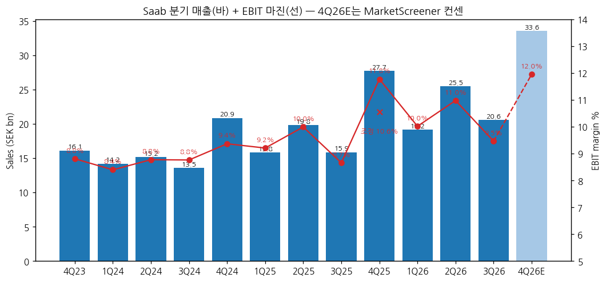
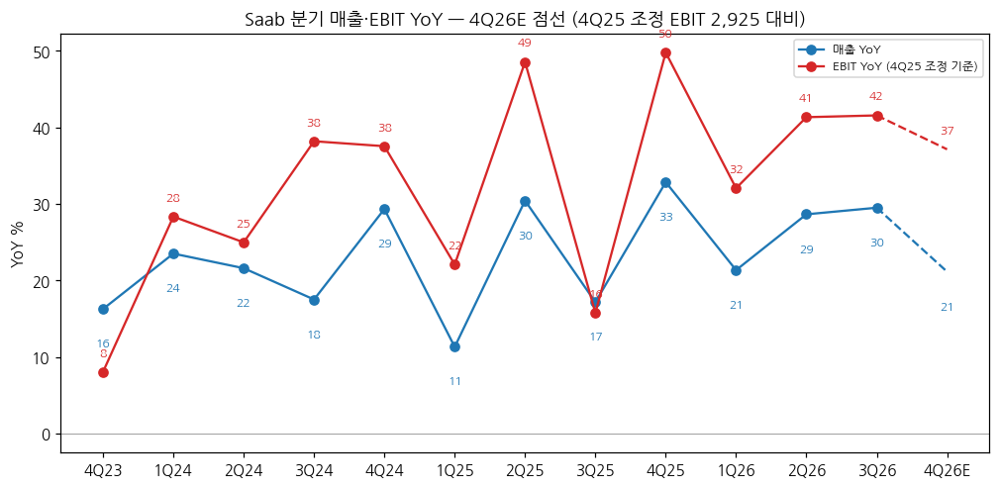
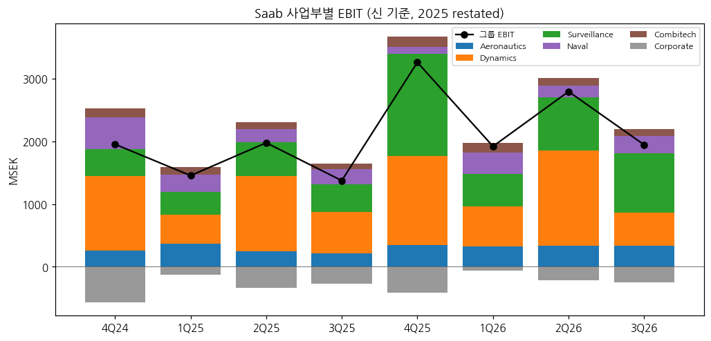

> 모드: 실적 리뷰 (v11)
> 종목: Saab (SAAB B, Nasdaq Stockholm)
> 섹터: 방산
> 서브섹터: 방산 글로벌
> 분기: 2026-Q3
> 발표일: 2026-10-23 (07:30 CET, 컨콜 10:00 CET)
> 작성 시각: 2026-11-14 18:00 KST
> 분석 소스: 회사 3Q26 Interim Report·발표자료·컨콜 트랜스크립트(2026-10-23) + 1Q26·2Q26·3Q25·3Q24 Interim Report, Year-End Report 2025, Annual Report 2025 + 웹 보완 — 컨센(Inderes·Bloomberg 12명 집계, Aktiespararna·FactSet, MarketScreener 4Q26E, Simply Wall St 13명), 등급·TP 변경(Placera 10/26·Inderes 10/26·Efn 7/20), 주가(Yahoo Finance). 셀사이드 리포트 첨부 없음 — 쟁점은 컨콜 Q&A + 기사로 구성
> 다음 발표: 4Q26·연간 2027-02-05 (MarketScreener 기준)

# Saab 3Q26 실적 리뷰

## 0. 한 줄 판정

> 성장 델타: 유지 | 내러티브: 강화 → 적극 구간 (EBIT +40%대 고원 + 수주 폭증, 단 4Q 고베이스·멀티플 부담)

→ 숫자: 매출 SEK 20,553m (+29.5%, 유기적 +30.6%), EBIT 1,945m (+41.6%). EBIT YoY가 1Q26 +32.0% → 2Q26 +41.3% → 3Q26 +41.6%로 **40%대에서 유지** (델타 +0.3%p). 컨센 대비 매출 +3%, EBIT은 부합(Bloomberg 집계 1,929m 대비 +0.8%)
→ 쟁점 ①: 성장의 주인공이 Surveillance로 바뀌었다 — 매출 +65%, EBIT +111%, 마진 13.7%. 반면 Dynamics는 매출 +10%에 EBIT −18% (R&D·믹스). 회사는 "추세 아님"이라고 답했다
→ 쟁점 ②: 수주 65.8bn (B/B 3.2x) — 우크라이나 그리펜 16대 24.6bn·GlobalEye 신규 고객 10.1bn·독일 프리깃 8.7bn. 잔고 364bn, 이 중 2027 인도분 102.1bn (+63%)
→ 쟁점 ③: 숫자는 좋은데 셀사이드는 밸류에이션으로 돌아섰다 — Pareto 매수→보유, Inderes 상향→축소 (TP는 올리면서). 주가는 발표일 +1.8%에 그쳤다
→ 다음 분기 관건: 4Q25 고베이스(조정 EBIT 2,925m) 대비 4Q26E EBIT 4,011m(+37%, 컨센)를 내는지, 그리고 2027년 초 회사가 내놓을 2028~ 중기 목표가 22%를 유지하는지

## 1. 숫자

① 그룹 분기 표 (MSEK) — 방산 비중 93% (2025)이라 **그룹 = 방산 합계**

| 항목 | 4Q23 | 1Q24 | 2Q24 | 3Q24 | 4Q24 | 1Q25 | 2Q25 | 3Q25 | 4Q25 | 1Q26 | 2Q26 | **3Q26** | 4Q26E |
|---|---|---|---|---|---|---|---|---|---|---|---|---|---|
| 매출 | 16,122 | 14,185 | 15,170 | 13,546 | 20,850 | 15,792 | 19,786 | 15,871 | 27,697 | 19,164 | 25,453 | **20,553** | 33,554 |
| EBIT | 1,420 | 1,191 | 1,331 | 1,187 | 1,953 | 1,454 | 1,977 | 1,374 | 3,261 | 1,920 | 2,794 | **1,945** | 4,011 |
| EBIT 마진 | 8.8% | 8.4% | 8.8% | 8.8% | 9.4% | 9.2% | 10.0% | 8.7% | 11.8% | 10.0% | 11.0% | **9.5%** | 12.0% |
| 매출 YoY | 16.3% | 23.5% | 21.6% | 17.5% | 29.3% | 11.3% | 30.4% | 17.2% | 32.8% | 21.4% | 28.6% | **29.5%** | 21.1% |
| EBIT YoY (조정) | 8.1% | 28.3% | 25.0% | 38.2% | 37.5% | 22.1% | 48.5% | 15.8% | 49.8% | 32.0% | 41.3% | **41.6%** | 37.1% |
| **매출 YoY 델타 (%p)** | −15.5 | +7.2 | −1.9 | −4.1 | +11.8 | −18.0 | +19.1 | −13.3 | +15.7 | −11.5 | +7.3 | **+0.9** | −8.4 |
| **EBIT YoY 델타 (%p)** | −43.2 | +20.3 | −3.4 | +13.2 | −0.6 | −15.5 | +26.5 | −32.8 | +34.0 | −17.7 | +9.3 | **+0.2** | −4.5 |

→ (출처: 4Q23~3Q26 회사 분기 보고서 "Quarterly income statement" (IFRS, MSEK). YoY 기준치 4Q22~3Q23은 3Q24 보고서. 4Q26E = MarketScreener 컨센 (매출 33,554·EBIT 4,011, 2026-11 조회). YoY·델타 [계산])
→ **조정 기준**: 4Q25 EBIT 3,261m에는 TransponderTech 매각익 336m 포함 → 조정 2,925m (마진 10.6%). EBIT YoY와 델타는 4Q25를 조정값으로 계산 (보고 기준 4Q25 YoY +67.0%, 1Q26 이후 영향 없음, 4Q26E 보고 기준 YoY +23.0%)
→ 컨센 대비: 매출 +3.1%, EBIT +0.8%, 순이익 +2.3% (Bloomberg 12명 집계, Inderes 인용 2026-10-16) / 매출 +2.9%, EBIT +5.6% (FactSet, Aktiespararna). 수주는 컨센 55.6bn 대비 +18%
→ YoY는 분기마다 들쭉날쭉하지만 (3Q가 휴가철 비수기, 4Q가 인도 집중) **2026년 세 분기 모두 EBIT +30~42%** 로 2024~2025(+15~50%) 대비 바닥이 높아졌다. 9M26 EBIT +38.6%, 매출 +26.7%
→ 컨센 경로: 4Q26E EBIT +37% → 2026E 연간 EBIT 약 10.7bn [계산: 9M 6,659 + 4Q E 4,011] (조정 7,730 대비 +38%). 2027E는 Inderes EBIT 13.0bn (+21%), 컨센 EPS 19.22 (+30% 전후 [계산]) → **YoY 정점은 2026년(2Q~3Q26 +41%)이고 2027년은 +20%대로 낮아지는 경로** `[전망]`

→ (출처: 회사 분기 보고서, 4Q26E MarketScreener 컨센)

→ (출처: 회사 분기 보고서, 4Q25 조정 EBIT 기준, 4Q26E MarketScreener 컨센)

② 사업부별 매출·EBIT (MSEK, 신 기준 — 2026-04-01 Naval 신설, 2025 restated)

| 사업부 | 항목 | 3Q25 | 4Q25 | 1Q26 | 2Q26 | **3Q26** | QoQ | YoY |
|---|---|---|---|---|---|---|---|---|
| Surveillance | 매출 | 4,146 | 8,168 | 5,027 | 7,366 | **6,842** | −7.1% | **+65.0%** |
| | EBIT | 446 | 1,630* | 520 | 845 | **939** | +11.1% | **+110.5%** |
| | 마진 | 10.8% | 20.0% | 10.3% | 11.5% | **13.7%** | +2.2%p | +2.9%p |
| Aeronautics | 매출 | 4,438 | 5,746 | 5,199 | 5,813 | **4,844** | −16.7% | +9.1% |
| | EBIT | 212 | 349 | 328 | 337 | **331** | −1.8% | +56.1% |
| | 마진 | 4.8% | 6.1% | 6.3% | 5.8% | **6.8%** | +1.0%p | +2.0%p |
| Naval | 매출 | 3,203 | 4,983 | 4,468 | 4,183 | **4,511** | +7.8% | +40.8% |
| | EBIT | 240 | 108 | 339 | 180 | **275** | +52.8% | +14.6% |
| | 마진 | 7.5% | 2.2% | 7.6% | 4.3% | **6.1%** | +1.8%p | −1.4%p |
| Dynamics | 매출 | 3,411 | 8,397 | 3,634 | 7,759 | **3,768** | −51.4% | +10.5% |
| | EBIT | 658 | 1,422 | 637 | 1,522 | **537** | −64.7% | **−18.4%** |
| | 마진 | 19.3% | 16.9% | 17.5% | 19.6% | **14.3%** | −5.3%p | −5.0%p |
| Combitech | 매출 | 1,025 | 1,430 | 1,367 | 1,331 | **1,071** | −19.5% | +4.5% |
| | EBIT | 85 | 162 | 155 | 127 | **117** | −7.9% | +37.6% |
| Corporate | EBIT | −267 | −410 | −59 | −217 | **−254** | | |

→ (출처: 3Q26 보고서 "Quarterly information per operating segment". \*4Q25 Surveillance는 매각익 336 포함, 제외 시 1,294 (15.8%) [계산]. QoQ·YoY [계산])
→ **델타를 끄는 건 Surveillance**: 그룹 EBIT 증가분 571m 중 493m(86%)가 Surveillance [계산]. Giraffe 1X 대량 인도 + GlobalEye 진행 (회사). 3Q26 매출 비중 33%로 최대 BA가 됐다
→ **꺾인 건 Dynamics**: EBIT −18% (R&D 증가·인도 믹스). 다만 Dynamics는 4Q·2Q에 배치 인도가 몰리는 구조라 분기 YoY 변동이 원래 크다 — 9M26은 매출 +24%, EBIT +17%, 마진 17.8%
→ Aeronautics 마진 6.8%는 T-7 손실(분기 1억+)을 안고 낸 수치 — 수출 계약(콜롬비아 등) 진행이 기여 (CFO)

(2-1) 9M 누계 사업부 (MSEK)

| 사업부 | 9M25 매출 | 9M26 매출 | YoY | 9M25 EBIT | 9M26 EBIT | YoY | 9M26 마진 |
|---|---|---|---|---|---|---|---|
| Surveillance | 13,088 | 19,235 | +47% | 1,361 | 2,304 | +69% | 12.0% |
| Aeronautics | 13,387 | 15,856 | +18% | 828 | 996 | +20% | 6.3% |
| Dynamics | 12,268 | 15,161 | +24% | 2,313 | 2,696 | +17% | 17.8% |
| Naval | 10,530 | 13,162 | +25% | 721 | 794 | +10% | 6.0% |
| Combitech | 3,547 | 3,769 | +6% | 316 | 399 | +26% | 10.6% |

→ (출처: 3Q26 보고서 BA 페이지)

→ (출처: 회사 분기 보고서, 신 기준)

(2-2) 수주·잔고 (MSEK)

| | 3Q25 | 4Q25 | 1Q26 | 2Q26 | **3Q26** |
|---|---|---|---|---|---|
| 수주 | 20,861 | 100,111 | 18,243 [계산] | 68,393 | **65,825** |
| Book-to-bill | 1.3x | 3.6x | 1.0x | 2.7x | **3.2x** |
| 수주잔고 | 202,408 | 274,532 | — | 317,700 | **364,223** |

→ (출처: 각 분기 보고서. 1Q26 = 9M 152,461 − 2Q − 3Q)
→ 3Q 대형 수주(>SEK 1bn) 52.1bn (+526%). BA별 3Q 수주: Surveillance 19.7bn (+392%), Aeronautics 28.8bn, Naval 8.9bn, Dynamics 7.6bn (+18%)
→ 잔고 인도 시점: 4Q26 27.9bn · **2027 102.1bn** · 2028 89.2bn · 2029 62.0bn · 이후 83.0bn — 2027 인도분이 2025 연간 매출(79.1bn)을 이미 넘는다 [계산]
→ 영업현금흐름(operational) 3Q 6,785m (전년 142m) — 폴란드 잠수함·GlobalEye 선수금. 순현금 8.7bn

③ 연간 (MSEK)

| 항목 | 2022 | 2023 | 2024 | 2025 | 2026E | 2027E |
|---|---|---|---|---|---|---|
| 매출 | 42,006 | 51,609 | 63,751 | 79,146 | 약 98,700 | 약 119,000 |
| EBIT | 3,274 | 4,272 | 5,662 | 8,066 (조정 7,730) | 약 10,700 | 약 13,000 |
| EBIT 마진 | 7.8% | 8.3% | 8.9% | 10.2% (9.8%) | 10.8% | 10.9% |
| 매출 YoY | 7.3% | 22.9% | 23.5% | 24.1% | 약 +25% | 약 +20% |
| EBIT YoY | 13.4% | 30.5% | 32.5% | 42.5% (조정 36.5%) | 약 +38% (조정 기준) | 약 +21% |

→ (출처: 2022~2025 회사 / 2026E = 9M 실적 + MarketScreener 4Q26E [계산] / 2027E = 매출 컨센 119.7bn(Simply Wall St 13명), EBIT은 Inderes 12,999 (2026-10-26) — 컨센 집계가 아닌 단일 추정 `[추정]`)
→ 발표 전후 컨센 변화: 2027E 매출 119.1bn → 119.7bn (+0.5%), EPS 19.04 → 19.22 (+0.9%) (Simply Wall St 2026-10-28) — **추정치는 거의 안 움직였다**. Inderes는 2026~28 매출·EBIT 2~4% 상향
→ 회사는 2026 단년 가이던스 미제시. 중기 목표(2023~27 유기적 CAGR 약 22%)는 "자신 있다" (CFO). 2023~3Q26 R12 매출 CAGR 24%, 조정 EBIT CAGR 33%

## 2. 시장 쟁점

① 2-0 지난 분기 체크

→ 첫 리뷰 — 직전 체크 없음

② 이번 분기 쟁점 4개

| # | 쟁점 | 근거 |
|---|---|---|
| (1) | Dynamics 마진 하락은 추세인가 | 컨콜 첫 질문(Trigon), Inderes "약점" 지목 |
| (2) | Aeronautics·Naval 마진 — T-7 손실과 증설 비용은 언제 줄어드나 | 컨콜 질문 3건 (BofA 2, Agency Partners 1) |
| (3) | Surveillance·GlobalEye 레버리지와 수주 파이프라인 (캐나다·NATO) | 컨콜 질문 2건 (SB1, Barclays), 3Q 서프라이즈의 원천 |
| (4) | 현금흐름·증설 투자 피크와 밸류에이션 | 컨콜 2건 (AlphaValue, SB1) + 3Q 후 등급 하향 2건 |

③ 쟁점별 분해

(1) **Dynamics 마진 하락은 추세인가**

(1-1) 회사 설명
→ CEO: 추세가 전혀 아니다. 배치 인도에 따라 분기마다 다르다. 9M은 성장 24%·EBIT 18% 수준. 잔고 90bn+로 "4Q는 견조한 마무리"
→ R&D: Dynamics 안에 드론형 효과기(배회형·일회성) 전담 BU 신설, 대드론, Carl-Gustaf 신탄종 — 투자 증가는 계속된다 (CFO)

(1-2) 시장 해석

| 출처 | 핵심 가정·추정 | 논리 |
|---|---|---|
| Inderes (10/23·10/26) | Dynamics가 "약점", R&D가 당분간 마진 확장을 막음 | 의도된 투자로 보고 추정은 상향 |
| CFO 발언 | 4Q 비교 기준 변화 언급 없음, Dynamics "견조한 연말" | 4Q24 21.2%·4Q25 16.9% 마진이 기준 |

(1-3) 공통 vs 갈림
→ 공통: 9M 마진 17.8%는 여전히 그룹 최고. 3Q는 인도 믹스 영향이 크다
→ 갈림: R&D 증가가 "일시적 믹스"인지 "구조적 마진 하향"인지 — 회사는 R&D를 계속 늘린다고 했다

(1-4) [판단]
→ Dynamics 마진은 분기 단독이 아니라 R12로 봐야 한다. 4Q26에 매출이 2Q·4Q 패턴대로 7~8bn대로 돌아오고 마진이 17% 이상이면 "믹스"가 확인된다. 4Q 마진이 15% 아래면 R&D 증액이 구조적 하향으로 넘어간 것으로 본다

(2) **Aeronautics·Naval 마진 — T-7 손실과 증설 비용**

(2-1) 회사 설명
→ T-7: 기존 가이드 분기 SEK 1억보다 "조금 더" — 연 약 5억 (CEO). 원인은 라인 자동화 투자·인력 교육·이직률, 그리고 보잉 출고 속도가 낮아 생기는 under-absorption. 미 공군 IOC 2027-08, 연 50대 수준까지는 "수년"
→ T-7 제외 Aeronautics 마진은 "high single-digit" (CEO)
→ Naval: 폴란드·스웨덴 잠수함 조합은 마진 개선 요인. 마진을 끌어내리는 건 수중무인체(테더드·전기 ROV)와 전투체계 1~2개 프로젝트(독일 건 아님) + Landskrona 증설 착수 비용 (CEO·CFO). 2Q26 Naval 4.3%는 충당금 영향 (BofA 질문)

(2-2) 시장 해석

| 출처 | 핵심 가정·추정 | 논리 |
|---|---|---|
| BofA (컨콜) | Aeronautics +200bp 확장의 지속성 질문 | 믹스 순풍이 무엇인지 확인 |
| Agency Partners (컨콜) | T-7 비용이 물량 연동인지, 고정비 초과인지 | 예상보다 커진 손실의 성격 |
| Ålandsbanken (2Q 후, Efn 7/20) | Aeronautics·Naval 마진 개선 여부가 다음 확인점 | 밸류 부담 → 마진 레벨업 필요 |

(2-3) 공통 vs 갈림
→ 공통: 두 BA 모두 EBIT은 늘고 있다 (3Q Aeronautics +56%, Naval +15%)
→ 갈림: T-7 손실이 "연 5억에서 줄어드는 시점" — 회사도 날짜를 주지 않았다

(2-4) [판단]
→ Aeronautics는 그리펜 수출(콜롬비아·태국·우크라이나) 물량이 늘수록 마진이 오르는 구조이고, T-7은 연 5억 정도의 상수 마이너스로 보면 된다. 그룹 마진 레벨업의 열쇠는 Aeronautics(그룹 매출 24%)가 6%대에서 8%대로 올라가는지다 `[판단]`

(3) **Surveillance·GlobalEye 레버리지와 파이프라인**

(3-1) 회사 설명
→ 잔고 마진: 플랫폼(GlobalEye)은 제품(센서)보다 마진이 조금 낮다. Surveillance는 "항상 10% 이상". GlobalEye 연 2대 → 6대 확대 시 레버리지는 있으나 캐나다 신규 허브 구축 비용이 일부 상쇄 (CEO·CFO)
→ 3Q GlobalEye 2대는 **신규 고객**(미공개) 확인. 캐나다 6대 term sheet 후 협상 "계획대로", NATO 약 10대 협상, 네덜란드 1대(스웨덴 공동 운용) 연내 기대. 캐나다 그리펜은 정치적 결정 대기 (CEO)
→ 4Q 주의: 4Q25 Surveillance에는 TransponderTech 매각익 336m와 프랑스 GlobalEye 착수 효과가 있어 "비교 기준이 어렵다" (CFO)

(3-2) 시장 해석

| 출처 | 핵심 가정·추정 | 논리 |
|---|---|---|
| Inderes (10/26) | 2027~28 상향의 주된 원천이 Surveillance | Giraffe·GlobalEye 볼륨 |
| SB1 Markets (컨콜) | 잔고 마진 vs 3Q 13.7% 비교 질문 | 레버리지의 크기 확인 |
| Barclays (TP 755→760, 10/26) | 잔고가 내년 예상 매출 대부분을 커버 | 가시성 근거로 비중확대 유지 |

(3-3) 공통 vs 갈림
→ 공통: 3Q 서프라이즈의 원천은 Surveillance이고, 2027 이후 추정 상향도 여기서 나온다
→ 갈림: 플랫폼 비중이 커질 때 마진이 13%대를 지킬지, 10%대로 수렴할지 — 회사 가이드는 "10% 이상"으로 보수적

(3-4) [판단]
→ 4Q26 Surveillance는 매각익 336m가 빠지는 높은 비교 기준이라 YoY가 약해 보일 수 있다. 판정은 매각익 제외 4Q25(1,294m, 15.8%) 대비로 봐야 한다. NATO·캐나다 계약 체결이 나오면 Surveillance 잔고와 2028 이후 경로가 한 단계 더 올라간다

(4) **현금흐름·증설 피크와 밸류에이션**

(4-1) 회사 설명
→ 3Q 현금은 대형 선수금(폴란드 잠수함·GlobalEye) 덕분. 플랫폼 계약은 초기 마일스톤 결제를 받는 것이 사업 모델. 4Q도 "강한 현금흐름으로 마감" (CFO). 누적 cash conversion 77% (목표 >60%)
→ capacity 투자 R12 SEK 80억+ — 2026·2027이 피크일 수 있고 이후 다소 감소 (CEO)
→ 2027-05-12 CMD 예고. 2028~ 가이던스 기간·지표는 2027년 초에 따로 제시 (CEO)

(4-2) 증권사 등급·TP 변경 (3Q 발표 후)

| 증권사 | 등급 | TP (SEK) | 논리 |
|---|---|---|---|
| Barclays | 비중확대 유지 | 755 → 760 | 잔고가 내년 매출 대부분 커버 |
| Pareto | 매수 → **보유** | 690 → 700 | 상승 여력 제한 |
| Inderes | 상향 → **축소** | 635 → 670 | 실적이 아닌 밸류 판단, 2027~28 P/E 35x·29x |
| SB1 Markets | 중립 유지 | 650 → 660 | 올해 영업이익의 약 33배, 유럽 피어 대비 51% 프리미엄 |

→ (출처: Placera 2026-10-26, Inderes 2026-10-26)
→ 컨센 평균 TP SEK 648 (13명, 범위 330~760) — "대체로 변화 없음" (Simply Wall St 2026-10-28). 현재가 622.5 (11/13) 대비 +4% [계산]

(4-3) 공통 vs 갈림
→ 공통: 사업은 좋다 — 모든 하향이 "밸류에이션" 이유였고 TP는 전부 올랐다
→ 갈림: 프리미엄의 정당성. Inderes는 유럽 방산 희소성·실행력·지배구조로 프리미엄 일부를 인정하면서도 적정 배수는 2029년에야 도달한다고 봤다

(4-4) [판단]
→ **TP 변경은 전부 실적 상향 쪽이고, 등급 하향은 전부 멀티플 쪽**이다. 한국 방산(현대로템·LIG D&A 평균 TP −30~40%, 실적·멀티플 동반 하향)과 정반대 — 같은 "방산 디레이팅" 신호로 묶으면 안 된다 `[판단]`

④ 낙관 vs 보수

→ 낙관(Barclays TP 760, DNB Carnegie 2Q 후 매수·TP 630): 잔고 커버리지·GlobalEye/NATO·22% 목표가 보수적이라는 논리
→ 보수(Inderes 축소, SB1 중립, 최저 TP 330): 실적 전망은 같지만 P/E 30x+가 2029년까지 정상화되지 않는다는 논리
→ 셀사이드 vs 주가: 발표일 10/23 634.9 → 646.5 (+1.8%), 10/29 676.3까지 올랐다가 11/13 622.5 (발표 전보다 −2%). 2Q26 발표일(+9.7%)과 달리 반응이 작았다 — 컨센 부합 EBIT에는 프리미엄을 더 주지 않는 단계 [판단]

⑤ 추정치·TP 변화 (압축)

| 출처 | 직전 TP | 현재 TP | 4Q26 EBIT E | 2026E / 2027E EBIT | 핵심 변화 |
|---|---|---|---|---|---|
| Inderes (10/26) | 635 | 670 | — | 10,742 / 12,999 | 2026~28 매출·EBIT +2~4%, 등급 축소 |
| Barclays (10/26) | 755 | 760 | — | — | 비중확대 유지 |
| Pareto (10/26) | 690 | 700 | — | — | 보유로 하향 |
| SB1 Markets (10/26) | 650 | 660 | — | — | 중립 유지 |
| MarketScreener 컨센 | — | — | 4,011 | — | 4Q 매출 33,554 |
| Simply Wall St 컨센 (13명) | 평균 648 | 평균 648 | — | 2027E EPS 19.04 → 19.22 | 매출 119.1 → 119.7bn |

→ 상향 4건(TP), 하향 0건. 등급 하향 2건은 모두 밸류
→ **TP 변화의 원인은 실적 상향 (+1~4%)**, 등급 하향의 원인은 멀티플 — 실적 하향 없음

## 3. 내러티브 점검

① 성장 스토리 정의
→ "유럽 재무장의 NATO 내부 공급자 — 그리펜·GlobalEye·잠수함 같은 대형 플랫폼 수주로 잔고를 쌓고, 증설로 인도를 늘려 매출 20%대·EBIT 그 이상으로 몇 년간 성장한다"

② 이번 분기가 스토리에 준 영향
→ 강화: 수주 65.8bn (그리펜 신규 고객 우크라이나, GlobalEye 신규 고객), 2027 인도분 잔고 +63%, Surveillance 마진 레벨업, 현금 선수금으로 증설 자금 자체 조달
→ 약화 요인(작음): Dynamics 3Q 감익, T-7 손실이 가이드보다 다소 큼
→ 시장은 스토리에 동의하지만 가격에 이미 반영됐다는 쪽으로 이동 — 추정치는 유지·소폭 상향, 등급만 하향

③ 국면 판단
→ 델타 유지(EBIT YoY +41%대, 2분기 연속 40% 이상) + 내러티브 강화(수주·잔고·TP 상향) → **적극 구간**
→ 단 BT 프레임상 주의점: ① 4Q26E YoY +37%(컨센)로 이미 소폭 둔화가 그려져 있고, ② 2027E EBIT +21%로 YoY 정점은 2026년이다. 2027 1H 분기 YoY가 20%대로 내려오면 판정은 "둔화"로 넘어간다 `[전망]`

④ 트리거와 리스크
→ 트리거: ① NATO GlobalEye 약 10대 계약 ② 캐나다 GlobalEye 6대 본계약 (+그리펜 결정) ③ 2027 초 2028~ 중기 목표 22% 이상 유지
→ 리스크: ① 4Q26 Surveillance·Dynamics가 고베이스에 못 미쳐 EBIT 컨센 4.0bn 미달 ② T-7 손실 확대 ③ 증설 투자 피크와 선수금 소진 시 현금흐름 역전

## 4. 향후 봐야 할 것

① **4Q26 EBIT 4,011m(+37% 조정 기준) 달성 여부** (델타 판정 1순위)
→ 무엇을: 그룹 EBIT 4.0bn·마진 12%, Dynamics 4Q 마진 17% 이상 회복, Surveillance 매각익 제외 4Q25(1,294m) 대비 증가
→ 어떤 데이터로: 4Q26 Year-End Report, 컨콜 Dynamics·Surveillance Q&A
→ 언제: 2027-02-05

② **2028~ 중기 목표와 2027 가이던스**
→ 무엇을: 유기적 성장 목표가 22%(2023~27) 이상인지, EBIT 성장 > 매출 성장 문구 유지 여부
→ 어떤 데이터로: 4Q26 보고서·2027 초 발표, 2027-05-12 CMD
→ 언제: 2027-02 ~ 2027-05

③ **GlobalEye 대형 계약 (NATO 약 10대·캐나다 6대·네덜란드 1대)**
→ 무엇을: 본계약 체결과 금액 (2대 기준 SEK 10~12bn 수준), GlobalEye 연 6대 생산 일정
→ 어떤 데이터로: Saab 보도자료, NATO NSPA·캐나다 DIA 발표
→ 언제: 네덜란드 연내, 캐나다·NATO 2027

④ **T-7 손실과 Aeronautics 마진**
→ 무엇을: T-7 손실이 연 5억에서 줄기 시작하는지, Aeronautics 마진 7% 돌파, 그리펜 신규 캠페인(캐나다 등) 결정
→ 어떤 데이터로: 분기 보고서 Aeronautics 페이지, 보잉 T-7 인도·미 공군 IOC(2027-08) 뉴스
→ 언제: 4Q26 발표 ~ 2027 하반기

⑤ **현금흐름·증설 피크**
→ 무엇을: 4Q 영업현금 플러스 유지, capacity 투자 R12 SEK 8bn 대비 증감
→ 어떤 데이터로: 4Q26 보고서 현금흐름표
→ 언제: 2027-02-05
