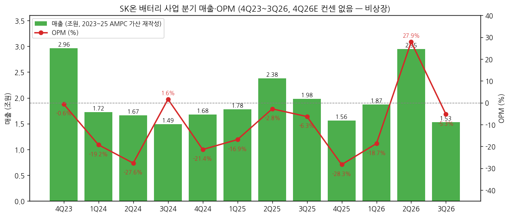
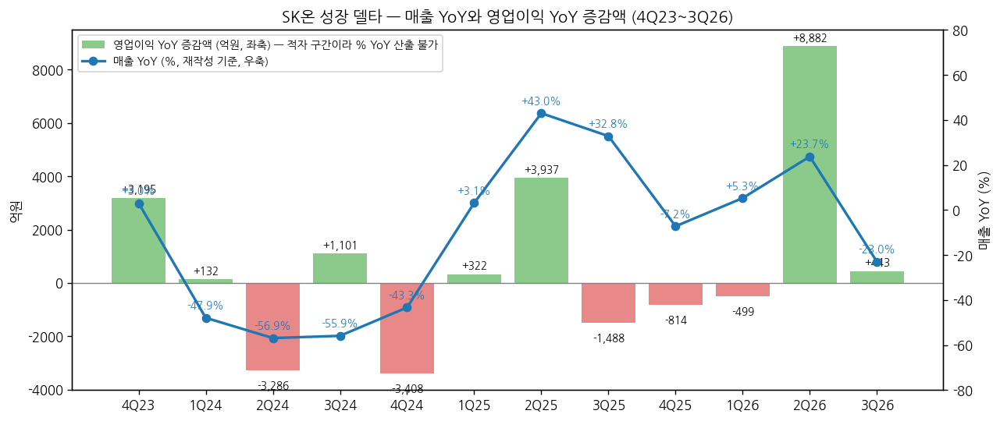
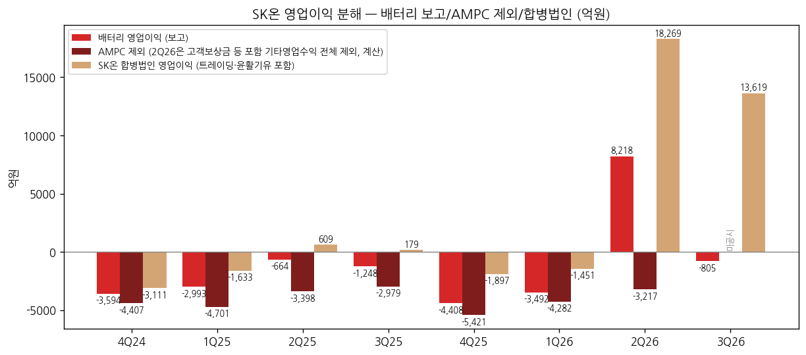

> 모드: 실적 리뷰 (v11)
> 종목: SK온 (비상장 — SK이노베이션 096770 배터리 자회사, 지분 90.3%)
> 섹터: 배터리
> 서브섹터: 배터리 셀
> 분기: 2026-Q3 (캘린더 분기 = 회계 분기)
> 발표일: 2026-10-29 (SK이노베이션 3Q26 실적발표·컨퍼런스콜)
> 작성 시각: 2026-11-14 21:00 KST
> 분석 소스: SK이노베이션 3Q26 실적발표 PDF(2026-10-29, irgo) + 1Q26·2Q26·4Q25·3Q25 실적발표 PDF + SK이노 DART 반기보고서 2026.06(20260814002500)·분기보고서 2026.03(20260515001455)·사업보고서 2025(20260316000827) 영업부문·매출실적 주석 + 웹 보완 — 컨콜 발언(뉴스토마토·지디넷·비즈워치 2026-10-29, 디지털데일리 2026-07-30), AMPC 공시 여부(SBS Biz 2026-08-03), SNE 점유율(디지털데일리 2026-08-05, 더팩트 2026-11-04), 재무(IB토마토 2026-07-06, 한경비즈니스 2026-08-26). **셀사이드 리포트 첨부 없음** — 쟁점은 컨콜·IR·기사로 구성. BT `company-overview/SK온_기업개요.md` v1.0 시계열 재사용
> 리뷰 깊이: 숫자 중심 | 리서치 첨부 0건
> 다음 발표: 4Q26 — SK이노베이션 4Q26 실적발표 2027-01 말 예정 (전년 2026-01-28 기준 ⚠️추정, 노션 실적 캘린더로 확정 필요)

> ⚠️ **숫자 기준**: ① 'SK온' = SK이노베이션 IR '회사별 실적'의 **배터리 사업**(SK이노 계열 내부거래 제거). SK트레이딩·SK엔텀·SK엔무브를 합친 **합병법인** 숫자와 다름(3Q26 합병법인 영업이익 1조3,619억) ② 2026년부터 AMPC를 매출에 포함 표시 → 2023~2025 매출은 AMPC를 더한 **재작성 기준**으로 YoY 계산(SK이노 IR 재작성치 2Q25 2.381조·3Q25 1.981조와 일치) ③ **3Q26 AMPC 금액 미공시** (회사가 2Q26부터 AMPC·고객보상금 별도 공개 중단) → 3Q26 AMPC 제외 영업이익 [미확보] — SK이노 3Q26 분기보고서(2026-11-16 전후) 공시 후 보완 ④ 비상장이라 FnGuide 컨센·TP 없음 → 서프라이즈·TP 표 생략. 섹터 합산용 원화 기준 그대로(환산 불필요)

# SK온 3Q26 실적 리뷰

## 0. 한 줄 판정

> 성장 델타: 꺾임 | 내러티브: 약화 → 매매 제외 구간 (2Q 일회성 흑자 소멸·매출 YoY -23%로 역성장 전환, ESS 반전은 2027 공급 개시 이후)

→ 숫자: 매출 1조5,263억 (YoY -23.0%, QoQ -48.2%), 영업손실 -805억 (OPM -5.3%). 매출 YoY가 2Q26 +23.7% → 3Q26 **-23.0%** (델타 -46.7%p). 영업손익은 전년 -1,248억 대비 +443억 개선이지만, 2Q26 +8,218억(고객보상금·AMPC 포함)에서 다시 적자 (SK이노 IR 3Q26 p.6)
→ 쟁점 ①: 2Q26 흑자는 일회성이었다 — 2Q26 기타영업수익(AMPC+고객보상금+파생이익) 약 1.14조(⚠️계산)를 빼면 -3,217억. 회사는 "일회성 제외 본원적 수익성 개선 흐름"이라고 했지만 AMPC 미공시로 검증 불가
→ 쟁점 ②: EV 판매량 감소 — 비중국 시장 1~9월 사용량 -17.9%, 북미 -46.7%, 점유율 10.0% → 6.6% (SNE). 3Q26 K-배터리 3사 중 유일한 적자 (LGES +7,560억, 삼성SDI +4,078억)
→ 쟁점 ③: ESS 수주는 붙기 시작 — NeoVolta 9GWh(2027~2031), 국내 중앙계약 284MW, Flatiron 1GWh. 2026 목표 20GWh 대비 약 절반, 매출 기여는 2027부터
→ 다음 분기 관건: 4Q26에 회사가 말한 "주요 고객 물량 증가로 일부 판매 회복"이 매출 YoY 플러스(4Q25 1.559조 초과)로 나오는지, 그리고 AMPC를 다시 공시하는지

## 1. 숫자

① 배터리 사업 분기 표 (억원)

| 항목 | 4Q23 | 1Q24 | 2Q24 | 3Q24 | 4Q24 | 1Q25 | 2Q25 | 3Q25 | 4Q25 | 1Q26 | 2Q26 | **3Q26** | 4Q26E |
|---|---|---|---|---|---|---|---|---|---|---|---|---|---|
| 매출 (재작성, AMPC 포함) | 29,633 | 17,221 | 16,653 | 14,915 | 16,800 | 17,762 | 23,811 | 19,810 | 15,585 | 18,701 | 29,460 | **15,263** | — |
| 영업이익 | -186 | -3,315 | -4,601 | 240 | -3,594 | -2,993 | -664 | -1,248 | -4,408 | -3,492 | 8,218 | **-805** | — |
| OPM | -0.6% | -19.2% | -27.6% | 1.6% | -21.4% | -16.9% | -2.8% | -6.3% | -28.3% | -18.7% | 27.9% | **-5.3%** | — |
| 매출 YoY | +3.0% | -47.9% | -56.9% | -55.9% | -43.3% | +3.1% | +43.0% | +32.8% | -7.2% | +5.3% | +23.7% | **-23.0%** | — |
| 영업이익 YoY | n/m | n/m | n/m | 흑전 | n/m | n/m | n/m | 적전 | n/m | n/m | 흑전 | **적자축소** | — |
| 영업이익 YoY 증감액 | +3,195 | +132 | -3,286 | +1,101 | -3,408 | +322 | +3,937 | -1,488 | -814 | -499 | +8,882 | **+443** | — |
| **매출 YoY 델타 (%p)** | -51.2 | -50.9 | -9.0 | +1.0 | +12.6 | +46.4 | +39.9 | -10.2 | -40.0 | +12.5 | +18.4 | **-46.7** | — |
| **영업이익 YoY 델타** | 적자 구간 — %p 산출 불가 (증감액 행으로 대체) | | | | | | | | | | | | |
| AMPC (기타영업수익) | 2,402 | 385 | 1,118 | 607 | 813 | 1,708 | 2,734 | 1,731 | 1,013 | 790 | 11,435* | **[미확보]** | — |
| AMPC 제외 영업이익 | -2,588 | -3,700 | -5,719 | -367 | -4,407 | -4,701 | -3,398 | -2,979 | -5,421 | -4,282 | -3,217* | **[미확보]** | — |

\* 2Q26 = AMPC + 고객보상금 + 파생이익 등 기타영업수익 전체 (SK이노 반기보고서 SK온 매출실적 표 1H26 기타영업수익 1,222,433백만원 − 1Q26 AMPC 78,953백만원, ⚠️계산)

→ (출처: 4Q23~3Q26 매출·영업이익 = SK이노베이션 IR 실적발표('배터리 사업'·'회사별 실적', 2025 분기는 3Q26·2Q26 IR의 재작성 비교 컬럼 + 4Q25 IR). YoY 기준치 4Q22~3Q23은 SK이노 분기·사업보고서 영업부문 '배터리' 누적 차감. AMPC = SK이노 정기보고서 영업부문 주석 '기타영업수익' 누적 차감. YoY·델타 [계산])
→ **4Q26E**: 비상장으로 FnGuide 컨센 없음. 회사 정성 가이던스만 — "주요 고객사 물량 증가에 따라 일부 판매 회복 기대, ESS 추가 수주 추진 및 전사 원가 절감 지속" (SK이노 IR 3Q26 p.7)
→ 컨센 대비 서프라이즈: [해당 없음 — 컨센 부재]. 3Q26 업계 비교로 대체: K-배터리 3사 중 유일한 영업적자 (LGES +7,560억, 삼성SDI +4,078억 — 뉴스토마토 2026-10-29)
→ **위치**: 매출 YoY는 2Q25 +43.0%를 정점으로 3Q25 +32.8% → 4Q25 -7.2% → 1Q26 +5.3% → 2Q26 +23.7%(고객보상금 포함 매출 효과) → 3Q26 **-23.0%**. 2Q26의 회복은 일회성 기타영업수익이 끌어올린 것이라 **추세 반등이 아니었다** [판단]. 4Q25(1.559조)가 낮은 기저라 4Q26 YoY는 플러스 가능성이 있지만, 이는 기저효과다 [전망]
→ **영업이익**: 12개 분기 중 흑자는 3Q24(+240억)·2Q26(+8,218억) 2번, 둘 다 AMPC·보상금 영향. AMPC 제외 기준으로는 **12개 분기 연속 적자**(공시 범위 내)

→ (출처: SK이노베이션 IR 4Q23~3Q26, 2023~25 매출은 AMPC 가산 재작성)

→ (출처: 같은 자료, 적자 구간이라 영업이익은 % YoY 대신 증감액)

② 사업부별 (공개 범위)

→ **EV·ESS 제품별 매출·영업이익: 미공개** — SK이노 IR은 'SK온(배터리 사업)' 한 줄, DART 영업부문은 2024.11 이후 '배터리 및 소재'(분리막 포함)로 통합. 셀사이드 사업부 추정도 [미확보]

| 구분 (억원) | 3Q25 | 2Q26 | **3Q26** | QoQ | YoY | 비고 |
|---|---|---|---|---|---|---|
| 배터리 사업 매출 | 19,810 | 29,460 | **15,263** | -48.2% | -23.0% | AMPC 포함 |
| 배터리 사업 영업이익 | -1,248 | 8,218 | **-805** | -9,023 | +443 | |
| SK온 합병법인 영업이익 | 179 | 18,269 | **13,619** | -4,650 | +13,440 | 트레이딩·탱크터미널·윤활기유 포함 (IR 각주) |
| ㄴ (참고) SK엔무브 영업이익 | 1,711 | 6,919 | **10,906** | +3,987 | +9,195 | 분기 최대, 중동 공급 차질 → 기유 스프레드 급등 |
| ㄴ (참고) SK트레이딩인터내셔널 | 1,417 | 3,132 | **3,518** | +386 | +2,101 | |

→ (출처: SK이노베이션 IR 3Q26 p.6 '회사별 실적'·각주 2, 2Q26 p.6, 4Q25 p.16)
→ **해석**: 합병법인은 분기 1조 원대 흑자지만 그 대부분이 윤활기유·트레이딩이다. 배터리 델타를 끄는 축은 없다 — 2Q26 반등은 고객보상금·AMPC, 3Q26 하락은 EV 판매량 감소 [판단]. 2026-11-01 이후 SK엔무브는 'SK온 합병법인' 소속이므로, SK온 법인 재무로는 배터리 부진이 가려진다

→ (출처: SK이노베이션 IR 4Q24~3Q26, AMPC는 SK이노 정기보고서 영업부문 주석. 3Q26 AMPC 미공시)

③ 연간 (간략)

| 항목 (억원) | 2021 | 2022 | 2023 | 2024 | 2025 | 9M26 |
|---|---|---|---|---|---|---|
| 매출 (재작성) | 30,397 | 76,177 | 135,142 | 65,590 | 76,968 | 63,424 |
| 영업이익 | -6,840 | -10,727 | -5,818 | -11,268 | -9,313 | 3,921 |
| OPM | -22.5% | -14.1% | -4.3% | -17.2% | -12.1% | 6.2% |
| 매출 YoY | +88.8% | +150.6% | +77.4% | -51.5% | +17.3% | +3.3% (vs 9M25 6.14조) |
| AMPC 제외 영업이익 | -6,840 | -10,727 | -11,988 | -14,192 | -16,499 | [미확보] |

→ (출처: SK이노 사업보고서 영업부문·MD&A(2024 -1조1,268억, 2025 -9,313억 명시), IR 3Q26. 2021 이전은 SK이노 배터리사업 = 분할 전 동일 부문)
→ 9M26 영업이익 +3,921억은 2Q26 일회성(약 1.14조 기타영업수익 중 상당분) 덕분 — 연간 흑자 여부는 4Q26이 결정 [전망]. 연간 컨센 변화: [해당 없음 — 비상장]

## 2. 시장 쟁점 (회사 설명 + 컨콜·기사 기반)

2-0. 지난 분기 체크 — **첫 리뷰 — 직전 체크 없음**

2-1. 이번 분기 쟁점 4개

| # | 쟁점 | 다룬 매체 수 |
|---|---|---|
| ① | 2Q 흑자는 일회성이었나 — 본원적 수익성은 개선되고 있나 | 5 (뉴스토마토·지디넷·비즈워치·디지털데일리·SBS Biz) |
| ② | EV 판매량은 왜 줄었고 4Q에 돌아오나 | 4 |
| ③ | ESS가 EV 공백을 언제, 얼마나 메우나 | 4 |
| ④ | 재무구조 — BOSK 종료 효과와 SK온 가치 | 3 (한경비즈니스·IB토마토·디지털데일리) |

2-2. 쟁점별 분해

① **2Q 흑자는 일회성이었나**

(1) 회사 설명
→ 2Q26: "구조적 원가 절감 중심으로 가시적 성과가 나왔으며 일회성 요인(고객사 보상금)을 제외하더라도 전분기 손익이 개선됐다" — 김영광 재무관리실장 (디지털데일리 2026-07-30)
→ 3Q26: "전분기에 일회성 이익이 있어 분기 손익은 줄었지만 일회성 요인을 제외한 본원적 수익성 측면에서는 개선 흐름을 이어가고 있다" (지디넷 2026-10-29) / "고정비 효율화 노력이 실질적인 손익 개선으로 이어지고 있다" (뉴스토마토 2026-10-29)
→ AMPC·보상금 금액은 회계 표시 변경(AMPC 매출 병합)을 이유로 미공개 — "AMPC와 고객사 보상금이 각각 얼마인지 밝히지 않았습니다" (SBS Biz 2026-08-03)

(2) 숫자로 본 검증 (셀사이드 편차 표 대신)

| 기준 | 1Q26 | 2Q26 | 3Q26 | 계산 |
|---|---|---|---|---|
| 보고 영업이익 | -3,492 | 8,218 | -805 | IR |
| 기타영업수익(AMPC·보상금 등) | 790 | 11,435 | [미확보] | DART 누적 차감 |
| 기타영업수익 제외 | -4,282 | **-3,217** | [미확보] | ⚠️계산 |
| 같은 기준 전년 동기 | -4,701 | -3,398 | -2,979 | |

(3) 공통 결론 vs 갈리는 지점
→ 공통: 2Q26 흑자는 고객보상금·AMPC 증가가 만든 것 (회사도 인정). 3Q26 적자 전환의 직접 원인은 판매량 감소 + 일회성 소멸
→ 갈림: 회사는 '본원 수익성 개선'을 주장하지만, 기타영업수익 제외 기준 2Q26 -3,217억은 전년 2Q25 -3,398억과 거의 같다 — 개선 폭은 YoY로 보면 미미

(4) **[판단]** 3Q26 AMPC가 1Q26 수준(약 800억)이라면 AMPC 제외 영업이익은 약 -1,600억 안팎(⚠️추정)으로 전년 3Q25 -2,979억보다 좋아진 셈이 된다 — BOSK 종료로 연 5,000억(감가상각 3,000억+이자 2,000억, 이자는 영업외) 고정비가 빠진 효과와 방향은 맞다. 반대로 3Q26 AMPC가 2,000억 이상이었다면 본원 개선은 없다. **SK이노 3Q26 분기보고서의 기타영업수익(9M 누적)이 결론을 가른다**

② **EV 판매량 감소 — 4Q 회복 여부**

(1) 회사 설명
→ "판매량 감소 영향으로 매출 및 손익은 전분기 대비 하락" / 4Q26 "주요 고객사 물량 증가에 따라 일부 판매 회복 기대" (SK이노 IR 3Q26 p.7)
→ 1Q26 "북미 판매량 소폭 증가, 유럽/아시아 물량 일부 회복" → 2Q26 "아시아 지역 판매량 확대" → 3Q26 "판매량 감소" (IR 1Q26~3Q26 Look-back)

(2) 외부 데이터

| 지표 | 값 | 출처 |
|---|---|---|
| 글로벌 EV 사용량 1H26 | 19.0GWh, -6.7% YoY, 점유율 4.0% → 3.1%, 8위 | SNE (디지털데일리 2026-08-05) |
| 비중국 1~9월 | 28.2GWh, -17.9%, 점유율 10.0% → 6.6% | SNE (더팩트 2026-11-04) |
| 지역 | 북미 -46.7%, 유럽 -2.2% | 같은 자료 |
| 가동률 (DART, 연결법인) | 2025 48.7% → 1H26 **36.4%** | SK이노 반기보고서 |

(3) 공통 vs 갈림
→ 공통: 북미 30D 보조금 폐지(2025.09.30) 이후 포드·현대차·VW의 북미 EV 생산 조정이 직격. 한국 3사 중 북미 EV 의존도가 가장 높은 구조
→ 갈림: HSBMA(현대차 JV, 2026.06 양산)·테네시 단독 공장이 물량을 늘릴지 vs 북미 EV 수요 자체가 정체할지

(4) **[판단]** 4Q26 매출이 4Q25(1.559조)를 넘으면 YoY는 플러스로 돌아서지만 기저효과다. 판단 기준은 **QoQ 회복 폭**(3Q26 1.526조 대비)과 HSBMA 가동률이다

③ **ESS — EV 공백을 언제 메우나**

(1) 회사 설명
→ "ESS는 당사의 핵심 성장축" — 김영광 실장 / NeoVolta 9GWh LFP 셀(2027년부터 5년), 국내 소재사 LFP 양극재 공급 계약(엘앤에프·포스코퓨처엠) / 신규 공장 없이 한국·북미 EV 라인 단계적 ESS 전환, 추가 투자는 수주 규모에 연동 (지디넷·비즈워치 2026-10-29)
→ "기존 중국산 셀 사용 업체들로부터 제품 사양과 공급 가능 물량, 가격 조건, 장기계약 가능 여부 등에 대한 문의가 늘고 있다… 다만 실제 계약으로 이어지려면 가격 경쟁력과 현지 조달 요건, 인증 및 납기 등을 충족해야 한다" (비즈워치 2026-10-29)
→ 북미 ESS 시장 2026 80~100GWh, 2030년까지 2배 이상 (뉴스토마토 2026-10-29) / 2026 수주 목표 20GWh (2Q26 컨콜)

(2) 수주 집계

| 시점 | 고객 | 물량 | 공급 |
|---|---|---|---|
| 2025.09 | Flatiron Energy (미국) | 1GWh 확정 + 6.2GWh 우선협상 | 2026~, 조지아 라인 전환 |
| 2026.02 | 국내 중앙계약시장 2차 | 284MW (565MW 중 50.3%) | 2027말 |
| 2026.02 | 장주기 ESS (국내) | 약 1.8GWh | 서산, 2027.3Q~ |
| 2026.08.27 | NeoVolta Power (미국) | **9GWh** (+ 추가 9GWh 연내 추진) | 2027~2031, 조지아 |

→ (출처: 헤럴드경제 2025-09-03, 디지털데일리 2026-07-30, 아이뉴스24 2026-09-01, SK이노 IR 1Q26 Highlights)

(3) 공통 vs 갈림
→ 공통: 미국 PFE(금지외국기업) 규제로 비중국 LFP 셀 수요가 생기고 있음. SK온은 확정 물량 기준 약 11GWh+ (Flatiron 확정 1 + NeoVolta 9 + 국내 약 1.8, MW 건 제외)
→ 갈림: LGES(ESS 매출 비중 30% 초반, 3Q26)·삼성SDI 대비 1~2년 늦은 진입 — 2027 매출 기여 규모와 LFP 파우치 원가 경쟁력은 미검증

(4) **[판단]** ESS는 2026년 실적 변수가 아니라 2027년 변수다. 3Q26 숫자에 ESS가 보이지 않는 건 예정대로다. 4Q26까지 20GWh 목표의 나머지 약 9GWh(NeoVolta 2차 등)가 채워지는지가 내러티브 쪽 체크포인트

④ **재무구조 — BOSK 종료 효과와 SK온 가치**

(1) 회사·공시
→ BOSK 종료로 테네시 단독, 켄터키 → 포드. 연 고정비 감가상각 약 3,000억·이자 약 2,000억 절감 (2Q26 컨콜, 디지털데일리 2026-07-30). 차입금 약 5.38조 포드 이전, 부채비율 242% → 212% (한경비즈니스 2026-08-26)
→ 1Q26 2차전지 유형자산 손상 약 4.7조 반영, 총차입금 21.59조·순차입금 16.93조 (IB토마토 2026-07-06)
→ SK이노 반기보고서: SK온 PRS 공정가치 '주당 기초자산 가치' 2025말 **45,014원 → 2026.06말 28,591원**, PRS 파생부채 5,814억 → **1.62조**

(2) 공통 vs 갈림
→ 공통: JV 종료로 고정비·차입 부담은 줄었다 (구조조정 효과)
→ 갈림: 테네시 45GWh(2028 상업가동 계획)를 EV로 쓸지 ESS로 전환할지 미정 — 고객 확보 전까지는 유휴 자산

(3) **[판단]** SK온 가치 하락은 SK이노 손익(PRS 평가손)으로 바로 넘어온다. 상장 대리변수인 SK이노베이션은 3Q26 정유·윤활기유 호황으로 영업이익 3.70조(역대 최대)를 냈지만, SK온 주당가치 지표가 연말에 추가 하락하면 4Q 영업외 손실 요인이 된다

2-3. 낙관 vs 보수 (셀사이드 부재 — 회사 vs 외부 데이터)
→ 낙관(회사): 고정비 효율화로 본원 수익성 개선 중, 4Q 고객 물량 회복, ESS 문의 급증 → 2027 ESS 매출
→ 보수(외부 데이터): SNE 점유율 하락(비중국 6.6%), 가동률 36%, AMPC 미공시로 검증 불가, PRS 주당가치 반기 -36.5%
→ 차이의 핵심 가정: **AMPC 제외 손익이 실제로 개선되고 있는지** — 회사는 개선을 말하고, 외부는 확인할 숫자가 없다

2-4. 추정치·TP 변화 — [해당 없음: 비상장, 셀사이드 SK온 단독 추정 미입수]. SK이노베이션 리포트의 SK온 가치 평가(SOTP) 변화는 BT 첨부 시 보완

## 3. 내러티브 점검

→ **성장 스토리 정의**: "비중국 하이니켈 파우치 셀로 북미 JV(포드·현대차)를 통해 IRA 수혜를 받으며 규모의 흑자에 도달한다" — 2022~2023 FI 유치(연 7.5% 보장·2026 IPO 전제)의 근거였던 스토리

→ **이번 분기**: 약화. ① 포드 JV는 이미 해체(2026.05) — 북미 EV 볼륨 전제가 축소 ② 2Q 흑자가 일회성으로 확인 ③ 비중국 점유율 하락 지속. 다만 새 스토리 'ESS(LFP 파우치) + JV 정리 후 고정비 축소'가 형성 초기 — 숫자 확인은 2027

→ **국면**: 델타 꺾임(매출 역성장, 적자 복귀) + 내러티브 약화(EV 스토리 축소, ESS는 미실현) → **매매 제외 구간**. 비상장이라 직접 매매 대상은 아니며, SK이노베이션 매매 시 'SK온 리스크 할인' 유지 근거 [판단]

→ **스토리를 다시 강하게 만들 트리거**: ① AMPC 포함 4Q26 흑자 + AMPC 재공시 ② ESS 누적 수주 20GWh 달성(연내) ③ 테네시 공장 ESS 전환·고객 확정

→ **깨뜨릴 리스크**: ① 4Q26 판매 회복 실패(매출 1.5조 이하 지속) ② PRS 기초자산 가치 추가 하락(2026말 공정가치) ③ AMPC 요건 변경·고객 보상금 소멸 후 분기 적자 -3,000억대 고착

## 4. 향후 봐야 할 것

| 순위 | 무엇을 (임계값) | 어떤 데이터로 | 언제 |
|---|---|---|---|
| 1 | **3Q26 AMPC(기타영업수익) 확정** → AMPC 제외 영업이익이 3Q25 -2,979억보다 개선됐는지 | SK이노 3Q26 분기보고서 영업부문 주석·SK온 매출실적 표 9M 누적 | 2026-11-16 전후 |
| 2 | **4Q26 배터리 매출 QoQ 회복**(1.526조 → 1.8조+) + 영업손익 흑전/적자 -1,000억 이내 + AMPC 공시 재개 여부 | SK이노 4Q26 실적발표 '회사별 실적' | 2027-01 말 (⚠️추정) |
| 3 | **ESS 수주 누적 20GWh** (NeoVolta 추가 9GWh 등) + 미국 라인 전환 일정 | 회사 보도자료·공시, 북미 ESS 업체 발표 | 2026-12 ~ 2027-01 |
| 4 | **HSBMA 가동률·테네시 공장 용도** (EV vs ESS) | 현대차 북미 EV 판매(월간), SK이노 컨콜 | 4Q26 컨콜 |
| 5 | **SK온 주당가치·점유율** — PRS 기초자산 28,591원 방어, SNE 비중국 점유율 6.6% 하락 멈춤 | SK이노 2026 사업보고서 공정가치 주석, SNE 월간 | 2027-02 (SNE), 2027-03 (사업보고서) |

→ 1순위는 성장 델타 판정(본원 수익성 개선 여부)을 직접 바꿀 수 있는 변수
