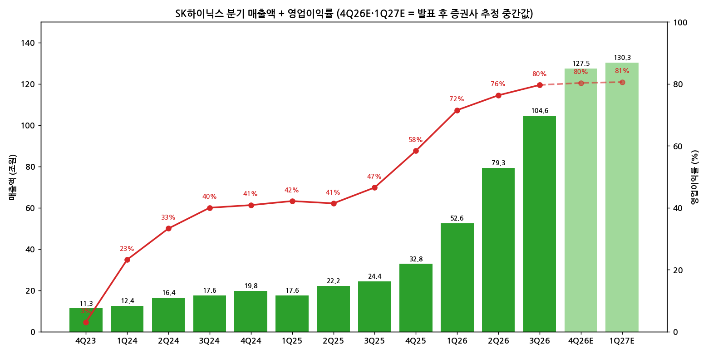
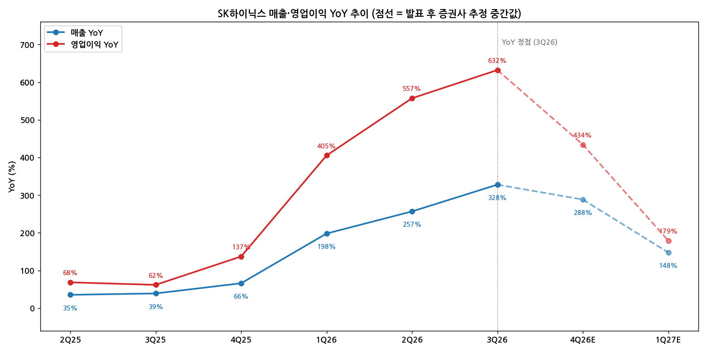

> 모드: 실적 리뷰 (v11)
> 종목: SK하이닉스 (000660)
> 섹터: 반도체
> 서브섹터: 메모리
> 분기: 2026-Q3
> 발표일: 2026-10-28
> 작성 시각: 2026-11-01 KST
> 분석 소스: SK하이닉스 2026년 3분기 실적발표 IR 자료(10/28) + 컨콜 Q&A(KB·신한·NH 정리) + 첨부 셀사이드 16개 — BNK투자증권(10/28), KB증권(10/28), 메리츠증권(10/28), 유안타증권(10/28), 한화투자증권 프리뷰(10/28), 교보증권(10/29), NH투자증권(10/29), SK증권(10/29), 다올투자증권(10/29), 대신증권(10/29), 미래에셋증권(10/29), 삼성증권(10/29), 신한투자증권(10/29), 키움증권(10/29), 하나증권(10/29), 한화투자증권(10/29). 웹서치 보완 없음

# SK하이닉스 3Q26 실적 리뷰 — 마지막 가속, 그리고 반 토막 난 주가

## 0. 한 줄 판정

> 성장 델타: **가속 (단, 컨센 경로상 이번 분기가 YoY 정점)** | 내러티브: **강화** → **이익 가속의 마지막 분기 — 주가는 이미 델타 정점을 선반영해 고점 대비 −49%, 추세 매매보다 '추정치 상향 반등' 구간** [판단]

→ 숫자: 매출 104.6조원(+328% YoY), 영업이익 83.3조원(+632% YoY), OPM 79.7%. 영업이익 YoY가 557% → 632%로 한 번 더 확대(가속). 컨센(77.0조원) 대비 +8.3%
→ 다만 QoQ 증가율은 +96% → +61% → +38% → 4Q26E 약 +23%로 감속. 발표 후 증권사 추정 중간값 기준 영업이익 YoY는 4Q26 +434%, 1Q27 +179%로 **3Q26이 정점**
→ 쟁점 ①: DRAM ASP +28～29%(컨센 10% 중후반)와 4Q DRAM 출하 +20% 중반 가이던스 → 4Q26·2027 추정치 일제 상향(2027 영업이익 중간값 464조원, 발표 전 컨센 404조원 대비 +15%)
→ 쟁점 ②: "2029년까지 DRAM·HBM 사실상 완판", LTA 14개사·2027～28 Capa 50%+ 확보 vs BNK·키움의 2028 이익 감소 전망(BNK 2028 영업이익 −74%) — **2028년 시각 차가 셀사이드 내 최대 쟁점**
→ 다음 분기 관건: 4Q26 영업이익 100조원 돌파(중간값 102조원) 여부, 1Q27 모바일 DRAM 가격 인상 폭, 주가 반등이 추정치 상향을 따라오는지

---

## 1. 숫자

① 연결 기준 분기 표

단위: 조원, %. K-IFRS 연결

| 항목 | 4Q23 | 1Q24 | 2Q24 | 3Q24 | 4Q24 | 1Q25 | 2Q25 | 3Q25 | 4Q25 | 1Q26 | 2Q26 | **3Q26** | 4Q26E | 1Q27E |
|---|---|---|---|---|---|---|---|---|---|---|---|---|---|---|
| 매출액 | 11.31 | 12.43 | 16.42 | 17.57 | 19.77 | 17.64 | 22.23 | 24.45 | 32.83 | 52.58 | 79.32 | **104.62** | 127.5 | 130.3 |
| 영업이익 | 0.35 | 2.89 | 5.47 | 7.03 | 8.08 | 7.44 | 9.21 | 11.38 | 19.17 | 37.61 | 60.54 | **83.33** | 102.4 | 105.0 |
| OPM | 3.1 | 23.2 | 33.3 | 40.0 | 40.9 | 42.2 | 41.4 | 46.6 | 58.4 | 71.5 | 76.3 | **79.7** | 80.3 | 80.6 |
| 매출 YoY | +47.4 | +144.3 | +124.8 | +93.8 | +74.8 | +41.9 | +35.4 | +39.1 | +66.1 | +198.1 | +256.8 | **+327.9** | +288.4 | +147.8 |
| 영업이익 YoY | 흑전 | 흑전 | 흑전 | 흑전 | +2,236 | +157.8 | +68.5 | +61.9 | +137.2 | +405.4 | +557.2 | **+632.1** | +434.2 | +179.2 |
| **매출 YoY 델타 (%p)** | — | +96.9 | −19.5 | −31.0 | −19.0 | −32.9 | −6.5 | +3.7 | +27.0 | +132.0 | +58.7 | **+71.1** | −39.5 | −140.6 |
| **영업이익 YoY 델타 (%p)** | — | — | — | — | — | n.m. | −89.3 | −6.6 | +75.3 | +268.2 | +151.8 | **+74.9** | −197.9 | −255.0 |

→ (출처: 4Q23～4Q24 회사 공시, 1Q25～3Q26 회사 IR·키움증권·교보증권 정리. 4Q26E = 발표 후 14개사 추정 중간값(영업이익 범위 89.0～118.2조원), 매출 중간값. 1Q27E = 삼성·대신·하나·BNK·다올 5개사 중간값 [계산])
→ 1Q25 영업이익 YoY 델타는 4Q24 기저(+2,236%, 4Q23 영업이익 0.35조원) 왜곡으로 n.m.

서프라이즈: 매출 FnGuide 컨센 98.2조원 대비 **+6.5%**, 영업이익 77.0조원 대비 **+8.3%** (FnGuide, 메리츠·NH·하나 인용). 1M 기준 컨센 상단(매출 99.9조원, 영업이익 80.0조원) 대비로도 +4.7%, +4.1% (유안타). 순이익은 39.8조원으로 컨센 57.9조원 대비 **−31%** — 외환관련손실 11.6조원 + 투자자산(Kioxia 등) 평가손실 22.9조원, 영업 외 일회성

(1) YoY 위치
→ 영업이익 YoY는 2025년 하반기 바닥(+62%)에서 4분기 연속 확대, 3Q26 +632%로 사이클 최고치. 판정 기준상 **가속**
→ 그러나 가속 폭(영업이익 YoY 델타)은 +268%p → +152%p → +75%p로 이미 줄고 있었고, 증권사 추정 경로상 4Q26 +434%, 1Q27 +179%로 꺾임. **이번 분기가 "마지막 가속"** [판단]

(2) 기저효과 조정 — QoQ로 다시 보기
→ 영업이익 QoQ 증가율 +96%(1Q26) → +61%(2Q26) → +38%(3Q26) → 약 +23%(4Q26E) → 약 +3%(1Q27E)
→ 분기 증가액은 +18.4조원 → +22.9조원 → **+22.8조원** → 약 +19.1조원으로 아직 크게 줄지 않았다. 증가율은 감속하지만 "매 분기 20조원씩 더 버는" 속도는 4Q26까지 유지 [판단]
→ 마이크론(3Q26 FQ4 26)은 영업이익 YoY가 이미 2Q26에 정점을 지나 이번 분기 둔화로 판정했다. SK하이닉스는 한 분기 늦게 정점에 도달 — 상반기 판가·출하가 시장 평균을 하회했던 기저(메리츠) 때문

→ (출처: 회사 공시·IR, 4Q26E·1Q27E = 발표 후 증권사 추정 중간값 [계산])

→ (출처: 동일. 점선 = 증권사 추정 중간값 경로)

② 사업부(제품)별 매출·영업이익

단위: 조원, %. 회사는 제품별 매출 비중만 공개하고 제품별 영업이익은 미공개 → **키움증권 추정 [추정]**. 증권사별 3Q26 DRAM 매출 추정 77.2～79.7조원, DRAM OPM 82～84%로 편차 작음

(1) 이번 분기 스냅샷

| 제품 | 3Q26 매출 | 비중 | 매출 QoQ | 매출 YoY | 3Q26 영업이익 | OPM | 영업이익 QoQ | 영업이익 YoY |
|---|---|---|---|---|---|---|---|---|
| **DRAM (HBM 포함)** | 78.97 | 75.5 | +36 | +315 | **65.28** | 82.7 | +41 | +491 |
| NAND (Solidigm 포함) | 25.36 | 24.2 | +21 | +422 | 17.94 | 70.7 | +32 | n.m. (3Q25 0.34) |
| 합계 | 104.62 | 100 | +32 | +328 | 83.33 | 79.7 | +38 | +632 |

(2) 제품별 YoY 추이 [추정, 키움]

| 항목 | 4Q25 | 1Q26 | 2Q26 | **3Q26** | 4Q26E | 방향 |
|---|---|---|---|---|---|---|
| DRAM 매출 YoY | — | +190 | +239 | **+315** | — | 가속 |
| DRAM 영업이익 YoY | — | +320 | +390 | **+491** | — | 가속 |
| DRAM OPM | 69 | 77 | 79 | **83** | 82 | 정점권 |
| NAND 매출 YoY | — | +256 | +343 | **+422** | — | 가속 |
| NAND OPM | 31 | 51 | 64 | **71** | 67 | 정점권 |

→ (4Q26E = 키움 추정: DRAM 영업이익 86.6조원 +33% QoQ, NAND 19.1조원 +6% QoQ)

(3) 해석 — 누가 델타를 끌고 누가 꺾이나
→ **DRAM이 전부를 끈다.** 3Q26 영업이익 증가분 22.8조원 중 DRAM이 19.1조원(84%). 4Q26도 DRAM 출하 +20% 중반(M15X 연말 풀캐파, 1cnm 전환)이 증가분의 대부분 [추정]
→ **NAND는 가격만으로 성장.** 3Q26 출하 −1%, ASP +24～27%. 4Q26 출하 한 자릿수 중반, ASP 상승률도 +7%대로 둔화 예상(하나·NH·SK) → NAND 영업이익 QoQ는 +6% 수준으로 먼저 감속
→ OPM은 DRAM 83%·NAND 71%로 정점권. 4Q26은 HBM4 비중 확대(초기 원가)와 판관비 증가로 전사 OPM 80% 근처 정체 예상(BNK·키움) [추정]

(4) 반도체 KPI — 볼륨 vs 가격 분해

| 항목 | 3Q26 실적 | 4Q26 가이던스·추정 | 출처 |
|---|---|---|---|
| DRAM Bit QoQ | 약 +10% | **+20% 중반 (회사 가이던스)** | IR p.4·p.10 |
| DRAM ASP QoQ | **+20% 후반** (증권사 +26～30%) | +8～17% (증권사 편차 큼) | IR, 키움 +17% / NH +9% / SK +8% |
| NAND Bit QoQ | 소폭 감소 (약 −1%) | 한 자릿수 중반 (회사 가이던스) | IR |
| NAND ASP QoQ | **+20% 중반** (증권사 +24～27%) | +7～15% | IR, 하나 +7% / 키움 +15% |
| HBM | HBM4 3분기 본격 출하, HBM 판가 약 +37% 추정(SK증권) | 4Q HBM4 출하·매출 비중이 HBM3E 상회 | IR p.11 |

→ 3Q는 가격 주도, 4Q는 **물량 주도**로 성장 엔진이 바뀐다. 가격 의존도가 낮아지는 대신 4Q 이후 성장은 생산능력 증설 속도에 묶인다 [판단]

③ 연간

단위: 조원, %

| 항목 | 2023 | 2024 | 2025 | **2026E** | 2027E | 2028E |
|---|---|---|---|---|---|---|
| 매출액 | 32.77 | 66.19 | 97.15 | **약 364** (346.9～371.7) | 571.6 (470.3～615.0) | 663.5 (237.6～747.4) |
| 영업이익 | −7.73 | 23.47 | 47.21 | **약 284** (270.5～299.7) | 463.8 (305.2～594.5) | 512.7 (94.2～583.0) |
| OPM | 적자 | 35.5 | 48.6 | **약 78** | 약 81 | 약 77 |
| 매출 YoY | −27 | +102 | +47 | **+275** | +57 | +16 |
| 영업이익 YoY | 적전 | 흑전 | +101 | **+502** | +63 | +11 |

→ (출처: 2023～2025 회사 공시. 2026E 이후 = 발표 후 증권사 추정 중간값, 괄호는 범위. 2026E 14개사, 2027E 14개사, 2028E 8개사 [계산])
→ 연간 컨센 변화: FnGuide 발표 전 컨센 2026 영업이익 262.7조원 → 발표 후 중간값 약 284조원(**+8%**), 2027 403.8조원 → 463.8조원(**+15%**) (발표 전 컨센 = 하나·KB 인용 FnGuide)
→ **2028E 범위가 94조원～583조원으로 6배 차이.** 2027년까지는 증권사 간 이견이 작지만 2028년에서 사이클 판단이 정면으로 갈린다 — 2번 쟁점 ②로

---

## 2. 시장 쟁점

① 2-0. 지난 리뷰에서 "봐야 할 것"으로 남긴 항목 체크

> 직전 분기(2026-Q2) 리뷰는 작성되지 않음. 2026-Q1 리뷰 기반 팔로업(`earnings-followup/2026-Q2_SK하이닉스_팔로업.md`) ④번 항목을 두 분기 누적 체크

| 직전 팔로업 항목 | 이번까지 결과 | 판정 |
|---|---|---|
| OPM 76% 돌파 여부 | 2Q26 76.3% → 3Q26 79.7% | **확인** (기대 초과) |
| NAND Bit 회복 (2Q26 +13～15% 컨센) | 2Q26 +16%, 3Q26 −1%(믹스 조정), 4Q26 가이던스 한 자릿수 중반 | **확인** (2Q) → 3Q 정체 |
| 순현금 100조원 + 자사주 매입소각 | 3Q26말 현금 114.5조원·차입금 15.8조원 → 순현금 약 98.7조원 [계산]. 8월 자사주 40조원 매입 완료, FY2026 주주환원 약 100조원 발표 | **확인** (기대 초과) |
| ADR 6월 결정 + 미국 상장 | ADR 상장 완료 — 대신증권 본주·ADR 괴리율 차트 게재. 기본 주식수 710백만주(2Q) → 722백만주(3Q), 자본잉여금 +39.5조원 | **확인** (세부 조건은 첨부 리포트 미기재) |
| HBM4 양산 + HBM4E 샘플 | HBM4 수율 계획 상회·목표 상향, 4Q HBM4 비중 HBM3E 상회. HBM4E 2분기 샘플 완료 | **확인** |

→ 지난 체크리스트는 모두 확인됐다. 그런데 그 사이 주가는 52주 고점 291.9만원(6/22) → 134.1만원(10/27, −54%)까지 밀렸다. 숫자가 아니라 **"2028년 이후"와 "AI 투자 신용위험"** 이 주가를 움직였다 (BNK·키움·다올)

② 2-1. 이번 분기 쟁점

| # | 쟁점 | 한 줄 정의 | 언급 증권사 |
|---|---|---|---|
| 1 | 4Q 물량 서프라이즈와 추정치 재상향 | DRAM ASP·출하 서프라이즈가 4Q26·2027 이익을 얼마나 끌어올리나 | 16/16 |
| 2 | 2028년 이후 사이클 지속성 | "2029년 완판·2030년까지 수요 우위" vs "2Q26 수요 모멘텀 정점, 2028 이익 급감" | 16/16 |
| 3 | HBM4 수익성과 사양 하향 | HBM4 비중 확대가 마진을 높이나 낮추나, 적층 단수 하향은 수요 감소인가 | 11/16 |
| 4 | 100조원 주주환원과 저PER 논쟁 | 사상 최대 환원이 사이클 할인(PER 3배)을 해소하나 | 16/16 |

③ 2-2. 쟁점별 분해

(1) 쟁점 1 — 4Q 물량 서프라이즈와 추정치 재상향

(1-1) 회사 설명
→ "3분기 DRAM B/G 약 10%, ASP 20% 후반 상승. 원화 강세에도 ASP 상승 및 고부가 제품 판매 확대로 영업이익률 80%, 분기 기준 최고" (IR p.4～5)
→ "4분기 DRAM B/G 약 20% 중반 증가 — 1cnm 공정 확대 및 M15X Ramp-up. M15X는 '26년말 Full capa 도달" (IR p.10～11)
→ "'27년 DRAM 실현 가능 수요 B/G 20% 중반, NAND 10% 후반" (IR p.9)

(1-2) 증권사별 해석 편차

| 증권사 | 4Q26 영업이익 E | 2027E 영업이익 | 논리 |
|---|---|---|---|
| 유안타 | **118.2조원** (최고) | **594.5조원** (최고) | DRAM 출하 +20% 중반 + HBM4 크로스오버, 4Q 매출 147조원 |
| 미래에셋 | 108조원 | 489.3조원 | 4Q·2027 영업이익 6%·14% 상향 |
| SK | 105조원 | 487.9조원 | 2027 12% 상향 — HBM 가격 인상, 1Q27 모바일 DRAM 인상 |
| 키움 | 105.3조원 | 305.2조원 | 4Q는 블렌디드 DRAM ASP +17% 가정으로 높지만 2027은 +6% 증익에 그침 |
| 메리츠 | 103.8조원 | 481조원 | "실적 추정치 재상향 사이클 도래" — 향후 3개월 컨센 상향이 주가 촉매 |
| BNK | 103.6조원 | 358.0조원 | 4Q까지는 상회, 이후 2Q27 정점 → 4Q27 57.6조원으로 급감 |
| NH | 102.7조원 | 483.7조원 | 최근 가격 상승 고려 시 추가 상향 가능 |
| 하나 | 102.1조원 | 465.0조원 | 2027 14.6% 상향, 4Q DRAM 가격 +10%로 타사보다 보수적 |
| 신한·교보·대신·다올·삼성 | 100.9～101.5조원 | 453.3～466조원 | 4Q 분기 100조원 돌파, DRAM 출하 +24～26% |
| KB | **89조원** (최저) | 394.4조원 | 4Q OPM 81%, 2027 +1.4% 상향에 그침 |

(1-3) 공통 결론 vs 갈리는 지점
→ 공통: 3Q는 가격(ASP) 서프라이즈, 4Q는 물량(DRAM 출하 +20% 중반) 서프라이즈. 4Q26 분기 영업이익 100조원 돌파는 14개사 중 13개사 전망
→ 갈림: 4Q DRAM ASP 가정(+8% vs +17%)과 **2027년 하반기 가격 경로**. 2027E 범위 305～595조원 차이의 대부분이 2027 하반기 ASP 가정 — BNK는 3Q27부터 DRAM ASP −14%, −30% 가정, 대다수는 0～+3% 유지

(1-4) [판단]
→ 4Q26 100조원은 회사 출하 가이던스만으로도 거의 확정적이다 (3Q DRAM 영업이익 65조원 × 출하 +24% ≈ 81조원 + NAND 18조원 ≈ 99조원, ASP 0% 가정). 진짜 변수는 **1Q27 이후 QoQ가 +3%로 멈추는 컨센 경로**를 깰 수 있느냐 — 메리츠·SK가 말하는 1Q27 모바일 DRAM 가격 인상과 2027 HBM 가격 인상이 확인되면 2027E 컨센이 470조원 이상으로 다시 올라간다

(2) 쟁점 2 — 2028년 이후 사이클 지속성

(2-1) 회사 설명
→ "주요 고객 14개 업체와 LTA 체결. 기간은 통상 5년, 일부는 연장 논의 중. 가격은 협의한 범위 내에서 시장 상황 반영, 예치금 등 실질적 이행 장치 포함. 확보 LTA 물량은 '27·'28년 전체 Capa의 50% 이상" (IR p.12)
→ "LTA 확정 물량과 협의 중인 수요를 합산하면 2029년까지 DRAM과 HBM은 사실상 Sold-out. 협의 중 물량도 구체적 구매 계획 기반" (컨콜, KB·신한)
→ "선단 공정 난이도와 팹 건설 리드타임으로 공급 확대 제한, '30년까지 수요 우위 수급 환경 예상" (IR p.9)
→ 공급과잉 대응: "용인·M17 등 신규 팹은 Shell 건설을 앞당기되 클린룸은 단계별 오픈, 장비 반입과 양산 확대는 수요에 따라 조정" (컨콜, KB). '27년 투자는 '26년 대비 상당한 증가

(2-2) 증권사별 해석 편차

| 증권사 | 핵심 가정·추정 | 논리 |
|---|---|---|
| 메리츠 | 2027～28 공급부족 "너무나 명확" | AGI 경쟁 투자의 가격 '역'탄력성, 유연한 생산 계획은 과거 업사이클에 없던 변화 |
| 삼성 | 2028E 영업이익 494조원 (+9%) | 서버 DRAM 수요가 공급 2배 — "반복되는 의심, 반복되는 수익 기회". 공급 경쟁 시작 전이라 과잉 우려 낮음 |
| SK·NH·교보·신한 | 2028E 523～583조원 (+8～19%) | LTA·완판으로 이익 변동성 축소, 투자 주체 다변화(소버린·온프레미스) |
| 미래에셋 | 2028E 502조원 (+3%) | 주주환원보다 "2029년까지 수요 안정성"이 더 의미 있음 |
| 키움 | **2028E 258조원 (−15%)** | 'HBM 장기 성장 기대'와 '중국 범용 메모리 증설 우려'가 맞물려 당분간 박스권 |
| BNK (보유) | **2028E 94조원 (−74%)** | 메모리 수요 모멘텀 2Q26 정점, 시스템당 용량 증가 둔화(원가 한계), OECD 경기선행지수 하락, 고금리 → AI 기업 신용위험. 사이클 고점에선 실적 호조 속 저PER화 |
| KB | 판단 근거 = 고객 CapEx | 글로벌 CSP AI CapEx 2027 +60%, 전력 +100%, 2030년까지 연 +40% |

(2-3) 공통 결론 vs 갈리는 지점
→ 공통: 2027년 공급 부족은 16개사 모두 동의. LTA 50%+는 이익 하방을 높인다
→ 갈림: **2028년**. 14개사는 LTA·완판을 "2028까지 공급 부족 지속"의 증거로, BNK·키움은 "수요 모멘텀 이미 정점 + 중국 범용 증설 + 금리"로 2028 가격 하락을 가정. 핵심 변수는 ① LTA 가격 밴드의 하한이 얼마나 단단한가 ② 중국(CXMT) 범용 DRAM 증설 속도 ③ AI 기업 자금조달 환경

(2-4) [판단]
→ 회사 숫자(LTA 50%+, 고객 요청이 공급의 2배)는 다수 쪽 논리를 지지한다. 그러나 주가는 BNK 쪽 시나리오를 상당 부분 반영 중 — 2027E PER 약 2.8～3.1배는 "2028 이익 급감"을 가정하지 않으면 설명하기 어렵다 [판단]
→ 결론을 바꿀 데이터: 2028 물량 LTA 추가 체결·연장(현재 "논의 중"), 중국 DRAM 업체 증설·가격 정책, CSP 2027 CapEx 가이던스(1～2월 4Q 실적)

(3) 쟁점 3 — HBM4 수익성과 사양 하향

(3-1) 회사 설명
→ "HBM4 계획 수율 상회해 목표 상향, 팹·후공정 수율 업계 최상위. 4분기 HBM4 출하·매출 비중이 HBM3E 상회" (컨콜)
→ "'27년 HBM 거래조건 협의 마무리, HBM과 일반 DRAM 간 수익성 격차 유의미한 축소 예상" (IR p.11)
→ 적층 단수 하향: "일부 고객의 사양 조정은 공급 부족 속 더 많은 가속기를 만들려는 움직임. HBM4 12단 → HBM4E 8단 전환돼도 다이당 용량 증가가 보완. 고객 요청 물량은 공급 가능 물량의 2배" (컨콜, KB)

(3-2) 증권사별 해석 편차

| 증권사 | 핵심 가정·추정 | 논리 |
|---|---|---|
| 삼성 | 2027 HBM ASP **+86% YoY** | HBM4 가격·생산성 우려 해소, 엔비디아 선도 점유율 수성 |
| NH | 품질 논란 → 수율 개선·목표 상향 | 시장 우려에 "충분한 답변" |
| SK | 3Q HBM 판가 약 +37% | HBM4 크로스오버·수율 안정화로 가격·수익성 동반 |
| 한화 | HBM–범용 수익성 격차 축소 | 특정 제품 의존도 하락 → DRAM 전반 이익 체력 강화 |
| 미래에셋 | 격차 축소 = 범용 전환 유인 증가 | HBM 증산 동인 커질수록 범용 DRAM Capa 잠식 → 수급 타이트 유지 |
| BNK | HBM4 비중 확대로 수익성 하락 | 4Q26 이후 마진 압박 요인 |

(3-3) 공통 결론 vs 갈리는 지점
→ 공통: HBM4 양산·수율 리스크는 해소. 2027 HBM 가격은 상승
→ 갈림: "격차 축소"의 방향. 다수는 **HBM 마진이 올라와** 격차가 준다고 보지만, 범용 DRAM 마진(83%)이 이미 HBM보다 높아 생긴 격차라는 점에서 **범용 가격이 꺾이면 반대 방향으로 벌어질 수 있다** [판단]

(3-4) [판단]
→ 마이크론에서도 CMBU(HBM 포함) GPM 83% < 범용 사업부 90%로 같은 구조가 확인됐다. 이번 사이클의 이익은 HBM보다 **범용 DRAM 가격**이 더 많이 끌고 있다. HBM은 "수요 확실성", 범용은 "이익 레버리지"를 담당 — 2027 하반기 범용 가격이 사이클 판정의 핵심

(4) 쟁점 4 — 100조원 주주환원과 저PER 논쟁

(4-1) 회사 설명
→ "FY2026 약 100조원 주주환원: 현금배당 30조원 이상, 자사주 매입·소각 60조원 이상(8월 40조원 포함). 3분기 이사회 현금배당 14조원(주당 2만원 = 실적 1만원 + Kioxia 특별 1만원) 및 자사주 20조원(임직원 보상 약 10조원 포함) 결의" (IR p.13, 컨콜)
→ "자사주는 매 분기 지속 매입, 현재 주가가 이익·현금흐름을 충분히 반영하지 못해 저평가" (컨콜). 배당 기준일 11/30, 12월 지급
→ 솔리다임 Pre-IPO·IPO 검토 중단 (금융시장 변동성, 반도체주 조정)

(4-2) 증권사별 해석 편차

| 증권사 | 핵심 가정·추정 | 논리 |
|---|---|---|
| KB | 저평가 해소의 "결정적 전환점" | 고점 대비 −50%, 2027E PER 3배는 금융위기급 저평가 |
| 대신 | 2027 환원 100조원 이상 | "회사-임직원-주주" 이익 극대화, 사이클 자신감의 표현 |
| 메리츠 | '진짜' 주주환원 | 대주주 유리한 배당 고집 대신 매입·소각, 영업외 이익도 공유 |
| 삼성 | 2027 환원 +27% 확대 | 배당 재원 126조원 중 약 80% 환원, 시총 대비 10.2% |
| 신한 | 하방 경직성 강화 | 12MF PBR 1.7배, DRAM 피어 중 최저 |
| 미래에셋 | 환원보다 장기수요 전망이 더 중요 | 27F PER 2.8배, 하방 제한적 |
| BNK (보유) | 환원으로 저PER화 못 막음 | 사이클 고점에선 실적 호조 중에도 주가 급락 — 구조적 특성 |

(4-3) 공통 결론 vs 갈리는 지점
→ 공통: 환원 규모(시총 약 10%)는 기대 이상이며 주가 하방을 지지
→ 갈림: 환원이 **멀티플을 바꾸는가**(KB·대신·메리츠) vs **사이클 판단이 멀티플을 정하는가**(BNK·미래에셋 함의)

(4-4) [판단]
→ 발표 당일 주가 134.1만원 → 148.7만원(**+10.9%**, 대신·각 사 기준가). 환원은 즉각 반등을 만들었다. 다만 PER 3배는 "이익이 지속되지 않는다"는 시장 가정이므로 환원만으로 해소되긴 어렵고, 쟁점 ②(2028)가 정리될 때 멀티플이 움직인다 [판단]
→ 순이익 −31% 미스(영업외 34.5조원 손실)는 Kioxia 평가손실이 특별배당 재원(투자 수익)과 같은 자산에서 나왔다는 점에서 이익의 질 문제가 아니라 회계 변동 [판단]

④ 2-3. 낙관 vs 보수 — 논리 대비

| 구분 | 증권사 | 무엇을 다르게 가정했나 |
|---|---|---|
| 가장 낙관 | 유안타 (TP 370만원) | 4Q 매출 147조원·2027 영업이익 594조원 — DRAM 출하·HBM4 크로스오버 최대 반영, LTA 고객 Spot 추가 요청 |
| 낙관 | SK·교보 (TP 400만원) | 2028 영업이익 533～583조원 — LTA 장기화·연장으로 실적 Duration 확대 |
| 보수 | 키움 | 2027 +6%, 2028 −15% — 중국 범용 증설 우려로 박스권 |
| 가장 보수 | BNK (보유, TP 165만원) | 2Q27 정점 → 4Q27 영업이익 57.6조원, 2028 94조원. DRAM ASP 3Q27 −14%, 4Q27 −30% |

→ 핵심 차이는 **2027 하반기 DRAM 가격 방향** 하나로 압축된다. 낙관은 "LTA 가격 밴드 + 수요 2배"로 가격 유지를, 보수는 "수요 모멘텀 정점 + 중국 + 금리"로 가격 하락을 가정
→ 셀사이드 vs 바이사이드: 14개 매수 의견, 평균 TP 약 325만원(주가 대비 +119%)인데 주가는 고점 대비 −49%. 셀사이드는 레벨(2027 이익)을, 바이사이드는 델타 정점과 2028을 보고 있다. 마이크론과 동일한 괴리 [판단]

⑤ 2-4. 추정치·TP 변화

단위: 원, 조원

| 증권사 | 의견 | 현재 TP | TP 변화 | 4Q26 영업이익 E | 2026E / 2027E 영업이익 | 핵심 변화 한 줄 |
|---|---|---|---|---|---|---|
| SK | 매수 | 4,000,000 | 유지 | 105.0 | 286.9 / 487.9 | 2027 12% 상향 |
| 교보 | Buy | 4,000,000 | 유지 | 101.1 | 282.6 / 462.5 | 변함없는 방향성 |
| 유안타 | BUY | 3,700,000 | **상향** (3,300,000) | 118.2 | 299.7 / 594.5 | 2027E BPS × PBR 3.5배 |
| 하나 | BUY | 3,600,000 | 유지 | 102.1 | 283.6 / 465.0 | 2027 14.6% 상향했으나 피어 멀티플 하향으로 TP 유지 |
| KB | Buy | 3,500,000 | **하향** | 89.0 | 270.5 / 394.4 | 추정치 +1.4% 상향, 목표 P/B 3.8배 |
| NH | Buy | 3,400,000 | 유지 | 102.7 | 284.2 / 483.7 | 산업 구조 변화 주목 |
| 메리츠 | Buy | 3,200,000 | 유지 | 103.8 | 285.3 / 481 | 재상향 사이클, 4Q26 20% 상향 |
| 한화 | Buy | 3,150,000 | 유지 | — | — / — (프리뷰 445.5) | 2027 추가 상향 가능성 |
| 미래에셋 | 매수 | 3,100,000 | 유지 | 108 | 289.4 / 489.3 | 4Q·2027 6%·14% 상향 |
| 신한 | 매수 | 3,000,000 | **상향** (+11%) | 101.5 | 283.0 / 459.1 | 12MF BPS +6%, 목표 PBR 3.5배 |
| 대신 | BUY | 3,000,000 | 유지 | 101.0 | 282.5 / 454.3 | 2027 환원 100조원+ |
| 삼성 | BUY | 3,000,000 | 유지 | 100.9 | 282.4 / 453.3 | 2026·27 EPS +3.4%·+3.7% |
| BNK | 보유 | 1,650,000 | **상향** (+11%) | 103.6 | 285.1 / 358.0 | 단기 과매도 반등, 저PER화 지속 |
| 키움 | — | 미기재 | — | 105.3 | 286.8 / 305.2 | 박스권 |
| 다올 | — (Spot Issue) | 미기재 | — | 101.0 | 282 / 466 | "되돌림이 필요한 시기" — 하락 폭 일부 회복 |

→ 평균 TP 약 **3,254,000원** (13개사 단순평균 [계산]) — FnGuide 컨센 TP 3,248,636원(KB 인용)·3,257,727원(삼성 인용, 22개사)과 일치. 10/28 종가 148.7만원 대비 +119%
→ TP 상향 3건(유안타·신한·BNK), 하향 1건(KB), 유지 9건
→ 4Q26 영업이익 컨센: 발표 전 FnGuide 88.4조원(키움·유안타 인용) → 발표 후 중간값 102.4조원(**+16%**)
→ **TP 하향·유지의 원인은 실적이 아니라 멀티플.** KB(추정치 상향에도 TP 하향), 하나(추정치 +14.6%에도 TP 유지 — "글로벌 반도체 업체들의 멀티플 하향")가 명시. 이익은 오르고 멀티플은 내려가는 전형적 사이클 고점 패턴 [판단]

---

## 3. 내러티브 점검

① 성장 스토리 정의
→ "HBM 1위가 AI 메모리 수요를 독점적으로 흡수하고, 장기계약(LTA)으로 사이클 변동성을 줄여 **경기민감주에서 구조적 성장주로 재평가**된다" — 시장이 SK하이닉스를 사는 이유

② 이번 분기 평가 — **강화**
→ 숫자: 컨센 +8% 비트, 2026·2027 추정치 +8%·+15% 상향, 분기 OPM 80%
→ 구조: LTA 14개사·2027～28 Capa 50%+, 2029년 DRAM·HBM 완판, HBM4 수율·점유율 우려 해소, 100조원 환원 — 지난 분기 시장이 의심한 항목(NH: HBM 품질 논란, LTA, 환원 지속성)에 모두 숫자로 답했다
→ 그럼에도 재평가는 일어나지 않았다. 스토리의 앞 절반(AI 수요)은 강화됐지만, 뒤 절반(**사이클 변동성 축소 → 멀티플 확장**)은 시장이 아직 받아들이지 않았다

③ 국면 — 델타 가속(정점) × 내러티브 강화
→ 비유하면 마라톤에서 **지금이 가장 빠른 구간 기록**인데, 관중(시장)은 다음 구간부터 페이스가 떨어질 걸 알고 미리 자리를 뜬 상태. 영업이익 YoY는 이번 분기가 꼭대기, QoQ는 4Q26 +23% → 1Q27 +3%로 평탄화 [판단]
→ BT 프레임에서 "델타 가속 + 내러티브 강화"는 원래 적극 구간이지만, 컨센 경로상 다음 분기부터 둔화가 확정적이라 **신규 추세 매매 구간은 아님**. 대신 주가가 고점 대비 −49%로 델타 둔화를 선반영한 만큼, "추정치 상향(리비전) → 반등" 구간은 열려 있다 (메리츠: 향후 3개월 추정치 상향 기반 회복) [판단]

④ 다시 강해질 트리거
→ 2028 물량 LTA 추가·연장 체결 공시 — 2028 논쟁을 숫자로 종료
→ 1Q27 모바일 DRAM·2027 HBM 가격 인상 확인 → 1Q27 이후 QoQ 경로 상향(현 컨센 +3%)
→ 4Q26 실적과 함께 2027 자사주 매입 규모·분기 환원 지속 발표

⑤ 깨뜨릴 리스크
→ 중국 범용 DRAM 증설·가격 공세 → 2027 하반기 범용 가격 하락 (키움)
→ AI 기업 신용위험 재부각 → CSP·네오클라우드 CapEx 조정 (BNK)
→ HBM 사양 하향 확산으로 큐브 수 대비 비트 수요 둔화, 범용 가격 하락 시 HBM–범용 마진 역전 확대

---

## 4. 향후 봐야 할 것

| 순위 | 무엇을 (변수·임계값) | 어떤 데이터로 | 언제 |
|---|---|---|---|
| 1 | **4Q26 영업이익 100조원 돌파 & 1Q27 DRAM 가격 가이던스** — 4Q26 100조원 미달 또는 1Q27 DRAM ASP 하락 언급 시 델타 '꺾임' 확정 | 4Q26 잠정실적(삼성전자 1월 초 잠정 → 하이닉스 1월 말), 컨콜 1Q27 B/G·ASP 코멘트 | 2027-01 하순 |
| 2 | **DRAM 계약가 상승률 둔화 속도** — 4Q26 DRAM 계약가 QoQ +10% 이상 유지, 1Q27 모바일 DRAM 인상 폭 | TrendForce·DRAMeXchange 월간 계약가, 한국 반도체 수출(DRAM 단가) | 매월 1일 수출입·월말 계약가 |
| 3 | **2028 LTA 추가·연장** — 14개사 → 추가 체결, 연장 논의 결과, LTA 비중 50% 이상 유지 | 회사 IR·컨콜, 고객사(CSP) 발표 | 2027-01 컨콜 |
| 4 | **중국 범용 DRAM 증설·AI 신용위험** — CXMT 증설·가격, CSP 2027 CapEx 가이던스(+60% 시장 전망 유지 여부) | 중국 업체 IPO·증설 뉴스, CSP 4Q 실적(1～2월), 마이크론 FQ1 27 실적(12월) | 2026-12 ～ 2027-02 |
| 5 | **4Q 주주환원 집행** — 4Q 자사주 매입 규모(분기 10조원 이상), 결산 특별배당(Kioxia 잔여) | 이사회 결의 공시, 배당 기준일 11/30 | 2026-12 ～ 2027-01 |

→ 1순위가 델타 판정을 직접 바꾼다. 4Q26이 중간값(102조원)을 넘고 1Q27 가격 가이던스가 상승이면 '둔화(완만)', 4Q26 100조원 미달·1Q27 가격 정체면 '꺾임' [판단]
→ 마이크론 FQ1 27(12월 중하순) GPM·가이던스가 한 달 먼저 나오는 선행 지표

---

> Sources: SK하이닉스 2026년 3분기 실적발표 IR 자료(2026-10-28), BNK투자증권·KB증권·메리츠증권·유안타증권·한화투자증권(2026-10-28), 교보증권·NH투자증권·SK증권·다올투자증권·대신증권·미래에셋증권·삼성증권·신한투자증권·키움증권·하나증권·한화투자증권(2026-10-29) — 원문은 비공개 보관
