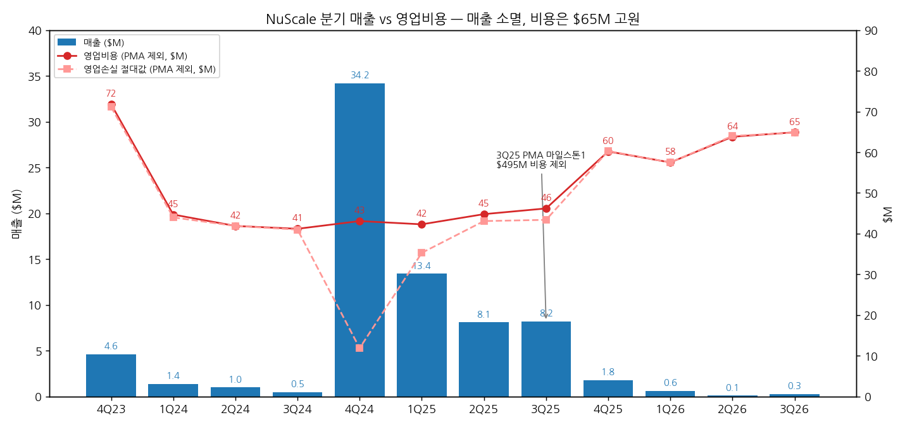
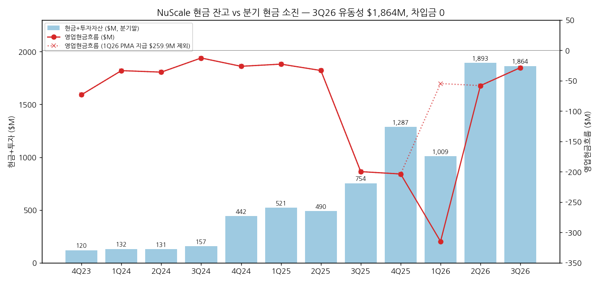
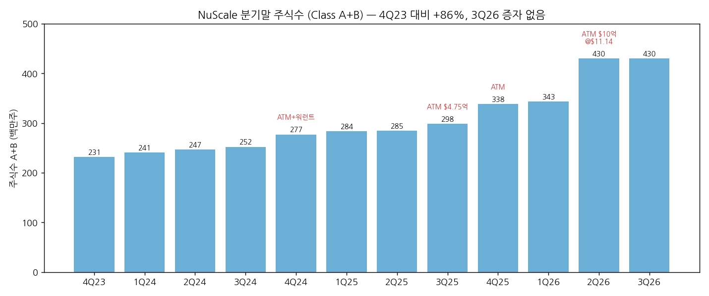

> 모드: 실적 리뷰 (v11)
> 종목: NuScale Power (SMR, NYSE)
> 섹터: 원전
> 서브섹터: SMR·차세대 원자로
> 분기: 2026-Q3
> 발표일: 2026-11-05 (AMC, 미 동부 기준 — 8-K Item 2.02 같은 날 제출)
> 작성 시각: 2026-11-16 15:30 KST
> 분석 소스: SEC 원문 — 3Q26 10-Q(2026-11-05), 2Q26 10-Q(2026-08-05), 8-K(2026-11-05, Ex.99.1 보도자료 본문은 미확보), 10-K FY25, XBRL companyfacts (기업개요 `SMR_기업개요.md` v1.0 트래커 재사용) + 컨콜 요약(**비공식 출처** — StatementDog 요약·Q&A 정리, Earnings Whispers/Finviz, TIKR, 24/7 Wall St.) + 등급·TP(Stocktwits/The Fly 10/20, TIKR 11/4\~6) + 주가(Yahoo Finance·stockanalysis.com 11/13 종가). 셀사이드 리포트 첨부 0건, 컨콜 트랜스크립트 원문 미확보(Motley Fool 미게재)
> 리뷰 깊이: 숫자 중심 | 리서치 첨부 0건 — 적자 개발사 변형(5지표 대신 영업비용·현금 소진·런웨이·희석 + 마일스톤 판정)
> 다음 발표: 4Q26·FY26 10-K (2027-02 하순 예상, 전년 2026-02-26 기준)

# NuScale Power 3Q26 실적 리뷰 — 공장은 돌기 시작했는데 주문서는 아직 없다

## 0. 한 줄 판정

> 성장 델타: 합산 제외 — 마일스톤 판정: 정체 | 내러티브: 약화 → 매매 제외 구간 (ENTRA1–TVA 구속력 있는 PPA 체결 시에만 이벤트 재진입 후보)

→ **왜 델타가 아니라 마일스톤인가**: 매출 $0.28M, 영업이익은 창업 이래 한 번도 흑자가 아니다. 워치리스트 결정(2026-11-14)대로 원전 섹터 델타 합산에서 빼고, "통제 가능한 마일스톤(제작·인허가)"과 "통제 불가 마일스톤(고객 계약)" 두 줄로 판정한다
→ **숫자**: 분기 영업비용 $64.9M(PMA 제외 기준 YoY +40.5%), 영업손실 -$64.8M, 순손실 -$45.7M(투자수익 $19.1M이 손실의 30%를 메움), Class A EPS -$0.11 — 컨센 부합(Earnings Whispers) 또는 -$0.26 대비 비트(TIKR, 집계 기준 상이). 유동성 $1,864.1M·차입금 0, 3Q 증자 0주 (3Q26 10-Q)
→ **진전(통제 가능)**: 두산에너빌리티와 첫 모듈의 상부 원자로 냉각계통(URPV) 제작 계약(2026-10) — 고객 주문 없이 자기 돈으로 "개발 → 실물 제작" 단계로 넘어갔다. Fluor 보유주 전량 매각(9월 말)으로 오버행도 정리
→ **정체·후퇴(통제 불가)**: ENTRA1–TVA 구속력 있는 PPA는 비구속 협약 후 14개월째 미체결, 이번엔 **시점 가이던스 자체를 내지 않았다**(과거 "2025년 말" → "2026년 가능성 높음" → 이번 무언급). RoPower(루마니아)는 신정부 출범 대기로 정체, 증권소송은 파생소송 1건이 10/28 추가됐다. Barclays(10/20 Underweight, TP $11→$5)·Wedbush(11월 초 신규 Underperform, $5)가 같은 논리로 돌아섰다
→ **다음 분기 관건**: TVA PPA 체결 여부 하나다. 단 체결되면 PMA 마일스톤2로 약 $1.18B [계산, 회사 미공시 추정]의 현금이 ENTRA1로 나간다 — "좋은 뉴스 = 현금 64% 유출"이라는 역설을 같이 봐야 한다

## 1. 숫자

① 분기 손익 표 ($M) — 적자 개발사 변형: 매출·영업비용·영업손실 + YoY

| 항목 | 4Q23 | 1Q24 | 2Q24 | 3Q24 | 4Q24 | 1Q25 | 2Q25 | 3Q25 | 4Q25 | 1Q26 | 2Q26 | **3Q26** | 4Q26E |
|---|---|---|---|---|---|---|---|---|---|---|---|---|---|
| 매출 | 4.6 | 1.4 | 1.0 | 0.5 | 34.2 | 13.4 | 8.1 | 8.2 | 1.8 | 0.6 | 0.1 | **0.3** | N/A |
| 영업비용 (R&D+G&A+기타, PMA 제외) | 71.8 | 44.7 | 41.9 | 41.2 | 43.1 | 42.3 | 44.8 | 46.2 | 60.2 | 57.5 | 63.8 | **64.9** | 약 65 (회사) |
| 영업손실 (보고) | -71.1 | -44.0 | -41.9 | -41.0 | -11.9 | -35.3 | -43.1 | -538.4 | -72.7 | -57.5 | -64.0 | **-64.8** | — |
| 영업손실 (PMA 제외) | -71.1 | -44.0 | -41.9 | -41.0 | -11.9 | -35.3 | -43.1 | -43.4 | -60.3 | -57.5 | -64.0 | **-64.8** | — |
| 순손실 (비지배 포함) | -56.4 | -48.1 | -74.4 | -45.6 | -180.3 | -30.4 | -37.6 | -532.6 | -63.9 | -46.7 | -50.1 | **-45.7** | — |
| OPM | N/M | N/M | N/M | N/M | N/M | N/M | N/M | N/M | N/M | N/M | N/M | **N/M** | — |
| 매출 YoY | — | — | — | — | +644% | +857% | +710% | +1,540% | -94.7% | -95.5% | -98.8% | **-96.6%** | — |
| 영업비용 YoY (PMA 제외) | — | — | — | — | -40.0% | -5.4% | +6.9% | +12.1% | +39.7% | +35.9% | +42.4% | **+40.5%** | 약 +8% |
| **영업비용 YoY 델타 (%p)** | — | — | — | — | — | +34.6 | +12.3 | +5.2 | +27.6 | -3.8 | +6.5 | **-1.9** | — |
| 영업손실 YoY 변화 (PMA 제외, $M) | — | — | — | — | +59.2 | +8.7 | -1.2 | -2.4 | -48.4 | -22.2 | -20.9 | **-21.4** | — |

→ (출처: 10-Q·10-K, XBRL companyfacts — `SMR_기업개요.md` ③ 12분기 트래커. 4Q = 연간 − 9M [계산]. PMA = ENTRA1 마일스톤1 $507.4M = 3Q25 $495.0M + 4Q25 $12.4M, G&A에 포함 → 제외 [계산]. 3Q26 매출 정확값 $281K. YoY·델타 [계산]. 4Q26E 영업비용은 CFO "분기 $65M 수준이 비교적 일정" 발언(콜 요약 — 비공식 출처)을 그대로 쓴 값)
→ **매출 YoY·영업이익 YoY 델타는 판정에 쓰지 않는다**: 매출 기저가 $0.1\~34M을 오가는 일회성 용역·라이선스(4Q24 RoPower 라이선스 $34.2M, 2025 Fluor FEED)라 YoY가 +1,540%에서 -98.8%까지 튄다. OPM도 의미 없다(N/M)
→ 컨센 대비: 매출 $0.28M vs 컨센 $0.2M(+40%), EPS -$0.11 부합 (Earnings Whispers — 비공식). TIKR은 EPS 컨센 -$0.26 대비 비트로 집계 — 집계 소스 간 차이가 크다. 4Q26 매출 컨센은 FY26 $20.4M(TIKR)이 4Q에만 $19.5M을 요구하는 구조인데, 구속력 있는 계약이 없어 **사실상 신뢰할 수 없는 숫자**로 보고 4Q26E 칸은 N/A 처리 `[판단]`
→ 해석: 비용은 2024\~1H25 분기 $42\~46M → 4Q25부터 $58\~65M으로 **한 계단 올라 고원**에 있다. 증가분은 R&D(+$7.0M YoY, NPM 부품 기술 성숙도)와 기타비용(+$8.1M — 상업 프로젝트가 없어 엔지니어 인건비가 매출원가로 안 넘어감 + 공급망 인력 확충) (3Q26 10-Q MD&A). 즉 "수주를 받을 준비 비용"이 먼저 올라왔고 수주는 아직이다

→ (출처: 10-Q·10-K, XBRL companyfacts. 영업비용·영업손실은 PMA 마일스톤1 제외 [계산])

② 사업부별 — 해당 없음 (단일 사업, NPM 판매 매출 0)

| 매출 원천 ($M) | 3Q25 | 9M25 | 3Q26 | 9M26 | 비고 |
|---|---|---|---|---|---|
| 플랜트·NPM 엔지니어링·라이선스 (Fluor 경유 RoPower FEED 포함) | 7.9 (Fluor) | 22.6 (Fluor) | 0.0 | 0.0 | FEED 2단계 2025년 말 종료 |
| E2 센터·기타 | 0.4 | 7.1 | 0.3 | 0.9 | E2 센터 신규 1건 → 누적 13곳 (콜 요약) |
| **합계** | **8.2** | **29.7** | **0.3** | **0.9** | |
| NPM(원자로 모듈) 판매 | 0 | 0 | 0 | 0 | 창업(2007) 이래 0 |

→ (출처: 3Q26 10-Q 손익·특수관계자 주석 — Fluor 3Q25 $7,873K(매출의 96%)·9M25 $22,573K(76%). "E2·기타" = 합계 − Fluor [계산])
→ 사업부 영업이익 미공개(단일 세그먼트). 셀사이드 사업부 추정치 없음

③ 현금 소진·런웨이·희석 (적자 개발사 핵심 KPI, $M)

| 항목 | 3Q25 | 4Q25 | 1Q26 | 2Q26 | **3Q26** | 비고 |
|---|---|---|---|---|---|---|
| 영업현금흐름 | -199.8 | -203.7 | -314.7 | -58.2 | **-28.6** | 분기값 = 누적 차이 [계산] |
| 영업현금흐름 (PMA 지급 제외) | — | — | -54.8 | -58.2 | **-28.6** | 1Q26 PMA 지급 $259.9M 제외 [계산]. 2H25 지급 $247.5M의 분기 배분은 미공시 |
| 투자수익 | 5.8 | — | — | — | **19.1** | 9M26 $43.9M (3Q26 10-Q) |
| 현금+단기·장기투자 | 753.8 | 1,287.2 | 1,008.7 | 1,893.0 | **1,864.1** | 현금성 513.4 + 단기 420.0 + 장기 930.7 |
| 장납기 소재(LLM) 재공품 | — | 63.8 | — | — | **69.7** | 전량 두산 조달분 |
| 주식수 A+B (백만주, 분기말) | 298.4 | 337.9 | 343.1 | 429.7 | **429.9** | YoY **+44.1%**, QoQ +0.05% |
| ATM 조달 | $4.75억 @$36.05 | ATM | — | $10억 @$11.14 | **0** | 신규 ATM $7.5억(8/11) 미사용 |

→ (출처: 3Q26 10-Q 유동성·현금흐름·자본 주석, XBRL companyfacts, `SMR_기업개요.md` ④. 9M26 영업CF -$401.4M 중 PMA 지급 $259.9M + 매입채무 감소 — Finviz는 매입채무 감소분을 $261M으로 요약(비공식))
→ **런웨이**: 유동성 $1,864.1M ÷ 2Q·3Q 평균 소진 $43.4M = **약 43분기(10년+)** [계산] / 보수적으로 영업비용 $65M 전액 ÷ 분기 = **약 29분기(7.2년)** [계산] — TIKR도 "약 7년"으로 계산. 3Q 소진 $28.6M은 투자수익 $19.1M이 받쳐 준 값이라 금리 하락 시 커진다 `[판단]`
→ **PMA 마일스톤2 발동 시**: 동일 단가(모듈당 약 $47.0M × 72기 × 35%) 가정 시 약 $1,184M [계산, 회사 미공시] → 잔여 유동성 약 $680M → 같은 소진 속도로 **약 16분기(4년)** [계산]. 마일스톤3(50%, OEM 계약 시)까지 가면 추가 약 $1,691M [계산] — 현재 현금으로는 감당 불가, 추가 증자가 전제 `[판단]`
→ **희석**: 1년 새 주식수 +44%. 3Q는 증자 0주였지만 신규 ATM $7.5억이 대기 중 — 11/13 시총 $2.00B 대비 37.5% [계산]. 미행사 희석증권 2,863만주(Class B 1,933만 + 옵션 447만 + RSU 482만) (3Q26 10-Q)
→ 3Q26 10-Q는 "향후 12개월 이상 필요 현금을 충족할 자금이 있다"고 명시 — 계속기업 불확실성 문구 없음

→ (출처: 10-Q·10-K 현금흐름표·재무상태표, XBRL. 점선 = 1Q26 PMA 지급분 제외 [계산])

→ (출처: 각 10-Q·10-K 재무상태표 Class A + Class B)

④ 연간 (간략, $M)

| 항목 | FY21 | FY22 | FY23 | FY24 | FY25 | 9M26 | FY26E |
|---|---|---|---|---|---|---|---|
| 매출 | 2.9 | 11.8 | 22.8 | 37.0 | 31.5 | 0.9 | 컨센 $20.4M (TIKR) — 신뢰 낮음 |
| 영업손실 (보고) | -174.3 | -230.0 | -275.6 | -138.7 | -689.6 | -186.3 | 약 -251 [계산: 9M + 4Q 비용 $65M] |
| 영업손실 (PMA 제외) | -174.3 | -230.0 | -275.6 | -138.7 | -182.2 | -186.3 | 약 -251 |
| 영업현금흐름 | -99.2 | -148.6 | -183.3 | -108.7 | -459.6 | -401.4 | — |
| 재무현금흐름 (지분 조달) | 173.3 | 368.1 | 16.1 | 429.8 | 1,305.7 | 985.2 | — |

→ (출처: 10-K FY21\~FY25, 3Q26 10-Q, XBRL. FY26E 영업손실은 4Q 매출 0 가정의 단순 계산 [계산])
→ 발표 전 → 후 연간 컨센 변화: 집계 데이터 미확보. FY27 컨센은 2025-09 시점 매출 $320.6M(TIKR 인용)이 마지막으로 확인된 값 — 이미 낡은 숫자다

## 2. 시장 쟁점

> 셀사이드 리포트 첨부 0건 — 쟁점은 10-Q 원문 + 컨콜 Q&A 요약(비공식, 질문자 소속 미공개) + Barclays·Wedbush 논리(기사 인용)로 구성했다

① 지난 분기 체크

→ 첫 리뷰 — 직전 체크 없음 (2026-Q2 SMR 리뷰 미작성)

② 이번 분기 쟁점 5개

| # | 쟁점 | 근거 |
|---|---|---|
| (1) | ENTRA1–TVA 구속력 있는 PPA는 왜 14개월째 없나 — 그리고 PPA가 와도 주문은 아니다 | 콜 Q&A 2건, Barclays·Wedbush 공통 |
| (2) | PMA 마일스톤2 — 좋은 뉴스가 현금 $1.2B 유출이 되는 구조 | 10-Q 주석 9, Finviz |
| (3) | RoPower(루마니아) 정체 — 유일한 해외 고객의 다음 단계는 자금 조달 | 10-Q MD&A, 콜 요약 |
| (4) | Fluor 이탈 — 오버행 해소인가, 핵심 파트너 상실인가 | 10-Q 특수관계자 주석 |
| (5) | ENTRA1 역량 소송 — 집단소송 1 + 파생소송 2 | 10-Q 주석 16 |
| 참고 | 한국 read-across — 두산에너빌리티 URPV 제작 계약 | 10-Q 주석, 두산 3Q26 리뷰 |

③ 쟁점별 분해

(1) ENTRA1–TVA 구속력 있는 PPA 부재 — 14개월째, 이번엔 시점도 안 말했다

(1-1) 회사 설명
→ 10-Q: "TVA–ENTRA1 협력의 다음 단계는 하나 이상의 PPA 체결을 조건으로 한다 … 우리는 그 단계를 지원할 준비를 하고 있다" — 2Q26 10-Q와 문구 동일 (3Q26 10-Q MD&A Outlook)
→ CEO 존 홉킨스: "ENTRA1이 프로젝트 개발에 필요한 준비를 마무리하는 중", "자본 규율을 지키고 우리가 통제할 수 있는 마일스톤을 달성한다" (콜 요약 — 비공식)
→ CFO 램지 하마디: PPA는 모듈 판매가 아니다. PPA 후 엔지니어링·건설운영허가(COLA) 작업이 이어지고, 모듈 판매는 **별도 NuScale–ENTRA1 OEM 계약**으로 완결된다. 마진 가이던스는 OEM 주문을 받으면 "곧" 줄 수 있다 (콜 요약·Finviz — 비공식)
→ 시점: 과거 "2025년 말" → 1Q26 "2026년 체결 가능성 높음" → 3Q26 **시점 미제시**, "과정이 길었다" (Finviz 요약 — 비공식)

(1-2) 반복된 질문 (콜 Q&A, 질문자 소속 미공개)
→ "TVA 등 계약 시점은? 장납기 선발주는 자신감의 신호인가" → 답: 첫 실물 제작에 들어가 프로그램 리스크를 낮췄다, 계약 시점은 고객 진척에 달렸다
→ "TVA PPA 이후 다음 단계는? PPA가 곧 모듈 주문인가" → 답: 아니다, OEM 계약이 별도로 필요
→ "하이퍼스케일러 투자가 꺾이면 SMR 수요는?" → 답: 원전은 초당적 지지, 데이터센터에만 의존하지 않음 — 산업용·지역난방도 추진

(1-3) 시장 해석 (기사 인용)

| 기관 | 핵심 가정 | 논리 |
|---|---|---|
| Barclays (10/20) | TVA–ENTRA1 협상이 **최소 2027년 초까지** | 상업 마일스톤이 기대보다 느리고 TVA 배치 자체가 불확실 → 실행 리스크 상승. Equal Weight → Underweight, TP $11 → $5 |
| Wedbush (11월 초 신규) | 19년간 "구속력 있고 자금 조달된 모듈 주문"이 한 번도 없었다 (Seth Basham) | 같은 SMR 칸 중 Oklo(Outperform, $36)·X-energy는 선호, NuScale만 Underperform $5 |
| 회사 | PPA는 진행 중, 시점은 고객 몫 | 통제 가능한 제작·공급망 준비로 리스크를 낮춘다 |

(1-4) 공통 결론 vs 갈리는 지점
→ 공통: 구속력 있는 주문은 2026년 안에 없다는 데 회사·셀사이드가 사실상 같은 쪽으로 왔다 (회사가 시점을 거둬들임)
→ 갈림: 회사는 "PPA → OEM"이 시간 문제라고 보고, Wedbush는 19년 무주문 이력 자체를 할인 요인으로 본다

(1-5) **[판단]**
→ 이번 분기 가장 중요한 정보는 "시점 가이던스 철회"다. 숫자는 변하지 않았지만 내러티브의 시계가 멈췄다. PPA가 체결돼도 OEM 계약 → 매출 인식까지 한 단계가 더 남아 있어, 이 종목의 실적 델타가 생기는 시점은 빨라야 2027년 이후다
→ 결론이 바뀌는 조건: ENTRA1–TVA 구속력 있는 PPA 공시(8-K) + 같은 분기 내 OEM 계약 협상 착수 언급

(2) PMA 마일스톤2 — 좋은 뉴스가 현금 유출이 되는 구조

(2-1) 회사 설명 (3Q26 10-Q 주석 9)
→ PMA(2025-08-27)상 NuScale은 ENTRA1에 모듈당 "마일스톤 기여금"을 3단계로 지급: ① 15% — 비구속 협약 시 ② **35% — 구속력 있는 PPA·전력구매 계약 시** ③ 50% — NPM OEM 계약 시. NuScale Corp가 지급 의무를 보증
→ 마일스톤1: 72기 대상 $507.4M 비용 인식, 2025년 $247.5M + 9M26 $259.9M **전액 지급 완료**
→ 마일스톤2·3은 "부채 인식 요건 미충족" — 3Q26 말 미계상(부채 0)
→ PMA에 ENTRA1 프로젝트용 NPM **최대 판매가격** 조항 존재 (가격 미공시). 별도로 ENTRA1 판매·마케팅 계약 연 $34.8M 지급 중 (2026년 잔여 $8.7M, 2027년 $34.8M 약정)

(2-2) 숫자로 본 리스크 [계산 — 회사 미공시 추정]

| 단계 | 비중 | 동일 단가 추정 | 유동성 $1,864M 대비 |
|---|---|---|---|
| 마일스톤1 (완료) | 15% | $507.4M (실제) | — |
| 마일스톤2 (PPA 시) | 35% | 약 $1,184M | 64% |
| 마일스톤3 (OEM 시) | 50% | 약 $1,691M | 91% |
| 합계 잔여 | 85% | 약 $2,875M | 154% |

→ (계산: $507.4M ÷ 15% ÷ 72기 = 모듈당 약 $47.0M — PMA상 범위 $35\~55M 안. 2·3단계도 72기 전부 해당한다는 가정)

(2-3) 공통 결론 vs 갈리는 지점
→ 공통: 셀사이드 기사에서 PMA 현금 리스크는 직접 수치화되지 않았다 — 10-Q 주석에서만 확인되는 정보
→ 갈림(해석 축): ① "고객에게 돈을 주고 주문을 사는 구조라 경제성이 나쁘다" vs ② "PPA가 오면 6GW 가시성이 생기니 현금 유출은 수주 대가로 정당" `[판단]`

(2-4) **[판단]**
→ PPA 체결 = 주가 이벤트지만 동시에 **유동성 $1.86B → 약 $0.68B**로 줄어든다. OEM까지 가면 현재 현금으로 감당이 안 돼 대규모 증자가 거의 확실하다. 그래서 PPA 뉴스에 매매할 때는 "증자 동반 여부"를 같이 봐야 한다
→ 확인 포인트: PPA가 72기 전체인지 일부 기수인지(지급액이 기수 비례), 지급 시기·분할 조건, 증자 계획 동시 발표 여부

(3) RoPower(루마니아) 정체 — 유일한 해외 고객

(3-1) 회사 설명 (3Q26 10-Q)
→ 현재 고객은 RoPower(Nuclearelectrica·Nova Power & Gas JV) **1곳**. 2024-07 기술 라이선스, FEED 2단계(Fluor 하도급) 2025년 말 완료
→ 2026-02-12 루마니아 정부가 도이체슈티 SMR 투자결정 승인 → pre-EPC 단계 진입 자격. 그러나 "RoPower가 pre-EPC 활동 자금을 확보하기 전에는 pre-EPC 계약을 맺지 않을 것으로 예상" — 계약 체결 시 NuScale 작업 재개
→ 콜: 현지 정부 교체로 단기 가시성 낮음, 회사는 이제 "리스크 배분"을 강조 (콜 요약·Finviz — 비공식)

(3-2) **[판단]**
→ 2026년 매출이 0으로 떨어진 직접 원인이 RoPower 공백이다(3Q25 매출의 96%가 Fluor 경유 FEED). RoPower가 움직이지 않으면 2026\~2027 매출은 E2 센터·소규모 용역뿐이다
→ "리스크 배분 강조"는 총액확정형(턴키) 리스크를 NuScale이 떠안지 않겠다는 뜻으로 읽힌다 — CFPP(2023-11 해지)가 비용 상승으로 무너진 선례 때문 `[판단]`

(4) Fluor 이탈 — 오버행 해소 vs 파트너 상실

(4-1) 회사 설명 (3Q26 10-Q 특수관계자 주석)
→ "2026-09-30 기준 Fluor는 NuScale Class A 보유주를 전량 처분했고 더 이상 특수관계자가 아니다". 2026-02 기준 4,040만주(12.68%) → 9월 말 0 (DEF 14A 2026, 10-Q)
→ Fluor는 2011년부터 최대주주·독점 EPC 파트너. 2025-11 교환 계약으로 독점 계약 상호 해제·세금수취약정(TRA) 50% 감액
→ 1Q26부터 Fluor 매출 0 — 3Q25까지 매출의 76\~96%가 Fluor 경유

(4-2) **[판단]**
→ 주가 측면: 4,040만주(현재 총주식의 9.4% [계산]) 매도 물량이 끝났다 — 수급 오버행 해소는 긍정
→ 사업 측면: 첫 플랜트 EPC를 누가 맡는지 공백이 생겼다. 일본 JGC(JNI 컨소시엄)·삼성물산(일부 EPC)이 후보로 거론되지만 공시상 확정 없음
→ 소송 측면: Fluor는 Truedson 집단소송에서 "미공개 중요정보 보유 상태에서 매도"(20A조) 피고 — 이탈 과정 자체가 소송 쟁점이다

(5) ENTRA1 역량 소송 — 확대 중

(5-1) 사실관계 (3Q26 10-Q 주석 16)

| 소송 | 제기 | 피고 | 상태 |
|---|---|---|---|
| Truedson 증권 집단소송 | 2026-02-18 (7/10 수정 소장) | 회사·CEO·CFO·Fluor + 7/10 추가: 이사회 의장 뵈크만 등 3인·**ENTRA1**·와디 하부시 | 9/25 기각 신청 → 원고 반박 11/16 기한, 회사 재반박 12/16 기한, 심리일 미정 |
| Leigh 파생소송 | 2026-03-24 | 임원·이사 | 6/9 집단소송 종결 시까지 중지 |
| **Harwood 파생소송** | **2026-10-28 (신규)** | 전·현직 이사·임원 | 14(a)조·신인의무 위반 — ENTRA1 역량·상업화 전략·내부통제 |

→ 집단 기간: 2025-03-03 \~ 2025-11-06 매수자. 손해액 추정 불가(회사)

(5-2) **[판단]**
→ 재무 영향은 아직 추정 불가지만, 소송 쟁점이 곧 **이 종목 내러티브의 핵심 전제(ENTRA1이 6GW를 실행할 수 있나)**와 같다. 그래서 소송 진행은 PPA 지연 해석을 계속 부정적으로 몰아간다
→ 12월 기각 신청 결론(재반박 12/16 이후)이 1차 분기점. 기각되면 오버행 하나가 더 걷힌다

④ 한국 read-across — 두산에너빌리티 (원전 기자재)

(1) 사실관계
→ 3Q26 말 LLM 재공품 $69.7M은 **전량 두산 조달** — 대형 단조·증기발생기 튜브·용접재 원소재 + 용해·열처리·가공비 (3Q26 10-Q 주석)
→ 2026-10 NuScale–두산 계약: NPM 첫 모듈의 **상부 원자로 냉각계통(upper reactor coolant system)** 실물 제작 — 고객 주문 없이 NuScale 자체 자금 투입 (10-Q 주석, 콜). 계약 금액·납기 미공시
→ 약정: LLM 소재 구매 약정 $41.9M이 2027년에 집중 (10-Q 약정표 — 공급사 미기재, LLM이 전량 두산이라는 점에서 두산 몫으로 추정 `[추정]`)
→ 콜: 두산은 "장기 전략 파트너이자 주주". 다만 **"단일 공급원 의존을 피하려 복수 공급사를 개발한다"** (콜 요약 — 비공식)

(2) **[판단]**
→ 두산 입장: NuScale 선행 제작은 PPA와 무관하게 이미 매출이 나는 독립 계약 — 작지만 확정분이다. 두산 3Q26 리뷰에서 4Q SMR 수주 1조원 목표에 NuScale 후속(최대 11모듈)을 넣은 곳(BofA)과 뺀 곳(미래에셋)이 갈렸는데, 이번 NuScale 분기는 **뺀 쪽(보수) 가정이 맞다**는 쪽으로 기운다 — TVA PPA 없이는 12기 단위 본 발주가 안 나온다
→ 리스크: "복수 공급사" 발언은 두산의 독점적 지위가 영구적이지 않다는 신호. 다만 단조·대형 압력용기 공급처가 제한적(두산·IHI)이라 단기 영향은 작다
→ 교차 확인 변수: NuScale PPA → 두산 NuScale 후속 수주 공시. 두 이벤트는 같은 날짜로 묶어 본다

⑤ 등급·TP 변화 (압축 — 기사 인용)

| 기관 | 직전 | 현재 | 일자 | 핵심 변화 한 줄 |
|---|---|---|---|---|
| Barclays | Equal Weight, $11 | **Underweight, $5** | 2026-10-20 | TVA 협상 2027년까지, 상업 실행 리스크 (Stocktwits/The Fly) |
| Wedbush | 신규 | **Underperform, $5** | 2026-11-03\~04 | 19년 무주문, SMR 칸에서는 Oklo·X-energy 선호 (TIKR) |

→ 평균 TP·상향/하향 집계 미확보 (TIKR 커버리지 19명, 분포 미공개). 이번 분기 확인된 변화는 하향 2건, 상향 0건
→ TP 하향의 원인: **실적 하향이 아니라 "마일스톤 지연 → 확률 할인"**이다. 매출 추정 자체가 의미 없는 종목이라 멀티플·실적 구분보다 "수주 확률" 하향으로 보는 게 정확하다 `[판단]`
→ 주가: 8월 발표 직후 시가 $9.34 → 이번 발표 직전 $5.13 (-45.1%, Finviz). 발표 다음 날(11/6) 장중 +14%(TIKR, Oklo +21% 동반) → 11/13 종가 **$4.66**, 시총 $2.00B, 52주 저가 $4.275 (stockanalysis.com). 시총 − 유동성 = **EV 약 $0.14B** [계산] — 시장은 기술·인허가 가치를 거의 0으로 본다

## 3. 내러티브 점검

① 시장이 이 종목을 사는 이유 (스토리 정의)
→ "미국에서 NRC 설계승인을 받은 **유일한 SMR**이 AI 데이터센터 전력 수요와 미국 원전 정책(2050년 400GW)을 타고 TVA 6GW(약 72기)라는 첫 대형 주문으로 넘어간다"

② 이번 분기
→ **강화된 부분**: 통제 가능한 영역. 두산 URPV 실물 제작 착수로 "설계 회사 → 제조 OEM" 전환의 첫 실물이 생겼다. Fluor 오버행 해소, 차입금 0·유동성 $1.86B로 버틸 체력도 확인
→ **약해진 부분**: 스토리의 핵심 전제인 "TVA 6GW 첫 주문". 시점 가이던스 철회, 14개월 미체결, 셀사이드 2곳이 같은 논리로 하향, ENTRA1 역량 소송 확대. RoPower도 정체라 대안 고객도 움직이지 않는다
→ 판정: 마일스톤 **정체**(진전 1 — 제작, 정체 2 — TVA·RoPower, 후퇴 1 — 소송) × 내러티브 **약화**(훼손은 아님 — TVA·ENTRA1 협약이 깨진 건 아니다) → **매매 제외 구간**. EV ≈ $0.14B라 하방은 현금이 받치지만, 상방은 PPA라는 단일 이벤트에 묶여 있다 `[판단]`
→ 훼손으로 내리는 조건: TVA가 ENTRA1 협약을 철회·축소하거나, ENTRA1 독점 계약이 깨지거나, 마일스톤2 지급 조건을 맞출 현금이 부족해 대규모 저가 증자가 나올 때

③ 트리거와 리스크
→ 트리거: ① ENTRA1–TVA 구속력 있는 PPA(8-K) ② ENTRA1 이외 직접 고객(하이퍼스케일러·산업용) 계약 — ENTRA1 동의 필요 ③ RoPower pre-EPC 계약·자금 조달
→ 리스크: ① PPA 체결 시 PMA2 약 $1.18B 유출 + 증자 ② ATM $7.5억 저가 사용(현 주가 기준 약 1.6억주, 현 주식수의 37% [계산]) ③ 집단소송 기각 신청 기각(소송 본안 진행)

## 4. 향후 봐야 할 것

(1) **ENTRA1–TVA 구속력 있는 PPA 체결 — 기수·지급 조건 포함** (판정을 바꾸는 1순위 변수)
→ 무엇을: PPA 체결 여부와 대상 기수(72기 전체 vs 첫 플랜트 6\~12기), PMA 마일스톤2 지급액·시기, 증자 동반 여부. 체결되면 마일스톤 판정 "진전"으로 상향, 2027년 1Q까지 무소식이면 Barclays 시나리오 확인
→ 어떤 데이터로: NuScale 8-K(Item 1.01·8.01), TVA 이사회 안건·보도자료, ENTRA1 발표, 뉴스 키워드 "TVA ENTRA1 power purchase agreement"
→ 언제: Barclays 기준 2027년 초까지 지연 가능 — 4Q26 10-K(2027-02 하순) 전후

(2) **유동성 $1.8B 유지와 ATM $7.5억 사용 여부**
→ 무엇을: 분기 영업비용 $65M 고원 유지(→ $70M 이상이면 경계), PMA 제외 소진 분기 $30\~60M, 4Q 증자 0주 유지. 주가 $5 이하에서 ATM 사용 시 희석 가속
→ 어떤 데이터로: 10-K FY26 유동성·자본 주석, 424B5·8-K, 분기말 Class A 주식수(표지)
→ 언제: 2027-02 하순 10-K

(3) **두산 URPV 제작 진척 + 후속 장납기 발주**
→ 무엇을: 첫 모듈 URPV 제작 공정, LLM 재공품 $69.7M → 증가 폭, 2027년 LLM 구매 약정 $41.9M 집행. 두산 쪽 NuScale 후속 수주 공시
→ 어떤 데이터로: NuScale 10-K 재고 주석, 두산에너빌리티 수주 공시·4Q IR(1월 말)
→ 언제: 두산 4Q IR 2027-01 말, NuScale 10-K 2027-02

(4) **RoPower 자금 조달 → pre-EPC 계약**
→ 무엇을: 루마니아 신정부 출범 후 도이체슈티 프로젝트 자금(미국 EXIM·DFC 등) 확정, pre-EPC 계약 체결 → NuScale 작업 재개(매출 재발생)
→ 어떤 데이터로: Nuclearelectrica 공시, 루마니아 에너지부 발표, NuScale 8-K
→ 언제: 신정부 일정 의존 — 1H27

(5) **Truedson 집단소송 기각 신청 결론**
→ 무엇을: 원고 반박(11/16) → 회사 재반박(12/16) → 심리·결정. 기각 시 오버행 해소, 기각 신청 기각 시 본안 진행(ENTRA1 역량 공방 장기화)
→ 어떤 데이터로: 오리건 연방지법 사건번호 26-cv-00328 도켓, 10-K 법률 주석
→ 언제: 12/16 이후, 결정은 1H27
