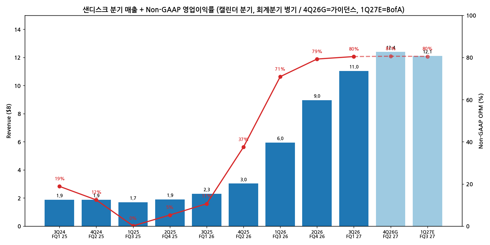
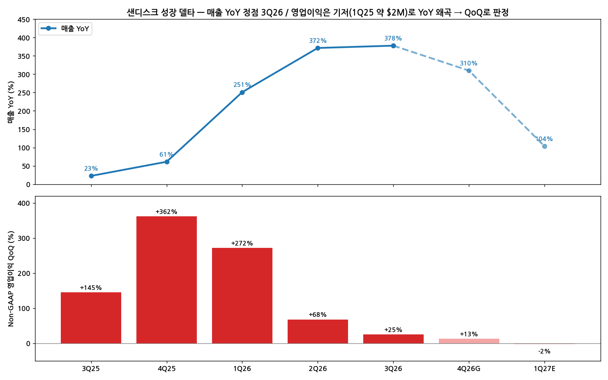

> 모드: 실적 리뷰 (v11)
> 종목: SanDisk (SNDK)
> 섹터: 반도체
> 서브섹터: 메모리
> 분기: 2026-Q3 (샌디스크 회계 FY27 Q1, 2026년 7～9월)
> 발표일: 2026-10-29 (ET, AMC) / 2026-10-30 KST
> 작성 시각: 2026-11-16 KST
> 분석 소스: 회사 실적·컨콜 내용(첨부 리포트 인용 기준) + 첨부 셀사이드 4개 — 대신증권 AI 리서치(10/29), Citi(10/29, 키옥시아 관점 코멘트), BofA(10/30), iM증권(11/04). 웹서치 보완 없음
> 리뷰 깊이: 풀 | 리서치 첨부 4건

# SanDisk 3Q26 (FQ1 FY27) 실적 리뷰 — 숫자는 또 상회했지만, 이제 성장은 물량과 계약이 끈다

## 0. 한 줄 판정

> 성장 델타: **둔화 (영업이익 QoQ 4분기 연속 감속, 매출 YoY는 이번 분기가 정점)** | 내러티브: **유지** → **이익 레벨은 사상 최고, 가격 주도 가속은 끝나고 NBM 계약 가시성이 하단을 받치는 '경계 구간'** [판단]

→ 숫자: 매출 $11.03B(+378% YoY, +23% QoQ), Non-GAAP 영업이익 $8.87B(OPM 80.4%), 조정 EPS $49.51. 컨센 대비 매출 +2.9%, EPS +6.1%. Non-GAAP GPM 85.1%로 직전 분기(84.6%)와 비슷
→ 델타: 영업이익 YoY는 1년 전 기저가 $0.25B·$0.002B 수준이라 의미가 없어 QoQ로 판정 — 영업이익 QoQ +362%(4Q25) → +272% → +68% → **+25%(3Q26)** → 가이던스 약 +13% → BofA 1Q27E −2%. 매출 YoY는 +378%로 이번 분기가 정점
→ 쟁점 ①: 성장의 질이 바뀌었다 — 증가분의 60%가 물량, 40%가 가격(회사). 4Q 가격 상승은 "낮은 수준", GPM 가이던스 84.5～85.5%로 2분기 연속 횡보
→ 쟁점 ②: NBM 8개 고객·최저가 기준 계약 매출 $93.9B·FY27 비트 약 50%·FY28 약 67% 확보 vs BofA "사이클 후반" 멀티플 하향(PO $2,500 → $2,000)
→ 주가: 10/29 $1,330 → 10/30 $1,151(−13.5%), 52주 고점 $2,354 대비 −51%. 다음 관건: 4Q 가격·GPM 유지, 데이터센터 외(엣지·컨슈머) 회복, 11/19 8:1 액면분할 후 수급

---

## 1. 숫자

① 분기 표 (캘린더 분기, 회계분기 병기)

단위: $M, %. **Non-GAAP 영업이익** (회사 주 지표, SBC 제외 — BofA 모델 기준). 3Q26 GAAP 영업이익률 79.6%, GAAP EPS $52.60 (대신)

| 항목 | 3Q24 (FQ1 25) | 4Q24 (FQ2 25) | 1Q25 (FQ3 25) | 2Q25 (FQ4 25) | 3Q25 (FQ1 26) | 4Q25 (FQ2 26) | 1Q26 (FQ3 26) | 2Q26 (FQ4 26) | **3Q26 (FQ1 27)** | 4Q26 가이던스 (FQ2 27) | 1Q27E (FQ3 27) |
|---|---|---|---|---|---|---|---|---|---|---|---|
| 매출액 | 1,883 | 1,876 | 1,695 | 1,901 | 2,308 | 3,025 | 5,950 | 8,965 | **11,031** | 12,400 (12,200～12,600) | 12,119 |
| 영업이익 | 약 355 | 약 233 | 약 2 | 약 100 | 245 | 1,133 | 4,218 | 7,104 | **8,871** | 약 9,990 [계산] | 9,755 |
| OPM | 18.9 | 12.4 | 0.1 | 5.3 | 10.6 | 37.5 | 70.9 | 79.2 | **80.4** | 약 80.6 | 80.5 |
| 매출 YoY | — | — | — | — | +22.6 | +61.2 | +251.0 | +371.6 | **+377.9** | +309.9 | +103.7 |
| 영업이익 YoY | — | — | — | — | −31.0 | +386 | n.m. (약 2,100배) | +7,004 | **+3,521** | 약 +782 | +131 |
| **매출 YoY 델타 (%p)** | — | — | — | — | — | +38.6 | +189.8 | +120.6 | **+6.3** | −68.0 | −206.2 |
| **영업이익 QoQ (조정 판정 기준)** | — | −34% | −99% | n.m. | +145% | +362% | +272% | +68% | **+25%** | 약 +13% | −2% |

→ (출처: 3Q25～3Q26 매출·Non-GAAP 영업이익 = BofA 모델(회사 발표치). 3Q24～2Q25 매출은 FY25 매출 $7,355M과 분기 YoY로 역산, 영업이익은 BofA YoY로 역산 [계산 — 근사]. 4Q26 = 회사 가이던스 매출 중간값 × GPM 중간값 85% − BofA 영업비용 추정 $552M [계산]. 1Q27E = BofA 추정 — Bloomberg 컨센(iM 인용)은 매출 $12,648M로 BofA보다 높다)
→ 2025-02 WDC 분사 이전 분기는 카브아웃 재표시치라 12분기 표는 3Q24부터만 수록. 영업이익 YoY는 1Q25 영업이익이 약 $2M이어서 1Q26～3Q26 YoY가 수천 % 단위로 왜곡 — **판정은 QoQ 기준**

서프라이즈: 매출 컨센(LSEG) 대비 **+2.9%**(Visible Alpha $10.74B 대비 +2.7%, Citi), 조정 EPS **+6.1%**, Non-GAAP GPM 85.1% vs 컨센 84.5%. 회사 가이던스 상단 대비 매출 +2.1%·EPS +7.6% — 상회 폭은 **세 분기 연속 축소**(가이던스 상단 대비 매출 +24% → +2.1%, 대신)

(1) YoY 위치
→ 매출 YoY는 3Q26 +378%가 정점(직전 대비 +6.3%p로 가속 폭 거의 소멸). 가이던스 기준 4Q26 +310%, BofA 경로상 1Q27 +104%로 급격히 수렴
→ 영업이익은 YoY가 의미 없는 기저라 QoQ로 보면 **4Q25(+362%)가 가속의 꼭대기**, 이후 4분기 연속 감속. BofA는 1Q27에 QoQ 마이너스(−2%)를 그린다

(2) 회사가 밝힌 성장 분해
→ 매출 증가분의 **60%는 물량, 40%는 가격**(회사, BofA·Citi). 4Q26도 물량·가격 동반 기여, 다만 4Q 가격 상승은 "낮은 수준" — Citi는 같은 NAND 업체 키옥시아에 가정한 +15% QoQ보다 완만하다고 평가
→ 직전 분기까지는 가격이 끈 사이클, 이번 분기부터는 물량(데이터센터 비트 배분)이 끄는 사이클로 넘어가는 지점 [판단]

→ (출처: 회사 발표치·BofA 모델, 4Q26G = 가이던스 중간값 [계산], 1Q27E = BofA)

→ (출처: 동일. 하단 = Non-GAAP 영업이익 QoQ, 연한 막대 = 가이던스·추정)

② 최종시장별 매출

단위: $M, %. 샌디스크는 단일 보고 세그먼트 — **최종시장별 영업이익은 미공개**

(1) 이번 분기 스냅샷

| 최종시장 | 3Q26 매출 | 비중 | QoQ | YoY | 2Q26 매출 | 3Q25 매출 |
|---|---|---|---|---|---|---|
| **데이터센터** | **4,802** | **43.5** | **+61** | **+1,685** | 2,977 | 269 |
| 엣지 (PC·스마트폰) | 5,832 | 52.9 | +7 | +320 | 5,432 | 1,387 |
| 컨슈머 | 397 | 3.6 | −29 | −39 | 556 | 652 |
| **합계** | **11,031** | 100 | +23 | +378 | 8,965 | 2,308 |

(2) 최종시장별 분기 추이

| 최종시장 | 3Q25 | 4Q25 | 1Q26 | 2Q26 | **3Q26** | 4Q26E | 1Q27E |
|---|---|---|---|---|---|---|---|
| 데이터센터 | 269 | 440 | 1,467 | 2,977 | **4,802** | 5,429 | 6,011 |
| 엣지 | 1,387 | 1,678 | 3,663 | 5,432 | **5,832** | 5,664 | 5,512 |
| 컨슈머 | 652 | 907 | 820 | 556 | **397** | 402 | 650 |
| 데이터센터 비중 | 11.7% | 14.5% | 24.7% | 33.2% | **43.5%** | 44% | 48% |

→ (출처: iM증권 표(회사 발표치 + Bloomberg 컨센 추정), 대신증권)

(3) 해석 — 누가 델타를 끌고 누가 꺾이나
→ **델타를 끄는 곳 = 데이터센터.** QoQ +$1.83B로 전사 증가분(+$2.07B)의 **88%**(대신). 비트를 단가 높은 데이터센터로 우선 배분한 효과, 1년 새 비중 12% → 44%
→ **꺾인 곳 = 엣지·컨슈머.** 엣지 QoQ +7%로 직전 분기(+48%)에서 급감속, 컨슈머 −29%. 회사는 컨슈머 감소를 "가격 인상에 따른 수요 조정"으로 설명, 컨콜에서 처음으로 PC 시장 약세(인텔 가이던스 하향)의 NAND 수요 영향 질문이 나왔다(대신). 컨센은 4Q26～1Q27 엣지 매출 감소를 그리고 있다
→ "성장은 데이터센터 한 곳"(대신 리포트 제목) — 데이터센터만 남은 성장은 비트 배분 여력이 소진되면 둔화가 빠르다 [판단]

③ 연간 (6월 결산)

단위: $M, %

| 항목 | FY24 | FY25 | **FY26** | FY27E | FY28E |
|---|---|---|---|---|---|
| 매출액 | 약 6,662 | 7,355 | **20,248** | 48,939～49,851 | 53,838～61,665 |
| Non-GAAP 영업이익 | — | 689 | **12,700** | 39,404 (BofA) | 43,958 (BofA) |
| OPM | — | 9.4 | **62.7** | 80.5 | 81.6 |
| 매출 YoY | — | +10.4 | **+175.3** | +142～146 | +10～24 |
| 영업이익 YoY | — | — | **+1,743** | +210 | +12 |

→ (출처: FY25·FY26 회사 발표치(BofA·iM 정리), FY24는 FY25 YoY로 역산 [계산]. FY27E·FY28E 매출 범위 = BofA(하단)·Bloomberg 컨센(iM, 상단), 영업이익 = BofA Non-GAAP. LSEG 컨센은 FY27 매출 $48.9B·영업이익 $39.3B·FY28 $59.2B·$47.8B(대신))
→ 연간 컨센 변화: BofA는 FY27 매출 $52.6B → $48.9B(**−7%**), EPS $233.85 → $225.26(−4%)으로 낮추고 FY28·FY29 EPS는 올렸다(FY29 매출은 −8% 역성장 가정). FY28 EPS 컨센 표준편차가 15.8%로 크다(대신) — 이익 레벨보다 **사이클 지속 기간**에서 의견이 갈린다

---

## 2. 시장 쟁점

① 2-0. 지난 리뷰에서 "봐야 할 것"으로 남긴 항목 체크

> 직전 분기(2026-Q2, FQ4 FY26) 리뷰는 작성되지 않음. 2026-Q1 리뷰 기반 팔로업(`earnings-followup/2026-Q2_SNDK_팔로업.md`) 4번 항목을 두 분기 누적 체크

| 직전 팔로업 항목 | 이번까지 결과 | 판정 |
|---|---|---|
| FQ4 FY26 매출 $8B·GPM 80% 가이던스 달성 | FQ4 FY26 $8.97B·GPM 84.6% → FQ1 FY27 $11.03B·85.1% | **확인** (기대 초과) |
| QLC Stargate 첫 매출 램프 | 첨부 리포트에 제품별 언급 없음. 니어라인 HDD → QLC SSD 대체 수요 확대(iM) | **미확인** |
| NBM 추가 계약 | 8개 데이터센터·엣지 고객, 최저가 기준 계약 매출 $93.9B, RPO $88.9B, FY27 비트 약 50%·FY28 약 67% 배정, 기존 고객 연장 검토·추가 약정(BofA) | **확인** (기대 초과) |
| NVIDIA ICMS 채택·우선 공급사 | 첨부 리포트에 언급 없음 | **미확인** |
| 데이터센터 분기 $2B+ | FQ4 FY26 $2.98B → FQ1 FY27 **$4.80B** | **확인** (기대 초과) |

→ 숫자 항목은 모두 크게 초과. 미확인 2건(QLC Stargate, NVIDIA ICMS)은 다음 분기로 이월

② 2-1. 이번 분기 쟁점

| # | 쟁점 | 한 줄 정의 | 언급 증권사 |
|---|---|---|---|
| 1 | 가격 상승 둔화와 마진 정점 | 물량 60%·가격 40%, GPM 85% 2분기 횡보 — 가격 사이클이 꺾였나 | 4/4 |
| 2 | NBM 계약이 사이클을 바꾸나 | $93.9B 최저가 계약·FY28 비트 2/3 확보가 '28년 이후 하단을 지키나 | 4/4 |
| 3 | 데이터센터 일극화 | 엣지 +7%·컨슈머 −29%, 데이터센터 외 회복은 언제 | 3/4 |
| 4 | CapEx 기조 전환과 주주환원 | CapEx 매출의 한 자릿수 중반으로 상향, 초과현금 100% 환원·8:1 분할 | 3/4 |

③ 2-2. 쟁점별 분해

(1) 쟁점 1 — 가격 상승 둔화와 마진 정점

(1-1) 회사 설명
→ "FQ1 매출 증가의 약 60%는 물량, 40%는 가격. FQ2는 물량과 가격 모두 기여" (BofA·Citi)
→ "10～12월 가격 상승은 낮은 수준, 1～3월에도 완만한 상승이 이어질 것" (Citi) / "가격은 연중 완만한 상승" (iM)
→ FQ2 GPM 가이던스 84.5～85.5% — 부품 원가 상승에도 유지 (BofA)

(1-2) 증권사별 해석 편차

| 증권사 | 핵심 가정·추정 | 논리 |
|---|---|---|
| BofA | GPM 84.6～84.8% 평탄, FY29 매출 −8% | 사이클 후반 밸류에이션 우려 — 목표 PER 10배 → 8배 |
| 대신 | GPM 2분기 연속 횡보 | "서프라이즈 폭 세 분기 연속 축소, 마진 개선세 멈춤은 분명" — 그래도 매수 상향 |
| Citi (키옥시아 관점) | 4Q 샌디스크 가격 상승 < 키옥시아 가정 +15% | LTA 가격 적용 시점 차이일 수 있음, 2030년까지 수요 초과는 키옥시아에 안심 요인 |
| iM | 가격 상승 멈춰도 이익 하단은 계약이 지지 | 시장이 가격 둔화를 '28년 이후 수급 완화 신호로 오해석 |

(1-3) 공통 결론 vs 갈리는 지점
→ 공통: 가격 주도 고속 성장 국면은 끝났고 GPM은 85% 근처 정점권
→ 갈림: 가격 둔화가 **사이클 후반 신호**(BofA)인가, **계약 구조로 바뀌는 과도기**(iM·대신)인가

(1-4) [판단]
→ 메모리 섹터 리뷰에서 본 마이크론(GPM 87% 정체)·SK하이닉스와 같은 그림이다. GPM 85%에서 더 올라갈 여지보다 **가격이 꺾일 때 얼마나 버티는지**가 다음 질문 — 쟁점 ②의 계약 하단이 그 답이 된다

(2) 쟁점 2 — NBM 계약이 사이클을 바꾸나

(2-1) 회사 설명
→ NBM(New Business Model) 8개 데이터센터·엣지 고객, 최저가 기준 최소 계약 매출 **$93.9B**, RPO **$88.9B**. 비트 기준 FY27 약 50%, FY28 약 67% 배정 (BofA)
→ "NBM 파이프라인이 2030년 말까지 공급을 초과", 계약 상대의 95%가 투자등급, 기존 고객 연장 검토·추가 약정 다수 (대신·BofA)
→ 2027 데이터센터 NAND 비트 수요 +40% 전망(2026년 2배 이상 성장 후), 데이터센터가 시장의 55% 초과 / 자사 비트 성장 계획은 10%대 중후반 유지 (BofA·iM)
→ 네오클라우드 신용 리스크 전이 질문에 "영향 전혀 없음, 수요는 한 분기 전보다 강해졌다" (대신)

(2-2) 증권사별 해석 편차

| 증권사 | 핵심 가정·추정 | 논리 |
|---|---|---|
| iM | 계약 매출 $939억 + Investor Day FY28～30 GPM 80% 안팎 | 가격이 멈춰도 이익 하단은 계약으로 지지, KV 캐시가 '28년 NAND를 지킨다 |
| 대신 | 2030년 말까지 물량 가시성 | 선행 PER 6.0배 < 5년 평균 10.7배 → 중립에서 매수로 상향 |
| BofA | NBM은 긍정적이지만 사이클 우려가 우세 | C27E EPS $251 × 8배 → PO $2,000, 매수 유지 |

(2-3) 공통 결론 vs 갈리는 지점
→ 공통: NBM으로 FY27～28 물량·가격 하단 가시성은 업계 최고 수준
→ 갈림: 시장이 그 가시성에 **멀티플을 줄지** — BofA는 8배로 낮췄고, 대신·iM은 6배가 과도하게 낮다고 본다

(2-4) [판단]
→ 메모리 3사의 장기계약(마이크론 SCA 35%+, SK하이닉스 LTA 50%+, 삼성 60～70%)과 비교해 FY28 비트 2/3는 **가장 높은 계약 비중**이다. 다만 계약의 가격 밴드 상단이 있다면 업황이 더 좋아져도 재가속은 어렵다 — 모멘텀 관점에서는 하방 보호, 상방 제한 [판단]

(3) 쟁점 3 — 데이터센터 일극화

(3-1) 회사 설명
→ 데이터센터 +61% QoQ, 엣지 +7%, 컨슈머 −29%. 컨슈머 감소는 가격 인상에 따른 수요 조정, 데이터센터 비중은 2027년 내내 상승 (대신·BofA)
→ 데이터센터 외 부문의 회복 시점은 숫자로 제시하지 않음 (대신)

(3-2) 증권사별 해석 편차

| 증권사 | 핵심 가정·추정 | 논리 |
|---|---|---|
| 대신 | 엣지 둔화 폭은 물량 배분만으로 설명 어려움 | PC 약세(인텔 가이던스 하향)가 처음 질문으로 등장, FY27 후반 전망은 엣지·컨슈머가 좌우 |
| iM | QLC·KV 캐시 수요가 데이터센터 성장 지속 | 니어라인 HDD의 10%만 QLC로 대체돼도 eSSD 상당한 추가 수요, 2020년대 말 AI DC NAND의 1/3이 KV 캐시 |
| BofA | 데이터센터 비중 확대 지속 | 공급을 데이터센터로 더 배분 |

(3-3) 공통 결론 vs 갈리는 지점
→ 공통: 데이터센터 수요는 강하고 비중은 계속 오른다
→ 갈림: 엣지 둔화가 **의도한 배분**인지 **수요 약화**인지 — 대신은 수요 약화 쪽에 무게

(3-4) [판단]
→ AMD 리뷰에서 본 "메모리 가격 상승 → PC 수요 감소"가 샌디스크 엣지에서 그대로 나타났다. 메모리 가격이 높을수록 데이터센터는 강하고 엣지는 약해진다 — 엣지 매출이 2분기 연속 감소하면(컨센 4Q26～1Q27 감소) 전사 성장률 둔화가 빨라진다 [판단]

(4) 쟁점 4 — CapEx 기조 전환과 주주환원

(4-1) 회사 설명
→ FY27 CapEx를 FQ1 매출 대비 3.4%에서 연중 한 자릿수 중반(약 5%)으로 상향, BiCS 8/10 지원. 8/27 키옥시아와 일본 310억달러 이상 공동 투자 발표 (대신·BofA)
→ FQ1 자사주 $5.0B(320만 주) 매입, 2분기 누적 $9.5B·발행주식 약 4% 축소, 잔여 한도 $10.5B, 초과현금 100% 환원 방침. 8:1 액면분할 11/19 효력, 11/20부터 분할 기준 거래 (BofA·대신·iM)
→ FCF $6.31B(전분기 $7.08B), 조정 FCF $5.70B(매출의 약 52%), 매출채권 +40% (대신)

(4-2) 증권사별 해석 편차

| 증권사 | 핵심 가정·추정 | 논리 |
|---|---|---|
| 대신 | "증설 없이 노드 전환" 기조는 더 이상 유지 안 됨 | CapEx 상향 두 분기 연속, 이익 증가 속도를 현금흐름이 못 따라옴 |
| iM | '28년 공급은 신규 팹보다 공정 전환 주도 | SLC 채택 확대 시 TLC 대비 3배 웨이퍼 필요 → 실효 공급 축소. 환원 강도는 FCF 50% 수준인 타 메모리사보다 높다 |
| BofA | FY27 CapEx $1.38B, 자사주 $22.3B | 환원 지속, 잔여 한도 $10.5B |

(4-3) 공통 결론 vs 갈리는 지점
→ 공통: 환원 강도는 메모리 업계 최고 수준(초과현금 100%)
→ 갈림: CapEx 상향을 공급 증가 신호로 볼지(대신), 공정 전환 중심의 제한적 증가로 볼지(iM)

(4-4) [판단]
→ 메모리 섹터 공통 쟁점(2028년 공급)과 같은 구도다. 샌디스크는 매출 대비 CapEx 5% 수준이라 공급 과잉의 주체라기보다 업계 증설(삼성·SK하이닉스·YMTC·키옥시아)의 영향을 받는 쪽이다 [판단]

④ 2-3. 낙관 vs 보수 — 논리 대비

| 구분 | 증권사 | 무엇을 다르게 가정했나 |
|---|---|---|
| 낙관 | iM | 계약 하단 + KV 캐시·QLC 대체 수요 → '28년 NAND 수급 유지, 높은 환원으로 업종 대비 총주주수익률 우위 |
| 낙관 | 대신 (중립 → 매수) | 선행 PER 6.0배 vs 5년 평균 10.7배, 실적과 반대로 움직인 주가(1개월 −23%) |
| 보수 | BofA (매수 유지, PO −20%) | FY29 매출 −8% 역성장, 목표 PER 8배 — 사이클 후반 할인 |

→ 핵심 차이는 **'28년 이후 가격 경로와 그에 붙일 멀티플**. 등급은 모두 매수(대신 상향), 그러나 BofA의 PO 하향은 실적이 아니라 멀티플에서 나왔다
→ 셀사이드 vs 시장: 실적·가이던스 상회 + 시간외 +2.2% → 다음 날 −13.5%. 같은 주 메모리 전반이 약세(iM: 52주 고점 대비 샌디스크 −51%, SK하이닉스 −53%, 키옥시아 −64%) — 시장은 이미 "가격 둔화 = 사이클 후반"으로 읽고 있다 [판단]

⑤ 2-4. 추정치·TP 변화

단위: $, $M

| 증권사 | 의견 / TP | TP 변화 | 다음 분기 영업이익 E | FY27E / FY28E 영업이익 | 핵심 변화 한 줄 |
|---|---|---|---|---|---|
| BofA | 매수 / **$2,000** | **하향** ($2,500) | 10,184 (Non-GAAP) | 39,404 / 43,958 | 목표 PER 10배 → 8배, FY27 매출 −7% |
| 대신 AI | **매수 (중립 → 상향)** / LSEG 컨센 $2,104 | — | — | 39,300 / 47,800 (LSEG 컨센) | 저평가 + NBM 가시성 |
| iM | Overweight(업종) / 자체 TP 없음 | — | 10,069 (Bloomberg 컨센) | 39,931 / 48,988 (Bloomberg 컨센) | 계약이 이익 하단 지지 |
| Citi | (키옥시아 커버리지) | — | — | — | 4Q 가격 상승 완만 |

→ 컨센 TP: FactSet 평균 $2,287(범위 $1,400～3,900, 26개사), LSEG 평균 $2,104(범위 $1,020～3,000). 10/30 종가 $1,151 대비 +83～99%. 추천 평균은 30일 전 1.18 → 1.27로 소폭 악화(대신)
→ 다음 분기 영업이익: 가이던스 계산치 약 $9.99B, BofA $10.18B, Bloomberg 컨센 $10.07B로 편차 작음
→ **TP 하향의 원인은 실적이 아니라 멀티플** — BofA는 EPS(C27E $255 → $251)를 거의 그대로 두고 배수만 10배 → 8배로 낮췄다 [판단]

---

## 3. 내러티브 점검

① 성장 스토리 정의
→ "AI 추론(KV 캐시·QLC 대용량)으로 NAND가 데이터센터 핵심 저장 계층이 되고, NBM 장기계약으로 **경기민감 NAND 회사에서 계약 기반 데이터센터 스토리지 회사**로 바뀐다"

② 이번 분기 평가 — **유지**
→ 강화 요소: 데이터센터 $4.8B(+61% QoQ), NBM 8개사·$93.9B·FY28 비트 2/3, 2030년까지 파이프라인 > 공급
→ 약화 요소: 가격 기여 축소(40%), GPM 정체, 엣지·컨슈머 둔화, BofA FY27 추정·멀티플 하향, 상회 폭 축소
→ 스토리의 핵심 전제(데이터센터 수요·계약 구조)는 숫자로 확인됐지만, 추정치는 상향보다 하향이 나왔고 멀티플은 압축 — 강화도 약화도 아닌 **유지** [판단]

③ 국면 — 델타 둔화 × 내러티브 유지
→ 이익은 매 분기 사상 최고지만 증가 속도는 4분기째 감속, 1Q27에는 QoQ 정체(BofA) — 섹터 리뷰의 메모리 국면(고점권 경계)과 같은 위치. 메모리 섹터 리뷰에서 메모리 레이어 모멘텀 구간 종료(2026-Q3)로 정리한 판단과도 일치 [판단]
→ 비유하면 가격이라는 순풍이 잦아들고 계약이라는 닻이 내려진 배 — 크게 밀려나지는 않지만 더 빨리 가지도 않는다

④ 다시 강해질 트리거
→ 1Q27 가격 재가속(가격 기여 40% → 50%+) 또는 GPM 86% 돌파
→ NBM 추가 계약·연장으로 FY28 비트 배정 80%+ 또는 FY29 계약 공개
→ KV 캐시·NVIDIA ICMS 등 신규 데이터센터 수요가 컨센 데이터센터 비트(+40%)를 웃돈다는 증거

⑤ 깨뜨릴 리스크
→ 4Q26 또는 1Q27 NAND 계약가 하락 전환 — 비계약 물량(FY27 약 50%)의 마진 급락
→ 엣지 2분기 연속 감소 + PC·스마트폰 수요 약세 확대
→ 업계 증설(삼성 V9 QLC, SK하이닉스 321단, YMTC·키옥시아) 가속으로 '28년 공급 증가

---

## 4. 향후 봐야 할 것

| 순위 | 무엇을 (변수·임계값) | 어떤 데이터로 | 언제 |
|---|---|---|---|
| 1 | **FQ2 FY27 매출 $12.4B·GPM 85% 달성 & FQ3 가이던스 QoQ 플러스 유지** — FQ3 가이던스 QoQ 마이너스면 델타 '꺾임' | 샌디스크 FQ2 FY27 실적·컨콜 | 2027-01 하순～02 초 |
| 2 | **NAND 계약가 방향** — 4Q26～1Q27 eSSD·모바일 NAND 계약가 QoQ 플러스 유지 여부 | TrendForce·DRAMeXchange 월간 계약가, 키옥시아 실적(2월), SK하이닉스·삼성 NAND 코멘트(1월) | 매월, 2027-01 |
| 3 | **엣지 매출 2분기 연속 감소 여부** — PC·스마트폰 수요, 가격 인상 수용 | 샌디스크 FQ2 최종시장 매출, 인텔·AMD·퀄컴 PC·모바일 가이던스 | 2027-01～02 |
| 4 | **NBM 추가 계약·연장** — FY28 비트 배정 67% → 상향, 계약 매출 $93.9B 증가 | 샌디스크 IR·컨콜, 고객사 발표 | 2027-01～02 |
| 5 | **8:1 액면분할 후 수급·자사주** — 11/20 분할 거래 개시, 잔여 한도 $10.5B 집행 속도 | 주가·거래량, 분기 자사주 매입액 | 2026-11-20 ～ 2027-02 |

→ 1순위가 델타 판정을 바꾼다. 마이크론 FQ1 FY27(12월 중하순)의 NAND 가격 코멘트가 한 달 먼저 나오는 선행 데이터

---

> Sources: 대신증권 AI 리서치(2026-10-29), Citi Research(2026-10-29, 키옥시아 코멘트), BofA Global Research(2026-10-30), iM증권(2026-11-04) — 원문은 비공개 보관
