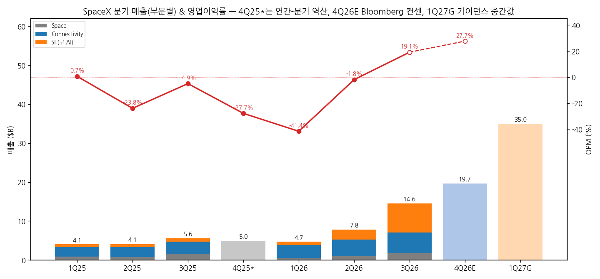
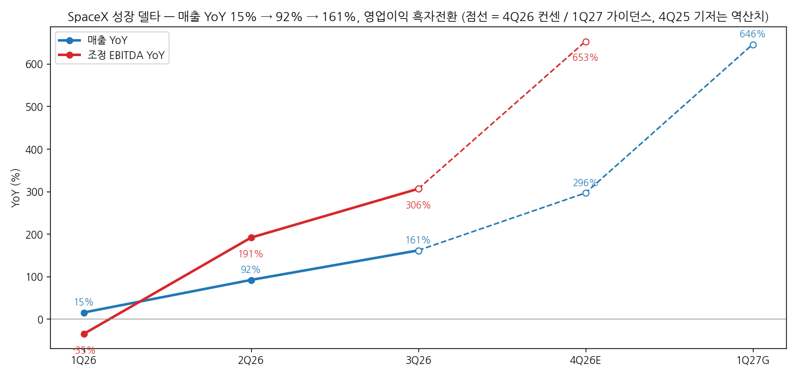
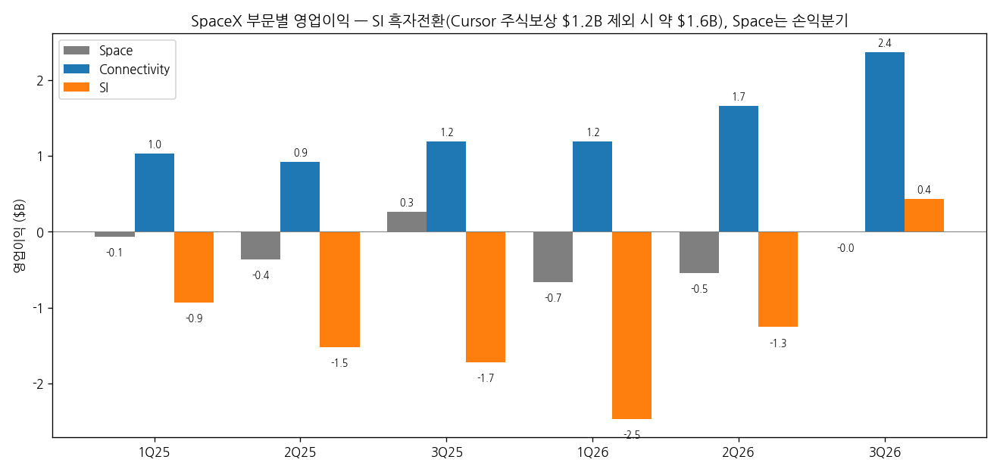
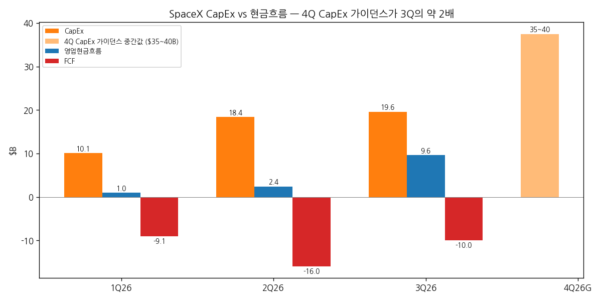

# SpaceX 3Q26 실적 리뷰

> 모드: 실적 리뷰 (v11)
> 종목: SpaceX (SPCX)
> 섹터: 미국 빅테크
> 분기: 2026-Q3
> 발표일: 2026-10-20 (미 동부 장 마감 후, 2026-06 상장 후 두 번째 실적)
> 작성 시각: 2026-11-01 14:30 KST
> 분석 소스: 국내 셀사이드 9개사(KB(AI 속보) · 유진 · SK · 메리츠 · 삼성 · 미래에셋 · 하나 · 신한 · 키움, 모두 10/21) + 웹 보완: 해외 IB TP 변경·컨센(StockAnalysis/TipRanks 10/27, Investing.com, MarketBeat). 회사 IR 원본·컨콜 원문은 첨부되지 않아 경영진 발언은 증권사 Q&A 정리에서 인용. 미래에셋은 텍스트 추출 불가로 미반영
> 편입 메모: 2026-11-01 BT 요청으로 워치리스트 "미국 빅테크" 섹터에 신규 편입 (AI 인프라 매출이 전사 52% → 하이퍼스케일러 성격). 첫 리뷰

---

## 0. 한 줄 판정

> 성장 델타: **가속** | 내러티브: **강화** ("우주 + 통신" → "AI 인프라 하이퍼스케일러") → **적극 구간. 단 4Q CapEx 2배·12/9 락업 해제가 변동성 변수**

→ **숫자**: 매출 $14.6B(+161% YoY, +87% QoQ, 컨센 +13%), 영업이익 $2.8B(OPM 19.1%)로 상장 후 첫 영업흑자, 컨센 대비 +25~40%. 매출 YoY는 1Q +15% → 2Q +92% → 3Q +161%로 2분기 연속 급가속. 조정 EBITDA $8.8B(마진 60.4%)
→ **쟁점 ①**: SI(구 AI) 부문 매출 $7.6B(+830%)가 전사의 52%로 처음 1위. GPU 임대(CSA) 단가가 와트당 $30~50 밴드 상단을 넘었고, 회사는 투자 회수 1년 미만(내년 6개월도 가능)을 제시. 다만 Anthropic·Google 등 고객과의 계약이 180일 단기·현물형이라 "임대료 사이클"에 실적이 묶인 구조(SK)
→ **쟁점 ②**: 1Q27 매출 가이던스 $33~37B는 발표 전 컨센 $24.4B를 중간값 기준 +43% 상회 — 시장 추정치의 대폭 상향을 강제. 반면 4Q CapEx 가이던스 $35~40B로 3Q($19.6B)의 약 2배
→ **추정치·TP**: 2026E 매출 컨센 $44.8B → $48.8B(+9%), 2027E $110B → $178B(+60%, S&P). 컨센 평균 TP $227 → $257(+13%). **TP 상향의 원천은 이익 추정치 상향**. 주가는 시간외 +5~9% 후 10/26 $146.90로 발표 전($147.79) 수준 — 10/22 13억 주 락업 해제 물량이 상승분을 흡수
→ **다음 분기 관건**: 4Q 매출 컨센 $19.7B 달성과 12월 ARR $100B, 1Q27 가이던스를 받칠 GW당 매출(3Q 대비 약 1.5배 필요, 키움), CapEx $35~40B의 조달 방식

---

## 1. 숫자

### ① 연결 기준 분기 표

| 항목 ($M) | 1Q25 | 2Q25 | 3Q25 | 4Q25* | 1Q26 | 2Q26 | **3Q26** | 4Q26E 컨센 | 1Q27 가이던스 |
|---|---|---|---|---|---|---|---|---|---|
| 매출액 | 4,067 | 4,071 | 5,576 | ≈4,960 | 4,694 | 7,814 | **14,575** | 19,659 | 33,000~37,000 |
| 영업이익 (GAAP) | 27 | -970 | -273 | ≈-1,373 | -1,943 | -143 | **2,791** | 5,436 | — |
| OPM | 0.7% | -23.8% | -4.9% | -27.7% | -41.4% | -1.8% | **19.1%** | 27.7% | — |
| 조정 EBITDA | 1,730 | 1,214 | 2,169 | ≈1,500 | 1,127 | 3,538 | **8,809** | 11,289 | — |
| 조정 EBITDA 마진 | 42.5% | 29.8% | 38.9% | ≈30% | 24.0% | 45.3% | **60.4%** | 57.4% | — |
| 매출 YoY | — | — | — | — | 15.4% | 91.9% | **161.4%** | ≈296% | ≈646% (중간값) |
| 영업이익 YoY | — | — | — | — | 적자전환 | 적자축소 | **흑자전환** | 흑자전환 | — |
| **매출 YoY 델타 (%p)** | — | — | — | — | — | +76.5 | **+69.5** | ≈+135 | — |
| **조정 EBITDA YoY (%)** | — | — | — | — | -34.9% | +191.4% | **+306.1%** | ≈+650% | — |

→ (출처: 분기 실적 = 삼성·SK·신한(SpaceX 공시, 2025년 분기는 상장 서류 기준). *4Q25는 비상장 시기로 분기 미공시 — 2025 연간(매출 $18.67B, 영업이익 -$2.59B)에서 1~3Q를 뺀 역산 `[추정]`, 유진 표($5.0B / -$1.4B)와 일치. 4Q26E = Bloomberg 컨센 10/20(SK), 1Q27 가이던스 = 회사)
→ 3Q26 서프라이즈: **매출 컨센 대비 +13.1~13.2%(FactSet $12.89B · Bloomberg $12.88B), 영업이익 +24.9%(Bloomberg $2.24B)~+40.1%(FactSet $1.99B), 조정 EBITDA +33.7%($6.59B), EPS $0.35 vs $0.14~0.15**. 순이익 $4.4B에는 영업외손익·세금 혜택 약 $1.6B가 포함돼 본업 평가는 영업이익 기준(키움)
→ 가이던스: 1Q27 매출 $33~37B(한 분기를 건너뛴 이례적 가이던스), 12월 ARR $100B 목표 유지, 4Q CapEx $35~40B(2Q 콜의 "2Q 수준 유지" 대비 약 2배). 4Q GPM은 3Q 관세 환급 일회성이 빠지며 2Q 수준(~55%)으로 회귀 안내(키움)

→ (출처: 삼성·SK·신한(SpaceX 공시), 4Q26E Bloomberg 컨센, 1Q27G 가이던스 중간값)

→ (출처: 동일. 4Q25 기저는 연간-분기 역산치라 4Q26E YoY는 참고용)

(1) YoY는 어디에 있나
→ 매출 YoY는 3분기 연속 확대 중이고 정점은 아직 오지 않았다. 컨센 4Q +296%, 가이던스 1Q27 +646%(중간값)로 2분기 더 가속하는 경로
→ 영업이익은 2Q 손익분기 → 3Q 첫 흑자 → 4Q 컨센 OPM 27.7%. 이익 레버리지의 원천은 SI 조정 EBITDA 마진 44.7% → 65.5%(키움)
→ `[판단]` 기저가 작아서 YoY 숫자 자체보다 **QoQ 증분**이 의미 있다: 매출 QoQ 증분 2Q +$3.1B → 3Q +$6.8B → 4Q 컨센 +$5.1B → 1Q27 가이던스 +$15.3B. 4Q 컨센은 증분이 오히려 줄어드는 그림이라 상향 여지가 크다

### ② 사업부별 매출·영업이익

(1) 부문

| 부문 ($M) | 3Q25 | 2Q26 | **3Q26** | 매출 YoY | 매출 비중 | 영업이익 3Q25 | 영업이익 2Q26 | **영업이익 3Q26** | OPM 3Q26 | 조정 EBITDA 3Q26 |
|---|---|---|---|---|---|---|---|---|---|---|
| Space (발사) | 1,666 | 962 | **1,767** | +6.1% | 12.1% | 259 | -542 | **-7** | -0.4% | 357 |
| Connectivity (Starlink) | 3,097 | 4,291 | **5,248** | +69.5% | 36.0% | 1,190 | 1,656 | **2,367** | 45.1% | 3,499 |
| SI (구 AI) | 813 | 2,561 | **7,560** | +829.9% | 51.9% | -1,722 | -1,257 | **431** | 5.7% | 4,953 |
| 전사 | 5,576 | 7,814 | **14,575** | +161.4% | 100% | -273 | -143 | **2,791** | 19.1% | 8,809 |

→ (출처: 삼성 부문별 주요 지표(SpaceX 공시))

(2) 부문 KPI 추이

| KPI | 1Q25 | 2Q25 | 3Q25 | 1Q26 | 2Q26 | **3Q26** |
|---|---|---|---|---|---|---|
| SI 매출 YoY | — | — | — | +12.5% | +247.5% | **+829.9%** |
| └ SI 솔루션·인프라 ($M) | 284 | 311 | 359 | 475 | 2,194 | **7,022** (Cursor $608 포함) |
| SI 조정 EBITDA 마진 | — | -37% | -53% | -74% | 44.7% | **65.5%** |
| 컴퓨팅 용량 (GW) | 0.3 | 0.4 | 0.6 | 1.0 | 1.4 | **1.7** |
| Connectivity 매출 YoY | — | — | — | +31.6% | +65.8% | **+69.5%** |
| Starlink 소비자 가입자 (백만) | 5.0 | 6.0 | 7.2 | 10.3 | 12.0 | **13.6** |
| ARPU ($) | 86 | 85 | 83 | 66 | 66 | **69** |
| Connectivity OPM | 41.7% | 35.7% | 38.4% | 36.5% | 38.6% | **45.1%** |
| Space 총 발사 (회) | 38 | 46 | 44 | 40 | 38 | **35** |

→ (출처: 삼성·SK·신한·키움(SpaceX 공시). SI EBITDA 마진은 조정 EBITDA ÷ 매출 계산)
→ `[판단]` **델타를 끄는 건 SI 하나다.** 전사 매출 증분(QoQ +$6.8B)의 74%가 SI. Connectivity는 +70%대 고성장을 유지하며 마진 레버리지(OPM 45%, 관세 환급 약 3%p 포함)를 보탰고, Space는 Starship R&D($1.2B, +44%)를 흡수하며 손익분기 수준

→ (출처: 삼성(SpaceX 공시))

(3) 현금흐름

→ (출처: SK·키움·삼성(SpaceX 공시), 1Q26 영업현금흐름은 CapEx+FCF 역산 `[추정]`)
→ 3Q 영업현금흐름 $9.6B(2Q $2.4B의 약 4배), CapEx $19.6B(이 중 SI $16.4B), FCF -$10.0B(2Q -$16.0B 대비 축소). 기말 현금성자산 $89.9B. 수주잔고 $63B(2Q 대비 +$15.5B, 이 중 $42B는 1년 내 인식) (키움·신한·유진)

### ③ 연간

| 항목 ($B) | 2023 | 2024 | 2025 | 2026E | 2027E |
|---|---|---|---|---|---|
| 매출액 | 10.4 | 14.0 | 18.7 | 44.8 → 48.8 | 109.7 → 177.6 |
| 영업이익 | -3.5 | 0.5 | -2.6 | 4.0~4.4 → 5.2 | 28.1~32.7 |
| OPM | -33.7% | 3.3% | -13.9% | 10.7% | — |
| 매출 YoY | — | 34.9% | 33.2% | 161.4% | 264.0% |
| 영업이익 YoY | — | 흑자전환 | 적자전환 | 흑자전환 | — |

→ (출처: 실적 = 삼성·유진(SpaceX 공시). 2026E·2027E 매출: 발표 전 Bloomberg 10/20(키움) → 발표 후 S&P Global 컨센 10/27(StockAnalysis). 2026E 영업이익 발표 전 = 신한(LSEG) $4.0B·하나 $4.4B, 발표 후 = S&P $5.2B. 2027E 영업이익은 발표 전 신한 $28.1B·하나 $32.7B, 발표 후 컨센 미확인)
→ 발표 전 → 발표 후: **2026E 매출 +9%, 2027E 매출 +60%**. 1Q27 가이던스(연환산 약 $140B)가 2027E를 통째로 끌어올렸다

---

## 2. 시장 쟁점

### ⓪ 지난 분기에 "봐야 할 것"으로 남긴 항목 체크

> 첫 리뷰 — 직전 체크 없음 (2026-11-01 빅테크 섹터 신규 편입)

### ① 이번 분기 쟁점 5개

| # | 쟁점 | 한 줄 정의 | 언급 |
|---|---|---|---|
| 1 | SI — GPU 임대 사업의 지속성 | 와트당 $50+·회수 1년 미만은 얼마나 가나, 단기 계약 구조는 강점인가 약점인가 | 8/8 |
| 2 | 1Q27 가이던스 $33~37B의 실현 가능성 | GW당 매출이 1.5배 올라야 성립 — 머스크 ARR $500B~1T는 어디까지 믿나 | 7/8 |
| 3 | CapEx 2배와 조달 | 4Q $35~40B, 2027년 13GW — 현금흐름·투자등급으로 감당되나 | 8/8 |
| 4 | Starlink — 가입자 미달 vs 마진 레버리지 | 가입자는 2분기 연속 컨센 미달, ARPU·OPM은 개선 | 6/8 |
| 5 | 수급·지배구조 | 12/9 락업 53억 주, 테슬라 합병 특별위원회, Starship Flight 15 | 6/8 |

### ② 쟁점별 분해

#### 쟁점 1. SI — GPU 임대 사업의 지속성

(1) 회사 설명
→ 컴퓨팅 임대 수요가 계속 늘어 와트당 가격이 $30~50 밴드 상단을 넘었고, 단기 계약 갱신 때마다 더 높은 가격으로 갱신. "H100 같은 구형 칩도 신품 때보다 임대료가 비싸다". 투자 회수 1년 미만, 내년 6개월로 단축 가능 (메리츠·삼성·신한)
→ 외부 임대:내부 사용 목표 50:50, 장기 고정 계약 대신 현물 가격 단기 임대 전략. "하이퍼스케일러 외에도 수요가 많아 보유 용량의 몇 배도 임대할 수 있다" (신한)
→ CSA 매출 확약: 4Q $11.4B, 1Q27 $13.6B(공개분 기준). Anthropic 계약 $84.5B로 확대(9/29), 월 $1.1B 신규 호스팅 계약(12월 개시) (삼성·신한)

(2) 증권사별 해석

| 증권사 | 핵심 가정·추정 | 논리 |
|---|---|---|
| SK | 3Q 평균 가동 1.5GW, GPU 임대 매출 $5.5B → 외판 500MW × 평균 $44/W. 내년 +10GW × 외판 50% × $50/W = 2027년 말 GPU 임대 ARR $312B | 램프업 속도(내년 10GW > 빅테크의 하이싱글 GW)와 "사후 판매"(Take-or-Pay 없이 증설 후 그때 필요한 구매자에 판매)가 특징. 고객 계약은 180일 단기 — 높아지는 임대료의 최대 수혜자 |
| 삼성 | SI GPM 11.1%(1Q) → 33.9% → 93.1%(3Q CSA) | CSA는 완공 DC를 임대하는 구조라 추가 비용이 제한적. 4Q·1Q27 CSA 확약만으로 3Q SI CapEx 상쇄 → "회수는 더 이상 의문이 아니다" |
| 키움 | SI 조정 EBITDA 마진 44.7% → 65.5%, Cursor 주식보상 $1.2B 제외 시 SI 영업이익 약 $1.6B | 높은 한계 마진을 2분기 연속 입증 |
| 메리츠 | 최신·구형 GPU 모두 매진 | 프런티어 모델 ARR이 기대 이상 → "모델 수익화 어려움 → 투자 제약" 전제가 낙관으로 변모. 반도체·메모리 수요 가속 |
| 하나 | SI 매출 컨센($6.15B) +23% | 신규 컴퓨팅 계약의 높은 증분 마진이 추정치 상향 뒷받침 |

(3) 공통 결론 vs 갈리는 지점
→ 공통: 현재 GPU 임대 시장은 공급자 우위이고, SpaceX는 가장 빠르게 용량을 늘리는 사업자라 임대료 상승의 최대 수혜
→ 갈림: **단기 현물 계약의 양면성** — SK·신한은 가격 상승 시 즉시 반영되는 강점으로, 리스크 측면에서는 같은 구조가 임대료 하락 시 즉시 매출·마진에 반영되는 약점(셀사이드는 명시적으로 다루지 않음)

(4) `[판단]`
→ 지금의 마진(SI EBITDA 65%)은 **임대료 사이클 정점 근처의 단가**에 기대고 있다. 장기 계약이 없다는 건 수요가 꺾이면 하이퍼스케일러보다 먼저, 더 크게 흔들린다는 뜻이다. 실제로 10/13~16 하이퍼스케일러 DC 지연 경고·네오클라우드 신용 리스크(CRWV)에 주가가 나흘간 -10.6% 반응했다(키움)
→ 결론이 바뀌는 조건: 와트당 단가 하락 신호(신규 계약 갱신가 하향) 또는 Anthropic·Google 등 주요 고객의 갱신 축소

#### 쟁점 2. 1Q27 가이던스 $33~37B의 실현 가능성

(1) 회사 설명
→ 1Q27 매출 $33~37B, 12월 ARR $100B 목표 유지. 컴퓨팅 용량 10월 말 2.2GW → 연말 2.5~3GW → 2027년 말 13GW+(기존 10GW). 전력·냉각 기준으로는 +20GW 계획, 낙관 시 2027년 말 23GW (삼성·KB)
→ 머스크: "2027년 말 ARR $500B~1T", 연매출 $1T 달성 시점 2031년 → 2030년 → "2028년도 불가능하지 않다" (삼성·신한)

(2) 증권사별 해석

| 증권사 | 핵심 가정·추정 | 논리 |
|---|---|---|
| 키움 | Space+Connectivity 1Q27 컨센 $7.5~8B 제외 시 SI가 $25~30B 필요(3Q의 약 3.5배). 1Q27 평균 3.5GW 가정 시 GW당 매출 약 1.5배 필요 | 가이던스는 컨센 대비 +43%로 시장 추정치의 2라운드 상향을 강제. 단 "$500B~1T"는 CFO 가이던스가 아닌 CEO 개인 발언이고 1Q27 연환산(~$140B)과 격차 큼 |
| SK | 2027년 말 GPU 임대 ARR $312B + 나머지 절반 용량(Grok·Cursor) | 머스크 발언 실현 가능 |
| 삼성 | 10만 기 V3 배치에 Starship 1,667회 발사 필요 | 머스크의 "3년 내 Starlink 대역폭 100배"는 비현실적 — CEO 타임라인은 할인해서 볼 것 |
| 하나·신한 | 1Q27 가이던스 = 신규 컴퓨팅 계약 반영 | 지속적 실적 전망치 상향 근거 |

(3) 공통 결론 vs 갈리는 지점
→ 공통: 1Q27 가이던스는 CFO 공식 수치라 신뢰도가 높고, 컨센이 따라 올라갈 수밖에 없다
→ 갈림: 머스크 장기 발언(ARR $500B~1T)의 반영 정도 — SK는 산술로 뒷받침, 키움·삼성은 할인

(4) `[판단]`
→ 1Q27 가이던스는 "용량 × 단가" 둘 다 올라야 맞는 숫자다. 용량은 회사가 통제하지만 단가는 시장이 정한다. **4Q 실적에서 GW당 매출(3Q SI 솔루션·인프라 연환산 $28B ÷ 기말 1.7GW ≈ $17B/GW)이 오르는지가 가이던스 신뢰도의 첫 시험**

#### 쟁점 3. CapEx 2배와 조달

(1) 회사 설명
→ 3Q CapEx $19.6B(SI $16.4B), 4Q $35~40B. 월 약 20만~22만 개 GB300 가동, 2027년 2분기 말까지 Vera Rubin 약 44만 개 학습 클러스터 (메리츠·신한·하나)
→ "투자적격등급과 재무제표 보유, 다양한 부채·자본 풀과 논의 중. 이번 분기 말 가동 설비가 내년 상반기부터 자체 현금을 창출해 후속 투자 지원" (신한). NVIDIA 칩 구매용 $40B 조달 추진 보도(10/7, 신한)
→ 가스터빈 블레이드·베인 자체 주조로 전력 확보를 12~18개월 앞당김. 테라팹: 2027년 5~6월 첫 테스트칩, 2028년 3분기 양산 목표(회사도 "매우 공격적") (신한·SK·KB)

(2) 증권사별 해석

| 증권사 | 핵심 가정·추정 | 논리 |
|---|---|---|
| 삼성 | 12MF EV/EBITDA 31.1배·24MF 16.5배 | SI CapEx는 회수 확실, 다만 SI 외 대규모 프로젝트(테라팹·궤도 DC·스타베이스 루이지애나) CapEx 회수 우려는 여전 |
| 키움 | 현금 $89.9B, 4Q CapEx 가이던스 2배 | 자금 조달 부담과 시장 기대치와의 격차는 증명해야 할 과제 |
| SK | 컨센 CapEx 1Q27 $34.9B·2Q27 $46.0B, FCF -$25.8B·-$29.8B | 대규모 FCF 적자 지속이 컨센에 이미 들어 있음 |
| 신한 | ★★★★★ | 4Q CapEx 급증과 자본조달은 부담이지만 SI·Connectivity 고성장과 Starship이 주가 견인 |
| 유진 | 회수 1년 미만·현금 $89.9B·투자등급 | CapEx 우려보다 성장 기대가 더 크게 작용 |

(3) 공통 결론 vs 갈리는 지점
→ 공통: SI CapEx는 회수 기간이 짧아 "좋은 CapEx"
→ 갈림: SI 외 CapEx(테라팹·궤도 DC·발사장)의 회수 — 삼성·키움은 우려, 나머지는 성장 옵션으로 해석

(4) `[판단]`
→ 회수 1년 미만이 사실이라면 CapEx는 클수록 좋다. 하지만 그 전제가 쟁점 1의 임대료 단가다. **CapEx와 단가가 같은 방향의 베팅**이라는 점이 핵심 — 단가가 꺾이면 CapEx 규모가 그대로 리스크가 된다. 2027년 FCF 컨센이 분기 -$26~30B인 상황에서 조달 수단(채권·주식·벤더 파이낸싱)의 구성이 다음 변수

#### 쟁점 4. Starlink — 가입자 미달 vs 마진 레버리지

(1) 회사 설명
→ 소비자 가입자 1,360만 명(+160만 QoQ), 선진국 위주 순증으로 ARPU $69(+4.5% QoQ) 반등. 기업·정부 매출 +91%. 항공기 약 1.2만 대 계약·3,800대 설치 (삼성·키움)
→ V3 위성 체감은 내년 중반(수백 기 배치 필요). 800MHz 저대역 주파수 인수(2027년 상반기 승인), Starlink Mobile 2028년 초 본격 서비스, FCC V2 위성 1.5만 기 승인 (신한·하나)

(2) 증권사별 해석

| 증권사 | 핵심 가정·추정 | 논리 |
|---|---|---|
| 키움 | 가입자 1,360만 vs 컨센 1,423만(-4.4%), 2분기 연속 미달·미달 폭 확대 | 대신 OPM 45.1%(관세 환급 약 3%p 제외해도 YoY +2~4%p) — 수익화가 숫자로 |
| 삼성 | B2B/B2G는 가격 탄력성·이탈률이 낮은 고수익 사업 | COO "B2B·B2G 각각이 B2C를 넘을 수 있다" = 연 수백억 달러 Connectivity 잠재력 |
| 하나 | ARPU는 전년 동기 $83보다 17% 낮음 | 믹스 개선으로 QoQ 반등 |

(3) 공통 결론 vs 갈리는 지점
→ 공통: 성장의 축이 소비자 가입자에서 기업·정부·항공으로 이동
→ 갈림: 가입자 미달을 일시적(V3 전 용량 제약)으로 볼지, 소비자 성장 둔화 신호로 볼지

(4) `[판단]`
→ Connectivity는 SI 변동성을 받쳐주는 "현금 엔진"이라 가입자 숫자보다 OPM·EBITDA가 중요하다. 다만 4Q엔 관세 환급 일회성(약 3%p)이 빠지므로 OPM 42% 안팎이 정상 수준

#### 쟁점 5. 수급·지배구조

(1) 회사 설명
→ 테슬라 합병: 양사 사외이사 특별위원회가 검토 중이나 조건 합의 없음, "기정사실로 여기면 안 된다". 테슬라 측 발행주식 50% 이상 찬성 필요 (신한·KB)
→ Starship Flight 15(11월): 부스터·상단 동시 타워 회수 첫 시도. 2027년 상반기 주 1회, 하반기 주 2회+ 발사 목표 (키움·하나)

(2) 증권사별 해석

| 증권사 | 핵심 가정·추정 | 논리 |
|---|---|---|
| 키움 | 10/22 13억 주(상장 후 최대 단일 물량), 12/9 잔여 약 53.3억 주(Bloomberg), 2027년 6월 머스크·핵심 투자자 | 지난 6차례 해제일 등락은 -4~+6%에 그쳤고 숏커버·나스닥100 비중 상향(1.28% → 2.82%) 패시브 자금이 흡수 → 오버행이 방향을 좌우할 가능성 낮음 |
| 하나 | 연말 락업 해제 | 단기 리스크 요인 |
| 신한 | 15차 비행 | 스타십 재사용성 확보 여부가 단기 주가 견인 |

(3) 공통 결론 vs 갈리는 지점
→ 공통: 락업은 단기 변수, Starship 완전 회수는 상방 이벤트
→ 갈림: 12/9 물량(현 유통주식 약 30억 주의 약 1.8배)이 이전 해제와 같은 방식으로 흡수될지

(4) `[판단]`
→ 10/22 13억 주 해제 후 주가는 발표 전 수준으로 돌아왔다(실적 서프라이즈 상승분 반납). **12/9 53억 주는 이전과 체급이 다른 물량**이라 실적 모멘텀과 무관하게 가격이 눌릴 수 있는 구간

### ③ 낙관 vs 보수 — 논리 대비

| 구분 | 증권사 | 무엇을 다르게 가정했나 |
|---|---|---|
| 가장 낙관 | SK("리틀 리그에서 뛰는 뉴욕 양키즈", GPU 임대 ARR $312B) · 신한(★★★★★) · 삼성("회수는 더 이상 의문 아님") | 와트당 $50 단가 유지 + 2027년 +10GW 계획대로 달성 + 외판 50%. 단기 계약은 단가 상승을 즉시 반영하는 강점 |
| 가장 보수 | 키움("관건은 투자 회수 속도") · 삼성(SI 외 CapEx 부분) | 1Q27 가이던스는 GW당 매출 1.5배 상승을 전제, 머스크 ARR 발언은 할인. SI 외 CapEx 회수와 조달 부담은 증명 전 |

→ 셀사이드와 바이사이드의 어긋남: 셀사이드 TP는 전원 상향 우위인데, 주가는 시간외 +5~9% 상승분을 반납하고 10/26 $146.90로 발표 전 수준. 이후 MarketBeat 기준 $134.7까지 하락(일자 미확인). 락업 물량과 AI 인프라 섹터 신용 우려(네오클라우드)가 실적보다 강하게 작용 `[판단]`

### ④ 추정치·TP 변화

| 증권사 | 직전 TP | 현재 TP | 4Q26 영업이익 E | 2026E / 2027E 영업이익 | 핵심 변화 한 줄 |
|---|---|---|---|---|---|
| Goldman Sachs | $230 | $245 | — | — | Buy 유지 (10/22) |
| Bernstein | $248 | $268 | — | — | Outperform 유지 (10/26) |
| Barclays | $254 | $300 | — | — | Buy 유지 (10/22) |
| Phillip Securities | $75 | $250 | — | — | 투자의견 상향 (10/22) |
| Morgan Stanley | $300 | $300 | — | — | 유지 (10/26) |
| Needham | $250 | $250 | — | — | 유지 (10/27) |
| Evercore ISI | $230 | $275 | — | — | 발표 전 상향 (10/16) |
| 신한 (국내) | — | 컨센 $231.1 인용 | — | $4.0B / $28.1B | ★★★★★ |
| 하나 (국내) | — | 컨센 $224.7 인용 | — | $4.4B / $32.7B | 추정치 상향 지속 전망 |
| 키움 (국내) | — | 컨센 $227.1 인용 | — | EBITDA $22.6B / $66.3B | 투자 회수 속도가 관건 |
| 국내 기타 5사 | — | 자체 TP 없음 | SK 컨센 $5.4B | — | SK: GPU 임대 ARR $312B 시나리오 |

→ (출처: 해외 = StockAnalysis/TipRanks(10/27)·Investing.com. 국내 = 각사 리포트(발표 전 컨센 인용). 해외 IB 개별 추정치는 원문 미입수)
→ 직전 TP가 확인된 주요 3개사(GS·Bernstein·Barclays) 평균 $244.0 → $271.0(**+11.1%**), Phillip 포함 4개사 상향 · 하향 0. 컨센 평균 TP $227(Bloomberg 10/20) → $256.6(S&P 39명, 10/27, **+13%**), 범위 $70~800 — 의견 분산이 극단적
→ **TP 상향의 원천은 실적 상향**: 2027E 매출 컨센 +60%, 2026E 영업이익 $4.0~4.4B → $5.2B. 반면 TP는 +13%에 그쳐 멀티플은 오히려 압축(12MF P/S 19.5배 → 상향된 추정치 기준 하락) `[판단]`

---

## 3. 내러티브 점검

(1) 성장 스토리 정의
→ **"발사(Space)와 Starlink(통신)가 만든 현금·인프라 위에, 가장 빠르게 GPU 용량을 늘리는 AI 인프라 사업자(SI)가 올라탄다 — 하이퍼스케일러가 된 우주 기업"**

(2) 이번 분기가 스토리에 준 영향

| 축 | 방향 | 근거 |
|---|---|---|
| SI = AI 인프라 하이퍼스케일러 | 강화 (형성 → 확인) | SI 매출 52%, EBITDA 마진 65.5%, 1Q27 가이던스 컨센 +43% |
| Starlink 현금 엔진 | 강화 | 매출 +70%, OPM 45%, 기업·정부·항공 확대 |
| 우주(Starship) 옵션 | 강화 | Flight 14 첫 궤도 진입·V3 26기 배치, Flight 15 완전 회수 시도 |
| 재무·수급 | 약화 | 4Q CapEx 2배, FCF 적자 지속, 12/9 락업 53억 주 |

(3) 국면 판단
→ 매출 YoY 92% → 161%, 영업이익 흑자전환(**가속**) × 3개 축 강화(**강화**) → **적극 구간**
→ 단 모멘텀 매매 관점에서 실적 델타와 주가가 디커플링된 상태(락업·섹터 신용 우려). 진입 타이밍 변수는 실적이 아니라 **12/9 락업 소화와 Flight 15 결과**. 실적 면의 다음 확인은 4Q 실적(2027년 1월 하순 예상)의 GW당 매출 `[판단]`

(4) 트리거와 리스크

| 다시 강하게 만들 트리거 | 깨뜨릴 리스크 |
|---|---|
| Flight 15 부스터·상단 동시 회수 성공 → 완전 재사용, 발사 단가·V3 배치 속도 혁신 | GPU 임대 단가 하락 신호(갱신가 하향) → 단기 계약 구조상 매출·마진 즉시 타격 |
| 4Q 매출이 컨센 $19.7B를 크게 상회, 12월 ARR $100B 공식 확인 | 4Q CapEx $35~40B 조달이 주식 발행 위주로 진행 → 희석 |
| 장기 계약(Take-or-Pay) 고객 확보 → 임대료 사이클 리스크 완화 | 12/9 락업 53억 주가 이전처럼 흡수되지 않음, 테슬라 합병 조건이 SpaceX 주주에 불리 |

---

## 4. 향후 봐야 할 것 (4Q26)

| 순위 | 무엇을 (변수·임계값) | 어떤 데이터로 | 언제 |
|---|---|---|---|
| 1 | **4Q 매출 $19.7B(컨센) 이상 + 12월 ARR $100B 확인 + GW당 매출 상승** — 1Q27 가이던스 $33~37B의 신뢰도를 결정 | 4Q26 실적·컴퓨팅 용량(연말 2.5~3GW) 공시 | 2027년 1월 하순 |
| 2 | **GPU 임대 단가($/W)와 계약 구조** — $50/W 이상 유지, 장기 계약 고객 확보 여부. 하락 시 델타 판정 즉시 재검토 | 신규 CSA 계약 공시(Anthropic·Google 갱신), 네오클라우드(CRWV) 임대가·신용 스프레드 | 수시 |
| 3 | **4Q CapEx $35~40B 조달 방식** — 채권(투자등급) vs 주식 vs 벤더 파이낸싱, FCF 적자 폭 | SEC 8-K·424B, 4Q 현금흐름표, NVIDIA $40B 조달 보도 후속 | 수시 / 2027년 1월 |
| 4 | **Starship Flight 15 완전 회수 성공** | FAA 승인·발사 결과 | 11월 |
| 5 | **12/9 락업 53억 주 소화 + 테슬라 합병 특별위원회 결론** | 락업일 거래량·주가, 나스닥100 비중 변화, 양사 공시 | 12/9 / 수시 |

→ 이 목록이 다음 분기 리뷰의 ⓪ 체크 대상, `earnings-followup/2026-Q4_SPCX_팔로업.md`, 캘린더 시그널로 이어진다
