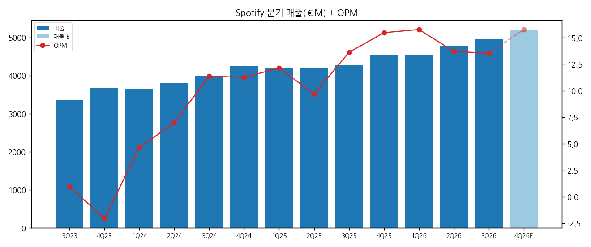
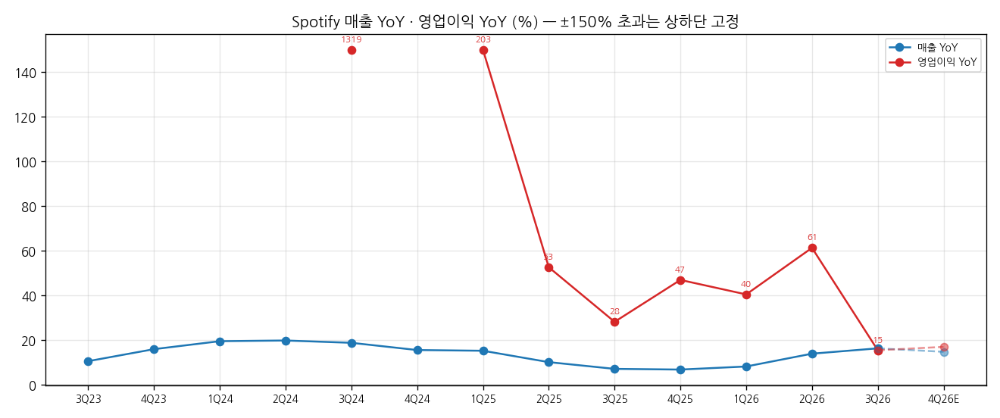

> 모드: 실적 리뷰 (v11)
> 종목: Spotify Technology (SPOT, NYSE)
> 섹터: 엔터
> 서브섹터: 음원 글로벌
> 분기: 2026-Q3
> 발표일: 2026-10-22 (BMO)
> 작성 시각: 2026-11-22 23:30 KST
> 분석 소스: SEC 6-K(3Q26 Shareholder Update·실적 보도자료) 및 과거 분기 6-K·20-F (company-data MCP, `company-overview-source/SPOT_*`) / 웹 보완 — Music Business Worldwide(2026-10-22), Hypebot(2026-10-22), beancount.io 6-K 정리(2026-10-23), TradingKey 컨콜 요약. 셀사이드 리포트 첨부 없음
> 리뷰 깊이: 숫자 중심 | 리서치 첨부 0건 (1차 출처: SEC 6-K / 보도 인용은 "보도" 표기)
> 비영업 요인: 저기저(2Q25 영업이익 €406M — 2025년 분기 중 최저, 2Q26 YoY +61% 확대의 기저) / 주가 연동 사회보장세(Social Charges) 3Q26 €22M(예상 대비 +€13M)

# Spotify 3Q26 실적 리뷰

## 0. 한 줄 판정

> 성장 델타: 둔화 | 내러티브: 유지 → 경계 구간 (매출 YoY는 3분기 연속 확대, 영업이익 YoY는 +61% → +16%로 급감 — 가격 인상이 매출을 끌지만 마케팅·클라우드·AI 비용이 이익 레버리지를 먹는 중)

> ⚠ 비영업 요인 플래그: 2Q26 영업이익 YoY +61.3%는 2Q25 저기저(€406M) 효과 — 3Q26 +15.5%가 정상 기저에 가까운 성장률. 3Q26 사회보장세 €22M(예상 대비 +€13M)은 OPM 약 0.3%p 하향 요인 [계산]

→ 숫자: 매출 €4,969M (+16.3% YoY, 고정환율 +14%), 영업이익 €672M (+15.5%, OPM 13.5%). 매출 YoY 6.8%(4Q25) → 8.2% → 13.9% → **16.3%** 가속, 영업이익 YoY 47.0% → 40.5% → 61.3% → **15.5%** 둔화
→ 쟁점 ①: 성장의 원천이 **가입자보다 가격** — Premium ARPU €4.95(+9.3% YoY)로 가입자(+9%)와 같은 크기 기여. 회사 문구 "가격 인상 효과, 상품·지역 믹스가 일부 상쇄"가 2개 분기 연속 동일 (보도)
→ 쟁점 ②: 비용 레버리지 둔화 — 매출총이익률은 33.0%(3분기 기준 사상 최고)인데 영업비용이 통화·사회보장세 제외 +19% (마케팅·클라우드·AI) (6-K 정리, 보도)
→ 다음 분기 관건: 4Q26 가이던스 영업이익 €820M = YoY **+17.0%** [계산] — 영업이익 YoY가 15\~17% 박스에 머무는지, 다시 20%대로 올라서는지

## 1. 숫자

① 연결 분기 표 (€M, IFRS 영업이익)

| 항목 (€M) | 3Q23 | 4Q23 | 1Q24 | 2Q24 | 3Q24 | 4Q24 | 1Q25 | 2Q25 | 3Q25 | 4Q25 | 1Q26 | 2Q26 | **3Q26** | 4Q26 E (회사 가이던스) |
|---|---|---|---|---|---|---|---|---|---|---|---|---|---|---|
| 매출 | 3,357 | 3,671 | 3,636 | 3,807 | 3,988 | 4,242 | 4,190 | 4,193 | 4,272 | 4,531 | 4,533 | 4,777 | 4,969 | 5,200 |
| 영업이익 | 32 | -75 | 168 | 266 | 454 | 477 | 509 | 406 | 582 | 701 | 715 | 655 | 672 | 820 |
| OPM | 1.0% | -2.0% | 4.6% | 7.0% | 11.4% | 11.2% | 12.1% | 9.7% | 13.6% | 15.5% | 15.8% | 13.7% | 13.5% | 15.8% |
| 매출 YoY | +10.6% | +16.0% | +19.5% | +19.8% | +18.8% | +15.6% | +15.2% | +10.1% | +7.1% | +6.8% | +8.2% | +13.9% | +16.3% | +14.8% |
| 영업이익 YoY | n.m. | n.m. | n.m. | n.m. | +1318.8% | n.m. | +203.0% | +52.6% | +28.2% | +47.0% | +40.5% | +61.3% | +15.5% | +17.0% |
| **매출 YoY 델타** | n.m. | +5.4%p | +3.6%p | +0.3%p | -1.0%p | -3.2%p | -0.3%p | -5.1%p | -3.0%p | -0.3%p | +1.4%p | +5.7%p | +2.4%p | -1.6%p |
| **영업이익 YoY 델타** | n.m. | n.m. | n.m. | n.m. | n.m. | n.m. | n.m. | -150.3%p | -24.4%p | +18.8%p | -6.5%p | +20.9%p | -45.9%p | +1.5%p |

→ 컨센 대비: 회사는 "모든 KPI가 가이던스 부합 또는 상회"라고 설명 (보도). 셀사이드 컨센 원문 미확보 — 가이던스 대비로만 확인: 매출총이익률 33.0% vs 가이던스 32.9% (보도)
→ [판단] 매출 YoY는 2025년 7% 안팎에서 2026년 3분기 16%로 가속 중이고, 영업이익 YoY의 정점은 2Q26(+61%, 저기저)이었다. 4Q26 가이던스 기준 영업이익 YoY는 +17%로 3Q26과 비슷한 수준 — **이익 성장률은 10%대 후반에서 안정, 매출 성장률이 이익 성장률을 따라잡은 구조**
→ 1Q26부터 비용 재분류로 세그먼트 매출총이익률이 과거와 연속되지 않는다 (기업 개요 참고)

→ (출처: SEC 6-K 분기 실적, company-overview-source/SPOT quarterly.json — 4Q26E는 회사 가이던스)

→ (출처: 같은 자료로 계산. 점선 = 4Q26 회사 가이던스)

② 사업부별 (€M, 세그먼트 영업이익 미공시 — 매출총이익까지)

| 항목 (€M) | 3Q25 | 4Q25 | 2Q26 | 3Q26 | QoQ | YoY |
|---|---|---|---|---|---|---|
| Premium 매출 | 3,826 | 4,013 | 4,331 | 4,487 | +3.6% | +17.3% |
| Premium 매출총이익 | 1,269 | 1,398 | 1,511 | 1,549 | +2.5% | +22.1% |
| Ad-Supported 매출 | 446 | 518 | 446 | 482 | +8.1% | +8.1% |
| Ad-Supported 매출총이익 | 82 | 101 | 85 | 90 | +5.9% | +9.8% |

→ Premium이 매출의 90%, 매출 YoY +17%로 성장 전부를 끌고 있다. Ad-Supported 매출은 +8%(3Q26 €482M)로 한 자릿수 — 회사 설명은 "노출 증가, 가격(단가) 약세가 일부 상쇄" (보도)
→ KPI: MAU 7.88억(+11% YoY, 순증 1,100만), Premium 구독자 3.06억(+9%, 순증 600만), Premium ARPU €4.95(+9.3%)

③ 연간 (€M)

| 항목 | FY2023 | FY2024 | FY2025 | 9M26 | 9M25 |
|---|---|---|---|---|---|
| 매출 | 13,247 | 15,673 | 17,186 | 14,279 | 12,655 |
| 영업이익 | −446 | 1,365 | 2,198 | 2,042 | 1,497 |
| OPM | −3.4% | 8.7% | 12.8% | 14.3% | 11.8% |
| 매출 YoY | 13.0% | 18.3% | 9.7% | 12.8% | — |
| 영업이익 YoY | n.m. | 흑자전환 | +61.0% | +36.4% | — |
→ (출처: 분기 6-K 합산 [계산]) 2026년 가이던스 합산(9M + 4Q 가이던스)은 매출 약 €19.5B, 영업이익 약 €2.86B [계산] — 영업이익 YoY 약 +30%

## 2. 시장 쟁점 (숫자 중심 — 회사 설명 + 컨콜 반복 질문)

① 지난 분기 체크
→ 첫 리뷰 — 직전 체크 없음

② 이번 분기 쟁점

(1) **가격 인상이 성장의 절반** — ARPU 상승이 계속될 수 있나
(1-1) 회사 설명: "ARPU 성장은 가격 인상 효과, 상품·지역 믹스가 일부 상쇄" — 2분기 연속 거의 같은 문구 (6-K, 보도). 2026년 2월 미국 등 Premium 가격 인상 (보도)
(1-2) [판단] 가입자 +9%, ARPU +9%로 매출 +17%의 절반이 가격. 가격 인상 효과는 1년이 지나면 기저에 들어가므로 **2027년 1Q부터 ARPU 기여가 줄어드는지**가 매출 가속 지속의 관건

(2) **영업이익 레버리지 둔화** — 매출총이익률은 오르는데 OPM은 정체
(2-1) 회사 설명: 통화·사회보장세 제외 영업비용 +19%, "성장 이니셔티브를 위한 마케팅, 클라우드·AI 지출 증가" (6-K 정리, 보도)
(2-2) 숫자: 매출총이익률 33.0%(+136bp YoY) vs OPM 13.5%(3Q25 13.6%) — 매출총이익 증가분이 전부 영업비용으로 나갔다 [계산]
(2-3) [판단] 4Q26 가이던스(OPM 15.8%, 매출총이익률 33.8%)는 계절적 마진 회복을 반영. 2027년 영업비용 가이던스가 '성장 투자 지속'이면 이익 YoY는 10%대에 머물 가능성

(3) **광고 사업 부진** — Ad-Supported 매출 +8%, 단가 약세
(3-1) 회사 설명: 음악 광고는 "판매 노출 증가, 가격 약세가 일부 상쇄" — 2분기 연속 같은 표현 (6-K 정리)
(3-2) [판단] 광고는 매출의 10%라 이익 판정에 미치는 영향은 작다. 다만 MAU 성장(+11%)이 광고 매출로 이어지지 않는 구조가 지속되면 무료 이용자 수익화 스토리는 약화

(4) **MAU 퍼널 조정** — 신흥시장 성장 질 관리
(4-1) 회사 설명(컨콜): 인도·인도네시아 등에서 데이터 정비·고유지율 기기 이전 등 "사업에 이로운 마찰"을 의도적으로 넣는 중. 4Q26 MAU 순증은 전년(무료 버전 개편 효과) 기록치보다 낮을 것 (보도)
(4-2) 4Q26 가이던스: MAU 8.18억(+3,000만), 구독자 3.16억(+1,000만)

## 3. 내러티브 점검

→ 성장 스토리: **세계 최대 음악 구독 플랫폼이 가격 결정력을 확보해, 매출 성장보다 빠른 이익 성장(영업 레버리지)을 만드는 구간** — 2024년 흑자 전환 이후 시장이 이 종목을 사는 이유
→ 이번 분기: 가격 결정력(ARPU +9%)은 확인됐지만, 영업 레버리지는 멈췄다(OPM 13.5%, 전년과 동일). 스토리는 유지, 레버리지 부분은 다음 분기 확인 필요 → **델타 둔화 + 내러티브 유지 → 경계 구간**
→ 다시 강하게 만들 트리거: 2027년 추가 가격 인상 발표 / 4Q26 영업이익 €820M 상회·OPM 16%대 / 슈퍼팬 상위 요금제 출시
→ 깨뜨릴 리스크: 가격 인상 후 해지율 상승 / AI·마케팅 투자 확대로 2027년 OPM 가이던스 하향 / 레이블(UMG 등) 도매가 인상(Streaming 2.0)이 매출총이익률을 잠식

## 4. 향후 봐야 할 것

① **4Q26 영업이익 YoY** — 가이던스 €820M(+17%) 대비 실제. 20%대 재가속이면 델타 판정 '가속'으로 복귀 / 4Q26 실적 보도자료 / 2027년 2월 초
② **2027년 1Q 가이던스의 OPM** — 영업비용 증가율이 매출 증가율 아래로 내려오는지 (영업 레버리지 재개 여부) / 4Q26 실적 발표 시 1Q27 가이던스 / 2027년 2월
③ **Premium ARPU 증가율** — 가격 인상 1년 경과로 +9%에서 한 자릿수 초반으로 떨어지는지 / 분기 6-K KPI / 2027년 1Q 실적(4월)
④ **추가 가격 인상 발표** — 미국·유럽 2차 인상, 슈퍼팬 요금제 / 회사 뉴스룸·보도 / 수시
⑤ **레이블 도매가 계약** — UMG Streaming 2.0 계약이 Spotify 매출총이익률에 주는 영향 / UMG·WMG 실적 콜, Spotify 매출총이익률 / 분기별
