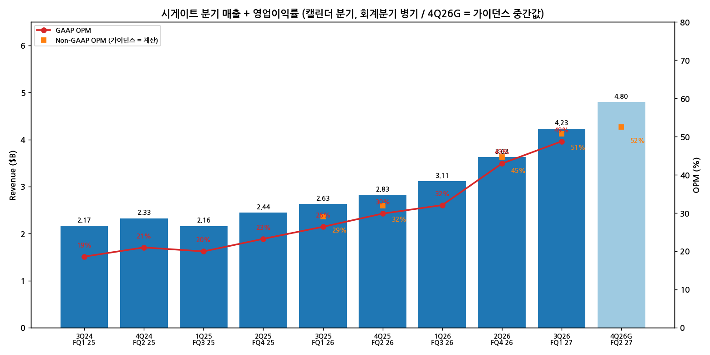
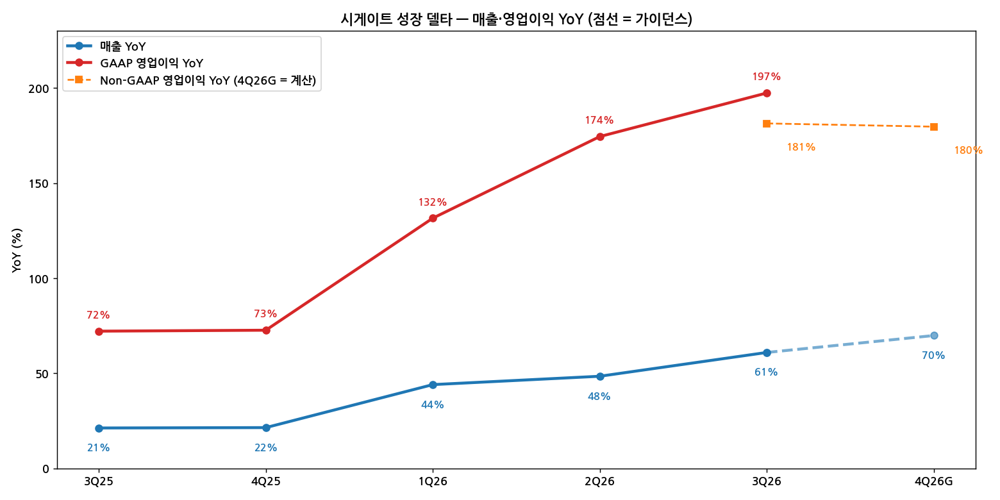

> 모드: 실적 리뷰 (v11)
> 종목: Seagate (STX)
> 섹터: 반도체
> 서브섹터: 메모리
> 분기: 2026-Q3 (시게이트 회계 FY27 Q1, 2026년 7～9월)
> 발표일: 2026-10-27 (ET, AMC) / 2026-10-28 KST
> 작성 시각: 2026-11-16 KST
> 분석 소스: SEC XBRL(10-Q·10-K, GAAP 분기 매출·영업이익) + 첨부 셀사이드 2개 — KB증권 AI 실적속보(10/28), 삼성증권(10/28). 웹서치 보완 없음
> 리뷰 깊이: 풀 | 리서치 첨부 2건

# Seagate 3Q26 (FQ1 FY27) 실적 리뷰 — 물량은 쉬어 갔고, 가격이 혼자 끌었다

## 0. 한 줄 판정

> 성장 델타: **가속 (매출 YoY +48.5% → +61.0%, GAAP 영업이익 YoY +175% → +197%) — 단, 영업이익 가속 폭은 3분기 연속 축소, 가이던스상 다음 분기 YoY는 고원** | 내러티브: **강화** → **적극 구간의 후반부 — 니어라인 물량이 CY2028까지 배정되고 주주환원이 본격화되지만, 주가는 고점 대비 −42%** [판단]

→ 숫자: 매출 $4.23B(+61.0% YoY, +16.6% QoQ), Non-GAAP 영업이익 $2.15B(OPM 50.7%, 사상 최고), Non-GAAP EPS $7.68. 컨센 대비 매출 +2.0%, 영업이익 +3.4%, EPS +3.1%. Non-GAAP GPM 57.8%(+17.7%p YoY)
→ 델타: 출하 용량 220EB(+21% YoY, **+1% QoQ**)인데 TB당 가격 +32% YoY — 이번 분기 성장은 거의 가격. FQ2 가이던스 매출 $4.7～4.9B(+70% YoY), EPS $9.00～9.40(컨센 $8.66 대비 +6%), OPM 50%대 중반
→ 쟁점 ①: EB 출하 정체 — 회사는 "수율·데이터센터 준비 문제가 아닌 계획된 제품 전환(Mozaic 4)·고객 인증 일정", 12월 분기 재가속
→ 쟁점 ②: 니어라인 공급은 CY2028까지 대부분 배정, 일부 클라우드 계약은 CY2030까지 — CY2028 물량의 가격·구성은 향후 수 분기에 확정
→ 다음 관건: FQ2 EB 재가속(QoQ +5%+), CY2028 계약 가격 조건, 순현금 전환 후 FY3Q27부터 FCF 75% 환원

---

## 1. 숫자

① 분기 표 (캘린더 분기, 회계분기 병기)

단위: $M, %. **영업이익 = GAAP** (SEC XBRL). Non-GAAP 영업이익은 리포트 공개 분기만 병기

| 항목 | 3Q24 (FQ1 25) | 4Q24 (FQ2 25) | 1Q25 (FQ3 25) | 2Q25 (FQ4 25) | 3Q25 (FQ1 26) | 4Q25 (FQ2 26) | 1Q26 (FQ3 26) | 2Q26 (FQ4 26) | **3Q26 (FQ1 27)** | 4Q26 가이던스 (FQ2 27) |
|---|---|---|---|---|---|---|---|---|---|---|
| 매출액 | 2,168 | 2,325 | 2,160 | 2,444 | 2,629 | 2,825 | 3,112 | 3,629 | **4,233** | 4,800 (4,700～4,900) |
| 영업이익 (GAAP) | 403 | 488 | 431 | 568 | 694 | 843 | 998 | 1,559 | **2,064** | — |
| OPM (GAAP) | 18.6 | 21.0 | 20.0 | 23.2 | 26.4 | 29.8 | 32.1 | 43.0 | **48.8** | — |
| 영업이익 (Non-GAAP) | — | — | — | — | 763 | 약 901 | — | 1,619 | **2,147** | 약 2,520 [계산] |
| OPM (Non-GAAP) | — | — | — | — | 29.0 | 31.9 | — | 44.6 | **50.7** | 약 52.5 |
| 매출 YoY | +49.1 | +49.5 | +30.5 | +29.5 | +21.3 | +21.5 | +44.1 | +48.5 | **+61.0** | +69.9 |
| 영업이익 YoY (GAAP) | n.m. | +293.5 | +201.4 | +80.9 | +72.2 | +72.7 | +131.6 | +174.5 | **+197.4** | — |
| 영업이익 YoY (Non-GAAP) | — | — | — | — | — | — | — | — | **+181.4** | 약 +180 [계산] |
| **매출 YoY 델타 (%p)** | — | +0.4 | −19.0 | −1.0 | −8.2 | +0.2 | +22.6 | +4.4 | **+12.5** | +8.9 |
| **영업이익 YoY 델타 (%p, GAAP)** | — | — | −92.1 | −120.5 | −8.7 | +0.5 | +58.9 | +42.9 | **+22.9** | — |

→ (출처: 매출·GAAP 영업이익 = SEC XBRL(10-Q 분기치, 4분기는 10-K 연간 − 3개 분기 [계산]). Non-GAAP 영업이익 = KB·삼성(FactSet), 4Q25 = 매출 × 삼성 표 Non-GAAP OPM 31.9% [계산]. 4Q26 가이던스 영업이익 = 매출 중간값 $4.8B × OPM 52.5%(KB 50～55% 범위 중간) [계산])
→ 3Q24 GAAP 영업이익 YoY는 기저(3Q23 −$129M 적자)로 n.m.

서프라이즈: 매출 컨센 대비 **+2.0%**, Non-GAAP 영업이익 **+3.4%**, EPS **+3.1%** (FactSet, KB·삼성). 직전 분기 회사 가이던스(EPS $7.30) 대비 +5.2%. 서프라이즈 폭은 WDC(매출 +6%, EPS +13%)보다 작다

(1) YoY 위치
→ 매출 YoY는 3Q25～4Q25 21%대 바닥 → 3Q26 +61% → 가이던스 +70%로 **아직 상승 중**
→ 영업이익 YoY는 가속이 계속되지만 가속 폭이 +58.9%p → +42.9%p → +22.9%p로 줄고, Non-GAAP 기준 가이던스는 +181% → 약 +180%로 **고원**. 컨센 경로상 영업이익 YoY 정점은 3Q26～4Q26 [판단]

(2) 성장 분해 — 이번 분기는 가격이 전부
→ 출하 용량 220EB: YoY +21%, **QoQ +1%**. 데이터센터향 198EB(+24% YoY), 전체의 약 90% (KB)
→ TB당 가격 +32% YoY로 가속 (삼성). 매출 QoQ +16.6% 중 물량 기여는 약 1%p — 나머지는 가격·믹스 [계산]
→ WDC(248EB +22%, 가격 +28%)와 같은 그림, 가격 기여는 STX가 더 크다

→ (출처: SEC XBRL, KB·삼성(Non-GAAP), 4Q26G = 가이던스 중간값 [계산])

→ (출처: 동일. 주황 = Non-GAAP 영업이익 YoY)

② 최종시장별 매출

단위: $M, %. 단일 HDD 사업 — **최종시장별 영업이익은 미공개**

| 최종시장 | 3Q26 매출 | 비중 | YoY | 3Q25 매출 [계산] |
|---|---|---|---|---|
| **데이터센터** | **3,450** | **81.5** | **+63** | 약 2,117 |
| 엣지 IoT | 780 | 18.4 | +52 | 약 513 |
| **합계** | **4,233** | 100 | +61 | 2,629 |

→ (출처: KB(회사 발표치). 3Q25는 YoY로 역산 [계산]. 분기별 QoQ 추이는 첨부 자료에 없음)
→ **델타를 끄는 곳 = 데이터센터.** 증가분 +$1.60B 중 데이터센터 +$1.33B(83%), 클라우드·엔터프라이즈 수요 동반
→ 엣지 IoT도 +52% — 꺾인 사업부 없음. 직전 리뷰의 데이터센터 비중 80.4% → 81.5%

③ 연간 (6월 결산)

단위: $M, %

| 항목 | FY24 | FY25 | **FY26** |
|---|---|---|---|
| 매출액 | 6,551 | 9,097 | **12,195** |
| 영업이익 (GAAP) | 452 | 1,890 | **4,094** |
| OPM | 6.9 | 20.8 | **33.6** |
| 매출 YoY | −11.3 | +38.9 | **+34.1** |
| 영업이익 YoY | 흑자 전환 | +318 | **+117** |

→ (출처: SEC XBRL 10-K, 삼성증권 재무표. FY23 매출 $7,384M·영업이익 −$342M)
→ FY27E: 첨부 리포트에 증권사 추정치 없음. 1분기 실적 + 2분기 가이던스로 상반기 매출 약 $9.0B(FY26 상반기 $5.5B 대비 +65%) [계산]. 회사: "FY27 내내 매출 QoQ 성장과 GPM 상승 지속" (삼성)
→ 연간 컨센 변화: 첨부 2건 모두 속보·코멘트형이라 미확인. Bloomberg 평균 TP $1,072.2(삼성), FactSet $1,127.0(KB)

---

## 2. 시장 쟁점

① 2-0. 지난 리뷰에서 "봐야 할 것"으로 남긴 항목 체크

> 직전 분기(2026-Q2, FQ4 FY26) 리뷰는 작성되지 않음. 2026-Q1 리뷰 기반 팔로업(`earnings-followup/2026-Q2_STX_팔로업.md`) 항목을 두 분기 누적 체크

| 직전 팔로업 항목 | 이번까지 결과 | 판정 |
|---|---|---|
| FQ4 FY26 매출 $3.45B+·GPM 48.5% | FQ4 FY26 $3.63B·GM 52.7% → FQ1 FY27 $4.23B·Non-GAAP GPM 57.8% | **확인** (기대 초과) |
| Mozaic 4(40TB) 본격 램프 | FQ4 HAMR 채택 약 40%(캘린더 기록). FQ1 EB 출하 정체는 "계획된 제품 전환·고객 인증 일정" 영향, 12월 분기 재가속 (KB·삼성) | **부분 확인** (전환 진행, 물량 효과는 지연) |
| NVIDIA 협력 구체화 | 첨부 리포트 언급 없음 | **미확인** |
| 자사주 본격화·전환사채 상환 | FQ1 부채 $12억 상환 + 10월 채권 $7.5억 추가 상환 → 원금 약 $16억. CY2026 말 순현금 전환, FY3Q27부터 FCF 75% 환원 (삼성·KB) | **확인** |
| Mozaic 5(50TB급) 2027 인증 | 플래터당 5TB Mozaic 5 고객 인증용 출하 2027년 말, 더 빨라질 가능성 (삼성) | **확인** (일정 유지) |

→ 숫자·재무 항목은 확인. NVIDIA 협력은 다음 분기로 이월

② 2-1. 이번 분기 쟁점

| # | 쟁점 | 한 줄 정의 | 언급 증권사 |
|---|---|---|---|
| 1 | EB 출하 정체 vs 가격 가속 | 220EB(QoQ +1%)·TB당 가격 +32% — 물량이 멈춘 이유와 재가속 시점 | 2/2 |
| 2 | 장기 물량 배정과 CY2028 가격 | 니어라인 CY2028까지 배정, 일부 CY2030 — 가격 조건 확정은 향후 수 분기 | 2/2 |
| 3 | 부채 축소 → 주주환원 전환 | 순현금 전환 후 FCF 75% 환원, CapEx 4～6% 유지 | 2/2 |

③ 2-2. 쟁점별 분해

(1) 쟁점 1 — EB 출하 정체 vs 가격 가속

(1-1) 회사 설명
→ "9월 분기 출하량 둔화는 생산 수율이나 데이터센터 준비 지연이 아닌 **계획된 제품 전환 일정과 고객사 인증 단계**에 따른 결과. 12월 분기 EB 증가세는 다시 확대" (KB)
→ "EB 출하 성장률 약 25% 전망 유지, 12월 분기 이후 추가 고객 인증에 대비해 생산시설 준비 중" (KB). 니어라인 EB 공급은 연평균 20%대 중반 성장 (KB)
→ 일부 외부 조달 부품 원가 상승에도 가격 상승과 믹스 개선이 마진 확대를 견인 (삼성)

(1-2) 증권사별 해석 편차

| 증권사 | 핵심 가정·추정 | 논리 |
|---|---|---|
| 삼성 | TB당 가격 +32%로 가속, EB는 FQ2 의미 있게 증가 | Mozaic 4 인증을 앞둔 고객 물량 준비 — 가격과 물량이 함께 가는 FQ2 |
| KB | EB +25% 전망 유지 | 회사 설명을 그대로 전달 — 수율 문제 아님 |

(1-3) 공통 결론 vs 갈리는 지점
→ 공통: 이번 분기 성장은 가격이 끌었고, FQ2부터 물량이 다시 붙는다
→ 갈림: 첨부 2건 안에서는 이견 없음. 시장 쪽 의문은 "물량 정체가 HAMR 전환 지연인가"인데 회사가 부인 [판단]

(1-4) [판단]
→ HAMR(Mozaic 4) 전환은 드라이브당 용량을 키워 물량을 늘리는 방식이라, 고객 인증이 늦어지면 바로 EB 정체로 나타난다. FQ2 EB가 QoQ +5% 이상 회복하지 못하면 "가격만 남은 성장"이 되고, 가격 둔화가 시작될 때 델타가 빠르게 꺾인다 — 1순위 확인 변수

(2) 쟁점 2 — 장기 물량 배정과 CY2028 가격

(2-1) 회사 설명
→ "니어라인 공급 물량은 **CY2028년까지 이미 대부분 배정**, 일부 클라우드 공급 계약은 CY2030년까지 연장. 향후 수 분기에 걸쳐 CY2028 공급 물량의 제품 구성과 가격 조건 확정" (KB)
→ "견조한 수요와 고객들의 장기 공급 약정이 우호적인 가격 환경을 뒷받침" (KB)

(2-2) 증권사별 해석 편차

| 증권사 | 핵심 가정·추정 | 논리 |
|---|---|---|
| 삼성 | FY27 매출·마진 개선 지속 | 장기 약정 + 가격 강세 = 성장 지속 가능 |
| KB | CY2028 가격 조건 미확정 | 물량은 잠겼고, 가격은 앞으로 정해진다 |

(2-3) 공통 결론 vs 갈리는 지점
→ 공통: 물량 가시성은 CY2028까지 확보(직전 리뷰 "FY27까지"에서 1년 이상 연장)
→ 갈림: **CY2028 가격**이 지금 수준 상승을 유지할지 — 이것이 '28년 이익 경로를 정한다

(2-4) [판단]
→ 샌디스크 NBM(최저가 계약)과 달리 시게이트는 물량을 먼저 잠그고 가격을 나중에 정하는 구조다. 공급자 우위 국면에서 가격 협상을 하니 유리하지만, 그 사이 경쟁사 HAMR(WDC 2027 상반기)이 들어오면 협상력이 약해진다. CY2028 가격 확정 시점이 WDC HAMR 인증 시점과 겹친다

(3) 쟁점 3 — 부채 축소 → 주주환원 전환

(3-1) 회사 설명
→ FQ1 FCF $14.8억(+246% YoY, 사상 최대), 배당·자사주 $5.7억, 부채 $12억 상환. 10월 초 채권 $7.5억 추가 상환으로 원금 약 $16억 (KB·삼성)
→ CY2026 말 순현금 전환, **FY3Q27(2027년 3월 분기)부터 FCF의 75% 환원**, 자사주 매입 크게 확대 (KB·삼성)
→ FY27 CapEx 매출 대비 4～6% 유지 — HAMR로 면적 밀도를 높여 대수 증설 없이 EB +25% (삼성)

(3-2) 증권사별 해석 편차

| 증권사 | 핵심 가정·추정 | 논리 |
|---|---|---|
| 삼성 | FCF 75% 환원 | "이익 성장이 주당 가치·주주 현금흐름으로 연결되는 구간" — 경쟁사 대비 CapEx 부담이 낮은 이유는 HAMR |
| KB | 순현금 전환 + 환원 확대 | 회사 계획 정리 |

(3-3) 공통 결론 vs 갈리는 지점
→ 공통: 부채 축소 마무리 → 2027년 1분기부터 환원 강도 급상승
→ 갈림: 첨부 자료 내 이견 없음

(3-4) [판단]
→ WDC(CapEx 2년간 4～6% 상단 초과)와 달리 STX는 범위 유지 — 같은 가격 국면에서 STX가 원가·CapEx 측 우려를 덜 받는 구조. 이익 피크 이후에도 주당 이익을 받치는 장치가 된다

④ 2-3. 낙관 vs 보수 — 논리 대비

| 구분 | 증권사 | 무엇을 다르게 가정했나 |
|---|---|---|
| 낙관 | 삼성 | 가격 강세 + FQ2부터 EB 회복 + 주주환원 = 성장과 주당 가치가 함께 간다 |
| 보수 (시장) | 주가 | 1개월 −29.7%, 3개월 −24.4%, 52주 고점($1,145) 대비 −42%(10/27 $667.9) — 메모리 사이클 피크 우려를 HDD에도 적용 |

→ 핵심 차이는 **가격 상승의 지속 기간과 EB 회복 여부**
→ 셀사이드 vs 시장: 컨센 TP $1,072～1,127 대비 상승여력 +60～69% — WDC와 같은 괴리. 첨부 자료에 발표 후 주가 반응 수치는 없음

⑤ 2-4. 추정치·TP 변화

| 증권사 | 의견 / TP | TP 변화 | 다음 분기 영업이익 E | 핵심 변화 한 줄 |
|---|---|---|---|---|
| KB (AI 속보) | — / FactSet 컨센 $1,127.0 | — | — | 회사 가이던스 정리 |
| 삼성 | — / Bloomberg 컨센 $1,072.2 | — | FQ2 컨센 매출 $4,548M·OPM 52.3%·EPS $8.66 (가이던스가 +6%·+6% 상회) | 주주환원 국면 진입 |

→ 첨부 2건 모두 자체 TP 없음 — TP 상향·하향 건수와 연간 추정치 변화는 이번 리뷰에서 미확인
→ 다음 분기 영업이익: 가이던스 계산치 약 $2.52B vs 컨센 OPM 52.3% × $4.55B = 약 $2.38B [계산] — 가이던스가 컨센을 약 6% 상회
→ 주가 하락은 실적 하향이 아니라 **멀티플 압축** — EPS 추정치는 오르는 중 (삼성 차트) [판단]

---

## 3. 내러티브 점검

① 성장 스토리 정의
→ "AI 데이터 저장 수요로 니어라인 HDD가 수년간 공급 부족이고, HAMR(Mozaic) 선행으로 **대수 증설 없이 EB와 원가 우위를 동시에 확보**한 1위 업체가 가격 결정력과 주주환원을 모두 가져간다"

② 이번 분기 평가 — **강화**
→ 강화 요소: 물량 배정 CY2028(+1년 이상), 일부 계약 CY2030, OPM 50% 돌파, 가격 가속(+32%), 순현금 전환·FCF 75% 환원, CapEx 4～6% 유지
→ 약화 요소: EB 출하 QoQ +1% 정체, 서프라이즈 폭 축소(매출 +2%), 영업이익 가속 폭 축소
→ 스토리의 핵심 전제(공급 부족·장기 약정·HAMR 우위)가 기간 면에서 길어졌다 — 강화 [판단]

③ 국면 — 델타 가속(감속 중인 가속) × 내러티브 강화
→ 숫자는 적극 구간이지만 영업이익 YoY 가속 폭이 3분기째 줄고, 가이던스상 다음 분기에 고원 — **적극 구간의 후반부** [판단]
→ WDC와 묶어 보면 HDD는 메모리 서브섹터 안에서 델타가 아직 플러스인 마지막 층. 메모리 섹터 리뷰의 "레이어 모멘텀 종료(2026-Q3)" 판단 대비 HDD는 한두 분기 늦게 같은 경로를 밟을 가능성 [판단]

④ 다시 강해질 트리거
→ FQ2 EB QoQ +5% 이상 회복 + 가격 강세 동시 확인 (물량·가격 동반 성장 복귀)
→ CY2028 계약 가격 조건이 현재 수준 이상으로 확정
→ Mozaic 5 인증 일정 앞당김

⑤ 깨뜨릴 리스크
→ EB 정체 2분기 연속 (HAMR 인증 지연)
→ CY2028 가격 협상에서 상승률 둔화 — WDC HAMR 진입과 맞물림
→ 메모리 가격 하락 전환 시 '스토리지 사이클 피크' 프레임 고착

---

## 4. 향후 봐야 할 것

| 순위 | 무엇을 (변수·임계값) | 어떤 데이터로 | 언제 |
|---|---|---|---|
| 1 | **FQ2 EB 출하 재가속 (QoQ +5%+, 230EB 이상) & 매출 $4.8B·OPM 50%대 중반** — EB 정체 지속이면 델타 '유지'로 하향 | STX FQ2 FY27 실적·컨콜 | 2027-01 하순 |
| 2 | **CY2028 니어라인 가격 조건 확정** — TB당 가격 상승률 유지 여부 | STX 컨콜, 하이퍼스케일러 CapEx | 2027-01～04 |
| 3 | **FCF 75% 환원 개시 (FY3Q27)** — 순현금 전환(CY2026 말) 확인 | STX 10-Q, 자사주 매입액 | 2027-01～04 |
| 4 | **Mozaic 4 고객 인증 확대 & Mozaic 5 일정** | STX IR·컨콜 | 2027 |
| 5 | **WDC 대비 가격·물량** — WDC HAMR 2사 인증(CY2027 1분기), 40TB ePMR 비중 | WDC FQ2 실적 (2027-01 하순) | 2027-01 |

→ 1순위가 델타 판정을 바꾼다. WDC가 며칠 먼저 발표하므로 함께 읽는다

---

> Sources: SEC EDGAR XBRL(Seagate 10-Q·10-K), KB증권 AI 실적속보(2026-10-28), 삼성증권(2026-10-28) — 리포트 원문은 비공개 보관
