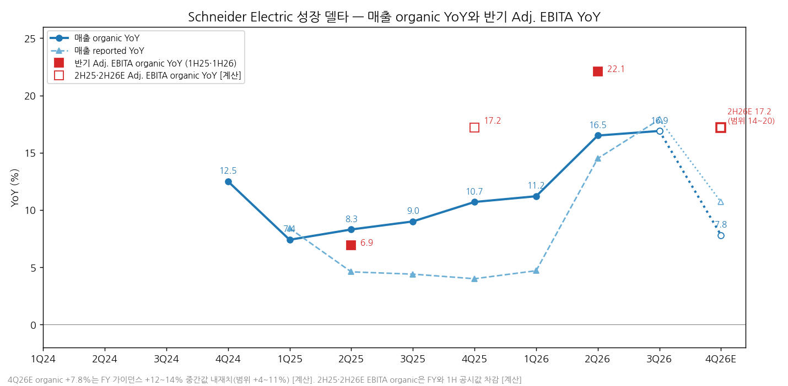
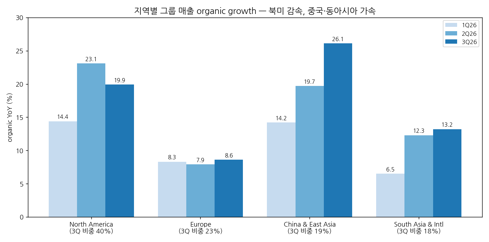
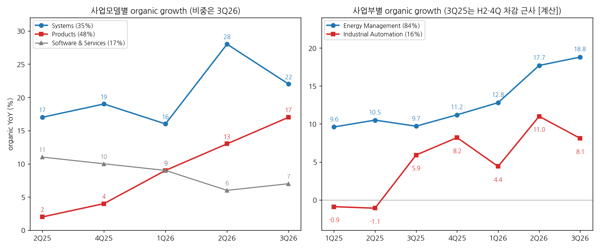

> 모드: 실적 리뷰 (v11)
> 종목: Schneider Electric SE (SU, Euronext Paris)
> 섹터: 전력 인프라
> 서브섹터: 배전·DC 전력관리
> 분기: 2026-Q3
> 발표일: 2026-10-16 (Q3 Revenues 보도자료·프레젠테이션 + 컨퍼런스콜, 매출만 발표)
> 작성 시각: 2026-11-03 13:30 KST
> 분석 소스: 회사 자료 — Q3 2026 Revenues release·presentation·콜 트랜스크립트(LSEG, 10/16), H1 2026 Results release(7/30), FY2025 Results release(2/26, AMF), H1 2025 release(AMF), Q1 2026 release(첨부). 셀사이드 첨부 1개 — NH투자증권(이민재, 10/19, FactSet 컨센 인용). 웹서치 보완(10/5~11/3) — 컨센 대비(Agefi-Dow Jones via ABC Bourse, Tiger/Deep News), 해외 IB 등급·TP(J.P. Morgan·RBC·Jefferies·Deutsche Bank·Panmure Liberum·Bernstein·Vertical Research, 기사 인용이며 원문 리포트 미확인), PTC 인수·증자(ABC Bourse·Meilleurtaux·Finimize). 4번 (3)항의 중간선거·FERC 데이터는 2026-Q3 효성중공업 리뷰(Axios 10/31·Forbes 11/2·Ballotpedia 11/2·대신증권) 재사용. 직전 분기는 2026-Q1 리뷰 + 2026-Q2 팔로업 기준 (2Q26 리뷰 미작성). 기업개요(Scheduled 폴더)는 접근 권한 거부 → 작업 폴더 사본 `company-overview/SU_기업개요.md` 참조

# Schneider Electric 3Q26 실적 리뷰 — organic +16.9%, 데이터센터 수주 세 자릿수와 가이던스 2차 상향, 주가는 PTC 인수에 묶였다

> 성장 델타: 유지 | 내러티브: 유지 → 델타 유지(고원 상단) + 내러티브 유지 → 관망 구간 (펀더멘털은 강하나 PTC 인수 오버행으로 주가 모멘텀 부재)

→ **판정 기준 (스킬 기본값과 다름)**: Schneider는 1Q·3Q에 매출만 발표하고 이익은 반기(1H·FY)에만 공시한다. 그래서 이번 분기 델타는 "영업이익 미공시 분기 → 매출 organic growth와 연간 adj. EBITA margin 가이던스 변화 기준"으로 판정한다. 근거: 분기 영업이익 YoY가 없는 상태에서 스킬 기본 기준(영업이익 YoY)을 그대로 쓰면 판정 자체가 불가능하고, 회사가 분기마다 갱신하는 연간 마진 가이던스가 이익 방향의 유일한 공식 신호다
→ **숫자**: 매출 €11,460M(reported +17.9%, organic +16.9%)으로 분기 최대다. organic YoY는 2Q26 +16.5%에서 +0.4%p 올라 ±5%p 안이다(유지). 컨센(€11,130M, organic +13.8%) 대비 매출 +3.0%, organic +3.1%p 서프라이즈다. 연간 adj. EBITA margin 가이던스는 19.4~19.7%에서 19.7~19.9%로 두 번째 상향됐다
→ **쟁점 ①**: 데이터센터 수주가 최근 4개 분기 중 3개 분기에서 세 자릿수 증가했고, 회사는 2027~28년 매출 가시성을 언급했다. 다만 북미 organic은 +23.1%에서 +19.9%로 감속했고, 중국·동아시아(+26.1%)가 빈자리를 채웠다
→ **쟁점 ②**: 가이던스(연 +12~14%)는 4Q26 organic +4~11%(중간 +7.8%)를 내재한다 [계산]. 회사는 "4Q25가 역대 1~3위 분기라 기저가 높다"고 설명했다. 가격 효과(3Q 제품 가격 인상분 ≈ 1H 전체 규모)가 organic의 약 3%p를 차지한다 [계산]
→ **쟁점 ③**: 10/5 PTC 인수(EV $23.7B) 발표 후 주가는 약 €304에서 €240으로 -21%다. J.P. Morgan은 OW → Neutral(TP €345 → €310)로 내렸고, €6B 증자(주당 €240, 희석 약 4%)와 자사주 매입 2027~28년 중단이 겹쳤다. 이익 추정은 오르는데 멀티플이 내려가는 구간이다
→ **다음 분기 관건**: 2027-02-18 FY26 발표에서 4Q organic +8% 이상, 2H26 adj. EBITA margin 20.3% 이상(가이던스 내재 중간값) 그리고 2027년 가이던스가 델타를 결정한다. 11/3 중간선거부터 12월 FERC·ERCOT 결론까지는 그룹 매출의 최소 13%로 추정되는 북미 데이터센터 매출의 할인율을 정하는 구간이다

---

## 1. 숫자

① 분기 매출 표 (단위: €M, %)

| 항목 | 1Q24 | 2Q24 | 3Q24 | 4Q24 | 1Q25 | 2Q25 | 3Q25 | 4Q25 | 1Q26 | 2Q26 | **3Q26** | 4Q26E |
|---|---|---|---|---|---|---|---|---|---|---|---|---|
| 매출액 | 8,602 | 9,571 | 9,311 | 10,669 | 9,325 | 10,011 | 9,721 | 11,095 | 9,767 | 11,459 | **11,460** | 12,286 |
| 매출 YoY (reported) | — | — | — | — | +8.4 | +4.6 | +4.4 | +4.0 | +4.7 | +14.5 | **+17.9** | +10.7 |
| 매출 YoY (organic) | — | — | — | +12.5 | +7.4 | +8.3 | +9.0 | +10.7 | +11.2 | +16.5 | **+16.9** | +7.8 (4~11) |
| **organic YoY 델타 (%p)** | — | — | — | — | -5.1 | +0.9 | +0.7 | +1.7 | +0.5 | +5.3 | **+0.4** | -9.1 |
| **reported YoY 델타 (%p)** | — | — | — | — | — | -3.8 | -0.2 | -0.4 | +0.7 | +9.8 | **+3.4** | -7.2 |
| FX 효과 | — | — | — | — | — | -4.6 | — | -6.6 | -6.7 | -1.2 | **+1.2** | +2~3 [계산] |
| Scope(M&A) 효과 | — | — | — | — | — | +1.4 | — | +0.6 | +1.1 | -0.6 | **-0.4** | — |
| 영업이익 (adj. EBITA) | 미공시 (분기) | | | | | | | | | | | |

→ (출처: Schneider 각 분기 release. 1Q24·2Q24·3Q24 매출은 1Q25·2Q25·3Q26 보고 성장률 역산 [계산], 3Q25 organic +9.0%는 언론 보도치. 4Q26E는 10/16 가이던스 중간값 내재치 [계산] — FY 매출 = FY25 €40,152M × (1+13% organic) + FX -€350M + scope -€50M = €44,972M, 9M 누적 €32,686M 차감. organic 범위 4~11%는 가이던스 하단 12%·상단 14% 각각의 내재치)
→ 3Q26 서프라이즈: 매출 컨센 대비 +3.0%, organic +3.1%p (컨센 €11,130M·organic +13.8%, 회사 제공 컨센, Agefi-Dow Jones 인용). Energy Management도 €9,615M vs 컨센 €9,300M(+3.4%), organic +18.8% vs +15.1% (Deep News 10/16)
→ organic YoY는 1Q25 +7.4%를 바닥으로 6개 분기 연속 올라 3Q26 +16.9%가 2024년 이후 최고다. 2Q26에서 +5.3%p 뛴 뒤 3Q26은 +0.4%p로 고원에 들어섰다
→ 가이던스 경로상 YoY 정점은 3Q26이다. 4Q26은 기저(4Q25 organic +10.7%, 매출 €11,095M)가 높아 organic이 한 자릿수로 내려오는 것이 가이던스의 기본값이다 (2-2 쟁점 (2))
→ FX는 1Q26 -6.7%에서 3Q26 +1.2%(+€114M, 위안·달러 강세)로 돌아섰다. 3Q에는 EUR 강세가 아니라 EUR 약세(위안·달러 대비)가 reported를 1.2%p 밀어 올렸다. 9M 누적 FX는 -2.2%, FY 추정은 -€300~400M(7/30 추정보다 축소)이다. Motivair는 2Q26부터 organic 기준에 편입돼 3Q scope는 소규모 매각만 반영(-€36M)됐다

② 반기 Adj. EBITA 표 (단위: €M, %)

| 항목 | 1H24 | 2H24 | 1H25 | 2H25 | **1H26** | 2H26E | FY26E (가이던스) |
|---|---|---|---|---|---|---|---|
| 매출액 | 18,173 | 19,980 | 19,336 | 20,816 | **21,226** | 23,746 | 44,972 |
| Adj. EBITA | 3,383 | 3,700 | 3,510 | 4,010 | **4,093** | 4,811 | 8,904 |
| Adj. EBITA margin | 18.6 | 18.5 | 18.2 | 19.3 | **19.3** | 20.3 (20.1~20.4) | 19.8 (19.7~19.9) |
| 매출 YoY (reported / organic) | — | — | +6.4 / +7.9 | +4.2 / +9.9 | **+9.8 / +14.0** | +14.1 / +12.0 | +12.0 / +13 |
| Adj. EBITA YoY (reported / organic) | — | — | +3.8 / +6.9 | +8.4 / +17.2 | **+16.6 / +22.1** | +20.0 / +17.2 (14~20) | +18.4 / +19.5 (18~21) |
| **EBITA organic YoY 델타 (%p)** | — | — | — | +10.3 | **+4.9** | -4.9 | |
| margin YoY (organic, bp) | — | — | -10 | +120 | **+120** | +80~120 [계산] | +100~120 |

→ (출처: H1 2025·FY2025·H1 2026 release. 2H25 EBITA organic +17.2%는 FY25 organic +12.3%와 1H25 +6.9%에서 역산 [계산]. 2H26E는 10/16 가이던스 중간값 내재치 [계산]: FY EBITA = €44,972M × 19.8%, 1H26 차감. 괄호는 가이던스 하단·상단 기준 범위)
→ 연간 가이던스 경로: 2/26 매출 organic +7~10%·margin 19.1~19.4% → 4/30 유지 → 7/30 +10~13%·19.4~19.7% → 10/16 **+12~14%·19.7~19.9%**. 두 번 연속 상향이고, EBITA organic 성장 가이던스는 +10~15%에서 +18~21%로 올라갔다
→ 가이던스가 내재한 2H26 margin은 약 20.3%로 2H25(19.3%) 대비 +1.0%p다. 2H26 EBITA organic YoY는 약 +17%로 1H26(+22.1%)보다 낮다. 1H에 있던 관세 환급 등 일회성과 2H의 높은 생산성 기저(회사가 7/30에 언급)를 감안한 보수적 수치로 본다 [판단]
→ **[판단] 델타 = 유지**: 판정 기준(매출 organic YoY + 연간 margin 가이던스 변화)으로 organic YoY +0.4%p(±5%p 이내), 연간 margin 가이던스 중간값 +0.25%p 상향이다. 레벨은 2024년 이후 최고라 "고원 상단의 유지"다. 4Q26 organic이 가이던스 하단(+4%)까지 내려가고 2027년 가이던스가 한 자릿수 초중반이면 "둔화"로 바뀐다

→ (출처: Schneider 분기·반기 release. 4Q26E 막대와 2H26E 마진 점은 가이던스 중간값 내재치 [계산], 점선)

→ (출처: 동일. 빈 사각형은 FY·1H 공시값 차감으로 구한 반기 EBITA organic YoY [계산])

③ 사업부·지역·사업모델별 매출 (단위: €M, %)

(1) 사업부별

| 사업부 | 항목 | 1Q25 | 2Q25 | 3Q25 | 4Q25 | 1Q26 | 2Q26 | **3Q26** |
|---|---|---|---|---|---|---|---|---|
| Energy Management | 매출 | 7,570 | 8,322 | 8,039 | 9,199 | 8,047 | 9,594 | **9,615** |
| Energy Management | organic YoY | +9.6 | +10.5 | +9.7 | +11.2 | +12.8 | +17.7 | **+18.8** |
| Energy Management | 매출 비중 | 81 | 83 | 83 | 83 | 82 | 84 | **84** |
| Industrial Automation | 매출 | 1,755 | 1,689 | 1,682 | 1,896 | 1,720 | 1,865 | **1,845** |
| Industrial Automation | organic YoY | -0.9 | -1.1 | +5.9 | +8.2 | +4.4 | +11.0 | **+8.1** |

→ (출처: 각 분기 release. 1Q25·3Q25 매출은 1Q26·3Q26 보고 성장률 역산, 3Q25 organic은 H2·4Q25 공시값 차감 근사 [계산])
→ 사업부 adj. EBITA (반기, 공시): Energy Management 1H25 €3,412M(21.5%) → 2H25 €3,823M(22.2%) → 1H26 €3,957M(22.4%). Industrial Automation 1H25 €471M(13.7%) → 2H25 €523M(14.6%) → 1H26 €501M(14.0%). 3Q 분기 사업부 이익은 미공시
→ 델타를 끄는 것은 Energy Management다(+12.8% → +17.7% → +18.8%, 그룹 매출의 84%). Industrial Automation은 2Q 정점(+11.0%) 후 +8.1%로 감속했다. Process & Hybrid가 중국 약세로 줄었고 Discrete가 버텼다

(2) 지역별 (그룹)

| 지역 | 3Q26 매출 | 비중 | 1Q26 organic | 2Q26 organic | **3Q26 organic** | 3Q26 EM organic | 9M organic |
|---|---|---|---|---|---|---|---|
| North America | 4,637 | 40 | +14.4 | +23.1 | **+19.9** | +20.3 | +19.4 |
| Europe | 2,646 | 23 | +8.3 | +7.9 | **+8.6** | +9.2 | +8.2 |
| China & East Asia | 2,153 | 19 | +14.2 | +19.7 | **+26.1** | +32.4 | +20.2 |
| South Asia & International | 2,024 | 18 | +6.5 | +12.3 | **+13.2** | +16.0 | +10.8 |
| 합계 | 11,460 | 100 | +11.2 | +16.5 | **+16.9** | +18.8 | +15.0 |

→ (출처: Q1·H1·Q3 2026 release. 2026년부터 지역 구분이 바뀌어(Western Europe·Asia Pacific·RoW → Europe·China & East Asia·South Asia & International) 2025년 지역 수치와 직접 비교는 북미만 가능하다. 북미 organic: 2Q25 +12.5%, 4Q25 +17.8%)
→ **북미 organic은 2Q26 +23.1% → 3Q26 +19.9%로 3.2%p 감속**했다. 북미 EM도 +24.8% → +20.3%다. 미국 데이터센터(조립식 솔루션·냉각)는 여전히 강했지만 Industry·Infrastructure가 감소했다
→ **중국·동아시아 EM은 +19.7% → +32.4%로 가속**했다. 중국 AI 인프라(데이터센터·반도체)와 말레이시아·태국·인도네시아 데이터센터 프로젝트, 한국·대만 반도체가 이끌었다. 3Q 그룹 성장의 가속분은 북미가 아니라 아시아에서 나왔다

→ (출처: Q1·H1·Q3 2026 release)

(3) 사업모델별 — Systems vs Products, 가격 효과

| 사업모델 | 3Q26 비중 | 2Q25 | 4Q25 | 1Q26 | 2Q26 | **3Q26** |
|---|---|---|---|---|---|---|
| Products | 48 | +2 | +4 | +9 | +13 | **+17** |
| Systems | 35 | +17 | +19 | +16 | +28 | **+22** |
| Software & Services | 17 | +11 | +10 | +9 | +6 | **+7** |

→ (출처: 각 분기 release, organic YoY %)
→ Systems(데이터센터 조립식 솔루션·3상 UPS·냉각 + 그리드)는 +28% → +22%로 낮아졌고, Products가 +13% → +17%로 올라 자리를 바꿨다. CFO는 "3Q 제품 가격 인상액이 1H 전체와 같은 수준"이라고 했다. 1H 제품 gross pricing은 +€280M이었다(H1 release)
→ 가격 분해 [계산 근사]: 3Q 제품 가격 효과 약 €280M은 3Q25 매출(€9,721M)의 약 2.9%다. organic +16.9% 중 약 3%p가 가격, 나머지 약 14%p가 물량·믹스다. Products만 보면 +17% 중 약 6%p가 가격이다(3Q25 Products 매출 약 €4.7B 기준)
→ 데이터센터: 순수 데이터센터 수요(수주)는 4Q25·2Q26·3Q26 세 자릿수 증가, 매출은 "strong double-digit"이다. 데이터센터 매출 비중은 FY25 기준 DC&N 30%, 순수 데이터센터 약 26%(CFO, 콜)다. NH는 2026년 데이터센터 비중이 30%를 넘을 것으로 본다

→ (출처: 각 분기 release. 3Q25 사업부 organic은 근사 [계산])

④ 연간 (단위: €M, %)

| 항목 | 2024 | 2025 | 2026E (가이던스 중간) | 2027F (NH·FactSet) |
|---|---|---|---|---|
| 매출액 | 38,153 | 40,152 | 44,972 | 49,972 |
| Adj. EBITA | 7,083 | 7,520 | 8,904 | 9,945 (영업이익, 정의 상이) |
| Adj. EBITA margin | 18.6 | 18.7 | 19.8 | 19.9 |
| 매출 YoY (reported / organic) | — | +5.2 / +8.9 | +12.0 / +13 | +11.1 / — |
| EBITA YoY (reported / organic) | — | +6.2 / +12.3 | +18.4 / +19.5 | +18.2 (NH 영업이익 기준) |

→ (출처: FY2025 release, 10/16 가이던스 [계산], NH투자증권 10/19 (FactSet). NH 2026E 매출 €44,996M은 가이던스 중간값 내재치 €44,972M과 거의 같다)
→ 발표 전 → 후 연간 컨센 변화: 집계 데이터 미확보(첨부 셀사이드 1개, 웹에서도 미확인). RBC가 10/26 2026~28년 매출·EBITA 추정을 상향(PTC 포함)한 것만 확인됐다
→ 데이터 주의: NH 리포트의 반기 표(1H25 21,147, 1H26 24,757 등, "백만유로" 표기)는 회사 공시(1H25 €19,336M, 1H26 €21,226M) 대비 1.09~1.17배다. 달러 환산 수치로 보여 [추정] 본 리뷰에서는 쓰지 않았다

---

## 2. 시장 쟁점

① 지난 분기 체크 (2026-Q2 팔로업의 "봐야 할 것" 5개 기준. 2Q26 리뷰는 미작성 — 7/30 H1 발표분은 이번 리뷰에서 함께 확인)

| 직전 팔로업 항목 | 결과 (H1 7/30 ~ 3Q 10/16) | 판정 |
|---|---|---|
| (1) H1에서 FY26 가이던스 상향 여부 | 7/30 매출 +7~10% → +10~13%, margin 19.1~19.4% → 19.4~19.7%. 10/16 다시 +12~14%·19.7~19.9%. 1H26 margin 19.3%(+120bp organic) | 확인 (2회 상향) |
| (2) 데이터센터 Systems +15%+ 지속, Motivair 기여 | Systems 2Q +28%·3Q +22%. 데이터센터 수요 2Q·3Q 세 자릿수. 액체냉각 capa를 북미 → 인도·이탈리아·중국으로 확대. Motivair 매출액은 미공시 | 확인 (Motivair 금액은 미확인) |
| (3) 이탈리아 SF6-free GIS 모멘텀 | 3Q 이탈리아 EM mid-single digit(Infrastructure 주도), Infrastructure 매출에 SF6-free 스위치기어 기여 명시. HD현대일렉트릭 유럽 수주는 범위 밖 | 부분 확인 |
| (4) 한국 반도체 CAPEX 수요 | 3Q "한국·대만 성장은 반도체 세그먼트가 주도"(EM), 일본 반도체도 IA 성장 기여 | 확인 |
| (5) 중동 영향 확대 여부 | 2Q 중동 mid-single digit 성장, 3Q double-digit 성장. 다만 4Q 가이던스에 "중동 혼란이 4Q에 영향 가능" 명시 | 반대로 나옴 (우려 미현실화, 4Q 리스크로 이월) |

② 이번 분기 쟁점 5개

| # | 쟁점 | 언급 소스 수 |
|---|---|---|
| (1) | 데이터센터 세 자릿수 수주는 언제 매출이 되고, capa는 따라가나 — 북미 감속을 어떻게 볼까 | 4 (NH, UBS·Bernstein·Morgan Stanley 콜 질문) |
| (2) | 가이던스가 내재한 4Q 감속(+4~11%)은 보수성인가 기저인가 | 2 (Oddo 콜 질문, 회사 설명) |
| (3) | 가격 인상이 마진을 얼마나 밀어 올리나 — 2027년에도 이어지나 | 3 (NH, UBS·BofA 콜 질문) |
| (4) | 중국·동아시아 +26%는 지속 가능한가 | 3 (NH, Redburn·Oxcap 콜 질문) |
| (5) | PTC 인수는 멀티플을 얼마나 깎나 — 실적 상향 vs 멀티플 하향 | 7+ (JPM·RBC·Jefferies·Berenberg·Deutsche Bank·Panmure·Vertical, 웹 기사) |

→ 셀사이드 첨부가 NH 1개라, 쟁점은 컨콜 Q&A(애널리스트 8명의 질문)와 웹서치 IB 코멘트로 구성했다 (미국 기업 적용 규칙 준용). 해외 IB 코멘트는 기사 인용이며 원문은 확인하지 못했다

③ 쟁점별 분해

(1) 데이터센터 — 세 자릿수 수주의 매출 전환과 북미 감속

(1-1) 회사 설명 (10/16 콜·release)
→ 데이터센터 수요는 3Q에도 세 자릿수 증가했고 "2027·2028년 가시성이 커지고 있다". 수요는 북미가 주도하고 중국·동아시아가 비슷한 속도로 가속했다. 하이퍼스케일·코로케이션·네오클라우드·엣지에 고르게 분포한다 (release)
→ 수주의 매출 전환 시점(backlog phasing)은 공개하지 않는다. "상당 부분이 2027·2028년으로 넘어간다". capa는 지역 허브별로 계속 늘리고 있으며, 액체냉각은 북미에서 인도·이탈리아·중국으로, 조립식(prefab)은 Foxconn 같은 파트너와 함께 확장한다 (CFO, UBS 질문)
→ 데이터센터 비중은 FY25 기준 DC&N 30%, 순수 데이터센터는 그보다 약 4%p 낮다. 연말에는 비중이 올라갈 것이다. 고객 유형별(하이퍼스케일러·네오클라우드) 분해는 하지 않으며, 네오클라우드 과다 노출은 없다 (CFO·CEO, Morgan Stanley 질문)
→ 조립식 솔루션은 4개 분기 연속 데이터센터 성장 1위 동력이다. 비중은 공개하지 않는다 (CFO, Bernstein 질문)

(1-2) 증권사·애널리스트별 시각

| 소스 | 핵심 가정·질문 | 논리 |
|---|---|---|
| NH투자증권 (10/19) | 2026년 데이터센터 비중 > 30%, 현재 수주 대부분 2028년까지 매출 전환 | 북미 중심 + 중국·인도·유럽 capa 확대, 액체냉각·조립식으로 영역 확장. 이튼과 함께 해외 전력기기 최선호주 |
| UBS (콜) | 세 자릿수 수주를 소화할 capa가 충분한가 | 수주-매출 전환 속도와 capa 병목을 의심 |
| Morgan Stanley (콜) | 하이퍼스케일러·네오클라우드별 노출, 회사채 금리 급등 뉴스와 연결 | AI 고객 신용 리스크 점검 |
| Bernstein (콜) | 조립식 비중·리드타임·마진 | 조립식이 Systems 마진에 accretive한지 |

(1-3) 공통 결론 vs 갈리는 지점
→ 공통: 수요(수주)는 의심받지 않는다. 질문은 모두 "전환 속도(capa)"와 "고객 질(신용)"에 몰려 있다
→ 갈림: 매출로의 전환 속도다. 회사는 phasing을 숨기고, 3Q 북미 organic은 +23.1%에서 +19.9%로 내려왔다. 수주 세 자릿수와 매출 +20%의 간극이 커지고 있다

(1-4) **[판단]**
→ 3Q Systems가 +28%에서 +22%로, 북미 EM이 +24.8%에서 +20.3%로 내려온 것은 수요 둔화가 아니라 capa·인도 일정의 문제로 보는 편이 숫자와 맞다. 같은 분기 수요는 세 자릿수였고 FY25 말 backlog는 €25.4B(+18%)로 사상 최대였다(이후 분기마다 "record backlog" 언급, 금액은 반기에만 공시)
→ 그렇다면 2027년 매출 성장은 수주가 아니라 capa 증설 속도가 정한다. 효성중공업·LS일렉트릭 리뷰와 같은 구조다
→ 결론이 바뀌는 조건: 4Q26에도 북미 organic이 +15% 아래로 내려가는데 데이터센터 수요 증가율까지 세 자릿수 아래로 떨어지면 "수요 정점" 해석으로 바뀐다

(2) 4Q 감속 내재 — 보수성인가 기저인가

(2-1) 회사 설명 (CFO, Oddo 질문)
→ 가이던스를 두 번째로 올리면서 범위를 좁혔다(상단 기준 연초 10% → 14%). 이는 자신감과 가시성의 표시다
→ 4Q25는 Schneider 역사상 최고 또는 세 번째로 강한 분기라 기저가 높다. 여러 시나리오를 반영했다
→ 4Q 기대 트렌드: Systems가 성장을 주도하고, 4개 지역 모두 성장(미국·중국·인도 주도). 다만 "중동 혼란이 4Q에 영향을 줄 수 있다" (release)

(2-2) 해석 편차

| 소스 | 4Q 가정 | 논리 |
|---|---|---|
| 가이던스 내재 [계산] | organic +4~11%, 중간 +7.8% | 9M +15.0%(€29,057M 기저) + 4Q(€11,095M 기저) = FY +12~14% |
| Oddo (콜) | "기계적으로 4Q 감속을 내재한다" | 보수성인지 기저인지 질문 |
| NH (10/19) | 2026E 매출 €44,996M (FactSet) | 가이던스 중간값과 일치 — 컨센도 4Q 한 자릿수 후반을 받아들이고 있다 [판단] |

(2-3) 공통 결론 vs 갈리는 지점
→ 공통: 4Q organic은 3Q(+16.9%)보다 크게 낮아진다. 기저가 높다는 점에는 이견이 없다
→ 갈림: 하단(+4%)에 가까울지 상단(+11%)에 가까울지다. 회사는 2025년에도 1Q 유지 → 2Q·3Q 상향 패턴을 보였다

(2-4) **[판단]**
→ 4Q25 기저(organic +10.7%)는 3Q25(+9.0%)보다 1.7%p 높을 뿐이다. 3Q26 +16.9%에서 기저 효과만 빼면 4Q는 +15% 안팎이 자연스럽다. 가이던스 중간값 +7.8%는 기저로 설명되는 폭(약 2%p)보다 훨씬 보수적이다
→ 4Q에는 FX가 +2~3%로 돌아서고(FY FX -€300~400M vs 9M 약 -€640M [계산]) 가격 효과도 커진다. 따라서 4Q reported 매출은 €12.3B(가이던스 중간)를 넘을 가능성이 높다 [판단]
→ 결론이 바뀌는 조건: 중동 혼란이 공급망에 번져 4Q organic이 +8% 아래로 내려오면, "보수적 가이던스" 해석이 틀리고 델타는 "둔화"가 된다

(3) 가격 인상과 마진 — 2027년에도 이어지나

(3-1) 회사 설명 (CFO, UBS·BofA 질문)
→ 3Q 제품 가격 인상액은 1H 전체와 같은 수준이다. 1월(구리·은) 인상이 풀 런레이트에 들어갔고, 4월(중동 분쟁에 따른 유가·플라스틱) 추가 인상이 올라오고 있다
→ 다음 파동은 반도체·메모리·구리다. 2027년 가이던스는 주지 않았지만 "인플레이션 압력이 2027년에 오면 가격 근육을 쓸 것"이다
→ FY26 가격 인상으로 원자재 인플레이션과 순관세 영향을 금액 기준으로 상쇄할 것이다. 생산성·영업레버리지가 margin에 기여한다 (release)

(3-2) 해석 편차

| 소스 | 가정 | 논리 |
|---|---|---|
| NH (10/19) | 3Q 가격 인상은 상반기와 같은 수준, 2027년 추가 인상 가능성 높음 | 하반기 반도체·메모리·구리 원가 부담 |
| BofA (콜) | 고객이 추가 인상을 받아들이나 | 데이터상 한 번 더 인상이 필요해 보인다는 시각 |
| 1H26 실적 (회사) | 1H 순가격 효과 -€154M (gross pricing +€280M, 원자재 -€330M, 순관세 -€104M) | 1H에는 가격이 원가를 따라가지 못했다 |

(3-3) 공통 결론 vs 갈리는 지점
→ 공통: 2H에 가격이 원가를 따라잡고 2027년에도 인상이 이어진다
→ 갈림: 가격이 순(net)으로 플러스 기여하느냐다. 1H는 gross pricing이 있었는데도 순가격 -€154M이었다

(3-4) **[판단]**
→ 3Q 가격 인상 약 €280M만으로도 1H 6개월치와 같다. 2H 전체로 €500M+ 가격 인상이 들어오면 1H의 순가격 마이너스(-€154M)는 2H에 플러스로 바뀐다 [추정]. 가이던스가 내재한 2H margin +1.0%p(19.3% → 20.3%)는 이 효과만으로도 상당 부분 설명된다
→ 다만 organic +16.9% 중 약 3%p가 가격이라, 물량 성장률은 headline보다 낮다(약 14%) [계산 근사]. 2027년에 원자재가 꺾이면 가격 효과는 매출과 마진 양쪽에서 빠진다
→ 결론이 바뀌는 조건: FY26 발표(2/18)에서 2H 순가격 효과가 여전히 마이너스이거나, 2027년 margin 가이던스 확장 폭이 +50bp 아래면 "가격 주도 마진 개선" 해석이 약해진다

(4) 중국·동아시아 +26% — 지속 가능한가

(4-1) 회사 설명 (CFO·CEO, Redburn·Oxcap 질문)
→ 중국은 3Q +26%(9M +20%)로 3개 분기 연속 강하다. 성장의 대부분은 데이터센터와 반도체다. 중국에서는 패널 빌더·장비 제조사에 파는 제품 중심 모델이고, 최대 파트너 네트워크를 갖고 있다
→ 알리바바·텐센트 같은 대형 고객도 시스템 통합사·패널 빌더를 통해 발주하므로 고객 집중도가 낮다. 3주 전 중국 방문에서 확인한 바로는 "이 성장률이 최소 2027년까지 이어질 수 있다". 건물·주거는 여전히 약하다
→ 4Q 성장 주도 국가에 중국을 미국·인도와 함께 추가했다

(4-2) 해석 편차

| 소스 | 가정 | 논리 |
|---|---|---|
| NH (10/19) | 중국 3개 분기 누적 성장률 20%, 내년에도 지속 | 정부 주도 하이퍼스케일 데이터센터 건설 + 반도체 투자 |
| Redburn (콜) | 중국 데이터센터는 북미와 같은 성격인가, 로컬 부품을 선호하지 않나 | 점유율 지속성 의문 |
| Oxcap (콜) | 소수 대형 고객 집중인가, 2027년 고객 대화는 | 집중 리스크 |

(4-3) 공통 결론 vs 갈리는 지점
→ 공통: 3Q 그룹 성장 가속분은 중국·동아시아에서 나왔다
→ 갈림: 로컬 경쟁사 대체 리스크와 지정학이다. 회사는 패널 빌더 채널을 해자로 보지만, 애널리스트는 로컬 부품 선호를 묻는다

(4-4) **[판단]**
→ 3Q 그룹 organic이 2Q보다 0.4%p 오른 것은 북미(-3.2%p)를 중국·동아시아(+6.4%p)가 메운 결과다. 모멘텀 트레이더 관점에서 성장의 질은 2Q보다 약간 낮아졌다. 북미 데이터센터는 계약·backlog 기반이고, 중국은 채널 제품 기반이라 변동성이 더 크다
→ 중국·동아시아 매출 비중은 3Q 19%다. 기업개요에서 "중국 매출 비중 25%+ 상승 시 분류 재검토"로 정한 임계에 다가가고 있다(지역 정의는 중국·동아시아 합산이라 직접 비교는 아님)
→ 결론이 바뀌는 조건: 4Q에 중국·동아시아가 +15% 아래로 꺾이면서 북미도 회복하지 않으면 그룹 organic은 가이던스 하단으로 간다

(5) PTC 인수 — 실적 상향 vs 멀티플 하향

(5-1) 회사 설명 (release, CEO)
→ 10/5 PTC 인수 확정 계약: 주당 $205 현금(10/2 종가 대비 +42.3% 프리미엄), equity $22.6B·EV $23.7B. 3년차 비용 시너지 €250M, 매출 시너지 약 €800M. 완전 연결 첫해 adj. EPS(PPA 전) low single-digit accretive, 시너지 반영 시 mid~high single-digit. 종결 목표 2027년 3Q
→ 자금: 10/20 신주 2,500만주(자본의 4.32%)를 주당 €240에 €6B 조달(10/19 종가 대비 -4.99%, 인수 발표 전 대비 -21%), 10/28 €6B 회사채 발행. S&P·Moody's는 A 등급 유지(10/6). 자사주 매입(€2.5~3.5B, 2030년까지)은 2027~28년 중단 후 재개한다
→ 9/24 Shelly(€1.2B)도 인수 합의, 2027년 1Q 종결 예정

(5-2) 증권사별 해석 편차 (웹 기사 인용, 원문 미확인)

| 증권사 | 등급·TP | 논리 |
|---|---|---|
| J.P. Morgan (10/6) | OW → **Neutral**, €345 → **€310** | PTC가 멀티플을 누른다. 같은 날 Legrand 선호. 다만 비용 시너지는 신뢰할 만하다 |
| Vertical Research (10월 초) | **Hold**, €265 | PTC 이후 보유로 하향 |
| Jefferies (10/8) | Buy, €289 → **€323** | AI 파괴 우려로 소프트웨어 가치가 10년 내 최저일 때 산다. 단 같은 리스크가 인수 후에도 주가를 누를 수 있다 |
| Berenberg | (등급 기사 미확인) | 인수 금액은 합리적, 소프트웨어 투자심리는 취약 |
| Deutsche Bank (10/19) | Buy, **€320** | 3Q 기대 상회와 연간 가이던스 상향 |
| Panmure Liberum (10/16) | Buy, **€330** | 매수 유지 |
| Bernstein (10/16) | Outperform 유지 (TP 기사 미확인) | 매수 유지 |
| RBC (10/26) | Outperform, **€320 유지** | 인수 발표 후 약 25% 하락은 "정당화되지 않는다". 2026~28 매출·EBITA 추정 상향(PTC 포함). 쟁점은 금융비용 후 ROIC > WACC 여부 |
| NH투자증권 (10/19) | 등급·TP 미제시 (FactSet 컨센 TP €332.7, Buy 22·Hold 4·Sell 0) | 북미 데이터센터 불확실성으로 국내 전력기기와 함께 밸류에이션 하락, 이튼과 함께 최선호주 |

(5-3) 공통 결론 vs 갈리는 지점
→ 공통: PTC가 실적 추정을 깎지는 않는다(EPS accretive, RBC 추정 상향). 문제는 멀티플이다. "전력·데이터센터 하드웨어" 프리미엄에 "AI 파괴 리스크가 있는 소프트웨어"가 섞인다
→ 갈림: 하락이 과도한가다. RBC·Jefferies·DB·Panmure는 과도하다고, JPM·Vertical은 멀티플 재평가가 정당하다고 본다

(5-4) **[판단]**
→ 이번 주가 하락은 **실적 하향이 아니라 멀티플 하향**이다. 가이던스는 두 번 올랐고 3Q는 컨센을 넘었는데, 주가는 인수 발표 전 약 €304에서 €240으로 -21%다 [계산: 증자가 €240 = 발표 전 대비 -21%]. NH(FactSet) 2026E EPS €10.3 기준 PER은 24.7배(10/16, €253.3)에서 약 23.3배(€240)로 내려왔다 [계산]
→ 오버행은 세 겹이다: (가) 자금조달(증자는 끝났지만 최대 $17B 부채 조달 중 일부 남음) (나) 자사주 매입 2년 중단 (다) 종결까지 1년 가까운 규제 일정. 이 기간에는 데이터센터 숫자가 좋아도 멀티플이 쉽게 돌아오지 않는다 [판단]
→ 결론이 바뀌는 조건: 증자가 €240 아래로 무너지지 않고 PTC 주주총회·규제 승인이 순조로우면, 2/18 FY26 발표에서 2027년 가이던스가 재평가의 계기가 된다. 반대로 추가 증자나 등급 하향(A 유지 실패)이 나오면 멀티플은 더 내려간다

④ 낙관 vs 보수 — 논리 대비
→ **가장 낙관 (Panmure Liberum €330, Jefferies €323, RBC·DB €320)**: 가이던스 2회 상향과 데이터센터 2027~28 가시성을 이익 상향의 근거로 보고, PTC는 산업 소프트웨어 저점 매수로 본다. 멀티플은 인수 전 수준으로 돌아온다고 가정한다
→ **가장 보수 (Vertical Research Hold €265, J.P. Morgan Neutral €310)**: 이익 전망을 크게 바꾸지 않고도, 소프트웨어 편입과 레버리지로 적용 멀티플을 낮췄다. JPM은 같은 섹터에서 Legrand를 선호해 "전력 순수성"에 프리미엄을 준다
→ 셀사이드 vs 시장: FactSet 기준 Buy 22·Hold 4·Sell 0, 평균 TP €329~333로 현재가(€240) 대비 +37~39% 상승여력이다. 셀사이드는 이익을 보고, 시장은 자본배분을 벌하고 있다. 10/16 발표 당일 컨센을 넘었는데도 주가는 -4%(€264.4 → 약 €253)였다

⑤ 추정치·TP 변화 (단위: €)

| 증권사 | 직전 TP | 현재 TP | 4Q26 매출 E | 2026 / 2027 이익 E | 핵심 변화 한 줄 |
|---|---|---|---|---|---|
| J.P. Morgan (10/6) | 345 | 310 (-10.1%) | 미확인 | 미확인 | OW → Neutral, PTC 멀티플 부담 |
| Jefferies (10/8) | 289 | 323 (+11.8%) | 미확인 | 미확인 | Buy 유지, 소프트웨어 저점 인수 |
| Vertical Research (10월 초) | 미확인 | 265 | 미확인 | 미확인 | Hold로 하향 |
| Panmure Liberum (10/16) | 미확인 | 330 | 미확인 | 미확인 | Buy 유지 |
| Deutsche Bank (10/19) | 미확인 | 320 | 미확인 | 미확인 | Buy 유지, 3Q 상회·가이던스 상향 |
| RBC (10/26) | 320 | 320 (유지) | 미확인 | 상향 (PTC 포함) | Outperform 유지, 하락 과도 |
| NH투자증권 (10/19) | — | 미제시 | 2H26E 내재 (FactSet) | 영업이익 8,411 / 9,945 (€M) | FactSet 컨센 TP 332.7 |

→ (출처: ABC Bourse·Agefi-Dow Jones(10/6·10/16), Meilleurtaux(10/25), Finimize(10/26), Zonebourse 요약, NH투자증권 10/19. 기사 인용이라 이익 추정치는 대부분 확인 불가)
→ 평균 TP: 발표 전 컨센 €329.15(Agefi 인용) / FactSet €332.7(75일 내, NH 인용). 확인된 변경은 하향 1(JPM)·상향 1(Jefferies)·유지 다수다
→ **TP 하향의 원인 = 멀티플 하향 (주)**: 실적 추정은 회사 가이던스 2회 상향과 RBC 추정 상향으로 오히려 올라가는 방향이다. JPM의 하향은 PTC에 따른 멀티플 조정이다

---

## 3. 내러티브 점검

① 성장 스토리 정의
→ AI 데이터센터의 전력 분배·UPS·냉각·조립식 솔루션을 한 번에 공급하는 1위 사업자로서, 북미 데이터센터 수주가 2027~28년 매출로 전환되고 가격·생산성으로 adj. EBITA margin이 20%대로 올라간다. 시장은 "데이터센터 노출 + 마진 확장 + 지역 분산"을 산다

② 이번 분기 평가
→ **강화된 부분**: 데이터센터 수요 세 자릿수(4개 분기 중 3개), 2027~28 가시성 언급, 연간 가이던스 2회 상향(margin 19.7~19.9%), 가격 결정력(3Q 가격 = 1H 전체), 중국·동아시아 가속으로 지역 분산 효과 확인
→ **약해진 부분**: PTC($23.7B)로 "순수 전력·데이터센터 하드웨어" 정체성이 희석됐다. 증자 €6B(희석 4%), 자사주 매입 2년 중단, JPM 등급 하향으로 멀티플이 내려갔다. 북미 organic 감속(+23.1% → +19.9%)도 처음 나왔다
→ **[판단] 내러티브 = 유지**: 데이터센터 스토리 자체는 숫자로 강화됐지만, 자본배분 이슈가 멀티플을 깎아 순효과는 상쇄된다. 이익 추정이 내려간 것이 아니라 "약화" 기준(타이밍 지연·마진 의문에 따른 추정치 하향)에는 해당하지 않는다
→ 1번 델타 "유지(고원 상단)"와 합치면 **관망 구간**이다. 펀더멘털은 적극 구간에 가깝지만, 주가는 인수 오버행으로 펀더멘털을 따라가지 못하고 있다. BT의 모멘텀 프레임에서는 €240(증자가) 지지 여부와 FY26 발표가 재진입 신호다

③ 스토리를 다시 강하게 만들 트리거
→ 2/18 FY26 발표: 4Q organic +10% 이상, 2H margin 20.3% 이상, 2027년 가이던스 매출 organic 두 자릿수 + margin +50bp 이상
→ 데이터센터 비중 공시(FY26 30%+)와 backlog 금액(FY25 €25.4B 대비 +20%+)
→ PTC 승인 절차가 일정대로 진행되고 추가 주식 발행 없이 자금조달 마무리

④ 스토리를 깨뜨릴 리스크
→ 4Q organic 가이던스 하단(+4%) 근접, 북미 organic 두 분기 연속 감속
→ 12월 FERC·ERCOT 결론이 데이터센터 접속을 크게 늦추는 방향 (북미 데이터센터 착공 지연)
→ PTC 통합 지연 또는 ROIC < WACC 우려 확대로 멀티플 추가 하락, 신용등급 하향

---

## 4. 향후 봐야 할 것 (우선순위 순)

(1) **FY26 결과 — 4Q organic +8% 이상, 2H26 adj. EBITA margin 20.3% 이상, 2027 가이던스** — 델타 판정을 바꾸는 1순위 변수
→ 무엇을: 4Q organic이 +8%(가이던스 중간 내재) 이상이고 +10%를 넘으면 "유지", +4~6%면 "둔화". 2H26 margin 20.3%(FY 19.8%) 이상 여부. 2027년 가이던스의 매출 organic(두 자릿수 여부)과 margin 확장 폭(+50bp 이상 여부)
→ 어떤 데이터로: FY2026 Results release·콜, 4Q 지역별 organic(특히 북미 +15% 이상 유지), 순가격 효과(2H)
→ 언제: 2027-02-18

(2) **데이터센터 수요 세 자릿수 지속과 북미 organic 재가속**
→ 무엇을: 4Q 데이터센터 수요가 4개 분기 중 4번째 세 자릿수인지, 북미 EM organic이 +20% 이상으로 돌아오는지, FY26 데이터센터 비중(30% 초과 여부)과 backlog 금액
→ 어떤 데이터로: FY26 release end-market 코멘트, IR 컨퍼런스(11/10 UBS 런던, 11/16 RBC 뉴욕, 11/30~12/2 Goldman Sachs, 12/1 UBS 플로리다) 발언, 피어 실적(Eaton·Vertiv 4Q 데이터센터 수주)
→ 언제: 11~12월 컨퍼런스, 2027-02-18

(3) **11/3 중간선거 → 11월 RTO 보고 → 12월 FERC·ERCOT 결론** — 멀티플 방향을 정하는 섹터 공통 이벤트 구간
→ 무엇을: 세 이벤트 모두 "데이터센터 전력 비용을 누가 내나"를 다룬다. 중간선거에서 데이터센터 반대 주민투표가 연이어 통과하면, 12월 FERC 결론도 비용 전가 차단·재무 보증 강화 쪽으로 기울 가능성이 커진다
→ Schneider 노출 구분 [판단]: (가) 북미 비중 — 그룹 매출의 40%, Energy Management의 44%다(3Q26). (나) 데이터센터 비중 — FY25 DC&N 30%, 순수 데이터센터 약 26%이고 데이터센터 수요는 "북미가 과반"(1Q26 release)이라, 매출도 같은 비율로 보면 북미 데이터센터 매출은 그룹의 최소 13%다 [추정: 26% × 50%]. 제품이 데이터센터 내부(배전·UPS·냉각·조립식)에 들어가므로 계통접속·착공 일정 지연은 6~18개월 뒤 매출로 반영된다. (다) 지역 분산 — 매출의 60%가 북미 밖이고, 3Q 가속분은 중국·동아시아(+26.1%)에서 나왔다. 유럽(코로케이션)·인도·호주·중동에서도 데이터센터가 성장을 이끌었다
→ 정리 [판단]: 전력 3사 기준으로 보면 Schneider의 노출은 효성중공업(하이퍼스케일러 직접 발주가 잔고의 약 3%)보다 크고 LS일렉트릭(잔고의 50% 이상이 데이터센터, 수주 66%가 미국)보다 작은 중간 수준이다. 12월 결론이 부정적이면 북미 데이터센터 매출 전환이 늦어져 2027년 북미 organic이 꺾일 수 있지만, 지역 분산과 2027~28 backlog가 완충한다. 주가 측면에서는 PTC 오버행과 겹쳐 멀티플 하방 압력이 더해지는 이벤트다
→ 어떤 데이터로: (1) 11/3 데이터센터 관련 지역 주민투표 결과(10~13개 주 41~50건, 오하이오 21건 최다, 2026년 기결정 6건은 모두 개발 반대로 결론) + 9개 주 공공요금위원회 선거 결과 (2) FERC 대형부하 소명명령 관련 RTO 보고(11/16~20) (3) ERCOT 적격성 감사 완료(12/10)·본심사 재개 (4) FERC 이해관계자 반론 시한(12/16)
→ 언제: 11/3 ~ 12월 중순, 제도 시행은 1H27. 효성중공업·LS일렉트릭·HD현대일렉트릭과 같은 섹터 공통 일정
→ (출처: 2026-Q3 효성중공업 리뷰 4번 (3)항 데이터 재사용 — 대신증권 표 2·본문, Axios 10/31, Forbes 11/2, Ballotpedia 11/2. Schneider 노출 수치는 Q3 2026 release·콜 트랜스크립트 10/16)

(4) **PTC 오버행 — 승인·자금조달·주가 €240 지지**
→ 무엇을: PTC 주주총회 승인, 규제 승인 진행, 잔여 부채 조달 규모와 신용등급(A 유지), 증자가 €240 지지 여부, 추가 등급 하향(JPM 이후) 또는 상향 여부
→ 어떤 데이터로: 회사 공시·PTC 주총 공고, S&P·Moody's, 뉴스 키워드 "Schneider PTC approval", "Schneider Electric downgrade/upgrade", 주가·컨센 TP 추이
→ 언제: 11월~2027년 3Q (자사주 €600M 프로그램은 11월 말 종료)

(5) **가격 인상의 순효과와 원가 — 2027년 인상, 중동 4Q 영향**
→ 무엇을: 2H26 순가격 효과가 플러스로 전환했는지(1H -€154M), 2027년 1월 추가 가격 인상 발표, 구리·메모리 가격, 중동 혼란의 4Q 공급망 영향
→ 어떤 데이터로: FY26 adj. EBITA bridge(Net price 항목), LME 구리 가격, 뉴스 키워드 "Schneider price increase 2027"
→ 언제: 2027년 1월(가격 인상 공지), 2027-02-18
