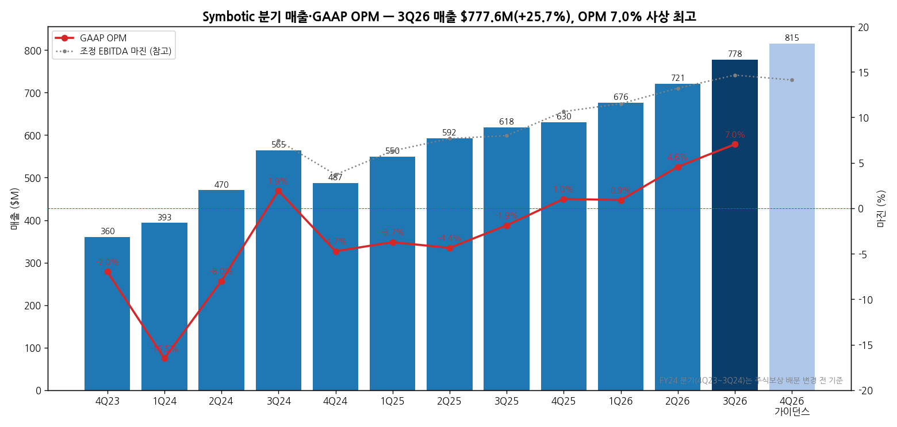
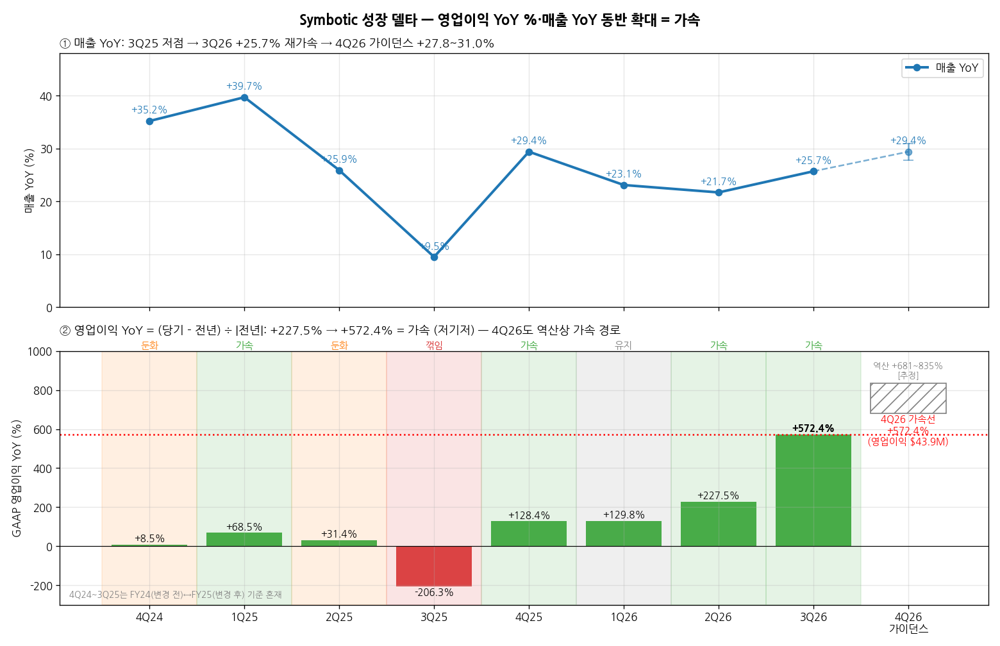

> 모드: 실적 리뷰 (v11)
> 종목: Symbotic (SYM)
> 섹터: 로봇
> 서브섹터: 산업·물류 자동화
> 분기: 2026-Q3 (회계분기 FQ4 26 = 2026-06-28\~09-26, 13주)
> 발표일: 2026-11-23 (미 동부 장 마감 후) / 10-K FY26 동시 제출
> 작성 시각: 2026-11-24 10:40 KST
> 분석 소스: [1차 — SEC] 8-K Ex.99.1 실적 보도자료(2026-11-23, FQ4 26·FQ3 26·FQ4 25 3개 열 + 조정표), 10-K FY26(2026-11-23 — 연간 부문 손익·MD&A·RPO·고객 집중·EMAA), XBRL companyfacts(FY26 10-Q의 FY25 분기 비교치 — 주식보상 배분 변경 후 기준), `company-overview/SYM_기업개요.md`(v1.0, 2026-11-14) 분기 시계열. 컨콜(2026-11-23 17:00 ET 웹캐스트)은 Motley Fool 트랜스크립트 링크 0건 + 보도 요약 미검색(발표 직후)으로 **미확보** — 회사 설명은 보도자료·10-K 문구만 사용. 셀사이드·컨센서스 미확보 → 서프라이즈는 회사 가이던스 대비
> 리뷰 깊이: 숫자 중심 | 리서치 첨부 0건
> 비영업 요인: 구조조정비 양쪽 분기 존재(3Q26 $5.4M / 3Q25 $6.5M, 2Q25 $16.4M) — 대칭 처리 시 가속 폭이 오히려 큼 / 소규모 인수 Fox Robotics(2026-01)·ARMS Innovations(2026-07) 편입 — 기여 분리 불가(회사 미공시) / 영업이익 아래: 전략투자 평가이익 $0.9M(2Q26 $19.4M), 지분법 손실 -$12.3M(Exol)
> 판정 지표: GAAP 영업이익 YoY % — 전년 적자 분기도 (당기 − 전년 동기) ÷ |전년 동기| 공식 (BT 2026-11-24 "델타는 항상 % 기준", 증감액 판정 폐기)
> 기준 단절: FY26부터 주식보상비용 배분 방식 변경(가속 → 정액, 소급). FY25 분기(4Q24\~3Q25)는 변경 후 수치(보도자료·10-Q 비교 열), FY24 분기(4Q23\~3Q24)는 변경 전 — FY24 연간 영향은 순손실 -$4.5M 수준(10-K)이라 작다

# Symbotic 3Q26 (FQ4 26) 실적 리뷰 — GAAP 영업이익 $54.7M(OPM 7.0%, 전년 -$11.6M), 매출 $777.6M(+25.7%) 재가속. Walmart EMAA로 수주잔고 최대 +$6.9B 예고, FQ1 27 매출 가이던스 +28\~31%

> 성장 델타: 가속 | 내러티브: 강화 → 델타 가속(영업이익 YoY +227.5% → +572.4%, 매출 YoY +21.7% → +25.7% — 저기저(3Q25 -$11.6M)) + 내러티브 강화(Walmart 신규 약정 $6B, 다음 분기 매출 가속 가이던스) → 적극 구간 (단, 단일 고객 86.7%·Systems 마진 정체는 확인 변수)

> ⚠ 비영업 요인 플래그: 판정을 만든 주된 원인은 아님 — YoY 개선 +$66.3M 중 매출총이익 +$46.3M(70%), R&D 감소 +$18.2M(27%, 엔지니어의 고객 프로젝트 배치·2025 구조조정 절감 — 영업 내 요인). 구조조정비는 양쪽 분기에 있어(3Q26 $5.4M, 3Q25 $6.5M, 2Q25 $16.4M) 빼고 보면 영업이익 YoY +448.3%(2Q26) → **+1,286.3%**(3Q26)로 가속 폭이 더 크다. 소규모 인수 2건(Fox Robotics·ARMS)은 매출 기여 미공시 — 분리 불가

→ **판정 방식 (전년 적자 구간 — % 공식)**: YoY = (당기 − 전년 동기) ÷ |전년 동기|. 2Q26 = (32.9 − (−25.8)) ÷ 25.8 = **+227.5%**, 3Q26 = (54.7 − (−11.6)) ÷ 11.6 = **+572.4%** (천 달러 원문 계산) → 델타 **+344.9%p = 가속**. 매출 YoY도 +21.7% → +25.7%(+4.0%p)로 같은 방향. 전년 분모가 작은 **저기저 가속**이지만 BT 규칙상 가속 그대로 센다 (OPM YoY 변화는 +9.0%p → +8.9%p로 보합 — 참고)
→ **숫자**: 매출 $777.6M(+25.7% YoY, +7.9% QoQ), GAAP 영업이익 $54.7M(OPM 7.0%, 사상 최고), 매출총이익률 22.6%(+1.7%p YoY), 순이익 $55.0M(지배주주 $11.3M, EPS $0.09). 참고 — 조정 EBITDA $113.9M(+130%, 가이던스 $100\~105M 상단 초과). FY26 연간 첫 GAAP 영업흑자 $100.2M
→ **쟁점**: (1) 이익 개선의 질 — Systems 마진은 21.4%로 오히려 하락, 개선은 운영서비스 흑자 전환과 R&D 감소 (2) Walmart EMAA $6B와 수주잔고 — RPO는 $22.3B로 아직 감소, 반영은 FQ1 27 (3) 단일 고객 집중 86.7%와 매출채권 구조 변화 (4) 매출 가속의 지속성 — 배치 시스템 84개, FY27 인식 16%
→ **다음 분기 관건**: 4Q26(FQ1 27) 영업이익 YoY **+572.4% 초과 = GAAP 영업이익 $43.9M 이상**(4Q25 기저 +$6.5M)이면 가속 지속, $6.5M\~$43.9M이면 둔화, $6.5M 미만이면 꺾임. 가이던스 매출 $805\~825M(+27.8\~31.0%) · 조정 EBITDA $110\~120M — 3Q26 차이($59M)로 역산하면 GAAP 영업이익 약 $51\~61M = YoY +681\~835% → **가속 경로** [추정] (4Q25 기저 $6.5M이 작아 생기는 저기저 효과)

---

## 1. 숫자

① 연결 분기 표 (단위: $M, %, 캘린더 분기 (회계 분기))

| 항목 | 4Q23 (FQ1 24) | 1Q24 (FQ2 24) | 2Q24 (FQ3 24) | 3Q24 (FQ4 24) | 4Q24 (FQ1 25) | 1Q25 (FQ2 25) | 2Q25 (FQ3 25) | 3Q25 (FQ4 25) | 4Q25 (FQ1 26) | 1Q26 (FQ2 26) | 2Q26 (FQ3 26) | **3Q26 (FQ4 26)** | 4Q26 가이던스 (FQ1 27) |
|---|---|---|---|---|---|---|---|---|---|---|---|---|---|
| 매출 | 359.9 | 393.3 | 470.3 | 564.6 | 486.7 | 549.7 | 592.1 | 618.5 | 630.0 | 676.5 | 720.8 | **777.6** | 805\~825 |
| GAAP 영업이익 | -25.1 | -64.9 | -37.6 | 10.9 | -23.0 | -20.5 | -25.8 | -11.6 | 6.5 | 6.1 | 32.9 | **54.7** | 미제공 (역산 약 51\~61 [추정]) |
| OPM | -7.0 | -16.5 | -8.0 | 1.9 | -4.7 | -3.7 | -4.4 | -1.9 | 1.0 | 0.9 | 4.6 | **7.0** | — |
| 매출 YoY | +74.5 | +47.4 | +50.8 | +44.1 | +35.2 | +39.7 | +25.9 | +9.5 | +29.4 | +23.1 | +21.7 | **+25.7** | +27.8\~31.0 |
| 영업이익 YoY (%, (당기−전년)÷\|전년\|) | n/m | n/m | n/m | +120.2 | +8.5 | +68.5 | +31.4 | -206.3 | +128.4 | +129.8 | +227.5 | **+572.4** | 역산 +681\~835 [추정] / 가속선 +572.4 |
| (참고) 영업이익 YoY 증감액 ($M) | — | — | — | +64.8 | +2.1 | +44.4 | +11.8 | -22.5 | +29.5 | +26.6 | +58.7 | **+66.3** | — |
| OPM YoY 변화 (%p) | — | — | — | +15.7 | +2.3 | +12.8 | +3.6 | -3.8 | +5.7 | +4.6 | +9.0 | **+8.9** | — |
| **매출 YoY 델타 (%p)** | — | -27.1 | +3.4 | -6.7 | -8.9 | +4.5 | -13.8 | -16.4 | +19.9 | -6.3 | -1.4 | **+4.0** | +2.1\~+5.3 |
| **영업이익 YoY 델타 (%p)** | — | — | — | — | -111.7 | +60.0 | -37.1 | -237.7 | +334.7 | +1.4 | +97.7 | **+344.9** | +109\~+262 [추정] |
| 델타 판정 (% 기준, 소급) | — | — | — | — | 둔화 | 가속 | 둔화 | 꺾임 (YoY 마이너스 전환) | 가속 | 유지 | 가속 | **가속** | |
| (참고) 조정 EBITDA | — | — | — | 42 | 18 | 34.7 | 45.4 | 49.4 | 67 | 77.8 | 95.2 | **113.9** | 110\~120 |
| (참고) 조정 EBITDA YoY | — | — | — | — | — | — | — | +17.6 | +272 | +124 | +110 | **+130** | +64\~79 |

→ (출처: 3Q26·2Q26·3Q25 = 8-K Ex.99.1 천 달러 원문(3Q26 매출 $777,606K·영업이익 $54,715K, 3Q25 $618,457K·-$11,583K — 주식보상 배분 변경 후 재작성 수치). 4Q24\~2Q25·4Q25\~1Q26 = XBRL companyfacts(FY26 10-Q 비교 열). 4Q23\~3Q24 = 기업 개요 v1.0 표(10-Q·10-K, 변경 전 기준, FY24 재작성 후). 증감액·델타·YoY [계산]. 4Q26 가이던스 = 보도자료 OUTLOOK. 조정 EBITDA는 회사 non-GAAP — 판정 미사용)
→ **기준 단절 주의**: 기업 개요의 3Q25 영업이익 -$21.8M(10-K FY25, 변경 전)은 이번 보도자료에서 **-$11.6M**으로 재작성됐다. 판정은 같은 기준끼리(3Q26 vs 재작성 3Q25) 비교. FY24 분기와 FY25 분기를 잇는 YoY(4Q24\~3Q25 행)는 기준이 섞여 있다
→ **서프라이즈 (가이던스 대비 — 컨센 미확보)**: 매출 $777.6M = 가이던스 $760\~780M 상단(중간값 대비 +1.0%), 조정 EBITDA $113.9M = 가이던스 $100\~105M 상단 대비 +8.5%
→ **YoY 위치**: 매출 YoY는 3Q25 +9.5%(저점, 직전 4Q 14주 기저) → 4Q25 +29.4% → 1Q26\~2Q26 +23.1%·+21.7%로 둔화 → **3Q26 +25.7% 재가속** → 가이던스 4Q26 +27.8\~31.0%로 한 번 더 가속. 회사 경로상 매출 YoY 정점은 아직 오지 않았다 [전망]
→ **이익 위치**: OPM -4.4%(2Q25) → 1.0% → 0.9% → 4.6% → **7.0%**. 영업이익 YoY는 +128.4%(4Q25) → +129.8% → +227.5% → +572.4%로 3개 분기 연속 확대. 전년 분모가 -$11.6M으로 작아 % 폭이 크다(저기저). 4Q26은 기저가 +$6.5M(흑자)로 더 작아져 YoY %가 더 커질 가능성이 높다
→ **[판단] 델타 = 가속**: % 공식으로 영업이익 YoY +227.5% → +572.4%, 매출 YoY도 가속. 조정 EBITDA 가이던스(QoQ $113.9M → $110\~120M, 보합)상 이익 **레벨**은 3Q26 근처지만, 4Q25 기저 $6.5M이 작아 영업이익 $43.9M만 넘으면 YoY가 +572.4%를 넘는다 → **다음 분기도 가속 판정 가능성이 높다**(저기저 가속) [전망]. 기저가 정상화되는 1Q27(1Q26 $6.1M)·2Q27(2Q26 $32.9M)부터 % 델타가 꺾일 수 있다

→ (출처: 8-K Ex.99.1, XBRL companyfacts, 기업 개요 v1.0. 3Q26 진한 막대, 4Q26 = 가이던스 중간값 $815M(연한 막대). OPM은 GAAP, 회색 점선 = 조정 EBITDA 마진(참고))

→ (출처: 동일 [계산]. 상단 = 매출 YoY(파랑, 4Q26 가이던스 점선), 하단 = 영업이익 YoY %(막대, (당기 − 전년) ÷ |전년|) — 빨간 점선 = 4Q26 가속선 +572.4%(영업이익 $43.9M), 빗금 = EBITDA 가이던스 역산 +681\~835% [추정])

② 부문별 매출·매출총이익 (단위: $M, %) — 회사는 부문 영업이익을 공시하지 않는다 (매출총이익까지)

| 부문 | 3Q25 매출 | 2Q26 매출 | **3Q26 매출** | 매출 YoY | 매출 비중 | 3Q25 GP (GPM) | 2Q26 GP (GPM) | **3Q26 GP (GPM)** | GP YoY 증감 |
|---|---|---|---|---|---|---|---|---|---|
| Systems | 582.3 | 671.0 | **722.5** | +24.1% | 92.9% | 128.1 (22.0) | 147.3 (22.0) | **154.9 (21.4)** | +26.8 |
| Software maintenance & support | 9.3 | 12.8 | **15.0** | +61.8% | 1.9% | 6.6 (70.9) | 9.3 (72.7) | **11.9 (79.3)** | +5.3 |
| Operation services | 26.9 | 37.1 | **40.1** | +49.3% | 5.2% | -5.3 (-19.7) | 4.3 (11.5) | **8.9 (22.3)** | +14.2 |
| 합계 | 618.5 | 720.8 | **777.6** | +25.7% | 100% | 129.4 (20.9) | 160.9 (22.3) | **175.7 (22.6)** | +46.3 |

→ (출처: 8-K Ex.99.1 손익계산서 부문 매출·매출원가(천 달러), GP = 매출 − 매출원가 [계산]. 주식보상 포함 GAAP 기준)
→ **누가 델타를 끄나**: 매출은 Systems(+24.1%)가 93%를 차지해 그대로 성장률을 정한다. 그러나 **이익 개선의 주인공은 Systems가 아니다** — Systems GPM은 22.0% → 21.4%(-0.6%p, YoY·QoQ 모두 하락). 매출총이익 증가 +$46.3M 중 Systems는 물량(+$140M 매출)으로 +$26.8M, **운영서비스가 적자(-$5.3M) → 흑자(+$8.9M) 전환으로 +$14.2M**, 소프트웨어 +$5.3M
→ Systems 마진 하락 원인 후보: 매출원가 내 주식보상 $6.4M → $15.6M(+$9.2M — 엔지니어가 R&D에서 고객 프로젝트로 재배치, 10-K MD&A), 재고 진부화 충당금 $2.2M → $8.1M(현금흐름표). 조정 매출총이익률(주식보상·감가 제외)은 22.1% → 24.8%로 올랐다 (보도자료 조정표)
→ 연간 FY26: Systems $2,618.2M(+23.6%, GPM 21.5%, 전년 19.7%) / 소프트웨어 $51.6M(+74.2%, GPM 75.0%) / 운영서비스 $135.1M(+37.2%, GPM 14.6%, 전년 -6.3%) (10-K)

③ 영업이익 YoY 개선 분해 (단위: $M — 가속의 원천)

| 항목 | 3Q25 | 2Q26 | **3Q26** | YoY 증감 | 영업이익 기여 |
|---|---|---|---|---|---|
| 매출총이익 | 129.4 | 160.9 | **175.7** | +46.3 | **+46.3** |
| 연구개발비 (R&D) | 55.9 | 43.8 | **37.7** | -18.2 | **+18.2** |
| 판관비 (SG&A) | 78.6 | 84.2 | **77.9** | -0.7 | +0.7 |
| 구조조정비 | 6.5 | — | **5.4** | -1.1 | +1.1 |
| GAAP 영업이익 | -11.6 | 32.9 | **54.7** | +66.3 | **+66.3** |
| (참고) 주식보상 합계 | 43.7 | 50.5 | **38.8** | -4.8 | — |

→ (출처: 8-K Ex.99.1 손익계산서·조정표 [계산])
→ YoY 개선 +$66.3M = 매출총이익 70% + R&D 감소 27% + 기타 3%. R&D 감소는 회사 설명상 "**engineering resources assigned to customer projects**(2025 Walmart MAA)" + "**cost savings realized from the restructuring** in the third quarter of fiscal 2025" (10-K MD&A, 연간 기준) — 비용이 사라진 게 아니라 일부는 매출원가로 옮겨갔다 [판단]
→ QoQ로는 +$21.8M = 매출총이익 +$14.8M + R&D -$6.0M + 판관비 -$6.4M(주식보상 -$7.3M) − 구조조정비 $5.4M

④ 수주잔고·현금·고객 (단위: $B, $M)

| 항목 | FY25 말 | 2Q26 말 (FQ3) | **3Q26 말 (FQ4)** | 비고 |
|---|---|---|---|---|
| 수주잔고 (RPO) | $22.5B | $22.5B | **$22.3B** | FY27 인식 약 16%(≈$3.6B [계산]) — 10-K |
| Walmart EMAA 신규 약정 (2026-10, RPO 미반영) | — | — | **약 $6B → 잔고 최대 +$6.9B** | 미국 RDC 추가 자동화 + 개발비 $125M (10-K) |
| 현금 | 1,245.0 | 1,746.4 | **2,025.1** | 차입금 없음 |
| 이연매출 (선수금, 유동+비유동) | 1,367.2 | — | **1,866.6** | |
| 분기 FCF | 494.4 (3Q25) | -164.6 | **353.1** | FY26 $595.9M (전년 $787.9M) |
| 고객 A(Walmart) 매출 비중 | 84.6% (FY25) | — | **86.7% (FY26)** | 매출채권: 고객 A 54.5% + 고객 B 25.5% |
| 해외 매출 | $47.9M (2%) | — | **$228.5M (8%)** | 멕시코(Walmex) 등 (10-K) |

→ (출처: 8-K Ex.99.1 재무상태표·현금흐름표, 10-K FY26 RPO·고객 집중·지역 주석)
→ 수주잔고는 분기 배치 진행으로 소진되며 $22.3B로 소폭 감소 — EMAA $6B가 들어가는 FQ1 27(4Q26)에 "significant backlog expansion"이 회사 예고다 (CFO, 보도자료)

⑤ 연간 (단위: $M, %, 9월 결산)

| 항목 | FY22 | FY23 | FY24 | FY25 | **FY26** | FY27 |
|---|---|---|---|---|---|---|
| 매출 | 593.3 | 1,176.9 | 1,788.2 | 2,246.9 | **2,804.9** | 가이던스 미제공 (FQ1만) |
| GAAP 영업이익 | -140.4 | -223.2 | -116.7 | -80.8 | **+100.2** | — |
| OPM | -23.7 | -19.0 | -6.5 | -3.6 | **+3.6** | — |
| 매출 YoY | +135.5 | +98.4 | +51.9 | +25.7 | **+24.8** | — |
| 영업이익 YoY | 적자 확대 | 적자 확대 | 적자 축소 | 적자 축소 | **흑자 전환 (+$181.1M)** | — |
| (참고) 조정 EBITDA | — | — | 62 | 147.5 | **353.8** | — |

→ (출처: 10-K FY22\~FY26. FY25 영업이익 -$80.8M은 FY26 10-K 재작성치(변경 전 -$115.0M), FY24 이전은 변경 전 기준. 셀사이드 FY27 컨센 미확보)
→ FY26 = 회사 첫 연간 GAAP 영업흑자·순이익($132.8M, 지배주주 $27.6M). CFO: "*we delivered our first full year of GAAP profitability*"

---

## 2. 시장 쟁점 (회사 설명 + 숫자가 던지는 질문)

① 지난 분기 체크
→ 첫 리뷰 — 직전 체크 없음 (2026-11-14 로봇 섹터 글로벌 피어 편입). 기업 개요·캘린더 시그널에 남긴 항목만 대조:

| 기업 개요·캘린더 항목 | 이번 분기 결과 | 판정 |
|---|---|---|
| FQ4 매출 $760\~780M·조정 EBITDA $100M+ | $777.6M · $113.9M | 확인 (상단·초과) |
| GAAP 흑자 유지 | 영업이익 $54.7M, 순이익 $55.0M | 확인 |
| Walmart $6B 약정 RPO 반영 | RPO $22.3B — 아직 미반영(10월 계약), FQ1 27 반영 예고 | 미확인 (다음 분기) |

② 이번 분기 쟁점 4개

| # | 쟁점 | 근거 |
|---|---|---|
| (1) | 이익 개선의 질 — Systems 마진은 왜 내려갔나 | 보도자료 부문 손익, 10-K MD&A |
| (2) | Walmart EMAA와 수주잔고 — 언제 숫자가 되나 | 10-K EMAA·RPO, CFO 발언 |
| (3) | 단일 고객 집중 86.7%와 고객 B 등장 | 10-K 고객 집중 주석 |
| (4) | 매출 가속의 지속성 — 배치 시스템 수·인식 속도 | 10-K MD&A, 가이던스 |

→ 컨콜 Q&A(애널리스트 질문)는 미확보 — 쟁점은 공시 숫자에서 직접 도출했다. 트랜스크립트·보도 요약이 나오면 (1)·(2)에 회사 답변을 덧붙인다

③ 쟁점별 분해

(1) **이익 개선의 질 — Systems 마진 정체, 개선은 운영서비스·R&D에서**

→ "*Systems gross profit increased ... primarily driven by 84 Systems in Deployment during the fiscal year ended September 26, 2026, as compared to 50 Systems in Deployment ..., our capture of the increased value we are driving for customers, and profit mix.*" (10-K MD&A, 연간)

→ "Systems 매출총이익 증가는 주로 **배치 중 시스템 84개(전년 50개)**, 고객 가치 증가분 확보, 수익 믹스 때문"

→ 시사점: 연간으로는 Systems GPM **19.7% → 21.5%** 개선 → 그러나 분기로는 3Q26 **21.4%**로 YoY·QoQ 모두 하락 → 분기 개선은 **운영서비스 흑자 전환(+$14.2M)·R&D 감소(+$18.2M)**가 만든 몫이 크다

→ 운영서비스 개선 설명: "*achieving operational scale at certain customer sites ..., certain loss contracts from the prior year which did not recur*" (10-K) — 전년 손실 계약 소멸은 **저기저 성격**(비영업은 아님)
→ R&D 감소 $18.2M 중 주식보상 -$7.4M, 조정 R&D -$12.3M. 같은 기간 매출원가 주식보상은 +$9.2M — 엔지니어를 고객 프로젝트로 돌리면 비용이 R&D에서 매출원가로 이동한다 [판단]
→ **[판단]** 영업 내 요인이라 가속 판정은 그대로지만, 다음 가속의 연료는 **Systems GPM 회복**(22% 이상)이어야 한다. R&D를 더 줄여 만드는 이익은 한계가 있다(분기 $37.7M, 매출의 4.9%)

(2) **Walmart EMAA — $6B 신규 약정, 잔고 반영은 FQ1 27**

→ "*Walmart made a new commitment to purchase our systems and fund certain development programs in an initial aggregate additional amount of approximately $6,000,000,000 ... We expect that the Initial Commitment could add up to $6.9 billion to our future backlog.*" (10-K)

→ "Walmart가 시스템 구매·개발 프로그램 자금으로 **약 $60억 신규 약정** — 향후 수주잔고에 **최대 $69억 추가** 가능"

→ 시사점: 잔고 $22.3B → 반영 시 **최대 $29.2B** [계산] → CFO "*first quarter of fiscal year 2027 highlighted by accelerating year-over-year revenue growth and significant backlog expansion*" → 다만 **FY27 인식 비중은 16%**($3.6B)로 잔고 증가가 바로 매출 가속이 되지는 않는다

→ 약정은 상호 서면 동의 없이 줄일 수 없다(10-K). 초기 약정에는 차세대 랙 기술 개발비 $125M(DPA)이 포함 — R&D 일부를 고객이 부담하는 구조 [판단]
→ **[판단]** 내러티브 "강화"의 핵심 근거. 확인 포인트는 FQ1 27 RPO가 $28B 이상으로 실제 올라가는지, 그리고 EMAA 배치가 FY27 몇 개 사이트로 시작되는지

(3) **단일 고객 집중 — Walmart 86.7%, 고객 B 등장**

→ "*Customer A 86.7 % 84.6 % 86.9 %*" (FY26·FY25·FY24 매출 비중) / 매출채권은 "*Customer A 54.5 % ... Customer B 25.5 %*" (10-K)

→ "고객 A(Walmart) 매출 비중 **86.7%**(전년 84.6%) — 매출채권은 고객 A 54.5%, **고객 B 25.5%**(전년 10% 미만)"

→ 시사점: 매출 집중은 오히려 심화 → 고객 B(매출 10% 미만이지만 채권 25.5%)가 새 대형 배치 고객으로 보임(Walmex·Exol·Medline 등 후보, 회사 미특정) [판단] → EMAA로 Walmart 비중은 더 올라갈 가능성

→ **[판단]** 집중은 리스크이자 내러티브의 원천(Walmart 전 물류망 표준). 해지 조항이 사실상 없는 계약 구조(10-K)라 단기 실적 리스크보다 **밸류에이션 할인 요인**이다

(4) **매출 가속의 지속성 — 배치 시스템 84개, 인식 속도**

→ "*Systems revenue increased ... due to there being 84 Systems in Deployment for the fiscal year ended September 26, 2026, as compared to 50 Systems in Deployment*" (10-K)

→ "Systems 매출 증가는 **배치 중 시스템 84개(전년 50개, +68%)** 때문"

→ 시사점: 배치 수 +68% vs Systems 매출 +23.6% → 시스템당 연 인식액은 줄었다(신규 배치 초기 단계 비중 증가 [판단]) → 초기 단계 시스템이 진행률을 올리는 FY27에 매출 레버리지 → 회사 가이던스 4Q26 +27.8\~31.0%가 그 경로

→ 분기 매출 QoQ: +1.9%(4Q25) → +7.4% → +6.6% → **+7.9%** → 가이던스 +3.5\~6.1% [계산]
→ **[판단]** 매출 쪽 가속은 가이던스로 뒷받침된다. 이익 쪽은 조정 EBITDA 가이던스가 QoQ 보합이지만 4Q25 기저($6.5M)가 작아 % 기준 가속선($43.9M)은 역산치($51\~61M)보다 낮다 — 4Q26은 **매출·이익 동반 가속** 경로, 다만 저기저 효과라 레벨(QoQ) 보합은 따로 본다

④ 시장 반응
→ 발표 다음 날 정규장(11/24 ET) 전 작성 — 주가 반응 미확보. 발표 전 기업 개요 기준 주가 $34.83(11/13), 2025-11 고점 $87.88 대비 -60%

---

## 3. 내러티브 점검

→ **성장 스토리**: Walmart 42개 RDC 전면 자동화를 축으로, AI 소프트웨어 + 자율 로봇 + 고밀도 구조물로 대형 유통 물류센터를 통째로 바꾸는 사실상 독점 사업자. 배치 시스템 수가 늘며 매출 20%대 성장, 2026년 GAAP 흑자 전환으로 "이익이 나기 시작한 물류 로봇"
→ **이번 분기**: ① 매출 재가속(+25.7%) ② OPM 7.0% 사상 최고·첫 연간 흑자 ③ Walmart EMAA $6B(잔고 최대 +$6.9B) ④ 다음 분기 매출 가속 가이던스 → 스토리가 **숫자와 계약으로 동시에 확인** → **내러티브 강화** (셀사이드 TP 변화는 미확보 — 숫자 중심 기준)
→ **판정**: 델타 가속 + 내러티브 강화 → **적극 구간**. 다만 이익 가속이 Systems 마진이 아닌 운영서비스·R&D에서 나왔고, 다음 분기 이익 가이던스는 레벨 보합 → "% 델타는 4Q26까지 저기저로 가속, 레벨은 횡보 — 기저가 차는 2027년 중반이 진짜 시험대"가 기본 시나리오 [전망]
→ **스토리 강화 트리거**: ① FQ1 27 RPO $28B+ (EMAA 반영) ② Systems GPM 22% 이상 회복 ③ Walmart 외 신규 대형 고객(고객 B) 공개·해외 비중 10%+
→ **훼손 리스크**: ① 배치 지연·차세대 랙 전환 비용(재고 충당금 $8.1M 증가) ② 내부통제 중대한 취약점 개선 지연(2024-11 재작성 이후, 개선 비용 분기 $1.5M 지속) ③ FCC 해외 로봇 기기 규제(2026-07 Covered List)의 공급망 영향 — 회사 "평가 중" (10-K)

---

## 4. 향후 봐야 할 것

(1) **4Q26(FQ1 27) 영업이익 YoY +572.4% — 가속 판정선 (GAAP 영업이익 $43.9M)** (1순위)
→ 무엇을: 영업이익 YoY +572.4% 초과(= $43.9M 이상, ±5%p 유지 구간 $43.6\~44.2M)면 가속, $6.5M\~$43.6M이면 둔화, $6.5M 미만이면 꺾임. 조정 EBITDA 가이던스 역산 $51\~61M [추정]이면 +681\~835%로 가속
→ 어떤 데이터로: FQ1 27 실적 보도자료(8-K)·10-Q
→ 언제: 2027-02 초 (캘린더 추정 \~2027-02-03 AMC)

(2) **매출 $805\~825M(+27.8\~31.0%) 가이던스 달성 — 매출 YoY 2개 분기 연속 가속**
→ 무엇을: 매출 YoY +25.7% 초과 유지, Systems 매출 YoY 25% 이상
→ 어떤 데이터로: FQ1 27 보도자료, 10-Q 배치 시스템 수
→ 언제: 2027-02 초

(3) **수주잔고 — EMAA 반영 RPO $28B 이상**
→ 무엇을: RPO $22.3B → 최대 $29.2B, FY27 인식 비중(16%) 변화
→ 어떤 데이터로: FQ1 27 10-Q RPO 주석, 컨콜
→ 언제: 2027-02 초

(4) **Systems GPM 22% 이상 회복**
→ 무엇을: 3Q26 21.4% → 22%+. 매출원가 주식보상·재고 충당금 방향
→ 어떤 데이터로: 보도자료 부문 손익, 현금흐름표 충당금
→ 언제: 2027-02 초

(5) **고객 다변화·해외 — 고객 B 정체, 해외 매출 10%+**
→ 무엇을: Walmart 외 대형 배치 고객 공개(Exol·Walmex·Medline·신규), 해외 비중 8% → 10%+
→ 어떤 데이터로: 10-Q 고객 집중·지역 주석, 회사 보도자료, 뉴스 키워드 "Symbotic new customer", "Symbotic Exol site", "Symbotic GreenBox"
→ 언제: 2027-02 초, 이후 수시
