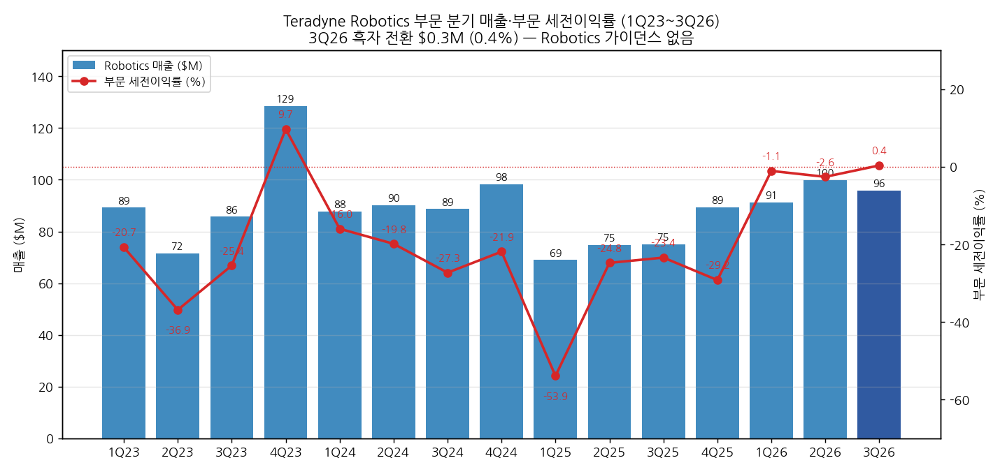
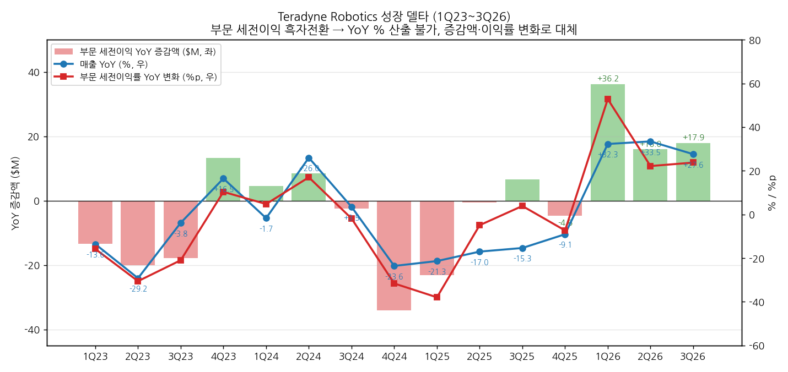

> 모드: 실적 리뷰 (v11)
> 종목: Robotics 부문 (Teradyne, TER) / 모회사 = Teradyne, Inc.
> 섹터: 로봇
> 서브섹터: 산업·물류 자동화
> 분기: 2026-Q3 (회계분기 = 캘린더 분기, 2026-09-27 종료 13주)
> 발표일: 2026-10-27 (미 동부 장 마감 후) / 10-Q 제출 2026-10-30
> 작성 시각: 2026-11-23 11:45 KST
> 분석 소스: [1차 — SEC] 10-Q 3Q26(2026-10-30)·2Q26(2026-07-31)·3Q25(2025-10-30) 부문 정보, 10-K 2025(2026-02-19), 8-K 실적 보도자료(2026-10-28). 과거 분기 시계열은 `company-overview/TER_기업개요.md`(v1.0, 2026-11-14) 표를 10-Q 천 달러 단위 원문과 대조. [보도 인용] 컨콜 요약 — StockStory "Top 5 Analyst Questions"·"Q3 Deep Dive", Zacks 콜 하이라이트(2026-10-28), Quartr 요약, The Robot Report(2Q26 실적·2025-11 감원). Motley Fool 트랜스크립트는 quote 페이지 링크 0건으로 미확보 → 컨콜 원문 대신 보도 요약 사용
> 리뷰 깊이: 숫자 중심 | 리서치 첨부 0건
> 비영업 요인: 없음 (부문 세전이익에는 이자·환율·퇴직비용이 빠져 있음 — 본사 집계. 전년 동기 -$17.6M 적자 기저)
> 섹터 합산: 제외 (트래킹 피어, Robotics 부문만)
> 다중 부문 처리: 판정·1번 숫자의 중심 = Robotics 부문(전사 매출의 7.3%). 모회사 전사 5지표는 참고 표로만 둔다 (feedback_multisegment_global_peer — 모회사 확장 트리거 4종 해당 없음: FormFactor 지분 투자 $300M은 $3B 미만)

# Teradyne Robotics 3Q26 실적 리뷰 — 부문 세전이익 $0.3M 흑자 전환(전년 -$17.6M), 매출 $95.8M(+27.6%)로 3분기 기준 최대. 흑자는 0.4%로 얇고 Robotics 가이던스는 없다

> 성장 델타: 유지 | 내러티브: 유지 → 델타 유지(흑자 전환·이익 개선폭 소폭 확대 ↔ 매출 YoY 둔화) + 내러티브 유지 → 관찰 구간 (턴어라운드 초입, 트래킹 피어 · 섹터 합산 제외)

→ **판정 기준**: 회사가 공시하는 유일한 부문 이익인 **부문 세전이익(Income before taxes)** 으로 판정했다 (영업이익 미공시). 전사 GAAP 영업이익은 반도체 테스트가 82%라 로봇 신호가 묻혀 참고로만 둔다
→ **판정 방식 (흑자 전환 구간)**: 3Q25 -$17.6M → 3Q26 +$0.3M이라 YoY %는 계산할 수 없다. 적자·전환 구간 규칙대로 ① **직전 분기 방향** — 2Q26 적자 축소(개선) → 3Q26 흑자 전환으로 개선 방향 연속 ② **대용 지표** — YoY 손익 개선액 +$16.0M(2Q26) → **+$17.9M**(3Q26, +$1.9M), 부문 세전이익률 YoY 변화 +22.2%p → **+23.8%p**(+1.6%p, ±5%p 이내). 매출 YoY는 +33.4% → **+27.6%**(-5.8%p 둔화). 이익 쪽 소폭 개선, 매출 쪽 둔화로 방향이 엇갈려 **유지**로 판정했다
→ **숫자**: 매출 $95.8M(+27.6% YoY, -4.1% QoQ), 부문 세전이익 $0.3M(이익률 0.4%), 매출총이익률 59.2%(3Q25 56.1%). YoY 개선 $17.9M 중 $14.6M(82%)이 매출총이익 증가(물량·믹스), $3.3M이 비용 감소다 [계산]
→ **쟁점**: (1) 흑자의 질 — 비용 절감인가 매출 레버리지인가 (2) 수요처 — 전자·반도체·AI 데이터센터 조립·테스트 자동화 (3) 피지컬 AI 시점 — 회사는 "2027 파일럿, 2028 본격 채택" (4) 4Q 계절성과 R&D 재투자 속 흑자 지속성
→ **다음 분기 관건**: 4Q26 부문 세전이익 흑자 유지(4Q25 -$26.1M 대비 개선폭)와 매출 YoY +20% 이상. 회사는 Robotics 가이던스를 내지 않는다 — 전사 4Q26 가이던스 매출 $1,250\~1,350M만 있음

---

## 1. 숫자

① Robotics 부문 분기 표 (판정 기준, 단위: $M, %, 12개 분기)

| 항목 | 4Q23 | 1Q24 | 2Q24 | 3Q24 | 4Q24 | 1Q25 | 2Q25 | 3Q25 | 4Q25 | 1Q26 | 2Q26 | **3Q26** | 4Q26E |
|---|---|---|---|---|---|---|---|---|---|---|---|---|---|
| 부문 매출 | 128.6 | 87.7 | 90.2 | 88.7 | 98.3 | 69.0 | 74.9 | 75.1 | 89.4 | 91.3 | 99.9 | **95.8** | 가이던스 없음 |
| 부문 세전이익 | 12.5 | -14.0 | -17.9 | -24.2 | -21.5 | -37.2 | -18.5 | -17.6 | -26.1 | -1.0 | -2.6 | **+0.3** | — |
| 부문 세전이익률 | 9.7 | -16.0 | -19.8 | -27.3 | -21.9 | -53.9 | -24.8 | -23.4 | -29.2 | -1.1 | -2.6 | **+0.4** | — |
| 매출총이익률 (GPM) | — | 60.7 | 58.5 | 59.0 | 52.3 | 53.2 | 54.4 | 56.1 | 42.3 | 50.5 | 53.5 | **59.2** | — |
| 매출 YoY | +16.5 | -1.7 | +26.0 | +3.5 | -23.6 | -21.3 | -17.0 | -15.3 | -9.1 | +32.3 | +33.4 | **+27.6** | — |
| 부문 세전이익 YoY | 흑자전환 | 적자축소 | 적자축소 | 적자확대 | 적자전환 | 적자확대 | 적자확대 | 적자축소 | 적자확대 | 적자축소 | 적자축소 | **흑자전환** | — |
| 세전이익 YoY 증감액 ($M) | +13.2 | +4.5 | +8.5 | -2.4 | -34.0 | -23.2 | -0.6 | +6.6 | -4.6 | +36.2 | +16.0 | **+17.9** | — |
| 세전이익률 YoY 변화 (%p) | +10.4 | +4.8 | +17.0 | -1.8 | -31.6 | -37.9 | -4.9 | +3.8 | -7.3 | +52.8 | +22.2 | **+23.8** | — |
| **매출 YoY 델타 (%p)** | +20.3 | -18.2 | +27.7 | -22.5 | -27.1 | +2.2 | +4.4 | +1.6 | +6.3 | +41.4 | +1.1 | **-5.8** | — |
| **세전이익 증감액 델타 ($M)** | +31.0 | -8.7 | +4.0 | -10.9 | -31.6 | +10.8 | +22.6 | +7.2 | -11.2 | +40.8 | -20.2 | **+1.9** | — |
| **세전이익률 YoY 변화 델타 (%p)** | +31.3 | -5.6 | +12.3 | -18.9 | -29.7 | -6.4 | +33.1 | +8.7 | -11.2 | +60.1 | -30.6 | **+1.6** | — |

→ (출처: 10-Q 각 분기 부문 정보(Segment information). 2025\~2026 분기는 천 달러 원문으로 재계산 — 3Q26 매출 $95,828K·세전 $345K, 3Q25 $75,087K·-$17,567K, 2Q26 $99,917K·-$2,576K, 2Q25 $74,866K·-$18,533K. 4Q = 10-K 연간 − 9개월 누적 [계산]. YoY·증감액·델타 [계산]. 부문 세전이익은 YoY 부호가 바뀌거나 적자끼리라 YoY %를 쓰지 않고 증감액·이익률 변화로 대체)
→ (4Q26E: 회사는 Robotics 부문 가이던스를 내지 않는다. 공개 컨센서스도 부문 단위로는 확인하지 못해 공란)
→ **서프라이즈**: 부문 컨센서스가 없어 계산하지 않았다. 회사 표현은 "Robotics achieved profitability in the quarter on $96 million of revenue, the highest third quarter revenue in the segment's history" (10-Q MD&A)
→ **YoY 위치**: 매출 YoY는 2024\~2025년 7개 분기 중 5개 분기 마이너스(저점 4Q24 -23.6%) → 1Q26 +32.3%로 반전 → 2Q26 +33.4% 정점 → 3Q26 +27.6%. 1Q25\~3Q25의 낮은 기저($69\~75M)가 1H26 고성장을 만들었고, 기저가 $89.4M으로 올라가는 4Q26부터는 YoY가 더 낮아질 가능성이 크다 [판단]
→ **이익 위치**: 부문 세전이익률 -53.9%(1Q25 저점, 구조조정비 포함) → -1.1%(1Q26) → -2.6%(2Q26) → +0.4%(3Q26). 손익분기 바로 위다. 분기 흑자는 4Q23(+$12.5M) 이후 11개 분기 만 [계산]
→ **[판단] 델타 = 유지**: 흑자 전환은 이익 개선 방향이 이어진 것이지만, 개선 속도(증감액 +$16.0M → +$17.9M)는 거의 같고 매출 YoY는 정점(2Q26)을 지났다. "가속"으로 보려면 4Q26에 매출 YoY +20% 이상과 이익률 개선폭 확대(4Q25 -29.2% 대비 +30%p 이상)가 함께 나와야 한다

→ (출처: 10-Q·10-K 부문 정보, 4Q는 연간 − 9개월 [계산]. 3Q26 진한 막대)

→ (출처: 동일. 부문 세전이익 YoY %는 부호 전환으로 계산 불가 → 증감액(막대)·이익률 YoY 변화(적색 선)로 대체 [계산])

② 3Q26 Robotics 손익 분해 (단위: $M — 흑자 전환의 원천)

| 항목 | 3Q25 | 2Q26 | **3Q26** | YoY 증감 | 세전이익 기여 |
|---|---|---|---|---|---|
| 매출 | 75.1 | 99.9 | **95.8** | +20.7 | — |
| 매출원가 | 33.0 | 46.5 | **39.1** | +6.1 | — |
| 매출총이익 (GPM) | 42.1 (56.1%) | 53.4 (53.5%) | **56.8 (59.2%)** | +14.6 | **+14.6** |
| 개발비 (E&D) | 14.4 | 13.1 | **13.7** | -0.6 | +0.6 |
| 판매비 (S&M) | 23.4 | 22.7 | **22.6** | -0.8 | +0.8 |
| 관리비 (G&A) | 9.7 | 9.1 | **9.1** | -0.6 | +0.6 |
| 기타 부문 항목 (주식보상·무형자산 상각·구조조정 등) | 12.1 | 11.1 | **10.9** | -1.2 | +1.2 |
| 부문 세전이익 | -17.6 | -2.6 | **+0.3** | +17.9 | **+17.9** |

→ (출처: 10-Q 3Q26·2Q26 부문 정보(천 달러 원문). 증감·기여 [계산])
→ **YoY +$17.9M 중 82%($14.6M)가 매출총이익 증가**다. 물량 +27.6%와 GPM +3.1%p(믹스 개선)가 함께 작용했다. 비용 감소는 $3.3M(판관+개발비 합계 $47.5M → $45.5M, 기타 항목 -$1.2M)
→ 2Q26 YoY 개선 +$16.0M은 매출총이익 +$12.7M, 판관+개발비 감소 +$3.3M이었다 [계산]. 두 분기 모두 **매출 레버리지가 주 원인**이고, 2025년 두 차례 감원(1월 약 10%·150명, 11월 약 14%)의 비용 효과는 이미 비용 기반에 들어가 있다 (10-Q, The Robot Report 2025-11-06)
→ QoQ로는 매출 -4.1%에도 이익이 +$2.9M 늘었다 — GPM 53.5% → 59.2%. 회사 설명은 "higher sales volume, improved product mix, and lower operating expenses primarily as a result of restructuring actions" (10-Q)

③ Robotics 지역별 매출 (단위: $M, %)

| 지역 | 3Q25 | **3Q26** | 3Q YoY | 9M25 | 9M26 | 9M YoY |
|---|---|---|---|---|---|---|
| 미주 | 28.5 | **39.0** | +36.9 | 88.1 | 121.2 | +37.6 |
| 유럽·중동·아프리카 | 32.8 | **31.6** | -3.5 | 86.0 | 102.0 | +18.6 |
| 아시아태평양 | 13.9 | **25.3** | +82.3 | 44.9 | 63.8 | +42.2 |
| 합계 | 75.1 | **95.8** | +27.6 | 218.9 | 287.0 | +31.1 |

→ (출처: 10-Q 3Q26 매출 세분 주석, YoY [계산])
→ 성장은 **미주·아시아**가 끌고, 최대 시장이던 유럽은 3Q26 역성장으로 돌아섰다. 회사가 밝힌 최대 수요처는 "Electronics and semiconductor customers" (10-Q MD&A) — 아시아 +82%와 같은 방향이다 [판단]
→ UR(협동로봇)/MiR(AMR) 제품별 매출은 2024년부터 미공시. 회사 설명은 "higher sales of collaborative robotic arms and autonomous mobile robots" (둘 다 증가, 10-Q)

④ 연간 (Robotics, 단위: $M, %)

| 항목 | 2021 | 2022 | 2023 | 2024 | 2025 | 9M25 | **9M26** |
|---|---|---|---|---|---|---|---|
| 부문 매출 | 375.9 | 403.1 | 375.2 | 364.8 | 308.3 | 218.9 | **287.0** |
| 부문 세전이익 | -8.2 | -16.2 | -54.3 | -77.6 | -99.4 | -73.3 | **-3.2** |
| 부문 세전이익률 | -2.2 | -4.0 | -14.5 | -21.3 | -32.2 | -33.5 | **-1.1** |
| 매출 YoY | +34.4 | +7.2 | -6.9 | -2.8 | -15.5 | — | **+31.1** |
| 전사 매출 대비 비중 | 10.2 | 12.8 | 14.0 | 12.9 | 9.7 | 10.4 | **7.3** |

→ (출처: 10-K 2021\~2025 부문 정보(2023\~2025 재작성치), 10-Q 3Q26. 2026E·2027E 부문 컨센서스는 확인하지 못함)
→ 2026년 연간은 9M 누적 -$3.2M이라 4Q26에 +$3.2M 이상이면 **2018년 이후 첫 연간 흑자**가 된다. 4Q가 계절적으로 강한 분기(4Q21·4Q23 흑자)지만 4Q25는 GPM 42.3%로 -$26.1M이었다 [판단]

⑤ 참고 — 모회사 전사 5지표 (판정 미사용, 단위: $M, %)

| 항목 | 4Q24 | 1Q25 | 2Q25 | 3Q25 | 4Q25 | 1Q26 | 2Q26 | **3Q26** | 4Q26 가이던스 |
|---|---|---|---|---|---|---|---|---|---|
| 매출 | 752.9 | 685.7 | 651.8 | 769.2 | 1,083.3 | 1,282.5 | 1,329.0 | **1,306.0** | 1,250\~1,350 |
| GAAP 영업이익 | 153.5 | 120.8 | 90.7 | 145.3 | 293.3 | 473.0 | 437.8 | **402.0** | — |
| OPM | 20.4 | 17.6 | 13.9 | 18.9 | 27.1 | 36.9 | 32.9 | **30.8** | GPM 57.5\~58.5 |
| 매출 YoY | +12.3 | +14.3 | -10.7 | +4.3 | +43.9 | +87.0 | +103.9 | **+69.8** | +20.0 (중간값) |
| 영업이익 YoY | +23.5 | +55.3 | -56.9 | -4.5 | +91.1 | +291.6 | +382.7 | **+176.7** | — |
| 매출 YoY 델타 (%p) | — | +2.0 | -25.0 | +15.0 | +39.6 | +43.2 | +16.9 | **-34.1** | -49.8 |
| 영업이익 YoY 델타 (%p) | — | +31.8 | -112.2 | +52.4 | +95.5 | +200.5 | +91.1 | **-206.0** | — |

→ (출처: XBRL companyfacts·10-Q·10-K, 4Q = 연간 − 9개월 [계산]. 4Q26 가이던스 = 8-K 보도자료(2026-10-28): 매출 $1,250\~1,350M, GAAP EPS $1.88\~2.18, Non-GAAP EPS $1.95\~2.25. YoY 중간값 [계산])
→ 전사는 반도체 테스트(메모리 $300.8M 사상 최대, SoC +53.7%)가 끌며 영업이익 YoY 정점이 2Q26(+382.7%)이다. 4Q26 가이던스 중간값 매출 YoY +20%로 기저가 높아지는 구간이다. 시장 기대(매출 $1.28B, Non-GAAP EPS $2.04)는 가이던스 중간값이 웃돌았다 [보도 인용 — StockStory]
→ 전사 기준으로 보면 델타는 "둔화"(+382.7% → +176.7%)다. **Robotics 판정(유지)과 다르며, 섹터 리뷰에는 Robotics 판정만 쓴다**

---

## 2. 시장 쟁점 (회사 설명 + 컨콜 반복 질문)

① 지난 분기 체크
→ 첫 리뷰 — 직전 체크 없음 (2026-11-14 로봇 섹터 트래킹 피어로 편입)

② 이번 분기 쟁점 4개

| # | 쟁점 | 근거 |
|---|---|---|
| (1) | 흑자 전환의 질 — 비용 절감인가, 매출 레버리지인가 | 10-Q 부문 손익, MD&A |
| (2) | 수요처 — 전자·반도체·AI 데이터센터 공정 자동화 | 10-Q MD&A, CFO 발언(StockStory), Goldman 질문 |
| (3) | 피지컬 AI는 언제 숫자가 되나 | CEO 발언(Zacks·StockStory), SIG 질문 |
| (4) | 흑자 지속성 — 4Q 계절성, R&D 재투자, GPM 변동 | 10-Q MD&A, CFO 발언, 4Q25 GPM 42.3% |

→ 컨콜에서 애널리스트 질문 5개 중 Robotics가 직접 나온 건 2개다 — SIG(Mehdi Hosseini, 사업부별 수요), Goldman Sachs(James Schneider, 가시성·로봇 성장). 나머지 3개(Cantor 메모리·HBM, UBS 재고·2027 성장 모양, JPMorgan CPO)는 반도체 테스트 쟁점이다 [보도 인용 — StockStory]. 모회사 콜에서 Robotics 비중이 작다는 뜻이다

③ 쟁점별 분해

(1) **흑자 전환의 질 — 매출 레버리지가 주 원인**

→ "*The increase in income before income taxes ... in Robotics was primarily due to higher sales volume, improved product mix, and lower operating expenses primarily as a result of restructuring actions.*" (10-Q 3Q26 MD&A)

→ "Robotics 세전이익 증가는 주로 **판매량 증가, 제품 믹스 개선**, 그리고 구조조정에 따른 **영업비용 감소** 때문이다"

→ 시사점: YoY 개선 $17.9M 중 **매출총이익 +$14.6M(82%)** → 비용 감소는 **$3.3M** → 감원 효과는 1Q26부터 이미 반영돼 추가 절감 여지가 작다 → 앞으로 이익은 **매출과 GPM**이 결정한다

→ **[판단]** "비용만 줄여서 만든 흑자"는 아니다. 다만 GPM이 4Q25 42.3% → 3Q26 59.2%로 분기마다 크게 흔들려(2024 평균 57.6%), 3Q26 59.2%가 믹스 정점일 수도 있다. 흑자 폭 0.4%는 GPM 1%p(약 $1M)만 내려가도 다시 적자다 [계산]

(2) **수요처 — 전자·반도체·AI 데이터센터 공정**

→ "*Electronics and semiconductor customers represented Robotics' largest end-market during the quarter.*" (10-Q MD&A) / CFO 미셸 터너: "*robot-assisted tests and assembly across the data center value chain*"이 점점 중요해지고 있다 [보도 인용 — StockStory Deep Dive]

→ "이번 분기 Robotics 최대 수요처는 **전자·반도체 고객**" / "데이터센터 밸류체인 전반의 **로봇 보조 테스트·조립**"

→ 시사점: 성장이 **아시아 +82%·미주 +37%**에서 나오고 유럽은 -3.5% → 전통 제조업(유럽 일반 산업)이 아니라 **AI 하드웨어 설비투자**에 붙은 수요 → 모회사 반도체 테스트와 같은 사이클을 탈 가능성

→ Goldman Sachs(Schneider) 질문 — 가시성과 로봇 성장: 회사는 가시성이 몇 분기 앞까지 좋아졌다면서도 로봇 모멘텀은 "주요 고객 밖에서는 고르지 않고(uneven), 상당 부분 파이프라인에 의존"한다고 답했다 [보도 인용 — StockStory]. 2Q26에 CEO는 "AI 데이터센터 구축이 로봇 매출을 계속 끌 것", 가장 빠른 성장 분야는 전자 제조·반도체라고 말했다 [보도 인용 — The Robot Report]
→ 회사는 NVIDIA 등과의 협력, 전자 조립 현장 배치를 3Q 최대 매출의 배경으로 들었다 [보도 인용 — StockStory]. 2025년에는 Robotics 매출의 AI 관련 제품 비중이 3Q25 8% 이상(2Q25 6%)이라고 밝힌 바 있다 [보도 인용 — Zacks/Nasdaq 2026-01-15]
→ **[판단]** 수요의 질은 좋아졌지만 "주요 고객" 의존이 커졌다. 대형 고객 1\~2곳의 발주 타이밍이 분기 매출을 흔들 수 있는 구조로 바뀌는 중이다 — 3Q26 QoQ -4.1%가 그 신호일 수 있다

(3) **피지컬 AI — 2027 파일럿, 2028 본격 채택**

→ CEO 그레그 스미스: 피지컬 AI와 새 네트워크 기술은 "*gestation periods*"가 있어 성장이 고르지 않을 수 있고, 큰 램프는 해당 연도 하반기에 몰릴 것 [보도 인용 — StockStory]

→ "피지컬 AI 도입에는 **잉태 기간**이 필요하다 — 2027년은 연구소·시험 단계 활동 증가, **의미 있는 최종 시장 채택은 2028년** 가능성" [보도 인용 — Zacks 콜 요약, 2026-10-28]

→ 시사점: 회사 스스로 피지컬 AI 매출 기여를 **2028년**으로 밀어 둠 → 2026\~2027 Robotics 성장은 **협동로봇·AMR 기존 제품 + AI 하드웨어 공정 자동화**로 설명해야 함 → 휴머노이드형 내러티브 프리미엄은 TER Robotics에 붙지 않음

→ SIG(Hosseini) 질문 — 사업부별 수요: "robotics and product test are tracking model expectations" (CEO) [보도 인용 — StockStory]. 컴퓨트가 기대를 넘고 모바일은 부진하다는 답 속에서 Robotics는 "계획대로" 정도로만 언급됐다
→ **[판단]** 3Q26 흑자 전환에도 회사가 Robotics 기대를 높이지 않았다. 내러티브는 "형성"이 아니라 "유지"다

(4) **흑자 지속성 — 4Q 계절성 vs R&D 재투자**

→ "*Looking ahead, we see significant future opportunities, and we are committed to reinvesting in the business, particularly in research and development, to enable continued growth in 2027.*" (10-Q MD&A, 전사 기준)

→ "앞으로 큰 기회가 있고, 2027년 성장을 위해 **특히 R&D에 재투자**하겠다"

→ 시사점: 전사 재투자 방침 → Robotics 개발비(분기 $12\~14M, 2024 평균 $16.8M)가 다시 오르면 → **0.4% 흑자 폭이 바로 잠식**될 수 있음 → 4Q는 매출 계절성(성수기)이 이를 상쇄할지 확인하는 분기

→ CFO: 총이익률은 제품 믹스·인플레이션·설비 투자에 따라 변동할 수 있고, R&D·영업 투자가 영업이익률을 누를 수 있다 [보도 인용 — StockStory, 전사 맥락]
→ 4Q 계절성: 4Q 매출은 4Q21 $112.8M·4Q23 $128.6M·4Q24 $98.3M·4Q25 $89.4M으로 연중 최고 분기인 해가 많다. 그러나 4Q25는 GPM 42.3%(매출원가 $51.6M)로 적자가 오히려 커졌다 [계산 — 10-K − 9M]
→ **[판단]** 4Q26 기저(-$26.1M, GPM 42.3%)가 매우 낮아 YoY 개선액은 크게 나올 가능성이 높다(흑자 유지만 해도 +$26M 이상). 그래서 4Q26 판정은 증감액보다 **흑자 유지 여부와 GPM 55% 이상**으로 보는 게 맞다

④ 시장 반응
→ 전사 주가는 발표 전 $324.95 → 발표 후 $303.65(-6.6%). 원인은 재고일수 69일 → 98일 증가와 공급망·마진 우려로, Robotics와 무관하다 [보도 인용 — StockStory]. TER 주가는 반도체 테스트 사이클이 결정한다 (기업 개요 판단 유지)

---

## 3. 내러티브 점검

→ **성장 스토리**: 협동로봇 1위 Universal Robots + AMR MiR가 2022년 정점($403M) 이후 3년 감소와 대규모 적자(2025년 -$99.4M)를 지나, 감원으로 비용을 낮추고 AI 하드웨어(전자·반도체·데이터센터) 공정 자동화 수요로 매출을 되살려 흑자로 돌아서는 턴어라운드
→ **이번 분기**: 매출 +27.6%·흑자 전환으로 턴어라운드 스토리는 **숫자로 확인**됐다. 그러나 ① 흑자 폭 0.4% ② 매출 YoY 정점 통과(2Q26 +33.4%) ③ 회사가 피지컬 AI 기여를 2028년으로 미룸 ④ Robotics 가이던스 부재 → 스토리가 강해졌다고 보기는 이르다 → **내러티브 유지**
→ **판정**: 델타 유지 + 내러티브 유지 → **관찰 구간**. 기업 개요의 분류 변경 조건("부문 세전이익률 +5% 이상 2개 분기 연속 → 이익 성장")에는 아직 못 미친다 [판단]
→ **스토리 강화 트리거**: ① 4Q26 부문 세전이익률 +5% 이상(성수기 레버리지) ② 대형 고객·AI 데이터센터 공정 자동화 수주 공개 ③ 2026 연간 흑자 전환(4Q26 +$3.2M 이상)
→ **훼손 리스크**: ① GPM 재하락(4Q25 42.3% 재발) ② R&D 재투자로 비용 기반 재상승 ③ 중국 협동로봇 저가 경쟁(Jaka·AUBO·Elite — 10-K 명시)과 유럽 수요 역성장 지속

---

## 4. 향후 봐야 할 것

(1) **4Q26 Robotics 부문 세전이익 흑자 유지** (1순위 — 델타 판정 변수)
→ 무엇을: 부문 세전이익 > $0 (가속 판정 조건: 이익률 +5% 이상, 약 $5M), 매출 YoY +20% 이상(매출 $107M 이상, 기저 $89.4M) [계산]. 2026 연간 흑자 여부(4Q26 +$3.2M 이상)
→ 어떤 데이터로: 4Q26 실적 보도자료(8-K)·10-K 2026 부문 정보
→ 언제: 2027-01 말\~02 초 (캘린더 추정 \~2027-02-01 AMC), 10-K는 2월 중순

(2) **Robotics 매출총이익률 55% 이상 유지**
→ 무엇을: GPM 59.2%(3Q26)가 믹스 정점인지, 4Q25 42.3% 같은 급락이 재발하는지. 1%p ≈ $1M로 흑자 폭(0.4%)보다 크다
→ 어떤 데이터로: 10-K 2026 부문 손익(4Q = 연간 − 9M)
→ 언제: 2027-02 중순

(3) **부문 비용 — 판관+개발비 분기 $45M대 유지 vs R&D 재투자**
→ 무엇을: E&D·S&M·G&A 합계(3Q26 $45.5M, 2024 평균 $58.7M). 분기 $50M 이상으로 오르면 손익분기 매출이 $100M 위로 올라간다 [계산]
→ 어떤 데이터로: 10-K 부문 정보, 컨콜 2027 투자 계획
→ 언제: 2027-01 말\~02 중순

(4) **수요처·지역 — 전자·반도체·AI 데이터센터 수요 지속, 유럽 회복**
→ 무엇을: 아시아·미주 성장률 유지, 유럽(3Q26 -3.5%) 플러스 복귀, "주요 고객 밖" 모멘텀 개선 언급
→ 어떤 데이터로: 10-K 매출 세분(지역), 4Q26 컨콜 Q&A, 두산로보틱스·Symbotic 실적(같은 서브섹터 교차 확인)
→ 언제: 2027-02

(5) **피지컬 AI·대형 고객 진척 — 2027 파일럿 일정**
→ 무엇을: 2027 연구소·시험 단계 활동 증가 확인, NVIDIA 협력 제품화, 2027 Robotics 성장 가이드(정성 언급이라도)
→ 어떤 데이터로: 4Q26 컨콜, 회사 보도자료, 뉴스 키워드 "Universal Robots physical AI", "Teradyne Robotics NVIDIA", "MiR AMR order"
→ 언제: 2027-01 말\~02 초 (4Q26 콜), 이후 수시

→ 모회사 모니터링 (트리거 해당 없음, 1줄): FormFactor 지분 투자 $300M(4Q26 종결 예정)은 $3B 미만이라 확장 트리거 아님. Robotics 매각·분사·대형 로봇 인수 발표 시 별도 항목 추가
