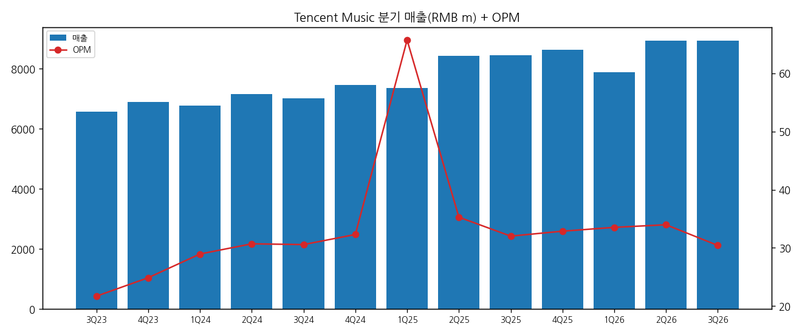
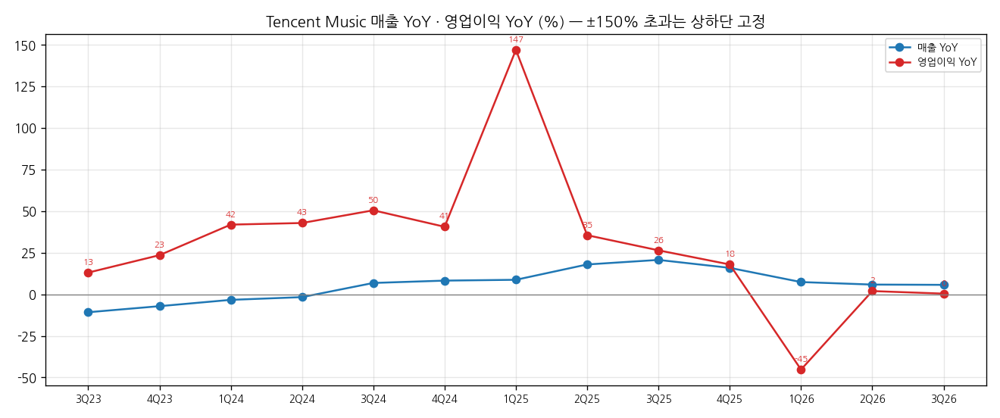

> 모드: 실적 리뷰 (v11)
> 종목: Tencent Music Entertainment (TME, NYSE / 1698.HK)
> 섹터: 엔터
> 서브섹터: 음원 글로벌
> 분기: 2026-Q3
> 발표일: 2026-11-17 (BMO, 웨비나 ET 06:00)
> 작성 시각: 2026-11-22 23:30 KST
> 분석 소스: SEC 6-K Ex.99.1(3Q26 실적 보도자료, 2026-11-17) + 과거 분기 실적 발표문(HKEX·6-K, `company-overview-source/TME_*`) / 웹 보완 — Music Business Worldwide(2026-11-17), Earnings Whispers(컨센), thecerbatgem 컨콜 요약, grafa. 셀사이드 리포트 첨부 없음
> 리뷰 깊이: 숫자 중심 | 리서치 첨부 0건 (1차 출처: SEC 6-K / 보도 인용은 "보도" 표기)
> 비영업 요인: 인수(Ximalaya, 2026-05-18 편입 — 3Q26 첫 온기 반영, 기여 미공시) · 기타이익 증가(3Q26 RMB 173m vs 94m) · 고기저(1Q25 관계사 간주처분이익 RMB 2,370m → 1Q26 YoY −45%)

# Tencent Music 3Q26 실적 리뷰

## 0. 한 줄 판정

> 성장 델타: 유지 (0%대 정체) | 내러티브: 약화 → 매매 제외 구간 (보고 영업이익 YoY +1.9% → +0.4%. 매출 +5.6%마저 Ximalaya 인수 효과가 섞인 숫자, KPI 공시 중단으로 구독 성장의 질을 확인할 수 없다)

> ⚠ 비영업 요인 플래그: 3Q26 영업이익 +RMB 10m(+0.4%)는 기타이익 +RMB 79m·이자수익 +RMB 11m 덕분 — 매출총이익 − 영업비용(핵심 영업이익)은 RMB 2,291m로 **−3.4% YoY** [계산]. 매출에는 Ximalaya 첫 온기 편입분 포함(기여 미공시 → 오가닉 분리 불가). 2Q26 기준 Ximalaya 매출은 RMB 407m(5/18\~6/30)

→ 숫자: 매출 RMB 8,941m (+5.6% YoY), 영업이익 RMB 2,720m (+0.4%, OPM 30.4%), 지배주주 순이익 RMB 2,154m (보합), Non-IFRS 순이익 RMB 2,450m (+1.9%). 매출 YoY 7.3%(1Q26) → 5.8% → **5.6%**, 영업이익 YoY −45.3%(1Q26, 고기저) → +1.9% → **+0.4%**
→ 쟁점 ①: 음악 관련 매출 +10.2%(멤버십 +9.2%, 마케팅·소비 +12.1%)에도 전사 성장은 5%대 — 소셜 엔터 −15.7%가 계속 깎는다
→ 쟁점 ②: 영업비용 +16.9%(G&A +17.7%) — Ximalaya 편입 비용과 인수 무형자산 상각(RMB 97m → 225m)
→ 다음 분기 관건: 4Q26 핵심 영업이익이 YoY 플러스로 돌아오는지(4Q25 RMB 2,615m [계산]), Ximalaya 기여 공개 여부

## 1. 숫자

① 연결 분기 표 (RMB m, IFRS 영업이익 — 기타이익·이자수익 포함)

| 항목 (RMB m) | 3Q23 | 4Q23 | 1Q24 | 2Q24 | 3Q24 | 4Q24 | 1Q25 | 2Q25 | 3Q25 | 4Q25 | 1Q26 | 2Q26 | **3Q26** |
|---|---|---|---|---|---|---|---|---|---|---|---|---|---|
| 매출 | 6,569 | 6,893 | 6,768 | 7,160 | 7,015 | 7,458 | 7,356 | 8,442 | 8,463 | 8,641 | 7,895 | 8,933 | 8,941 |
| 영업이익 | 1,425 | 1,714 | 1,959 | 2,198 | 2,144 | 2,409 | 4,836 | 2,978 | 2,710 | 2,840 | 2,647 | 3,035 | 2,720 |
| OPM | 21.7% | 24.9% | 28.9% | 30.7% | 30.6% | 32.3% | 65.7% | 35.3% | 32.0% | 32.9% | 33.5% | 34.0% | 30.4% |
| 매출 YoY | -10.8% | -7.2% | -3.4% | -1.7% | +6.8% | +8.2% | +8.7% | +17.9% | +20.6% | +15.9% | +7.3% | +5.8% | +5.6% |
| 영업이익 YoY | +13.0% | +23.5% | +41.9% | +42.8% | +50.5% | +40.5% | +146.9% | +35.5% | +26.4% | +17.9% | -45.3% | +1.9% | +0.4% |
| **매출 YoY 델타** | n.m. | +3.6%p | +3.8%p | +1.6%p | +8.5%p | +1.4%p | +0.5%p | +9.2%p | +2.7%p | -4.8%p | -8.5%p | -1.5%p | -0.2%p |
| **영업이익 YoY 델타** | n.m. | +10.5%p | +18.4%p | +1.0%p | +7.6%p | -9.9%p | +106.3%p | -111.4%p | -9.1%p | -8.5%p | -63.2%p | +47.2%p | -1.5%p |

→ 컨센 대비: 매출 $1.33B vs 컨센 $1.35B (−1.5%), Non-IFRS EPS $0.23 vs 컨센 $0.22 (Earnings Whispers, 보도) — "기대치 부합"
→ 1Q25 영업이익 RMB 4,836m에는 관계사 간주처분이익 RMB 2,370m 포함 → 1Q26 YoY −45.3%는 고기저 효과. 이를 넘기면 2Q26 +1.9% → 3Q26 +0.4%로 **보고 이익 성장이 사실상 멈췄다**
→ [판단] 영업이익 YoY의 정점은 1Q25(+146.9%, 일회성)이고, 일회성을 뺀 정점은 3Q24(+50.5%). 이후 4Q24 +40.5% → 2Q25 +35.5% → 3Q25 +26.4% → 4Q25 +17.9% → (1Q26 고기저) → 2Q26 +1.9% → 3Q26 +0.4%로 2년째 하강 경로. 회사 가이던스 없음, 다음 분기 E는 공란

→ (출처: 분기 실적 발표문·6-K, company-overview-source TME — 3Q26은 2026-11-17 6-K)

→ (출처: 같은 자료로 계산. 1Q25 +147%는 간주처분이익 일회성 — 상단 고정)

② 사업부별 (RMB m, 사업부 이익 미공시 — 매출만)

| 항목 (RMB m) | 3Q25 | 4Q25 | 2Q26 | 3Q26 | QoQ | YoY |
|---|---|---|---|---|---|---|
| 음악 관련 서비스 매출 | 6,969 | 7,099 | 7,605 | 7,682 | +1.0% | +10.2% |
| 소셜 엔터·기타 매출 | 1,494 | 1,542 | 1,328 | 1,259 | -5.2% | -15.7% |

→ 3Q26 음악 관련 매출 RMB 7,682m(+10.2%) = 멤버십 RMB 4,985m(+9.2%) + 마케팅·소비 RMB 2,697m(+12.1%, 아티스트 MD·오프라인 공연). 소셜 엔터·기타 RMB 1,259m(−15.7%) (6-K)
→ 매출 비중: 음악 86%, 소셜 14% — 소셜이 2021년 63%에서 줄어드는 구조 전환은 거의 끝났지만, 감소폭(−16%)이 여전히 전사 성장률을 2%p 이상 깎는다 [계산]
→ 이익 구조: 매출총이익률 42.8%(3Q25 43.5%, −0.7%p), 영업비용률 17.1%(15.5%) (6-K) — 마진 하락의 원인이 원가와 판관비 양쪽

③ 연간 (RMB m)

| 항목 | FY2023 | FY2024 | FY2025 | 9M26 | 9M25 |
|---|---|---|---|---|---|
| 매출 | 27,752 | 28,401 | 32,902 | 25,769 | 24,261 |
| 영업이익 | 6,059 | 8,710 | 13,364 | 8,402 | 10,524 |
| OPM | 21.8% | 30.7% | 40.6% | 32.6% | 43.4% |
| 핵심 영업이익(GP−OPEX) | 4,777 | 7,349 | 9,678 | 7,280 | 7,063 |
| 매출 YoY | −2.1% | +2.3% | +15.8% | +6.2% | — |
→ (출처: 20-F·분기 발표문 [계산]) FY2025 영업이익에는 1Q25 일회성 RMB 2,370m 포함. 핵심 영업이익 기준 9M26은 +3.1% [계산]

## 2. 시장 쟁점 (숫자 중심 — 회사 설명 + 컨콜)

① 지난 분기 체크
→ 첫 리뷰 — 직전 체크 없음

② 이번 분기 쟁점

(1) **성장의 질 — 인수 효과를 빼면 얼마나 크나**
(1-1) 회사 설명: Ximalaya 편입이 음악 관련 매출 성장과 영업비용 증가를 동시에 이끌었다. 기여 금액은 공개하지 않음 (6-K)
(1-2) 보도 해석: "매출 성장이 다시 적어도 부분적으로는 비유기적" (MBW)
(1-3) [판단] 2Q26 6주치 Ximalaya 매출이 RMB 407m이었으니 3Q26 온기 기여는 RMB 800\~900m 수준으로 추정 [추정]. 이를 빼면 3Q26 오가닉 매출은 YoY 마이너스일 가능성 — 회사가 분리 공시하기 전까지 확인 불가

(2) **SVIP 성장 — 숫자 없는 스토리**
(2-1) 회사 설명(CEO): "SVIP 성장과 유지가 건전", Ximalaya 결합으로 SVIP·기타 유료 회원의 지출이 늘고 있고 지갑 점유율을 더 가져올 여지 (6-K)
(2-2) 2026년부터 유료 가입자·ARPPU·SVIP 수 공시 중단 — 마지막 공시는 4Q25 유료 1.274억·SVIP 2,000만 이상 (기업 개요)
(2-3) [판단] 멤버십 매출 +9.2%는 가격(SVIP 믹스)과 Ximalaya가 섞인 숫자라 구독 성장 둔화를 가린다. 2026년 3월 4Q25 실적 후 주가 급락의 원인(KPI 공시 중단·구독 둔화)이 해소되지 않았다

(3) **비용 증가 — 마진 하락의 원인**
(3-1) 숫자: 영업비용 RMB 1,532m(+16.9%), G&A RMB 1,237m(+17.7%), 판매·마케팅 RMB 295m(+13.5%), 인수 무형자산 상각 RMB 97m → 225m (6-K)
(3-2) [판단] 상각비 증가분(RMB 128m)만으로 핵심 영업이익 감소분(RMB 80m)을 넘는다 — 인수 관련 회계 비용을 빼면 기존 사업 이익은 보합 수준 [계산]. 그래도 '성장' 판정에는 못 미친다

(4) **주주환원으로 주가 방어**
(4-1) 3Q26 자사주 3,470만 ADS 매입, 약 $300M(평균 $8.6/ADS). 현금·예금·단기투자 RMB 51.49B (6-K)
(4-2) 2H 파이프라인이 "기대 이상의 매출 성장"을 뒷받침한다는 회장 코멘트, 숫자 가이던스는 없음 (컨콜, 보도)

## 3. 내러티브 점검

→ 성장 스토리: **중국 음악 스트리밍 1위가 SVIP(5배 요금)로 ARPPU를 끌어올리며 소셜 엔터 축소를 메우고 이익률을 확장하는 구간** — 2023\~2025년 핵심 OPM 9% → 29%의 원동력
→ 이번 분기: 이익률 확장이 멈췄고(핵심 영업이익 −3.4%), 성장은 인수에 기대며, 이를 판단할 KPI는 공시되지 않는다 → **델타 유지(0%대) + 내러티브 약화 → 매매 제외 구간**
→ 다시 강하게 만들 트리거: Ximalaya 분리 공시로 오가닉 성장 확인 / SVIP 수 공시 재개 / 핵심 영업이익 YoY 플러스 복귀
→ 깨뜨릴 리스크: 오가닉 매출 마이너스 확인 / 숏폼·AI 음악 플랫폼으로의 이용자 이탈(MAU 4Q25 −5%) / 중국 소비 둔화로 MD·공연 매출 둔화

## 4. 향후 봐야 할 것

① **4Q26 핵심 영업이익 YoY** — 4Q25 RMB 2,615m 대비 플러스 복귀 여부 (델타 판정을 '유지'에서 바꿀 1순위 변수) / 4Q26 실적 발표문 / 2027년 3월 중순
② **Ximalaya 기여 공개** — 매출·이익 분리 공시 또는 오가닉 성장률 언급 / 실적 발표문·컨콜 / 2027년 3월
③ **멤버십 매출 증가율** — +9%대 유지 vs 한 자릿수 초반 둔화 (Ximalaya 효과 1년 후 기저 반영 전까지) / 분기 발표문 / 분기별
④ **디어유 버블 QQ뮤직** — C-POP 입점 수·로열티(디어유 IR)로 TME 팬덤 수익화 간접 확인 / 디어유 분기 IR / 분기별
⑤ **에스엠 지분(9.66%) 관련 이벤트** — TME의 한국 엔터 투자 확대·제휴 여부 / 공시·보도 / 수시
