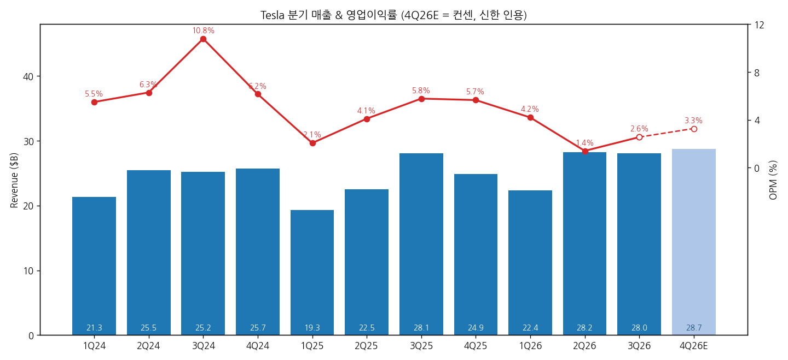
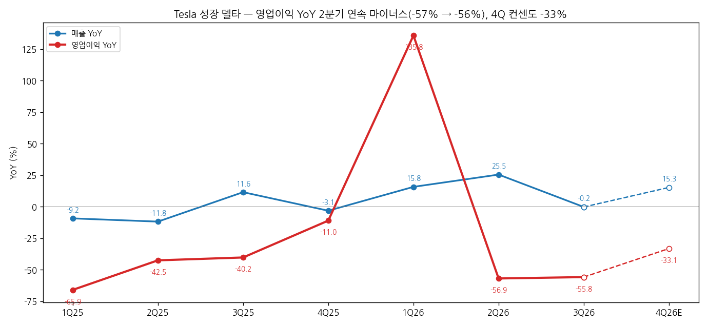
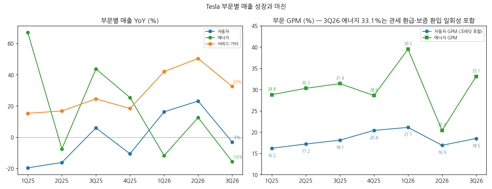
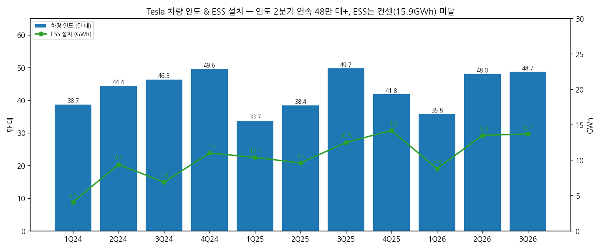

# Tesla 3Q26 실적 리뷰

> 모드: 실적 리뷰 (v11)
> 종목: Tesla (TSLA)
> 섹터: 미국 빅테크
> 서브섹터: 소비자·모빌리티
> 분기: 2026-Q3
> 발표일: 2026-10-21 (미 동부 장 마감 후)
> 작성 시각: 2026-11-01 16:30 KST
> 분석 소스: 국내 셀사이드 13건(대신 10/21 · 키움 · 한화 · 하나 · KB(AI 속보) · NH · 삼성 · 흥국 · 신영 10/22 · LS · 신한 · iM 10/23 · KB 10/28). 웹 보완: 해외 IB TP 변경(TipRanks·CNBC 10/22). 회사 IR 원본·컨콜 원문은 첨부되지 않아 경영진 발언은 증권사 Q&A 정리에서 인용

---

## 0. 한 줄 판정

> 성장 델타: **꺾임** | 내러티브: **유지** (로보택시·옵티머스 지연 ↔ FSD 수익화·Optimus 양산 개시·SpaceX 합병 옵션) → **숫자 기준 매매 제외 구간. 주가는 실적이 아니라 이벤트(Optimus·합병·EU FSD)로 움직이는 국면**

→ **숫자**: 매출 $28.0B(-0.2% YoY), 영업이익 $0.72B(-55.8%, OPM 2.6%). 영업이익 YoY는 2Q -56.9% → 3Q -55.8%로 **2분기 연속 마이너스** = 판정 기준상 꺾임. 단 OPM은 2Q 1.4%를 바닥으로 QoQ +1.2%p 반등, 조정 EPS $0.48은 컨센 +9.6%
→ **본업은 좋아졌다**: 크레딧 제외 자동차 GPM 16.3% → **18.1%**(컨센 16.7%), 인도 48.7만 대로 2분기 연속 48만 대+, 수주잔고 4년래 최대, 재고일수 27일(1Q) → 11일. FSD 유료 고객 174만 명(+67%), 북미 신차 부착률 75%+, FSD ARR 약 $10억. **이익을 지운 건 R&D(+69%)·주식보상(+76%) 등 AI·신사업 비용**
→ **쟁점**: 로보택시 실적 기여 2Q27 가시화·3~4Q27 유의미, Optimus 외부 인도 2027년 말 → 성장 축의 수익화가 모두 2027년 하반기 이후로 확인. 반면 CapEx 가이던스는 $25B+ → **약 $20B로 5분기 만에 첫 하향**, FCF $1.5B로 흑자 전환(컨센 -$4.5B)
→ **주가와 TP**: 시간외 -3.3~3.8% → 10/22 $374.58 → 10/27 **$407.46**(발표 전 대비 +5.4%). Optimus 양산 공식 확인·SpaceX 합병 기대가 주가를 끌어올림(iM). TP는 Piper $450 → $475, Canaccord $410 → $442 상향, GS·Truist 유지. 컨센 TP $407 → $410~418, 투자의견은 매수 49%·보유 38%·매도 13%로 빅테크 중 가장 분산
→ **다음 분기 관건**: 4Q 영업이익 컨센 $0.94B(YoY -33%) — 3분기 연속 마이너스가 유력. 숫자보다 12월 EU FSD 표결, Optimus 시연(1~2개월 내), 합병 특별위원회 결론이 주가 변수

---

## 1. 숫자

### ① 연결 기준 분기 표

| 항목 ($M) | 4Q24 | 1Q25 | 2Q25 | 3Q25 | 4Q25 | 1Q26 | 2Q26 | **3Q26** | 4Q26E 컨센 |
|---|---|---|---|---|---|---|---|---|---|
| 매출액 | 25,707 | 19,335 | 22,496 | 28,095 | 24,901 | 22,387 | 28,236 | **28,046** | 28,713 |
| 영업이익 | 1,583 | 399 | 923 | 1,624 | 1,409 | 941 | 398 | **718** | 942 |
| OPM | 6.2% | 2.1% | 4.1% | 5.8% | 5.7% | 4.2% | 1.4% | **2.6%** | 3.3% |
| 매출 YoY | 2.1% | -9.2% | -11.8% | 11.6% | -3.1% | 15.8% | 25.5% | **-0.2%** | 15.3% |
| 영업이익 YoY | -23.3% | -65.9% | -42.5% | -40.2% | -11.0% | 135.8% | -56.9% | **-55.8%** | -33.1% |
| **매출 YoY 델타 (%p)** | -5.7 | -11.3 | -2.6 | +23.4 | -14.7 | +18.9 | +9.7 | **-25.7** | +15.5 |
| **영업이익 YoY 델타 (%p)** | -77.3 | -42.6 | +23.4 | +2.3 | +29.2 | +146.8 | -192.7 | **+1.1** | +22.7 |
| 조정 EPS ($) | 0.73 | 0.27 | 0.40 | 0.50 | 0.50 | 0.41 | 0.33 | **0.48** | 0.46~0.47 |

→ (출처: 실적 = NH·흥국·신한(Tesla 공시). 4Q26E = 신한 표(컨센, 매출 $28.7B·영업이익 $0.94B), Bloomberg 4Q26 매출 $28.7B·조정 EPS $0.46(키움 10/21). 4Q24 조정 EPS는 공시 기준)
→ 3Q26 서프라이즈: **매출 컨센 대비 -0.3%(Bloomberg $28.13B)~-1.4%(FactSet $28.46B), 영업이익 +19.8%(Bloomberg $0.60B)·회사 취합 컨센 $0.72B 부합, 조정 EPS $0.48 vs $0.44(+9.6%)**, GAAP EPS $0.22(-43.6% YoY). GAAP·조정 차이는 주식보상비용(세후 $9.8억). GPM 19.6% vs 컨센 17.9%로 상회했지만 영업비용 $4.78B(+39% YoY) vs 컨센 $4.34B로 이익은 컨센 수준에 그침 (삼성·키움·KB)
→ 가이던스: 2026 CapEx 약 $20B(종전 $25B 초과), 3Q 누적 $13.0B → 4Q 약 $7B. "영업비용 증가세는 신제품 상업화까지 지속". $30B 차입 한도 확보(연내 인출 계획 없음) (삼성·대신)

→ (출처: NH·신한(Tesla 공시), 4Q26E 컨센)

→ (출처: 동일)

(1) YoY는 어디에 있나
→ 영업이익 YoY는 1Q26 +135.8%(기저 1Q25 OPM 2.1%) 한 분기를 빼면 **2024년 이후 거의 매 분기 마이너스**. 2Q·3Q26 -56~57%, 4Q 컨센 -33%로 3분기 연속 마이너스 경로
→ 매출 YoY도 2Q +25.5% → 3Q -0.2%로 급감속. 3Q25가 미국 세액공제 종료 전 수요 당겨쓰기로 높은 기저였던 영향(인도 49.7만 대)
→ `[판단]` "델타"로 보면 꺾인 상태가 이어지는 중이고, 개선 신호는 **QoQ OPM 바닥 통과(1.4% → 2.6% → 컨센 3.3%)** 하나. 이익의 바닥은 확인됐지만 YoY 플러스 전환은 컨센상 2027년 1분기 이후

### ② 사업부별 매출·영업이익

> 부문별 영업이익은 미공개 — 매출총이익(GPM)으로 대체

(1) 부문

| 부문 ($M) | 3Q25 | 2Q26 | **3Q26** | 매출 YoY | 매출 비중 | GPM 3Q25 | GPM 2Q26 | **GPM 3Q26** |
|---|---|---|---|---|---|---|---|---|
| 자동차 | 21,205 | 20,516 | **20,560** | -3.0% | 73.3% | 18.1% | 16.9% | **18.5%** (크레딧 제외 18.1%) |
| └ 규제 크레딧 | 417 | 146 | **113** | -72.9% | 0.4% | — | — | — |
| 에너지 발전·저장 | 3,415 | 3,139 | **2,881** | -15.6% | 10.3% | 31.4% | 20.4% | **33.1%** (일회성 포함) |
| 서비스·기타 | 3,475 | 4,581 | **4,605** | +32.5% | 16.4% | 10.5% | 14.1% | **15.9%** (사상 최고) |
| 전사 | 28,095 | 28,236 | **28,046** | -0.2% | 100% | 18.0% | 16.8% | **19.6%** |

→ (출처: 신한·NH·삼성(Tesla 공시). 크레딧 매출 $1.13억은 정부 규제 변경으로 계약상 반환된 크레딧 $4.75억을 매출에서 환입한 결과(KB))

(2) 부문 KPI 추이

| KPI | 3Q25 | 4Q25 | 1Q26 | 2Q26 | **3Q26** |
|---|---|---|---|---|---|
| 자동차 매출 YoY | +5.9% | -10.6% | +16.2% | +23.1% | **-3.0%** |
| 에너지 매출 YoY | +43.7% | +25.4% | -11.8% | +12.5% | **-15.6%** |
| 서비스·기타 매출 YoY | +24.6% | +18.4% | +42.0% | +50.4% | **+32.5%** |
| 인도 (만 대) | 49.7 | 41.8 | 35.8 | 48.0 | **48.7** |
| ESS 설치 (GWh) | 12.5 | 14.2 | 8.8 | 13.5 | **13.7** (컨센 15.9) |
| FSD 유료 고객 (만 명) | 약 104 | — | — | 약 148 | **174** (+67% YoY) |
| 크레딧 제외 ASP / 대당 원가 ($천) | — | — | — | 42.4 / 35.5 | **42.0 / 34.4** |

→ (출처: 신한·흥국·삼성·KB(Tesla 공시). FSD 3Q25·2Q26은 YoY·QoQ 증가율 역산)
→ `[판단]` **델타를 끄는 건 서비스·기타(충전·보험·FSD 부대매출)와 자동차 원가**다. 자동차는 ASP -0.9% QoQ보다 대당 원가 -3.0%가 커서 마진이 올랐고, FSD가 차량 구매 이유가 됐다(삼성). 에너지는 미국산 셀 공급망 전환에 따른 공급 제약으로 설치·매출이 컨센 -23%(키움). 에너지 GPM 33.1%는 관세 환급·셀 공급사 보증 환입 일회성이라 런레이트가 아니다(대신·iM)

→ (출처: 신한(Tesla 공시))

→ (출처: 신한·Tesla 공시)

(3) 비용·현금흐름

| 항목 ($M) | 3Q25 | 2Q26 | **3Q26** | YoY |
|---|---|---|---|---|
| R&D | 1,630 | 2,371 | **2,760** | +69.4% |
| 판관비 | 1,560 | — | **2,020** | +29.0% |
| 주식보상비용 | 670 | 1,160 | **1,170** | +75.7% |
| 영업현금흐름 | 6,240 | 4,700 | **6,260** (사상 최대) | +0.4% |
| CapEx | 2,250 | 5,790 | **4,730** | +110.5% |
| FCF | 3,990 | -1,090 | **1,530** | -61.6% |

→ (출처: 삼성·KB·대신·흥국(Tesla 공시). 2Q26 FCF·3Q25 일부는 증감률 역산 `[추정]`)
→ FCF 서프라이즈의 원천은 CapEx가 컨센($7.8B)보다 약 $3B 적었던 것과 운전자본(매입채무·미지급 +$3.99B, 이연매출 +$1.26B) — 이익 개선이 아니라 투자 이연 + 운전자본(삼성·키움). 보증 충당금 순증 $12.2억(전년 $3.0억의 4배), 누적 $101.4억(KB). 현금·투자자산 $45.5B

### ③ 연간

| 항목 ($B) | 2022 | 2023 | 2024 | 2025 | 2026E | 2027E |
|---|---|---|---|---|---|---|
| 매출액 | 81.5 | 96.8 | 97.7 | 94.8 | 107.0 | 120.5 |
| 영업이익 | 13.7 | 8.9 | 7.1 | 4.4 | 3.4 | 5.9 |
| OPM | 16.8% | 9.2% | 7.2% | 4.6% | 3.1% | 4.9% |
| 매출 YoY | 51.4% | 18.8% | 0.9% | -2.9% | 12.9% | 12.6% |
| 영업이익 YoY | 109.4% | -34.9% | -20.4% | -38.5% | -22.9% | 74.3% |

→ (출처: 실적 = iM·신한(Tesla 공시), 2026E·2027E = 신한 인용 컨센(Bloomberg). 하나 Bloomberg $3.3B / $5.8B로 유사)
→ 발표 전후 연간 컨센: 조정 EPS 2026E $1.72(Bloomberg 10/21) → $1.7(FactSet 10/27, KB)로 큰 변화 없음. 3Q 조정 EPS 상회분(+$0.04)과 4Q 비용 지속이 상쇄

---

## 2. 시장 쟁점

### ⓪ 지난 분기에 "봐야 할 것"으로 남긴 항목 체크

> 직전 분기(2Q26) 리뷰가 없어 **1Q26 리뷰 기반 팔로업(`2026-Q2_TSLA_팔로업.md`, 대상 2Q26)** 항목을 2Q·3Q 누적으로 체크

| 직전 팔로업 항목 | 2Q26 → 3Q26 결과 | 판정 |
|---|---|---|
| 재고 소진 속도 + 정상화 마진 | 재고일수 27일(1Q) → 15일 → 11일, 크레딧 제외 자동차 GPM 16.3% → 18.1% | 확인 |
| HW3 → AI4 리트로핏 보증 충당금 | 보증 충당금 순증 $12.2억(전년 4배), 누적 $101.4억 | 확인 (비용 현실화) |
| Optimus 양산 시작 시점 | 프리몬트 초기 생산 개시(양산 품질), 주 2만 대 도달은 최소 1년, 외부 인도 2027년 말 | 부분 확인 (시작은 했으나 램프 지연) |
| 로보택시 도시 확장 + EU/중국 FSD | 6개 도시, Cybercab 오스틴 투입. EU 9개국 승인·전역은 2027년 1Q 기대, 중국 미승인 | 부분 확인 |
| CapEx 변동 + Terafab 진척 | CapEx $25B+ → $20B 하향, Terafab 1H27 시운전·2028년 양산 | 확인 (하향 방향) |

### ① 이번 분기 쟁점 5개

| # | 쟁점 | 한 줄 정의 | 언급 |
|---|---|---|---|
| 1 | 마진 바닥 통과 vs 이익 감소 지속 | 자동차 GPM은 올랐는데 영업이익은 -56% — 어느 숫자를 볼 것인가 | 13/13 |
| 2 | 로보택시·Optimus 수익화 지연 | 모든 성장 축의 이익 기여가 2027년 하반기 이후로 | 12/13 |
| 3 | CapEx 하향 — 축소인가 이연인가 | $20B로 낮췄지만 Terafab만 2028년 초까지 수백억 달러 | 11/13 |
| 4 | FSD 수익화 — 크레딧의 빈자리를 메우나 | 부착률 75%, ARR $10억, EU·중국 승인이 관건 | 10/13 |
| 5 | SpaceX 합병 | 특별위원회 구성, 콜에서 질문 거부 — 주가의 진짜 변수 | 8/13 |

### ② 쟁점별 분해

#### 쟁점 1. 마진 바닥 통과 vs 이익 감소 지속

(1) 회사 설명
→ "규제 크레딧을 제외한 자동차 GPM 16.3% → 18.1%, 주된 배경은 아태 인도 비중 상승. 원자재·금리 부담은 금융 프로그램 조정으로 상쇄". "영업비용 증가는 대부분 R&D 관련 활동이며 신제품 상업화 시점까지 이어질 것" (삼성 CFO 코멘트)
→ R&D 증가 요인: SI(Super Intelligence) 개발, AI 컴퓨팅 감가상각, 자체 칩 개발, Optimus·Megapack 3·Semi 양산 준비 (삼성)

(2) 증권사별 해석

| 증권사 | 핵심 가정·추정 | 논리 |
|---|---|---|
| 하나 | OPM 1.4% → 2.6% | "마진은 바닥 통과" — 시선은 로보택시와 SpaceX로 |
| 삼성 | 영업현금흐름 $6.26B 사상 최대, 2026 OCF 약 $20B로 CapEx 자체 충당 | "현금 머신을 타고 로봇을 향해 간다" — FSD 구독 100만 명당 연 $11.8억 현금 유입, 모멘텀을 기다리는 편안한 시기 |
| 대신 | 영업비용 $4.78B(+39%)가 총이익 개선분을 흡수하는 구조 그대로 | 펀더멘털 보통, 밸류에이션 비쌈(12MF PER 173배 vs 5년 평균 101배) → 중립 |
| KB | 12MF P/E 197배, 12MF ROE 6.5%, PEG 9.6배 | 현 멀티플을 설명할 Earnings 부족 → 운용 비중 축소 유지. 보증 충당금 4배 증가 |
| iM | 비용 증가 속도 > 탑라인 개선 속도 | 전분기 대비 개선이지만 본업 반등엔 시간 필요 |
| 신영 | CEO 보상 관련 비용 | GPM 반등과 신사업 비용 급증이 동시에 나타난 실적 |

(3) 공통 결론 vs 갈리는 지점
→ 공통: 본업(자동차·서비스) 마진은 개선, 영업이익 감소는 AI·신사업 비용 때문
→ 갈림: **비용을 "투자"로 보고 현금흐름에 주목(삼성·하나)하느냐, "현 멀티플을 정당화 못 하는 이익"으로 보느냐(KB·대신)**

(4) `[판단]`
→ 모멘텀 판정에 필요한 건 전사 영업이익 델타이고, 그건 3분기 연속 마이너스 경로다. 본업 마진 개선은 사실이지만 회사가 "비용 증가는 상업화까지 지속"이라고 말한 이상 **2027년 상반기까지 이익 델타가 플러스로 돌아설 근거는 숫자에 없다**

#### 쟁점 2. 로보택시·Optimus 수익화 지연

(1) 회사 설명
→ 로보택시: 오스틴 Cybercab 투입(9/3), 차량 수 출시 한 달 만에 10배, 무감독 누적 주행 약 200만 마일(분기 중 8배). 11월 댈러스, 연말 24시간 운행·고객 Cybercab 소규모 인도(TaaS로만 운영). 고객 Model Y의 로보택시 편입은 2Q27. 실적 기여 2Q27 가시화·3~4Q27 상당한 수준. 마일당 $0.30 원가 목표는 미달 (삼성·대신·흥국)
→ Optimus: 프리몬트 대량생산 라인에서 초기 생산 개시. 연 100만 대(주 2만 대)까지 "최소 1년, 그 이상 걸릴 수 있다". 손·손가락이 최대 난제. 1~2만 대로 Optimus Academy 자가 학습. AI5 칩 2027년 4월경, 외부 인도 2027년 말. 오스틴에 프리몬트보다 큰 공장 착공 (삼성)

(2) 증권사별 해석

| 증권사 | 핵심 가정·추정 | 논리 |
|---|---|---|
| 삼성 | 로보택시 유의미 2H27, Optimus 대량 생산 2028년 | "일론 타임"과 밸류체인 코멘트를 고려하면 로봇 대량 생산은 2028년. 2027년 로보택시, 2028년 옵티머스가 현금흐름 추가 |
| KB | 두 사업 이익 기여 2027년 하반기 이후 | 투자 사이클 정점이 2028년으로 밀림 — 시간외 -3% 원인 |
| iM | Optimus 양산 공식 확인 | 당분간의 주가 상승 트리거 확보, 합병의 신호탄 |
| 대신 | 수익화 시점이 여전히 미래형 | 현 배수 정당화 어려움 |
| 신영·흥국 | 2027년 기대 요인 | 신사업 준비 시간 — 원가 절감이 이어지면 2H27부터 기여 |

(3) 공통 결론 vs 갈리는 지점
→ 공통: 두 사업 모두 2027년 하반기가 첫 실적 기여 시점
→ 갈림: 지연을 "악재"(KB·대신)로 보느냐, Optimus 양산 시작 자체를 "트리거"(iM)로 보느냐 — 실제 주가는 후자에 반응(10/27 $407)

(4) `[판단]`
→ 머스크가 이번엔 스스로 기대를 낮췄다("1년 더 필요, 단기 기대를 과도하게 높이고 싶지 않다", 신영). 일정 리스크는 오히려 줄었지만 **이익 숫자로 확인되는 시점은 최소 3개 분기 뒤**. 그때까지 주가는 시연·승인 같은 이벤트에 반응

#### 쟁점 3. CapEx 하향 — 축소인가 이연인가

(1) 회사 설명
→ "효율적 자본 집행의 결과"로 2026 CapEx $20B로 하향, 영업현금흐름으로 충당. 향후 수년간 CapEx 증가 지속(로보택시 플릿·Optimus·태양광·컴퓨트·반도체 팹). Terafab: 2028년 초까지 최소 수백억 달러, 장기 $1,000억 초과 가능, SpaceX와 비용 분담 미정. 2028년 CapEx 수백억 달러 (삼성·대신·키움)

(2) 증권사별 해석

| 증권사 | 핵심 가정·추정 | 논리 |
|---|---|---|
| 키움 | 4Q 약 $7B 집행 남음 | 축소가 아니라 이연 — FCF 흑자는 이어지기 어렵고 4Q부터 다시 적자 가능성 |
| 대신 | 5분기 연속 상향 경로가 처음 꺾임 | 단기 절제와 장기 확장(Terafab $1,000억)이 같은 콜에 공존 |
| 흥국 | — | 투자 부담을 덜고 성장 기반을 다지다 — 단기 현금 유출 우려 일부 완화 |
| KB | $30B 차입 한도 + 2027년 투자 확대 | Capex 하향은 축소가 아닌 이연 |

(3) 공통 결론 vs 갈리는 지점
→ 공통: 2026년 숫자는 낮아졌지만 2027~28년 투자 확대 방향은 오히려 강해짐
→ 갈림: 흥국은 단기 완화에, 키움·KB·대신은 이연에 무게

(4) `[판단]`
→ 하이퍼스케일러들과 반대로 CapEx를 낮춘 유일한 빅테크지만, Terafab 비용을 SpaceX와 어떻게 나누느냐가 정해지지 않았다. **합병 논의와 CapEx 경로가 같은 변수**라는 점이 핵심

#### 쟁점 4. FSD 수익화 — 크레딧의 빈자리를 메우나

(1) 회사 설명
→ FSD 유료 174만 명, 처음으로 절반이 월 구독. 북미 신차 75% 이상이 인도 시점 유료 FSD(전분기 대비 약 +20%p). 애널리스트 추정 FSD ARR 약 $10억은 "대체로 타당". 유럽 9개국 승인, EU 전역은 늦어도 2027년 1분기 기대(규제 기관 통제 사안), 중국은 승인 필요 (NH·삼성·키움)

(2) 증권사별 해석

| 증권사 | 핵심 가정·추정 | 논리 |
|---|---|---|
| 키움 | 크레딧 연 $4.5억 수준까지 축소 | 크레딧의 빈자리를 소프트웨어 매출이 메운 셈. 10월 말 NHTSA 답변·12월 EU FSD 표결이 첫 점검 |
| 삼성 | 글로벌 75% 유료 시 연 $78억 현금흐름, 연 200만 대 누적 시 $100억+ | FSD가 판매 증가 → 구독 → 영업현금흐름 선순환 |
| 하나 | EU 전역 승인 4분기 예상 | — |
| KB | 8월 이후 할부 금리 4차례 인상에도 수주잔고 4년래 최대 | 수요는 넘친다, 공급(배터리)이 병목 |

(3) 공통 결론 vs 갈리는 지점
→ 공통: FSD가 차량 수요와 마진의 핵심 동력으로 올라섰다
→ 갈림: EU 승인 시점(4분기 vs 2027년 1분기) — 회사도 통제 불가라고 명시

(4) `[판단]`
→ ARR $10억은 연 영업이익 $3~4B 규모에서 의미 있는 크기다. **EU 전역 승인이 나면 FSD 부착률 확대가 4Q~1Q 이익 델타를 바꿀 수 있는 유일한 단기 변수**

#### 쟁점 5. SpaceX 합병

(1) 회사 설명
→ 양사 사외이사 특별위원회 구성, 머스크는 이해충돌로 불참. 테슬라는 콜에서 합병 질문을 받지 않음. 합병 성사엔 테슬라 발행주식 과반 찬성 필요 (키움·신한 SpaceX Q&A). 테슬라는 SpaceX 지분 보유(3Q 평가손 -$1.42억) (삼성)

(2) 증권사별 해석

| 증권사 | 핵심 가정·추정 | 논리 |
|---|---|---|
| iM | Optimus 양산 확인 = 합병의 신호탄 | SI·칩·테라팹·로보틱스 시너지 |
| 키움 | 투표 참여 주식이 아닌 발행주식 과반 필요 | 결론까지 시간 필요, 질문 거부에 시간외 +1.9% → -3.3%로 반전 |
| KB | 지배구조 불확실성 | 리스크 요인 |
| 하나 | 시선은 로보택시와 SpaceX로 | 주가 변수의 중심 이동 |

(3) 공통 결론 vs 갈리는 지점
→ 공통: 합병은 테슬라 주가의 가장 큰 단일 변수
→ 갈림: 테슬라 주주에게 유리할지(시너지·AI 인프라 편입) 불리할지(지배구조·희석) — 조건 미정이라 판단 보류

(4) `[판단]`
→ SpaceX가 이번 분기 매출 +161%·영업흑자를 낸 반면 테슬라는 이익 -56%다. 합병 비율이 정해지면 **테슬라 주가는 자체 실적이 아니라 SpaceX 가치에 연동되는 구조**로 바뀐다 — 실적 기반 모멘텀 매매 프레임이 적용되기 어려운 종목이 된다

### ③ 낙관 vs 보수 — 논리 대비

| 구분 | 증권사 | 무엇을 다르게 가정했나 |
|---|---|---|
| 가장 낙관 | 삼성("현금 머신을 타고 로봇을 향해") · iM("합병의 신호탄") · Piper Sandler($475↑) | FSD 구독 현금흐름이 투자를 자체 충당, 2027 로보택시·2028 옵티머스가 차례로 현금흐름 추가, 합병 시너지 |
| 가장 보수 | KB(운용 비중 축소) · 대신(중립) · HSBC(Reduce, $157) | 12MF P/E 170~200배를 설명할 이익 부재, 수익화 2027년 하반기 이후, 보증 충당금 급증 |

→ 셀사이드와 바이사이드의 어긋남: 실적 직후 시간외 -3%대였지만 10/27엔 발표 전보다 +5.4%. 국내 셀사이드는 대부분 "지연·비쌈"이었는데 주가는 Optimus 양산 확인·합병 기대로 올랐다. **이익 델타와 주가가 가장 무관하게 움직이는 빅테크** `[판단]`

### ④ 추정치·TP 변화

| 증권사 | 직전 TP | 현재 TP | 4Q26 영업이익 E | 2026E / 2027E 영업이익 | 핵심 변화 한 줄 |
|---|---|---|---|---|---|
| Piper Sandler | $450 | $475 | — | — | Buy 유지 |
| Canaccord | $410 | $442 | — | — | Buy 유지 |
| Goldman Sachs | $360 | $360 | — | — | Neutral 유지 |
| Truist | $370 | $370 | — | — | 유지 |
| Evercore ISI | — | $300 | — | — | Hold |
| HSBC | — | $157 | — | — | Reduce |
| KB (국내) | — | 컨센 $417.9 인용 | — | $5.6B / $7.5B (FactSet) | 운용 비중 축소 유지 |
| 대신 (국내) | — | 셀사이드 평균 $382.7 인용 | — | — | 중립 유지, 28개 중 보유 14 |
| 신한 (국내) | — | — | $0.94B (컨센) | $3.4B / $5.9B (컨센) | 신사업 수익 가시성 확보에 주목 |
| 국내 기타 10사 | — | 자체 TP 없음 | — | 하나 $3.3B / $5.8B | 삼성: 현금흐름 기반 편안한 시기 |

→ (출처: 해외 = TipRanks·CNBC(10/22), 국내 = 각사 리포트. 해외 IB 개별 추정치는 원문 미입수. KB의 FactSet 영업이익은 산정 기준이 Bloomberg 컨센과 달라 직접 비교 불가)
→ 직전 TP가 확인된 2개사 평균 $430 → $458.5(**+6.6%**), 상향 2 · 유지 2 · 하향 0. 컨센 평균 TP $406.8(Bloomberg 10/21) → $409.7(TipRanks)~$418.6(Bloomberg 10/22)~$417.9(FactSet 10/27). 목표가 범위 $24.86~600으로 극단적
→ **TP 변화의 원천은 실적이 아니라 이벤트 기대**: 조정 EPS 컨센은 거의 그대로($1.72 → $1.7)인데 TP·주가는 상승. 12MF P/E 173~197배로 멀티플만 확대

---

## 3. 내러티브 점검

(1) 성장 스토리 정의
→ **"자동차는 FSD로 수익화하는 현금 기반이고, 진짜 가치는 로보택시·Optimus·AI(그리고 이제 SpaceX)라는 물리 AI 옵션에 있다"**

(2) 이번 분기가 스토리에 준 영향

| 축 | 방향 | 근거 |
|---|---|---|
| FSD 수익화 | 강화 | 174만 명(+67%), 북미 부착률 75%+, ARR $10억 |
| 자동차 현금 기반 | 강화 | 크레딧 제외 GPM 18.1%, OCF 사상 최대, 수주잔고 4년래 최대 |
| 로보택시·Optimus 타이밍 | 약화 | 이익 기여 2027년 하반기, Optimus 대량 생산 2028년(삼성) |
| SpaceX 합병 옵션 | 형성 | 특별위원회 구성, Optimus 양산과 맞물려 기대 형성 |

(3) 국면 판단
→ 영업이익 YoY 2분기 연속 마이너스(**꺾임**) × 강화·약화·형성이 섞인 스토리(**유지**) → **숫자 기준 매매 제외 구간**
→ 단 테슬라는 이익 델타가 아니라 내러티브 이벤트로 가격이 형성되는 종목이라, 이 프레임의 판정과 주가 방향이 엇갈릴 수 있다(이번 분기가 그 예). 프레임상 재진입 조건은 "이익 YoY 플러스 전환" 또는 "합병 조건 확정으로 SpaceX 가치 연동" 둘 중 하나 `[판단]`

(4) 트리거와 리스크

| 다시 강하게 만들 트리거 | 깨뜨릴 리스크 |
|---|---|
| 12월 EU FSD 전역 승인 → 부착률·ARR 급증 | EU·중국 FSD 승인 지연 → FSD가 크레딧 공백을 못 메움 |
| Optimus 사전 프로그래밍 없는 시연(1~2개월 내) + 외부 고객 계약 | 로보택시 사고·규제 이슈로 2Q27 수익화 일정 후퇴 |
| SpaceX 합병 조건이 테슬라 주주에 유리하게 확정 | 합병 무산 또는 불리한 비율, Terafab 비용을 테슬라가 대부분 부담 |

---

## 4. 향후 봐야 할 것 (4Q26)

| 순위 | 무엇을 (변수·임계값) | 어떤 데이터로 | 언제 |
|---|---|---|---|
| 1 | **4Q 영업이익 컨센 $0.94B(YoY -33%) 대비 위치 + OPM 3% 이상** — 영업비용 증가 속도와 크레딧 제외 자동차 GPM 18% 유지 | 4Q 인도량(1월 초), 4Q26 실적 | 2027년 1월 초 / 1월 하순 |
| 2 | **EU FSD 전역 승인(12월 표결) + 중국 승인** — 승인 시 FSD 부착률·ARR이 이익 델타의 유일한 단기 레버 | EU 표결 결과, NHTSA 답변(10월 말) | 12월 / 수시 |
| 3 | **SpaceX 합병 특별위원회 결론** — 합병 비율·Terafab 비용 분담 | 양사 8-K·위원회 발표 | 수시 |
| 4 | **로보택시 확장(댈러스 11월·연말 24시간 운행) + Optimus 시연** — 2Q27 수익화 일정 유지 여부 | 회사 발표, 무감독 주행거리, 시연 영상 | 11~12월 |
| 5 | **4Q CapEx 약 $7B·FCF + 에너지 공급 제약 해소** — ESS 설치 15GWh 이상 회복, 에너지 GPM 일회성 제외 수준 | 4Q 인도·설치 공시, 4Q 현금흐름표 | 2027년 1월 |

→ 이 목록이 다음 분기 리뷰의 ⓪ 체크 대상, `earnings-followup/2026-Q4_TSLA_팔로업.md`, 캘린더 시그널로 이어진다
