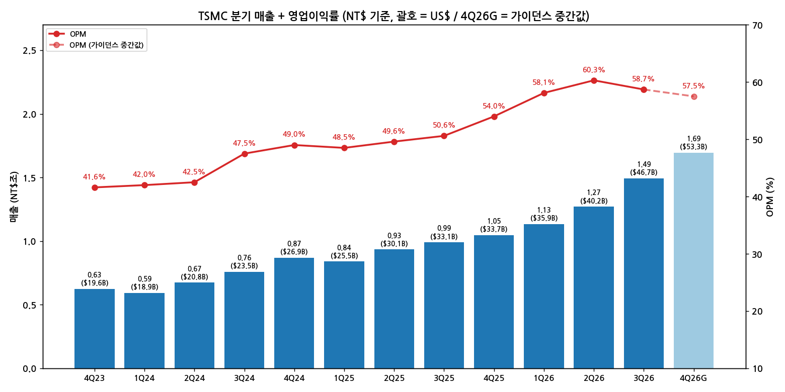
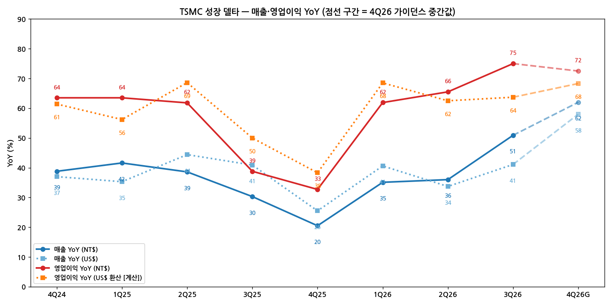

> 모드: 실적 리뷰 (v11)
> 종목: TSMC (TSM / 2330.TW)
> 섹터: 반도체
> 서브섹터: 파운드리
> 분기: 2026-Q3 (2026년 7～9월, 회계연도 = 캘린더)
> 발표일: 2026-10-15 (대만 오후, 현지 장 마감 후 발표·14:00 TST 컨콜) / 2026-10-15 KST 오후 (미국 ADR 기준 개장 전)
> 작성 시각: 2026-11-16 KST
> 분석 소스: TSMC 보도자료·월매출(pr.tsmc.com 3Q26 실적·10월 매출) + 기업개요 원천 데이터(`company-overview-source/TSM_TSMC`, 분기 매출·OPM·노드·플랫폼 비중) + 첨부 셀사이드 3개 — 메리츠증권(10/16, 컨콜 Q&A 정리), 신한투자증권(10/16), BofA(11/11, 이사회 예산·배당). 컨콜 내용은 리포트 인용 기준. 웹서치 보완 없음
> 리뷰 깊이: 풀 | 리서치 첨부 3건

# TSMC 3Q26 실적 리뷰 — AI가 스마트폰 공백까지 메웠다, 시장이 원한 건 2027년 숫자였다

## 0. 한 줄 판정

> 성장 델타: **가속 (매출 YoY NT$ +36.0% → +50.9% / US$ +33.7% → +41.1%, 영업이익 YoY NT$ +65.5% → +75.0%) — 단, 달러 환산 영업이익 YoY는 +62.5% → +63.7%로 사실상 유지, 4Q 가이던스상 약 +68%로 재가속** | 내러티브: **강화** → **적극 구간 — AI 수요 > 공급이 2027년까지 이어지고 CapEx가 한 단계 더 오르지만, 2027 가이던스 공백과 마진 희석이 주가를 묶고 있다** [판단]

→ 숫자: 매출 NT$1,494.2십억(US$46.72B, +50.9% YoY, +17.6% QoQ), 영업이익 NT$876.4십억(OPM 58.7%), EPS NT$29.43. 컨센 대비 매출 +2.1%, 영업이익 +2.6%, EPS +3.7% (메리츠·Bloomberg). 달러 매출은 가이던스 상단(US$45.8B)을 +2.0% 상회
→ 델타의 엔진: HPC 매출 +22% QoQ(회사), 비중 68%(사상 최고). 반대로 스마트폰은 달러 환산 YoY 약 −1%로 정체 [계산] — 성장은 전부 AI·HPC
→ 쟁점 ①: 4Q 가이던스 US$52.3～54.3B(중간값 컨센 +5.9%, YoY +58%) + 2026 달러 성장률 +44% — 수요는 공급 초과, 회사는 "수요 둔화 신호 없음"
→ 쟁점 ②: GPM 66.4%(−1.3%p QoQ) — 2nm 램프 + 해외 팹 희석 2%p(2026) → 3～4%p(향후 수년). 2027 OPM 추정이 FactSet 55.8% vs BofA 60.8%로 5%p 갈린다
→ 다음 관건: 2027 가이던스(1월 컨콜) — 매출 성장률·CapEx(BofA US$80～90B)·마진 희석 폭이 동시에 나온다

---

## 1. 숫자

① 분기 표 (캘린더 분기)

단위: NT$십억, US$B, %. **영업이익 = 회사 발표(TIFRS)**. 3Q25·2Q26·3Q26은 메리츠 표 실제치, 그 외는 매출 × 회사 공시 OPM [계산]. 4Q26G = 가이던스 중간값(US$53.3B × NT$31.8, OPM 57.5%) [계산]

| 항목 | 4Q23 | 1Q24 | 2Q24 | 3Q24 | 4Q24 | 1Q25 | 2Q25 | 3Q25 | 4Q25 | 1Q26 | 2Q26 | **3Q26** | 4Q26 가이던스 |
|---|---|---|---|---|---|---|---|---|---|---|---|---|---|
| 매출액 (NT$십억) | 625.5 | 592.6 | 673.5 | 759.7 | 868.5 | 839.2 | 933.8 | 989.9 | 1,046.1 | 1,134.1 | 1,270.4 | **1,494.2** | 1,694.9 |
| 매출액 (US$B) | 19.62 | 18.87 | 20.82 | 23.50 | 26.88 | 25.53 | 30.07 | 33.10 | 33.73 | 35.90 | 40.20 | **46.72** | 53.3 (52.3～54.3) |
| 영업이익 (NT$십억) | 260.2 | 248.9 | 286.2 | 360.9 | 425.5 | 407.0 | 463.2 | 500.7 | 564.9 | 658.9 | 766.6 | **876.4** | 974.6 |
| OPM | 41.6 | 42.0 | 42.5 | 47.5 | 49.0 | 48.5 | 49.6 | 50.6 | 54.0 | 58.1 | 60.3 | **58.7** | 57.5 (56.5～58.5) |
| GPM | 53.0 | 53.1 | 53.2 | 57.8 | 59.0 | 58.8 | 58.6 | 59.5 | 62.3 | 66.2 | 67.7 | **66.4** | 66 (65～67) |
| 매출 YoY (NT$) | 0.0 | +16.5 | +40.1 | +39.0 | +38.8 | +41.6 | +38.6 | +30.3 | +20.5 | +35.1 | +36.0 | **+50.9** | +62.0 |
| 매출 YoY (US$) | −1.6 | +12.9 | +32.8 | +36.0 | +37.0 | +35.3 | +44.4 | +40.9 | +25.5 | +40.6 | +33.7 | **+41.1** | +58.0 |
| 영업이익 YoY (NT$) | −20.0 | +7.6 | +41.7 | +58.3 | +63.5 | +63.5 | +61.8 | +38.8 | +32.7 | +61.9 | +65.5 | **+75.0** | +72.5 |
| 영업이익 YoY (US$ 환산) [계산] | −21.2 | +4.2 | +34.4 | +54.9 | +61.4 | +56.2 | +68.6 | +50.0 | +38.3 | +68.5 | +62.5 | **+63.7** | +68.3 |
| **매출 YoY 델타 (%p, NT$)** | — | +16.5 | +23.6 | −1.1 | −0.1 | +2.8 | −3.0 | −8.3 | −9.9 | +14.7 | +0.9 | **+14.9** | +11.1 |
| **영업이익 YoY 델타 (%p, NT$)** | — | +27.6 | +34.2 | +16.5 | +5.3 | 0.0 | −1.7 | −23.1 | −6.0 | +29.1 | +3.6 | **+9.5** | −2.5 |

→ (출처: 매출·US$ 매출·GPM·OPM = TSMC 분기 보도자료(pr.tsmc.com, 기업개요 원천 CSV). 3Q25·2Q26·3Q26 영업이익 = 메리츠 표1. 4Q22～3Q23 기저 = 같은 CSV. US$ 환산 영업이익 = US$ 매출 × OPM [계산])
→ 신한(FactSet, Non-GAAP 표기) 분기 영업이익은 2Q26 783.1·4Q25 574.8 등으로 회사 OPM 기준과 일부 차이 — 이 표는 회사 OPM 기준
→ 연간 2025 영업이익: 분기 합 1,936.1(BofA 1,936.1과 일치) vs 20-F(IFRS) 1,910.3 — 기준 차이, 이 리뷰는 분기 보도자료(TIFRS) 기준

서프라이즈: 매출 컨센 대비 **+2.1%**, 영업이익 **+2.6%**, EPS **+3.7%** (Bloomberg, 메리츠) / 영업이익 +3.3%, EPS +3.1% (FactSet, 신한). 달러 매출은 가이던스 상단 US$45.8B 대비 +2.0%, OPM 58.7%는 가이던스(56.0～58.0%) 상단 상회. 4Q 매출 가이던스 중간값은 컨센 US$50.3B 대비 **+5.9%** (메리츠)

(1) YoY 위치
→ 매출 YoY(NT$)는 4Q25 +20.5%가 바닥 → 1Q26 +35.1% → 3Q26 +50.9% → 4Q 가이던스 +62.0%로 **아직 올라가는 중**. 정점은 4Q26 이후 [전망]
→ 환율 왜곡: 3Q 평균 환율 NT$29.9 → NT$32.0(대만달러 약 7% 약세) [계산]이라 NT$ YoY가 달러 YoY보다 약 10%p 부풀려졌다. 달러 기준으로도 매출 YoY는 +33.7% → +41.1%로 가속
→ 영업이익: NT$ 기준 +65.5% → +75.0%로 가속, 달러 환산은 +62.5% → +63.7%로 유지. 4Q 가이던스는 달러 환산 약 +68%로 재가속. 컨센 경로상 영업이익 YoY 정점은 4Q26～1Q27, 2027년 컨센 연간 영업이익 YoY는 +27%(FactSet)로 감속 [판단]

(2) 성장 분해 — 가격·믹스 엔진
→ 매출 QoQ +16.2%(달러) 중 HPC가 +22% QoQ, 스마트폰 +10% QoQ(회사) — 증가분 약 US$6.5B 중 HPC 약 US$5.2B(약 80%) [계산]
→ 노드 믹스: 2nm 3% → 8%, 3nm 30% → 33%, 5nm 33% → 28% — 2nm+3nm 41%(전분기 33%). 선단(7nm 이하) 79%(+2%p)
→ OPM은 −1.6%p QoQ — 2nm 초기 램프 희석. 회사는 해외 팹 희석을 2026년 약 2%p로 제시

→ (출처: TSMC 보도자료, 메리츠. 4Q26G = 가이던스 중간값 × 환율 가정 NT$31.8 [계산])

→ (출처: 동일. 점선 = US$ 기준, US$ 영업이익 = 매출 × OPM [계산])

② 플랫폼별·노드별 매출

단위: US$B, %. **사업부(플랫폼·노드)별 영업이익은 미공개.** 금액은 회사 공시 비중(정수 %) × US$ 매출 [계산] — 비중 반올림으로 ±1～2%p 오차. QoQ는 HPC·스마트폰만 회사 발표치

(1) 플랫폼별

| 플랫폼 | 3Q26 매출 | 비중 | QoQ | YoY [계산] | 2Q26 매출 | 3Q25 매출 |
|---|---|---|---|---|---|---|
| **HPC** | **31.8** | **68** | **+22 (회사)** | **+68** | 26.5 (66%) | 18.9 (57%) |
| 스마트폰 | 9.8 | 21 | +10 (회사) | −1 | 8.8 (22%) | 9.9 (30%) |
| IoT | 1.9 | 4 | 약 −7 [계산] | 약 +13 | 2.0 (5%) | 1.7 (5%) |
| 자동차 | 1.9 | 4 | 약 +16 [계산] | 약 +13 | 1.6 (4%) | 1.7 (5%) |
| DCE·기타 | 1.4 | 3 | — | — | 1.2 (3%) | 1.0 (3%) |
| **합계** | **46.72** | 100 | +16.2 | +41.1 | 40.20 | 33.10 |

→ (출처: 비중 = 신한 표(회사 자료), HPC +22%·스마트폰 +10% QoQ = 메리츠·회사 컨콜. 금액·YoY [계산])

플랫폼별 YoY 추이 (US$, 비중 × 매출 [계산])

| 플랫폼 | 1Q26 | 2Q26 | **3Q26** | 방향 |
|---|---|---|---|---|
| HPC | +45 | +47 | **+68** | 가속 |
| 스마트폰 | +30 | +9 | **−1** | 꺾임 |
| HPC 비중 (1Q25→3Q26) | 59 → 60 → 57 → 55 → 61 → 66 → **68** | | | |

→ **델타를 끄는 곳 = HPC 단독.** HPC YoY가 +47% → +68%로 21%p 뛰는 동안 스마트폰 YoY는 +30% → +9% → −1%로 3개 분기 연속 둔화 [계산]
→ 회사가 말한 "가격 민감 소비자 수요 둔화(부품가 상승·매크로)"가 숫자로 이미 보인다. 4Q는 고객 신형 AP 양산 효과(신한)로 스마트폰이 계절적으로 받쳐 주는 분기 — 1Q27이 시험대 [전망]

(2) 노드별

| 노드 | 3Q26 매출 | 비중 | QoQ [계산] | YoY [계산] | 2Q26 비중 | 3Q25 비중 |
|---|---|---|---|---|---|---|
| **2nm** | **3.7** | **8** | **약 +209** | n.m. (신규) | 3 | 0 |
| **3nm** | **15.4** | **33** | **+28** | **+103** | 30 | 23 |
| 5nm | 13.1 | 28 | −1 | +7 | 33 | 37 |
| 7nm | 4.7 | 10 | +6 | +1 | 11 | 14 |
| 16nm 이상 | 9.8 | 21 | +6 | +14 | 23 | 26 |

→ (출처: 비중 = TSMC 보도자료·신한. 금액·증감 [계산])
→ 2nm+3nm 매출 US$19.2B, YoY +152% [계산] — 증가분 대부분이 최선단 두 노드. 5nm는 3분기 연속 비중 하락(37 → 28%)으로 3nm에 1위를 내줬다
→ 2027 N2 생산능력 2배 이상, 대만 N5 팹의 N3 전환 투자 진행 (메리츠) — 5nm 비중 축소는 의도된 전환

③ 연간

단위: NT$십억, %

| 항목 | 2022 | 2023 | 2024 | 2025 | **2026E** | 2027E (FactSet) | 2027E (BofA) |
|---|---|---|---|---|---|---|---|
| 매출액 | 2,263.9 | 2,161.7 | 2,894.3 | 3,809.1 | **5,593.6** | 7,447.0 | 7,852.8 |
| 영업이익 | 1,121.3 | 921.5 | 1,322.1 | 1,936.1 | **3,276.5** | 4,153.1 | 4,777.8 |
| OPM | 49.5 | 42.6 | 45.7 | 50.8 | **58.6** | 55.8 | 60.8 |
| 매출 YoY | +42.6 | −4.5 | +33.9 | +31.6 | **+46.8** | +35.1 | +40.4 |
| 영업이익 YoY | +72.5 | −17.8 | +43.5 | +46.4 | **+69.2** | +27.1 | +45.2 |

→ (출처: 2022～2024 = 기업개요(SEC XBRL), 2025 영업이익 = 분기 합(BofA 동일). 2026E = 9M 실적 + 4Q 가이던스 중간값 [계산] — BofA 5,594.1 / 3,291.0, 신한(FactSet) 5,511.8 / 3,267.7. 2027E = 신한(FactSet), BofA)
→ 달러 기준 2026 매출 성장률 가이던스: 1월 약 +30% → 7월 "40% 초반" → 10월 **+44%** (메리츠·기업개요)
→ 연간 컨센 변화: EPS 컨센 2026E 110.29(FactSet, 10/16) → 111.29(Visible Alpha, 11/11), 2027E 144.36 → 150.60 — **약 +1% / +4% 상향** [계산, 집계 기관 상이 — 방향만 참고]
→ 2027 OPM 추정 5%p 차이(55.8% vs 60.8%)가 이 종목의 가장 큰 숫자 쟁점 (2-2 쟁점 2)

---

## 2. 시장 쟁점

① 2-0. 지난 리뷰에서 "봐야 할 것"으로 남긴 항목 체크

> 첫 리뷰 — 직전 체크 없음 (earnings-review·earnings-followup에 TSM 이전 파일 없음. 캘린더 시그널 "파운드리 가동률, AI칩 수요, 첨단 노드 ramp (N3·N2)"는 모두 이번 분기 숫자로 확인됨 — 2nm 8%, 3nm 33%, HPC 68%)

② 2-1. 이번 분기 쟁점

| # | 쟁점 | 한 줄 정의 | 언급 증권사 |
|---|---|---|---|
| 1 | AI 수요 > 공급, 어디까지 가나 | 4Q 가이던스 +5.9% 상회, 2026 +44%, "수요 둔화 신호 없음" — 전력·HBM·DC 지연 우려를 회사가 일축 | 3/3 |
| 2 | 2nm 램프 + 해외 팹 마진 희석 | GPM −1.3%p, 해외 팹 희석 2%p → 3～4%p. 2027 OPM 55.8% vs 60.8% | 3/3 |
| 3 | CapEx 한 단계 상승 | 2026 US$60～64B 유지, '26～'28 투자 "직전 3년 대비 크게 증가", 이사회 예산 +116% → 2027 US$80～90B | 3/3 |
| 4 | 숫자 없는 낙관 — 2027 가이던스 공백 | AI CAGR 미상향, 2027 전망 미제시, "2027 사업계획은 신중히" — 비트에도 주가 −8% | 2/3 (메리츠·BofA) + 주가 |

③ 2-2. 쟁점별 분해

(1) 쟁점 1 — AI 수요 > 공급, 어디까지 가나

(1-1) 회사 설명
→ "수요가 매우 강하고 수요 둔화의 신호는 보이지 않는다. ('24～'29 AI 매출 CAGR이) 50% 후반인지 여부 자체가 중요하지 않으나, **아마 그보다 높아질 것**" (메리츠 Q1)
→ "CSP 설비투자, 데이터센터 건설, 재무 상황, 전력·부품 공급 등 가능한 모든 요소를 반영해 capa 계획 — **자체 평가 수요는 여전히 공급을 초과**" (메리츠 Q2). 미국 전력 공급 상황도 "현재까지 순조롭다" (Q12)
→ "Agentic AI를 위한 CPU 수요가 계속 증가" (Q11). 단 기존 AI CAGR에는 **CPU가 포함되지 않음** — 일반 서버용과 AI 서버용을 구분할 수 없어서 (Q13)
→ 소비자·가격 민감 수요는 부품가 상승·매크로로 둔화되지만 AI·HPC가 상쇄 (메리츠)

(1-2) 증권사별 해석 편차

| 증권사 | 핵심 가정·추정 | 논리 |
|---|---|---|
| 신한 | 4Q 매출 NT$1,663.1십억(가이던스 중간값), 2027F 매출 +35%(FactSet) | "AI 가속기(CPU 미포함) CAGR 50% 중후반 가이던스를 상회하는 수요 가시성 확보" — 초과 수요 → 적극적 CapEx |
| 메리츠 | 4Q 가이던스 컨센 +5.9%, 2027 매출·CapEx 전망은 예상 상회할 것 | TSMC는 GPU·CPU·네트워크·HBM 베이스 다이까지 AI 인프라 반도체를 전담 — 이 회사의 수요 진단이 AI H/W 밸류체인의 온도계 |
| BofA | 2027 선단 노드 가동률 100% 초과, '28도 AI 수요가 둔화·감소해도 양호 | 수요 측이 아니라 공급 측(가동률)으로 본다 — 초과 수요가 꺼져도 '28까지 버틴다 |

(1-3) 공통 결론 vs 갈리는 지점
→ 공통: 2027년까지 선단 노드·CoWoS는 공급 부족. 이번 분기 숫자(HPC +22% QoQ)가 그 증거
→ 갈림: **CPU를 포함한 AI 수요 재정의** — 메리츠는 CPU 포함 전망 수정 발표 가능성을 열어 두고, 신한·BofA는 기존 CAGR 위에서 추정. 상향 폭이 2027 매출 추정 차이(+35% vs +40%)로 이어진다

(1-4) [판단]
→ 이번 분기에 확인된 건 "수요가 강하다"가 아니라 **"수요가 HPC 한 곳에 몰려 있다"** 는 것이다. HPC YoY +68%, 스마트폰 −1% — 회사가 2027을 '신중'하다고 한 건 AI가 아니라 이 소비자 쪽 얘기다. 1Q27(비수기)에 스마트폰 YoY가 마이너스로 내려가도 HPC QoQ가 플러스면 델타는 유지된다. 반대로 HPC QoQ가 한 자릿수 초반으로 내려가면 전체 델타가 바로 꺾인다 — HPC QoQ가 1순위 변수

(2) 쟁점 2 — 2nm 램프 + 해외 팹 마진 희석

(2-1) 회사 설명
→ 3Q GPM 66.4%(−1.3%p QoQ)는 2nm 램프업 영향, 가이던스(65.0～67.0%) 내 (메리츠·신한)
→ 4Q GPM 가이던스 65～67% — "2nm 비중 확대, 해외 팹 양산 물량 증가로 소폭 하락 예상. 원가 관리 통한 효율화 지속" (신한)
→ 해외 팹 GPM 희석: **2026년 약 2%p → 미국 팹 생산 확대에 따라 향후 수년간 3～4%p** (메리츠)
→ "TSMC의 수익성에는 한계가 없지만, 단기간에 급격히 개선되는 것도 없을 것" (메리츠 Q3)

(2-2) 증권사별 해석 편차

| 증권사 | 핵심 가정·추정 | 논리 |
|---|---|---|
| 메리츠 | 희석 요인이 "실제 전망치에 반영되는 국면" | 과거 수 분기 예고한 희석이 숫자로 들어오기 시작 — 새 악재는 아니다 |
| 신한 (FactSet) | 2026F OPM 59.3% → 2027F **55.8%** | 2nm·해외 팹 희석이 2027 마진을 3.5%p 끌어내린다 |
| BofA | 2026E 58.8% → 2027E **60.8%** → 2028E 62.2% | 선단 가동률 100% 초과 + 가격 → 희석을 흡수하고 마진 확대 |

(2-3) 공통 결론 vs 갈리는 지점
→ 공통: 2026 4분기 GPM 65～67%, 해외 팹 희석은 커진다
→ 갈림: **2027 OPM — 55.8% vs 60.8%, 영업이익으로 NT$625십억(약 15%) 차이** [계산]. 가격 인상(공급 부족)이 희석(2nm 초기·애리조나·구마모토)을 이길지가 핵심

(2-4) [판단]
→ 2nm는 3nm 때와 같은 경로다 — 3nm 비중이 6%(2023)에서 26%(4Q24)로 커지던 2024년에도 GPM은 53% → 59%로 올랐다. 신규 노드 램프 희석은 가격·가동률로 흡수돼 왔다. 문제는 해외 팹 3～4%p라는 구조적 희석이고, 이건 가격으로만 상쇄된다. 3Q OPM 58.7%가 가이던스 상단을 넘었고 4Q 가이던스도 57.5%(중간값)로 2025년 평균(50.8%)보다 7%p 높다 — 2027 컨센 55.8%는 보수적이라고 본다. 1월 컨콜에서 장기 GPM 목표 문구가 상향되는지가 확인 지점 [판단]

(3) 쟁점 3 — CapEx 한 단계 상승

(3-1) 회사 설명
→ 2026 CapEx US$60～64B 가이던스 유지(1월 US$52～56B에서 7월 상향), 3Q CapEx US$13.8B 집행 (메리츠)
→ "**2026～28 투자는 직전 3년(2023～25, 약 US$101B) 대비 크게 늘어날 것**. 장비·자재·인건비 상승은 사실이나, 잘 해낸다면 **매출 성장률이 CapEx 증가율을 앞설 것**" (메리츠 Q10, 신한)
→ N3: "목표 capa 도달 시 추가 투자를 하지 않는 관행"을 깨고 세 사이트에서 신규 팹 — 타이난 신규 팹 1H27 양산, 추가 1곳 1H28. 애리조나 2팹 3Q27 양산(앞당김), 일본 N3 2028 (메리츠)
→ 전 세계 25개 팹 프로젝트 진행, 텍사스 등 애리조나 외 지역 검토, "Terafab을 건설하려는 고객사 한 곳과 논의" (메리츠 Q5)
→ 11/10 이사회: 자본 예산 US$40.9B 승인, 분기 배당 NT$7 → NT$9, 프론티어 AI 연구소 투자 최대 US$1B (BofA). 기업개요 기준 Anthropic·OpenAI 각 최대 US$5억

(3-2) 증권사별 해석 편차

| 증권사 | 핵심 가정·추정 | 논리 |
|---|---|---|
| 메리츠 | 2027 CapEx 전망은 예상을 상회할 것 | AI H/W 투자 심리 개선을 견인 — TSMC CapEx가 밸류체인 전체의 선행지표 |
| 신한 | 2026 US$62B, 첨단 패키징 협력사(ASE·Amkor) 2027년 2배 | 직접 수혜 가능한 국내외 장비사 실적 기대 — CapEx를 장비 밸류체인 신호로 해석 |
| BofA | 2026 US$62B → **2027 US$80～90B** (BofAe US$83B, street 약 US$80B) | 누적 예산 YoY +50%(장기 추세 +40～45% 상회), 2026 예산 +116% YoY, 56%가 선단 전공정 — 3nm·2nm 가파른 증설 |

(3-3) 공통 결론 vs 갈리는 지점
→ 공통: CapEx는 2027년에 한 단계 더 오른다 (+30% 안팎) [계산: US$80～83B / US$62B]
→ 갈림: 첨부 3건 안에서 방향 이견은 없음. 갈리는 건 **CapEx를 TSMC 주주에게 좋은 신호로 보느냐(BofA: FCF가 '26 US$53B → '27 US$76B → '28 US$109B로 늘어 배당 감당)**, 아니면 밸류체인(장비·패키징) 신호로 쓰느냐(신한·메리츠)

(3-4) [판단]
→ CapEx 증가 자체는 TSMC에 부담이 아니다 — BofA 추정상 영업현금흐름이 CapEx를 넘는 폭이 오히려 커진다. 핵심은 회사가 말한 "**매출 성장률 > CapEx 증가율**"이 2027에 지켜지느냐다. 2027 CapEx +30%면 매출 +35%(FactSet)로 간신히 지켜지는 수준 — CapEx가 US$90B(+45%)까지 가면 이 공식이 깨지고 마진 희석 논쟁(쟁점 2)과 겹친다 [판단]
→ 피어 대비: 같은 기간 인텔 파운드리는 OPM −27.7%·외부 매출 $0.41B(일회성), 삼성 파운드리는 3Q 적자 지속 (각 3Q26 리뷰) — 경쟁사가 손실을 줄이는 단계에서 TSMC는 OPM 58.7%로 증설 속도를 올린다. 공급 측 경쟁 구도는 이번 분기에도 바뀌지 않았다

(4) 쟁점 4 — 숫자 없는 낙관, 2027 가이던스 공백

(4-1) 회사 설명
→ "2026년 이후 CapEx 규모를 소통하기는 아직 이르다" (메리츠 Q10), "향후 생산능력 증가율을 구체적으로 소통하기는 이르다" (Q4)
→ 중장기 AI 가이던스 상향 없음, 2026년 이후 매출 전망 미제시 (메리츠)
→ C.C. Wei: 소비자·가격 민감 부문은 부품가 상승·거시 불확실성에 부담 — "2027 사업 계획은 신중하게(prudent)" (기업개요 원천 메모, 컨콜 보도 인용)

(4-2) 증권사별 해석 편차

| 증권사 | 핵심 가정·추정 | 논리 |
|---|---|---|
| 메리츠 | "정량 지표 업데이트가 적었다" | 다만 향후 예상 상회하는 2027 매출·CapEx 발표로 심리 개선 — 공백은 시간 문제 |
| BofA | 2027E/28E P/E 15x/13x (역사적 11～21x) | 34% EPS CAGR 대비 밸류에이션 부담 없음, AI 컴퓨트 증가 시나리오에서 방어적 |
| 주가 (시장) | ADR US$422.3(10/15) → US$388.62(11/10), **−8.0%** [계산] | 비트·레이즈에도 하락 — 2027 정량 신호 부재 + "prudent" 문구 + 마진 희석에 반응 [판단] |

(4-3) 공통 결론 vs 갈리는 지점
→ 공통: 2027 숫자는 1월 컨콜(4Q26 실적)에서 나온다
→ 갈림: 셀사이드는 공백을 "보수적 소통"으로, 시장은 "AI 피크 신호를 숨긴 것"일 수 있다고 반응 [판단]

(4-4) [판단]
→ TSMC는 매년 1월에 연간 가이던스를 주는 회사라 10월 공백은 관행이다. 다만 2026년 내내 가이던스를 세 번 올린(+30 → 40초반 → +44%) 회사가 이번엔 AI CAGR을 "아마 더 높아질 것"이라고만 하고 숫자를 안 바꿨다 — 시장은 상향 '횟수'에 익숙해져 있었다. 1월에 2027 매출 성장률이 +30%대 중반 이상, CapEx US$80B 이상으로 나오면 이 할인은 풀린다 [전망]

④ 2-3. 낙관 vs 보수 — 논리 대비

| 구분 | 증권사 | 무엇을 다르게 가정했나 |
|---|---|---|
| 낙관 | BofA | 2027 OPM 60.8%·매출 +40% — 공급 부족이 가격으로 희석을 이긴다. 선단 가동률 '27 100% 초과, '28도 양호. PO NT$3,260 / US$620 (20x '27 P/E) |
| 낙관 | 메리츠 | AI CAGR에 CPU가 들어가면 숫자가 한 단계 더 올라간다 — 2027 매출·CapEx 예상 상회 |
| 보수 | 신한(FactSet 컨센) | 2027 OPM 55.8%·영업이익 +27% — 희석이 그대로 마진에 남는다 (투자판단 ★★★★★로 방향은 긍정) |
| 보수 | 주가 | 발표 후 약 4주간 ADR −8%, 52주 고점 US$487.5 대비 −20% [계산] |

→ 핵심 차이는 **2027 마진(희석 vs 가격)** 과 **AI 수요 정의(CPU 포함 여부)**
→ 셀사이드 vs 시장: LSEG 컨센 TP US$561.9(신한) 대비 10/15 주가 상승여력 +33%, 11/10 기준 +45% [계산] — 셀사이드 낙관과 주가 반응이 어긋나 있다

⑤ 2-4. 추정치·TP 변화

| 증권사 | 의견 / TP | TP 변화 | 4Q26 영업이익 E | 2026 / 2027 영업이익 E (NT$십억) | 핵심 변화 한 줄 |
|---|---|---|---|---|---|
| 신한 | 투자판단 ★★★★★ / 자체 TP 없음 (LSEG 컨센 US$561.9) | — | 950.7 (FactSet) | 3,267.7 / 4,153.1 | 3nm 이하 capa 증설 추가 확대 — 장비 밸류체인 수혜 |
| 메리츠 | Issue Comment, 의견·TP 없음 | — | — (매출 컨센 US$50.3B, 가이던스 +5.9%) | — | 수요 우려 일축, 2027 숫자 공백 |
| BofA | Buy / PO NT$3,260 · US$620 | 유지 (10/12 설정) | — | 3,291.0 / 4,777.8 | 2027 CapEx US$80～90B, 배당 NT$9, AI 연구소 투자 |

→ 4Q 영업이익: 가이던스 중간값 계산치 NT$974.6십억 vs 신한 표(FactSet) 950.7 — 가이던스가 약 +2.5% 높다 [계산]
→ TP 상향·하향 건수: 첨부 3건 중 자체 TP는 BofA 1건(유지) — 평균 TP 변화율 미확인
→ EPS 컨센 2027E +4% 상향(FactSet 10/16 → Visible Alpha 11/11) vs 주가 −8% — 이번 조정은 **실적 하향이 아니라 멀티플 압축** (BofA 기준 '27 P/E 약 14x) [판단]

---

## 3. 내러티브 점검

① 성장 스토리 정의
→ "AI 가속기·CPU·네트워크·HBM 베이스 다이까지 **AI 인프라 반도체 제조를 사실상 독점**하는 회사가, 공급 부족 속에서 선단 노드(3nm → 2nm → A16/A14)와 CoWoS 증설로 물량과 가격을 동시에 올린다"

② 이번 분기 평가 — **강화**
→ 강화 요소: HPC +22% QoQ·비중 68%(사상 최고), 4Q 가이던스 컨센 +5.9%, 2026 성장률 +44%(세 번째 상향), "수요 > 공급"·"AI CAGR 아마 더 높아질 것", N3 신규 팹 3곳·애리조나 2팹 앞당김, 이사회 예산 +116%·배당 NT$9, A14 수요 > N2
→ 약화 요소: GPM −1.3%p·해외 팹 희석 3～4%p 예고, 스마트폰 YoY −1%(소비자 둔화), 2027 정량 가이던스 부재·"prudent", 비트에도 주가 −8%
→ 스토리의 핵심 전제(AI 공급 부족·기술 독점)는 숫자로 더 강해졌다. 약화 요소는 스토리 바깥(소비자)과 마진 수준 — 강화 [판단]

③ 국면 — 델타 가속 × 내러티브 강화
→ 매출 YoY는 달러 기준으로도 가속(+33.7 → +41.1%), 4Q 가이던스(+58%)까지 더 오른다. 영업이익은 달러 환산 고원(+62～68%)이지만 4Q 재가속 — **적극 구간** [판단]
→ 같은 반도체 섹터 안에서 메모리(레이어 모멘텀 종료 판단)·HDD(적극 구간 후반)보다 델타 정점이 한두 분기 늦다. 영업이익 YoY 정점은 4Q26～1Q27, 2027 연간은 +27～45%로 감속 [전망]
→ 파운드리 서브섹터 안에서는 TSMC 단독 — 인텔·삼성 파운드리는 여전히 적자(각 3Q26 리뷰)라 섹터 델타 = TSMC 델타

④ 다시 강해질 트리거
→ 1월 2027 가이던스: 매출 +30%대 중반 이상 + CapEx US$80B 이상 + 장기 GPM 목표 상향
→ AI 매출 가이던스 재정의(CPU 포함) 또는 '24～'29 CAGR 상향
→ N2 비중 두 자릿수 진입(4Q26～1Q27)과 GPM 65% 이상 유지 동시 확인

⑤ 깨뜨릴 리스크
→ HPC QoQ 한 자릿수 초반으로 둔화 (고객 재고 조정·DC 전력 병목 현실화)
→ 해외 팹 희석 4%p 초과 또는 2nm 수율 문제로 GPM 63% 하회
→ 인텔 14A·삼성 2nm 외부 대형 수주 현실화(BofA 리스크 ②), 미국 Section 232 반도체 관세 최종 세율

---

## 4. 향후 봐야 할 것

| 순위 | 무엇을 (변수·임계값) | 어떤 데이터로 | 언제 |
|---|---|---|---|
| 1 | **4Q26 매출 US$52.3～54.3B 달성 + HPC QoQ 두 자릿수 유지** — 10월 NT$586.9십억(+59.7% YoY) 기준, 11+12월 합 약 NT$1,108십억 이상이면 중간값 달성 [계산]. HPC QoQ 한 자릿수 초반이면 델타 '유지'로 하향 | TSMC 월매출(11월분 12/10, 12월분 1/10), 4Q26 실적 | 2026-12-10 / 2027-01 중순 |
| 2 | **2027 가이던스** — 매출 성장률(컨센 FactSet +35%), CapEx(BofA US$80～90B, street 약 US$80B), "매출 성장률 > CapEx 증가율" 유지 여부 | 4Q26 실적 컨콜 | 2027-01 중순 |
| 3 | **마진 희석 폭** — 4Q GPM 65% 이상, 2027 해외 팹 희석 3～4%p 진입 시점, 장기 GPM 목표 변경 (2027 OPM 55.8% vs 60.8% 판가름) | 4Q26 실적·컨콜 | 2027-01 중순 |
| 4 | **AI 수요 재정의** — '24～'29 AI CAGR 상향 또는 CPU 포함 재정의, CoWoS capa(5x → 9x reticle) | 컨콜, 4월 기술 심포지엄 | 2027-01～04 |
| 5 | **선단 노드·경쟁** — N2 비중 10% 이상, 애리조나 2팹(3Q27)·A14 리스크 생산(2027), 인텔 14A 1.0 PDK·EMIB 외부 고객, 삼성 2nm 수주 | TSMC 보도자료, INTC·삼성전자 4Q 실적 | 2027-01～04 |

→ 1순위가 델타 판정을 바꾼다. 월매출이 분기 실적보다 한 달 먼저 신호를 준다 — 12/10 11월 매출이 첫 체크포인트

---

> Sources: TSMC 보도자료·월매출(pr.tsmc.com, 기업개요 원천 데이터 경유), 메리츠증권(2026-10-16), 신한투자증권(2026-10-16), BofA Global Research(2026-11-11) — 리포트 원문은 비공개 보관
