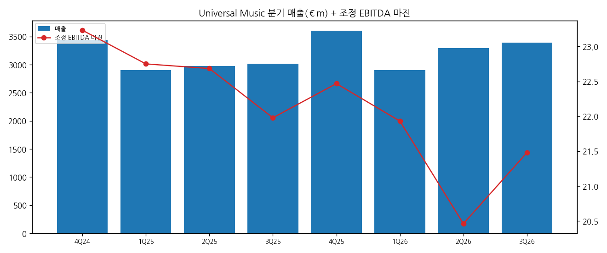
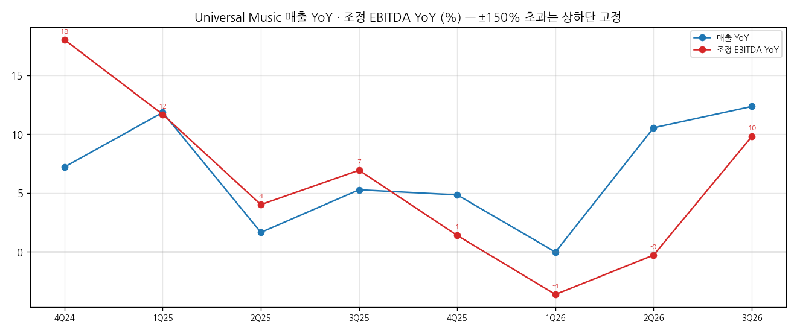

> 모드: 실적 리뷰 (v11)
> 종목: Universal Music Group (UMG, Euronext Amsterdam)
> 섹터: 엔터
> 서브섹터: 음원 글로벌
> 분기: 2026-Q3
> 발표일: 2026-10-29 (암스테르담 장후)
> 작성 시각: 2026-11-22 23:30 KST
> 분석 소스: 회사 3Q26 실적 보도자료(보도 전재본) + 과거 분기 실적(`company-overview-source/UMG`, 기업 개요 v1.0) / 웹 보완 — Music Business Worldwide(2026-10-29, 컨콜 정리), Music Week(2026-10-29), Newsquawk(컨센), Finimize·Reuters 요약, Idéal Investisseur, securities.io. 셀사이드 리포트 첨부 없음. 회사 IR 원문은 외부망 차단으로 미확보
> 리뷰 깊이: 숫자 중심 | 리서치 첨부 0건 (1차 출처: 회사 IR 분기 보도자료 — 전재본·보도 인용, 출처 등급 "보도")
> 비영업 요인: 인수(Downtown Music, 2026-02-20 편입 — 3Q26 매출 €195m·조정 EBITDA €13m) / 판정 지표 예외(아래)

> **판정 지표 예외**: UMG는 1·3분기에 IFRS 영업이익을 공시하지 않는다(분기는 매출·조정 EBITDA, 반기·연간만 전체 손익). 보고 기준 분기 영업이익이 없어 **회사 조정 EBITDA로 델타를 판정** [예외 — 규칙상 보정 지표 판정 금지, BT 확인 필요]. 반기 기준 보고 영업이익(1H·FY)은 4Q 리뷰에서 대조

# Universal Music 3Q26 실적 리뷰

## 0. 한 줄 판정

> 성장 델타: 가속 | 내러티브: 유지 (회복 신호) → 관찰 구간 (조정 EBITDA YoY −3.6% → −0.3% → +9.8%로 2개 분기 연속 개선, Downtown을 빼도 +7.8%. 구독 성장이 컨센을 넘으며 상반기 점유율 우려를 일부 해소 — 단 오가닉 구독 성장의 1/3 이상이 가격)

> ⚠ 비영업 요인 플래그: Downtown 인수 편입 — 3Q26 매출 €195m(그룹 매출 성장 +12.3% 중 약 6.5%p), 조정 EBITDA €13m(마진 6.7%로 그룹 마진 희석). Downtown 제외 조정 EBITDA €716m = YoY +7.8%, 2Q26 Downtown 제외 −1.8%에서 개선 [계산] → 오가닉 기준으로도 가속. 판정 지표는 조정 EBITDA(위 예외)

→ 숫자: 매출 €3,394m (+12.3% YoY, 고정환율 +11.7%, Downtown 제외 고정환율 +5.3%), 조정 EBITDA €729m (+9.8%, 마진 21.5%). 매출 YoY 0.0%(1Q26) → 10.5% → **12.3%**, 조정 EBITDA YoY −3.6% → −0.3% → **+9.8%**
→ 쟁점 ①: **구독 매출 반등** — Recorded Music 구독 €1,422m(고정환율 +19.2%, Downtown 제외 +9.5%) vs 컨센 +8.2% (ING, Reuters 인용). 회사 "상반기보다 점유율 역풍 완화"
→ 쟁점 ②: **가격 의존** — 오가닉 구독 성장의 1/3 이상이 가격(Streaming 2.0 도매가 인상), Apple Music과는 아직 Streaming 2.0 계약 없음 (컨콜, MBW)
→ 다음 분기 관건: 4Q26 조정 EBITDA YoY가 두 자릿수를 이어가는지(4Q25 €810m 기준), Downtown 마진 개선(6.7% → 두 자릿수) 속도

## 1. 숫자

① 연결 분기 표 (€m, 회사 조정 EBITDA — 위 판정 지표 예외)

| 항목 (€m) | 4Q24 | 1Q25 | 2Q25 | 3Q25 | 4Q25 | 1Q26 | 2Q26 | **3Q26** |
|---|---|---|---|---|---|---|---|---|
| 매출 | 3,439 | 2,901 | 2,980 | 3,021 | 3,605 | 2,900 | 3,294 | 3,394 |
| 조정 EBITDA | 799 | 660 | 676 | 664 | 810 | 636 | 674 | 729 |
| 조정 EBITDA 마진 | 23.2% | 22.8% | 22.7% | 22.0% | 22.5% | 21.9% | 20.5% | 21.5% |
| 매출 YoY | +7.2% | +11.8% | +1.6% | +5.3% | +4.8% | -0.0% | +10.5% | +12.3% |
| 조정 EBITDA YoY | +18.0% | +11.7% | +4.0% | +6.9% | +1.4% | -3.6% | -0.3% | +9.8% |
| **매출 YoY 델타** | n.m. | +4.6%p | -10.2%p | +3.6%p | -0.4%p | -4.9%p | +10.6%p | +1.8%p |
| **조정 EBITDA YoY 델타** | n.m. | -6.3%p | -7.7%p | +2.9%p | -5.5%p | -5.0%p | +3.3%p | +10.1%p |

→ 컨센 대비: 매출 €3.39B vs 컨센 €3.38B (+0.4%), 조정 EBITDA €729m vs 컨센 €697m (+4.6%) (Newsquawk, 보도). 발표 당일 주가 +7.9% (MBW)
→ 4Q23\~3Q24는 전년 분기 숫자를 확보하지 못해 YoY 미표시 (기업 개요 데이터 범위 4Q23\~3Q26)
→ [판단] 조정 EBITDA YoY는 4Q24(+18.0%)가 직전 정점, 2025년 한 자릿수로 둔화 후 1Q26 마이너스 바닥. 3Q26이 첫 반등. 회사 분기 가이던스 없음 — 중기 목표(2024 CMD: 구독 매출 CAGR 8\~10%, 매출 7%+ CAGR \~2028)만 유지

→ (출처: 회사 분기 실적 — 기업 개요 v1.0 시계열, 3Q26 보도자료 전재본)

→ (출처: 같은 자료로 계산)

② 사업부별 (3Q26, €m — 분기 사업부 조정 EBITDA는 일부만 공시)

| 사업부 | 3Q26 매출 | YoY (고정환율) | Downtown 제외 YoY | 비고 |
|---|---|---|---|---|
| Recorded Music | — | +14.7% | +7.4% | Downtown 제외 RM 조정 EBITDA 마진 26.2% (+1.2%p) |
| └ 구독 스트리밍 | 1,422 | +19.2% | +9.5% | 도매가 인상 + 가입자 증가 |
| └ 구독+광고 스트리밍 | 1,809 | +17.9% | — | 광고 스트리밍은 약세 |
| Music Publishing | 590 | +7.5% | +1.5% | 디지털 성장, 싱크 약세 |
| Downtown (인수) | 195 | 신규 | — | 조정 EBITDA €13m, 마진 6.7% |
| 그룹 합계 | 3,394 | +11.7% | +5.3% | 조정 EBITDA €729m (Downtown 제외 €716m, 마진 22.4%) |
→ (출처: 회사 보도자료 전재본·MBW·Music Week) 사업부 매출 절대액은 구독·출판만 확보, 나머지 "—"
→ 3Q26 상위 판매 아티스트: Mrs. GREEN APPLE, Olivia Rodrigo, **Stray Kids(JYP)**, Ariana Grande, The Beatles (Music Week) — K-pop이 UMG 피지컬·구독에 같이 잡히는 구조
→ 델타를 끄는 건 **Recorded Music 구독**(가격 + 가입자). Publishing은 Downtown 제외 +1.5%로 정체

③ 연간 (€m)

| 항목 | FY2023 | FY2024 | FY2025 | 9M26 | 9M25 |
|---|---|---|---|---|---|
| 매출 | 11,108 | 11,834 | 12,507 | 9,588 | 8,902 |
| 조정 EBITDA | 2,369 | 2,661 | 2,810 | 2,039 | 2,000 |
| 조정 EBITDA 마진 | 21.3% | 22.5% | 22.5% | 21.3% | 22.5% |
| IFRS 영업이익 | 1,418 | 1,775 | 1,998 | 미공시 | 미공시 |
| 매출 YoY | +7.4% | +6.5% | +5.7% | +7.7% | — |
→ (출처: 연차 실적·분기 합산 [계산]) 9M26 조정 EBITDA는 +2.0%로 매출(+7.7%)에 크게 못 미친다 — 상반기 부진 + Downtown 저마진

## 2. 시장 쟁점 (숫자 중심 — 회사 설명 + 컨콜)

① 지난 분기 체크
→ 첫 리뷰 — 직전 체크 없음

② 이번 분기 쟁점

(1) **점유율 우려 해소?** — 2Q26 발표 후 주가 하루 −25% (상장 후 최대 일일 하락, Reuters 인용 MBW)
(1-1) 회사 설명: "도매가 인상과 건전한 가입자 증가가 성장에 기여, 점유율 역풍은 상반기보다 완화" (보도자료)
(1-2) 보도 해석: JPMorgan "투자자를 설득하려면 몇 분기 더 필요하겠지만 3Q는 크게 개선" (MBW 인용)
(1-3) [판단] 구독 +9.5%(오가닉)는 중기 목표 8\~10% 범위 안으로 복귀. 다만 '완화'일 뿐 점유율 회복 숫자는 공개되지 않았다

(2) **가격이 성장의 1/3** — Streaming 2.0의 지속성
(2-1) 회사 설명(컨콜): 오가닉 구독 성장의 1/3 이상이 가격. Spotify·Amazon 등과 신규 계약, Apple Music과는 Streaming 2.0 미체결 — Apple은 7월 2022년 이후 첫 소비자 가격 인상 (MBW)
(2-2) [판단] Spotify 3Q26 ARPU +9.3%와 같은 흐름 — 플랫폼 가격 인상이 레이블 매출로 넘어오는 구간. Apple 계약 체결이 다음 가격 레버

(3) **Downtown 통합과 비용 효율**
(3-1) 회사 설명: Downtown 3Q 조정 EBITDA €13m(마진 6.7%), 통합 진행 중. €250m 비용 절감 프로그램(2024-02 발표) 완료 선언, 추가 효율화 시사 (컨콜, MBW)
(3-2) [판단] Downtown이 그룹 마진을 약 0.9%p 희석. 마진 회복은 Downtown 통합 시너지 + 신규 비용 프로그램에 달림

(4) **지배구조 이벤트**
(4-1) 2026-04 Pershing Square 주당 €30.40(총 €55.8bn) 인수 제안 → 5/29 이사회 거절, 6월 Pershing 잔여 4.7% 매각 (UMG가 €250m 자사주로 일부 매입). 볼로레 그룹 실질 지분 약 28\~32% (기업 개요)
(4-2) [판단] 현 주가 €17.63(11/13)는 제안가의 58% — 실적과 별개로 재평가 촉매가 남아 있다

## 3. 내러티브 점검

→ 성장 스토리: **스트리밍 가격 인상(Streaming 2.0)과 슈퍼팬 수익화로 구독 매출 8\~10% 성장을 지속하는 음원 저작권 플랫폼** — 레이블 1위의 가격 결정력
→ 이번 분기: 구독 성장이 컨센을 넘어 상반기 우려를 일부 덜었고, 조정 EBITDA YoY가 반등(+9.8%, 오가닉 +7.8%). 스토리 자체는 유지, 숫자는 회복 초입 → **델타 가속 + 내러티브 유지(회복 신호) → 관찰 구간** (가속이 4Q에도 이어지는지 확인 필요)
→ 다시 강하게 만들 트리거: Apple Music Streaming 2.0 계약 / 4Q26 조정 EBITDA 두 자릿수 성장 / 슈퍼팬 요금제(Spotify 등) 출시로 레이블 몫 확대
→ 깨뜨릴 리스크: 점유율 하락 재개(독립 레이블·AI 음악) / 가격 인상 효과 소멸 후 구독 성장 한 자릿수 초반 / Downtown 마진 개선 지연

## 4. 향후 봐야 할 것

① **4Q26 조정 EBITDA YoY** — 4Q25 €810m 대비 두 자릿수 유지 여부, 그리고 **FY2026 IFRS 영업이익**(FY2025 €1,998m) — 판정 지표 예외를 보고 기준으로 대조 / FY2026 실적 발표 / 2027년 3월 초
② **오가닉 구독 성장률** — Downtown 제외 +9.5%가 8\~10% 범위 유지하는지 / 분기 보도자료 / 2027년 3월·4월
③ **Apple Music Streaming 2.0 계약** — 체결 시 가격 레버 추가 / 회사 발표·보도 / 수시
④ **Downtown 마진** — 6.7% → 두 자릿수 개선 속도 / 분기 실적 컨콜 / 분기별
⑤ **K-pop 기여** — Stray Kids·KATSEYE 등 한국 기획사 해외 매출과 UMG 피지컬 동행 여부 (하이브·JYP 해외 음반 매출과 교차) / 기획사 IR / 분기별
