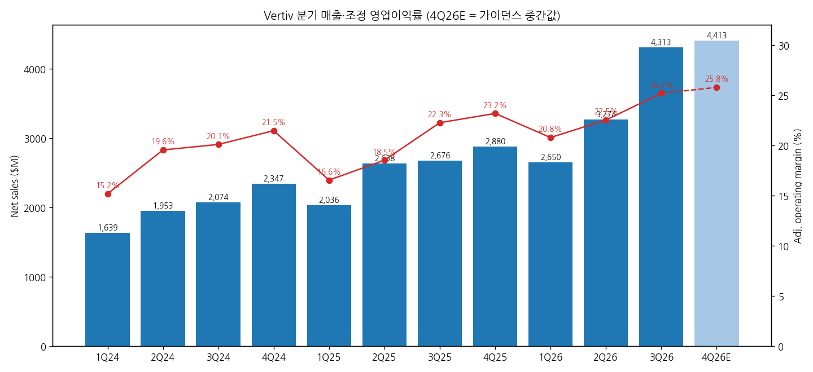
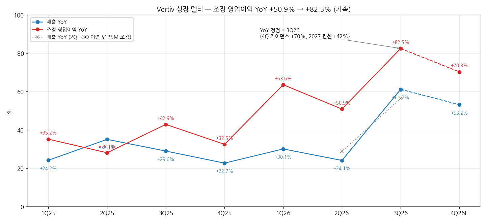
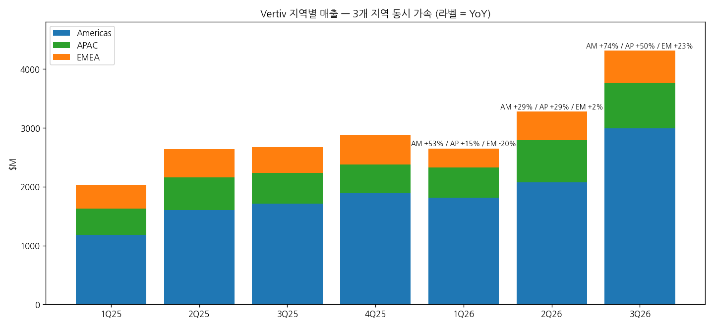

> 모드: 실적 리뷰 (v11)
> 종목: Vertiv (VRT)
> 섹터: 전력 인프라
> 서브섹터: 배전·DC 전력관리
> 분기: 2026-Q3
> 발표일: 2026-10-28 (BMO, 컨콜 11:00 ET)
> 작성 시각: 2026-11-15 12:40 KST
> 분석 소스: 셀사이드 첨부 3개(신한투자증권 10/30 「이익 성장폭 감안하면 저평가 구간」, SK증권 10/30 「연간 가이던스 상향 및 생산 정상화」, 삼성증권 10/30 「믿고 보는 경쟁력」) + 웹서치 보완. 회사 자료 — 3Q26 보도자료(8-K Ex.99.1, 10/28), 컨콜 트랜스크립트(Motley Fool 10/28). 웹 — 컨센·TP(TIKR 10/30·11/10, FactSet 컨센은 삼성증권 인용), 주가 반응(TIKR·Trefis 11/4~10), 선수금·잔고 이력(StockTitan 10/28). 피어 비교는 `2026-Q3_{ETN|SU|ABB|LS일렉트릭}_리뷰.md`. 직전 분기 리뷰 없음 (첫 리뷰)

# Vertiv 3Q26 실적 리뷰 — 조정 영업이익 YoY +83%로 급가속, 수주 +100% 이상. 다만 YoY 정점은 이번 분기이고 수주 공시는 중단

> 성장 델타: 가속 | 내러티브: 강화 → 델타 가속 + 내러티브 강화 → 적극 구간 (단 가이던스 경로상 이익 YoY 정점은 이번 분기 — 4Q +70%, 2027 컨센 +42%로 감속. 11/3 중간선거 후 텍사스 모라토리엄 우려로 주가는 실적 발표일 종가 대비 약 -18%)

→ **숫자**: 매출 $4,313M(+61.2% YoY, organic +55%), 조정 영업이익 $1,087M(+82.5% YoY), 조정 영업이익률 25.2%(+290bp). 조정 영업이익 YoY가 2Q26 +50.9%에서 +82.5%로 31.6%p 커졌고 매출 YoY도 +24.1% → +61.2%로 함께 올라 "강한 가속"이다. 2Q에서 밀린 매출 $100~150M이 3Q에 들어온 것을 빼도 매출 YoY는 약 +56%로 가속이다. 컨센(FactSet) 대비 매출 +15.0%, 조정 영업이익 +17.9%, 조정 EPS $2.21 +21.5% 비트
→ **쟁점 ①**: 2Q 공급망 차질·제품 품질 루머로 생긴 "실행력 의문"이 풀렸다. 2Q 매출은 가이던스 중간값을 밑돌았는데, 3Q는 7월 가이던스 상단($3.85B)도 $463M 넘겼다. 연간 가이던스를 올해 세 번째로 올렸다(매출 중간값 $14.0B → $14.65B, 조정 EPS $6.70 → $7.15)
→ **쟁점 ②**: 유기적 수주가 YoY +100% 이상이고 미주 파이프라인의 분기 증가 속도는 "사상 최고"였다. 네오클라우드를 빼도 수주는 강하다. 그런데 회사는 앞으로 수주를 공시하지 않겠다고 했다. 선행지표가 사라져 다음 분기부터는 선수금(유동 이연수익 $4.12B, 1년 새 3.6배)과 가이던스로만 수요를 읽어야 한다
→ **쟁점 ③**: 주가는 발표일 +16%였지만 11/3 중간선거 이후 텍사스 데이터센터 모라토리엄 우려로 1주일 새 약 23% 빠졌다가 일부 회복했다. 컨센 TP는 7월 $381 → 10월 말 $335로 내려왔고 2027 EPS 컨센은 $9.17 → $9.45로 올라갔다. 이익 상향 + 멀티플 하향 국면이다
→ **다음 분기 관건**: 4Q26(2/10 발표) 조정 영업이익 $1.14B(+70%)·마진 25.8%와 첫 2027 가이던스. 2027 컨센(매출 +32%, 조정 영업이익 +42%) 이상을 제시하는지가 "가속 후 고원"과 "둔화"를 가른다

---

## 1. 숫자

① 연결 기준 분기 표 (단위: $M, %)

| 항목 | 1Q24 | 2Q24 | 3Q24 | 4Q24 | 1Q25 | 2Q25 | 3Q25 | 4Q25 | 1Q26 | 2Q26 | **3Q26** | 4Q26 가이던스 |
|---|---|---|---|---|---|---|---|---|---|---|---|---|
| 매출액 | 1,639 | 1,953 | 2,074 | 2,347 | 2,036 | 2,638 | 2,676 | 2,880 | 2,650 | 3,274 | **4,313** | 4,413 (4,313~4,513) |
| 조정 영업이익 | 249 | 382 | 417 | 504 | 337 | 489 | 596 | 668 | 551 | 738 | **1,087** | 1,138 (1,118~1,158) |
| 조정 영업이익률 | 15.2 | 19.6 | 20.1 | 21.5 | 16.6 | 18.5 | 22.3 | 23.2 | 20.8 | 22.6 | **25.2** | 25.8 (25.3~26.3) |
| 매출 YoY | +8 | +13 | +19 | +26 | +24.2 | +35.1 | +29.0 | +22.7 | +30.1 | +24.1 | **+61.2** | +53.2 |
| 조정 영업이익 YoY | — | — | — | — | +35.2 | +28.1 | +42.9 | +32.5 | +63.6 | +50.9 | **+82.5** | +70.3 |
| **매출 YoY 델타 (%p)** | — | — | — | — | — | +10.9 | -6.1 | -6.3 | +7.4 | -6.0 | **+37.1** | -8.0 |
| **조정 영업이익 YoY 델타 (%p)** | — | — | — | — | — | -7.1 | +14.8 | -10.4 | +31.1 | -12.7 | **+31.6** | -12.2 |
| GAAP 영업이익 | | | | | | | 516.7 | | | | **983.8** | 1,073.6 |
| GAAP 영업이익률 | | | | | | | 19.3 | | | | **22.8** | 24.3 |
| 유기적 매출 성장률 | | | | | | | | | | | **+55.0** | +49~51 |

→ (출처: 2025~2026 분기는 신한투자증권 10/30 영업실적 표(회사 자료·Bloomberg)와 3Q26 보도자료. 2024 분기는 2025 분기 YoY로 역산 [계산] — 합계 매출 $8,012M·조정 영업이익 $1,552M와 일치. 2024 매출 YoY는 회사 발표치(근사). 2023 분기 조정 영업이익은 미확보라 2024 이익 YoY는 비움. GAAP 영업이익은 3Q 보도자료에서 3Q25·3Q26만 수록 — 1H26 합계 $1,078M(1H25 $733M). 4Q26은 회사 가이던스 중간값)
→ 영업이익 = 조정 영업이익(회사 주 지표 — GAAP 영업이익에서 무형자산 상각·인수 조건부 대가·구조조정·M&A 비용 제외). 3Q26 GAAP 영업이익은 $984M(+90%)로 조정 기준보다 증가율이 더 높다(전년 구조조정 비용 $31M 기저)
→ 컨센 대비 (FactSet, 삼성증권 인용): 매출 $4,313M vs $3,749M(+15.0%), 조정 영업이익 $1,087M vs $922M(+17.9%), 조정 EPS $2.21 vs $1.82(+21.5%). 회사 7월 가이던스 중간값 대비로는 매출 +$563M, 조정 영업이익 +$169M, 마진 +70bp
→ 4Q26 가이던스 vs 컨센: 매출 $4,413M vs $4,307M(+2.5%), 조정 영업이익 $1,138M vs $1,119M(+1.7%), 조정 EPS $2.25 vs $2.21(+1.7%)

→ **판정 근거**: 조정 영업이익 YoY가 2Q26 +50.9%에서 3Q26 +82.5%로 31.6%p 커져 "가속"이다. 매출 YoY도 +24.1% → +61.2%로 함께 올라 "강한 가속"이다. 2Q→3Q 매출 이연 $100~150M(중간값 $125M)을 되돌려도 매출 YoY는 2Q26 약 +28.8% → 3Q26 약 +56.5%로 가속이다 [계산]. 이연 매출의 이익 기여(약 $30M 가정 [추정])를 빼도 조정 영업이익 YoY는 약 +77%로 가속 판정은 같다
→ **YoY 정점은 이번 분기 [판단]**: 4Q 가이던스는 매출 +53%, 조정 영업이익 +70%다. 연간 2026 가이던스 +68%, 2027 컨센 +42%(신한 표 컨센, 조정 영업이익 $4,805M)다. 이익 레벨은 계속 오르지만 YoY 기준 델타는 4Q부터 내려가는 경로다. 다만 4Q +70%는 2Q26(+51%)보다 높아 "고원 상단"이다

→ (출처: 회사 보도자료, 신한투자증권 10/30. 4Q26E = 회사 가이던스 중간값)

→ (출처: 같은 자료 [계산]. 점선 = 4Q26 가이던스, 회색 점선 = 2Q→3Q 이연 매출 $125M 되돌린 매출 YoY)

② 지역별 매출·조정 영업이익 (단위: $M, %)

Vertiv는 사업부가 아니라 지역(Americas·APAC·EMEA)을 보고 세그먼트로 쓴다.

| 지역 | 항목 | 3Q25 | 2Q26 | **3Q26** | 매출 비중 3Q26 |
|---|---|---|---|---|---|
| Americas | 매출 | 1,712 | 2,071 | **2,989** | 69% |
| Americas | 매출 YoY (organic) | — | +29.3 | **+74.5 (+66.2)** | |
| Americas | 조정 영업이익 | 501.8 | 미확보 | **877.3** | |
| Americas | 마진 | 29.3 | 미확보 | **29.4** | |
| Americas | 조정 영업이익 YoY | | | **+74.8** | |
| APAC | 매출 | 520 | 720 | **779** | 18% |
| APAC | 매출 YoY (organic) | — | +28.6 | **+49.9 (+48.3)** | |
| APAC | 조정 영업이익 | 68.5 | 미확보 | **132.4** | |
| APAC | 마진 | 13.2 | 미확보 | **17.0** | |
| APAC | 조정 영업이익 YoY | | | **+93.3** | |
| EMEA | 매출 | 444 | 484 | **545** | 13% |
| EMEA | 매출 YoY (organic) | — | +1.7 | **+22.8 (+19.3)** | |
| EMEA | 조정 영업이익 | 83.5 | 미확보 | **152.3** | |
| EMEA | 마진 | 18.8 | 미확보 | **28.0** | |
| EMEA | 조정 영업이익 YoY | | | **+82.4** | |
| Corporate | 조정 영업이익 | -58.2 | 미확보 | **-75.1** | |

→ (출처: 3Q26 보도자료 Regional Segment Results, 지역 매출 분기 이력은 신한투자증권 10/30 표. 3Q25 지역 YoY는 2024 지역 분기 미확보로 비움. 2Q26 지역 손익은 이번 수집 범위에서 미확보 — 9M 누계 마진: Americas 28.2%(+2.7%p), APAC 14.7%(+3.3%p), EMEA 24.4%(+4.3%p))

지역별 매출 YoY 추이 (%)

| 지역 | 1Q25 | 2Q25 | 3Q25 | 4Q25 | 1Q26 | 2Q26 | **3Q26** | 2026 가이던스 (organic) |
|---|---|---|---|---|---|---|---|---|
| Americas | — | — | — | — | +53.1 | +29.3 | **+74.5** | high-40s |
| APAC | — | — | — | — | +15.0 | +28.6 | **+49.9** | mid-30s |
| EMEA | — | — | — | — | -20.5 | +1.7 | **+22.8** | low-to-mid single digit |

→ (출처: 신한투자증권 10/30 지역 매출 표 [계산], 2026 가이던스는 컨콜 CFO 발언. 2025 지역 YoY는 2024 지역 분기 미확보로 비움)

→ (출처: 신한투자증권 10/30 지역 매출 표, 3Q26 보도자료)

→ **델타를 끄는 것은 Americas다**. 매출 증가분 $1,637M 중 $1,276M(78%)이 Americas다. 제품 organic +75.5%, 서비스·부품 organic +20.1%로 제품(전력·열관리 장비)이 성장을 끌었다. 인수 기여는 서비스에 몰려 있다(Americas 서비스 인수분 $118M)
→ **Americas 마진은 29.4%로 거의 제자리(+10bp)**다. CFO는 "하반기에 대규모 증설 램프업이 비효율을 만들었다"고 했다. 물량은 74% 늘었는데 마진은 늘지 않았다 — 증설이 안정되면 남은 마진 여력이다 [판단]
→ **EMEA가 돌아왔다**. 매출 YoY가 1Q26 -20.5% → 2Q26 +1.7% → 3Q26 +22.8%로 2개 분기 연속 가속했고 마진은 18.8% → 28.0%(+920bp)다. 회사가 2025년부터 "EMEA 성장은 2H26"이라고 예고한 경로대로다. 파이프라인은 YoY 약 2배, 유기적 수주는 그보다 더 늘었다(CEO)
→ **APAC 마진 +380bp**는 말레이시아 Johor 신공장 등 시설 가동률 상승 효과다. 중국은 "회복 초기 신호"라고 했다

(1) 수주·잔고·선수금 — 선행지표 (단위: $B)

| 항목 | 4Q23 | 4Q24 | 1Q25 | 2Q25 | 3Q25 | 4Q25 | 1Q26 | 2Q26 | **3Q26** |
|---|---|---|---|---|---|---|---|---|---|
| 수주잔고 | 5.5 | 7.2 | 7.9 | 8.5 | 9.5 | 15.0 | 미공시 | 미공시 | **미공시** |
| 유동 이연수익(선수금) | 0.64 | 1.06 | 1.10 | 1.26 | 1.13 | 1.81 | 2.46 | 3.63 | **4.12** |
| 재고자산 | | | | | 1.44 | 1.46 | 1.83 | 2.52 | **3.29** |
| 유기적 수주 YoY | | | | | | 약 +252% | | | **+100% 이상** |
| Book-to-bill | | | | | 약 1.4x | 약 2.9x | | | **미공시** |

→ (출처: 3Q26 보도자료 재무상태표, StockTitan 10/28이 정리한 분기 보도자료·2025 10-K 수치, 컨콜 CEO 발언. 2026년 보도자료부터 잔고·Book-to-bill 미공시)
→ 수주 공시는 이번 분기가 마지막이다. Dave Cote 회장: "앞으로 수주 데이터는 공유하지 않을 계획이다". 3Q 수주 +100% 이상은 "강도를 보여주기 위해" 예외적으로 언급한 것이다
→ 선수금이 1년 새 3.6배($1.13B → $4.12B)로 늘었다. 고객이 납품 전에 3Q 매출만큼의 돈을 미리 냈다는 뜻이다. 다만 3Q에는 선수금 증가(+13% QoQ)가 매출 증가(+32% QoQ)보다 느렸다. 재고는 9개월 새 2.3배로 늘었다 — 회사는 "성장 대비 + 프로젝트 납기 안정성 확보"라고 설명했다
→ 잔고 리드타임은 12~18개월로 변화가 없고, 잔고에는 구매주문만 넣고 생산능력 예약 계약(capacity agreement)은 넣지 않는다(CEO)

③ 연간 (단위: $M, %)

| 항목 | 2023 | 2024 | 2025 | 2026 가이던스 | 2027 컨센 | 2028 컨센 |
|---|---|---|---|---|---|---|
| 매출 | 6,863 | 8,012 | 10,230 | 14,650 (14,450~14,850) | 18,836 | 22,810 |
| 조정 영업이익 | 1,054 | 1,552 | 2,090 | 3,515 (3,475~3,555) | 4,805 | — |
| 조정 영업이익률 | 15.4 | 19.4 | 20.4 | 24.0 (23.5~24.5) | 25.5 | — |
| 매출 YoY | +20.6 | +16.7 | +27.7 | +43.2 (organic +37~39) | +28.6 | +21.1 |
| 조정 영업이익 YoY | — | +47.3 | +34.7 | +68.2 | +36.7 | — |
| 조정 EPS ($) | — | 2.85 | 4.20 | 7.15 (7.10~7.20) | 9.43~9.45 | 12.11 |
| 조정 FCF | — | 1,152 | 1,894 | 2,700 (2,600~2,800) | — | — |

→ (출처: 2023~2025 신한·삼성증권 표(회사 자료), 2026 회사 가이던스(10/28), 2027~2028 컨센은 신한투자증권 10/30 표(Bloomberg 컨센)·TIKR 10/30(EPS). 2023 조정 영업이익은 2024 YoY +47.3%로 역산 [계산])
→ 발표 전 → 후 연간 컨센: 2026 조정 영업이익 컨센 $3,330M → 가이던스 $3,515M(+5.6%), 조정 EPS 컨센 $6.73 → 가이던스 $7.15(+6.2%) (FactSet, 삼성증권). 2027 EPS 컨센은 9월 말 $9.17 → 10/29 $9.45(+3.1%) (TIKR, 30개 증권사)
→ 2027 컨센 조정 영업이익 YoY는 +37~42%다(표 기준 +36.7%, 신한 분기 표 기준 2026E $3,386M 대비 +41.9%). 2026년(+68%)보다 낮다 — 컨센이 그리는 이익 YoY 정점은 2026년(분기로는 3Q26)이다

---

## 2. 시장 쟁점

> 셀사이드 첨부 3개는 모두 국내 증권사 글로벌 주식 노트(10/30)다. 국내 노트는 등급·자체 TP 대신 컨센 TP를 인용한다. 해외 IB의 TP 변경은 웹 보도로 보완했다.

① 지난 분기 체크 (2-0)

첫 리뷰 — 직전 체크 없음.

② 이번 분기 쟁점

| # | 쟁점 | 언급 출처 수 |
|---|---|---|
| (1) | 2Q 공급망 차질·품질 루머 이후 실행력 회복 — 3Q 서프라이즈는 이연 매출 덕인가, 체력인가 | 3/3 + 컨콜 질문 3건(Melius·Wells Fargo·JPM) |
| (2) | 수주 +100% 이상과 수주 공시 중단 — 북미 데이터센터 수요는 꺾이지 않았나 | 3/3 + 컨콜 질문 2건(Evercore·Barclays) |
| (3) | 800V DC·액체냉각·Nvidia DSX — 2027~2028 신규 성장축 | 3/3 + 컨콜 질문 3건 |
| (4) | 이익은 오르는데 멀티플은 내려간다 — 중간선거·텍사스 모라토리엄 | 2/3(신한·삼성) + 보도 다수 |

③ 쟁점별 분해

(1) 2Q 공급망 차질·품질 루머 이후 실행력 회복 — 3Q 서프라이즈는 이연 매출 덕인가, 체력인가

(1-1) 회사 설명
→ "2분기 매출 인식 지연분 일부가 3분기에 들어왔다. 대략 $100~150M 정도로 본다" (CFO Craig Chamberlin, Wells Fargo Steve Tusa 질문 답변)
→ "이연분 $100~150M을 빼면 3Q→4Q는 예전과 비슷한 계절 흐름이다. 4Q 가이던스에는 늘 그렇듯 보수성이 들어 있다" (CFO, Barclays 질문 답변)
→ 품질 루머(압축기 소손·UPS 과열, Melius Scott Davis 질문)에 대해: "신제품 비중이 높으면 초기 품질 분포가 넓어진다. 데이터로 보면 개선 추세다. 완벽하지 않지만 업계 공통 현상이다" (CEO Giordano Albertazzi)
→ "이 속도로 성장하는 건 많은 일이고 항상 질서정연하지는 않다" (CEO). 제조·물류 EVP를 새로 영입했다

(1-2) 증권사별 해석 편차

| 증권사 | 핵심 가정·추정 | 논리 |
|---|---|---|
| SK증권 | 이연 $100~150M 차감 시 매출 $4.16~4.21B, 기존 가이던스 중간값 $3.75B 상회 | "제품 인도 지연 완화 → 실적 변동성 하락". 단 제조 공정·신제품 품질 개선은 진행 중이라 정상화 지속성은 후속 분기 확인 필요 |
| 삼성증권 | 이연분 제외해도 컨센 대비 매출 +10% 이상 | 2Q 우려를 불식시킬 서프라이즈. 수주 증가는 "지연 물량 회복이 아니라 기술력·실행력·고객 신뢰" |
| 신한투자증권 | 물류 정상화 + 증설 효과로 컨센 크게 상회. 4Q 가이던스 매출 $4.4B(+53%), 마진 25.8% | 프로젝트 지연은 업계 평상 수준을 넘지 않는다는 회사 설명 수용. 지연 우려로 인한 주가 낙폭이 과도 |
| Bernstein (웹, 10/29) | TP $368 → $376, Outperform | 7월에는 2Q 미스·공급 우려로 TP를 $416 → $368로 내렸다. "VRT는 여전히 좋은 회사, 좋은 주식" |

(1-3) 공통 결론 vs 갈리는 지점
→ 공통: 이연분을 빼도 7월 가이던스와 컨센을 크게 넘었다. 3Q 서프라이즈는 일회성이 아니라 증설·물류 정상화가 만든 체력이다
→ 갈림: 정상화가 지속되느냐다. SK는 "품질 개선 진행 중, 후속 분기 확인"으로 유보적이고, 신한·삼성은 우려가 과도했다고 본다

(1-4) [판단]
→ 숫자는 낙관 쪽과 맞는다. 이연분 제외 매출 YoY도 +56%로 가속이고, 마진이 7월 가이던스보다 70bp 높았다. 재고가 9개월 새 2.3배로 늘어난 것은 "프로젝트 납기 안정성"을 위해 돈을 쓴 결과다
→ 결론이 바뀌는 조건: 4Q 매출이 가이던스 하단($4,313M, 3Q와 같은 수준) 아래로 나오면 3Q가 이연분에 기댄 반짝이었다는 해석이 힘을 얻는다

(2) 수주 +100% 이상과 수주 공시 중단 — 북미 데이터센터 수요는 꺾이지 않았나

(2-1) 회사 설명
→ "3분기 유기적 수주는 YoY 100% 넘게 늘었다. 고객 구성(하이퍼스케일러·엔터프라이즈·네오클라우드 등)은 시장 구성과 거의 같다. 네오클라우드를 빼도 강하다" (CEO·Cote 회장)
→ "미주 파이프라인의 분기 대비 증가 속도는 우리가 본 것 중 가장 빠르다. 전력 확보·인허가·심리·현장 숙련 인력이 속도 조절 요인이지만 성장을 늦추지는 않는다" (CEO)
→ "이 성장률은 시장 성장률을 웃돈다고 본다. 5월에 제시한 시장 모델은 그대로다. 캐치업(지연 물량 회복)이 아니라 주문이다" (CEO, Evercore Amit Daryanani 질문 답변)
→ "수주 데이터는 앞으로 공유하지 않는다" (Cote 회장)
→ 2027 초기 시각: "데이터센터 수요는 가속 중. 시장을 크게 웃도는 유기적 매출 성장을 2027년에도 기대한다. 마진도 계속 확대" (CEO, 슬라이드 10)

(2-2) 출처별 해석 편차 — 배전·DC 피어 비교 (3Q26)

| 출처 | 3Q26 데이터센터·북미 신호 | 해석 |
|---|---|---|
| **Vertiv** | 유기적 수주 +100% 이상, 미주 파이프라인 분기 증가 속도 사상 최고, Americas organic 매출 +66% | 가속. 단 다음 분기부터 수주 미공시 |
| Eaton | 데이터센터 수주 +101%, EA 분기 수주 사상 최대, EA 롤링 수주 증가율 +41% → +39% | 가속, 증가율만 정점권 |
| ABB | Electrification 북미 수주 +117%, 2개 분기 연속 세 자릿수 | 가속 |
| Schneider | 데이터센터 수주 4개 분기 중 3개 분기 세 자릿수, 북미 organic +23% → +20% | 고원 |
| LS일렉트릭 | 미국 수주 비중 66%, 누적 수주 50% 이상이 데이터센터, 이익 YoY +132% | 가속 (단납기라 바로 매출) |
| SK증권 | 유기적 수주 +100% 이상은 "이례적", 네오클라우드 제외해도 강세 | 수요 강도 확인 |
| 삼성증권 | 수주 증가율이 시장보다 높아 점유율 확대 시사. BTM 전력 설계·유체 관리 인수로 사업 범위 확장 | 점유율 상승 |
| 신한투자증권 | 수주 +100% 이상에도 리드타임 12~18개월 유지 | 증설이 수요를 따라가고 있다 |

→ (출처: 각 사 2026-Q3 리뷰 2번 쟁점, 첨부 리포트 3개)

(2-3) 공통 결론 vs 갈리는 지점
→ 공통: 북미 데이터센터 수주는 둔화하지 않았다. 배전·DC 5사(VRT·ETN·ABB·SU·LS) 중 수주가 줄어든 곳은 없다. Vertiv의 +100% 이상은 그중에서도 가장 높다
→ 갈림: 증가율의 정점이다. ETN 롤링 수주(+41% → +39%)와 SU 북미 organic(+23% → +20%)은 꺾이기 시작했다. Vertiv는 수주를 더 공시하지 않아 같은 비교를 다음 분기부터 할 수 없다

(2-4) [판단]
→ **북미 데이터센터 수주는 둔화가 아니다**. Vertiv 3Q 수주 +100% 이상, 미주 파이프라인 사상 최고 속도, 선수금 1년 새 3.6배가 같은 방향이다. 배전·DC 서브섹터 안에서 Vertiv가 수주 증가율 1위다
→ 다만 수주 공시 중단은 모멘텀 트레이더에게 선행지표 하나를 잃는다는 뜻이다. 앞으로는 ① 선수금(유동 이연수익) QoQ 증가율 ② 분기 가이던스 상향 폭 ③ 피어(ETN 롤링 수주, ABB 북미 수주)로 대신 확인한다. 선수금이 2개 분기 연속 QoQ 감소하면 수주 둔화 신호로 본다

(3) 800V DC·액체냉각·Nvidia DSX — 2027~2028 신규 성장축

(3-1) 회사 설명
→ 800V DC 로드맵: "중간 단계(중·저압 AC + 800V를 랙까지, 사이드카 방식)는 2027년부터 매출이 발생한다. 완전한 네이티브 800V DC는 2027년 고객 검증, 2028년 시장 배치다. 7월에 보여준 그림과 같다" (CEO, Mark Delaney 질문 답변)
→ "제품 출시를 생산능력과 따로 생각할 수 없다. 전용 라인·전용 공급망까지 같이 깔아야 출시다" (CEO, Luke Junk 질문 답변)
→ 액체냉각: "구체적 수치는 말하지 않겠다. 1차 열 제거에서 액체냉각 비중이 훨씬 커지고 있고 방향에 만족한다. 공랭이 사라지는 건 아니다. 시스템 단위 조율이 더 중요해진다" (CEO)
→ 칠러 생산능력 연말까지 2배, 말레이시아 Johor 공장 가동. UtilityInnovation Group(마이크로그리드·BTM 전력 설계, 약 $1.45B + 성과 연동 최대 $1.15B) 10/26 인수 완료, King Environmental(유체 관리) 인수

(3-2) 증권사별 해석 편차

| 증권사 | 핵심 가정·추정 | 논리 |
|---|---|---|
| SK증권 | 800V DC 2027 매출 기여 규모는 미공개 | 중장기 모니터링 대상. 단기 실적 변수는 아님 |
| 삼성증권 | 2027 중간 단계 매출, 2028 네이티브 배치 | 모멘텀 재확인. 설계 표준화·모듈화로 고객 구축 기간을 줄여 전력·인허가·인력 제약 환경에서 경쟁력이 더 부각 |
| 신한투자증권 | Nvidia DSX(Vera Rubin 기반 AI 팩토리 표준 설계, 공장에서 Pod 단위 조립) 파트너 선정 — 2027 판매 시작, 2028 실적 본격 기여. 1차 냉각에서 수냉 비중이 공랭을 넘어 수익성 향상 | 추가 성장 요인 4가지(리드타임 유지·신공장 효율·수냉 믹스·DSX) |

(3-3) 공통 결론 vs 갈리는 지점
→ 공통: 800V DC는 2027년 일부, 2028년 본격이라는 일정에 이견이 없다. 2026~2027 이익 추정에는 거의 들어 있지 않다
→ 갈림: 규모다. 회사가 매출 기여를 공개하지 않아 증권사마다 정성 평가에 그친다

(3-4) [판단]
→ 2027년 실적 델타를 바꿀 변수는 아니다. 800V DC·DSX는 2028년 이후 "델타 재가속" 후보로 관전 포인트에 넣는다
→ 액체냉각 믹스 상승은 이미 마진(25.2%)에 들어오고 있다. 다만 회사가 비중을 숫자로 주지 않아 확인 수단이 마진뿐이다

(4) 이익은 오르는데 멀티플은 내려간다 — 중간선거·텍사스 모라토리엄

(4-1) 회사 설명
→ "전력 확보, 인허가, 모라토리엄, 숙련 인력을 속도 조절 요인으로 모니터링한다. 이 요인 상당수는 우리에게 역풍이 아니라 우리 강점이 통하는 영역이다(모듈화·조립식으로 구축 시간 단축)" (CEO, 컨콜·발표 자료)
→ 11/10 Baird 컨퍼런스가 선거 후 첫 공개 발언 자리였다 (발언 내용은 이번 수집 범위에서 미확보)

(4-2) 출처별 해석 편차

| 출처 | 핵심 가정·추정 | 논리 |
|---|---|---|
| 신한투자증권 | 컨센 TP $322.73(LSEG), 현재가 $242.94 대비 +32.8%, 투자판단 ★5개 | 데이터센터 투자 지연 우려로 주가 낙폭 과도. 마진 업사이드·이익 성장폭 감안 시 저평가 |
| 삼성증권 | 12M Fwd P/E 27.7배, 최근 5년 평균 하회 | 밸류에이션 부담 낮아짐 |
| TIKR (10/30, 11/10) | 컨센 TP 7월 $381 → 10/30 $335 → 11/9 $338(30개사, $250~$427). Fwd P/E 5월 55배 → 11/6 20배 → 11/9 약 22배(5년 평균 27배) | 선거 후 텍사스 우려로 하락. 텍사스에서 막힌 데이터센터도 다른 주에서 지어지면 Vertiv 장비가 필요 |
| Trefis·TIKR (11/4~5) | 11/4 -13%, 11/5 장중 추가 하락. 텍사스 주지사 당선인이 데이터센터 모라토리엄 공약(1/19 취임) | 텍사스가 미국 계획 데이터센터 전력의 약 27~30% |
| Seeking Alpha (11/7) | 2027 EPS 기준 18.5배 | 모라토리엄은 신규 승인 대상이고 기존 잔고는 확정 주문 |

(4-3) 공통 결론 vs 갈리는 지점
→ 공통: 이익 추정은 오르고(2027 EPS +3%, 2026 가이던스 +6%) 멀티플은 내려갔다. 주가 하락은 실적이 아니라 정치·AI 센티먼트 때문이다
→ 갈림: 텍사스 모라토리엄이 실제 정책이 되느냐다. 아직 공약 단계이고(1/19 취임), 텍사스는 9월부터 전력망 감사를 이유로 주 인허가를 멈춘 상태다

(4-4) [판단]
→ TP·주가 하락은 **멀티플 하향**이다. 2026 가이던스 +6%, 2027 EPS 컨센 +3%로 이익 추정은 올라갔다
→ 모라토리엄은 "신규 승인"이 대상이라 12~18개월 잔고와 3Q 수주에는 영향이 없다. 영향이 나온다면 2027년 하반기 이후 수주다 [판단]. 12월 FERC·ERCOT 결론과 1/19 텍사스 주지사 취임 후 첫 조치가 멀티플 방향을 정한다

④ 낙관 vs 보수 — 논리 대비

| 구분 | 출처 | 무엇을 다르게 가정했나 |
|---|---|---|
| 가장 낙관 | Bernstein (OP, $376) | 41배 Fwd P/E — 이익 성장(2028 EPS $12+)이 프리미엄 멀티플을 다시 정당화 |
| 가장 낙관 | 신한투자증권 | 프로젝트 지연은 업계 평상 수준, 수냉 믹스·DSX·신공장 효율로 마진 업사이드 |
| 가장 보수 | SK증권 | 제조 공정·신제품 품질 개선 진행 중 — 정상화 지속성은 후속 분기 확인 |
| 가장 보수 | 컨센 TP 최저 $250 (TIKR 집계) | 2026년 5월 55배 고점 멀티플로 돌아가지 못함 |

→ 같은 숫자에서 갈리는 변수는 **멀티플이 5년 평균(27배)으로 돌아가느냐**와 **2Q 같은 실행 차질이 반복되느냐**다
→ 셀사이드 vs 바이사이드: 셀사이드 EPS 추정은 오르는데 주가는 발표일 +16% 이후 선거 쇼크로 되돌렸다. 셀사이드는 실적을, 시장은 텍사스·AI 자금조달(CoreWeave 2032년 회사채 수익률 약 15%) 센티먼트를 보고 있다

⑤ 추정치·TP 변화 (2-4)

| 출처 | 직전 TP ($) | 현재 TP ($) | 4Q26 조정 영업이익 E | 2026 / 2027 조정 영업이익 E | 핵심 변화 한 줄 |
|---|---|---|---|---|---|
| Bernstein | 368 | **376** | — | — | Outperform 유지, 2Q 후 하향분 일부 회복 (10/29) |
| 신한투자증권 (컨센 인용) | — | 322.73 (LSEG 컨센) | 1,139 (컨센) | 3,386 / 4,805 (컨센) | 저평가 구간, ★5개 |
| 삼성증권 (컨센 인용) | — | 332.3 (Bloomberg 평균) | 1,119 (FactSet 컨센) | 3,330 (발표 전 컨센) | 12M Fwd P/E 27.7배 |
| SK증권 (컨센 인용) | — | — | — | 3,400 / 4,822 (GAAP 영업이익, Bloomberg 컨센) | 2026 가이던스 상향 반영 |
| 시장 컨센 TP (TIKR) | 381 (7월 중순) | **335 (10/30) → 338 (11/9)** | — | EPS 2027 $9.17 → $9.45 | 30개사, 범위 $250~$427 |

→ (출처: 첨부 리포트 3개, TIKR 10/30·11/10. 해외 IB 개별 TP 변경은 Bernstein만 확인 — 나머지는 웹 수집 범위에서 미확보)
→ 평균 TP: 7월 중순 $381 → 발표 후 $335(-12%) → 11/9 $338. 발표 이후로는 TP 상향 1건(Bernstein) 확인, 하향 미확인
→ **TP 하향의 원인은 멀티플이다**. 7월 이후 컨센 TP는 -11% 내려왔지만 2027 EPS 컨센은 +3%, 2026 가이던스는 +6% 올라갔다

---

## 3. 내러티브 점검

① 성장 스토리 정의
→ **"AI 데이터센터 전력·열관리를 통합(converged)으로 공급하는 1위 — 랙 밀도가 올라갈수록(액체냉각·800V DC) 데이터센터당 Vertiv 콘텐츠가 늘고, 증설이 수요를 따라가는 동안 이익이 매출보다 빠르게 큰다"** — 시장이 Vertiv를 사는 이유는 하이퍼스케일러·네오클라우드 capex의 가장 직접적인 장비 수혜주라는 점이다

② 이번 분기 평가 — **강화**
→ 숫자: 조정 영업이익 YoY +83%로 가속, 마진 25.2%(+290bp) 분기 최고, 3개 지역 동시 가속. 2Q에 생긴 "공급망·품질 때문에 수요를 매출로 못 바꾼다"는 의문을 숫자로 지웠다
→ 수요: 유기적 수주 +100% 이상, 미주 파이프라인 사상 최고 증가 속도, 선수금 3.6배. 배전·DC 피어 중 수주 증가율이 가장 높다
→ 가이던스: 연간 매출 +$650M, 조정 영업이익 +$190M, EPS +$0.45 상향. 2027년에도 "시장을 크게 웃도는 유기적 성장" 예고
→ 약화 요인: 수주 공시 중단(가시성 하락), 재고 2.3배(운전자본 부담), 품질 루머 잔존, 컨센 TP는 7월보다 낮다. 이 중 스토리 전제를 건드리는 것은 없다 — 가시성과 멀티플 문제다 [판단]

③ 국면 설명 (0번 판정 근거)
→ 델타 가속(+50.9% → +82.5%) + 내러티브 강화 → **적극 구간**. 같은 배전·DC 서브섹터의 ETN(가속|강화), ABB(가속|유지), LS(가속|강화)와 같은 방향이고, 이익 YoY 레벨은 LS 다음으로 높다
→ 단, 이익 YoY 정점은 이번 분기다. 4Q 가이던스 +70%, 2027 컨센 +37~42%로 내려가는 경로다. 모멘텀 관점에서는 **"레벨은 오르는데 델타는 감속하는" 구간이 4Q부터 시작**된다. 4Q 조정 영업이익 YoY가 가이던스 경로(+70%)보다 크게 낮은 +55% 아래로 나오면 "둔화"로 내린다 [판단]

④ 스토리를 강하게 만들 트리거
→ (1) 2/10 첫 2027 가이던스가 컨센(매출 +28~32%, 조정 영업이익 +37~42%) 이상
→ (2) 선수금 QoQ 증가 지속 + 4Q 마진 26% 이상(Americas 증설 비효율 해소)
→ (3) 800V DC 중간 단계·Nvidia DSX 첫 매출 확인(2027)

⑤ 스토리를 깨뜨릴 리스크
→ (1) 텍사스 모라토리엄 실행(1/19 취임 후) + 12월 FERC 결론이 데이터센터 접속 비용 전가 쪽 → 신규 수주 둔화
→ (2) 2Q 같은 공급망·품질 차질 재발 — 신제품 비중이 높아 품질 분포가 넓다(CEO)
→ (3) 네오클라우드 자금조달 경색(CoreWeave 회사채 수익률 약 15%)으로 주문 취소·지연

---

## 4. 향후 봐야 할 것 (우선순위 순)

(1) **4Q26 조정 영업이익 $1.12~1.16B(YoY +70%), 마진 25.3~26.3%, 매출 $4.31~4.51B** — 델타 판정을 바꾸는 1순위 변수
→ 무엇을: 가이던스 중간값(매출 $4,413M, 조정 영업이익 $1,138M) 이상이면 "가속 후 고원"으로 판정 유지. 조정 영업이익 YoY +55% 미만 또는 매출이 3Q($4,313M)를 밑돌면 "둔화". Americas 마진 30% 회복 여부(3Q 29.4%, 증설 비효율)
→ 어떤 데이터로: 4Q26 보도자료 Regional Segment Results, 컨콜
→ 언제: 2027-02-10 (4Q 실적 + 첫 2027 가이던스)

(2) **첫 2027 가이던스 — organic 매출 +25% 이상, 조정 영업이익 컨센 $4.8B 이상, 증분 마진 30~35%**
→ 무엇을: 2027 컨센(매출 $18.8B +29%, 조정 영업이익 $4.8B +37~42%)과 비교. 회사 장기 프레임 증분 마진 30~35% 유지 여부. 수주를 공시하지 않는 대신 가이던스 폭이 수요 판단의 핵심 자료가 된다
→ 어떤 데이터로: 2/10 가이던스 표, 컨콜 2027 슬라이드
→ 언제: 2027-02-10

(3) **선수금(유동 이연수익) QoQ 증가 지속 — $4.12B 이상 유지**
→ 무엇을: 수주 미공시의 대체 지표. 2개 분기 연속 QoQ 감소면 수주 둔화 신호. 재고($3.29B) 대비 선수금 비율도 함께 본다
→ 어떤 데이터로: 4Q 보도자료 재무상태표, 10-K(잔고 연말 수치가 공시되는지)
→ 언제: 2027-02-10, 10-K는 2월 중순

(4) **11/3 중간선거 → 11월 RTO 보고 → 12월 FERC·ERCOT 결론 → 1/19 텍사스 주지사 취임**
→ 무엇을: 데이터센터 전력 비용 부담 강화와 텍사스 신규 데이터센터 모라토리엄 실행 여부. Vertiv는 데이터센터 매출 비중이 가장 높아 배전·DC 피어 중 노출이 가장 크다. 반대로 BTM 전력(UIG 인수)·모듈형은 계통 우회 수요로 일부 헤지
→ 어떤 데이터로: FERC RTO 보고(11/16~20), ERCOT 감사(12/10), FERC 반론 시한(12/16), 텍사스 주지사 첫 행정명령, 뉴스 키워드 "Texas data center moratorium", "Vertiv"
→ 언제: 2026-11 중순 ~ 2027-01 말

(5) **800V DC·Nvidia DSX·액체냉각 — 2027 첫 매출과 품질 지표**
→ 무엇을: 800V DC 중간 단계 매출 개시, DSX Pod 첫 출하, 칠러 2배 증설 완료, 품질 이슈 재발 여부
→ 어떤 데이터로: 회사 발표, Nvidia GTC(2027년 3월), 컨콜 Q&A
→ 언제: 2027-02-10 ~ 2027 상반기
