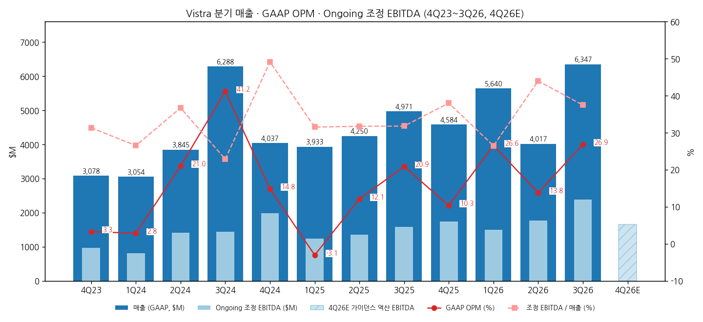
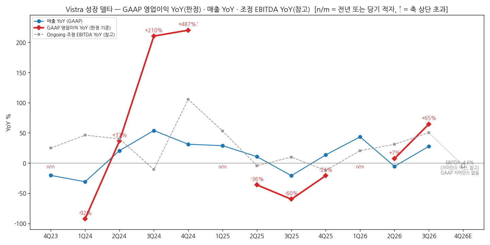
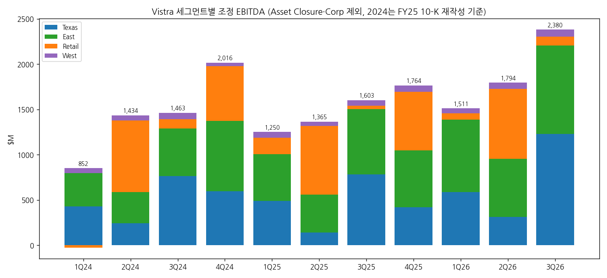

> 모드: 실적 리뷰 (v11)
> 종목: Vistra (VST)
> 섹터: 원전
> 서브섹터: 원전 운영 (확장)
> 분기: 2026-Q3
> 발표일: 2026-11-06 (BMO, 보도자료·컨콜) / 10-Q 제출 2026-11-09
> 작성 시각: 2026-11-16 15:40 KST
> 분석 소스: [1차] 3Q26 10-Q(2026-11-09, SEC EDGAR) + 10-K FY2025(2026-02-27)·1Q22\~2Q26 10-Q(세그먼트 재작성 컬럼) + 3Q26 보도자료(2026-11-06, finviz 전재본 — SEC 8-K 원문은 403으로 미확보) + `company-overview/VST_기업개요.md` v1.0(2026-11-15) / [비공식 요약] 컨콜 트랜스크립트 원문 미확보(Motley Fool 목록 없음) → Earnings Whispers 요약(finviz 2026-11-09), TIKR(2026-11-06·11-09), Zacks(2026-11-10) / [보도 인용] KeyBanc 하향(TIKR 2026-11-04), BMO TP(TIKR 2026-11-09), MarketBeat 등급 표, Yahoo Finance 주가. 셀사이드 리포트 첨부 0건
> 리뷰 깊이: 숫자 중심 | 리서치 첨부 0건
> 지표 선택: 5지표는 규정대로 GAAP(매출·영업이익)으로 채우되, **성장 델타 판정은 회사 핵심 지표인 Ongoing Operations 조정 EBITDA 기준**. GAAP 매출·영업이익에 선도 헤지 미실현 평가손익이 섞여 분기마다 수십\~수백 %씩 흔들리기 때문(3Q26 미실현 이익 $559M 포함)
> 다음 발표: 4Q26·2026 연간 — 2027-02 하순 예상 (전년 2026-02-26 발표 기준 [추정])

# Vistra 3Q26 실적 리뷰

## 0. 한 줄 판정

> 성장 델타: 가속 | 내러티브: 약화 → 경계 구간 (3Q26이 조정 EBITDA YoY 정점, 4Q26 가이던스 역산 YoY 마이너스 + 텍사스 정책 리스크로 멀티플 하향)

→ 숫자: Ongoing 조정 EBITDA **$2,378M(+50.4% YoY, 분기 최대)**, YoY 1Q26 +20.5% → 2Q26 +31.0% → 3Q26 +50.4%로 3개 분기 연속 확대(+19.4%p). GAAP 매출 $6,347M(+27.7%), 영업이익 $1,706M(+64.5%), OPM 26.9%

→ 컨센 대비: GAAP EPS $3.23 vs $2.94(+9.9%), 매출은 $6.85B(Zacks)·$7.44B(Earnings Whispers) 대비 미달 — 헤지 회계 노이즈라 의미 작음. 2027 가이던스 신규 $7.7\~8.5B, 중간값 $8.1B는 발표 전 컨센 $7.96B(TIKR) 대비 +1.8%

→ 쟁점은 **"성장의 질"**: 2027 중간값 +11%(vs 2026 중간값 $7.3B) 중 약 $700M이 Cogentrix 인수 + Meta Perry PPA — 이를 빼면 약 $7.4B로 +1% 안팎 [계산]. 3Q26 YoY에도 Lotus(2025-10 인수) 편입분이 섞여 있다

→ 텍사스 리스크가 주가를 끌었다: 11/4 주지사 선거(데이터센터 모라토리엄 공약 후보 당선) → 당일 -13.8%, KeyBanc Sector Weight 하향, BMO TP $210 → $188. 3Q 실적 다음 날 +10.5% 반등(11/6)했지만 11/13 $133.01은 ATH($217.92) 대비 -39%

→ 다음 분기 관건: 4Q26 Ongoing 조정 EBITDA가 가이던스 역산 $1,661M(YoY -4.6%)을 넘어 플러스 YoY를 내는지, 그리고 Comanche Peak 잔여 1,200MW·Beaver Valley 원전 계약이 텍사스 정책 변화 속에서 나오는지

## 1. 숫자

① 연결 분기 표 ($M, US GAAP + 회사 non-GAAP)

| 항목 | 4Q23 | 1Q24 | 2Q24 | 3Q24 | 4Q24 | 1Q25 | 2Q25 | 3Q25 | 4Q25 | 1Q26 | 2Q26 | **3Q26** | 4Q26E (가이던스 역산) |
|---|---|---|---|---|---|---|---|---|---|---|---|---|---|
| 매출 | 3,078 | 3,054 | 3,845 | 6,288 | 4,037 | 3,933 | 4,250 | 4,971 | 4,584 | 5,640 | 4,017 | **6,347** | — |
| 영업이익 (GAAP) | 102 | 86 | 808 | 2,588 | 599 | -120 | 515 | 1,037 | 474 | 1,499 | 553 | **1,706** | — |
| OPM | 3.3% | 2.8% | 21.0% | 41.2% | 14.8% | -3.1% | 12.1% | 20.9% | 10.3% | 26.6% | 13.8% | **26.9%** | — |
| 매출 YoY | -20.4% | -31.0% | 20.6% | 53.9% | 31.2% | 28.8% | 10.5% | -20.9% | 13.5% | 43.4% | -5.5% | **27.7%** | — |
| 영업이익 YoY | n/m | -92.4% | 36.7% | 210.3% | 487.3% | 적자 | -36.3% | -59.9% | -20.9% | 흑전 | 7.4% | **64.5%** | — |
| **매출 YoY 델타 (%p)** | +0.2 | -10.6 | +51.6 | +33.3 | -22.7 | -2.4 | -18.3 | -31.4 | +34.4 | +29.9 | -48.9 | **+33.2** | — |
| **영업이익 YoY 델타 (%p)** | n/m | n/m | +129.1 | +173.6 | +277.0 | n/m | n/m | -23.6 | +39.0 | n/m | n/m | **+57.1** | — |
| **Ongoing 조정 EBITDA** | 965 | 810 | 1,412 | 1,438 | 1,983 | 1,240 | 1,349 | 1,581 | 1,742 | 1,494 | 1,767 | **2,378** | 1,661 (1,461\~1,861) |
| 조정 EBITDA YoY | 24.7% | 46.2% | 40.1% | -10.8% | 105.5% | 53.1% | -4.5% | 9.9% | -12.2% | 20.5% | 31.0% | **50.4%** | -4.6% (-16.1\~+6.8%) |
| **조정 EBITDA YoY 델타 (%p)** | -30.7 | +21.5 | -6.1 | -50.9 | +116.3 | -52.4 | -57.6 | +14.4 | -22.1 | +32.7 | +10.5 | **+19.4** | -55.0 |
| 조정 EBITDA / 매출 | 31.4% | 26.5% | 36.7% | 22.9% | 49.1% | 31.5% | 31.7% | 31.8% | 38.0% | 26.5% | 44.0% | **37.5%** | — |

→ (출처: 매출·영업이익 = SEC XBRL companyfacts 3개월 값, 4Q = 10-K 연간 − 9M [계산], 3Q26 = 10-Q 2026-11-09. Ongoing 조정 EBITDA = 각 분기 10-Q MD&A 세그먼트 표의 연결 조정 EBITDA − Asset Closure [계산]. 2024 분기는 2025 10-Q 재작성 컬럼(Moss Landing 이관 반영), 2023 분기는 당시 체계(Sunset 포함). 4Q26E = 2026 가이던스 $7.1\~7.5B − 9M26 $5,639M [계산])

→ 지표 선택: GAAP 매출·영업이익은 발전 세그먼트의 선도 매도 헤지가 시가평가되면서 출렁인다 — 3Q24 영업이익 $2,588M(미실현 이익), 1Q25 적자(미실현 손실)가 그 예. 회사 가이던스·보상·시장 컨센 모두 Ongoing 조정 EBITDA 기준이라 **델타 판정은 조정 EBITDA로 한다** [판단]

→ 컨센 대비: GAAP EPS $3.23 vs $2.94(+9.9%, Zacks·Earnings Whispers), 매출 $6.35B vs $6.85B(-7.3%, Zacks) / $7.44B(-14.7%, Earnings Whispers). 분기 조정 EBITDA 컨센은 공개 출처에서 미확보

→ **YoY 정점은 3Q26**: 조정 EBITDA YoY는 3개 분기 연속 확대됐지만 4Q26 가이던스 역산은 -4.6%(범위 상단에서도 +6.8%). 4Q25($1,742M)가 높은 기저인 데다 4Q26엔 Cogentrix가 2개월만 들어온다. 2027 가이던스 중간값 기준 연간 YoY는 +11% → **분기 YoY 경로상 정점이 이번 분기** [판단]

→ **Organic vs reported**: 3Q25에 Lotus(2025-10-22 인수, 가스 2.6GW)가 있었다고 가정한 프로포마 매출은 $5,150M(10-Q Note 2) → 3Q26 매출 YoY는 보고 기준 +27.7%, **Lotus 제외 +23.2%** [계산]. 회사는 Lotus의 인수 후 매출·이익을 "포트폴리오 단위 운영이라 분리 불가"로 공시. Lotus 분기 조정 EBITDA를 $60\~80M으로 가정하면(인수가 $1.9B ÷ EV/EBITDA 6\~8배 ÷ 4 [추정]) Lotus 제외 조정 EBITDA YoY는 약 +45\~47% [추정] — 가속 판정은 유지

→ (출처: VST 10-Q·10-K·XBRL, 4Q26E = 2026 가이던스 역산)

→ (출처: VST 10-Q·10-K·XBRL. GAAP 영업이익 YoY는 적자 기저·±150% 초과 구간을 생략. 4Q26E는 2026 가이던스 범위 역산 — 점선·오차막대)

② 세그먼트별 매출·조정 EBITDA ($M)

| 세그먼트 | 항목 | 3Q25 | 4Q25 | 1Q26 | 2Q26 | **3Q26** | QoQ | YoY |
|---|---|---|---|---|---|---|---|---|
| Texas (ERCOT 발전, Comanche Peak 원전) | 매출 | 1,799 | — | — | — | **2,855** | | +58.7% |
| | 조정 EBITDA | 784 | 418 | 586 | 311 | **1,227** | +294.5% | +56.5% |
| | 비중 | 48.9% | 23.7% | 38.8% | 17.3% | **51.6%** | | |
| East (PJM·NE·NY·MISO, PJM 원전 3개 단지) | 매출 | 1,750 | — | — | — | **1,830** | | +4.6% |
| | 조정 EBITDA | 719 | 631 | 801 | 642 | **979** | +52.5% | +36.2% |
| | 비중 | 44.9% | 35.8% | 53.0% | 35.8% | **41.1%** | | |
| Retail (TXU 등 소매) | 매출 | 4,139 | — | — | — | **4,814** | | +16.3% |
| | 조정 EBITDA | 37 | 645 | 68 | 773 | **98** | -87.3% | +164.9% |
| West (CAISO) | 매출 | 165 | — | — | — | **133** | | -19.4% |
| | 조정 EBITDA | 63 | 70 | 56 | 68 | **76** | +11.8% | +20.6% |
| **발전 합계 (Texas+East+West)** | 조정 EBITDA | 1,566 | 1,119 | 1,443 | 1,021 | **2,282** | +123.5% | +45.7% |
| Asset Closure | 조정 EBITDA | -17 | -16 | -19 | -23 | **-18** | | |
| Corp/Elim | 조정 EBITDA | -22 | -22 | -17 | -27 | **-2** | | |

→ (출처: 3Q26 10-Q Note 19·MD&A 세그먼트 표, 1Q26·2Q26 10-Q, 4Q25 = 10-K 연간 − 9M [계산]. 세그먼트 매출은 세그먼트 간 거래(발전 → 소매)와 미실현 헤지 손익 포함 — 4Q25\~2Q26 분기 매출은 이번 리뷰에서 미집계. 비중 = 4개 영업 세그먼트 합계 대비 [계산]. **세그먼트 영업이익(GAAP)은 미공시** — 세그먼트별로는 순이익과 조정 EBITDA만 공시)

(2-1) 세그먼트별 조정 EBITDA YoY 추이 (%)

| 세그먼트 | 1Q25 | 2Q25 | 3Q25 | 4Q25 | 1Q26 | 2Q26 | **3Q26** |
|---|---|---|---|---|---|---|---|
| Texas | 14.2 | -41.3 | 2.9 | -30.2 | 19.6 | 119.0 | **56.5** |
| East | 40.1 | 21.2 | 35.9 | -18.7 | 55.8 | 53.6 | **36.2** |
| Retail | 흑전 | -4.2 | -63.7 | 7.5 | -63.0 | 2.2 | **164.9** |
| 발전 합계 | 25.1 | -5.6 | 15.1 | -21.0 | 35.4 | 67.7 | **45.7** |

→ (출처: 2025 10-Q의 2024 재작성 컬럼, 4Q24 = FY24 재작성(10-K FY25) − 9M [계산])

→ **델타를 끈 건 Texas**: 조정 EBITDA $784M → $1,227M(+$443M). 실현 전력가격 상승, Martin Lake 1호기 복귀, 가스 유닛 최적 운전(CCGT 이용률 73.7% → 81.7%, 석탄 58.5% → 72.7%) (10-Q MD&A). 단 ERCOT North Hub 3Q 평균은 $32.61 → $35.10/MWh(+7.6%)에 그쳐, 이익 증가의 상당 부분은 **과거에 높게 걸어둔 헤지가 실현된 효과** [판단]

→ **East는 3개 분기 연속 +36\~56%**: PJM 용량가격(2025/26 인도연도부터 급등)과 Lotus 가스 편입. PJM Western Hub $46.82 → $70.00/MWh(+49.5%). 3Q는 Lotus 효과가 1년치를 채우는 마지막 분기 — 4Q26부터 East YoY는 Lotus 기저가 빠진다 [판단]

→ Retail은 3Q가 계절적 저점(여름 고가 구매전력). $37M → $98M 개선은 계약 단가 인상 (10-Q)

→ 9M26 기준 비중: East $2,422M(42.6%) / Texas $2,124M(37.4%) / Retail $939M(16.5%) / West $200M(3.5%) — 세그먼트 합계 대비 [계산, 기업개요 인용]

→ (출처: VST 10-Q·10-K 세그먼트 표)

(2-2) 원전 운영 지표 — CEG 대비 노출

| 지표 | 3Q25 | **3Q26** | YoY |
|---|---|---|---|
| Comanche Peak(텍사스) 발전량 (GWh) / 이용률 | 5,028 / 94.9% | **5,198 / 98.1%** | +3.4% / +3.2%p |
| PJM 원전 3개 단지(East) 발전량 (GWh) / 이용률 | 8,544 / 95.6% | **8,368 / 93.6%** | -2.1% / -2.0%p |
| 원전 합계 (GWh) | 13,572 | **13,566** | 0.0% |
| 자사 총 발전량 (GWh) | 58,106 | **65,594** | +12.9% |
| **원전 발전 비중** | 23.4% | **20.7%** | -2.7%p |
| 원전 PTC 인식 ($M) | 145 | **162** | +11.7% |

→ (출처: 3Q26 10-Q 세그먼트 생산량 표, Note 3. 총 발전량 = Texas+East+West 가스·석탄·원전·태양광 합계 [계산]. 원전 PTC는 2026·2025 모두 3Q에 연간 추정치를 일괄 인식)

→ 원전 물량은 평탄하고 가스 물량(+Lotus)이 늘면서 **원전 발전 비중이 23.4% → 20.7%로 하락**. Cogentrix(가스 5.5GW) 편입으로 4Q26부터 더 낮아진다 [전망]

→ CEG와의 차이 (기업개요 v1.0 인용): 원전 설비 비중 VST 14.8% vs CEG 약 40%, 원전 발전 비중 VST 약 24% vs CEG 56%(9M26), 원전 발전량 CEG가 약 3.5배. 반면 **가동 원전 중 하이퍼스케일러 20년 PPA 비중은 VST 52%(AWS 1,200MW + Meta 2,176MW) vs CEG 약 20%** — VST는 "가스·석탄 사이클 위에 계약형 원전 이익을 얹은 구조", 원전 운영 서브섹터 델타 합산에서는 CEG가 원전 대표, VST는 확장 피어로 본다 [판단]

(2-3) 가이던스 (이전 → 이번)

| 항목 | 최초 (2025-11) | 2Q26 (2026-08-07) | **3Q26 (2026-11-06)** |
|---|---|---|---|
| 2026 Ongoing 조정 EBITDA | $6.8\~7.6B (중간값 $7.2B) | $6.8\~7.6B 재확인 | **$7.1\~7.5B (중간값 $7.3B, +$0.1B)** |
| 2026 Ongoing 조정 FCFbG | $3.9\~4.7B | $3.9\~4.7B 재확인 | **$4.3\~4.7B (중간값 +$0.2B)** |
| 2027 Ongoing 조정 EBITDA | "중간값 기회" $7.4\~7.8B (2026-02, Cogentrix·Meta 제외) | 같은 범위, CFO "하단 쪽" | **$7.7\~8.5B 신규 (중간값 $8.1B, Cogentrix·Meta Perry 포함)** |
| 2027 Ongoing 조정 FCFbG | — | — | **$4.3\~5.1B** |
| 헤지 비율 (2026 / 2027 / 2028) | — | 약 100% / 94% / 72% (8/3) | **약 100% / 98% / 78% (10/30)** |

→ (출처: 3Q26 보도자료(finviz 전재), 2Q26 실적 요약(earnings_calendar.md 8/7 행), 2027 "기회" 범위·CFO 발언은 TIKR 2026-11-04 [보도 인용], 헤지 8/3 수치는 TIKR [보도 인용])

→ 2026 가이던스 중간값 $7.3B 중 9M 실적 $5,639M = **77%** 달성 [계산]

③ 연간 ($M)

| 항목 | 2022 | 2023 | 2024 | 2025 | 2026E (가이던스) | 2027E (가이던스) |
|---|---|---|---|---|---|---|
| 매출 | 13,728 | 14,779 | 17,224 | 17,738 | — | — |
| 영업이익 (GAAP) | -1,177 | 2,661 | 4,081 | 1,906 | — | — |
| OPM | -8.6% | 18.0% | 23.7% | 10.7% | — | — |
| 매출 YoY | 13.7% | 7.7% | 16.5% | 3.0% | — | — |
| 영업이익 YoY | 적지 | 흑전 | 53.4% | -53.3% | — | — |
| **Ongoing 조정 EBITDA** | 3,115 | 4,140 | 5,656 | 5,912 | **7,300 (7,100\~7,500)** | **8,100 (7,700\~8,500)** |
| 조정 EBITDA YoY | 60.5% | 32.9% | 36.6% | 4.5% | **23.5%** | **11.0%** |
| Ongoing 조정 FCFbG | — | — | — | 3,592 | 4,500 (4,300\~4,700) | 4,700 (4,300\~5,100) |

→ (출처: 10-K 각 연도, 2026E·2027E = 3Q26 보도자료 가이던스 중간값. 2024 조정 EBITDA는 당시 공시치 $5,656M — 재작성 기준 분기 합계는 $5,643M. 2021 Ongoing $1,941M(Uri) 기저로 2022 YoY 확대)

→ **2027 성장의 분해** [계산]: 중간값 $8.1B − Cogentrix·Meta Perry 기여 약 $0.7B(회사 언급, 보도 인용) = 약 $7.4B → 2026 중간값 $7.3B 대비 **약 +1%**. 즉 2027 +11% 중 약 10%p가 인수·신규 계약에서 나온다. 2Q 시점 CFO가 "2027 기회 $7.4\~7.8B의 하단"이라고 한 것과 일치 — 기존 자산의 무기 성장은 텍사스 선도가격 약세로 사실상 정체 [판단]

→ 발표 전 → 발표 후 2027 컨센: 조정 EBITDA $7.96B(TIKR, 발표 전) → 가이던스 중간값 $8.1B(+1.8%). 반면 2027 EPS 컨센은 3개월간 약 -6%(TIKR 2026-11-09 [보도 인용]) — 이익 레벨은 지켰지만 주당 지표는 하향 (아래 2-③(2))

## 2. 시장 쟁점

① 2-0 지난 분기 체크

→ 첫 리뷰 — 직전 체크 없음 (2Q26 VST 리뷰 미작성)

② 이번 분기 쟁점 5개 (컨콜 원문 미확보 — 비공식 요약 3건 + 보도 기준)

| # | 쟁점 | 근거 |
|---|---|---|
| (1) | 3Q26 +50%는 정점인가 — 4Q 가이던스 역산 YoY 마이너스 | 10-Q·가이던스 역산 [계산] |
| (2) | 2027 +11%의 질 — 인수(Cogentrix)·Meta 제외 시 정체, FCF/주 하향 | Earnings Whispers·TIKR 요약 |
| (3) | 텍사스 정책 리스크 — 데이터센터 모라토리엄, ERCOT 부하 전망 하향 | TIKR 11/4·11/6, KeyBanc 하향, Earnings Whispers |
| (4) | 원전 계약 진척 — Comanche Peak 잔여 1,200MW·Beaver Valley 미계약 | Earnings Whispers 요약, TIKR |
| (5) | 자본배분 — Cogentrix 차입·우선주 상환 후 레버리지와 자사주 | 보도자료, 10-Q |

③ 쟁점별 분해

(1) **3Q26 +50%는 정점인가**

(1-1) 회사 설명
→ 3Q 조정 EBITDA 증가 $796M의 원천은 실현 매출(net of fuel) +$768M — Texas 실현 가격, Lotus 편입, Martin Lake 1호기 복귀 (10-Q MD&A). 발전 EBITDA $2.28B vs $1.544B, 실현가격 +10% 이상, 7월 ERCOT·PJM 최대 피크에도 상업 가용률 약 95% (컨콜, Earnings Whispers 요약 [비공식])
→ 2026 가이던스는 범위를 좁히며 중간값을 $0.1B 올렸다 (보도자료)

(1-2) 숫자로 본 해석

| 기준 | 3Q26 YoY | 4Q26E YoY | 비고 |
|---|---|---|---|
| Ongoing 조정 EBITDA (보고) | +50.4% | -4.6% (-16.1\~+6.8%) | 가이던스 역산 [계산] |
| Lotus 제외 [추정] | 약 +45\~47% | 분리 불가 | 4Q25에 Lotus 약 2개월 포함, 4Q26엔 Cogentrix 2개월 추가 |
| 발전 합계 | +45.7% | — | Texas +56.5%, East +36.2% |

(1-3) 공통 vs 갈림
→ 공통: 3Q는 여름 피크 + 높게 걸어둔 헤지 실현 + Lotus·Martin Lake 효과가 겹친 분기
→ 갈림: 4Q26 가이던스 역산 YoY 마이너스가 보수적 가이던스(9M에 77% 달성)인지, 텍사스 실현가 둔화의 반영인지. 회사는 3Q에 가이던스 상단을 올리지 않고 하단을 올렸다 — 4Q를 크게 보지 않는다는 신호 [판단]

(1-4) [판단]
→ BT 프레임에서 3Q26은 "가속"이지만 **경로상 YoY 정점**이다. 4Q26에 조정 EBITDA가 $1,742M(4Q25)을 넘으면(가이던스 상단 근처) 델타는 "유지"로 이어지고, $1,661M 근처면 "꺾임"(YoY 마이너스) 판정 조건에 걸린다

(2) **2027 +11%의 질**

(2-1) 회사 설명
→ 2027 Ongoing 조정 EBITDA $7.7\~8.5B, FCFbG $4.3\~5.1B 신규 제시. 2027 발전량 약 98% 헤지 (보도자료)
→ Cogentrix와 Meta Perry PPA로 약 $700M 상향 — 지난 분기 지적한 갭을 메움. Cogentrix 주당 이익 기여 기대를 단기 high single digit, 2029년부터 double digit으로 상향(이전 2027 mid single digit). 2027 FCF/주는 약 $14(이전 약 $16 — 자사주 가정 축소), 2030 FCF/주 약 $24(2027 대비 +70%, Comanche Peak AWS 램프·PJM 업레이트 대부분 제외) (컨콜, Earnings Whispers 요약 [비공식])
→ 2027 가이던스 중간값은 시장 예상을 소폭 상회, 8월에 회사가 시사한 수준과 비슷 (TIKR 11/6)

(2-2) 시장 해석

| 출처 | 핵심 가정·추정 | 논리 |
|---|---|---|
| TIKR (11/4, 실적 전) | 2027 컨센 $7.96B, 기회 범위 하단 $7.4B + $0.7B = $8.1B | $8.1B 이상이면 선거가 2027에 영향 없음 |
| TIKR (11/9, BMO 기사) | 2027 EPS 3개월간 약 -6% | 추정치 하향이 계속 — 주가 회복 제약 |
| Earnings Whispers (11/9) | 2027 FCF/주 $16 → $14 | 자사주 축소 + 인수 자금 → 주당 지표 희석 |

(2-3) [판단]
→ 2027 EBITDA 레벨은 지켰지만 **성장의 원천이 "가격"에서 "인수·계약"으로 바뀌었다**. 기존 자산 무기 성장 약 +1%는 BT의 "델타 증가 구간" 정의와 거리가 있다. 다만 2028\~2030 성장(FCF/주 $14 → $24)은 Meta PPA 본격화(2027말 전량)·AWS 램프(2027-4Q\~2032)·PJM 업레이트(2031\~34)가 끈다 — 델타의 재가속은 2028 이후의 이야기 [전망]

(3) **텍사스 정책 리스크**

(3-1) 회사 설명
→ ERCOT 2030년까지 부하 성장 전망을 "최소 5\~6%"에서 4\~6%로 낮추고 단기 부하 연결이 느리다고 인정. ERCOT 선도가격은 크립토 부하 이탈·배터리 공급·접속 지연으로 약세. Helix(KKR·NVIDIA 데이터센터 인프라 JV) 자본 집행은 2027년으로 지연, 2028 ERCOT 포지션 헤지 비율은 낮음 (Earnings Whispers 요약 [비공식])

(3-2) **CEO 코멘트 — Odessa 가스 발전 207MW 20년 PPA(New Era Energy & Digital) 발표 맥락** (Jim Burke, TIKR 11/6 인용 [보도 인용])

→ "*As the power landscape evolves, we continue to see more of these opportunities.*"

→ "전력 지형이 바뀌면서 이런 기회를 **계속 더 보고 있다**."

→ 시사점: 텍사스 데이터센터 직접 계약은 원전이 아니라 **가스(Odessa 207MW)**로 먼저 나왔다 → 원전 프리미엄 계약은 정책 불확실성 해소 전까지 대기 → 단기 텍사스 성장 축은 계약 가스·업그레이드

(3-3) 시장 해석

| 출처 | 핵심 가정·추정 | 논리 |
|---|---|---|
| KeyBanc (Sophie Karp, 11/4) | Overweight → Sector Weight, TP 제거 | 텍사스 민주당 승리는 투자자에게 부정적 서프라이즈, VST가 가장 노출 [보도 인용] |
| TIKR (11/4) | 8/3 일부 송전망 접속 승인 중단(ERCOT 감사 대기) → 선거로 장기화 가능성 | 데이터센터 전력 수요 지연 |
| TIKR (11/6) | 신임 주지사는 이미 헤지된 전력의 가격을 바꿀 수 없음 | 2026\~27 이익은 헤지로 방어 |
| TIKR (11/9) | ERCOT 도매가 약 $30/MWh — CEO는 신규 건설을 지지 못하는 수준이라 언급, 2027 텍사스 선도가 하락 | 2028 헤지 78%의 나머지가 노출 |

(3-4) 공통 vs 갈림
→ 공통: 2026\~2027 이익은 헤지(100%·98%)로 거의 고정 — 정책 리스크는 **2028 이후 가격·계약 기회**의 문제
→ 갈림: 모라토리엄이 법제화될지(2027 텍사스 의회), 기존 원전(Comanche Peak)의 co-location·front-of-meter 계약까지 막히는지

(3-5) [판단]
→ 3Q 숫자 자체와 무관하게 멀티플이 깎인 구간이다(11/2 선행 P/E 약 13배 → 11/4 약 12배, TIKR). 이익 하향보다 **"텍사스 데이터센터 성장 옵션"의 할인**이 주가 하락의 주 원인 [판단]

(4) **원전 계약 진척**

(4-1) 회사 설명
→ 원전 계약은 Meta·AWS 외에는 아직 "대화 단계(conversational)". Beaver Valley와 Comanche Peak 두 번째 트랜치는 미계약 (Earnings Whispers 요약 [비공식])
→ 계약 일정: AWS Comanche Peak 1,200MW 2027-4Q 개시 → 2032 전량, Meta PJM 원전 2,609MW(가동분 Perry 1,268·Davis-Besse 908 + 업레이트 433) 2026말 일부 → 2027말 전량, 업레이트 2031\~2034 (3Q26 10-Q)

(4-2) 숫자로 본 위치

| 항목 | VST | CEG (기업개요 인용) |
|---|---|---|
| 가동 원전 | 6,448MW | 약 22GW |
| 하이퍼스케일러 원전 PPA (가동분) | 3,376MW (52%) | 약 4.4GW (업레이트 포함, 약 20%) |
| 미계약 원전 (가동분) | 약 3,072MW — Comanche Peak 1,200 + Beaver Valley 1,872 [계산] | 약 18GW |
| 3Q26 신규 원전 계약 | 없음 | — (CEG 3Q26 리뷰 참조) |

(4-3) [판단]
→ VST는 이미 가동 원전의 절반을 20년 계약으로 묶었다 — "남은 원전 물량"은 CEG보다 훨씬 작다. 원전 테마에서 VST의 추가 업사이드는 **Comanche Peak 2호기 1,200MW(텍사스 정책 리스크 직접 노출)와 Beaver Valley(PJM)** 두 건에 달려 있다. 3Q에 신규 원전 계약이 없었던 것 + 텍사스 선거 → 원전 내러티브 측면에서 VST는 이번 분기 "대기" [판단]

(5) **자본배분 — 레버리지와 자사주**

(5-1) 회사 설명
→ Cogentrix(가스 10개 약 5,500MW) 2026-10-30 인수 완료 — 현금 약 $2.2B + 신주 500만 주($185/주 합의가) + 인수 차입 $1.7B(11/5 상환). Series A 우선주 $1B 상환(10월), 매출채권·Repurchase Facility 전액 인출 (10-Q Note 2·유동성)
→ 프로포마 유동성 약 $5.4B(9/30 $8.9B), 프로포마 레버리지 약 2.8배 (보도자료·Earnings Whispers [비공식])
→ 자사주: 3Q26 143만 주 $208M(평균 $145.63), 9M26 $917M. 2021-11 이후 약 $6.7B, 발행주식 약 339M(-30%). 10/29 $1.5B 추가 승인 → 잔여 약 $2.5B, 2028말까지 사용 예정 (10-Q·보도자료)

(5-2) [판단]
→ 잔여 $2.5B를 2년여(2026-11\~2028말)에 쓰면 연 약 $1.1\~1.2B — 2025 실적($1.03B)과 비슷하고 2026 FCFbG 중간값 $4.5B의 약 25% [계산]. FCF/주 2027 가이던스가 $16 → $14로 내려간 건 인수에 현금을 쓰면서 자사주 가정을 줄였기 때문 — **"자사주로 주당 성장 극대화" 스토리가 "인수로 EBITDA 규모 확대"로 이동** [판단]

④ 낙관 vs 보수 (실적 전후 보도 기준)

→ 낙관: BMO Outperform 유지, TP $188(11/5, $210에서 하향) — 현재가 대비 +66%(기사 시점). Williams Trading Buy $202(10/2 개시). 근거(보도 범위): 2027 헤지 98%로 이익 가시성, 2030 FCF/주 $24 경로
→ 보수: KeyBanc Sector Weight(11/4, TP 제거) — 텍사스 정책. TIKR 필자는 2027 추정치 하향 지속·텍사스 불확실성으로 BMO TP 미달 전망
→ 셀사이드 vs 주가: 실적 다음 날 +10.5%(11/6 $124.80), 11/9 +7.3%($133.92)로 선거 낙폭(11/4 -13.8%)을 대부분 회복. 11/13 $133.01은 10/30($138.37) 대비 -3.9% (Yahoo Finance) — **실적은 "정책 패닉"을 되돌렸지만 선거 전 수준까지는 못 돌아감**

⑤ 추정치·TP 변화 (압축, 확인된 범위)

| 증권사 | 직전 TP | 현재 TP | 의견 | 시점 | 비고 |
|---|---|---|---|---|---|
| BMO Capital | 231 → 210 (10/5) | 188 | Outperform | 2026-11-05 | 실적 전일, 선거 후 [보도 인용] |
| KeyBanc (Sophie Karp) | — | 제거 | Overweight → Sector Weight | 2026-11-04 | 텍사스 선거 [보도 인용] |
| Williams Trading | — | 202 | Buy (개시) | 2026-10-02 | MarketBeat |
| (미상) | — | 181 | Outperform 재확인 | 2026-10-01 | MarketBeat |

→ (출처: TIKR 2026-11-04·11-09, MarketBeat 등급 표. **실적(11/6) 후 개별 IB TP 변경은 확인 못 함**)
→ 컨센 평균 TP: 약 $204\~205(TIKR, 22명) / $217.61(MarketBeat, 17명 — 15 Buy·2 Hold) — 집계처마다 반영 시점이 달라 편차. 현재가 대비 +53\~64% [계산]
→ 하향 원인은 **멀티플 + 주당 지표**: 2027 조정 EBITDA 레벨은 가이던스로 컨센 상회($8.1B vs $7.96B)했지만 2027 EPS 컨센은 3개월 -6%, FCF/주 가이던스 $16 → $14. 선행 P/E 13배(11/2) → 약 12배(11/4) → 약 14배(11/6) (TIKR)

## 3. 내러티브 점검

① 성장 스토리 정의
→ "텍사스·PJM 전력가격·용량가격 상승을 헤지로 이익에 고정하고, 원전을 하이퍼스케일러 20년 계약으로 팔아 사이클 발전사에서 계약형 인프라로 재평가받는 미국 최대 경쟁 발전·소매사"

② 이번 분기가 스토리에 준 영향
→ 강화: 조정 EBITDA 분기 최대($2,378M, +50%), 2026 가이던스 하단 상향, 2027 $8.1B로 컨센 상회, 2027 헤지 98%, 원전 이용률 Comanche Peak 98.1%
→ 약화: ① 2027 성장의 대부분이 인수(Cogentrix)·Meta 계약 — 기존 자산 무기 성장 약 +1% ② 텍사스 주지사 교체·데이터센터 모라토리엄 공약·ERCOT 부하 전망 하향 ③ 신규 원전 계약 공백(Comanche Peak 2호기·Beaver Valley "대화 단계") ④ FCF/주 2027 $16 → $14 ⑤ 원전 발전 비중 하락(23.4% → 20.7%, Cogentrix로 추가 하락)

③ 국면 판단
→ 델타 가속(조정 EBITDA YoY +19.4%p) + 내러티브 약화(추정치·멀티플 하향, 원전 계약 지연) → **경계 구간**
→ 내러티브 판정 근거: 스토리 자체(원전 계약형 전환)는 유지되나 타이밍 지연(텍사스 원전 계약)과 TP·EPS 추정 하향이 동반 — 판정표의 "약화" 정의에 해당 [판단]
→ 4Q26 가이던스 역산 YoY가 마이너스라 다음 분기 "꺾임" 조건에 걸릴 가능성이 있다. BT 프레임상 **3Q 숫자에 올라탈 구간이 아니라, 텍사스 정책·원전 계약 이벤트를 기다리는 구간** [판단]

④ 트리거와 리스크
→ 트리거: ① Comanche Peak 2호기 1,200MW 또는 Beaver Valley 하이퍼스케일러 원전 PPA ② 4Q26 조정 EBITDA $1.74B+(YoY 플러스) ③ PJM 2028/29 이후 용량가격 상한 유지 + 업레이트 일정 가속
→ 리스크: ① 텍사스 데이터센터 모라토리엄 법제화(2027 의회) ② ERCOT 선도가격 $30/MWh대 고착 → 2028 비헤지 22% 노출 ③ PJM 용량시장 개편(가격 상한·하한 재설정)·FERC co-location 규제

## 4. 향후 봐야 할 것

① **4Q26 조정 EBITDA와 연간 가이던스 달성** (델타 판정을 바꿀 1순위)
→ 무엇을: 4Q26 Ongoing 조정 EBITDA가 4Q25 $1,742M을 넘는지(=2026 연간 $7.38B 이상). 가이던스 역산 중간값 $1,661M(YoY -4.6%)이면 "꺾임", $1,742M+면 "유지"
→ 어떤 데이터로: 4Q26 보도자료·10-K, Cogentrix 2개월 기여 분리 여부
→ 언제: 2027-02 하순

② **텍사스 원전·데이터센터 계약 — Comanche Peak 2호기 1,200MW, Beaver Valley**
→ 무엇을: 하이퍼스케일러 원전 PPA 추가 발표, Helix 첫 자본 집행(2027 지연), 가스 계약(Odessa형) 추가
→ 어떤 데이터로: 8-K·보도자료, 키워드 "Vistra Comanche Peak PPA", "Vistra Beaver Valley data center"
→ 언제: 상시 — 텍사스 정책 윤곽 이후(2027-01 주지사 취임)

③ **텍사스 정책 — 데이터센터 모라토리엄·ERCOT 감사·접속 승인 재개**
→ 무엇을: 신임 주지사 취임(2027-01) 후 행정 조치, 2027 정기 의회 법안, ERCOT 감사 결과·대형 부하 접속 승인 재개, ERCOT 부하 성장 전망(4\~6%) 추가 하향 여부
→ 어떤 데이터로: 텍사스 PUC·ERCOT 발표, 주 의회 법안, NRG·CEG(Calpine 텍사스) 코멘트
→ 언제: 2026-12 ERCOT 감사 \~ 2027-01 취임 \~ 2027 상반기 의회

④ **2028 헤지·선도가격과 2027 FCF/주 $14**
→ 무엇을: 2028 헤지 비율(10/30 78%) 상승 여부, ERCOT 2027\~28 선도가($30/MWh대) 반등, 자사주 실행 속도(연 $1B+), 레버리지 2.8배 → 하향
→ 어떤 데이터로: 4Q26 보도자료 헤지 표, ERCOT 선도가, 10-K 자사주
→ 언제: 2027-02 하순

⑤ **원전 운영·Meta PPA 개시**
→ 무엇을: Meta Perry·Davis-Besse 가동분 공급 개시(2026말 일부), Comanche Peak·PJM 원전 이용률 93%+ 유지, 원전 PTC(2026 연간) 규모
→ 어떤 데이터로: 10-K 세그먼트 생산량·이용률, PTC 주석, CEG 4Q26 원전 지표와 비교
→ 언제: 2027-02 하순
