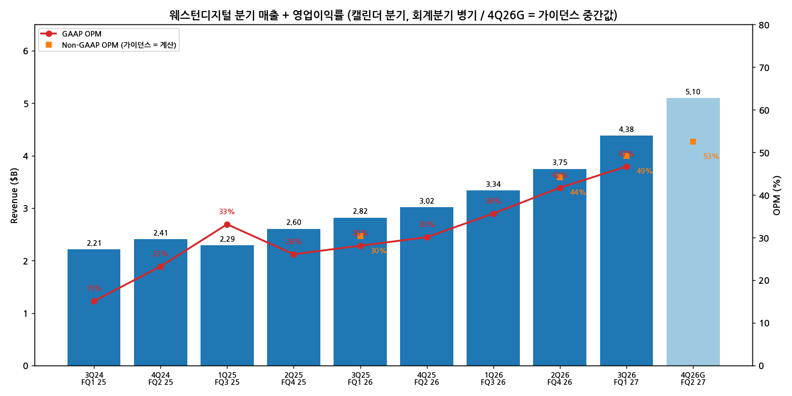
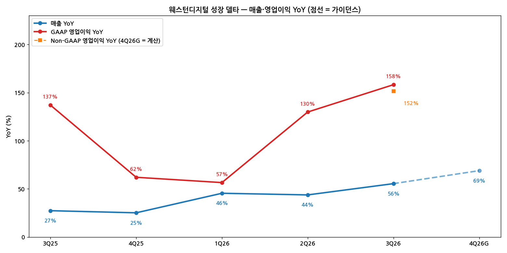

> 모드: 실적 리뷰 (v11)
> 종목: Western Digital (WDC)
> 섹터: 반도체
> 서브섹터: 메모리
> 분기: 2026-Q3 (웨스턴디지털 회계 FY27 Q1, 2026년 7～9월)
> 발표일: 2026-10-22 (ET, AMC) / 2026-10-23 KST
> 작성 시각: 2026-11-16 KST
> 분석 소스: SEC XBRL(10-Q·10-K, GAAP 분기 매출·영업이익) + 첨부 셀사이드 3개 — KB증권 AI 실적속보(10/23), 삼성증권(10/23), 한화투자증권 Earnings Flash(10/23). 웹서치 보완 없음
> 리뷰 깊이: 풀 | 리서치 첨부 3건

# Western Digital 3Q26 (FQ1 FY27) 실적 리뷰 — HDD는 아직 가격이 가속한다

## 0. 한 줄 판정

> 성장 델타: **가속 (매출 YoY +44% → +56%, GAAP 영업이익 YoY +130% → +158%, 가이던스 매출 YoY +69%)** | 내러티브: **유지** → **숫자는 적극 구간, 주가는 '가격 피크아웃' 의심 구간 — 고점 대비 −56%로 멀티플만 압축** [판단]

→ 숫자: 매출 $4.38B(+55.5% YoY, +16.9% QoQ), Non-GAAP 영업이익 $2.15B(OPM 49.1%), 조정 EPS $4.64. 컨센 대비 매출 +5.6～6.4%, EPS +12.9%. Non-GAAP GPM 58.1%(+14.2%p YoY)
→ 델타: 출하 용량 248EB(+22% YoY)에 TB당 가격 +28% YoY(직전 분기 +18%) — 성장 동력이 **가격 쪽으로 더 기울며 가속**. FQ2 가이던스 매출 $5.0～5.2B(+69% YoY), GPM 60～61%, EPS $5.60～6.00으로 컨센(매출 $4.57～4.78B, EPS $4.84～5.27)을 크게 상회
→ 쟁점 ①: 가격 가속은 3～4개 분기 더 간다(회사) vs 그 뒤 피크아웃(시장) — 12개월 선행 P/E 14.1배로 HDD 업황 개선 전 수준까지 하락(삼성)
→ 쟁점 ②: 원가 — DRAM·NAND 등 부품 가격 상승으로 TB당 원가 절감률이 연 10%를 밑돈다 + CapEx가 2년간 매출 대비 4～6% 상단을 웃돈다 → 시간외 −6.4%(한화)
→ 다음 관건: FQ2 GPM 60%+ 달성, 40TB ePMR 출하 비중 30% → 50%, HAMR 2개 하이퍼스케일러 인증 완료(2027년 1분기)

---

## 1. 숫자

① 분기 표 (캘린더 분기, 회계분기 병기)

단위: $M, %. **영업이익 = GAAP** (SEC XBRL). Non-GAAP 영업이익은 리포트 공개 분기만 병기

| 항목 | 3Q24 (FQ1 25) | 4Q24 (FQ2 25) | 1Q25 (FQ3 25) | 2Q25 (FQ4 25) | 3Q25 (FQ1 26) | 4Q25 (FQ2 26) | 1Q26 (FQ3 26) | 2Q26 (FQ4 26) | **3Q26 (FQ1 27)** | 4Q26 가이던스 (FQ2 27) |
|---|---|---|---|---|---|---|---|---|---|---|
| 매출액 | 2,212 | 2,409 | 2,294 | 2,605 | 2,818 | 3,017 | 3,337 | 3,747 | **4,381** | 5,100 (5,000～5,200) |
| 영업이익 (GAAP) | 334 | 560 | 760 | 680 | 792 | 908 | 1,190 | 1,563 | **2,046** | — |
| OPM (GAAP) | 15.1 | 23.2 | 33.1 | 26.1 | 28.1 | 30.1 | 35.7 | 41.7 | **46.7** | — |
| 영업이익 (Non-GAAP) | — | — | — | — | 856 | — | — | 1,655 | **2,153** | 약 2,681 [계산] |
| OPM (Non-GAAP) | — | — | — | — | 30.4 | — | — | 44.2 | **49.1** | 약 52.6 |
| 매출 YoY | +85.3 | +76.2 | +30.9 | +30.0 | +27.4 | +25.2 | +45.5 | +43.8 | **+55.5** | +69.0 |
| 영업이익 YoY (GAAP) | — | — | — | — | +137.1 | +62.1 | +56.6 | +129.9 | **+158.3** | 약 +195 [근사] |
| **매출 YoY 델타 (%p)** | — | −9.1 | −45.3 | −0.9 | −2.6 | −2.2 | +20.3 | −1.7 | **+11.7** | +13.5 |
| **영업이익 YoY 델타 (%p)** | — | — | — | — | — | −75.0 | −5.5 | +73.3 | **+28.4** | — |

→ (출처: 매출·GAAP 영업이익 = SEC XBRL(10-Q 분기치, 4분기는 10-K 연간 − 3개 분기 [계산]). Non-GAAP 영업이익 = KB·한화(FactSet). 4Q26 가이던스 영업이익 = 매출 중간값 $5.1B × GPM 중간값 60.5% − 영업비용 가이던스 중간값 $405M [계산]. 가이던스 영업이익 YoY는 Non-GAAP 가이던스 vs 전년 GAAP이라 근사)
→ 2025-02 샌디스크 분사로 이전 분기는 HDD 단독 재표시치. 2023년 분기 영업이익은 재표시되지 않아 영업이익 YoY는 3Q25부터. 1Q25 GAAP 영업이익(760)이 앞뒤 분기보다 높아 1Q26 YoY(+57%)가 눌려 보인다

서프라이즈: 매출 컨센 대비 **+5.6%(한화)～+6.4%(KB)**, 조정 EPS **+12.9%**, Non-GAAP 영업이익 +3.2%(삼성)～+12.0%(KB). 직전 분기 회사 가이던스($4.1B·EPS $4.00) 대비 매출 +6.9%, EPS +16%

(1) YoY 위치
→ 매출 YoY는 3Q25～4Q25 25%대 바닥 → 1Q26 +46% → 3Q26 +56% → 가이던스 +69%로 **아직 정점이 오지 않았다**
→ GAAP 영업이익 YoY도 2Q26 +130% → 3Q26 +158%로 재가속. 가이던스 경로상 YoY 정점은 빨라도 4Q26 이후 [판단]

(2) 성장 분해 — 물량보다 가격
→ 출하 용량 248EB(+22% YoY), TB당 가격 +28% YoY(직전 분기 +18%) — 매출 +55% 중 가격 기여가 물량보다 크다 (KB·한화)
→ 삼성 계산: 가이던스 매출 +69%에 출하 용량 +25%를 가정하면 TB당 가격은 **+35%** — 가격 상승률이 한 단계 더 올라간다
→ 같은 시기 샌디스크는 "물량 60%·가격 40%"로 가격 기여가 줄었다 — **NAND는 가격이 식고, HDD는 가격이 달아오르는** 정반대 국면 [판단]

→ (출처: SEC XBRL, KB·한화(Non-GAAP), 4Q26G = 가이던스 중간값 [계산])

→ (출처: 동일. 주황 = Non-GAAP 영업이익 YoY)

② 최종시장별 매출

단위: $M, %. 단일 HDD 사업 — **최종시장별 영업이익은 미공개**

| 최종시장 | 3Q26 매출 | 비중 | YoY | 3Q25 매출 [계산] |
|---|---|---|---|---|
| **클라우드** | **3,870** | **88** | **+54.1** | 약 2,511 |
| 클라이언트 | 320 | 7 | +119 | 약 146 |
| 컨슈머 | 193 | 5 | +19.1 | 약 162 |
| **합계** | **4,381** | 100 | +55.5 | 2,818 |

→ (출처: 한화투자증권(회사 발표치). 3Q25는 YoY로 역산 [계산]. 분기 QoQ 최종시장 추이는 첨부 자료에 없음)
→ **델타를 끄는 곳 = 클라우드.** 증가분 +$1.56B 중 클라우드가 +$1.36B(87%). 하이퍼스케일러 고용량 니어라인 수요
→ 클라이언트 +119%는 기저가 작고(약 $1.5억) 가격 효과 — 꺾이는 사업부는 없다. 직전 리뷰에서 본 클라우드 비중 89%는 88%로 소폭 하락
→ 샌디스크(엣지·컨슈머 둔화)와 달리 HDD는 소비자 쪽도 플러스 [판단]

③ 연간 (6월 결산)

단위: $M, %

| 항목 | FY24 | FY25 | **FY26** |
|---|---|---|---|
| 매출액 | 6,317 | 9,520 | **12,919** |
| 영업이익 (GAAP) | −403 | 2,334 | **4,453** |
| OPM | −6.4 | 24.5 | **34.5** |
| 매출 YoY | — | +50.7 | **+35.7** |
| 영업이익 YoY | — | 흑자 전환 | **+90.8** |

→ (출처: SEC XBRL 10-K, 삼성증권 재무표. HDD 단독 재표시 기준)
→ FY27E: 첨부 리포트에 증권사 추정치 없음. 1분기 실적 + 2분기 가이던스만으로 상반기 매출 약 $9.5B(FY26 상반기 $5.8B 대비 +62%) [계산]
→ 연간 컨센 변화: 첨부 3건 모두 속보형(Not Rated)이라 발표 전후 연간 컨센 변화는 미확인. Bloomberg 평균 TP $627.8(삼성), FactSet $669.6(KB), $624.5(한화)

---

## 2. 시장 쟁점

① 2-0. 지난 리뷰에서 "봐야 할 것"으로 남긴 항목 체크

> 직전 분기(2026-Q2, FQ4 FY26) 리뷰는 작성되지 않음. 2026-Q1 리뷰 기반 팔로업(`earnings-followup/2026-Q2_WDC_팔로업.md`) 항목을 두 분기 누적 체크

| 직전 팔로업 항목 | 이번까지 결과 | 판정 |
|---|---|---|
| FQ4 FY26 매출 $3.80B·클라우드 90%+ | FQ4 FY26 $3.75B(가이던스 범위 내, 중간값 소폭 하회) → FQ1 FY27 $4.38B. 클라우드 비중 88% | **부분 확인** (매출 OK, 클라우드 90% 미달) |
| 40TB ePMR 2H CY2026 램프 | 40TB ePMR 출하 용량 비중 FQ2 30% → FQ3 50% 목표 (한화) | **확인** |
| HAMR 4개 고객 인증 → 2027 램프 | 1세대 HAMR 2개 하이퍼스케일러 인증 CY2027 1분기 완료·상반기 대량 출하, 추가 2개 고객은 2027 상반기 인증 시작 (KB·삼성) | **부분 확인** (일정 유지, 동시 인증 4곳 → 2곳 선행) |
| UltraSMR FY27 말 60% | 첨부 리포트 언급 없음 | **미확인** |
| 샌디스크 잔여 지분 처분 | 첨부 리포트 언급 없음. FY26 말 장기차입금 $107M·순현금 약 $5억 (삼성·한화) | **미확인** |

→ 숫자는 확인, 기술 로드맵은 일정 유지. 미확인 2건(UltraSMR 비중, 샌디스크 지분)은 다음 분기로 이월

② 2-1. 이번 분기 쟁점

| # | 쟁점 | 한 줄 정의 | 언급 증권사 |
|---|---|---|---|
| 1 | 가격 가속은 언제까지 | TB당 가격 +28% → 가이던스상 +35%, 3～4개 분기 후 둔화 예고 | 3/3 |
| 2 | 원가·CapEx 부담 | 부품(DRAM·NAND) 가격 상승으로 원가 절감 둔화, CapEx 2년간 4～6% 상단 초과 | 3/3 |
| 3 | 출하 용량 성장 저점과 HAMR 전환 | 이번 분기가 EB 성장률 저점, 6～8개 분기 가속 vs 경쟁(도시바 증설) | 3/3 |

③ 2-2. 쟁점별 분해

(1) 쟁점 1 — 가격 가속은 언제까지

(1-1) 회사 설명
→ "TB당 ASP는 향후 3～4개 분기 YoY 상승이 이어지나, 이후 상승 속도는 다소 둔화" (KB)
→ 공급 부족 + 고용량 제품 전환 + **LTA 가격 재조정**으로 향후 3～4개 분기 ASP 추가 상승 기대, 경영진은 가격 상승폭 확대 가능성도 언급 (한화·삼성)
→ HDD 수급 격차는 단기간 해소가 어렵고, 주요 고객 수요 전망은 2028～2030년까지 계속 높아지는 중. 주요 고객 7곳의 수요 가시성은 2030～2031년까지 (KB·한화)

(1-2) 증권사별 해석 편차

| 증권사 | 핵심 가정·추정 | 논리 |
|---|---|---|
| 삼성 | 가이던스 내재 TB당 가격 +35% YoY | "가격 상승 가속 구간" — 3～4개 분기 가격, 6～8개 분기 출하량이 성장을 이어받는 바통 터치 |
| 한화 | ASP YoY +18% → +28% 확대 | LTA 재가격이 추가 상승 동력 |
| KB | 3～4개 분기 뒤 상승 속도 둔화 | 회사 발언을 그대로 전달 — 피크아웃 시점이 처음 제시됨 |

(1-3) 공통 결론 vs 갈리는 지점
→ 공통: 향후 2～3개 분기는 가격 상승률이 더 높아진다
→ 갈림: **회사가 스스로 둔화 시점(3～4개 분기 뒤)을 말했다는 것**을 시장이 피크아웃 예고로 읽느냐, 출하량이 바통을 이어받는 전환으로 읽느냐

(1-4) [판단]
→ 모멘텀 관점에서 가격 YoY가 가장 높아지는 구간이 4Q26～2Q27이고, 그 뒤 둔화가 예고돼 있다. 메모리(DRAM·NAND)가 겪은 "가격 정점 → 멀티플 선반영 압축"이 HDD에서 한두 분기 늦게 반복되는 구도 — 주가가 실적 피크보다 먼저 꺾인 이유다

(2) 쟁점 2 — 원가·CapEx 부담

(2-1) 회사 설명
→ "TB당 원가는 장기적으로 연 약 10% 하락하나, 단기적으로 DRAM·NAND 등 원재료 가격 상승으로 절감률이 10%를 하회" (KB)
→ "향후 2년간 CapEx는 5년 평균 범위 4～6%를 소폭 상회, 생산 대수 확대 투자는 계획 없음" — 헤드·미디어 기술과 공장 자동화에 집중 (KB·한화)
→ FQ1 CapEx $227M(QoQ +110%), FCF $13.8억(+130% YoY, FCF 마진 31.4%), 자사주 $10.0억, 배당 $0.15 → $0.175(+17%) (KB·한화)

(2-2) 증권사별 해석 편차

| 증권사 | 핵심 가정·추정 | 논리 |
|---|---|---|
| 한화 | 시간외 −6.4% | 호실적에도 원가 상승·CapEx 확대 부담이 부각 |
| 삼성 | 원가 하락 폭 축소는 영업 레버리지로 상쇄 | Non-GAAP 영업이익은 컨센 +3%에 그침 — 매출 서프라이즈(+6%)보다 작다 |
| KB | 원가 절감률 10% 하회 | 메모리 가격 상승이 HDD 원가로 전이 |

(2-3) 공통 결론 vs 갈리는 지점
→ 공통: 원가 절감 둔화는 사실이지만 가격 상승이 훨씬 커서 마진은 계속 오른다(가이던스 GPM 60～61%)
→ 갈림: CapEx 상향을 **공급 증가 신호**로 보느냐(시장 반응), **대수 증설 없는 기술 투자**로 보느냐(회사)

(2-4) [판단]
→ 메모리 가격 상승이 HDD 원가 상승으로 이어지는 연결이 확인됐다 — 메모리 사이클이 꺾이면 HDD 원가 부담은 오히려 줄어든다. CapEx는 대수 증설이 아니어서 공급 과잉 리스크로 보기 어렵다

(3) 쟁점 3 — 출하 용량 성장 저점과 HAMR 전환

(3-1) 회사 설명
→ "FY27 잔여 기간 EB 성장은 가속, **이번 분기가 성장률 저점**" (KB). 장기 니어라인 출하 용량 연평균 25%+ 성장 (한화)
→ 1세대 HAMR: 2개 하이퍼스케일러 인증 CY2027 1분기 완료, 상반기 대량 출하. 추가 2개 고객 2027 상반기 인증 시작, 2세대 HAMR(플래터당 5TB, 최대 55TB) 인증 2027 하반기 (KB·삼성)
→ "HDD 경쟁력의 핵심은 생산 대수가 아닌 기록 밀도" — 도시바 증설에 따른 점유율 우려를 일축 (삼성)

(3-2) 증권사별 해석 편차

| 증권사 | 핵심 가정·추정 | 논리 |
|---|---|---|
| 삼성 | EB 증가율 25% 소폭 하회 → 6～8개 분기 가속 | HAMR 전환이 EB 성장의 핵심, 도시바 증설은 밸류에이션 부담 요인 |
| 한화 | 40TB ePMR 비중 30% → 50% | ePMR이 HAMR 이전 공백을 메운다 |
| KB | HAMR 일정 계획대로 | 인증 일정 확인 |

(3-3) 공통 결론 vs 갈리는 지점
→ 공통: 출하 용량은 이번 분기가 저점, 2027년 HAMR로 다시 가속
→ 갈림: 시게이트(HAMR 선행)·도시바(증설)와의 경쟁에서 점유율을 지킬지

(3-4) [판단]
→ 쟁점 1과 합치면 WDC의 성장 경로는 "2026년 가격 → 2027년 물량(HAMR)" 이어달리기다. 바통 터치 시점에 HAMR 인증이 밀리면 가격 둔화와 물량 공백이 겹치는 구간이 생긴다 — 2027년 1분기 인증 완료가 가장 중요한 확인 포인트

④ 2-3. 낙관 vs 보수 — 논리 대비

| 구분 | 증권사 | 무엇을 다르게 가정했나 |
|---|---|---|
| 낙관 | 삼성 | 가격 상승률이 3～4개 분기 더 높아지고, 이후 HAMR 출하량이 바통을 받는다 — 14.1배는 업황 개선 전 수준 |
| 보수 (시장) | 한화 인용 시장 반응 | 원가 상승 + CapEx 확대 = 마진 정점 신호, 시간외 −6.4% |

→ 핵심 차이는 **가격 둔화 이후의 물량 성장(HAMR) 신뢰도**
→ 셀사이드 vs 시장: 실적·가이던스 모두 크게 상회했는데 주가는 1개월 −24%, 3개월 −36%, 52주 고점($799.87) 대비 −56%(10/22 $354.19). 컨센 TP 평균($624～670) 대비 상승여력 +76～89% — 셀사이드는 숫자를, 시장은 사이클 위치를 본다 [판단]

⑤ 2-4. 추정치·TP 변화

| 증권사 | 의견 / TP | TP 변화 | 다음 분기 영업이익 E | 핵심 변화 한 줄 |
|---|---|---|---|---|
| KB (AI 속보) | — / FactSet 컨센 $669.6 | — | — | 회사 가이던스 정리 |
| 삼성 | — / Bloomberg 컨센 $627.8 | — | — | 12M fwd P/E 14.1배로 축소 |
| 한화 | Not Rated / FactSet 컨센 $624.5 | — | FQ2 컨센 매출 $4.78B·EPS $5.27 (가이던스가 +7%·+10% 상회) | 가이던스 > 컨센 |

→ 첨부 3건 모두 자체 TP 없음 — 증권사별 TP 상향·하향 건수와 연간 추정치 변화는 이번 리뷰에서 미확인
→ 멀티플: 12개월 선행 P/E 14.1배(Bloomberg, 삼성)는 2025년 9월 초 수준. **EPS 추정치는 오르고 주가는 내린 멀티플 압축** [판단]

---

## 3. 내러티브 점검

① 성장 스토리 정의
→ "AI 데이터 폭증으로 하이퍼스케일러 대용량 니어라인 HDD가 공급 부족이고, 3사 과점 + 대수 증설 없는 기술 전환(ePMR → HAMR)으로 **가격 결정력이 장기간 유지**된다"

② 이번 분기 평가 — **유지**
→ 강화 요소: TB당 가격 상승 가속(+18% → +28%), GPM 58% → 가이던스 60～61%, 고객 수요 가시성 2030～2031년, FCF·배당 인상
→ 약화 요소: 가격 둔화 시점 예고(3～4개 분기 뒤), 원가 절감 둔화, CapEx 상향, HAMR 동시 인증 고객 축소(4 → 2+2), 멀티플 압축
→ 숫자는 강화, 시장 해석은 약화 — 합쳐서 유지 [판단]

③ 국면 — 델타 가속 × 내러티브 유지
→ 메모리 3사(델타 꺾임)·샌디스크(둔화)와 달리 HDD는 **델타가 아직 가속 중인 메모리 서브섹터 내 유일한 층**이다. 다만 주가는 이미 메모리 사이클과 같이 움직였다 — 실적과 주가의 괴리가 가장 큰 종목 [판단]
→ 비유하면 같은 열차의 마지막 칸 — 앞칸(DRAM·NAND)이 감속하면 마지막 칸도 곧 감속할 것이라고 시장이 먼저 브레이크를 밟고 있다

④ 다시 강해질 트리거
→ FQ2 GPM 61% 상회 + FQ3 가이던스 매출 QoQ 플러스 유지
→ LTA 재가격 결과 공개(가격 상승률 +35% 이상 확인)
→ HAMR 2개 하이퍼스케일러 인증 조기 완료

⑤ 깨뜨릴 리스크
→ 가격 상승률 둔화가 3～4개 분기보다 빨리 옴
→ HAMR 인증 지연 → 2027년 물량 공백
→ 도시바·시게이트 증설로 2027～2028년 니어라인 공급 증가

---

## 4. 향후 봐야 할 것

| 순위 | 무엇을 (변수·임계값) | 어떤 데이터로 | 언제 |
|---|---|---|---|
| 1 | **FQ2 FY27 매출 $5.1B·GPM 60%+ & FQ3 가이던스 매출 QoQ 플러스** — TB당 가격 YoY +35% 근처 확인, QoQ 정체면 델타 '유지'로 하향 | WDC FQ2 FY27 실적·컨콜 | 2027-01 하순 |
| 2 | **HAMR 1세대 2개 하이퍼스케일러 인증 완료** (CY2027 1분기) | WDC 컨콜·IR, 시게이트 Mozaic 진척과 비교 | 2027-01～04 |
| 3 | **40TB ePMR 출하 비중 30%(FQ2) → 50%(FQ3)** | WDC 컨콜 | 2027-01 |
| 4 | **원가 — 메모리 가격 전가로 TB당 원가 절감률 10% 하회 폭** | WDC GPM 브리지, DRAM·NAND 계약가 | 분기 |
| 5 | **시게이트 대비 가격·출하 용량** — STX TB당 가격 +32%, 220EB(+21%) vs WDC +28%, 248EB(+22%) | STX FQ2 실적(1월 하순) | 2027-01 |

→ 1순위가 델타 판정을 바꾼다. 시게이트가 며칠 늦게 발표하므로 함께 읽는다

---

> Sources: SEC EDGAR XBRL(Western Digital 10-Q·10-K), KB증권 AI 실적속보(2026-10-23), 삼성증권(2026-10-23), 한화투자증권 Earnings Flash(2026-10-23) — 리포트 원문은 비공개 보관
