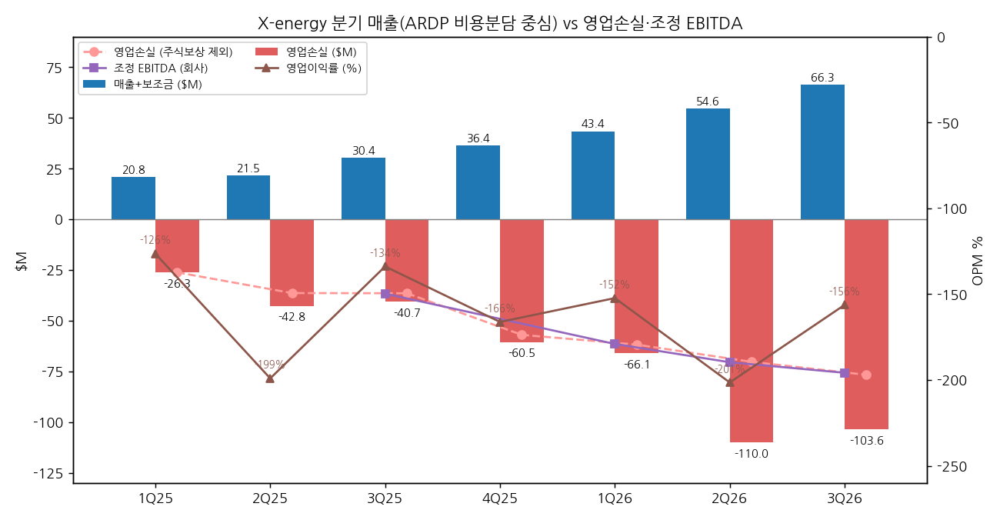
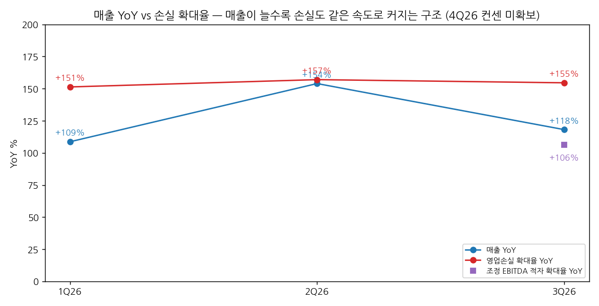
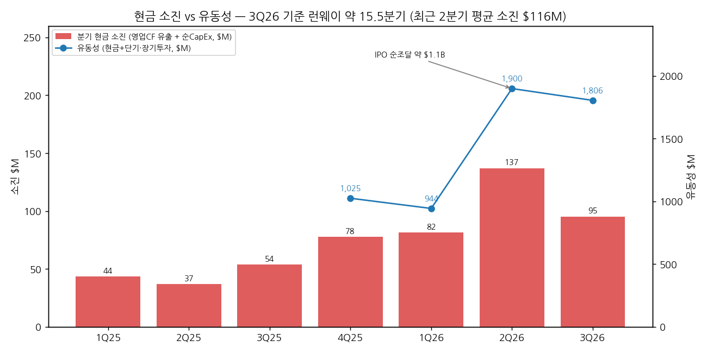
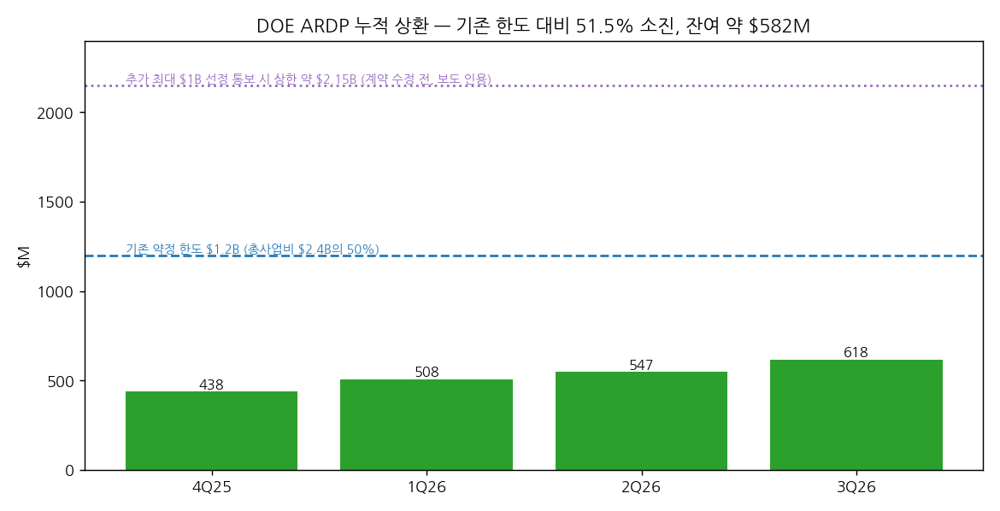

> 모드: 실적 리뷰 (v11)
> 종목: X-energy (XE, Nasdaq)
> 섹터: 원전
> 서브섹터: SMR·차세대 원자로
> 분기: 2026-Q3
> 발표일: 2026-11-12 (장 시작 전 8-K 실적 보도자료 + 10-Q 동시 제출, 같은 날 컨콜)
> 작성 시각: 2026-11-16 15:30 KST
> 분석 소스: SEC 1차 공시 — 3Q26 10-Q(2026-11-12), 8-K Ex.99.1 실적 보도자료(2026-11-12), 1Q26·2Q26 10-Q, 424B4(2026-04-27), XBRL companyfacts, 기업개요 XE v1.0(2026-11-15) / 주가: Yahoo Finance 일간(2026-11-13까지) / 비공식 보완(미검증 표기): Earnings Whispers·Finviz 3Q 프리뷰(2026-11-04, 컨센 EPS −$0.10·매출 $62.4M), BIC Magazine(2026-08-13, ARDP 추가 최대 $1B CEO 발언), allmind·Barchart 2Q26 콜 요약, stockanalysis.com 애널리스트 TP(2026-10-28 캐시), 국내 보도(이투데이·더구루 — 두산·DL이앤씨), 2026-Q3 두산에너빌리티 리뷰의 셀사이드 인용(JPM·신한·BofA). 3Q26 컨콜 트랜스크립트 미확보 — 콜 Q&A 미반영
> 리뷰 깊이: 숫자 중심 (개발사 변형 — 마일스톤·현금 트래커) | 리서치 첨부 0건
> 섹터 델타: **합산 제외** (워치리스트 2026-11-14 — SMR·차세대 원자로는 적자 개발사라 섹터 성장 델타 합산에서 빼고 마일스톤·현금 소진만 추적)
> 다음 발표: 4Q26·FY26 10-K 2027-03 예상 (상장 첫 연간 보고서)

# X-energy 3Q26 실적 리뷰 — 건설허가는 한 달 앞당겨 받았지만, 돈을 대는 쪽(Dow FID·ARDP 계약 수정)은 아직 서명 전

## 0. 한 줄 판정

> 성장 델타: 합산 제외 — 마일스톤 판정: 진전 | 내러티브: 유지 → 마일스톤 진전 + 내러티브 유지 → FID 대기 관찰 구간 (매매 트리거는 Dow 최종투자결정·구속력 주문)

→ **숫자**: 매출+보조금 $66.3M(+118% YoY)으로 컨센($62.4M, 비공식) 대비 +6.3%. 그러나 매출의 대부분이 DOE ARDP 비용분담(정부가 개발비 절반을 돌려주는 돈)이라 매출이 늘수록 원가가 더 늘어난다 — 영업손실 −$103.6M(손실 +155% YoY), 조정 EBITDA −$75.7M(적자 +106% YoY, QoQ −$70.5M → −$75.7M로 악화). 조정 EPS −$0.14는 컨센 −$0.10 하회
→ **마일스톤(진전)**: ① NRC가 Dow 시드리프트(Long Mott) Xe-100 4기 건설허가를 2026-11-09 승인 — 예정(1Q27)보다 한 달 이상 앞당김, 4세대 원자로 첫 상업 건설허가 ② TX-1 연료공장 골조 완료(2Q 콜 약속 이행) ③ AEP 인디애나 12기(960MWe) 공동개발협약(2026-08) — Amazon 지원 두 번째 프로젝트 ④ Energy Northwest(Cascade) 원자력섬 설계에 Fluor 선정
→ **아직 안 된 것(내러티브가 '강화'가 아닌 이유)**: Dow 최종투자결정(FID) 시점은 보도자료에 없다. ARDP 추가 배정(최대 약 $1B, 보도 인용)은 "선정 통보"뿐이고 계약 수정 전. AEP·Energy Northwest는 모두 타당성·개발 단계 — 구속력 있는 원자로 주문은 여전히 0건
→ **현금**: 유동성 $1,805.5M·차입금 0, 3Q 소진 $95.2M(2Q $137.1M에서 감소). 최근 2분기 평균 소진 기준 런웨이 약 15.5분기 [계산] — 당장 증자 압박은 없다
→ **다음 분기 관건**: Dow FID 공시 여부와 ARDP 계약 수정(추가 배정 의무화) + 예산기간(2027-03 종료) 연장. 두 개가 같이 나오면 "꿈 → 고성장(초기)" 재분류 검토 [판단]

## 1. 숫자

① 분기 손익 표 ($M) — 원자로·연료 판매 매출 0, 매출 = ARDP 용역·보조금 + 국방부·민간 엔지니어링 용역

| 항목 | 1Q25 | 2Q25 | 3Q25 | 4Q25 | 1Q26 | 2Q26 | **3Q26** | 4Q26E |
|---|---|---|---|---|---|---|---|---|
| 매출+보조금 | 20.8 | 21.5 | 30.4 | 36.4 | 43.4 | 54.6 | **66.3** | 컨센 미확보 |
| 직접원가 | 28.7 | 36.1 | 38.8 | 57.7 | 65.4 | 86.7 | **93.6** | |
| 매출총손익 [계산] | −7.9 | −14.6 | −8.4 | −21.3 | −22.0 | −32.1 | **−27.3** | |
| 영업손실 (GAAP) | −26.3 | −42.8 | −40.7 | −60.5 | −66.1 | −110.0 | **−103.6** | |
| 영업이익률 | −126% | −199% | −134% | −166% | −152% | −201% | **−156%** | |
| 영업손실 (주식보상 제외) [계산] | −26.2 | −36.4 | −36.5 | −57.0 | −61.8 | −70.3 | **−76.7** | |
| 조정 EBITDA (회사 Non-GAAP) | — | — | −36.7 | — | −61.5 | −70.5 | **−75.7** | |
| 매출 YoY | — | — | — | — | +108.7% | +154.0% | **+118.1%** | |
| 영업손실 확대율 YoY | — | — | — | — | +151.3% | +157.0% | **+154.5%** | |
| **매출 YoY 델타 (%p)** | — | — | — | — | — | +45.3 | **−35.9** | |
| **영업손실 확대율 델타 (%p)** | — | — | — | — | — | +5.7 | **−2.5** | |

→ (출처: 3Q26·2Q26·1Q26 10-Q, 424B4 감사 재무제표, 3Q26 8-K Ex.99.1. 4Q25 = FY25 − 9M25 [계산]. 1Q26 조정 EBITDA = 9M26 −207.7 − 2Q26 − 3Q26 [계산]. 2024 분기는 상장 전이라 미공시 → YoY는 2026년 분기부터. 주식보상 1Q25\~3Q26: 0.1·6.4·4.2·3.5·4.3·39.7·26.9)
→ 컨센 대비: 매출 +6.3% (컨센 $62.4M), 조정 EPS −$0.14 vs 컨센 −$0.10·위스퍼 −$0.13 → 하회. GAAP EPS −$0.21 (Earnings Whispers·Finviz 2026-11-04 프리뷰 — 비공식 출처)
→ 섹터 델타 판정을 쓰지 않는 이유: 영업이익이 음수라 "영업이익 YoY"가 성장 지표로 의미가 없고, 매출 YoY는 수요가 아니라 ARDP 지출 진척에 비례한다 — 3Q 매출 증가 +$35.9M 중 ARDP가 +$29.3M (8-K Ex.99.1). 그래서 이 종목은 섹터 합산에서 빼고 마일스톤(진전/정체/후퇴)과 현금으로 판정한다
→ 숫자가 말하는 것: 주식보상을 빼면 영업손실이 −36.5(3Q25) → −61.8 → −70.3 → **−76.7**로 4개 분기째 커지는 중이다. 2Q의 큰 손실(−110.0)은 IPO 스톡옵션 일시 비용($33.5M) 때문이고, 그걸 걷어낸 기초 체력은 분기마다 $5\~10M씩 적자가 늘고 있다 — 인력 확대·TX-2 설계·장납기 선급이 원인 (3Q26 10-Q MD&A)

→ (출처: 10-Q 3건, 424B4, 8-K Ex.99.1. 영업이익률은 우축)

→ (출처: 10-Q·8-K Ex.99.1 [계산]. 4Q26 컨센 미확보로 E 구간 없음)

② 매출 원천별 (사업부 대체 — 10-Q상 단일 영업부문, $M)

| 매출 원천 | 9M25 | 9M26 | YoY | 9M26 비중 |
|---|---|---|---|---|
| DOE (ARDP 등) | 56.3 | **142.0** | +152% | 86.4% |
| 국방부 (Project Pele 등) | 4.3 | 3.2 | −25% | 2.0% |
| 민간 (Dow·Amazon·Energy Northwest 등) | 12.2 | 19.2 | +58% | 11.7% |
| **합계** | 72.7 | **164.4** | **+126%** | 100% |

→ (출처: 3Q26 10-Q 주석3. YoY·비중 [계산])
→ 3Q26 단독: 용역 매출 $51.6M + 보조금 수익 $14.8M. 보조금 +267% YoY는 Dow 1호기 관련 ARDP 상환 증가(Dow 비용을 총액으로 보조금 수익·직접원가 동시 인식) (3Q26 10-Q)
→ 민간 3Q26 $10.3M(+138% YoY) — 상업 고객 돈이 아직 매출의 1/6 수준. **"고객 돈" 매출이 정부 돈을 넘어서는 시점이 재분류의 실질 기준** [판단]

③ 현금·런웨이·주식수 (마일스톤 & 현금 트래커, $M)

| 항목 | 1Q25 | 2Q25 | 3Q25 | 4Q25 | 1Q26 | 2Q26 | **3Q26** |
|---|---|---|---|---|---|---|---|
| 영업현금흐름 | −41.9 | −20.0 | −30.8 | −57.2 | −67.3 | −97.3 | **−51.2** |
| CapEx 총액 | 11.2 | 24.4 | 43.7 | 37.9 | 43.0 | 63.3 | **71.8** |
| ARDP CapEx 상환 | 9.5 | 7.4 | 20.6 | 17.3 | 28.8 | 23.5 | **27.8** |
| **현금 소진 (영업CF 유출 + 순CapEx)** [계산] | 43.6 | 37.0 | 53.9 | 77.8 | 81.5 | 137.1 | **95.2** |
| 유동성 (현금+단기·장기투자) | — | — | — | 1,025.3 | 944.0 | 1,899.8 | **1,805.5** |
| ARDP 누적 상환 | — | — | — | 약 438 | 508.0 | 546.7 | **618.0** |
| 이자수익 | — | — | — | — | — | — | **19.7** |
| 주식수 A+B (백만주, 10-Q 표지) | — | — | — | 상장 전 | 상장 전 | 406.4 | **406.2** |

→ (출처: 10-Q 3건, 424B4, XBRL companyfacts. 분기 현금흐름 = 누적 차이 [계산]. 유동성 3Q26 = 현금 1,044.1 + 단기투자 514.3 + 장기투자 247.1, 차입금 0 (8-K Ex.99.1). 상장 전 2025 분기말 유동성 미공시)
→ **런웨이**: 1,805.5 ÷ 최근 2분기 평균 소진 116.2 = **약 15.5분기(3.9년)** [계산]. 3Q 소진만 쓰면 약 19분기. 3Q 소진이 줄어든 건 2Q의 공급사 선급금(흑연·단조·농축)이 3Q에 반복되지 않았기 때문 — 영업CF −97.3 → −51.2 (2Q 콜 요약·10-Q) [판단]
→ 이자수익 $19.7M이 영업손실의 19%를 메운다. 금리가 내려가면 이 완충이 줄어든다 [판단]
→ 순손실 −$83.7M(X-energy 귀속 −$59.4M)이 영업손실보다 작은 건 이자수익 덕분. 3Q25 순손실 −$219.0M은 워런트 평가손이 컸던 상장 전 숫자라 비교 의미 없음

→ (출처: 10-Q 3건, 424B4 [계산])

④ 연간 (간략, $M)

| 항목 | FY24 | FY25 | 9M26 | FY26E | FY27E |
|---|---|---|---|---|---|
| 매출+보조금 | 120.2 | 109.1 | 164.4 | 컨센 미확보 | 컨센 미확보 |
| 영업손실 | −123.5 | −170.3 | −279.7 | | |
| 영업이익률 | −103% | −156% | −170% | | |
| 매출 YoY | — | −9.2% | +126.0% (9M) | | |
| 영업CF | −96.2 | −149.9 | −215.8 | | |

→ (출처: 424B4, 3Q26 10-Q [계산]. 회사는 수치 가이던스를 내지 않는다 (8-K Ex.99.1). 연간 컨센은 무료 소스에서 신뢰할 만한 집계를 확보하지 못해 공란)
→ 9M26 영업손실에는 IPO 관련 주식보상 $70.8M(9M 합계)이 포함 — 제외 시 약 −$209M [계산]

## 2. 시장 쟁점 — 회사 설명 + 공시 + 비공식 콜 요약

① 2-0 지난 분기 체크 — 첫 리뷰라 직전 리뷰 4번 없음. 대신 **2Q26 콜(2026-08-13)에서 회사가 약속한 것** 대조

| 2Q26 콜 약속 (비공식 콜 요약 기준) | 3Q26 결과 | 판정 |
|---|---|---|
| Dow 건설허가 "2027년 초" 예정대로 | 2026-11-09 승인 — 한 달 이상 조기 | **확인 (초과)** |
| TX-1 골조 80%(6월) → 3Q 마일스톤 달성 | 골조(수직) 공사 완료, 내부 공사·장비 설치 단계 진입 | **확인** |
| 1GW 유틸리티 고객 발표 "최종 단계" | AEP 12기 960MWe 공동개발협약(2026-08) — 타당성 단계, Amazon 자금 | **부분 확인** — 규모는 맞지만 구속력 주문 아님 [판단] |
| DOE ARDP 추가 최대 $1B | 10-Q: "추가 배정 선정 통보" — 계약 수정(contract award modification) 미체결 | **미확인** |
| HALEU 농축 장기계약 (Centrus·General Matter) | 계약 유지, 세부 비공개 | 유지 |

→ (출처: 2Q26 콜 요약 — allmind·Barchart·Earnings Whispers(비공식), 3Q26 10-Q·8-K Ex.99.1)

② 이번 분기 쟁점 5개 (셀사이드 리포트 미첨부 — 공시·보도자료·2Q 콜 요약·3Q 프리뷰 기사로 구성)

(1) 건설허가는 받았다 — 그런데 Dow는 언제 짓기로 결정하나 (FID)
(2) ARDP 잔여 $582M + 추가 최대 $1B — 정부 돈은 언제, 얼마나 확정되나
(3) 상업 파이프라인 11.5GWe·144기 — Amazon/Energy Northwest·AEP가 구속력 계약으로 넘어가나
(4) TX-1 연료공장과 현금 소진·주식 오버행 — 적자 확대 속도 vs 런웨이, 락업 해제 이후 수급
(5) 한국 밸류체인 연결 — 두산에너빌리티 기자재 계약, DL이앤씨·한수원

③ 쟁점별 분해

(1) **Long Mott 건설허가(2026-11-09) vs Dow FID 미정**

(1-1) 회사 설명
→ "NRC 건설허가는 예정보다 한 달 이상 앞서 받았다", 산업용 공정열 부지에 NRC가 내준 첫 건설허가 (8-K Ex.99.1, CEO 클레이 셀)
→ NRC는 환경평가 "중대 영향 없음(FONSI)" + 최종 안전성평가보고서 발행. 첫 상업 인도 "2030년대 초" (3Q26 10-Q)
→ 보도자료에 **FID 시점 언급 없음**. 10-Q 위험요인: "어떤 배치(deployment)에서도 FID를 달성하지 못했다". FID가 나면 Dow가 건설비를 계속 부담(ARDP 50:50 대상), **FID가 안 나면 X-energy는 Dow 건설 자금 의무가 없지만 ARDP 실증을 유지하려면 합리적 기간 안에 다른 고객을 찾아야 한다** (3Q26 10-Q)

(1-2) 공시·보도가 보여주는 것
→ 건설허가 신청(2025-03) → 18개월 심사 일정(2025-06 확정) → 승인(2026-11-09). 인허가 리스크 하나가 빠졌다
→ Dow는 MPDA·CCA를 편의 해지할 수 있다 (424B4) — 허가가 나왔다고 FID가 자동으로 따라오지 않는다

(1-3) [판단]
→ 이번 분기 마일스톤 판정을 "진전"으로 둔 가장 큰 근거. 다만 시장이 기다리는 건 허가가 아니라 **Dow가 자기 돈을 넣는 결정**이다. 승인 당일 주가 +7.0%(11-06 $10.43 → 11-09 $11.16) 후 실적일 +2.9%(11-11 $10.94 → 11-12 $11.26), 11-13 $11.08로 되돌림 — 허가 이벤트가 리레이팅으로 이어지지 않았다 (Yahoo Finance)
→ 결론이 바뀌는 조건: Dow FID 공시(또는 Dow 4Q 실적 콜에서 일정 제시) → 내러티브 "강화". 반대로 Dow가 2027 상반기까지 FID 일정을 내놓지 않으면 ARDP 이행기간(상한 약 2030년) 압박과 겹쳐 "약화"

(2) **ARDP 잔여 자금과 추가 배정**

(2-1) 회사 설명
→ ARDP 누적 상환 $618.0M(2026-09-30). 기존 약정 = 총사업비 추정 $2.4B의 50%인 $1.2B → 잔여 약 $582M [계산]. 의회 배정 누적 약 $1.1B + 최근 ARDP·원전 추가 배정 $3.1B (3Q26 10-Q)
→ "추가 배정 대상으로 선정 통보를 받았으나, 증액은 DOE 계약관의 후속 계약 수정과 연장 신청 승인이 있어야 한다" (3Q26 10-Q)
→ 현 예산기간 2025-03 → **2027-03 종료**, 연장은 DOE 재량. 이행기간은 원 7년 + 연장 최대 3년 = 10년 상한 — 2020-12 선정 기준 약 2030년 [계산]. Dow 상업운전(2030년대 초)이 그 뒤라 일부 건설비는 ARDP 대상 밖일 수 있다 (3Q26 10-Q)

(2-2) 보도 인용 (비공식)
→ 2Q 콜(2026-08-13)에서 CEO가 "추가 최대 $1B, 2021년 이후 시드리프트 공공 지원 총액 최대 $2.15B", DOE 대변인 확인, 같은 50:50 조건 (BIC Magazine 2026-08-13). 다른 요약은 DOE 분담 잠재 총액 약 $2.115B로 표기 (allmind 2Q 요약)

(2-3) [판단]
→ 3분기 동안 분기 상환 속도는 $39\~71M — 이 속도면 기존 잔여 $582M은 약 2\~3년치 [계산]. 즉 **추가 배정이 계약으로 묶이지 않아도 당장 자금 공백은 없다**. 쟁점은 "돈이 바닥나느냐"가 아니라 **"Dow 건설비 50%가 정부 돈으로 커버되느냐"** — 그게 Dow FID의 경제성을 좌우한다
→ 결론이 바뀌는 조건: 계약 수정 체결 + 2027-03 예산기간 연장 승인 → 진전. 연장 거부·예산 삭감 → 후퇴(재무 구조 재평가)

→ (출처: 3Q26·2Q26·1Q26 10-Q, 424B4(4Q25 약 438), 추가 상한은 BIC Magazine 보도 인용 — 계약 수정 전)

(3) **상업 파이프라인 — Amazon/Energy Northwest·AEP·Centrica**

(3-1) 회사 설명
→ 4개 프로젝트(Dow, Amazon/Energy Northwest, Amazon/AEP, Centrica) — 고객이 조건부 권리를 전부 행사한다는 가정에서 **144기·약 11.5GWe** (8-K Ex.99.1, 10-Q는 "11GWe 초과")
→ Energy Northwest(Cascade, 워싱턴주): 4기 320MWe → 최대 960MWe, 운전 2030년대 초 기대. **Fluor를 원자력섬 엔지니어링·설계에 선정** — 회사 표현으로 "두 번째 상업 계약" (8-K Ex.99.1)
→ AEP(인디애나 설리번 카운티): 12기 960MWe 타당성 공동개발협약(2026-08), AEP-Amazon 자금·개발 협약 별도 — "Amazon 지원 두 번째 상업 배치 기회" (8-K Ex.99.1, 10-Q)
→ Centrica(영국): Xe-100이 영국 일반설계평가(GDA) 접수 — 약 3년 소요 (8-K Ex.99.1)

(3-2) 프리뷰 기사가 잡은 쟁점 (비공식)
→ "3Q는 약속한 1GW 유틸리티 계약과 TX-1 마일스톤을 보여줘야 한다 — 11월에도 서명이 없으면 톤과 결과의 차이가 무시하기 어려워진다" (Finviz 2026-11-04)

(3-3) [판단]
→ AEP 960MWe가 2Q 콜의 "1GW 유틸리티"에 해당하는 것으로 보이나 **타당성 협약**이다. Amazon 5GWe 옵션의 첫 두 건이 모두 개발 자금 단계 — 구속력 있는 원자로 주문(장납기 기자재 고객 자금 투입)은 아직 Dow조차 없다
→ Amazon 조건(최혜 가격, 2031\~2039 제조 우선 배정, 상업운전 5년 후 원가절감분 지급 — 424B4)은 물량을 주는 대신 마진을 누른다 — 파이프라인이 커질수록 단위 마진 질문이 따라온다
→ 결론이 바뀌는 조건: Energy Northwest 건설허가 신청 또는 AEP 타당성 → 확정 계약 전환

(4) **TX-1 연료공장·현금 소진·주식 오버행**

(4-1) 회사 설명
→ TX-1(오크리지) 골조 완료 → 내부 공사·장비 설치 단계. 미국 첫 신규 상업 규모 첨단 원전 연료 제조시설, **연 약 70만 개 TRISO-X 페블** 생산 예정 (8-K Ex.99.1). NRC Part 70 면허(2026-02, 40년) 보유
→ TX-1 비용 50%는 ARDP 상환, **TX-2부터는 비대상** (3Q26 10-Q)
→ "강한 재무구조와 상당한 자금으로 차별화된 위치" (CEO, 8-K Ex.99.1). 10-Q: "향후 1년 의무 충족 가능하나 영업손실·현금 유출이 과거보다 커질 수 있고 추가 자본 필요"
→ 무조건부 구매약정 $312.2M(흑연·우라늄 농축 등) (3Q26 10-Q)

(4-2) 오버행
→ IPO 락업은 424B4상 180일(2026-10-20)이었으나 조기 종료 조항으로 **2026-09-01 종료** (3Q26 10-Q)
→ 표지 주식수: Class A 287.5M → **297.5M**, Class B 118.9M → **108.7M** (2026-08-10 → 11-09) — 락업 해제 후 약 1,020만주가 B→A로 교환 [계산]. Class B 1.087억주가 추가로 A 전환 가능
→ 2026 주식보상계획 가용 3,720만주 + **2027-01-01부터 매년 발행주식의 5% 자동 증액** (약 2,000만주/년 [계산]), 조건부 "2025 워런트" 1,410만주(@$6.487, 해당 고객 Xe-100 전량 가동 시) (3Q26 10-Q)
→ 주가: 2Q 실적 이후 −52.5%, 약세 심리 18.5% → 30% (Earnings Whispers 2026-11-04 — 비공식). 2026-11-05 종가 저점 $9.00 → 11-13 $11.08, 공모가 $23 대비 −51.8% (Yahoo)

(4-3) [판단]
→ 소진 속도(분기 $95\~137M)보다 유동성($1.8B)이 훨씬 커서 **2027년 중 증자 필요성은 낮다**. 주가를 누른 건 현금이 아니라 ① 락업 해제 수급 ② FID·구속력 주문 부재다
→ 시총 약 $4.50B − 유동성 $1.81B = **EV 약 $2.70B** [계산] — 기술·파이프라인에 의미 있는 값이 남아 있다. 주당 유동성 약 $4.44 [계산]이 하방 참고선
→ 결론이 바뀌는 조건: 조정 EBITDA 적자가 분기 −$80M을 넘어 확대 + 소진 $130M+ 재개 → 런웨이 12분기 이하로 축소, 후퇴 판정

(5) **한국 밸류체인 연결 — 두산에너빌리티·DL이앤씨·한수원**

| 영역 | 내용 | 출처 등급 |
|---|---|---|
| 두산에너빌리티 — 주기기 공급 | "선호 전략 공급사"(원자로 압력용기·증기발생기·터빈 역량), 2025-12 예약계약 — 11GWe 파이프라인 대응 SMR 제작설비 구축 약정 | 424B4 (1차) |
| 두산 — Dow 4모듈 후속 계약 | 증기발생기 전열관·주단소재 후속 계약 **연내 예상**, 4Q SMR 수주 목표 약 1조원(X-energy + NuScale) | 2026-Q3 두산에너빌리티 리뷰의 JPM·신한·BofA 인용 (셀사이드) |
| 두산 — 16기분 단조 소재 | 2025-12 16기분 단조 핵심소재 예약, 2026-03 구속력 계약 | 이투데이·더구루 (미검증 — 비공식) |
| 두산 — 지분 투자 | "X-energy 지분 투자자"(424B4), 투자액 $5M(2023) | 투자 사실 1차 / 금액 미검증 |
| DL이앤씨 | 지분 투자자, 글로벌 Xe-100 배치 협력 (424B4). 투자액 $20M(2023), 표준설계 계약 | 투자 사실 1차 / 금액·계약 미검증 |
| 한수원(KHNP) | 2025-08 X-energy·Amazon·두산과 Amazon 물량 미국 배치 협력 공동협약(비구속) | 424B4 (1차) |
| 경쟁 | "한국 경쟁사는 SMR 개발 중이나 상업 운전 SMR 없음" (i-SMR 등) | 3Q26 10-Q |

→ 3Q26 10-Q에는 두산·DL이앤씨·한수원 언급이 없다 — 이번 분기 새 공시 없음
→ [판단] X-energy 마일스톤의 한국 쪽 수혜는 **Dow FID 전에도 장납기 기자재 선발주로 먼저 나타날 수 있다** — 두산 4Q 수주 공시에 Dow 4모듈 전열관·주단소재가 잡히면 X-energy가 FID 전 선급(무조건부 약정)을 늘리고 있다는 신호. 이는 X-energy 입장에서 현금 소진 증가 요인이기도 하다

④ 2-3 낙관 vs 보수 (비공식 — 셀사이드 리포트 미첨부)

→ 낙관 쪽: Morgan Stanley Overweight($41 → $34), UBS Buy($34 → $18), Wedbush 긍정 — 논리는 ARDP 정부 분담 + 첫 4세대 건설허가 + Amazon 파이프라인 + 자체 연료 공장 (stockanalysis.com 2026-10-28 캐시·Finviz 헤드라인 — 미검증)
→ 보수 쪽: Piper Sandler Underweight($9 → $8), Needham Hold 개시 — FID·구속력 주문 부재, 첫 호기(FOAK) 원가 불확실 [판단 — 리포트 원문 미확보]
→ 바이사이드: 2Q 이후 −52.5%, 약세 심리 30% (Earnings Whispers) — 셀사이드 컨센 "Buy"(10명, 평균 TP $31.38)와 주가($11.08)의 괴리가 크다. 평균 TP가 3Q 실적·허가 이후 갱신되었는지 미확인

⑤ 2-4 TP 표 (미검증 — 2026-10-28 캐시 기준, 3Q 실적 후 변경분 미확보)

| 증권사 | 등급 | 직전 TP | 현재 TP | 핵심 변화 |
|---|---|---|---|---|
| Morgan Stanley | Overweight | $41 | $34 | 하향 |
| UBS | Buy | $34 | $18 | 하향 |
| Piper Sandler | Underweight | $9 | $8 | 하향 |
| Needham | Hold (개시) | — | — | |
| 컨센 (10명) | Buy | — | 평균 $31.38 | |

→ TP 하향은 실적 추정 하향이 아니라 **주가 급락에 따른 멀티플 하향**으로 보인다 — 개발사라 실적 추정이 밸류에이션의 축이 아니다 [판단]

## 3. 내러티브 점검

① 성장 스토리 정의
→ "정부(ARDP)가 첫 발전소와 연료공장 비용의 절반을 대고, Amazon·Dow 같은 대형 수요처가 줄을 선 4세대 고온가스로 + 자체 TRISO 연료 수직계열화 — 첫 호기가 지어지면 60년짜리 연료·서비스 반복 매출이 열린다"

② 이번 분기가 스토리에 준 영향
→ 강화 요인: 건설허가 조기 승인, TX-1 골조 완료, AEP 960MWe 추가, Fluor 원자력섬 설계 선정, 영국 GDA 접수, 유동성 $1.8B·무차입
→ 약화 요인: 조정 EBITDA 적자 확대(−$70.5M → −$75.7M), 조정 EPS 컨센 하회, FID 일정 무언급, ARDP 증액 미계약, 락업 해제 후 B→A 전환
→ 결과: 진전은 있었지만 모두 "다음 단계로 갈 자격"을 얻은 것이지 돈이 들어오는 계약은 아니다 → **내러티브 유지**

③ 국면 판단
→ 마일스톤 진전 + 내러티브 유지 → **FID 대기 관찰 구간**. 섹터 델타 합산 제외 종목이라 BT의 모멘텀 프레임에서는 실적이 아닌 이벤트(FID·구속력 주문·ARDP 계약)가 매매 트리거 [판단]

④ 트리거와 리스크
→ 트리거: ① Dow FID 공시 ② ARDP 계약 수정(추가 최대 $1B 의무화) + 2027-03 예산기간 연장 ③ Energy Northwest 건설허가 신청 또는 AEP 확정 계약
→ 리스크: ① Dow FID 장기 지연(편의 해지 가능) ② ARDP 연장 거부·예산 삭감 ③ Class B 대량 전환·2027-01 주식보상 풀 자동 증액에 따른 수급 부담

## 4. 향후 봐야 할 것

① **Dow(Long Mott) 최종투자결정 (마일스톤 판정 1순위)**
→ 무엇을: FID 공시 여부와 시점, Dow가 제시하는 착공·상업운전 일정, 장납기 기자재 고객 자금 투입 개시
→ 어떤 데이터로: XE 8-K, Dow 4Q26 실적 콜, NRC·Long Mott 발표
→ 언제: Dow 4Q 실적(2027-01 말) \~ 2027 상반기

② **ARDP 계약 수정 + 예산기간 연장**
→ 무엇을: 추가 배정(최대 약 $1B) 계약 수정 체결 여부·금액, 2027-03 종료 예산기간 연장 승인, 누적 상환 $618M → $700M대 진행
→ 어떤 데이터로: XE 8-K·10-K, DOE 발표, 의회 세출
→ 언제: 2027-03 (예산기간 종료) / FY26 10-K

③ **현금 소진·조정 EBITDA 추세**
→ 무엇을: 분기 소진 $95\~137M 범위 유지 여부, 조정 EBITDA 적자 −$80M 돌파 여부, 유동성 $1.6B 이상 유지(런웨이 12분기+)
→ 어떤 데이터로: 4Q26 실적 보도자료·FY26 10-K 현금흐름표
→ 언제: 2027-03

④ **Amazon 파이프라인의 구속력 전환 (Energy Northwest·AEP)**
→ 무엇을: Energy Northwest 건설허가 신청서 NRC 제출, AEP 타당성 결과 → 확정 계약, Amazon 5GWe 옵션 3번째 프로젝트
→ 어떤 데이터로: NRC 신청 접수 공지, XE·AEP·Energy Northwest 보도자료
→ 언제: 2027 중

⑤ **TX-1 장비 설치와 한국 기자재 계약**
→ 무엇을: TX-1 장비 설치·시운전 일정, 두산에너빌리티 Dow 4모듈 전열관·주단소재 계약 공시(4Q SMR 수주 약 1조원 목표의 일부)
→ 어떤 데이터로: XE 분기 보고, 두산에너빌리티 수주 공시·4Q26 IR
→ 언제: 두산 4Q 실적(2027-01 말), XE 4Q26(2027-03)
