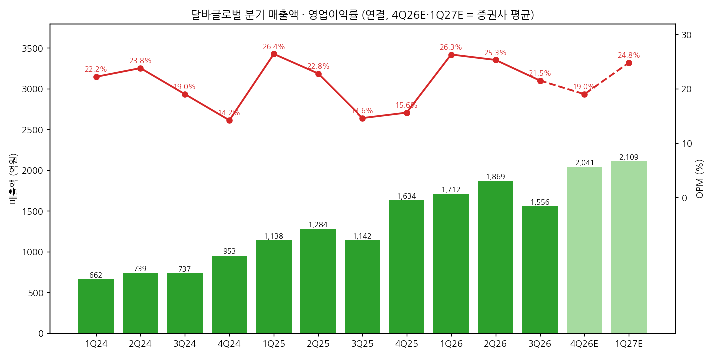
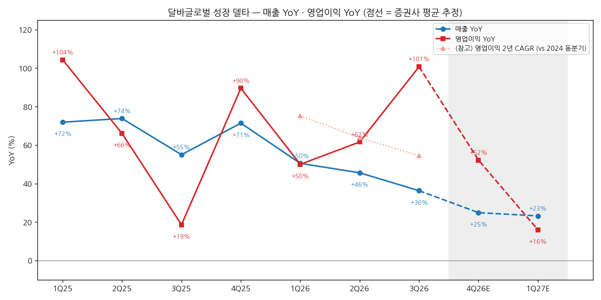
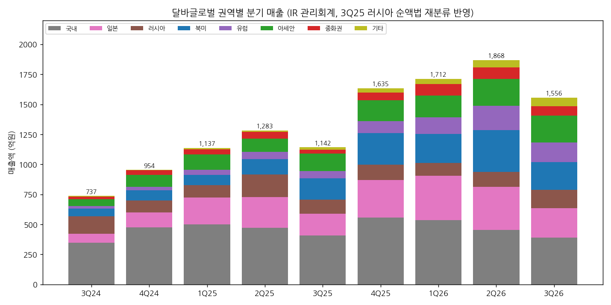

> 모드: 실적 리뷰 (v11)
> 종목: 달바글로벌 (483650)
> 섹터: 뷰티
> 서브섹터: 브랜드사
> 분기: 2026-Q3
> 발표일: 2026-11-12 (연결 잠정실적 공시 + IR 자료「2026년 3분기 경영실적」, 장중 발표)
> 작성 시각: 2026-11-17 18:40 KST
> 분석 소스: 회사 IR「2026년 3분기 경영실적」(2026-11-12) + 셀사이드 6건 첨부 — KB증권(11/12), DB증권(11/13), 다올투자증권(11/13, 이미지 PDF 판독), 신한투자증권(11/13), 하나증권(11/13), NH투자증권(11/13) + HSBC「EastSpenders: K-food going global」(10/22, 발표 전 — 달바글로벌·에이피알 선호주 부분). 과거 분기 숫자는 달바글로벌 기업개요(2026-11-15, OpenDART 연결 분기 시계열)로 교차검증. 웹서치 보완 없음
> 리뷰 깊이: 풀 | 리서치 첨부 7건 (국내 6 + HSBC 테마 1)
> 비영업 요인: 이례적 저기저(3Q25 OPM 14.6% — 신제품 4종 마케팅 선행투자 쇼크)·영업외 순손실 약 134억원(외환 관련 손실 47억원 포함, 순이익만 영향)·3Q25 매출 재작성(러시아 판매장려금 순액법, 1,173억 → 1,142억원, 영업이익 영향 없음) — 판정은 보고 기준 그대로

# 달바글로벌 3Q26 실적 리뷰 — 이익은 두 배, 매출은 +36%로 3개 분기 연속 감속

> 성장 델타: 가속 | 내러티브: 약화 → 델타 가속(저기저) + 내러티브 약화 → 경계 구간 (매출 YoY 3개 분기 연속 둔화·북미 +174% → +32% 급감속 — 4Q26 매출 YoY +25% 이상과 북미 재가속 확인 전까지)
>
> ⚠ 비영업 요인 플래그: 가속의 주된 원인 = 이례적 저기저. 3Q25 영업이익 167억원(OPM 14.6%)은 신제품 4종 마케팅 선행투자로 광고판촉비율이 27.3%까지 올라간 분기였다(당시 컨센 대비 -30%). 이번 분기 OPM 개선 +6.9%p 중 +8.1%p가 광고판촉비율 하락(27.3% → 19.2%)에서 나왔고, 광고판촉비 절대액은 -4.5% YoY다. 2년 전(3Q24) 대비로 보면 영업이익 +139%(연환산 +54%)로 1Q26(+207%, 연 +75%)·2Q26(+168%, 연 +64%)보다 낮아 기저를 걷어내면 둔화다 ([계산], 참고). 별도로 영업외 순손실 약 134억원(세전이익 200억원 vs 영업이익 334억원)으로 순이익은 +5.5% YoY에 그쳤다 — 영업이익 판정에는 영향 없음 → 섹터 리뷰: 저기저 주도 가속 (참고)

→ **숫자**: 매출 1,556억원(+36.3% YoY, -16.7% QoQ), 영업이익 334억원(+100.7% YoY, -29.2% QoQ), OPM 21.5%(+6.9%p YoY). 영업이익 YoY는 2Q26 +61.6%에서 +39.1%p 커졌지만 매출 YoY는 71.4%(4Q25) → 50.5% → 45.6% → 36.3%로 3개 분기 연속 내려왔다. FnGuide 컨센 대비 매출 -8.9%, 영업이익 +2.6%다
→ **쟁점 ①**: 매출 미스(-9%)는 환율 몫이 크다. 2Q말 환율을 적용하면 3Q 매출은 1,705억원으로 컨센(1,708억원)과 같다(회사 IR). 그러나 북미는 환율 효과(-13%)를 빼도 YoY 성장률이 +174%에서 크게 꺾였다. 오프라인 +8%, 리오더 물량 부재(NH)가 원인이다
→ **쟁점 ②**: OPM 21.5%는 마케팅을 줄여 만든 숫자다. 6곳 모두 "수익성 방어는 긍정"으로 평가하지만, NH·신한은 이를 "성장보다 비용 관리"로 읽고 매출 성장률 둔화와 같은 동전의 양면으로 본다
→ **쟁점 ③**: 6곳 모두 TP를 내렸다(평균 28.2만원 → 21.8만원, -22.5%). 2027E 영업이익 추정은 -0~-5%만 내려갔고 목표 멀티플이 2~4배씩 낮아졌다. 하향의 주원인은 멀티플이다. 주가는 7/29 고점 26.5만원 대비 -53%(11/12 12.56만원, 12MF PER 약 10~11배)
→ **다음 분기 관건**: 컨센 4Q26 영업이익 388억원(6곳 평균)은 YoY +52%로, 이번 분기 +100.7%보다 낮다. 컨센 경로상 영업이익 YoY 정점은 이번 분기다. 4Q 영업이익이 500억원(+96%)을 넘어야 "유지", 컨센 수준이면 "둔화"다. 매출 YoY가 +25%(2,041억원) 아래로 내려가면 성장주 내러티브가 한 단계 더 약해진다

---

## 1. 숫자

① 연결 기준 분기 표 (단위: 억원, %)

| 항목 | 1Q24 | 2Q24 | 3Q24 | 4Q24 | 1Q25 | 2Q25 | 3Q25 | 4Q25 | 1Q26 | 2Q26 | **3Q26** | 4Q26E | 1Q27E |
|---|---|---|---|---|---|---|---|---|---|---|---|---|---|
| 매출액 | 662 | 739 | 737 | 953 | 1,138 | 1,284 | 1,142 | 1,634 | 1,712 | 1,869 | **1,556** | 2,041 | 2,109 |
| 영업이익 | 147 | 176 | 140 | 135 | 301 | 292 | 167 | 255 | 451 | 472 | **334** | 388 | 523 |
| OPM | 22.2 | 23.8 | 19.0 | 14.2 | 26.4 | 22.8 | 14.6 | 15.6 | 26.3 | 25.3 | **21.5** | 19.0 | 24.8 |
| 매출 YoY | | | | | +71.9 | +73.8 | +55.0 | +71.4 | +50.5 | +45.6 | **+36.3** | +24.9 | +23.2 |
| 영업이익 YoY | | | | | +104.3 | +66.0 | +18.6 | +89.5 | +50.0 | +61.6 | **+100.7** | +52.2 | +16.0 |
| **매출 YoY 델타 (%p)** | | | | | — | +1.9 | -18.8 | +16.4 | -20.9 | -4.9 | **-9.3** | -11.4 | -1.7 |
| **영업이익 YoY 델타 (%p)** | | | | | — | -38.3 | -47.4 | +70.9 | -39.5 | +11.6 | **+39.1** | -48.5 | -36.2 |
| (참고) 영업이익 2년 변화 (vs 2024 동분기) | | | | | | | | | +206.8 | +168.2 | +138.6 | +187.4 | |
| (참고) 3Q26 매출, 2Q말 환율 적용 | | | | | | | | | | | 1,705 (YoY +49.3) | | |

→ (출처: 1Q24~2Q26 = OpenDART 연결(달바글로벌 기업개요 시계열), 3Q26 = 회사 IR·잠정실적. 2025~2026 YoY는 백만원 단위 원수치 기준 KB증권 표3 값 사용. 4Q26E = KB·DB·NH·신한·하나·다올 6곳 평균, 1Q27E = NH·다올 2곳 평균(소수 의견). "2Q말 환율 적용 매출" = 회사 IR 4쪽)
→ **YoY 계산 기준**: 3Q25는 **재작성치**(러시아 일부 온라인 채널 판매장려금을 판관비 → 매출 차감으로 바꾼 순액법, 2026-02-19 3Q 분기보고서 정정) 매출 1,142억원을 쓴다. 영업이익은 재작성 영향이 없다(167억원 동일). 원공시 매출 1,173억원 기준이면 3Q26 매출 YoY는 +32.6%다. K-IFRS 연결, IFRS 18 미적용으로 보인다(IR 요약 손익계산서에 영업외이익·비용 구분 유지 — [판단]). 따라서 외환 손익은 영업이익 밖(영업외)에 있다. IFRS 18을 조기적용해 외화 환손실이 영업이익에 들어간 에이피알과는 영업이익의 범위가 다르다
→ 3Q26 서프라이즈: 매출 컨센 대비 -8.9%, 영업이익 +2.6% (컨센 매출 1,708억원·영업이익 326억원, FnGuide/Quantiwise — KB·다올·신한·하나 인용. NH 인용 FnGuide 컨센은 1,754억원·325억원, DB 자체 집계는 1,750억원·330억원)
→ 영업이익 YoY는 분기마다 크게 출렁인다. 2025년 3Q·4Q의 OPM이 14~16%로 낮았기 때문이다(3Q 마케팅 선행투자, 4Q 블프·메가와리 마케팅 집중). 그래서 2026년 3Q·4Q는 영업이익 YoY가 기계적으로 커지는 저기저 구간이다. 이 저기저 위에서도 컨센 4Q26 영업이익 YoY는 +52%로 이번 분기보다 낮다
→ 매출 YoY는 2Q25(+73.8%)가 정점이다. 4Q25 +71.4%로 반등한 뒤 3개 분기 연속 내려왔고, 컨센은 4Q26 +24.9%, 1Q27 +23.2%까지 더 낮춘다. **컨센 경로상 매출 YoY 정점은 이미 지났고, 영업이익 YoY 정점은 이번 분기(3Q26)다**
→ **[판단] 델타 = 가속**: 보고 영업이익 YoY가 +61.6% → +100.7%로 39.1%p 커졌다. 판정 원칙(보고 영업이익 YoY와 그 변화)에 따라 가속으로 둔다. 다만 ① 매출 YoY는 반대 방향(-9.3%p)이고 ② 가속의 대부분이 저기저에서 나왔으며 ③ 컨센 경로상 다음 분기부터 다시 둔화한다. 판정 기준표의 "매출·영업이익 방향이 엇갈리면 유지" 조항을 적용하면 "유지"로도 볼 수 있다 — BT 확인 필요

→ (출처: OpenDART 연결, 회사 IR, 4Q26E 증권사 6곳 평균, 1Q27E NH·다올 평균. 연한 막대·점선 = 추정)

→ (출처: 동일. 점선 = 추정. 분홍 점선 = 2024년 동분기 대비 영업이익 2년 연환산 성장률 [계산] — 저기저를 걷어낸 추세 참고용)

② 사업부별·권역별 매출 (단위: 억원, %)

(1) 사업 부문 — 단일 영업부문(화장품). 사업부별 영업이익은 공시하지 않는다. 제품별·권역별 **매출만** IR 관리회계로 공개한다

| 품목 | 1Q25 | 2Q25 | 3Q25 | 4Q25 | 1Q26 | 2Q26 | **3Q26** | 3Q26 YoY | 3Q26 비중 |
|---|---|---|---|---|---|---|---|---|---|
| 미스트 | 575 | 541 | 493 | 783 | 741 | 773 | **603** | +22.3 | 38.8 |
| 선케어 | 233 | 343 | 267 | 314 | 416 | 492 | **387** | +45.2 | 24.9 |
| 크림 | 111 | 108 | 108 | 186 | 174 | 164 | **161** | +49.5 | 10.4 |
| 마스크팩 | 60 | 62 | 74 | 74 | 67 | 83 | **98** | +31.7 | 6.3 |
| 앰플/세럼 | 36 | 52 | 51 | 67 | 61 | 67 | **71** | +37.2 | 4.5 |
| 홈뷰티기기·기타 | 119 | 173 | 143 | 203 | 248 | 285 | **230** | +60.3 | 14.8 |
| 이너뷰티 | 4 | 5 | 5 | 8 | 6 | 5 | **6** | +21.5 | 0.4 |
| 합계 (내수 / 수출) | 1,138 | 1,284 | 1,142 | 1,635 | 1,712 | 1,869 | **1,556 (390 / 1,166)** | +36.3 | |

→ (출처: 회사 IR Appendix 제품별 매출(관리회계, 백만원 → 억원 환산), 기업개요 제품별 시계열. "홈뷰티기기·기타"에는 멀티밤·비타토닝·헤어바디·색조 등이 섞여 있다. d'Alba Signature 디바이스 단독은 3Q26 YoY -53%(3Q25 이벤트 기저, IR 15쪽))
→ 미스트(Hero SKU) YoY가 +42.9%(2Q26) → +22.3%로 가장 크게 둔화했다. 국내 미스트는 리뉴얼(퍼스트 스프레이 세럼 펩타이드) 재고 소진 공백으로 1Q26 281억원 → 3Q26 171억원까지 줄었다. 선케어·크림·기타가 +45~60%로 미스트 둔화를 메워 미스트 비중은 43.2%(3Q25) → 38.8%로 내려왔다. 회사는 이를 "균형 잡힌 제품 비중"이라 부른다 (IR Appendix)
→ 영업이익: 사업부 영업이익은 회사도 셀사이드도 내지 않는다. 비용 구조만 IR로 본다 (아래 (3))

(2) 권역별 — 6대 권역 + 국내 (IR 관리회계)

| 권역 | 3Q24 | 3Q25 | 4Q25 | 1Q26 | 2Q26 | **3Q26** | 3Q26 YoY | 3Q26 QoQ | 3Q26 비중 | 권역 YoY 추이 (1Q26 → 2Q26 → 3Q26) |
|---|---|---|---|---|---|---|---|---|---|---|
| 국내 | 349 | 407 | 557 | 536 | 453 | **390** | -4.1 | -13.9 | 25.1 | +7 → -4 → -4 |
| 일본 | 75 | 184 | 314 | 368 | 360 | **247** | +34.2 | -31.4 | 15.9 | +67 → +39 → +34 |
| 북미 | 64 | 176 | 261 | 243 | 348 | **232** | +31.8 | -33.3 | 14.9 | +193 → +174 → **+32** |
| 아세안 | 58 | 144 | 174 | 182 | 222 | **224** | +55.6 | +0.9 | 14.4 | +43 → +99 → +56 |
| 유럽 | 20 | 62 | 99 | 138 | 205 | **163** | +162.9 | -20.5 | 10.5 | +254 → +240 → +163 |
| 러시아 | 145 | 116* | 128 | 107 | 123 | **150** | +29.3 | +22.0 | 9.6 | +1 → -34 → +29 |
| 중화권 | 21 | 34 | 65 | 97 | 98 | **79** | +132.4 | -19.4 | 5.1 | +126 → +70 → +132 |
| 기타(인도·중동 등) | 5 | 19 | 37 | 41 | 59 | **71** | +273.7 | +20.3 | 4.6 | +255 → +434 → +274 |
| 해외 합계 | 388 | 735 | 1,078 | 1,177 | 1,415 | **1,166** | +58.6 | -17.6 | 74.9 | +85 → +74 → +59 |

→ (출처: 회사 IR 6쪽, 기업개요 권역 시계열, YoY는 KB·신한·하나 표의 원수치 기준. *3Q25 러시아 = 순액법 재작성치(147 → 116억원))
→ **델타를 끌어내린 권역은 북미다.** YoY가 +174%에서 +32%로 한 분기 만에 140%p 내려왔다. 북미 매출 QoQ 감소 116억원은 전사 매출 QoQ 감소(313억원)의 37%다. 회사 설명은 USD 13% 하락과 아마존 프라임데이 부재다(미국 아마존 YoY +25%, 틱톡샵 +336%, 오프라인 +8%). 일본(-113억원 QoQ)은 계절 비수기와 엔화 9% 하락, 국내(-63억원)는 미스트 리뉴얼 공백과 선크림 용기 부족이 원인이다
→ 성장을 끈 권역은 유럽(+163%)·중화권(+132%)·아세안(+56%)·기타(+274%)다. 다만 넷을 합쳐도 매출의 35%다. 매출의 56%를 차지하는 국내·일본·북미가 모두 YoY 30%대 이하로 내려와 전사 매출 YoY를 끌어내렸다

→ (출처: 회사 IR(관리회계), 기업개요 권역 시계열)

(3) 비용 구조 — OPM 개선의 출처 (단위: 억원, 매출 대비 %)

| 항목 | 3Q25 | 2Q26 | **3Q26** | 매출 대비 3Q25 → 3Q26 | OPM 기여 (YoY, %p) |
|---|---|---|---|---|---|
| 매출원가 | 284 | 434 | **371** | 24.9 → 23.8 | +1.1 |
| 광고판촉비 | 312 | 329 | **298** | 27.3 → 19.2 | **+8.1** |
| 판매수수료 | 135 | 260 | **218** | 11.8 → 14.0 | -2.2 |
| 운반비 | 141 | 228 | **189** | 12.3 → 12.1 | +0.2 |
| 급여 | 31 | 50 | **51** | 2.7 → 3.3 | -0.6 |
| 기타 | 72 | 96 | **94** | 6.3 → 6.0 | +0.3 |
| **영업이익 (OPM)** | 167 (14.6) | 472 (25.3) | **334 (21.5)** | | **+6.9** |

→ (출처: 회사 IR 4쪽 손익계산서. OPM 기여 = 비용률 하락분 [계산])
→ OPM 개선 +6.9%p 중 +8.1%p가 광고판촉비율 하락에서 나왔다. 반대로 판매수수료율은 +2.2%p 올랐다. 아마존·틱톡샵·오프라인 리테일 비중이 커지는 채널 믹스 비용이다. 원가율 -1.1%p는 제조사 다변화·규모의 경제 덕이다(IR). 다만 QoQ로는 원가율이 +0.6%p 올랐다. 원가율이 높은 B2B 비중이 39%(+4%p YoY, NH)로 커지고 달러가 약해졌기 때문이다 (DB·NH)
→ 운반비율은 12.1%로 YoY 거의 그대로다. 해운 전환으로 운임지수 상승을 막았다(IR). 같은 분기 에이피알은 유럽 항공 운송으로 운반비율이 +1.6%p 올랐다. 물류비에서는 달바가 상대적으로 잘 방어했다

③ 연간 (단위: 억원, %)

| 항목 | 2022 | 2023 | 2024 | 2025 | 2026E | 2027E |
|---|---|---|---|---|---|---|
| 매출액 | 1,452 | 2,008 | 3,091 | 5,197 | 7,179 | 9,525 |
| 영업이익 | 146 | 324 | 598 | 1,015 | 1,646 | 2,211 |
| OPM | 10.1 | 16.2 | 19.4 | 19.5 | 22.9 | 23.2 |
| 매출 YoY | | +38.3 | +53.9 | +68.2 | +38.1 | +32.7 |
| 영업이익 YoY | | +121.9 | +84.4 | +69.6 | +62.2 | +34.3 |

→ (출처: 2022 = 2024 사업보고서 K-IFRS 전환 요약재무(미감사), 2023~2025 = OpenDART 연결. 2026E·2027E = KB·DB·NH·신한·하나·다올 6곳 발표 후 추정치 단순평균. 다올 2026E는 3Q 누적 + 4Q E로 [계산], 2027E 영업이익은 매출 9,704억원 × OPM 23.2%로 [계산])
→ 신한의 2027E(매출 1조 1,741억원, +57.6%)가 이상치다. 신한을 빼면 2027E 매출 9,082억원(+26.5%), 영업이익 2,094억원(+27.2%)이다. 2027년 영업이익 성장률 컨센은 실질적으로 +25~30%다
→ 회사 가이던스: 2026년 매출 7,000억원, OPM 20% 초반(2Q26 IR, 기업개요). 3Q 누적 매출 5,137억원으로 진도율 73.4%다. 가이던스를 맞추는 데 필요한 4Q 매출은 1,863억원(YoY +14%)으로 컨센(2,041억원)보다 낮다. 3Q 누적 영업이익 1,258억원은 이미 2025년 연간(1,015억원)을 넘었다(IR). 3Q IR에는 가이던스 변경 언급이 없다
→ 발표 전후 컨센 변화: 수정 전후 숫자를 모두 낸 4곳(KB·NH·신한·하나) 기준으로 2026E 매출 -6.0%, 영업이익 -1.6%, 2027E 매출 -6.4%, 영업이익 -3.5%다. 영업이익보다 매출과 순이익(KB 2026E -11.4%, 신한 -7.4%)이 더 많이 내려갔다. FnGuide 발표 전 컨센(2026E 영업이익 1,672억원, 2027E 2,216억원 — 하나·신한 인용)과 비교하면 6곳 평균은 2026E -1.6%, 2027E -0.2%다

---

## 2. 시장 쟁점

① 지난 분기 체크
→ 첫 리뷰 — 직전 리뷰·팔로업 없음. 대신 기업개요(2026-11-15)의 "분기 재평가 트리거"로 점검한다 (참고)

| 기업개요 재평가 트리거 | 3Q26 결과 | 판정 |
|---|---|---|
| 분기 OPM 20% 유지 | 21.5% | 확인 |
| 북미·유럽 오프라인 전환 (코스트코 625점, 영국 부츠·독일 로스만 2H26 입점) | 코스트코 225 → 400점, 부츠 105점 입점. 북미 오프라인 매출은 +8%에 그침, 로스만은 1H27로 이연 | 절반 확인 (점포는 늘고 매출은 안 따라옴) |
| 러시아 회복 (2Q26 -34%) | +29% YoY, +22% QoQ (골드애플 발주 확대) | 확인 |
| 국내 역성장 지속 여부 (2Q26 -3.8%) | -4.1% (온라인 -20%, 홈쇼핑 -27%, 오프라인 +19%) | 반대로 나옴 (역성장 지속) |
| 2026 가이던스(매출 7,000억원) 진도율 | 3Q 누적 73.4% | 확인 (컨센은 가이던스보다 높음) |

② 이번 분기 쟁점 5개

| # | 쟁점 | 언급 증권사 수 |
|---|---|---|
| (1) | 매출 -9% 미스 — 환율 탓인가 성장 둔화인가 | 6/6 |
| (2) | 북미 +174% → +32% — 프라임데이 공백인가 채널 정체인가 | 6/6 |
| (3) | OPM 21.5% — 마케팅 효율화는 지속 가능한가, 성장과 맞바꾼 것인가 | 6/6 |
| (4) | 순이익 +5.5% — 영업외 손실과 EPS 하향 | 5/6 |
| (5) | TP 평균 -22.5% — 실적 하향인가 멀티플 하향인가 | 6/6 |

(분모는 국내 셀사이드 6곳. HSBC는 발표 전(10/22) 자료라 쟁점 집계에서 빼고 (5)에서만 참고한다)

③ 쟁점별 분해

(1) 매출 -9% 미스 — 환율 탓인가 성장 둔화인가

(1-1) 회사 설명 (IR 4·7쪽)
→ "2Q 말 환율을 3Q에 적용 시 3Q 매출 1,705억원 (원화 강세로 인한 효과 -9%)". 2Q 대비 3Q 원화는 권역 매출 가중평균으로 12% 강해졌다 (IR 7쪽 주2)
→ "원화 강세 및 마케팅비 효율화 기조 하에서도" 해외 매출 YoY +59%. 국내 -4.3%는 미스트 리뉴얼 재고 소진 공백과 8월까지의 선크림 튜브 용기 부족 때문이며 "두 이슈 모두 3Q 중으로 정상화" (IR 8쪽)

(1-2) 증권사별 해석 편차

| 증권사 | 핵심 가정·추정 | 논리 |
|---|---|---|
| KB | 2Q말 환율 적용 시 매출 QoQ -8.8%, 영업이익 -23.8% | 프로모션 부재 + 원화 강세. 4Q 매출 1,910억원(컨센 -12.6%)으로 가장 보수적. "낮은 환율이 외형 성장폭을 제한" |
| 다올 | 매출 미스는 환율, 권역별 기울기가 갈림 | 유럽·아세안은 견조, 국내·북미·일본은 부진. 4Q 1,937억원(+19%) |
| DB | 한국·북미·유럽 모두 기대치 하회 | 환율·이벤트 부재를 감안해도 "신규 채널 입점 속도에 비해 다소 미진". 국내·일본(매출 40%) 둔화를 지켜봐야 |
| NH | 낮아진 매출 컨센도 하회 | 성장보다 비용 관리에 중점을 둔 분기. 하반기 매출 부진은 주가에 대부분 반영 |
| 신한 | 당사 기대(+58%) 대비 크게 하회 | "예상보다 제품 확장이 다채롭지 못한 게 둔화 원인일 수 있다". 그래도 수요는 느리지만 우상향 |
| 하나 | 전 지역 견조 | 환율 하락에도 전 지역 성장. 4Q는 미스트·크림 성수기로 주요 권역 QoQ +50% 내외 |

(1-3) 공통 결론 vs 갈리는 지점
→ 공통: 6곳 모두 원화 강세가 매출 미스의 1차 원인이라고 본다. 6곳 모두 2026E 매출을 내렸다(-6~-7%)
→ 갈림: 환율을 뺀 "남은 둔화"가 있느냐다. 하나·다올은 일시적(행사 공백·계절성)으로, DB·신한·NH는 채널 효율과 제품 확장 속도의 문제로 본다. 4Q 매출 추정이 1,910억원(KB)~2,312억원(신한)으로 400억원 벌어져 있다

(1-4) **[판단]**
→ 환율만으로 설명되는 숫자다. 2Q말 환율 매출 1,705억원은 컨센(1,708억원)과 같다. 환율을 고정한 YoY도 약 +49%로 2Q26(+46%)과 비슷하다 ([계산], 3Q25 실제 환율과 2Q말 환율 차이는 반영 못 한 근사치)
→ 다만 이 계산은 "QoQ 환율 효과만" 뺀 것이다. 환율 고정 매출 1,705억원도 2Q26(1,869억원)보다 -9% 낮다. 3Q 비수기 패턴(2025년 2Q → 3Q -11%)과 비슷한 수준이라 계절성으로 설명된다. 결국 **전사 기준으로 매출 둔화의 본체는 환율+계절, 권역 기준으로는 북미가 진짜 둔화**다 (쟁점 2)
→ 결론이 바뀌는 조건: 원/달러가 3Q 평균 수준에 머무는데도 4Q 매출이 1,900억원(YoY +16%)을 밑돌면 환율이 아니라 수요 둔화로 해석이 바뀐다

(2) 북미 +174% → +32% — 프라임데이 공백인가 채널 정체인가

(2-1) 회사 설명 (IR 10쪽)
→ "북미 매출은 3Q USD 환율 13% 하락 및 프라임 부재에도 YoY 32% 성장". 미국 아마존 YoY +25%, 캐나다 아마존 +80%, 틱톡샵 +336%(QoQ +43%)
→ 오프라인 매출 YoY +8%. 미국 코스트코 판매 매장 225 → 400점(2027년 중 625점 전점 목표), 캐나다 세포라 150점 신규 입점

(2-2) 증권사별 해석 편차

| 증권사 | 북미 4Q26E | 논리 |
|---|---|---|
| NH | 343억원 (+31%) | 아마존+틱톡샵은 지속, **오프라인은 유의미한 리오더 물량 부재**로 +8%. 2027E 북미 +40% |
| 신한 | 407억원 (+56%) | 아마존(+25%)·오프라인(+8%) 두 채널 모두 전기 대비 둔화. 성장률이 "급격히 둔화"한 점이 아쉬움 |
| 다올 | 292억원 (+12%) | 미국 틱톡샵 10월 일평균 GMV 3Q 대비 +92%, 세포라 캐나다 온기. 부담 요인은 **미국 아마존 순위 하락, 코스트코 PO 인식 시점 불확실**, 달러 약세 -6% |
| 하나 | 375억원 (+44%) | 연말 홀리데이 행사 효과. **2027년 1분기 코스트코 리오더 물량만 100억원 이상 예정** |
| DB | 340억원 (+30%) | 북미 -33% QoQ는 코스트코·세포라·얼타 신규 입점 속도를 감안하면 미진 |
| KB | 290억원 (+11%) | 성수기 QoQ +25%. 낮은 환율이 성장 폭 제한 |

(2-3) 공통 결론 vs 갈리는 지점
→ 공통: 6곳 모두 북미 둔화를 이번 분기 가장 아쉬운 숫자로 꼽는다. 틱톡샵은 강하고 오프라인은 약하다는 데 동의한다
→ 갈림: 4Q 북미 YoY가 +11%(KB)~+56%(신한)로 벌어진다. 코스트코 리오더를 언제 보느냐(하나: 1Q27 100억원+, 다올: PO 인식 시점 불확실)가 핵심 차이다

(2-4) **[판단]**
→ 북미는 환율(-13%)을 되돌려도 YoY +50% 안팎이다 ([계산] 232 ÷ 0.87 = 267억원 → +52%, 근사치). 2Q26 +174%의 3분의 1 이하다. 환율과 프라임데이만으로는 설명이 안 되는 감속이다
→ 3Q25 북미(176억원)는 프라임데이가 없던 분기인데도 2Q25(127억원)보다 컸다. 즉 3Q25에는 오프라인 초도 입고(얼타 등)가 들어 있던 고기저다. 이번 분기 오프라인 +8%는 그 초도 입고가 리오더로 이어지지 않았다는 뜻이다 [판단]
→ 에이피알도 같은 분기 북미 온라인이 QoQ 약 -18%였다(행사 공백). 차이는 에이피알은 오프라인(+50% QoQ)이 공백을 메웠고, 달바는 메우지 못했다는 점이다
→ 결론이 바뀌는 조건: 4Q 북미가 350억원(+34%)을 넘고 1Q27에 코스트코 리오더(100억원+)가 확인되면 "행사 공백"이 맞다. 4Q 북미가 300억원(+15%) 아래면 북미 성장은 구조적으로 둔화한 것이다

(3) OPM 21.5% — 마케팅 효율화는 지속 가능한가

(3-1) 회사 설명 (IR 4쪽)
→ "마케팅 효율화로 YoY -8%p 기록", "제조사 다변화 및 규모의 경제 효과"(원가율), "해운 전환 등 물류비 효율화로 운임지수 상승 방어". 3Q 기준 역대 최대 영업이익, 상장 이후 최대 YoY 영업이익 성장 (IR 3쪽)

(3-2) 증권사별 해석 편차

| 증권사 | 4Q26 OPM E | 논리 |
|---|---|---|
| 신한 | 21.0% (영업이익 486억원) | 물류비·환율로 피어가 마진 하락을 못 피하는 상황에서 마진 상승은 긍정. 광고비는 전년 수준 유지 |
| KB | 20.6% (394억원) | B2B 비중 확대와 수익성 관리 강화를 반영해 **2027E OPM을 +1%p 상향**. 대신 장기 OPM 가정은 환율 변동성으로 하향 |
| 하나 | 18.4% (387억원) | 경영진이 수익성 관리에 관심을 보이는 건 "평가할 만한 변화". 다만 성수기 퍼포먼스 마케팅 확대로 QoQ 하락 불가피 |
| NH | 18.8% (368억원) | **"성장보다는 비용 관리에 중점을 둔 분기"**. 환율·운임 등 수출 환경이 불확실해 비용을 조인 것 |
| 다올 | 18.1% (350억원) | 광고선전비 효율화와 해운 전환이 OPM 방어 |
| DB | 17.0% (340억원) | 마케팅비·운반비 절감으로 OPM은 예상 상회. 4Q OPM 가장 보수적 |

(3-3) 공통 결론 vs 갈리는 지점
→ 공통: 6곳 모두 3Q 수익성은 긍정으로 본다. 2026E OPM은 22.4~23.4%로 모두 2025년(19.5%)보다 높게 잡았다
→ 갈림: 4Q OPM이 17.0%(DB)~21.0%(신한)로 4%p 벌어진다. 4Q25 OPM 15.6%(광고비율 25%)를 기저로, 이번 성수기에도 광고비를 누를지가 갈린다

(3-4) **[판단]**
→ 이번 OPM 개선은 거의 전부 광고판촉비에서 나왔다(+8.1%p). 광고판촉비 절대액이 -4.5% YoY인데 매출은 +36% 늘었다. 효율화가 사실이라면 좋은 숫자다. 그러나 같은 분기에 매출 YoY는 3개 분기 연속 내려왔고 국내 온라인(-20%)·북미 아마존(+25%)이 둔화했다. 마케팅 축소와 성장 둔화가 같이 나타났다는 점에서 NH의 "성장보다 비용 관리" 해석이 숫자와 더 맞다 [판단]
→ 판매수수료율 +2.2%p는 계속 올라갈 비용이다. 아마존·틱톡샵·오프라인 리테일로 채널이 옮겨 갈수록 수수료율이 오른다. 광고비 효율화 여지가 줄어들면 OPM은 이 수수료율 상승을 그대로 맞는다
→ 결론이 바뀌는 조건: 4Q에 광고판촉비율이 4Q25(약 25%)보다 확실히 낮으면서(20% 안팎) 매출 YoY +25%를 지키면 "효율화"가 맞다. 광고비를 늘렸는데도 매출이 +20%를 밑돌면 마케팅 효율 자체가 떨어진 것이다

(4) 순이익 +5.5% — 영업외 손실과 EPS 하향

(4-1) 회사 설명
→ IR은 영업외 항목을 따로 설명하지 않는다. 3Q 누적 영업외비용 161억원(2025년 연간 65억원), 3Q 순이익 148억원(QoQ -61%) (IR 요약재무제표)

(4-2) 증권사별 해석 편차

| 증권사 | 핵심 숫자 | 논리 |
|---|---|---|
| KB | 금융비용 124억원, 금융수익 -21억원. 2026E 순이익 -11.4%, 2027E -16.3% | 순이익 하향 폭이 영업이익(-4.2%)보다 훨씬 크다. 목표주가 하향의 한 축 |
| 하나 | 영업외 외환 관련 손실 47억원 | 원화 강세에 따른 외화자산 환산 손실 |
| 신한 | 순이익 +5% — "2026년 순이익 추정치 하향 불가피" | 전일 주가 급락 이유 = 매출 성장률 둔화 + 순이익 하향 가능성 |
| 다올 | 지배순이익 148억원, 컨센 대비 -41.3% | 4Q 순이익 추정도 308억원 → 278억원 |
| DB | 세전이익 200억원, 4Q 기타영업외손익 -21억원 반영 | 2026E 순이익 1,100억원 |

(4-3) 공통 결론 vs 갈리는 지점
→ 공통: 순이익 쇼크(컨센 -41%)는 영업 밖 요인이다. 영업이익 질에는 문제가 없다
→ 갈림: 영업외 손실이 반복되느냐다. KB는 2027E 순이익까지 -16% 내렸고, 신한은 2027E 순이익을 유지했다

(4-4) **[판단]**
→ 세전이익 - 영업이익 = -134억원인데, 하나가 밝힌 외환 손실은 47억원이다. 나머지 약 87억원의 구성(금융자산 평가손실, 관계사 쿠오카스킨 지분 관련 등)은 첨부 자료로 확인되지 않는다 — **불확실, 3Q 분기보고서 주석 확인 필요**
→ 해외 매출이 75%인데 외화 손익이 영업외에 있어 영업이익 판정에는 들어가지 않는다. 에이피알(IFRS 18 조기적용)처럼 외환 손실 47억원을 영업이익에 넣으면 3Q26 영업이익은 287억원, YoY +72%다 ([계산], 섹터 비교 참고). 이 기준으로도 2Q26(+61.6%) 대비 가속이다

(5) TP 평균 -22.5% — 실적 하향인가 멀티플 하향인가

(5-1) 회사 설명
→ 해당 없음 (밸류에이션 쟁점). 3Q 누적 영업이익이 이미 전년 연간을 넘었고 "39분기 연속 YoY 매출 성장"을 강조했다 (IR 3쪽)

(5-2) 증권사별 해석 편차

| 증권사 | 적용 멀티플 | 하향 이유 |
|---|---|---|
| KB | DCF(WACC 10.9%, 영구성장 3.2%), implied 12MF PER 20.1배 | 환율 가정 하향으로 2027E 매출 -8.3%·영업이익 -4.2%, 환율 변동성 반영해 장기 OPM 가정 하향 |
| NH | 12MF PER 20배 → **17배** (화장품 브랜드 피어 평균) | 2027E 매출 -7%·영업이익 -5%, 브랜드 업종 밸류에이션 하락 |
| 신한 | 12MF PER 24배 → **20배** | 2027E 순이익 유지. 업종 밸류에이션 하향만 반영 |
| 하나 | 12MF PER 17배 → **15배** | 추정치 하향 + 업종 밸류에이션 하락. "12MF PER 10.2배는 바닥". 에이피알과 일정 밸류 간극 유지 |
| DB | 2026E PER 20배 / 2027E 15배 | "국가별 매출 변동성 확대로 실적 가시성 하락" — 2027E 추정치·타깃 멀티플 동시 하향 |
| 다올 | 2027E PER 16배 (글로벌 소비재 대비 할인) | 원화 강세로 2027E 매출 9,704억원(+37%)·OPM 23.2%로 하향 |
| (참고) HSBC (10/22, 발표 전) | 2026E EV/EBITDA 20배 (상장 후 평균), TP 30만원 유지 = 2027E PER 20배 | 2025~28E 매출·영업이익 CAGR 38%/47%. 에이피알(EV/EBITDA 26.2배, CAGR 50%/51%)보다 할인. 선호 이유 "Strong earnings growth", 리스크로 미스트·d'Alba 단일 브랜드/제품 집중과 대주주 지분 매각 가능성 |

(5-3) 공통 결론 vs 갈리는 지점
→ 공통: 6곳 모두 매수를 유지하고 TP를 내렸다. 연간 영업이익 하향(2027E -0~-5%)보다 TP 하향(-6~-33%)이 훨씬 크다. 멀티플을 2~4배씩 낮췄다
→ 갈림: 신한(29만원, 상승여력 +131%)은 추정치를 거의 유지하고 멀티플만 낮췄다. DB(18만원)·하나(18.5만원)는 "실적 가시성"과 "보수적 OPM"을 이유로 이익과 멀티플을 함께 낮췄다. HSBC는 발표 전 30만원이었는데, 이후 주가가 16.7만원 → 12.6만원(-25%)으로 내려와 HSBC 기준 상승여력은 +139%까지 벌어졌다

(5-4) **[판단]**
→ 이번 TP 하향은 **멀티플 하향이 주원인**이다. 매출 추정 하향(-6~-8%)은 영업이익에는 마진 상향으로 상당 부분 상쇄됐다. 순이익 하향(KB -11~-16%)이 PER 기반 TP에 일부 더해졌다
→ 멀티플이 내려가는 이유는 1번의 매출 YoY 감속이다. 신한 표현대로 "소비재는 매출 성장률이 낮아지면 단기 투자심리가 악화"된다. 이익이 두 배가 됐는데도 주가가 3개월 -52%인 것은 시장이 이 종목을 이익이 아니라 매출 성장률로 평가하고 있다는 뜻이다 [판단]

④ 낙관 vs 보수 — 논리 대비
→ **가장 낙관(신한 TP 29만원)**: 2027E 매출 1조 1,741억원(+58%), 영업이익 2,793억원(+60%)으로 6곳 평균(2,211억원)보다 26% 높다. 유럽 2027E 2,538억원(+218%)·일본 2,041억원(+44%)을 가정한다. 마진 상승이 피어 대비 차별점이고, 수요는 "느리지만 우상향"이라고 본다
→ **가장 보수(DB TP 18만원, 하나 18.5만원)**: DB는 4Q OPM 17.0%, 2027E 매출 +22%·2028E +13%로 성장 둔화를 가장 빨리 가정한다. "4분기 아마존 행사 성과를 지켜보며 저점 매수 접근"을 권했다. 하나는 2027E OPM 22.0%로 6곳 중 가장 낮고 4Q 아세안 YoY +3.5%로 둔화를 가정한다
→ 셀사이드 vs 시장: 6곳 모두 매수, 평균 TP 21.8만원은 11/12 종가(12.56만원) 대비 +74%다. 그런데 주가는 실적 발표일에 52주 최저가를 새로 썼고, 11/13 12.1만원(기업개요, Yahoo)으로 더 내렸다. 셀사이드는 "이익은 견조, 주가는 바닥(하나)"을, 시장은 "매출 성장률 감속"을 가격에 넣고 있다. 12MF PER 11.0배로 에이피알(13.0배)보다 낮다 (KB 피어 표, Bloomberg 컨센)

⑤ 추정치·TP 변화 (단위: 원, 억원)

| 증권사 (발간일) | 직전 TP | 현재 TP | 4Q26 영업이익 E | 2026 / 2027 영업이익 E | 핵심 변화 한 줄 |
|---|---|---|---|---|---|
| 신한 (11/13) | 약 310,000 [역산] | 290,000 (-6%) | 486 | 1,743 / 2,793 | 추정 유지, 목표 PER 24배 → 20배 |
| KB (11/12) | 290,000 | 235,000 (-19.0%) | 394 | 1,652 / 2,090 | 환율 가정 하향, 2027E 매출 -8.3%·OP -4.2%, OPM +1%p |
| 다올 (11/13) | 310,000 | 220,000 (-29.0%) | 350 | 1,608 [계산] / 2,251 [계산] | 4Q OP 389 → 350억원, 2027E PER 16배 |
| NH (11/13) | 300,000 | 200,000 (-33.3%) | 368 | 1,626 / 2,038 | 2027E 매출 -7%·OP -5%, 목표 PER 20배 → 17배 |
| 하나 (11/13) | 220,000 | 185,000 (-15.9%) | 387 | 1,644 / 2,031 | 4Q OP 507 → 387억원, 목표 PER 17배 → 15배 |
| DB (11/13) | 260,000 | 180,000 (-30.8%) | 340 | 1,600 / 2,060 | 실적 가시성 하락, 2027E 추정·멀티플 동시 하향 |
| (참고) HSBC (10/22, 발표 전) | 300,000 | 300,000 (유지) | — | — | 2026E EV/EBITDA 20배, 3Q 결과 미반영 |

→ 평균 TP(국내 6곳): 28.2만원 → 21.8만원 (-22.5%). 하향 6건, 유지·상향 0건. 신한 직전 TP는 "목표주가 6% 하향" 문구로 역산한 값이다 (불확실)
→ 연간 컨센: 수정 전후를 모두 공개한 4곳(KB·NH·신한·하나) 기준 2026E 영업이익 -1.6%, 2027E -3.5%. 매출은 2026E -6.0%, 2027E -6.4%
→ TP 하향 원인: **멀티플 하향이 주원인** (목표 PER 15~24배 → 15~20배, KB는 DCF 장기 OPM 하향). 실적 하향은 순이익(영업외 손실·환율) 쪽이 더 크다

---

## 3. 내러티브 점검

① 성장 스토리 정의
→ "미스트 단일 히트로 시작한 브랜드가 일본·러시아·북미·유럽·아세안·중화권 6대 권역에서 온라인(아마존·틱톡샵·쇼피)과 오프라인(코스트코·부츠·왓슨스)을 동시에 넓히며, 매출 +40~70%와 OPM 20%대를 함께 내는 멀티 리전 K뷰티". 시장은 이 종목을 에이피알보다 싼 "제2의 글로벌 확장주"로 사 왔다

② 이번 분기가 스토리에 준 영향
→ **강화된 부분 (마진·분산)**: OPM 21.5%로 2025년 3Q 마진 쇼크(14.6%)의 재발 우려를 지웠다. 해외 오프라인 점포 약 1만 개(2H25 약 6천 개), B2C +65%·B2B +48%로 채널이 고르게 컸다. 미스트 비중 38.8%로 단일 제품 의존도가 내려왔다. 유럽·중화권·아세안·인도·중동은 고성장을 이어갔다
→ **약화된 부분 (성장 속도)**: 매출 YoY +36%로 3개 분기 연속 감속했다. 매출 비중 56%인 국내·일본·북미가 동시에 +30%대 이하로 내려왔다. 특히 북미는 점포를 늘리는데(코스트코 225 → 400점) 오프라인 매출은 +8%에 그쳤다. 독일 로스만 입점은 2H26에서 1H27로 밀렸다(다올·IR)
→ **판정 = 약화**: 스토리의 전제(다권역 수요·채널 확장)는 살아 있다. 그러나 성장 속도 의문으로 매출 추정(-6~-8%)과 멀티플(-15~-30%)이 함께 내려갔다. 훼손이 아니라 약화다

③ 국면
→ 델타 가속(보고 기준) + 내러티브 약화 → **경계 구간**. 영업이익 YoY 가속은 저기저 효과가 크고 컨센 경로상 이번 분기가 정점이다. 매출 YoY는 이미 꺾이는 방향이다. BT 프레임에서 "숫자는 좋아 보이지만 다음 분기 델타가 내려갈 것이 컨센에 들어 있는" 구간이다
→ 에이피알과의 비교 [판단]: 같은 분기에 에이피알은 매출 +100%·마진 하락, 달바는 매출 +36%·마진 상승으로 정반대 모양이 나왔다. 두 종목 모두 TP 하향의 주원인은 멀티플이다. 브랜드사 서브섹터 전체가 "성장률 정상화 → 멀티플 압축" 구간에 있다는 신호다

④ 트리거와 리스크
→ **트리거 (스토리 재강화)**: (1) 4Q26 매출 YoY +25% 이상과 북미 350억원+ (2) 1Q27 코스트코 리오더 100억원+(하나)·전점 625점 확대 (3) 2027 가이던스에서 매출 +30% 이상 제시, 중국 법인 직접 운영(티몰)·로스만 입점·Bath & Body 출시 같은 신규 성장축
→ **리스크 (스토리 훼손)**: (1) 원화 강세 지속 — 해외 75%라 환산 매출이 다시 -5~-10% 깎이고 영업외 외환 손실이 반복된다 (2) 마케팅 축소의 대가로 아마존 순위 하락(다올 지적)이 이어져 북미·일본 성장률이 10%대로 내려가는 경우 (3) 국내 역성장 고착 — 온라인 -20%, 홈쇼핑 -27%

---

## 4. 향후 봐야 할 것

(1) **4Q26 영업이익 500억원 / 매출 YoY +25%** — 델타 판정을 바꾸는 1순위 변수
→ 무엇을: 4Q 영업이익 500억원(YoY +96%) 이상이면 "유지", 컨센 388억원(+52%)이면 "둔화", 255억원(YoY 0%) 미만이면 "꺾임". 매출은 컨센 2,041억원(+25%), 회사 가이던스 내재치 1,863억원(+14%). 매출 YoY가 +20%를 밑돌면 매출 기준 감속이 4개 분기로 늘어난다
→ 어떤 데이터로: 4Q26 잠정실적·IR, 증권사 4Q 프리뷰(1월), 관세청 월간 화장품 수출
→ 언제: 2027년 2월 (4Q26 실적 발표, 정확한 일자 미확정 — 노션 실적 캘린더 확인 필요)

(2) **북미 재가속 — 4Q 북미 350억원 이상, 코스트코 리오더**
→ 무엇을: 4Q 북미 매출(추정 290~407억원, YoY +11~+56%), 미국 아마존 YoY(3Q +25%)와 순위, 틱톡샵 성장(10월 GMV +92%), 코스트코 400 → 625점 확대와 1Q27 리오더 100억원+
→ 어떤 데이터로: 블프·사이버먼데이 아마존 뷰티 순위, 코스트코·세포라·얼타 입점 뉴스, 관세청 대미 화장품 수출, 4Q IR 북미 채널별 성장률
→ 언제: 11월 말~12월(블프) / 2027년 2월(실적)

(3) **마케팅 효율의 지속성 — 4Q 광고판촉비율 20% 안팎 + 매출 YoY +25%**
→ 무엇을: 4Q 광고판촉비율(4Q25 약 25%, 3Q26 19.2%), 판매수수료율(3Q26 14.0%, +2.2%p YoY) 추이, 4Q OPM(추정 17.0~21.0%)
→ 어떤 데이터로: 4Q IR 손익계산서 비용 항목, 아마존·큐텐 메가와리 순위
→ 언제: 2027년 2월

(4) **환율과 영업외 손익 — 원화 강세가 다시 매출 -9%를 만드는지**
→ 무엇을: 4Q 분기말·평균 원/달러·원/엔·원/루블(3Q 대비), 회사가 공개하는 "전분기말 환율 적용 매출"과의 차이, 영업외 외환 손실 반복 여부와 3Q 영업외 손실 134억원 중 미확인 87억원의 정체
→ 어떤 데이터로: 3Q 분기보고서 주석(금융비용 내역), 서울외국환중개 고시 환율, 4Q IR
→ 언제: 11월 중순(3Q 분기보고서) / 12월 말(환율) / 2월(실적)

(5) **2027 가이던스와 신규 성장축**
→ 무엇을: 2027 매출 가이던스(6곳 평균 +33%, 신한 제외 +27%), 2026 가이던스 7,000억원 달성 여부, 중국 법인 티몰 직접 운영, 독일·체코 로스만(1H27), 인도 연 100억원, d'Alba Bath & Body(1H27), 국내 역성장 탈출(4Q 블프·연말)
→ 어떤 데이터로: 4Q 실적 IR, 회사 보도자료, 인도 Nykaa·UAE 아마존 순위
→ 언제: 2027년 2월(가이던스) / 1H27(신규 채널)
