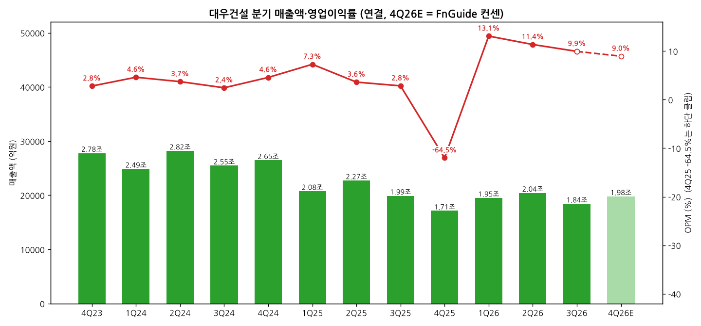
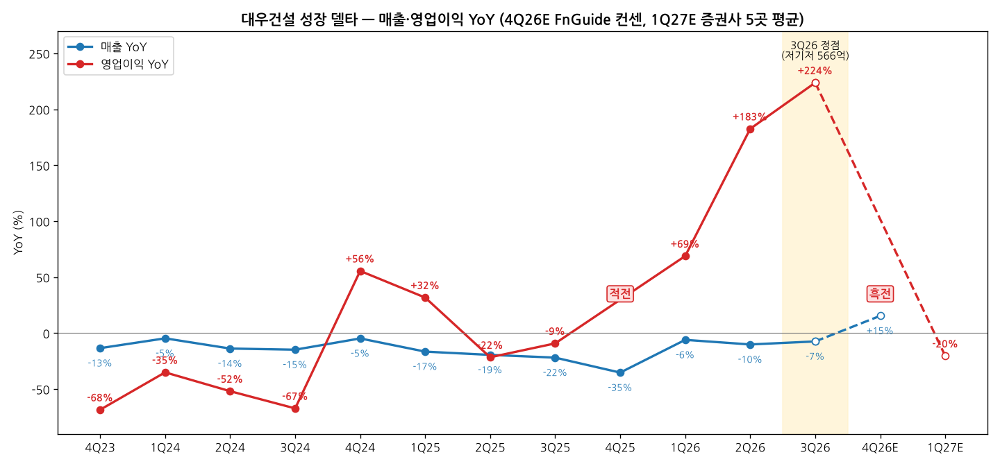
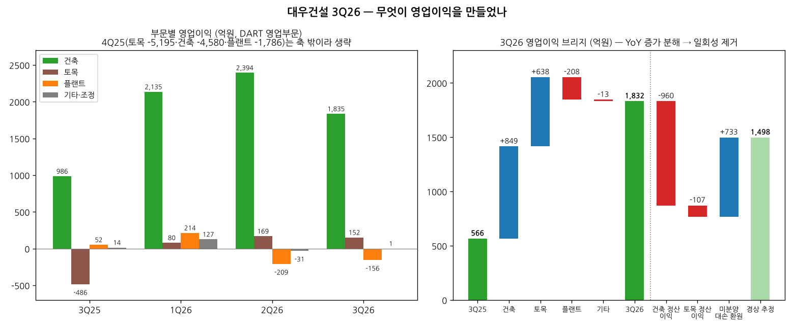
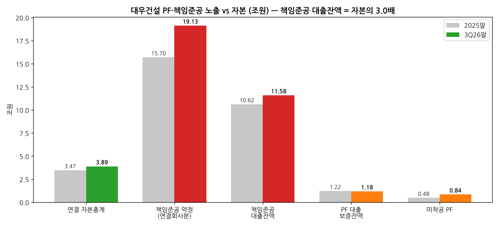

> 모드: 실적 리뷰 (v11)
> 종목: 대우건설 (047040)
> 섹터: 원전
> 서브섹터: 원전 시공
> 분기: 2026-Q3
> 발표일: 2026-10-27 (잠정실적·IR 자료) / 분기보고서 2026-11-13 제출 (DART 접수 20261113001461 — 확정치 반영, 잠정과 동일)
> 작성 시각: 2026-11-16 22:30 KST
> 분석 소스: 회사 자료 — 3Q26 IR 자료(10/27, 「3분기 경영실적 및 경영계획 달성률」 14p), DART 분기보고서(2026.09, 11/13 제출 — 연결 손익·영업부문 주석·수주상황·PF/책임준공 우발부채·10/29 체코 관련 풍문해명 공시), OpenDART 연결재무제표(fnlttSinglAcntAll, 2015\~3Q26), 기업개요 v1.0(DART 50분기 부문 시계열). 셀사이드 9건(8개사) 첨부 — IBK투자증권(10/27)·한화투자증권(10/28 "수주를 손에 쥔 자의 여유", 11/10 "역성장의 마침표")·신영증권(10/28)·삼성증권(10/28)·KB증권(10/29)·유진투자증권(11/02)·교보증권(11/11)·키움증권(11/11 "아쉬운 원전, 가덕도와 LNG는 유효"). 웹서치 보완: 체코 재입찰 일정·협상 경과(인사이트 11/04, 딜사이트, 이투데이), 주가는 Yahoo Finance 일봉(\~11/03) + 증권사 표지 주가(11/06\~11/11)
> 리뷰 깊이: 풀 | 리서치 첨부 9건
> 비영업 요인: 일회성(건축 예정원가율 조정·준공정산이익 +960억원, 토목 해외 준공정산이익 +107억원, 지방 준공 후 미분양 대손충당금 -733억원)·저기저(3Q25 영업이익 566억원, OPM 2.8%)·4Q25 빅배스 기저(영업손실 -1조 1,055억원, 대손상각비 6,051억원 — 4Q26 YoY 비교 불가)

# 대우건설 3Q26 실적 리뷰 — 숫자는 저기저 위의 가속, 시장이 사던 원전 시공 스토리는 체코에서 끊겼다

> 성장 델타: 가속 | 내러티브: 훼손 → 델타 가속(저기저·정산이익) + 내러티브 훼손(원전 시공 주간사 지위) → 매매 제외 구간 (컨센 경로상 영업이익 YoY 정점이 이번 분기, 원전 재진입 확인 전까지 관망)
> ⚠ 비영업 요인 플래그: 가속의 주된 원인 = 이례적 저기저(3Q25 영업이익 566억원 — 토목 해외현장 손실 -486억원) + 일회성 정산이익(건축 +960억원, 토목 +107억원) − 일회성 대손(미분양 -733억원). 일회성 순효과 +334억원을 빼면 경상 영업이익 약 1,498억원(OPM 8.1%, YoY +165%) [계산] — 판정은 보고 기준 가속 그대로. 4Q26은 4Q25 빅배스(-1조 1,055억원) 기저로 YoY 비교 불가(흑전)

→ **숫자**: 연결 매출 1조 8,424억원(-7.4% YoY), 영업이익 1,832억원(+223.8% YoY, OPM 9.9%). 영업이익 YoY가 2Q26 +182.6%에서 +223.8%로 +41.2%p 확대돼 판정 기준상 "가속"이다. 매출은 12개 분기 연속 역성장이라 "강한 가속"은 아니다. QoQ로는 영업이익 -21.1%, OPM 13.1% → 11.4% → 9.9%로 2개 분기 연속 내려왔다
→ **쟁점 ①**: 영업이익 컨센(FnGuide 1,624억원) +12.8% 상회는 **건축 GPM 23.7%** 덕이다. 이 중 960억원이 예정원가율 조정·준공정산이고, 이를 빼도 경상 GPM은 16% 초반이다. 회사는 주택건축 기초 마진 전망을 15%에서 16% 중후반으로 올렸다. 반대편에 미분양 대손 733억원이 판관비로 들어가 3Q 판관비가 1,860억원으로 1·2Q의 1.6\~1.7배가 됐다
→ **쟁점 ②**: 10/29 한수원이 체코 두코바니 5·6호기 **시공 계약 협상을 종료**했다. 주가는 하루에 -18.6%(14,270원 → 11,620원), 같은 날 두산에너빌리티는 -7.7%였다. 사후 리포트 5건이 모두 TP를 내렸고(평균 21,000원 → 14,250원, 직전 TP가 확인되는 4곳), 2026E 영업이익 추정은 거의 그대로다 — **TP 하향은 100% 멀티플 하향**이다. 한수원은 2027년 1월 사전설명회 → 4월 입찰공고 → 7월 새 시공사 선정 일정이고, 기존 컨소시엄도 자격을 갖추면 재입찰할 수 있다 (인사이트 11/04)
→ **쟁점 ③**: 9M 신규수주 12.48조원은 연간 가이던스 27조원의 46.2%다. 4Q에 남은 대형 5건(체코·파푸아뉴기니 LNG·Rovuma LNG·인도라마 비료·가덕도 신공항, 약 18조원 — 삼성) 중 체코가 빠졌고, 가덕도는 계약 지연(유진), LNG 2건은 늦어도 2027년 초(키움)다. 남은 원전 대신 **LNG EPC를 새 밸류에이션 축으로 쓰는 시도**(키움 글로벌 LNG EPC 피어 PBR)가 나왔다
→ **다음 분기 관건**: 4Q26 컨센 영업이익 1,772억원은 흑전이라 YoY 판정이 불가하고, 1Q27E(증권사 5곳 평균 2,036억원)는 1Q26 2,556억원 대비 -20%다. **컨센 경로상 YoY 정점은 3Q26(+224%)이며 다음 판정 가능 분기는 "꺾임"이 기본값**이다. 판정을 바꿀 변수는 4Q 추가 대손 여부와 4Q 대형 수주(가덕도·LNG)의 계약 확정이다

---

## 1. 숫자

① 연결 기준 분기 표 (단위: 억원, %)

| 항목 | 4Q23 | 1Q24 | 2Q24 | 3Q24 | 4Q24 | 1Q25 | 2Q25 | 3Q25 | 4Q25 | 1Q26 | 2Q26 | **3Q26** | 4Q26E | 1Q27E |
|---|---|---|---|---|---|---|---|---|---|---|---|---|---|---|
| 매출액 | 27,782 | 24,873 | 28,215 | 25,478 | 26,470 | 20,767 | 22,733 | 19,906 | 17,140 | 19,514 | 20,435 | **18,424** | 19,792 | — |
| 영업이익 | 779 | 1,148 | 1,048 | 623 | 1,212 | 1,513 | 822 | 566 | -11,055 | 2,556 | 2,322 | **1,832** | 1,772 | 2,036 |
| OPM | 2.8 | 4.6 | 3.7 | 2.4 | 4.6 | 7.3 | 3.6 | 2.8 | -64.5 | 13.1 | 11.4 | **9.9** | 9.0 | — |
| 매출 YoY | -13.4 | -4.6 | -13.8 | -14.8 | -4.7 | -16.5 | -19.4 | -21.9 | -35.2 | -6.0 | -10.1 | **-7.4** | +15.5 | — |
| 영업이익 YoY | -68.4 | -35.0 | -51.9 | -67.2 | +55.6 | +31.8 | -21.6 | -9.1 | 적전 | +68.9 | +182.6 | **+223.8** | 흑전 | -20.3 |
| **매출 YoY 델타 (%p)** | -32.0 | +8.8 | -9.1 | -1.0 | +10.1 | -11.8 | -2.9 | -2.4 | -13.4 | +29.2 | -4.1 | **+2.7** | +22.9 | — |
| **영업이익 YoY 델타 (%p)** | -61.0 | +33.4 | -16.8 | -15.4 | +122.8 | -23.8 | -53.4 | +12.4 | 산출 불가 | 산출 불가 | +113.7 | **+41.2** | 산출 불가 | 산출 불가 |

→ (출처: 4Q23\~2Q26 OpenDART 연결 fnlttSinglAcntAll — 4Q = 연간 − 3Q 누적(company-data `dart_quarterly_summary`). 3Q26 DART 분기보고서(2026.09) 연결 손익 — 매출 1,842,348백만원·영업이익 183,181백만원, 잠정 공시(10/27)와 동일. 1Q26\~3Q26 YoY는 회사·증권사 공통 표기(+68.9/+182.6/+223.8%)를 썼다. 4Q26E = FnGuide 컨센(키움증권 11/11 인용, 매출 1조 9,792억원·영업이익 1,772억원). 1Q27E = 분기 추정을 낸 5곳(한화 1,920·신영 1,990·유진 2,030·교보 2,050·키움 2,190억원) 단순평균 [계산]. 4Q23 YoY 델타는 3Q23 YoY(매출 +18.6%, 영업이익 -7.4%) 대비)
→ 3Q26 서프라이즈: 매출은 컨센(1조 9,890억원) 대비 -7.4%, 영업이익은 컨센(1,624억원, FnGuide — 삼성·신영·한화 인용, 커버 20곳) 대비 +12.8%. QuantiWise 기준(1,614억원)으로는 +13.5% (IBK). 지배주주순이익 816억원은 컨센(약 990억원) 대비 -18% — 영업외손익 -770억원 [계산: 세전 1,062억원 − 영업이익 1,832억원]
→ 9M26 누적: 매출 5조 8,373억원(-7.9%), 영업이익 6,711억원(+131.3%), OPM 11.5%, 매출총이익률 18.6%(전년 10.6%) (IR p.7\~9)
→ 영업이익 YoY는 1Q24\~3Q24 -35\~-67%로 바닥을 다진 뒤 2025년 다시 마이너스로 돌아섰고, 4Q25 빅배스(적전) 뒤 1Q26 +69% → 2Q26 +183% → 3Q26 +224%로 3개 분기 연속 커졌다. 그러나 기저(1Q25 1,513 → 2Q25 822 → 3Q25 566억원)가 계속 낮아진 덕이 크다 — **영업이익 절대액은 2,556 → 2,322 → 1,832억원으로 2개 분기 연속 감소**다
→ **컨센 경로상 YoY 정점은 이번 분기다**. 4Q26은 기저가 -1조 1,055억원이라 흑전(비교 불가), 1Q27E는 -20%, 2027E 연간 영업이익 컨센 8,238억원은 2026E 8,474억원 대비 -2.8%다. 증권사 8곳 중 2027E 영업이익을 2026E보다 낮게 본 곳이 4곳(신영 -6.4%, 삼성 -3.1%, KB -3.1%, 교보 -2.0%), 나머지 4곳도 +1\~+6%(한화 +1.1%, 키움 +2.2%, IBK +2.3%, 유진 +5.8%)다
→ **[판단] 델타 = 가속 (보고 기준)**: 영업이익 YoY +182.6% → +223.8%로 확대. 매출 YoY는 -10.1% → -7.4%로 덜 나빠졌을 뿐 역성장이라 "강한 가속"이 아니다. 가속의 재료는 ⚠ 플래그대로 저기저와 정산이익이다 — 경상 영업이익 약 1,498억원 [계산]은 1Q26·2Q26 보고치보다 낮다(1·2Q에도 정산이익이 있었는지는 회사 미분리, 신영은 "2026년 주택부문에서 반복적으로 발생한 예정원가율 조정 및 준공 정산이익"으로 표현)

→ (출처: OpenDART·DART 분기보고서, 4Q26E는 FnGuide 컨센(키움 11/11 인용) — 연한 막대·점선. 4Q25 OPM -64.5%는 축 하단에서 표기)

→ (출처: OpenDART·DART, 4Q26E FnGuide 컨센, 1Q27E 증권사 5곳 평균 [계산] — 점선. 4Q25·4Q26E는 적전·흑전이라 YoY 미표기)

② 사업부별 매출·영업이익 (단위: 억원, %)

| 부문 | 항목 | 3Q25 | 4Q25 | 1Q26 | 2Q26 | **3Q26** | 3Q26 YoY |
|---|---|---|---|---|---|---|---|
| 건축 (주택건축) | 매출 | 13,220 | 13,291 | 12,732 | 13,924 | **13,001** | -1.7 |
| 건축 | 영업이익 | 986 | -4,580 | 2,135 | 2,394 | **1,835** | +86.1 |
| 건축 | OPM | 7.5 | -34.5 | 16.8 | 17.2 | **14.1** | +6.6%p |
| 건축 | GPM (분기) | 11.5 | 12.0 | 20.8 | 21.6 | **23.7** | +12.2%p |
| 토목 | 매출 | 4,088 | 1,529 | 3,506 | 3,927 | **3,161** | -22.7 |
| 토목 | 영업이익 | -486 | -5,195 | 80 | 169 | **152** | 흑전 |
| 토목 | OPM | -11.9 | -339.8 | 2.3 | 4.3 | **4.8** | +16.7%p |
| 토목 | GPM (분기) | -5.6 | -326.2 | 8.8 | 9.6 | **13.0** | +18.6%p |
| 플랜트 (원자력 포함) | 매출 | 2,195 | 1,360 | 2,840 | 2,275 | **1,871** | -14.8 |
| 플랜트 | 영업이익 | 52 | -1,786 | 214 | -209 | **-156** | 적전 |
| 플랜트 | OPM | 2.4 | -131.3 | 7.5 | -9.2 | **-8.3** | -10.7%p |
| 플랜트 | GPM (분기) | 15.8 | -109.3 | 16.5 | 3.4 | **6.3** | -9.5%p |
| 기타·연결조정 | 매출 | 403 | 959 | 436 | 309 | **391** | -3.0 |
| 기타·연결조정 | 영업이익 | 14 | 506 | 127 | -31 | **1** | — |

→ (출처: 매출·영업이익 = DART 연결 영업부문 주석. 3Q25·3Q26·1Q26은 각 보고서 "3개월" 값, 2Q26 = 9M − 3Q − 1Q [계산], 4Q25 = 2025 연간 − 9M25 누적 [계산], 합계는 연결과 일치. 기타·연결조정 = 기타부문 + 조정 및 제거. 분기 GPM = 삼성증권 10/28 실적표(회사 데이터) — IR p.8의 부문별 GPM(건축 22.0%, 토목 10.4%, 플랜트 9.5%)은 **9M 누계** 기준이라 분기값과 다르다)
→ 3Q26 매출 비중: 건축 70.6%, 토목 17.2%, 플랜트 10.2%, 기타 2.0% (IR p.7)
→ **델타를 끈 것은 건축과 토목이다**. 연결 영업이익 YoY 증가 +1,266억원 중 건축 +849억원(67%), 토목 +638억원(50%), 플랜트 -208억원, 기타·조정 -13억원 [계산]. 토목 +638억원은 "개선"이라기보다 3Q25 해외현장 손실(-486억원)이 사라진 효과에 해외 준공정산 107억원이 더해진 것이다
→ 건축은 GPM 23.7%(분기 최고)인데 OPM은 14.1%로 1·2Q(16.8·17.2%)보다 낮다. 미분양 대손 733억원이 판관비로 잡힌 영향이다 — 3Q 연결 판관비 1,860억원 vs 1Q 1,079억원·2Q 1,179억원 [계산: 매출총이익 − 영업이익, IR p.8\~9] [추정: 대손이 건축 부문에 귀속]. 정산이익 960억원과 대손 733억원을 모두 빼면 건축 경상 OPM은 약 12.4%다 [계산]
→ **플랜트는 2개 분기 연속 적자**다. 고마진 현장 종료(매출 -14.8%)에 나이지리아 NLNG Train 7 추가원가가 겹쳤다(신영·교보). 원자력 매출은 플랜트 안에 있지만 따로 공시되지 않는다
→ 매출 역성장의 원인은 토목(이라크 등 해외현장 공정 감소)과 플랜트(기존 현장 준공)이고, 건축 매출은 -1.7%로 거의 바닥이다 (IBK·삼성)

→ (출처: 왼쪽 DART 영업부문 주석 [계산], 오른쪽 브리지 = DART 부문 증감 [계산] + 일회성 금액(IBK·신영·한화·삼성·교보 공통 인용: 건축 정산 960억원, 토목 준공정산 107억원, 미분양 대손 733억원))

③ 수주·잔고·재무 (단위: 억원, 조원)

| 항목 | 2025말 / 9M25 | 2Q26 | **3Q26** | 출처 |
|---|---|---|---|---|
| 신규수주 (9M 누계) | 10.60조 | — | **12.48조 (+11.9%)** — 연간 가이던스 27조의 46.2% | IR p.5·12 |
| 3Q 단일 분기 신규수주 | — | 3.71조 | **5.35조** | 유진·키움 표 |
| 수주잔고 (계약잔액) | 50.60조 | 53.40조 | **54.86조 (국내 50.41조 / 해외 4.44조)** | DART 수주상황, IR p.6 |
| 분양 (9M) | — | — | **10,948세대 (계획 16,076세대의 68.1%)** | IR p.13 |
| 미분양 | — | 3,989세대 | **3,579세대 (-410)** | 한화 10/28 |
| 총차입금 / 순부채 | 3.73조 / 1.90조 | — | **4.56조 / 3.24조** | DART 자본위험관리 주석 |
| 현금성자산 | 1.83조 | — | **1.33조** | DART |
| 자본총계 / 부채비율 | 3.47조 / 284.5% | 3.92조 / — | **3.89조 / 274.8%** | DART (재무약정 부채비율 한도 350%) |
| PF 대출 보증잔액 | 1조 2,189억 | — | **1조 1,811억** | IR p.10 |
| 미착공 PF 잔액 | 4,845억 | — | **8,400억 (+73.4%)** | IR p.10 |
| 책임준공 조건부 채무인수 약정 (연결회사분) | 15.70조 (대출잔액 10.62조) | 16.94조 (10.36조) | **19.13조 (대출잔액 11.58조, 67건)** | DART 주석 24.2.3 |

→ 수주잔고 54.86조원은 2025 매출 기준 약 6.8년치다. 증가분은 거의 국내(도시정비·주택)이고 해외 잔고는 5.59조원(2025말) → 4.44조원으로 줄었다. 체코 시공분은 잔고에 들어간 적이 없다 (기업개요 v1.0, 2Q26 상위 현장)
→ 순부채가 9개월 만에 1.33조원 늘었다. 키움은 2026E 순차입금비율 69.6%, 유진은 48.1%로 본다. **책임준공 약정 대출잔액 11.58조원은 연결 자본 3.89조원의 3.0배**이고 1분기 만에 약정이 2.19조원(16.94 → 19.13조원) 늘었다 — 정비사업 수주 확대의 그림자다 (이 중 5.51조원은 HUG 등 보증기관 보증 — 전체 기준)

→ (출처: DART 분기보고서(2026.09) 주석 24.2.3·자본위험관리, IR p.10. 2Q26 16.94조원은 기업개요 v1.0(DART 반기보고서))

④ 연간 (단위: 억원, %)

| 항목 | 2022 | 2023 | 2024 | 2025 | 2026E | 2027E |
|---|---|---|---|---|---|---|
| 매출액 | 104,192 | 116,478 | 105,036 | 80,546 | 78,223 | 86,507 |
| 영업이익 | 7,601 | 6,625 | 4,031 | -8,154 | 8,474 | 8,238 |
| OPM | 7.3 | 5.7 | 3.8 | -10.1 | 10.8 | 9.5 |
| 매출 YoY | +20.0 | +11.8 | -9.8 | -23.3 | -2.9 | +10.6 |
| 영업이익 YoY | +2.9 | -12.8 | -39.2 | 적전 | 흑전 | -2.8 |

→ (출처: 2022\~2025 DART 사업보고서(OpenDART). 2026E·2027E = FnGuide 컨센(키움 11/11 인용))
→ 발표 전후 연간 컨센: 2026E 영업이익 8,440억원(QuantiWise, KB 10/29 인용) → 8,474억원(FnGuide 11/11) — 사실상 변화 없음. 2027E는 8,300억원 → 8,238억원(-0.7%). 추정 전후를 밝힌 증권사의 2026E 영업이익 수정폭은 -1.3%(한화)\~-0.2%(KB), EPS 기준으로는 IBK -6.3%·삼성 -9.5%(영업외 반영). **실적 추정은 거의 그대로이고 TP만 크게 내려갔다** (2번 ⑤)
→ 2026E 영업이익 흑전은 4Q25 빅배스 기저 덕이다. "역성장의 마침표"(한화 11/10)는 매출 기준으로 2027E +10.6%(키움 +5.1%\~유진 +13.2%) 회복을 말하는 것이고, 영업이익은 2027E 증권사 8곳 범위가 7,510억원(신영)\~8,820억원(IBK)으로 2026E와 비슷하다

---

## 2. 시장 쟁점

① 지난 분기 체크
→ 첫 리뷰 — 직전 체크 없음 (2026-Q2 리뷰·팔로업 미작성)

② 이번 분기 쟁점 5개

| # | 쟁점 | 언급 증권사 수 |
|---|---|---|
| (1) | 건축 GPM 23.7%는 얼마가 경상인가 — 정산이익 960억원과 미분양 대손 733억원 | 8/8 |
| (2) | 체코 두코바니 시공 협상 결렬 — 원전 프리미엄은 얼마나 훼손됐나, 재입찰·분쟁은 | 5/8 (사후 발간 5곳 전부) |
| (3) | 수주 가이던스 27조원 — 체코가 빠진 파이프라인, LNG·가덕도가 대안이 되나 | 8/8 |
| (4) | 매출 역성장은 끝나는데 이익은 왜 2027년에 정체인가 — 플랜트·토목 회복 시점 | 7/8 |
| (5) | 대손·PF·책임준공 — 이익 개선을 다시 갉아먹을 재무 리스크 | 3/8 (IBK·유진·키움) + DART 데이터 |

→ (8 = 첨부 9건 중 한화 2건을 1곳으로 센 증권사 수. (2)는 10/29 이전 발간 4곳(IBK·한화 10/28·신영·삼성)이 체코를 4Q 파이프라인으로만 언급)

③ 쟁점별 분해

(1) 건축 GPM 23.7%는 얼마가 경상인가 — 정산이익 960억원과 미분양 대손 733억원

(1-1) 회사 설명 (3Q26 IR, 10/27 실적 설명 — 증권사 정리)
→ 3Q 매출총이익률 20.0%로 연중 최고. 건축 부문에 예정원가율 조정·준공정산 일회성 이익 약 960억원, 토목 해외현장 준공정산 약 107억원이 반영됐다 (IBK·신영·한화)
→ 일회성을 뺀 건축 기초 GPM은 16% 초반(교보 16.4%). 회사는 향후 **주택건축 기초 마진 전망을 기존 15% 수준에서 16% 중·후반으로 상향**했다 — 보수적으로 잡았던 예정원가율이 공사 진행 중 개선되고 있다는 설명 (IBK·한화)
→ 지방 준공 후 미분양 관련 대손충당금 733억원을 판관비에 반영했다. 3분기 말 미분양 3,579세대로 전분기 대비 410세대 감소 (한화)

(1-2) 증권사별 해석 편차

| 증권사 | 3Q 판정 | 경상 마진 가정 | 논리 |
|---|---|---|---|
| IBK (10/27) | 상회 (+13.5%, QuantiWise) | 건축 원가율 78.0% → 4Q 83.2% | 예정원가율 개선은 **지속 가능한 이익률**. 다만 미회수비율(미청구+공사미수금/4개 분기 매출) 상승 → 대손 가능성 여전 |
| 한화 (10/28) | 상회 (+12.8%) | 건축 원가율 76.3% → 4Q 83.0%, 2027E 82% | 마진 가이던스 16% 중후반 상향은 긍정적. 이익은 컨센 상회, 지배순이익은 -18% |
| 신영 (10/28) | 상회 (+12.8%), 자체 추정 대비 +67.6% | 2027E 원가율 84.2% | 2026년 반복된 예정원가율 조정·정산이익의 **기저효과로 2027E 영업이익 -6.4%** |
| 삼성 (10/28) | 상회 (+12.8%) | 4Q 건축 GPM 17.7%, 2027E 18.2% | 높은 수익성은 확인, 대손 733억원이 일부 상쇄 |
| KB (10/29) | 상회 (+8.2%, 1M 컨센) | 4Q 건축 원가율 80.2%, 2027E 83.5% | 실적보다 체코 이슈가 주가 결정 |
| 유진 (11/02) | 부합 (자체 추정) | 4Q 건축 GPM 19.0%, 2027E 17.5% | 건축 GPM +2.1%p QoQ. **4Q에도 미분양 관련 추가 대손** 반영 전망 (4Q OPM 7.6%) |
| 교보 (11/11) | 상회 (+12.8%) | 경상 GPM 16.4%, 4Q 17.0%, 2027E 19.0% | 일회성 제외해도 16%대 — 주택 마진 구조 개선 |
| 키움 (11/11) | — | 4Q 건축 GPM 19.0%, 2027E 19.0% | 실적보다 원전·LNG·가덕도 수주로 밸류 재설정 |

(1-3) 공통 결론 vs 갈리는 지점
→ 공통: 8곳 모두 "일회성을 빼도 건축 경상 GPM 16%대"라는 회사 설명을 받아들였다. 2024\~2025년 건축 GPM 7.9\~11.6%(삼성 표)와 비교하면 4Q25 빅배스 후 원가율이 한 단계 낮아진 것은 사실이다
→ 갈림: (a) **2027년 건축 마진 수준** — 신영(원가율 84%대)·IBK(83%대)는 2026년 정산이익이 사라지며 마진이 내려간다고 보고, 교보·키움(GPM 19%)은 높게 유지된다고 본다. 2027E 영업이익 7,510억원(신영) vs 8,820억원(IBK)의 차이가 여기서 나온다. (b) **대손의 반복성** — 유진은 4Q 추가 대손을 넣었고(4Q OPM 7.6%), 교보는 판관비율 6.7%로 정상화를 가정했다(4Q OPM 9.5%)

(1-4) **[판단]**
→ 숫자로 보면 "경상 16%대"는 맞지만 **영업이익 레벨은 낮아지는 중**이다. 브리지 기준 경상 영업이익 약 1,498억원(OPM 8.1%) [계산]은 1Q 2,556억원·2Q 2,322억원 보고치보다 낮다. 2026년 내내 정산이익이 반복됐다는 신영의 지적이 맞다면 1·2Q의 높은 OPM에도 일회성이 섞였을 가능성이 높다
→ 대손은 일회성이라고 보기 어렵다. 4Q25 대손상각비 6,051억원 → 3Q26 733억원으로 같은 성격(지방 준공 후 미분양 분양대금 회수 불능)이 이어졌고, DART 기준 9M26 누적 매출채권 대손상각비 734억원(1·2Q 판관비가 평상 수준이라 대부분 3Q), 자체사업 미청구공사는 642억원(2025말) → 2,915억원으로 늘었다 [DART 주석 7·손상 내역]
→ 결론이 바뀌는 조건: 4Q26에 정산이익 없이 건축 GPM 16% 이상 + 추가 대손 없음이 확인되면 "구조적 마진 개선"(교보·키움) 쪽이 맞다. 반대로 4Q에 대손이 다시 나오거나 건축 GPM이 15% 아래면 신영 쪽(2027 역성장)이 맞다

(2) 체코 두코바니 시공 협상 결렬 — 원전 프리미엄은 얼마나 훼손됐나, 재입찰·분쟁은

(2-1) 회사 설명·경과
→ 10/29 한수원이 대우건설·두산에너빌리티 시공 컨소시엄과의 두코바니 5·6호기 시공계약 협상 종료를 발표했다. 주된 원인은 공사비·계약조건 이견, 한수원은 새 시공사 선정 입찰을 준비한다 (KB). 쟁점은 상세설계 단계에서 늘어나는 철근·콘크리트 물량을 누가 부담하느냐였다 — 한수원은 기준 물량 기준 총액확정(lump-sum), 컨소시엄은 증가분 별도 정산을 요구했다. 약 15개월 동안 실무협의 78회·분쟁조정위원회 11회·CEO 회동 2회에도 합의하지 못했다 (인사이트 11/04 보도)
→ 같은 날 회사 공시(풍문해명, 미확정): "한수원으로부터 시공계약 협상 종료 의사를 확인했으나 **공식 서면 통지는 수령하지 않았으며**, 한수원에 협의를 지속하고자 하는 입장을 전달했다. 구체적 사항 확정 시점 또는 1개월 이내 재공시 예정" (DART 분기보고서(2026.09) 공시사항 진행 현황)
→ 컨소시엄은 "한수원이 협상 종료 직전 계약조건을 변경하고 충분한 검토 시간을 주지 않았다"며 일방적 종료를 수용할 수 없다는 입장이다 (KB). 대우건설은 일방 종료 시 **법적 분쟁 소지**가 크다는 법조계 의견을 들어 재입찰 대신 산업통상자원부 중재의 재협상을 원한다 (딜사이트 보도)
→ 한수원 일정: **2027년 1월 사전설명회 → 4월 입찰공고 → 7월까지 새 시공사 선정**. 기존 대우건설 컨소시엄도 자격요건을 갖추면 재입찰 가능하고, 현대건설·삼성물산이 후보로 거론된다 (인사이트 11/04). 착공 목표는 2029년이라 일정 여유는 있다는 평가 (이투데이, 메리츠 인용)
→ 주가: 10/28 14,270원 → 10/29 11,620원(**-18.6%**) → 10/30 10,920원 → 11/06 10,400원 → 11/11 11,650원. 같은 날 두산에너빌리티 -7.7%, 현대건설 -4\~-10% 장중 (Yahoo Finance, 한화·키움 표지, 이투데이)

(2-2) 증권사별 해석 편차 (10/29 이후 발간 5곳)

| 증권사 | 처리 | 원전 가치 가정 | 논리 |
|---|---|---|---|
| KB (10/29) | **Hold 하향**, TP 19,000 → 11,000원 (-42%) | 적용 ROE 11.3 → 10.0%, COE 8.3 → 9.8% (베타 상승) → P/B 1.80 → 1.05배 | 상반기 리레이팅의 주동력은 주택이 아니라 **해외 원전 시공사로서의 성장 가능성**이었다. 체코를 발판으로 '팀코리아' 핵심 시공사가 된다는 기대가 깨져 프리미엄 유지 불가. 재협상 가능성은 있으나 한수원이 신규 입찰을 공식화해 단기 해소 어려움 |
| 유진 (11/02) | TP 19,000 → 13,000원 (-32%) | PBR 1.2배 | 팀코리아 주요 시공사로서 원전 참여 가능성은 여전하나 구체적 수주 확인 전까지 밸류 부담. 가덕도 계약 지연도 겹침. 대신 국내 유일 LNG 액화플랜트 원청 경험(NLNG T7)을 재평가 |
| 한화 (11/10) | TP 22,000 → 15,000원 (-32%) | 목표 P/B 2.2 → 1.4배 (ROE 12.4%) | 실적 영향은 당장 없으나 원전 기대감이 크게 낮아져 목표배수 조정 불가피. 탑라인 성장 가시성은 높다 |
| 교보 (11/11) | TP 24,000 → 18,000원 (-25%) | P/B 1.7배 (2005\~09 중동 플랜트 사이클 평균) | **재입찰 예정이고 2027년까지 협상** — 재선정되면 팀코리아향 원전으로 밸류 상향 여지. 원전 대신 플랜트 사이클 멀티플로 대체 |
| 키움 (11/11) | TP 14,000원 (하향, 직전 미기재) | 글로벌 LNG EPC 피어 PBR 2.13배 × (1-40%) = 1.28배 | 높은 밸류의 근거는 **주간사로서 해외 원전 참여 → 미국 원전까지 이어지는 스토리**였고 이번에 훼손. 재참여 가능성은 있으나 수익성 우려로 이전 같은 밸류 불가. 나머지 4건(가덕도·LNG 2건·인도라마)은 가시성 상승 |

(2-3) 공통 결론 vs 갈리는 지점
→ 공통: 5곳 모두 **이익 추정은 거의 손대지 않고 멀티플만 내렸다**. 체코 시공분은 수주잔고에 없었고 매출 인식도 2029년 착공 이후라 2026\~27E 이익과 무관하다. 5곳 모두 "원전 프리미엄이 밸류의 핵심이었다"는 데 동의한다
→ 갈림: (a) **재진입 확률** — 교보는 재입찰 재선정 시 상향을 열어뒀고, KB는 단기 해소가 어렵다고 봤다. (b) **대체 멀티플** — KB는 ROE·COE로 P/B 1.05배(원전 가치 0에 가까움), 교보는 중동 플랜트 사이클 1.7배, 키움은 LNG EPC 피어 할인 1.28배. 같은 실적에 P/B 1.05\~1.7배가 나오는 것은 **"대우건설을 무엇으로 볼 것인가"의 합의가 사라졌다**는 뜻이다

(2-4) **[판단]**
→ 원전 내러티브 훼손 정도: **"지연"이 아니라 "주간사 지위 상실 위험"**이다. 두산에너빌리티에게 체코는 주기기 5.6조원이 그대로 남은 상태에서 시공 몫의 타이밍 문제였지만(두산 리뷰 (2)), 대우건설에게 체코는 "한국 원전 수출의 시공 주간사"라는 정체성 그 자체였다. 같은 사건에 주가 반응이 -18.6% vs -7.7%로 갈린 이유다
→ 재참여 가능성: 열려 있지만 조건이 나쁘다. ① 한수원이 총액확정 방식을 유지하면 대우건설이 재입찰해도 협상에서 거부한 위험을 그대로 지는 구조다. ② 법적 분쟁(또는 산업부 중재 요구)을 선택하면 재입찰 참여와 양립하기 어렵다 — 둘 중 하나를 골라야 한다. ③ 두산에너빌리티는 새 시공 컨소시엄에 참여해 재입찰하겠다고 했고(두산 리뷰 (2-1)), 현대건설·삼성물산이 거론된다 — 두산이 다른 시공사와 손잡으면 대우건설은 파트너 없이 경쟁해야 한다 [판단]
→ Read-across: 두산에너빌리티 리뷰의 "타이밍 문제(11곳 중 11곳)" 해석은 대우건설에는 적용되지 않는다. 오히려 같은 원전 시공 서브섹터의 **현대건설은 재입찰 후보로 수혜 가능성**(메리츠, 이투데이 인용)이 있어 서브섹터 안에서 방향이 갈린다
→ 결론이 바뀌는 조건: 11월 말까지의 회사 재공시에서 산업부 중재 재협상이 열리거나, 2027년 4월 입찰공고 조건에 물량 증가분 정산 조항이 들어가고 대우건설이 두산과 다시 컨소시엄을 구성하면 "약화" 수준으로 되돌릴 수 있다. 7월 선정에서 빠지면 훼손이 확정된다

(3) 수주 가이던스 27조원 — 체코가 빠진 파이프라인, LNG·가덕도가 대안이 되나

(3-1) 회사 설명
→ 9M 신규수주 12조 4,782억원(+11.9%) — 연간 계획 27조원 대비 46.2%, 매출 계획 8조원 대비 73.0% (IR p.12). 회사는 가이던스 제시 이후 주요 파이프라인 변화가 없다며 27조원을 유지했다 (신영·삼성)
→ 약 18조원 규모 대형 5건(체코 두코바니, 파푸아뉴기니 LNG CPF, 나이지리아 인도라마 비료, 모잠비크 Rovuma LNG(Area 4), 가덕도 신공항)으로 자신감을 보였지만, **발주처 협상에 따라 계약 시점이 연말에서 연초로 넘어갈 가능성은 인정**했다 (삼성 10/28)
→ 분기보고서: 8월 파푸아뉴기니 LNG CPF 우선협상대상자 선정, 모잠비크 Rovuma LNG 1단계 낙찰의향서(LOI) 접수 (DART 분기보고서 II-1)

(3-2) 증권사별 해석 편차

| 증권사 | 2026 신규수주 가정 | 핵심 파이프라인 시점 | 논리 |
|---|---|---|---|
| 삼성 (10/28) | 가이던스 유지 인정, 시점 이연 가능 | 연말 → 연초 | 단기 플랜트·토목 위축 반영해 TP 하향 |
| 신영 (10/28) | 4Q: 가덕도 6.0조, Rovuma 25억달러, 체코, PNG, 인도라마 | 4Q26, 이라크 Al Faw 3.2조·베트남 닌투언 2호기는 2027 | 수주가 매출로 연결되는 시차 → 본격 기여는 2028년부터 |
| 유진 (11/02) | **26.5조원** (4Q 14.0조원), 잔고 66.9조원 | 체코·가덕도 차질 | 매출 대비 견조한 수주, NLNG T1·2·3·5·6 참여 + T7 원청(Saipem·Chiyoda와) 경험으로 LNG EPC 경쟁력 재입증 |
| 한화 (11/10) | 파이프라인 유효(체코 제외 4건) | 계약·착공 시점 따라 실적 반영 시기 변동 | 토목·플랜트 매출·마진 동시 회복 |
| 교보 (11/11) | 국내 정비사업 + PNG LNG CPF·Rovuma 본계약 | — | Mozambique Area 1·투르크메니스탄 비료 공정 확대로 플랜트 매출 회복 |
| 키움 (11/11) | **19.5조원** (4Q 7.1조원), 1Q27 9.0조원 | 인도라마 11월 초 계약 마무리, PNG·Rovuma 늦어도 2027년 초 | 가덕도는 2035년 개항 목표로 실시설계 착수, 물가 상승분 반영 법안 발의 예정. Rovuma는 원청 참여이고 규모가 Area 1보다 커 큰 수주 금액 기대 |

(3-3) 공통 결론 vs 갈리는 지점
→ 공통: 4Q에 대형 수주가 몰려 있고, 체코를 뺀 4건은 유효하다는 데 이견이 없다
→ 갈림: **2026년 안에 들어오느냐**. 유진(26.5조원)은 가이던스에 근접, 키움(19.5조원)은 LNG 2건을 2027년 초로 미뤘다. 4Q 수주 7.1조원과 14.0조원의 차이다

(3-4) **[판단]**
→ 27조원 달성은 어렵다. 9M 12.48조원에서 체코를 빼면 4Q에 14.5조원이 필요한데 가덕도(6.0조원, 유진 "지연")와 Rovuma(25억달러)가 동시에 연내 계약돼야 한다. 키움 경로(19.5조원)가 현실적이다 [판단]
→ 다만 수주 미달은 이번 리뷰의 판정 변수가 아니다. 수주는 잔고(54.86조원)를 늘릴 뿐 2027년 영업이익 컨센은 이미 정체다. 의미가 있는 것은 **LNG가 원전을 대신할 밸류에이션 축이 되느냐**다 — 키움이 처음으로 LNG EPC 피어(Chiyoda·JGC·Technip Energies·Saipem·KBR, 평균 PBR 2.13배)를 기준으로 삼았다. Rovuma LNG를 원청으로 따내면 "원전 시공사" 대신 "LNG EPC 원청"으로 다시 묶일 여지가 생긴다. 반대로 NLNG T7은 3Q 플랜트 적자의 원인이고, 대우건설은 T7 관련 Saipem에 1.99억달러 조건부 채무인수 지급보증을 제공하고 있다 (DART 주석 24) — LNG EPC는 마진 리스크도 같이 온다

(4) 매출 역성장은 끝나는데 이익은 왜 2027년에 정체인가 — 플랜트·토목 회복 시점

(4-1) 회사 설명
→ 매출 감소는 기존 플랜트 현장 준공과 해외 토목 현장 공정 감소 때문이다 (IBK·삼성). 플랜트는 기존 고마진 현장 종료와 추가 원가 반영으로 수익성이 하락했고, 투르크메니스탄 비료·모잠비크 Area 1이 2027년부터 매출에 본격 반영된다 (IBK·삼성)

(4-2) 증권사별 해석 편차

| 증권사 | 2027E 매출 YoY | 2027E 영업이익 YoY | 논리 |
|---|---|---|---|
| 유진 | +13.2% | +5.8% | 플랜트 2027E 매출 +37%(1.25조원), GPM 12.2% |
| IBK | +12.5% | +2.3% | 가덕도 확보 시 토목 2027년 증가, 플랜트 투르크메니스탄·모잠비크 |
| KB | +12.2% | -3.1% | 토목 +35%(1.89조원)지만 플랜트 매출 0.72조원(-7%) — 원전 수주 약화로 플랜트 중장기 축소 |
| 삼성 | +9.9% | -3.1% | 토목 +24% 회복, 플랜트 -11% |
| 교보 | +8.8% | -2.0% | 건축 GPM 19% 유지, 판관비 정상화 |
| 한화 | +7.8% | +1.1% | 2028년 플랜트 1.59조원으로 본격 회복 |
| 신영 | +7.2% | **-6.4%** | 2026년 정산이익 기저 + 신규 수주 매출 전환 시차 |
| 키움 | +5.1% | +2.2% | 건축 GPM 19% 유지, 플랜트 GPM 10% 회복 |

(4-3) 공통 결론 vs 갈리는 지점
→ 공통: 8곳 모두 2027년 매출은 늘고(+5\~+13%), OPM은 내려간다(2026E 10.3\~11.1% → 2027E 9.0\~10.5%)
→ 갈림: **플랜트 회복의 크기**(KB 0.72조원 vs 유진 1.25조원)와 **건축 마진의 지속성**(신영 vs 교보·키움)

(4-4) **[판단]**
→ 모멘텀 관점에서 이 쟁점의 결론은 단순하다 — **2027년은 "매출 성장 + 이익 정체" 해다**. 영업이익 YoY 기준으로는 1Q27E -20%, 2Q27E -8%(5곳 평균 2,135억원 vs 2,322억원) [계산]이라 상반기 판정은 "꺾임"이 기본값이다. 이익 델타가 다시 플러스로 돌아서는 것은 플랜트·토목 신규 수주가 매출로 넘어오는 2H27\~2028년이다 (신영·한화)

(5) 대손·PF·책임준공 — 이익 개선을 다시 갉아먹을 재무 리스크

(5-1) 회사 설명 (IR p.10, DART)
→ PF 대출 보증잔액 1조 1,811억원(2025말 1조 2,189억원), **미착공 PF 8,400억원(2025말 4,845억원, +73%)**. 부채비율 274.8%(2025말 284.5%) (IR p.10)
→ 책임준공 조건부 채무인수 약정(연결회사분) 67건, 약정 19조 1,305억원·대출잔액 11조 5,793억원. 재무약정상 부채비율 350%·이자보상배율 유지 조항이 붙은 대출 1조 5,942억원 (DART 주석 24·약정사항)

(5-2) 증권사별 해석 편차

| 증권사 | 가정 | 논리 |
|---|---|---|
| IBK | 대손 가능성 존재 | 미회수비율(미청구공사+공사미수금 / 최근 4개 분기 매출) 상승 — 착공 현장 증가와 잔금 유출입 시점 등 복합 요인이지만 대손 위험 지속 |
| 유진 | 4Q 추가 대손 | 4Q26 OPM 7.6%(판관비율 9.1%) — 미분양 관련 추가 대손 가능성 |
| 키움 | 2026E 영업현금흐름 -0.75조원, 순차입금비율 69.6% | 재고자산(자체사업) 증가로 현금흐름 악화 |
| 교보·한화·KB | 판관비율 6.7\~8.0% (4Q) | 대손 정상화 가정 |

(5-3) 공통 결론 vs 갈리는 지점
→ 이 쟁점은 대부분 증권사가 본문에서 다루지 않았다. 다루지 않은 곳은 4Q 판관비 정상화를 가정한다. 4Q26E 영업이익 범위 1,310억원(신영)\~1,960억원(교보)의 차이 상당 부분이 판관비(대손) 가정이다

(5-4) **[판단]**
→ 셀사이드가 덜 보는 곳이 숫자로는 가장 빠르게 움직였다. 9개월 사이 ① 순부채 +1.33조원, ② 미착공 PF +3,555억원, ③ 책임준공 약정 +3.43조원(15.70 → 19.13조원), ④ 자체사업 미청구공사 642억원 → 2,915억원이다 [DART]. 이익의 질 관점에서 4Q25 빅배스를 만든 원인(지방 미분양 회수 불능)과 같은 계열의 비용이 3Q에 다시 733억원 나왔다는 점이 중요하다
→ 당장 부채비율 350% 약정까지는 여유(274.8%)가 있다. 그러나 원전 프리미엄이 빠진 뒤 시장이 대우건설을 "레버리지 높은 주택 건설사"로 다시 보기 시작하면 이 항목들이 할인 요인이 된다 [판단]

④ 낙관 vs 보수 — 논리 대비
→ **가장 낙관 (IBK·신영 22,000원, 10/27\~28 — 체코 이전)**: 둘 다 결렬 이전 발간이라 원전 프리미엄이 살아 있는 P/B 2.0배다. 사후 발간 중 가장 높은 교보(18,000원)는 원전 대신 **중동 플랜트 사이클(2005\~09) 평균 P/B 1.7배**를 가져와 "플랜트 수주 사이클 재현"을 가정했다
→ **가장 보수 (KB Hold 11,000원, 유진 13,000원)**: KB는 원전 가치를 ROE 하향(11.3 → 10.0%)과 COE 상향(8.3 → 9.8%)으로 거의 0으로 처리해 P/B 1.05배 — 사실상 "주택 중심 건설사" 밸류다. 유진은 PBR 1.2배로 LNG 경쟁력은 인정하되 프리미엄은 주지 않았다
→ 셀사이드 vs 시장: 11/11 주가 11,650원은 P/B 약 1.2배(키움 2026E BPS 9,673원 기준) [계산]로 **유진(1.2배)·KB(1.05배)의 "원전 프리미엄 0" 시나리오에 가깝다**. 컨센 TP(10/29 21,175원, KB 인용)는 아직 사후 하향이 다 반영되지 않았다 — 사전 발간 IBK·신영 22,000원이 그대로 남아 있다

⑤ 추정치·TP 변화 (단위: 원, 십억원)

| 증권사 | 직전 TP | 현재 TP | 4Q26 영업이익 E | 2026 / 2027 영업이익 E | 핵심 변화 한 줄 |
|---|---|---|---|---|---|
| IBK (10/27) | 22,000 | 22,000 (유지) | 191 | 862 / 882 | 체코 이전. EPS 26E -6.3%·27E -15.8%, Target PBR 2.0배 |
| 한화 (10/28) | 22,000 | 22,000 (유지) | 141 | 812 / 821 | 체코 이전. 영업이익 26E·27E -1.3%, P/B 2.2배 |
| 신영 (10/28) | 22,000 | 22,000 (유지) | 131 | 802 / 751 | 체코 이전. 2027E 영업이익 -6.4% 역성장 전망 |
| 삼성 (10/28) | 21,000 | 18,000 (-14.3%) | 193 | 864 / 838 | 체코 이전. 플랜트·토목 단기 위축, EPS 26E -9.5%·27E -17.6%, P/B 1.7배 |
| KB (10/29) | 19,000 | **11,000 (-42.1%), Hold 하향** | 174 | 845 / 819 | 영업이익 -0.2%/-4.4%. P/B 1.80 → 1.05배 (ROE↓·COE↑) |
| 유진 (11/02) | 19,000 | 13,000 (-31.6%) | 153 | 824 / 872 | 이익 추정 불변. PBR 1.2배 |
| 한화 (11/10) | 22,000 | 15,000 (-31.8%) | 141 | 812 / 821 | 이익 추정 불변. P/B 2.2 → 1.4배 |
| 교보 (11/11) | 24,000 | 18,000 (-25.0%) | 196 | 867 / 850 | P/B 1.7배 (중동 플랜트 사이클 평균) |
| 키움 (11/11) | 미기재 | 14,000 (하향) | 176 | 847 / 865 | 글로벌 LNG EPC 피어 할인 P/B 1.28배 |

→ (출처: 각 증권사 리포트. 키움은 첨부 페이지에 직전 TP 이력 없음)
→ 증권사별 최신 TP 8곳 평균 16,625원 (체코 이전 발간 IBK·신영 22,000원 포함). 사후 발간 5곳 평균 14,200원. 직전 TP가 확인되는 사후 4곳(KB·유진·한화·교보) 기준 21,000원 → 14,250원(**-32.1%**) [계산]. 하향 6곳, 유지 2곳(IBK·신영 — 모두 체코 이전)
→ 발표 후 8곳 평균: 4Q26E 영업이익 1,694억원, 2026E 8,404억원, 2027E 8,373억원 [계산]. FnGuide 2026E 컨센 8,440억원(10/29) → 8,474억원(11/11)
→ **TP 하향의 원인 = 멀티플 하향 (거의 전부)** — 이익 추정 -0\~-4% vs TP -25\~-42%. 3Q 실적 자체로 TP를 내린 곳은 삼성(-14.3%)뿐이다

---

## 3. 내러티브 점검

① 성장 스토리 정의
→ 2026년 상반기 대우건설을 산 이유는 두 겹이었다. 바닥에는 "4Q25 빅배스로 원가율을 털어낸 주택 마진 정상화(OPM 3% → 10%+)"가 있었고, 멀티플을 P/B 0.5배에서 2배대로 올린 것은 **"체코 두코바니 시공 주간사 → 팀코리아 핵심 시공사 → 미국·유럽 원전 시공 확장"**이었다 (KB·키움). 주가는 12개월 +274%(10/27 기준, IBK), 52주 최고 37,150원이었다

② 이번 분기 평가
→ **강화된 부분**: 바닥 스토리(주택 마진)다. 건축 경상 GPM 16%대와 회사의 마진 전망 상향(15% → 16% 중후반)은 빅배스 이후 원가율 재설정이 숫자로 이어진다는 확인이다
→ **훼손된 부분**: 멀티플을 만든 스토리(원전 시공)다. 체코 시공 협상이 종료됐고 새 시공사 선정은 2027년 7월이다. 사후 5곳이 모두 원전 가치를 멀티플에서 빼거나 줄였고(P/B 1.05\~1.7배), 주가는 52주 최고 대비 -69%(11/11 11,650원)다
→ **[판단] 내러티브 = 훼손**: 기준표의 "스토리의 핵심 전제가 깨짐"에 해당한다. 시장이 이 종목을 비싸게 산 이유는 원전 시공 주간사 지위였고, 그 전제가 2027년 7월 재선정 전까지 성립하지 않는다. 주택 마진 강화는 "유지" 수준의 바닥 스토리일 뿐 멀티플을 다시 올릴 힘은 없다
→ 1번 델타 "가속"과 합치면 **숫자와 스토리가 반대로 가는 구간**이다. 그런데 이 가속은 저기저·정산이익이 만든 것이고 컨센 경로상 정점이 이번 분기다. 모멘텀 프레임에서는 "강한 내러티브 + 델타 증가"가 모두 아니다 → **매매 제외 구간** [판단]

③ 스토리를 다시 강하게 만들 트리거
→ 체코 재진입 — 산업부 중재 재협상 성사, 또는 2027년 4월 입찰공고에 물량 정산 조항 반영 + 두산에너빌리티와 컨소시엄 재구성 + 7월 재선정
→ Rovuma LNG(Area 4) 원청 본계약 — "LNG EPC 원청"이라는 대체 내러티브의 출발점 (키움 LNG 피어 밸류에이션)
→ 4Q26에 정산이익 없이 건축 GPM 16%+ 유지 + 추가 대손 없음 — 주택 마진이 구조적이라는 확인

④ 스토리를 깨뜨릴 리스크
→ 두산에너빌리티가 현대건설·삼성물산과 새 시공 컨소시엄을 구성 → 대우건설의 체코 재진입 경로 소멸
→ 지방 미분양 대손 반복 + 책임준공·미착공 PF 증가 → 4Q25형 손실 재발 우려로 "주택 마진" 바닥 스토리까지 흔들림
→ 가덕도 신공항 계약 지연 장기화(물가 반영 법안 지연)와 LNG 2건의 2027년 이연 → 2026 수주 가이던스 대폭 미달

---

## 4. 향후 봐야 할 것 (우선순위 순)

(1) **4Q26 영업이익 1,772억원 + 추가 대손 여부 → 1Q27 "꺾임" 판정 경로** — 델타 판정 1순위 변수
→ 무엇을: 4Q26은 4Q25(-1조 1,055억원) 기저라 YoY 판정이 불가(흑전)하므로 **레벨**을 본다. 컨센 1,772억원(OPM 9.0%) 이상 + 판관비 1·2Q 수준(1,100\~1,200억원, 대손 정상화)이면 경상 이익력 확인. 판관비가 3Q처럼 1,800억원대면 대손 반복이다. 다음 판정 분기 1Q27은 기저가 2,556억원이라 컨센(2,036억원, YoY -20%) 경로상 마이너스 전환 = "꺾임"이 기본값 — 2,556억원을 넘어야 플러스 성장 유지
→ 어떤 데이터로: 4Q26 잠정실적·IR(부문별 GPM, 판관비, 일회성 정산이익 공시 여부), 사업보고서 대손상각비 주석
→ 언제: 2027년 2월 초(캘린더상 \~2/9)

(2) **체코 두코바니 — 회사 재공시와 2027년 재입찰 참여**
→ 무엇을: ① 10/29 풍문해명의 "1개월 이내 재공시"(11월 말까지) 내용 — 서면 통지 수령 여부, 산업부 중재 재협상 또는 법적 대응 선택 ② 2027년 1월 사전설명회·4월 입찰공고의 계약 조건(총액확정 유지 여부) ③ 대우건설 입찰 참여와 컨소시엄 파트너(두산 잔류 여부) ④ 7월 새 시공사 선정 결과
→ 어떤 데이터로: DART 대우건설 재공시, 한수원 입찰 공고, 두산에너빌리티·현대건설 공시·뉴스, 뉴스 키워드 "두코바니 시공사 입찰", "대우건설 체코 재협상"
→ 언제: 11월 말(재공시) → 2027-01 → 2027-04 → 2027-07

(3) **4Q 대형 수주 — 가덕도 6조원·Rovuma LNG·PNG LNG·인도라마 계약 확정**
→ 무엇을: 연간 신규수주 27조원 대비 달성(키움 19.5조원 vs 유진 26.5조원 경로), 특히 Rovuma LNG 원청 본계약(25억달러) — LNG EPC 대체 내러티브의 성립 여부. 가덕도는 물가 상승분 반영 법안 처리
→ 어떤 데이터로: 수주 공시(단일판매·공급계약), 4Q IR 신규수주, ExxonMobil Rovuma FID 뉴스, 국회 가덕도 법안
→ 언제: 11\~12월 수시, 늦으면 1Q27

(4) **건축 경상 GPM 16% 중후반 유지와 미분양**
→ 무엇을: 정산이익 없이 건축 분기 GPM 16% 이상(회사 전망 16% 중후반), 미분양 3,579세대 감소 지속, 4Q 분양 5,128세대(계획 16,076 − 9M 10,948) 소화
→ 어떤 데이터로: 4Q IR 부문별 GPM, 국토부 미분양 통계, 회사 분양 실적
→ 언제: 2027년 2월 초, 미분양 통계는 매월 말

(5) **PF·책임준공·순부채**
→ 무엇을: 미착공 PF 8,400억원의 착공 전환(노들역 등), 책임준공 약정 19.13조원·대출잔액 11.58조원 추이, 순부채 3.24조원의 연말 감소 여부, 부채비율 274.8%(약정 한도 350%)
→ 어떤 데이터로: 4Q IR 요약 재무상태표, 사업보고서 주석 24(PF·책임준공), 신용등급 변동
→ 언제: 2027년 2월 초(IR), 3월 중순(사업보고서)

---

> 참고 — 피어 교차: 같은 날 체코 사건을 겪은 두산에너빌리티 리뷰(2026-Q3_두산에너빌리티_리뷰.md)는 "주기기 5.6조원 유지, 시공 약 3조원 타이밍 문제"로 정리했다. 대우건설은 같은 사건의 반대편 — 주간사 지위 자체가 걸린 쪽이다. 같은 원전 시공 서브섹터의 현대건설 3Q26 리뷰(별도 작성)는 재입찰 후보로서의 read-across를 함께 볼 것
