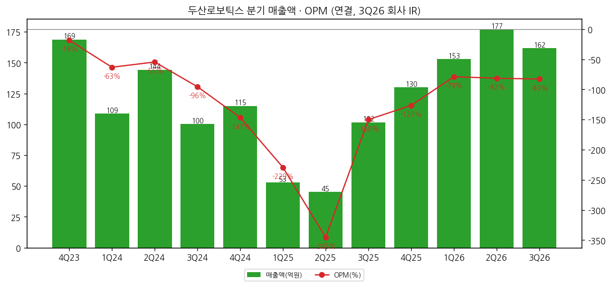
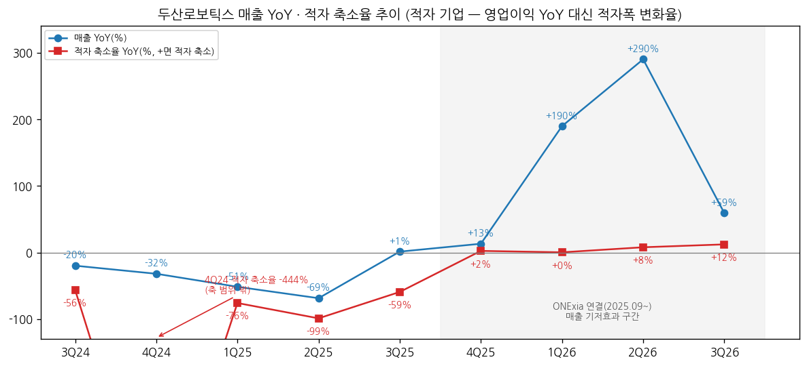
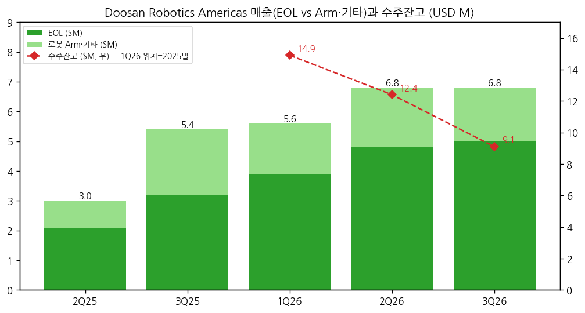

> 모드: 실적 리뷰 (v11)
> 종목: 두산로보틱스 (454910)
> 섹터: 로봇
> 서브섹터: 산업·물류 자동화
> 분기: 2026-Q3
> 발표일: 2026-10-29
> 작성 시각: 2026-11-14 20:00 KST
> 분석 소스: 회사 3Q26 경영실적 IR(2026-10-29, K-IFRS 연결·감사 전) + 2Q26 IR(2026-07-24) + OpenDART 분기 재무(3Q23~2Q26) + DART 2026 반기보고서 + 두산로보틱스 기업개요 v1.0 / 셀사이드 리포트 첨부 0건 → 웹 공개 정보 보완: CEO스코어데일리(2026-11-10), 아이뉴스24(2026-07-24), Quartr 3Q26 요약(2026-10-29), Yahoo Finance 일별 주가(~2026-11-13)
> 리뷰 깊이: 숫자 중심 | 리서치 첨부 0건 (3Q26 분기보고서 미공시 — IR 잠정치 기준)

# 두산로보틱스 3Q26 실적 리뷰

## 0. 한 줄 판정

> 성장 델타: 유지 | 내러티브: 약화 → 매매 제외 구간 (흑자 경로·북미 수주잔고 반등 확인 전까지 관망)

→ 숫자: 매출 162억(+59.1% YoY, -8.5% QoQ), 영업이익 -134억(적자 19억 축소), OPM -82.9%. **적자 기업이라 영업이익 YoY 대신 적자 축소율로 델타를 판정** — 적자 축소율 2Q26 +7.9% → 3Q26 +12.2%(+4.3%p)로 ±5%p 이내 → "유지"
→ 매출 YoY는 +290%(2Q) → +59%(3Q)로 급감했지만 ONExia 연결(2025.09~) 기저효과가 걷힌 탓이 크다. 비교 가능한 DRA(북미) 매출은 +127%(2Q) → +27%(3Q, USD)로 **오가닉 성장도 둔화**
→ 쟁점 1: 북미 수주잔고가 $14.9M(2025말) → $12.4M(2Q26) → **$9.1M(3Q26)** 2개 분기 연속 감소 — "DRA 2026년 +50% 이상" 가이던스 이후 2027년 성장의 연료가 줄고 있다
→ 쟁점 2: 순손실 -183억으로 영업손실보다 49억 크고, 순현금이 한 분기에 440억 줄었다(2,024억 → 1,584억). 2Q26 장기차입금 500억, 9월 CEO 교체(권영민 사장)까지 겹치며 시장은 실적 발표 후 2거래일 -10%(10/28 60,500원 → 10/30 54,400원)
→ 다음 분기 관건: 4Q26 DRA 수주잔고 반등 여부와 분기 영업적자 -100억 이내 진입. 둘 다 안 나오면 델타 "꺾임"(적자 재확대) 위험

## 1. 숫자

① 연결 분기 표 (억원)

| 항목 | 4Q23 | 1Q24 | 2Q24 | 3Q24 | 4Q24 | 1Q25 | 2Q25 | 3Q25 | 4Q25 | 1Q26 | 2Q26 | 3Q26 | 4Q26E |
|---|---|---|---|---|---|---|---|---|---|---|---|---|---|
| 매출액 | 169 | 109 | 144 | 100 | 115 | 53 | 45 | 102 | 130 | 153 | 177 | 162 | 미확보 |
| 영업이익 | -31 | -69 | -79 | -96 | -169 | -121 | -156 | -153 | -164 | -121 | -144 | -134 | 미확보 |
| OPM | -18.4% | -63.3% | -54.6% | -95.6% | -146.7% | -229.3% | -345.3% | -150.2% | -126.5% | -78.9% | -81.6% | -82.9% | — |
| 매출 YoY | — | — | — | -19.8% | -31.9% | -51.5% | -68.6% | +1.3% | +13.2% | +189.7% | +290.0% | +59.1% | — |
| 영업이익 YoY (적자폭 변화, 억원) | — | — | — | -35 | -138 | -52 | -78 | -57 | +4 | +0 | +12 | +19 | — |
| 적자 축소율 (YoY) | — | — | — | -56.2% | -444.2% | -75.8% | -98.8% | -59.2% | +2.4% | +0.3% | +7.9% | +12.2% | — |
| **매출 YoY 델타 (%p)** | — | — | — | — | -12.1 | -19.6 | -17.1 | +69.9 | +11.8 | +176.5 | +100.3 | -230.9 | — |
| **적자 축소율 델타 (%p)** | — | — | — | — | -387.9 | +368.4 | -23.0 | +39.6 | +61.6 | -2.1 | +7.6 | +4.3 | — |

→ (출처: 4Q23~2Q26 OpenDART 분기·사업보고서 연결(4Q = 연간 − 3Q 누적), 3Q26 회사 IR p.4(2026-10-29, 감사 전 — 3Q26 분기보고서 미공시). 4Q26E: 셀사이드 컨센 미확보, 회사 분기 가이던스 없음)
→ **적자 기업 델타 판정 방식**: 영업이익 YoY(%)는 부호가 뒤집혀 의미가 없으므로 "적자 축소율 = (이번 분기 영업이익 − 전년 동기 영업이익) ÷ |전년 동기 영업이익|"으로 대체. +면 적자 축소, −면 확대. 판정은 이 비율의 직전 분기 대비 변화폭(±5%p)으로 한다
→ 컨센 대비: FnGuide 컨센 미확보로 서프라이즈 판정 불가. 회사 IR은 "북미 솔루션 사업 호조로 연결 매출 전년 대비 59% 증가"로 요약
→ 적자 축소율은 4Q25 +2.4% → 1Q26 +0.3% → 2Q26 +7.9% → 3Q26 +12.2%로 **4개 분기 연속 플러스(적자 축소)지만 폭이 작다**. 매출이 전년의 1.6~3.9배가 됐는데 적자는 10% 남짓 줄었을 뿐 — 늘어난 매출만큼 판관비(북미 사업장 확장 이전·AI R&D 인력)가 같이 늘었다 (회사 2Q26·3Q26 IR)
→ 3Q 누적: 매출 491억(+146% YoY), 영업이익 -399억(적자 7.3% 축소) — CEO스코어데일리 2026-11-10·회사 IR. 회사 연간 전망(2026.07 제시 "매출 전년 대비 50% 이상 증가")은 3Q 누적으로 이미 초과(2025 연간 330억)

→ (출처: OpenDART 연결, 3Q26 회사 IR)

→ (출처: OpenDART 연결, 3Q26 회사 IR. 4Q24 적자 축소율 -444%는 축 범위 밖)

② 사업부별 매출 (영업이익은 미공개)

(1) 제품별 — 회사 IR 비중 역산 (억원)

| 제품 | 1H26 (IR 비중) | 3Q26 누적 (IR 비중) | **3Q26 단독 [추정]** | 1H26 분기 평균 | 비고 |
|---|---|---|---|---|---|
| 자동화 솔루션 (EOL/CMI) | 148 (45%) | 246 (50%) | **약 97** | 74 | 전액 북미 |
| 로봇 Arm | 129 (39%) | 172 (35%) | **약 43** | 64 | |
| 부품 등 기타 | 53 (16%) | 74 (15%) | **약 21** | 26 | |
| 합계 | 330 | 491 | 162 | 165 | |

→ (출처: 회사 2Q26 IR p.6 「26.1H」 비중, 3Q26 IR p.6 「26년 3분기 누적」 비중 × 각 누적 매출. 비중이 정수 %로 반올림돼 단독 분기 값은 ±5억 오차 `[추정]`. DART 반기보고서 기준 1H26 비중은 Arm 43% / 부품 11% / 솔루션 45%로 IR과 분류가 다름)
→ **3Q 매출의 60%가 북미 EOL 솔루션**. Arm 단품은 1H 분기 평균 64억 → 3Q 약 43억으로 줄었을 가능성 — 국내·유럽 딜러 채널 Arm 판매가 여전히 약하다 `[추정]`
→ 영업이익을 끄는 축은 확인 불가(사업부 손익 미공개). 다만 EBITDA -103억 중 감가상각 31억을 빼고도 현금 기준 적자가 크다

(2) 북미 (Doosan Robotics Americas) — USD M

| 항목 | 2Q25 | 3Q25 | 1Q26 | 2Q26 | **3Q26** | QoQ | YoY |
|---|---|---|---|---|---|---|---|
| DRA 매출 | 3.0 | 5.4 | 5.6 | 6.8 | **6.8** | 0% | **+27%** |
| └ EOL | 2.1 | 3.2 | 3.9 | 4.8 | **5.0** | +4% | **+55%** |
| └ 로봇 Arm·기타 | 0.9 | 2.2 | 1.7 | 2.0 | **1.8** | -10% | -18% |
| 수주잔고 (기말) | — | — | (2025말 14.9) | 12.4 | **9.1** | **-27%** | |
| DRA 매출 YoY | | | | +127% | **+27%** | | |
| EOL YoY | | | | +130% | **+55%** | | |

→ (출처: 회사 2Q26 IR p.5, 3Q26 IR p.5. 2025년 비교치는 ONExia 인수 이전 매출 포함 기준, 2026년은 사업부간 매출 조정 전. 수주잔고 2024말 $3.8M)
→ DRA 매출은 2분기 연속 $6.8M로 **정체**. EOL만 소폭 늘었다. 수주잔고는 분기 매출(약 $7M)의 1.3배까지 내려와, 신규 수주가 받쳐주지 않으면 1~2분기 뒤 매출이 꺾인다 `[판단]`

→ (출처: 회사 IR 2Q26·3Q26 p.5)

(3) 손익·현금 보조 지표 (억원)

| 항목 | 3Q25 | 1Q26 | 2Q26 | **3Q26** | QoQ | YoY |
|---|---|---|---|---|---|---|
| EBITDA | -134 | -88 | -113 | **-103** | +10 | +31 |
| 당기순이익 | -129 | -92 | -128 | **-183** | -55 | -54 |
| 순차입금 (− = 순현금) | -2,110 | -2,113 | -2,024 | **-1,584** | +440 | +526 |
| 부채비율 | 9.7% | 17.8% | 34.2% | **33.9%** | -0.4%p | +24.1%p |

→ (출처: 회사 IR 1Q26·2Q26·3Q26 p.4. 2Q26부터 장기차입금 500억)
→ 순손실(-183억)이 영업손실(-134억)보다 49억 크다 — 영업외손실 원인(외화·투자자산 평가·이자 등)은 IR 미기재, 3Q26 분기보고서 확인 필요
→ 순현금 감소 440억은 영업적자(EBITDA -103억)의 4배 — 운전자본·북미 사업장 이전 투자·기타 현금 유출 내역 확인 필요 `[판단: 일회성 여부가 4Q 판정 변수]`

③ 연간 (억원)

| 항목 | 2022 | 2023 | 2024 | 2025 | 2026 3Q 누적 | 2026E / 2027E |
|---|---|---|---|---|---|---|
| 매출액 | 450 | 530 | 468 | 330 | 491 | 컨센 미확보 |
| 영업이익 | -132 | -192 | -412 | -595 | -399 | 컨센 미확보 |
| OPM | -29.4% | -36.1% | -88.0% | -180.3% | -81.2% | |
| 매출 YoY | +21.6% | +18.0% | -11.7% | -29.6% | +146.0% | |
| 영업이익 (적자폭 변화) | -61 | -59 | -220 | -183 | +31 (누적 기준) | |

→ (출처: 2022 2023 사업보고서 비교표시, 2023~2025 OpenDART, 2026 3Q 누적 회사 IR)
→ 4Q26 영업손실이 -135억 수준이면 2026 연간 약 -535억 — 2025(-595억) 대비 약 10% 축소에 그친다 `[전망: 3Q 단순 연장]`
→ 상장 당시(2023) 증권신고서의 2026년 당기순이익 추정 942억 대비 실적 괴리가 크다 (CEO스코어데일리 2026-11-10)

## 2. 시장 쟁점

① 2-0 지난 분기 체크

→ 첫 리뷰 — 직전 체크 없음 (2Q26 리뷰 미작성)

② 이번 분기 쟁점 4개 (셀사이드 리포트 미첨부 — 회사 설명 + 웹 공개 정보 + 주가 반응 기준)

| # | 쟁점 | 근거 소스 |
|---|---|---|
| (1) | 매출 +59%는 성장인가 인수 효과인가 — 오가닉 둔화와 수주잔고 감소 | 회사 IR p.5 |
| (2) | 매출이 늘어도 적자는 왜 그대로인가 — 비용 구조 | 회사 IR·언론 |
| (3) | 현금 소진 가속과 순손실 확대 — 자금 여력 | 회사 IR 재무 |
| (4) | CEO 교체와 피지컬AI 전략 — 내러티브 재정비 | CEO스코어데일리·회사 IR |

③ 쟁점별 분해

(1) **매출 +59%는 성장인가 인수 효과인가**

(1-1) 회사 설명
→ "북미솔루션사업 호조로 연결 매출 전년 대비 59% 증가", "EOL부문(+55% yoy)이 성장을 견인, DRA 전년 동기 대비 매출 +27% 증가", "EOL 성장세 지속과 사업장 확장 이전으로 '26년 매출 전년 동기 대비 50% 이상 성장 전망" (회사 3Q26 IR p.4~5)

(1-2) 숫자 분해
→ 연결 매출 증가 60억(102 → 162억) 중 대부분이 북미 솔루션. 비교 기준을 맞춘 DRA 매출은 +27%(USD)로 2Q(+127%)에서 크게 둔화
→ DRA 매출 2분기 연속 $6.8M 정체 + 수주잔고 $12.4M → $9.1M(-27% QoQ)
→ Arm 단품(3Q 약 43억 `[추정]`)은 1H 평균보다 낮다

(1-3) 공통 결론 vs 갈리는 지점
→ 공통: 2026년 성장은 ONExia(북미 EOL) 효과이며, 2026 DRA +50% 가이던스는 상반기 고성장으로 달성 가능권
→ 갈림: 2027년 — 사업장 확장 이전(4배 규모)이 수주 확대로 이어질지, 잔고 감소가 수주 공백 신호인지. 회사는 4Q 신규 수주 수치를 아직 제시하지 않았다

(1-4) [판단]
→ 잔고/분기매출 비율이 1.3배로 낮아져 4Q 수주가 핵심. 4Q 잔고가 $12M 이상으로 반등하면 "일시적 수주 타이밍", $9M 이하 유지면 2027년 DRA 성장률 한 자릿수 위험

(2) **매출이 늘어도 적자는 왜 그대로인가**

(2-1) 회사 설명
→ 2Q26: "DRIC, 북미 법인 이전 확장 및 AI 관련 R&D 인력 채용에 따른 인건비 증가 등으로 판관비 증가" (회사 2Q26 IR p.4)
→ 3Q26: "북미 사업장 확대와 인공지능(AI) 연구개발 투자, 인력 채용에 따른 비용"을 적자 요인으로 제시 (CEO스코어데일리 2026-11-10)

(2-2) 숫자 분해
→ 영업적자는 1Q26 -121억 → 2Q -144억 → 3Q -134억으로 -120~-145억 박스. 같은 기간 매출은 153 → 177 → 162억
→ 연간 판관비는 2021 185억 → 2025 639억(4년 3.5배). 1H26 R&D 비용 60억(매출 대비 18%), R&D 인력 70명 (DART 2026 반기보고서)
→ 솔루션 매출은 SI 성격이라 GPM이 Arm 단품보다 낮을 가능성 — 매출 믹스가 솔루션으로 이동할수록 매출 증가 대비 이익 개선이 작다 `[판단: 사업부 GPM 미공개]`

(2-3) 공통 결론 vs 갈리는 지점
→ 공통: 2026년은 "투자 기간" — 회사는 비용 증가를 의도된 투자로 설명
→ 갈림: 손익분기 매출 수준. 현재 분기 매출 160~180억에서 적자 -130억 수준이면, 비용이 고정이라 가정해도 분기 매출이 지금의 2배 이상 돼야 손익분기에 근접 `[판단]`

(2-4) [판단]
→ 적자 축소율이 +10%대에 머무는 한 델타는 "유지". 4Q에 적자 -100억 이내(축소율 +39% 이상, 4Q25 -164억 대비)가 나와야 "가속"으로 바뀐다

(3) **현금 소진 가속과 순손실 확대**

(3-1) 회사 설명
→ IR은 재무상태표만 제시하고 순손실·현금 감소 원인을 설명하지 않았다. 순손실 확대(-183억, YoY 42.3% 확대)는 언론이 보도 (CEO스코어데일리)

(3-2) 숫자 분해
→ 순현금: 2025말 1,971억 → 3Q26 1,584억. 3Q 한 분기 -440억 (2Q -89억, 1Q +142억)
→ 현금성자산 2Q26 2,524억 → 3Q26 2,084억, 장기차입금 500억(2Q26 신규) 유지, 자본 3,292억 → 3,048억 (회사 2Q26·3Q26 IR)

(3-3) 공통 결론 vs 갈리는 지점
→ 공통: 당장 유동성 문제는 없다 (현금성자산 2,084억, 부채비율 33.9%)
→ 갈림: 3Q의 대규모 유출이 일회성(사업장 이전 투자·인수 잔금 등)인지 상시 소진인지 — 분기보고서 현금흐름표로만 판별 가능

(3-4) [판단]
→ 최근 4분기 순현금 감소 526억 기준이면 약 3년치 버퍼. 3Q 속도(-440억/분기)가 반복되면 1년 안에 추가 조달 논의가 시작된다 — 4Q 현금 감소폭이 판정 변수

(4) **CEO 교체와 피지컬AI 전략**

(4-1) 회사 설명
→ "NVIDIA와 Agentic Robot OS 기반 기술 협력 — 26년 6월 NVIDIA와 피지컬AI 협력 발표, AI 기술 워크샵 진행(9월), 27년 Agentic Robot OS 기반 솔루션 공개 예정" (회사 3Q26 IR p.8)
→ "한국형 피지컬AI 국책 관련 2건 수주 (1,000억원)" — 온디바이스AI 협동로봇(지원 857억, 54개월), AI 지능형 용접(지원 158억, 45개월, 두산에너빌리티 실증) (회사 3Q26 IR p.9)
→ "M&A, 파트너십을 통한 기술 추가 확보 지속 검토" (회사 3Q26 IR p.8)

(4-2) 사실 관계
→ 2026.09.18 권영민 사장(두산모트롤 대표, 전 두산밥캣 CSO) 신임 CEO 선임, 김민표 대표(전 토스페이먼츠, 2025.03 선임) 9/30 퇴임 — 1년 6개월 만의 교체 (CEO스코어데일리 2026-11-10)
→ 언론 해석: 신임 CEO가 "북미 솔루션에 '흑자 엔진'을 단다" — 그룹 내 재무·전략통 기용으로 수익성 중심 전환 신호 (CEO스코어데일리 기사 제목)

(4-3) 시장 반응 (Yahoo Finance 일별 종가)

| 일자 | 종가 (원) | 변화 |
|---|---|---|
| 10/28 (발표 전일) | 60,500 | |
| 10/29 (발표일) | 57,500 | -5.0% |
| 10/30 | 54,400 | -5.4% |
| 11/09 (저점) | 48,800 | 발표 전일 대비 -19.3% |
| 11/13 | 51,900 | 발표 전일 대비 -14.2% / 2026.06 장중 고점 170,000원 대비 -69% |

→ 시가총액 약 3.36조 (2026-11-13). 최근 4분기 매출 622억 기준 PSR 약 54배 (기업개요 v1.0)

(4-4) [판단]
→ 국책과제·NVIDIA 협력은 2027~2031년 이야기라 단기 숫자를 바꾸지 못한다. 시장은 실적 발표 후 "AI 내러티브"보다 "적자·현금"에 반응했다. 신임 CEO 첫 전략 발표(4Q 실적 시점 2027 경영계획 예상)가 내러티브 재정비의 첫 확인 지점

④ 2-3·2-4 (셀사이드 낙관·보수 대비, 추정치·TP 표)

→ 셀사이드 리포트 미첨부로 생략. BT가 리포트를 올리면 이 섹션을 풀 버전으로 보강

## 3. 내러티브 점검

→ 성장 스토리: "국내 1위 협동로봇 + 북미 EOL 솔루션 인수로 외형 회복 → 피지컬AI·산업용 휴머노이드로 확장하는 두산그룹 로봇 플랫폼"
→ 이번 분기 숫자는 **외형 회복(3Q 누적 +146%)은 확인**했지만, ① 오가닉 성장 둔화(DRA +27%) ② 수주잔고 2분기 연속 감소 ③ 적자 축소 미미 ④ 현금 소진 가속으로 **흑자 전환 경로는 오히려 멀어 보이게 했다**
→ 판정: 델타 **유지**(적자 축소율 +7.9% → +12.2%) + 내러티브 **약화**(추정치 근거가 아닌 주가·현금 기준 — 고점 대비 -69%, CEO 교체) → **매매 제외 구간**
→ 내러티브를 다시 강하게 만들 트리거: ① DRA 대형 수주로 잔고 $15M 이상 회복 ② 2027 Agentic OS 솔루션 공개와 첫 상용 레퍼런스 ③ 신임 CEO의 흑자 전환 시점 제시
→ 깨뜨릴 리스크: ① 4Q 적자 재확대(-150억 이상) ② 자금 조달(유상증자) ③ Arm 매출 추가 감소

## 4. 향후 봐야 할 것

| 순위 | 무엇을 (변수·임계값) | 어떤 데이터로 | 언제 |
|---|---|---|---|
| 1 | **분기 영업적자 -100억 이내** (적자 축소율 +39% 이상, 4Q25 -164억 대비) — 델타 "가속" 전환 조건. -150억 이상이면 "꺾임" | 4Q26 잠정실적·IR | 2027-02 초 (4Q25 실적 2026-02-11 발표) |
| 2 | **DRA 수주잔고 $12M 이상 반등** ($9.1M 유지 시 2027 북미 성장 둔화) | 회사 IR p.5 수주잔고 | 2027-02 |
| 3 | **3Q26 현금 유출 440억의 성격** — 일회성(이전 투자·인수 관련) vs 상시. 4Q 순현금 감소 200억 이하 여부 | 3Q26 분기보고서 현금흐름표·주석, 4Q IR 재무상태표 | 분기보고서 2026-11-16 전후 / 2027-02 |
| 4 | **신임 CEO 2027 경영계획** — 흑자 전환 시점·매출 목표·M&A | 4Q IR '27년 경영계획' 페이지, 언론 | 2027-02 |
| 5 | **Arm 단품 매출 회복** — 분기 60억 이상 복귀 여부, 차세대 Arm 출시 | IR 제품 비중, DART 사업보고서 제품별 매출 | 2027-02~03 |

→ 다음 분기 리뷰 2-0의 체크 대상 = 위 5개
