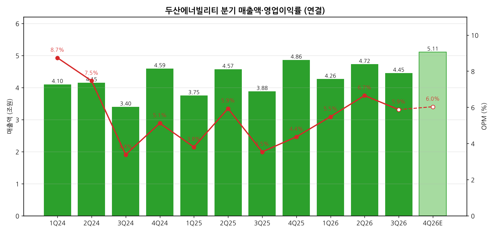
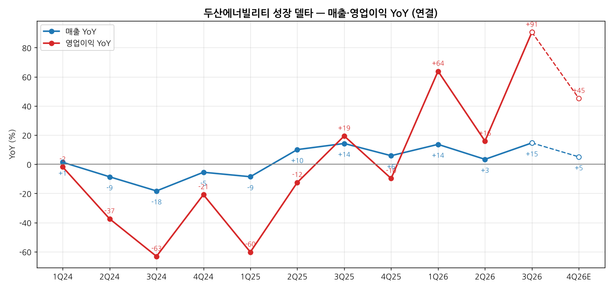
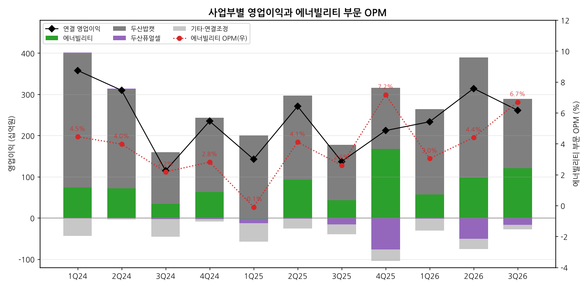
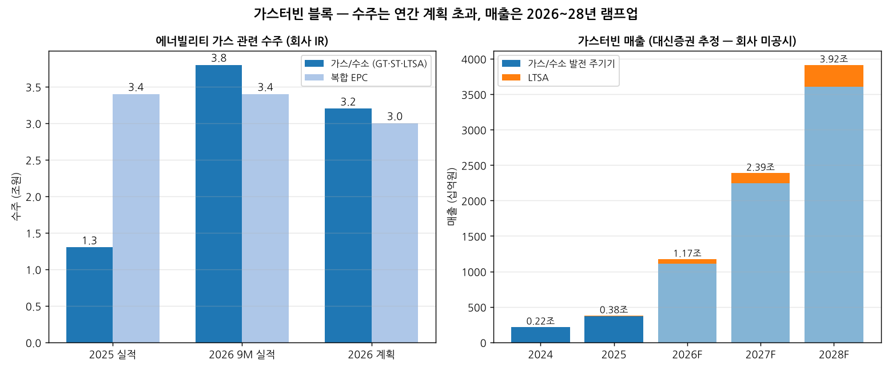

> 모드: 실적 리뷰 (v11)
> 종목: 두산에너빌리티 (034020)
> 섹터: 원전
> 서브섹터: 원전 기자재
> 교차 섹터: 전력 인프라 / 발전 — 가스터빈 블록(1번 ③, 2번 ③ (4)) 참조. 전력 인프라 섹터 리뷰는 이 블록만 떼어 써도 되도록 숫자·출처·판정을 블록 안에 완결했다
> 분기: 2026-Q3
> 발표일: 2026-10-29 (잠정실적·IR 설명회, 같은 날 한수원이 체코 두코바니 시공 협상 종료 발표) / 분기보고서 2026-11-13 제출 (DART 접수 20261113000856)
> 작성 시각: 2026-11-15 12:00 KST
> 분석 소스: 회사 자료 — 3Q26 IR 자료(10/29, 국문 14p), DART 분기보고서(2026.09, 11/13 제출 — 연결 손익·영업부문 주석·수주상황), OpenDART 연결재무제표(fnlttSinglAcntAll, 2015\~3Q26), 기업개요 v1.1(DART 51분기 사업부 시계열). 셀사이드 13건 첨부 — 국내 7건: KB증권(10/30)·신한투자증권(10/30)·대신증권(10/30)·삼성증권(10/30)·하나증권(10/30)·미래에셋증권(10/30 3Q26 Review, 11/12 2027 전망 "12차 전기본의 주인공") / 해외 6건: J.P. Morgan First Take(10/29)·Bernstein(10/29)·Morgan Stanley(10/29)·BofA(10/30)·Macquarie Flashnote(10/29, 한국 원전 섹터)·Evercore ISI Overnight(10/29, 미커버·가스터빈 read-across). 피어 교차 참조: BWXT_기업개요.md(BWXT 3Q26 컨콜), 2026-Q3_GEV·ENR 리뷰. 웹서치 보완 없음
> 리뷰 깊이: 풀 | 리서치 첨부 13건

# 두산에너빌리티 3Q26 실적 리뷰 — 에너빌리티 OPM 6.7%로 마진은 꺾여 올라왔는데, 원전 수주 타이밍이 멀티플을 끌어내렸다

> 성장 델타: 가속 | 내러티브: 약화 → 델타 가속 + 내러티브 약화 → 숫자와 주가가 엇갈린 관찰 구간 (원전 수주 트리거 확인 전까지 비중 확대 보류, 가스터빈 쪽은 강화)

→ **숫자**: 연결 매출 4조 4,494억원(+14.7% YoY), 영업이익 2,612억원(+90.6% YoY, OPM 5.9%). 영업이익 YoY가 2Q26 +15.9%에서 +90.6%로 75%p 뛰었고 매출 YoY도 +3.4% → +14.7%로 같이 올라 판정 기준상 "가속"이다. 다만 3Q25(OPM 3.5%) 저기저 효과가 크다. 기저와 무관한 증거는 **에너빌리티 부문 OPM이 3.0% → 4.4% → 6.7%로 매출이 18% 줄어든 분기에도 올랐다**는 점이다
→ **쟁점 ①**: 같은 2,612억원이 FnGuide 컨센(2,455억원) 기준으로는 +6.4% 비트, Bloomberg 컨센(2,740억원)·JPM 추정(3,000억원) 기준으로는 미스다. 갈린 곳은 밥캣(JPM 추정 2,270억원 vs 실제 1,674억원)이고, 에너빌리티 부문은 국내외 대부분이 "고수익 믹스 확인"으로 읽었다 (MS만 부문 OP 9% 미스로 해석)
→ **쟁점 ②**: 실적 발표 당일 한수원이 대우건설·두산 컨소시엄과의 체코 두코바니 시공 협상을 종료했다. 두산의 주기기 계약 5.6조원(NSSS 4.93조원 + 터빈발전기 0.71조원)은 그대로이고, 위험에 놓인 것은 2026년 수주로 잡혀 있던 시공분 약 3조원이다. 주가는 당일 -7.7%(61,400원 → 56,700원), 11/11 47,350원까지 밀렸다. 12곳 중 11곳이 "타이밍·심리 문제, 이익 영향은 제한적"으로 봤고, 미래에셋만 "재입찰해도 기존 금액·수익성 유지는 어렵다"며 추정에서 줄였다
→ **쟁점 ③**: 원자력 수주는 9M26 0.4조원으로 연간 계획 4.9조원의 8%다. 회사는 13.3조원 가이던스를 유지했지만, 원자력 대신 가스(9M 3.8조원, 연간 계획 3.2조원 이미 초과)가 수주를 메웠다. AP1000 장납기 기자재 첫 계약은 4Q26\~2027로 열려 있고 BWXT도 같은 지연을 말했다
→ **쟁점 ④**: 11곳 중 9곳이 TP를 내렸다(평균 121,545원 → 102,364원, -15.8%). 2026E 영업이익 추정은 5\~7% 하향에 그쳐 **TP 하향의 주원인은 WACC 상승과 원전 섹터 멀티플 하향**이다
→ **다음 분기 관건**: 컨센 경로상 4Q26 영업이익은 약 3,080억원(YoY +45%)으로 3Q26 +91%보다 낮아 델타는 "둔화"가 기본값이다. 판정보다 중요한 것은 4Q에 SMR 1조원·AP1000 장납기 첫 계약이 나와 원자력 수주가 숫자로 돌아오는지, 그리고 가스터빈 2030년 슬롯 예약이 확정 수주로 넘어가는 속도다

---

## 1. 숫자

① 연결 기준 분기 표 (단위: 억원, %)

| 항목 | 1Q24 | 2Q24 | 3Q24 | 4Q24 | 1Q25 | 2Q25 | 3Q25 | 4Q25 | 1Q26 | 2Q26 | **3Q26** | 4Q26E (컨센 내재) |
|---|---|---|---|---|---|---|---|---|---|---|---|---|
| 매출액 | 40,979 | 41,505 | 33,956 | 45,891 | 37,486 | 45,690 | 38,804 | 48,599 | 42,611 | 47,248 | **44,494** | 51,069 |
| 영업이익 | 3,581 | 3,098 | 1,148 | 2,349 | 1,425 | 2,711 | 1,371 | 2,121 | 2,335 | 3,143 | **2,612** | 3,080 |
| OPM | 8.7 | 7.5 | 3.4 | 5.1 | 3.8 | 5.9 | 3.5 | 4.4 | 5.5 | 6.7 | **5.9** | 6.0 |
| 매출 YoY | +1.4 | -8.6 | -18.3 | -5.5 | -8.5 | +10.1 | +14.3 | +5.9 | +13.7 | +3.4 | **+14.7** | +5.1 |
| 영업이익 YoY | -1.8 | -37.4 | -63.1 | -20.8 | -60.2 | -12.5 | +19.4 | -9.7 | +63.9 | +15.9 | **+90.6** | +45.2 |
| **매출 YoY 델타 (%p)** | -3.6 | -10.0 | -9.7 | +12.8 | -3.1 | +18.6 | +4.2 | -8.4 | +7.8 | -10.3 | **+11.3** | -9.6 |
| **영업이익 YoY 델타 (%p)** | -11.0 | -35.6 | -25.8 | +42.3 | -39.4 | +47.7 | +31.9 | -29.1 | +73.6 | -47.9 | **+74.7** | -45.4 |

→ (출처: 1Q24\~2Q26 DART 분기·반기·사업보고서(OpenDART 연결, 4Q = 연간 − 3Q 누적), 3Q26 DART 분기보고서(2026.09) — 잠정 공시와 동일(매출 4조 4,494억원, 영업이익 2,612억원). 2023년 분기는 기업개요 v1.1 DART 표. 4Q26E는 [계산]: 매출 = FnGuide 2026 컨센 18조 5,423억원(10/30, 하나증권 Consensus Data) − 9M 13조 4,354억원, 영업이익 = FnGuide 2026 컨센 1조 1,170억원(11/11, 미래에셋 11/12 표지) − 9M 8,090억원. 매출·영업이익 컨센 시점이 달라 OPM은 참고치)
→ 3Q26 서프라이즈: 매출은 컨센 대비 -0.5%, 영업이익은 FnGuide 컨센 대비 +6.4% (컨센 매출 4조 4,709억원·영업이익 2,455억원, FnGuide — KB·신한·대신 인용, 커버 15곳). Bloomberg 컨센(2,740억원) 대비로는 -4.7% (JPM 인용). 지배주주순이익은 -137억원으로 컨센 1,070억원 대비 적자 전환 — 환율 하락에 따른 외화환산손실 약 800억원 등 영업외손익 -1,810억원 (미래에셋·KB)
→ 9M26 누적: 매출 13조 4,354억원(+10.1%), 영업이익 8,090억원(+46.9%), OPM 6.0% (회사 IR)
→ 영업이익 YoY는 3Q24(-63%)·1Q25(-60%) 바닥 이후 지그재그로 올라와 3Q26 +91%가 2024년 이후 최고다. 그러나 **컨센 경로상 YoY 정점은 이번 분기다**. 4Q26 내재 +45%, 2026년 연간 +46%, 2027년 +48%로 YoY는 40%대 고원으로 내려온다
→ **[판단] 델타 = 가속 (기저효과 포함, '강한 가속'은 아님)**: 판정 기준(영업이익 YoY 확대 + 매출 YoY 확대)상 가속이다. 3Q25는 연결 OPM 3.5%로 낮았고 에너빌리티 부문에 일회성 비용이 있었다(삼성증권). 2년 전(3Q24, OPM 3.4%) 대비로도 +128%라 저기저가 두 해 겹친 분기다. 그래서 조정 기준으로 에너빌리티 부문 OPM 레벨을 따로 봤다 — 1Q26 3.0% → 2Q26 4.4% → 3Q26 6.7%로 2개 분기 연속 상승했고, 이 개선은 기저와 무관하다. 방향은 같으므로 판정은 "가속"을 유지하되, 4Q는 둔화가 기본값이다

→ (출처: DART, 4Q26E는 FnGuide 컨센 내재 [계산] — 연한 막대·점선)

→ (출처: DART, 4Q26E는 FnGuide 컨센 내재 [계산] — 점선)

② 사업부별 매출·영업이익 (단위: 억원, %)

| 사업부 | 항목 | 1Q25 | 2Q25 | 3Q25 | 4Q25 | 1Q26 | 2Q26 | **3Q26** |
|---|---|---|---|---|---|---|---|---|
| 에너빌리티 | 매출 | 15,387 | 22,492 | 16,598 | 23,412 | 18,728 | 22,146 | **18,064** |
| 에너빌리티 | 영업이익 | -14 | 924 | 434 | 1,679 | 570 | 975 | **1,211** |
| 에너빌리티 | OPM | -0.1 | 4.1 | 2.6 | 7.2 | 3.0 | 4.4 | **6.7** |
| 에너빌리티 | 매출 YoY | -7.5 | +24.0 | +5.4 | +4.5 | +21.7 | -1.5 | **+8.8** |
| 에너빌리티 | 영업이익 YoY | 적전 | +28.0 | +26.5 | +166.1 | 흑전 | +5.5 | **+179.0** |
| 두산밥캣 | 매출 | 20,982 | 22,014 | 21,152 | 23,770 | 22,472 | 24,478 | **24,633** |
| 두산밥캣 | 영업이익 | 2,000 | 2,042 | 1,336 | 1,483 | 2,070 | 2,917 | **1,674** |
| 두산밥캣 | OPM | 9.5 | 9.3 | 6.3 | 6.2 | 9.2 | 11.9 | **6.8** |
| 두산밥캣 | 매출 YoY | -12.4 | -1.6 | +19.0 | +11.0 | +7.1 | +11.2 | **+16.5** |
| 두산밥캣 | 영업이익 YoY | -38.7 | -14.7 | +6.3 | -17.7 | +3.5 | +42.8 | **+25.3** |
| 두산퓨얼셀 | 매출 | 997 | 1,015 | 908 | 1,261 | 1,284 | 443 | **1,396** |
| 두산퓨얼셀 | 영업이익 | -115 | -19 | -156 | -766 | -13 | -509 | **-170** |
| 기타·연결조정 | 영업이익 | -446 | -236 | -243 | -275 | -292 | -240 | **-103** |

→ (출처: DART 영업부문 주석 — 매출은 외부고객 매출, 영업이익은 부문 영업손익(연결조정 전). 3Q26 = 분기보고서(2026.09) 9M 누적 − 반기보고서(2026.06) 1H 누적 [계산]. 1Q25\~2Q26은 기업개요 v1.1 DART 51분기 표. 기타·연결조정 = 연결 영업이익 − 3개 부문 합 [계산])
→ 3Q26 매출 비중: 밥캣 55.4%, 에너빌리티 40.6%, 퓨얼셀 3.1% [계산]. 회사 IR(내부관리연결) 기준 에너빌리티 매출은 1조 8,249억원(+8.7%)으로 DART 부문 매출과 정의가 약간 다르다 — 영업이익(1,211억원)은 두 기준이 같다
→ **델타를 끈 것은 에너빌리티다**. 연결 영업이익 증가 1,241억원 중 에너빌리티가 777억원(63%), 밥캣 338억원(27%), 기타·연결조정 140억원이다 [계산]. 회사 설명은 "Misfah·Duqm·Jafurah(중동 가스복합 EPC)와 체코 Dukovany 공정 진척으로 매출 성장, 원자력·가스터빈 중심 고수익 Mix 개선으로 영업이익 상승"이다 (IR p.3)
→ 밥캣은 YoY(+25%)로는 좋았지만 QoQ로는 영업이익이 2,917억원 → 1,674억원(-43%)으로 꺾였다. 2Q26 OPM 11.9%가 관세 관련 효과가 낀 이례적 고점이었고(기업개요 v1.1 메모), 3Q26 6.8%는 3Q25 6.3%와 비슷한 계절 수준이다. 국내 증권사는 "가격 정책 효과로 개선"(신한·삼성), JPM은 "자체 추정 대비 -26% 부진"으로 같은 숫자를 반대로 읽었다 (2번 쟁점 (1))
→ 퓨얼셀은 매출 +54%에도 적자(-170억원)가 이어졌다. 연결 이익에 미치는 크기는 작다

→ (출처: DART 영업부문 주석, [계산])

(1) 에너빌리티 수주·잔고 — 선행지표 (단위: 조원)

| 항목 | 1Q25 | 2Q25 | 3Q25 | 4Q25 | 1Q26 | 2Q26 | **3Q26** | 2026 계획 |
|---|---|---|---|---|---|---|---|---|
| 신규수주 | 1.72 | 2.04 | 1.63 | 9.34 | 2.79 | 4.34 | **2.88** | 13.3 |
| 수주잔고 (IR) | 16.15 | 16.01 | 16.42 | 23.05 | 24.13 | 26.35 | **26.58** | — |

→ (출처: 회사 IR 각 분기, 신한투자증권 분기 표. 수주잔고는 각 분기 IR 발표치이며 환율에 따라 사후 재표시된다 — 2Q26은 3Q26 IR 비교 컬럼에서 25.53조원. DART 분기보고서 기준 에너빌리티 수주잔고는 26.89조원(기초 23.39조원 + 증감 9.22조원 − 매출계상 5.72조원))
→ 9M26 누적 수주 10.0조원(+85.5% YoY), 연간 계획 13.3조원의 75%다. 수주잔고는 +70.9% YoY로 사상 최대다 (IR p.3)
→ 수주 구성이 계획과 다르게 채워졌다. 원자력은 9M 0.4조원(계획 4.9조원)에 그쳤고, 가스/수소가 3.8조원으로 연간 계획 3.2조원을 이미 넘었다. 복합 EPC 3.4조원(계획 3.0조원), 기타 2.4조원(계획 1.1조원)도 초과다 (IR p.5)

| 구분 | 2025 실적 | 2026 9M 실적 | 4Q26 추진 | 2026 계획 |
|---|---|---|---|---|
| 원자력 (대형원전 주기기·시공·서비스·SMR) | 6.8 | **0.4** | 1.2 (SMR 1.0 + 서비스 0.2) + 대형원전 α | 4.9 |
| 가스/수소 (GT 기자재·서비스·복합 STG) | 1.3 | **3.8** | 0.7 (복합 주기기 0.5 + 단품·서비스 0.2) | 3.2 |
| 복합 EPC | 3.4 | **3.4** | 0.5 | 3.0 |
| 신재생 (해상풍력 등) | 0.9 | **0.0** | 0.7 | 1.2 |
| 기타 | 2.2 | **2.4** | 0.0 | 1.1 |
| **합계** | **14.7** | **10.0** | **3.3 + α** | **13.3** |

→ (출처: 회사 3Q26 IR p.5, 단위 조원)

### ③ 가스터빈 (전력 인프라 교차 참조)

> 이 블록은 전력 인프라 섹터 리뷰 '발전' 서브섹터에서 그대로 가져다 쓸 수 있도록 숫자·출처·판정을 안에 완결했다. 회사는 가스터빈 매출·영업이익을 따로 공시하지 않는다 — 수주·대수·슬롯은 회사 IR, 매출은 증권사 추정이다

**발전(가스터빈) 파트 판정**: 수주 델타 가속 (연간 계획 조기 초과) | 매출 델타 가속 (매출화 초입, 추정 기준) | 내러티브 강화 → 국면: 원전과 분리해 보면 "관심 구간". 단 3Q 확정 수주는 GT 1기로 느려졌고, 이는 같은 분기 GE Vernova·Siemens Energy와 같은 "확정 수주 둔화 + 슬롯 예약 증가" 패턴이다 [판단]

(1) 가스터빈 핵심 숫자 (발전 서브섹터 이식용)

| 항목 | 값 | 출처 |
|---|---|---|
| 가스/수소 수주 (GT 기자재·서비스·복합 STG) | 2025 1.3조원 → 9M26 **3.8조원** (연간 계획 3.2조원 대비 119%) | 회사 IR p.5 |
| 3Q26 가스 관련 수주 | 약 0.7조원 — GT 1기(송산), ST 5기(국내 2·해외 3), LTSA 1건(일산 2Unit) | IR p.9, KB |
| 2026 누적 대수 | **GT 13기**(국내 6·해외 7) · ST 11기 · LTSA 6건 (1H GT 12기 → 3Q 1기) | IR p.9 |
| 용량 환산 | GT 13기 × 380MW ≈ **4.9GW** | [계산], H급 380MW(Bernstein) |
| 미국 빅테크 | xAI 누적 GT 12기 (2025-10 2기 0.4조원, 2025-12 3기 0.6조원, 2026-03 7기 1.4조원), **첫 북미 출하 3Q26** (수주 약 1년 후) | BofA Exhibit 8, IR p.9, Bernstein |
| 슬롯 | **2031년 착수 물량까지 예약주문 확보**. 2030년 슬롯은 2027년 중, 2031년 슬롯은 2028년 중 확정 전환 또는 소멸. 상당한 예약금 수령 | IR p.9, MS, Bernstein |
| 생산능력 | 연 약 8기 → **12기 (+50%, 2028년)**, 1차 증설 진행 중, 추가 증설 검토 | JPM, Bernstein, IR p.9 |
| 누적 수주 목표 | 2030년 70기+, 2034년 100기+ (국내 26기 + 해외 20\~45기 → 2034년 110기) | Evercore ISI (회사 발표 인용) |
| 4Q26 추진 | 복합화력 주기기 0.5조원(국내 1·해외 2 프로젝트, 국내가 연내 가능성 높음) + 단품·개보수·서비스 0.2조원 | IR p.5, MS |
| 매출 (추정) | GT 주기기 + LTSA: 2025 0.38조원 → 2026F **1.17조원** → 2027F 2.39조원 → 2028F 3.92조원 | 대신증권 표 5 (회사 미공시) |
| 마진 | 미공시. 회사는 "원자력·가스터빈 중심 고수익 Mix로 에너빌리티 OPM 상승"으로 설명 | IR p.3 |
| 잔고 내 비중 | 원자력 + 가스가 에너빌리티 수주잔고의 78% | BofA Exhibit 10 |
| 신제품 | 90MW 중형 GT, 2H28 상업화 목표 | Bernstein |

(2) 경쟁사 대비 위치 (같은 분기 기준)

| 회사 | 가스터빈 수주·잔고 | 마진 | 슬롯 | 출처 |
|---|---|---|---|---|
| **두산에너빌리티** | 2026 9M GT 13기(약 4.9GW), 수주 3.8조원 | 미공시 (에너빌리티 부문 OPM 6.7%) | 2031년 | 회사 IR |
| GE Vernova | 가스 계약 122GW(확정 64 + 예약 58), 3Q 신규 11GW, 2026 누적 수주 약 37GW | Power EBITDA 마진 21.4% | 2032년 다수 판매 | 2026-Q3_GEV_리뷰 |
| Siemens Energy | 총 약정 104GW(예약 39GW), FY26 수주 42GW, 4Q 확정 2GW | Gas Services 마진 16.0% | — | 2026-Q3_ENR_리뷰 |
| Mitsubishi Heavy | 워치리스트상 원자력 부문만 추적 — 가스터빈 수치 미확보 | — | — | — |

→ [판단] 두산의 연간 수주 규모는 GE Vernova의 약 1/8 수준이다. 의미는 "점유율"보다 **3강이 2030\~32년 슬롯까지 찬 상태에서 나오는 넘침(overflow) 수요를 4번째 공급자로 받는 구조**에 있다. 미국 첫 출하(xAI)가 납품 실적이 되면서 신규 글로벌 고객과의 협의가 늘었다(Bernstein, IR p.9). 텍사스·국내에 집중하고 휴스턴 서비스 거점을 경쟁력으로 내세운다(Bernstein)
→ [판단] 발전 서브섹터 관점의 결론: 두산 가스터빈은 "수주는 이미 숫자로 확인, 매출·마진은 2026\~28년 램프업" 단계다. 피어(GEV·ENR)는 이익이 이미 올라오는 단계라 사이클 위치가 1\~2년 뒤에 있다. 이 차이 때문에 피어의 "확정 수주 둔화"는 두산에 같은 크기의 악재가 아니다 — 두산은 아직 생산능력(연 12기)이 수요보다 작다

→ (출처: 왼쪽 회사 3Q26 IR p.5, 오른쪽 대신증권 10/30 표 5 — 회사 미공시 항목의 증권사 추정)

④ 연간 (단위: 억원, %)

| 항목 | 2022 | 2023 | 2024 | 2025 | 2026E | 2027E |
|---|---|---|---|---|---|---|
| 매출액 | 154,211 | 175,899 | 162,331 | 170,579 | 185,423 | 205,756 |
| 영업이익 | 11,061 | 14,673 | 10,176 | 7,627 | 11,170 | 16,518 |
| OPM | 7.2 | 8.3 | 6.3 | 4.5 | 6.0 | 8.0 |
| 매출 YoY | +40.3 | +14.1 | -7.7 | +5.1 | +8.7 | +11.0 |
| 영업이익 YoY | +27.3 | +32.7 | -30.6 | -25.0 | +46.5 | +47.9 |

→ (출처: 2022\~2025 DART 사업보고서(기업개요 v1.1). 2022 YoY는 2021 두산인프라코어 중단영업 재분류로 기준 단절. 2026E 매출·2027E는 FnGuide 컨센(10/30, 하나증권 Consensus Data), 2026E 영업이익은 FnGuide 11/11 컨센(미래에셋 11/12))
→ 발표 후 연간 영업이익 컨센은 2026E가 1조 1,380억원(10/30)에서 1조 1,170억원(11/11)으로 -1.8%다. 발표 전 컨센은 확보하지 못했다. 대신 추정 전·후를 다 밝힌 4곳(KB·신한·삼성·MS)은 2026E를 5.2\~6.6% 내렸다
→ 발표 후 10곳 평균은 2026E 1조 969억원, 2027E 1조 5,620억원이다 [계산]. 2027E 범위가 1조 3,283억원(하나)\~2조 288억원(미래에셋)으로 1.5배 벌어져 있다 — 원자력 매출 인식 시점 가정 차이다

---

## 2. 시장 쟁점

① 지난 분기 체크
→ 첫 리뷰 — 직전 체크 없음 (2026-Q2 리뷰·팔로업 미작성)

② 이번 분기 쟁점 5개

| # | 쟁점 | 언급 증권사 수 |
|---|---|---|
| (1) | 같은 2,612억원이 왜 비트이자 미스인가 — 에너빌리티 OPM 6.7%는 구조적 개선인가 기저효과인가 | 11/12 |
| (2) | 체코 두코바니 시공 협상 결렬 — 5.6조원 주기기와 3조원 시공 중 무엇이 위험한가 | 11/12 |
| (3) | 원자력 수주는 언제 숫자로 돌아오나 — 9M 0.4조원 vs 계획 4.9조원, AP1000·SMR | 11/12 |
| (4) | 가스터빈 (전력 인프라 교차 참조) — 2031년 슬롯까지 찼는데 왜 3Q 확정 수주는 1기였나 | 11/12 |
| (5) | TP 하향은 실적 문제인가 멀티플 문제인가 | 10/12 |

→ (12 = 셀사이드 첨부 13건 중 미래에셋 2건을 1곳으로 센 증권사 수. Evercore ISI는 미커버라 (1)(4)만 해당)

③ 쟁점별 분해

(1) 같은 2,612억원이 왜 비트이자 미스인가 — 에너빌리티 OPM 6.7%는 구조적인가

(1-1) 회사 설명 (3Q26 IR, 10/29 컨콜 — 증권사 정리)
→ "영업이익은 원자력·가스터빈 중심의 고수익 사업 Mix 개선으로 전년 대비 상승" (IR p.3)
→ 연결 영업이익 증가(+47%, 9M)는 "에너빌리티 수익성 개선과 밥캣 가격 정책 효과" (IR p.4)
→ 순차입금은 3Q가 정점이고 4Q 회수로 연말 약 3조원으로 줄인다. 부채비율 상승 18%p 중 약 13%p는 일시적 환율 효과다 (MS, Bernstein)

(1-2) 증권사별 해석 편차

| 증권사 | 기준 컨센·추정 | 3Q 판정 | 논리 |
|---|---|---|---|
| KB | FnGuide 2,460억원 | 상회 (+6.4%) | 체코 기자재 공정 + 중동 가스복합 EPC 진행으로 매출 믹스 개선 |
| 신한 | FnGuide 2,455억원 | 소폭 상회 | 에너빌리티 수익성 개선 + 밥캣 가격 정책 효과 |
| 대신 | FnGuide 2,460억원 / 자체 1,890억원 | 양호 | 가스터빈·원전 기자재 매출 증가 |
| 삼성 | 컨센 대비 +5.3% | 부합 | 신규 수주 프로젝트 매출 인식 + 3Q25 일회성 비용 기저효과 |
| 하나 | — | 부합 | 마진이 점진적으로 오르는 점이 긍정적 |
| 미래에셋 | — | 상회 | 고마진 사업 본격화로 수익성 개선 달성, 순이익은 외화환산손실 약 800억원으로 적자 |
| BofA | — | 대체로 부합 | 비수기에도 에너빌리티 OPM 7% (2Q 4%, 전년 3%) |
| Bernstein | — | 에너빌리티 강함, 연결 약함 | "margin inflection" — 고마진 원전·가스 믹스가 이익으로 넘어오는 첫 증거. 순이익 150억원은 컨센 1,020억원 대비 크게 미달 |
| JPM | Bloomberg 2,740억원 / JPMe 3,000억원 | 미스 (-5%/-13%) | 밥캣 부진(1,670억원 vs JPMe 2,270억원) 탓, 에너빌리티는 대체로 부합 |
| MS | Refinitiv 컨센 | 연결 부합, 에너빌리티 미스 | 에너빌리티 매출·OP가 컨센 대비 -5%/-9% |

(1-3) 공통 결론 vs 갈리는 지점
→ 공통: 에너빌리티 OPM 상승은 원자력·가스 믹스 덕분이라는 데 이견이 없다. 순이익 부진이 영업외(외화환산)에서 나왔다는 데도 같다
→ 갈림: 컨센 출처가 다르다. FnGuide(국내)는 2,455억원, Bloomberg는 2,740억원으로 285억원 차이다. 차이의 대부분이 밥캣 추정에서 나왔다 — 국내 증권사는 밥캣을 자체 컨센(약 1,670억원 수준)으로 넣었고, JPM은 2,270억원을 넣었다

(1-4) **[판단]** — 숫자로 분해
→ 에너빌리티 부문만 보면 3Q26 매출은 QoQ -18%(2조 2,146억원 → 1조 8,064억원)였는데 영업이익은 +24%(975억원 → 1,211억원)였다. 매출이 줄면 고정비 부담으로 마진이 내려가는 게 보통인데 반대로 2.3%p 올랐다. **매출 레벨이 아니라 믹스가 마진을 끌었다는 직접 증거**이고, 3Q25 기저와 상관없다. BofA·Bernstein 해석이 숫자와 맞다
→ MS의 "에너빌리티 미스"는 매출 레벨(공정 진척 속도) 기준이다. 이익의 질로 보면 미스가 아니다
→ 밥캣은 2Q26 11.9%가 관세 관련 효과가 낀 고점이라 3Q 6.8%로의 하락을 "부진"으로 보기 어렵다. 3Q25 대비로는 OPM +0.5%p다. JPM의 미스는 밥캣 추정치가 높았던 데서 나온 해석 차이다
→ 결론이 바뀌는 조건: 4Q26 에너빌리티 OPM이 매출 계절 반등(4Q는 연중 최대 매출 분기)에도 6%를 밑돌면, 3Q의 6.7%가 특정 프로젝트 정산 효과였다는 해석이 힘을 얻는다. 4Q25 7.2%·4Q24 2.8%로 4Q 변동이 크다

(2) 체코 두코바니 시공 협상 결렬 — 5.6조원 주기기와 3조원 시공 중 무엇이 위험한가

(2-1) 회사 설명 (10/29 컨콜 — JPM·MS·대신·신한 정리)
→ 기존 주기기 계약 5.6조원(NSSS 4.93조원 + 터빈발전기 0.71조원)은 그대로다. 시공 협상과 별개다 (JPM, Macquarie, 신한)
→ 새 시공 컨소시엄에 참여해 재입찰할 계획이다. 3년 전부터 체코에 시공 인력을 상주시켜 현장 자료·초기 인허가·설계에 관여했고, 주기기 공급사로서 설치까지 수행할 수 있다는 점을 경쟁력으로 든다. 수익성은 재입찰 시 따로 따진다 (대신, MS)
→ 체코 대형원전 수주가 2027년으로 넘어가도 연간 수주 13.3조원은 달성 가능하다 (JPM, Bernstein, KB)
→ 경과: 한수원은 본계약 후 약 15개월 협상 끝에 10/29 협상을 종료하고 경쟁입찰로 새 시공사를 뽑아 2027년 7월 계약을 목표로 한다. 쟁점은 공사비 총액확정(Lump-sum) 방식 — 한수원은 기본설계 승인 시점 물량 기준 총액 확정을, 대우건설은 상세설계에서 늘어난 물량의 보상을 요구했다 (Macquarie, 미래에셋 그림 2, 대신)

(2-2) 증권사별 해석 편차

| 증권사 | 시공분 가정 | 처리 | 논리 |
|---|---|---|---|
| Macquarie | 2026 원자력 수주에 시공 약 3조원 반영 → 2027년 이후로 밀릴 위험 | TP 12만원 유지, 최선호주 | 매도는 과도. 두산의 EPC 범위는 대우·현대건설의 토건 시공 범위와 달라 컨소시엄이 바뀌어도 역할을 유지할 여지 |
| BofA | 시공 약 3조원 2026 → 2027 이연 | 2026E 잔고 -10%, 2027E OP 영향 5% 미만, 2028E 잔고 불변 | 타이밍 문제 |
| 미래에셋 | 약 3조원 규모 예상 시공 발주금액 축소 | 추정 하향 + 뉴스케일 SMR 모듈 제외 → TP -29% | 재입찰해도 기존 수주금액과 수익성 유지 어려움. 다만 EPC는 기자재보다 마진이 낮아 이익 영향은 제한적, 주가 하락은 과도 |
| 대신 | 2027년 7월 신규 계약 재입찰 | 6개월 TP 현실화 | 총액계약 구조라 실제 공사비가 예비비 포함 계약금액을 넘을지가 핵심 — 시공능력(하도급·공기)의 중요성 부각 |
| 신한 | 5.6조원 주기기와 별개 | 추정·멀티플 하향 (협상 결렬과는 무관하게) | 주기기 제작·설치 역량과 현지 경험으로 신규 컨소시엄 참여 가능성 높음 |
| 하나 | 리스크 분담 변화가 없으면 기대감 지연 | TP -17% | 컨소시엄 재참여 가능성 높지만 단기 수주 가시성 우려 |
| KB | 시공 수주 내년 이연 불가피 | 가이던스 13.3조원 충족 전망 | 가스터빈이 원전 공백을 메움 |
| 삼성 | 두코바니 EPC 다소 지연 가능 | 가이던스 무리 없음 | 복합화력 주기기·SMR이 남아 있음 |
| JPM | 시공 계약 상실보다 프로젝트 전체 일정 불확실성이 문제 | 컨센 소폭 하향 예상 | 심리·밸류에이션 역풍이지 단기 이익 변수는 아님 |
| MS | 경쟁 입찰이라 금액·시점 모두 불확실 | TP -33% (WACC·멀티플이 주원인) | 수주 불확실성이 Team Korea 파이프라인 전체 리스크를 뜻하지는 않음 |
| Bernstein | 대형원전 수주 2027년 이연 | 타이밍 문제로 판단 | 다른 프로젝트로 13.3조원 달성 가능 |

(2-3) 공통 결론 vs 갈리는 지점
→ 공통: 11곳 모두 5.6조원 주기기는 영향이 없다고 봤다. 시공분(약 3조원)이 2026년 수주에서 빠진다는 데도 같다
→ 갈림: 재입찰 시 **금액과 수익성**이다. 미래에셋만 "기존 금액·수익성 유지는 어렵다"며 추정에서 줄였고, 대신은 총액확정 조건 자체가 EPC 마진의 위험이라고 짚었다. Macquarie는 두산의 시공 범위가 토건사와 달라 역할이 남는다고 본다. 시장(주가 -7.7%, 이후 -16%)은 미래에셋 쪽에 가깝게 반응했다

(2-4) **[판단]**
→ 이익 쪽에서 보면 영향은 작다. 시공 약 3조원은 10년 넘게 나눠 인식되는 저마진 EPC다. BofA 계산(2027E OP 영향 5% 미만)이 숫자와 맞는다
→ 그러나 주가를 움직인 것은 이익이 아니라 **"수주 → 매출 전환 시간표"의 신뢰**다. 9M 원자력 수주가 0.4조원인 상태에서 2026년 원자력 숫자를 채울 유일한 대형 건이 빠졌다. 한수원이 총액확정을 고수한다는 점은 두산이 재입찰로 들어가도 위험을 더 지는 구조라는 뜻이다 — 이 부분은 미래에셋·대신의 경계가 맞다
→ 결론이 바뀌는 조건: 2027년 상반기 재입찰에서 두산이 시공사 리스크 분담 완화(물량 증액 조항 등)와 함께 참여가 확정되면 "타이밍" 해석이 맞게 된다. 반대로 한수원이 현대건설 단독 등으로 가고 두산 EPC 범위가 빠지면, 두산 원자력 수주 경로에서 2.9\~3조원이 영구히 빠진다

(3) 원자력 수주는 언제 숫자로 돌아오나 — 9M 0.4조원 vs 계획 4.9조원, AP1000·SMR

(3-1) 회사 설명 (IR p.7\~8, 10/29 컨콜 — Bernstein·MS·BofA 정리)
→ 대형원전: 국내 11차 전기본 2기 확정, 12차 전기본 신규 원전 기대. 해외는 한미 원전 프레임워크의 미국 내 APR1400 2기, 베트남, 체코 후속(Temelin 3\~4호기). AP1000은 미국 DOE·DOC 프로젝트와 한미 프레임워크 6기, 폴란드 2기 등 (IR p.7). 2030년 가이던스(원자력 잔고 27.2조원·매출 3.5조원)에 이 기회들은 "추가분(+β·+γ)"이다
→ AP1000 장납기 기자재: 웨스팅하우스와 SPV 프로젝트 협의 중, 폴란드 첫 호기 장납기 품목 협상 중. 연내 계약은 확정하지 못했다. 정부 금융지원으로 발주된 장납기 기자재 계약은 이후 EPC 일정과 독립적으로 제작·매출 인식·대금 회수가 가능하다(V.C. Summer 선례). 공급 범위가 원자로용기·증기발생기(RPV·SG) 이상으로 넓어질 수 있다 (Bernstein, MS)
→ SMR: NuScale 1개 모듈 선행 제작 계약(2026-10) — PPA 시점과 무관한 독립 계약. X-energy Dow 4모듈 증기발생기 전열관·주단소재 후속 계약 연내 예상. TerraPower 주기기 3종(GV·RSS·CBS) 제작 착수. 4Q SMR 수주 목표 약 1조원, 주요 조건은 대부분 합의 (JPM, IR p.8)

(3-2) 증권사별 해석 편차

| 증권사 | 대형원전 수주 시점 가정 | SMR 4Q 1조원 | 논리 |
|---|---|---|---|
| Bernstein | AP1000 장납기 4Q26\~2027 | 진행 중 | 장납기 계약은 프로젝트 지연 위험과 분리돼 위험이 낮다. 기수 증가 + 기당 공급 범위 확대의 이중 레버리지 |
| BofA | WEC AP1000 4Q26 최빠름, 이후 베트남 | X-energy + NuScale 1조원 | 미국 DOE 175억달러·한국 초기 100억달러가 장납기 선발주를 가능하게 함 |
| 대신 | 의미 있는 원전 수주 확대는 **2H27부터** | 소규모 SMR 다수 수주 긍정적 | 미국은 4Q26\~2027 사업개발(부지·SPC·금융·COL) → 2H27\~2028 장납기 선발주 → 2028\~29 건설 계약. 이제는 스토리보다 실질 수주가 필요 |
| 미래에셋 | 연말\~1H27 미국 AP1000 장납기 발주 | 뉴스케일 후속은 추정에서 제외 | 뉴스케일은 TVA PPA 불확실, 루마니아 Doicesti FID 조건 80% 미충족. 대형원전 파이프라인의 양·질은 개선(12차 전기본 2\~4기 추가 유력) |
| KB | 미국 대형원전 발주 예상보다 앞당겨질 것 | 초기 프로젝트 진행 | 대미투자 윤곽이 빠르게 드러남. Bear case 리스크로 "웨스팅하우스의 주기기 밸류체인 다변화" |
| 신한 | AP1000 수주 기회 구체화 | X-energy 4모듈 주단소재·전열관 | DOE 장납기 금융지원 + 폴란드 발주 절차 진입, 웨스팅하우스와 공급 품목 확대 협의 |
| 삼성 | 국내 대형 2기·SMR 1기 + AP1000 20여 기 가시성 높음 | NuScale·X-energy로 가시성 제고 | 섹터 최선호주 |
| JPM | AP1000 발주 시점 불확실 (부지·정부 승인·프로젝트 협상) | 4Q 핵심 확인 항목 | 대형원전·SMR·가스터빈 균형 노출 |
| MS | 장납기 첫 계약 이르면 2026년 말 또는 2027년 | NuScale PPA 지연으로 기대 하향 | 2027년에 계약 모멘텀 여지. 대기업 수주 전 조달 진척 |

(3-3) 공통 결론 vs 갈리는 지점
→ 공통: 미국 AP1000 장납기 기자재가 다음 원자력 수주의 1순위이고, 시점은 4Q26\~2027이다. 공급 범위 확대 가능성에도 이견이 없다
→ 갈림: **"첫 계약"과 "의미 있는 규모"의 시차**다. Bernstein·BofA·삼성은 첫 계약이 곧 재평가 트리거라고 보고, 대신은 의미 있는 금액은 2H27부터라고 본다. SMR은 NuScale 후속(최대 11모듈)을 넣은 곳(BofA)과 뺀 곳(미래에셋)으로 갈린다

(3-4) **[판단]**
→ 미국 쪽 증거는 경쟁사 공시와도 맞는다. BWXT는 3Q26 컨콜(11/2)에서 "AP1000 기자재는 두산·IHI와 경쟁하고 공급사 배분은 웨스팅하우스가 결정한다"고 했고, 미국 첫 신규원전 기자재 발주 시점을 "2026년 → 2026년 말\~2027년 상반기"로 미뤘다 (BWXT_기업개요.md). BWXT는 캐나다 Cambridge 대형부품 생산능력을 +50% 늘렸고 미국 대형부품 신공장 FID를 2026년 말에 내린다. 두산의 독점적 위치가 아니라 **경쟁 입찰 구도**라는 점이 KB가 Bear case로 든 "웨스팅하우스 밸류체인 다변화"의 실체다
→ 그래서 첫 계약 자체보다 **두산이 받는 범위(RPV·SG만인지, RCP·터빈발전기까지인지)와 기수**가 더 중요한 숫자다. 한미 프레임워크 물량(6기)은 한국 자금이 들어가는 만큼 두산 몫이 클 가능성이 높고 [판단], DOE 10기는 BWXT·IHI와 나눌 가능성이 있다
→ 결론이 바뀌는 조건: 1H27까지 AP1000 장납기 첫 계약이 없거나, 있어도 두산 범위가 RPV 일부에 그치면 대신의 "2H27 이후" 시나리오가 기본값이 된다

(4) **가스터빈 (전력 인프라 교차 참조)** — 2031년 슬롯까지 찼는데 왜 3Q 확정 수주는 1기였나

(4-1) 회사 설명 (IR p.9, 10/29 컨콜 — Bernstein·MS·BofA·Evercore ISI 정리)
→ "'26년 누적 GT 13기·ST 11기·LTSA 6건 수주 달성, GT·ST·LTSA 통합 수주 실적 본격화" / "'31년 착수 물량까지 예약주문 확보" / "국내외 수요 지속 및 협의 물량 확대에 따라 생산·서비스 Capacity 증설 검토" (IR p.9)
→ 빅테크 데이터센터향 GT 첫 수출을 3Q에 출하했다. 송산 열병합에서 처음으로 민간 EPC사에 GT·ST를 공급해 고객 기반을 넓혔고, 하동 복합은 1Q GT 2기에 이어 3Q ST·EPC로 확장됐다 (IR p.9)
→ 예약은 확정 수주와 다르다. 2030년 인도분은 2027년, 2031년 인도분은 2028년에 확정 여부가 정해진다. 상당한 예약금을 받았다. 한국 대미투자와 연계된 잠재 수요는 기존 예약·납기와 함께 검토 중이다 (MS)

(4-2) 증권사별 해석 편차

| 증권사 | 핵심 가정·추정 | 논리 |
|---|---|---|
| KB | 상반기 3.1조원으로 연간 목표 달성 후 3Q 0.7조원 추가 | 예상을 뛰어넘는 수주 증가세, 국내·텍사스 중심 2031년 인도분 예약 |
| 대신 | 가스/수소 주기기 매출 2026F 1.11조원 → 2027F 2.24조원 → 2028F 3.61조원 | 에너빌리티 기자재·서비스 매출 비중 2025 22.5% → 2028F 77.7% |
| JPM | 생산능력 연 12기(+50%) 2028년 | 가스터빈 가시성 2031년까지 연장 |
| Bernstein | 2030년 예약 대부분 2027년 확정 전환 → 잔고 추가 상향 | 제약은 수요가 아니라 제조 슬롯 — 가동률·가시성·가격에 유리 |
| BofA | 2030\~31 예약 → 2027\~28 확정 | 단기 가시성은 원전보다 가스가 명확 |
| MS | 예약은 확정 수주와 구분 | 증설 진행 중, 예약이 증설 후 생산능력을 넘으면 추가 투자 |
| Evercore ISI | 누적 2034년 110기 → 40GW+ 수주 함의 | GEV·ENR 가스 사이클 긍정 신호 재확인 |
| 미래에셋 (11/12) | 국내 H급 GT 기자재 점유율 100% | 12차 전기본 LNG 증설 수혜 |

(4-3) 공통 결론 vs 갈리는 지점
→ 공통: 수요가 아니라 생산능력이 제약이라는 데 모두 동의한다. 가스터빈이 원전 수주 공백기의 이익 브리지라는 데도 같다 (MS Base case: "가스터빈·EPC가 단기 이익 브리지")
→ 갈림: 예약의 질이다. Bernstein은 예약을 "잔고 상향의 다음 층"으로 보고, MS는 확정 수주와 분명히 구분한다. 3Q 확정 GT가 1기에 그친 이유는 증권사 누구도 따로 분해하지 않았다

(4-4) **[판단]** — 숫자로 분해
→ 1H26 GT 12기 중 7기가 xAI 한 고객(2026-03, 1.4조원)이었다. 3Q 1기는 대형 단일 고객 계약이 없던 분기의 "기본 속도"에 가깝다. 생산능력이 연 약 8기(2028년 12기)인데 2026년에 이미 13기를 받았으므로, **확정 수주 속도는 수요가 아니라 슬롯 배분이 정한다**. GEV(3Q 신규 11GW)·Siemens Energy(4Q 확정 2GW, 예약 39GW)와 같은 "확정 둔화 + 예약 증가" 패턴이다
→ 따라서 다음 가스터빈 수주 델타의 변수는 (a) 2030년 슬롯 예약의 2027년 확정 전환율 (b) 2차 증설 발표 여부 두 가지다. 예약금이 있는 예약이라 소멸 위험은 낮지만, MS 지적대로 아직 잔고가 아니다
→ 결론이 바뀌는 조건: 2027년 중 2030년 슬롯 예약 전환율이 절반 아래로 나오거나, 피어 GEV의 분기 가스 계약이 10GW를 밑돌기 시작하면 "공급 부족 → 넘침 수요" 전제가 약해진다

(5) TP 하향은 실적 문제인가 멀티플 문제인가

(5-1) 회사 설명
→ 해당 없음 (밸류에이션 쟁점)

(5-2) 증권사별 해석 편차

| 증권사 | 밸류에이션 방식 | 하향 이유 |
|---|---|---|
| KB | DCF (WACC 8.32% → 9.25%, 영구성장 2.35%) | 무위험수익률·베타 상승에 따른 WACC 상승 |
| 신한 | 2030F 에너빌리티 EBITDA × EV/EBITDA, 할인율 30% → 40% (36.0배 → 30.8배) | 고금리 + 수주 가시화까지 시차 |
| 삼성 | SOTP, 글로벌 피어 2026E EV/EBITDA 28.8배 → 24.3배 | 피어 멀티플 하락 + 추정 하향 |
| 하나 | 2030년 최대 Capa 기준 NOPLAT × 35배 → 30배 | 배수 하향 (NOPLAT 유지) |
| 대신 | 6개월 TP | 단기 원전 수주 모멘텀 부족 반영해 현실화 |
| 미래에셋 | 2034F EBITDA 7년 할인 × 피어 2027F EV/EBITDA 17.4배 | 체코 EPC 축소, 뉴스케일 제외 |
| MS | SOTP 확률가중 (Base 50%·Bull 25%·Bear 25%, 기존 60/25/15), WACC 7.4% → 8.1%, 원전 EV/잔고 1.8배 → 1.6배 | 금리 + 원전 섹터 디레이팅 + 보수적 수주·마진 |
| BofA | 2028E EV/잔고 2.0배 → 1.5배 (잔고 46조원 불변) | 정치·자금·프로젝트 시점 불확실성 |
| Bernstein | DCF (WACC 8.0%, 영구성장 3% 불변) | 원전 매출 인식 지연 + 연결 이익 약세로 2026E EPS -20% |
| JPM | 2028E 가격/잔고 1.9배 (변경 없음) | First Take — TP 유지 |

(5-3) 공통 결론 vs 갈리는 지점
→ 공통: 2026E 영업이익 추정은 5\~7% 하향에 그쳤다(KB -5.5%, 신한 -6.6%, 삼성 -5.2%, MS -6.0%). TP 하향 폭(9\~33%)이 훨씬 크다
→ 갈림: 하향 근거가 "금리(WACC)"인 곳(KB·MS)과 "수주 시차·리스크 프리미엄"인 곳(신한·BofA·대신)으로 나뉜다. 전자는 금리가 내려가면 되돌아오고, 후자는 원전 수주가 나와야 되돌아온다

(5-4) **[판단]**
→ **TP 하향의 원인 = 멀티플 하향(주) + 실적 하향(부)**. 이익 추정은 평균 6% 내려갔지만 평균 TP는 16% 내려갔다. 차이는 WACC 상승(KB +0.9%p, MS +0.7%p)과 EV/잔고 배수 하향(BofA 2.0 → 1.5배, MS 1.8 → 1.6배)에서 나온다
→ 두산은 2027E P/E가 50\~80배(KB 77.8배, 하나 88.6배)인 "잔고 가치" 종목이라, 이익이 아니라 잔고의 할인율로 값이 매겨진다. 그래서 원자력 수주 지연은 이익보다 할인율로 먼저 반영됐다. 주가는 52주 고점 136,400원 대비 -65%(11/11 47,350원)로, 현재가는 발표 후 평균 TP 102,364원 대비 약 +116% 상승여력이다 [계산]
→ 결론이 바뀌는 조건: AP1000 장납기 첫 계약이 나오면 신한·BofA·대신식 "시차 할인"이 먼저 풀린다. 금리 경로는 KB·MS식 WACC 할인을 정한다

④ 낙관 vs 보수 — 논리 대비
→ **가장 낙관 (JPM 13만원 유지, KB·BofA·Macquarie 12만원)**: 셋 다 수주잔고 기반이다. JPM은 2028E 에너빌리티 잔고 43.7조원에 가격/잔고 1.9배, BofA는 잔고 46.8조원에 1.5배를 쓴다. 원자력 수주 지연을 "1년 이연"으로 처리하고 2028년 잔고 경로는 거의 건드리지 않았다
→ **가장 보수 (MS 8만원, 대신·삼성·미래에셋 8.5만원)**: MS는 Bear case 확률을 15% → 25%로 올렸고(Bear 43,000원), 대신은 의미 있는 원전 수주를 2H27로 미뤘으며, 미래에셋은 체코 EPC와 뉴스케일을 추정에서 덜어냈다. "언제"를 1년 이상 늦게 본 쪽이다
→ 셀사이드 vs 시장: 커버 증권사 전원이 매수(Bloomberg 24 Buy | 0 Hold | 0 Sell, JPM 인용)인데 주가는 고점 대비 -65%다. 셀사이드는 "타이밍", 시장은 "원전 수주 사이클 자체의 신뢰"를 할인하고 있다. 미래에셋은 11/12 2027 전망에서 TP 8.5만원을 유지하며 원전 섹터 최선호주로 다시 골랐다

⑤ 추정치·TP 변화 (단위: 원, 십억원)

| 증권사 | 직전 TP | 현재 TP | 4Q26 영업이익 E | 2026 / 2027 영업이익 E | 핵심 변화 한 줄 |
|---|---|---|---|---|---|
| KB (10/30) | 140,000 | 120,000 (-14.3%) | 331 | 1,140 / 1,552 | WACC 상승, 26E OP -5.5%·27E -11.2% |
| 신한 (10/30) | 135,000 | 110,000 (-18.5%) | 352 | 1,161 / 1,676 | 할인율 30 → 40%, 26F OP -6.6%·27F -8.6% |
| 하나 (10/30) | 120,000 | 100,000 (-16.7%) | 275 | 1,084 / 1,328 | NOPLAT 배수 35 → 30배 |
| 삼성 (10/30) | 112,000 | 85,000 (-24.1%) | 367 | 1,176 / 1,846 | 피어 EV/EBITDA 하락, 26E EPS -37% |
| 대신 (10/30) | 100,000 (10/23) | 85,000 (-15.0%) | 271 | 1,080 / 1,365 | 원전 수주 2H27 본격화로 6개월 TP 현실화 |
| 미래에셋 (10/30, 11/12) | 120,000 | 85,000 (-29.2%), 11/12 유지 | 336 | 1,145 / 2,029 | 체코 EPC 축소·뉴스케일 제외 |
| J.P. Morgan (10/29) | 130,000 | 130,000 (유지) | 313 (발표 전 모델) | 1,161 / 1,575 | First Take, 컨센 소폭 하향 예상 |
| Bernstein (10/29) | 100,000 | 91,000 (-9.0%) | — | 938 / 1,416 (조정 EBIT) | 2026E EPS -20% |
| Morgan Stanley (10/29) | 120,000 | 80,000 (-33.3%) | 274 [계산] | 1,083 / 1,494 | WACC 8.1%, EV/잔고 1.6배, Bear 확률 25% |
| BofA (10/30) | 140,000 | 120,000 (-14.3%) | 192 | 1,001 / 1,339 | EV/잔고 2.0 → 1.5배 |
| Macquarie (10/29) | 120,000 | 120,000 (유지) | — | — | Flashnote, 매도 과도·최선호주 |

→ (출처: 각 증권사 리포트. MS 4Q26E = 2026E 1조 830억원 − 9M 8,090억원 [계산]. Bernstein은 조정 EBIT 기준(2025A 6,719억원)이라 4Q 역산 생략. Evercore ISI는 미커버로 표에서 제외)
→ 평균 TP는 121,545원 → 102,364원(-15.8%)이다. 하향 9건, 유지 2건(JPM·Macquarie)이다 [계산, 11곳 단순평균]
→ 발표 후 2026E 영업이익 10곳 평균 1조 969억원, 2027E 1조 5,620억원. FnGuide 2026E 컨센은 1조 1,380억원(10/30) → 1조 1,170억원(11/11, -1.8%)
→ **TP 하향의 원인 = 멀티플 하향 (주) + 실적 하향 (부)** — 이익 추정 -5\~7% vs TP -9\~33%

---

## 3. 내러티브 점검

① 성장 스토리 정의
→ 한국·미국·유럽의 대형원전 재개와 SMR, 데이터센터발 가스터빈 수요가 동시에 열리면서 두산이 "원자로·증기발생기·가스터빈을 다 만드는 몇 안 되는 공급자"로 수주잔고를 쌓고, 저마진 석탄·EPC 대신 고마진 원자력·가스 기자재 비중이 커지며 마진이 구조적으로 오른다. 시장은 "수주잔고 → 믹스 전환 → 마진 확장"을 산다

② 이번 분기 평가
→ **강화된 부분**: 마진 쪽이다. 에너빌리티 OPM 6.7%는 매출 감소 분기에 나온 믹스 효과다. 가스터빈은 2031년 슬롯·미국 첫 출하·증설로 스토리가 한 단계 구체화됐다. SMR도 NuScale 선행 제작·TerraPower 제작 착수로 "계획 → 제작" 단계로 넘어갔다
→ **약해진 부분**: 수주 쪽 중 원자력이다. 9M 원자력 수주 0.4조원, 체코 시공 약 3조원 이탈, NuScale PPA 지연, AP1000 첫 계약 미확정이 한 분기에 겹쳤다. 그 결과 9곳이 TP를 내렸고, 주가는 고점 대비 -65%다
→ **[판단] 내러티브 = 약화**: 핵심 전제(원전 르네상스 수요, 두산의 공급자 위치)는 깨지지 않았다. 하지만 타이밍 지연으로 추정치·멀티플이 함께 내려갔다 — 기준표의 "약화"에 해당한다. 가스터빈만 떼면 "강화"다
→ 1번 델타 "가속"과 합치면 **숫자와 주가가 엇갈린 관찰 구간**이다. 이익 델타는 가속인데 시장은 원자력 수주 시간표를 할인하고 있다. 모멘텀 프레임에서 "강한 내러티브 형성 구간"은 아니므로 비중을 키울 근거는 원자력 수주가 숫자로 나올 때다 [판단]

③ 스토리를 다시 강하게 만들 트리거
→ AP1000 장납기 기자재 첫 본계약 (미국 DOE·DOC SPV 또는 폴란드) — 범위가 RPV·SG 이상이면 더 강함
→ 4Q26 SMR 수주 1조원 (X-energy Dow 4모듈 + NuScale) 달성과 연간 13.3조원 초과
→ 12차 전기본(1H27)에 신규 대형원전 2\~4기 반영 + 가스터빈 2차 증설 발표

④ 스토리를 깨뜨릴 리스크
→ AP1000 기자재가 BWXT·IHI로 분산 발주되거나 두산 범위가 RPV 일부로 축소 (웨스팅하우스 밸류체인 다변화 — KB Bear case)
→ 체코 재입찰에서 두산 EPC 범위 제외 또는 총액확정 조건 수용에 따른 EPC 손실 위험
→ 가스터빈 2030년 슬롯 예약의 확정 전환 부진, 또는 에너빌리티 순차입금(3Q 4.48조원)이 연말 3조원으로 내려오지 않는 경우

---

## 4. 향후 봐야 할 것 (우선순위 순)

(1) **4Q26 연결 영업이익 3,080억원 이상 + 에너빌리티 OPM 6% 이상** — 델타 판정을 정하는 1순위 변수
→ 무엇을: 컨센 내재 4Q26 영업이익 약 3,080억원(YoY +45%)이면 판정 기준상 "둔화"다(3Q +91%보다 축소). "가속"을 유지하려면 4,040억원 이상이 필요해 가능성은 낮다 [계산]. 그래서 판정보다 **에너빌리티 OPM 레벨**을 본다 — 4Q 최대 매출 분기에 6% 이상이면 믹스 개선이 구조적이라는 확인, 5% 미만이면 3Q가 일회성 정산이었다는 반증
→ 어떤 데이터로: 4Q26 잠정실적·IR(에너빌리티 부문 OPM), 밥캣 4Q 실적(밥캣 OPM 7% 내외 유지 여부)
→ 언제: 2027년 1월 말\~2월 초

(2) **AP1000 장납기 기자재 첫 본계약과 두산 공급 범위**
→ 무엇을: 미국 DOE(최대 10기, 175억달러)·DOC/한미 프레임워크(6기)·폴란드(3기) 중 첫 계약 시점, 기수, 범위(RPV·SG만인지, RCP·터빈발전기 포함인지)
→ 어떤 데이터로: 두산 수주 공시, 웨스팅하우스 발표·IPO 서류(S-1), 피어 BWXT·IHI 수주 뉴스(BWXT 미국 대형부품 공장 FID 2026년 말), 뉴스 키워드 "Westinghouse long-lead Doosan", "AP1000 reactor vessel order"
→ 언제: 4Q26\~1H27 (BofA 4Q26 최빠름, 대신 의미 있는 규모는 2H27)

(3) **4Q26 수주 3.3조원 + α — SMR 1조원과 연간 13.3조원**
→ 무엇을: X-energy Dow 4모듈 증기발생기 전열관·주단소재, NuScale 후속(TVA-ENTRA1 PPA), 복합 주기기 0.5조원(국내 1건), 해상풍력 0.7조원. 원자력 수주가 연간 1조원을 넘는지
→ 어떤 데이터로: 수주 공시, NuScale·TVA PPA 뉴스, 루마니아 Doicesti FID 진행
→ 언제: 11\~12월 수시, 4Q IR에서 확정

(4) **체코 두코바니 재입찰 — 시공사 선정과 리스크 분담 조건**
→ 무엇을: 한수원 신규 시공사 경쟁입찰 공고·조건(총액확정 유지 여부), 두산의 컨소시엄 파트너(대우건설 복귀 또는 현대건설), 두산 EPC 범위. 주기기 5.6조원 공정 진척(분기 매출 인식)
→ 어떤 데이터로: 한수원 입찰 공고, 대우건설·현대건설 공시·뉴스, DART 분기보고서 "체코 Dukovany 5,6호기 NSSS 외" 수주잔고 증감
→ 언제: 입찰 1H27, 계약 목표 2027년 7월

(5) **가스터빈 슬롯 예약의 확정 전환과 2차 증설** (전력 인프라 '발전' 공통 변수)
→ 무엇을: 2030년 인도 슬롯 예약의 확정 수주 전환(2027년 중), 연 12기 이후 2차 증설 발표, 신규 해외 고객(미국 외 중동·동남아) 확정 수주
→ 어떤 데이터로: 수주 공시, IR 대수 표(GT·ST·LTSA), 피어 GEV 4Q 가스 계약 13GW+ 여부(1월 말)·Siemens Energy 예약 39GW 전환 속도
→ 언제: 4Q26 IR(1월 말) 이후 분기마다, 슬롯 전환은 2027년

---

> 참고 — 재무: 에너빌리티 부문 순차입금 4.48조원(2025말 2.66조원), 부채비율 159.2% (IR p.3·11). 연결 순차입금 4.45조원, 부채비율 145.6%. 회사는 연말 약 3조원을 목표로 제시했다 (MS·Bernstein). 4Q 회수가 확인되지 않으면 쟁점 (5)의 할인율 논리에 더해진다
