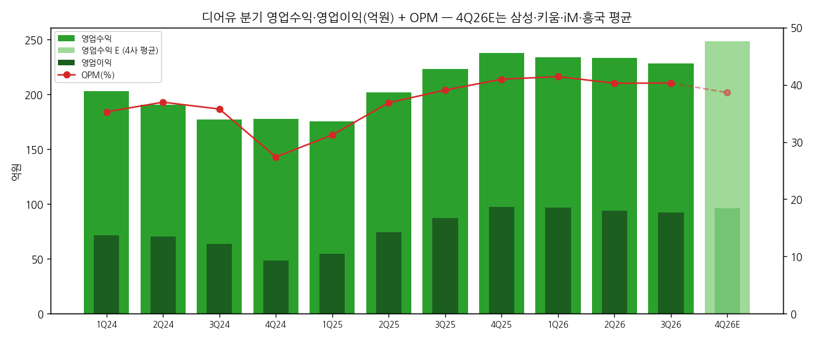
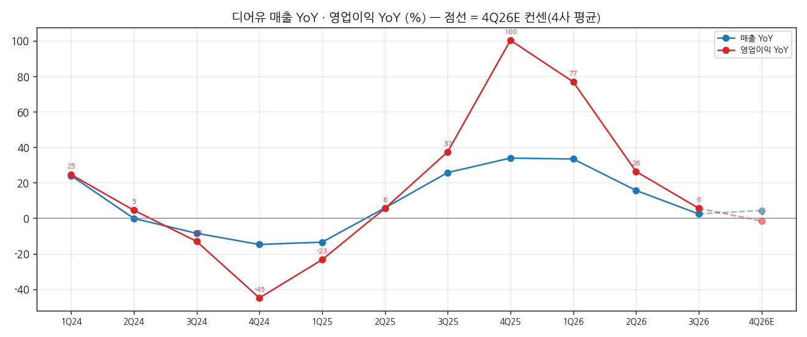
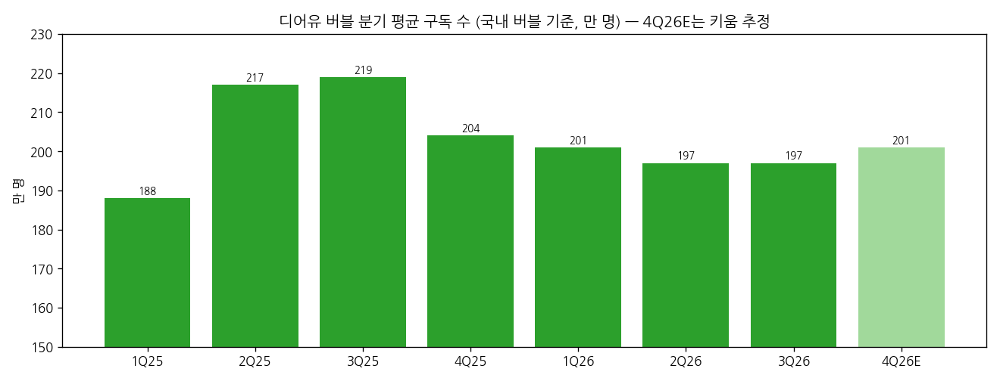

> 모드: 실적 리뷰 (v11)
> 종목: 디어유 (376300)
> 섹터: 엔터
> 서브섹터: 팬덤 플랫폼
> 분기: 2026-Q3
> 발표일: 2026-11-03 (IR 잠정실적) / 분기보고서 2026-11-16 제출 (확정 — 영업수익 228.4억·영업이익 92.0억, 잠정과 동일, OpenDART 접수 20261116001157)
> 작성 시각: 2026-11-23 00:30 KST
> 분석 소스: 디어유 3Q26 IR(2026-11-03, 연결·별도 재무제표 포함) + OpenDART 분기 재무(company-data MCP `dart_financials`) + 셀사이드 4건 — 삼성(11/04)·키움(11/04)·iM(11/06)·흥국(11/20, 신규) / 같은 폴더 `company-overview/디어유_기업개요.md` 참고
> 리뷰 깊이: 풀 | 리서치 첨부 5건 (IR 1 + 증권사 4)
> 비영업 요인: 영업외 손실(3Q26 기타비용 68.5억 — 아티스트 MG 선급금 손상 중심, 금융비용 105.6억 — 원/달러 하락에 따른 달러예금 외화환산손실) → 순이익 −74억 적자전환, 영업이익 판정과 무관 · 인식 시점(4Q25 QQ뮤직 버블 매출 3Q\~4Q25 합산 반영 — 4Q25 기저 소폭 과대, 2Q26 중국 로열티 6월 초과분 3Q26 인식)

# 디어유 3Q26 실적 리뷰

## 0. 한 줄 판정

> 성장 델타: 꺾임 | 내러티브: 약화 → 매매 제외 구간 (영업이익 YoY +100% → +77% → +26% → +6%로 3개 분기 연속 둔화, 4Q26 컨센은 −2%로 마이너스 전환. 구독자 역성장은 197만에서 멈췄지만 성장 스토리는 '구독'에서 증명 전인 '뉴욕 버블 하우스·중국'으로 넘어가는 중)

> ⚠ 비영업 요인 플래그: 3Q26 순손실 −74억(적자전환)은 영업외 요인 — 기타비용 68.5억(MG 선급금 손상)·금융비용 105.6억(외화환산손실, 보유 현금의 약 70%가 달러예금) (OpenDART·iM). 영업이익 판정과 무관. MG 손상은 2Q25(119억)에 이어 두 번째라 반복성 점검 필요. 4Q25 영업이익 YoY +100%에는 QQ뮤직 버블 3Q\~4Q25 매출 합산 반영 효과(약 4억)가 섞여 있다

→ 숫자: 영업수익 228억 (+2.4% YoY, −2.2% QoQ), 영업이익 92억 (+5.6% YoY, OPM 40.3%) — 컨센 부합(삼성 기준 컨센 대비 영업이익 +3.3%). 매출 YoY 33.9%(4Q25) → 33.4% → 15.7% → **2.4%**, 영업이익 YoY 100.4% → 76.9% → 26.4% → **5.6%**
→ 쟁점 ①: **구독자 바닥** — 분기 평균 구독 197만, 2개 분기 보합(3Q25 219만 → 4개 분기 감소 후 멈춤). 10/1 입점 배우 이광수 효과로 4Q 반등 기대(4건 공통)
→ 쟁점 ②: **뉴욕 버블 하우스** — 11/14 가오픈·12/4 정식 오픈. 미국 법인 영업손실 약 17억(삼성 추정)으로 별도 영업이익 +19.8%가 연결 +5.6%로 줄었다. 흥행 시 "실적 2\~3배"(키움) vs "성과 확인 후 추정 조정"(삼성)
→ 다음 분기 관건: 4Q26 영업이익 컨센 평균 96억(4사 93\~98억, YoY −1.6%) — 판정 '꺾임'을 뒤집으려면 구독자 200만 회복 + 버블 하우스 초기 매출이 비용을 덮어야 한다

## 1. 숫자

① 연결 분기 표 (억원, K-IFRS 영업이익. 3Q26은 분기보고서 확정, 4Q26E는 삼성·키움·iM·흥국 평균 — 매출 E는 버블 하우스 매출을 넣은 키움 284억 때문에 높다)

| 항목 (억원) | 1Q24 | 2Q24 | 3Q24 | 4Q24 | 1Q25 | 2Q25 | 3Q25 | 4Q25 | 1Q26 | 2Q26 | **3Q26** | 4Q26E (4사 평균) |
|---|---|---|---|---|---|---|---|---|---|---|---|---|
| 매출액(영업수익) | 203 | 191 | 177 | 178 | 175 | 202 | 223 | 238 | 234 | 234 | 228 | 248 |
| 영업이익 | 72 | 71 | 63 | 49 | 55 | 74 | 87 | 98 | 97 | 94 | 92 | 96 |
| OPM | 35.3% | 37.0% | 35.8% | 27.4% | 31.2% | 36.9% | 39.1% | 41.0% | 41.4% | 40.3% | 40.3% | 38.6% |
| 매출 YoY | +24.0% | -0.1% | -8.5% | -14.8% | -13.5% | +5.8% | +25.8% | +33.9% | +33.4% | +15.7% | +2.4% | +4.4% |
| 영업이익 YoY | +24.6% | +4.5% | -13.1% | -45.0% | -23.4% | +5.5% | +37.4% | +100.4% | +76.9% | +26.4% | +5.6% | -1.6% |
| **매출 YoY 델타** | n.m. | -24.1%p | -8.4%p | -6.3%p | +1.3%p | +19.3%p | +19.9%p | +8.2%p | -0.5%p | -17.7%p | -13.3%p | +2.0%p |
| **영업이익 YoY 델타** | n.m. | -20.1%p | -17.6%p | -31.9%p | +21.6%p | +28.9%p | +31.9%p | +63.0%p | -23.5%p | -50.5%p | -20.8%p | -7.2%p |

→ 컨센 대비: 영업수익 +1.4%, 영업이익 +3.3% (FnGuide 컨센, 삼성 인용) — 4건 모두 "컨센 부합"
→ 4Q22 이하 분기 숫자가 IR에 없어 1Q24부터 YoY 표시(11개 분기). 1Q22\~1Q24는 별도, 2Q24부터 연결(미국 법인 Dear U International 편입) — 회사 IR은 연결로 다시 표기
→ [판단] 영업이익 YoY의 정점은 **4Q25(+100.4%)** — 2024년 하반기 역성장(−45%) 저기저의 반동. 이후 3개 분기 연속 둔화했고 컨센 경로상 4Q26 −1.6%, 2027E 연간 +5\~25%(증권사별)로 고성장 구간은 끝났다. 판정 기준상 '2개 분기 연속 둔화 + 정점 경과' → **꺾임**. OPM은 40%대에서 유지 중이라 '이익률 훼손'이 아니라 '성장 정체'형 꺾임

→ (출처: 디어유 3Q26 IR 연결 손익, 4Q26E = 4사 평균)

→ (출처: 같은 자료로 계산. 점선 = 4Q26E 컨센)

② 매출 구성·KPI (억원, 사업부 영업이익 미공시 — 별도/연결 차이로 신사업 손익 추정)

(1) 매출 구성 (삼성 집계)

| 항목 (억원) | 3Q25 | 4Q25 | 1Q26 | 2Q26 | **3Q26** | 4Q26E (삼성) | 3Q26 YoY |
|---|---|---|---|---|---|---|---|
| 버블 | 220 | 231 | 229 | 227 | 220 | 226 | −0.2% |
| 기타 | 3 | 7 | 6 | 7 | 8 | 13 | +220% |
| └ QQ뮤직 버블(TME 로열티) | — | 4 | 5 | 6 | 7 | 8 | 신규 |
| 영업수익 합계 | 223 | 238 | 234 | 234 | 228 | 238 | +2.4% |
→ (출처: 삼성 표 1, 십억원 → 억원 환산. 4Q25 QQ뮤직은 3Q\~4Q25 합산 반영)
→ 버블 본업 매출은 YoY 보합(−0.2%) — 성장분 전부가 '기타'(QQ뮤직 로열티·신사업). 즉 **본업 구독 성장은 멈췄고, 증가분은 중국 로열티에서 나온다**

(2) 별도 vs 연결 영업이익 — 신사업(미국 법인) 비용 (삼성 표 2, 억원)

| 항목 | 3Q25 | 4Q25 | 1Q26 | 2Q26 | **3Q26** |
|---|---|---|---|---|---|
| 별도 영업이익 | 91 | 100 | 101 | 105 | 109 |
| 연결 조정·자회사 손익 | −3 | −3 | −4 | −11 | −17 |
| 연결 영업이익 | 87 | 98 | 97 | 94 | 92 |
→ 별도 영업이익은 YoY +19.8%(91 → 109억)로 여전히 두 자릿수 성장. 연결과의 차이 −17억은 버블 하우스 사용권자산 상각비(2Q26\~)·미국 인건비(1Q26\~) [삼성 추정]. **본사 수익성은 좋아지고 있는데, 신사업 비용이 연결 성장률을 깎는 구조**
→ 비용: 인건비 +5% QoQ·+32% YoY, 기타비용 +8% QoQ (iM) / 지급수수료 비중 36%(−2%p QoQ, −6%p YoY) — PG(웹) 결제 전환율 18%(+1%p QoQ), 신규 IP 유입 구독자의 웹 결제 비중 33% (흥국·iM)

(3) 섹터 KPI

| KPI | 3Q25 | 4Q25 | 1Q26 | 2Q26 | **3Q26** | 출처 |
|---|---|---|---|---|---|---|
| 버블 분기 평균 구독(국내 기준, 만 명) | 219 | 204 | 201 | 197 | **197** | 키움·IR |
| Bubble for Japan 분기말 구독(명) | 약 70,200 [계산] | — | — | 107,973 | **110,940** | IR (3Q25는 키움 YoY +58% 역산) |
| QQ뮤직 버블 입점 아티스트 | — | — | — | — | **489명** (K-POP 351·C-POP 138) | 키움 |
| QQ뮤직 버블 구독 QoQ | — | — | — | — | **+20%** | iM |
| JOOX 입점 아티스트 | — | — | — | — | 115명 | 키움 |
| PG(웹) 결제 전환율 | — | — | — | 17% | **18%** | 흥국·iM |
| 미국 법인 영업손실(추정, 억원) | −3 | −3 | −4 | −11 | **−17** | 삼성 |

→ (출처: 키움증권 집계 — 분기 평균, 국내 버블 기준(일본·중국·미국 버블 제외). 4Q26E는 키움 추정 201만)
→ 뉴욕 버블 하우스: 맨해튼 유니언스퀘어 약 400평 상설 공간, 11/14 가오픈·12/4 정식 오픈. 11월 RIIZE·12월 Stray Kids 프로모션. 수익원 = 입장료($15)·MD(버블 마트, 자체 화장품 '버블앤코')·기업 스폰서십. 구독 기간별 입장료 차등 (삼성·키움·iM·흥국)

③ 연간 (억원)

| 항목 | 2023 | 2024 | 2025 | 9M26 | 9M25 | 2026E (컨센) | 2027E (컨센) |
|---|---|---|---|---|---|---|---|
| 영업수익 | 757 | 749 | 838 | 696 | 600 | 약 930 | 약 1,000 |
| 영업이익 | 286 | 254 | 314 | 283 | 216 | 약 380 | 약 420 |
| OPM | 37.8% | 34.0% | 37.4% | 40.7% | 36.0% | 40.9% | 42.0% |
| 영업이익 YoY | +75.8% | −11.2% | +23.5% | +30.8% | — | +21% | +11% |
| 지배순이익 | 262 | 244 | 186 | 89 | 83 | 약 165 | 약 360 |
→ (출처: IR 연간, 9M은 분기 합산 [계산], 컨센은 흥국 표 기재 컨센 영업이익 2026E 38십억·2027E 42십억, 매출·순이익은 4사 평균 [계산])
→ 발표 전후 연간 컨센: 영업이익 2026E는 4사 모두 약 380억으로 거의 변화 없음. **순이익(EPS)만 크게 하향** — 삼성 2026E EPS −47.9%, 2027E −9.6% (영업외 손실 반영)

## 2. 시장 쟁점

① 지난 분기 체크
→ 첫 리뷰 — 직전 체크 없음

② 이번 분기 쟁점 (리포트 4건 기준)

(1) **구독자 역성장이 끝났나** — 4건 전부. 197만 보합이 바닥인가
(2) **뉴욕 버블 하우스의 수익성** — 4건 전부. 새 성장 동력 vs 비용 부담
(3) **중국(QQ뮤직)·일본이 본업 정체를 메울 수 있나** — 4건 전부
(4) **순이익 변동성(MG 손상·환율)과 EPS 하향** — 3건(삼성·키움·iM)

③ 쟁점별 분해

(1) **구독자 역성장이 끝났나**

(1-1) 회사 설명: "2Q26 평균 197만 → 3Q26 평균 197만, 전분기 대비 구독 수 보합. FX 효과로 영업수익 감소. 2Q26 중국 로열티 6월 초과분 3Q26 인식, QQ Music 버블 구독수는 지속적인 증가 중". 신규 입점: AEN(스타쉽), 소유, CIIU 뻔푸소년(JYP). 서비스 종료: 탁보영·이영지·Peso Pluma (IR 3Q26)

(1-2) 증권사별 해석 편차

| 증권사 | 핵심 가정·추정 | 논리 |
|---|---|---|
| 키움 | 4Q26E 평균 구독 201만(+2% QoQ), 2027E 206만 | 네 분기 연속 역성장이 멈췄고 이광수의 폭발적 반응이 배우·개그맨·아이돌 신규 입점 문의로 확산 — 4Q 기점 우려 해소. 다만 구독 반등만으로 추정치 상회는 어렵다 |
| iM | 4Q 반등 기대 | 첸백시 버블 서비스 종료에 따른 이탈 우려가 있으나 이광수 콘텐츠의 SNS 바이럴로 기존 팬층 외 신규 유입 확인 — 이탈 일부 상쇄 |
| 삼성 | 평균 구독 197만 "견조한 흐름 유지" | 구독자 자체보다 신사업 성과가 핵심 변수 |
| 흥국 | 평균 구독 197만 | 신규 IP 유입 구독자의 웹 결제 비중 33% — 구독 수보다 수수료 구조 개선에 주목 |

(1-3) 공통 결론 vs 갈리는 지점: 4건 모두 "바닥 통과"에 동의. 갈리는 건 **반등의 폭** — 키움은 4Q 201만(+2%)으로 소폭, 나머지는 수치 제시 없음. 2027년 구독 성장을 두 자릿수로 보는 곳은 없다
(1-4) [판단] 구독 197만 보합은 '바닥'이지 '성장 재개'가 아니다. 3Q25 219만 대비 −10%라 버블 본업 매출은 YoY 보합(−0.2%). 판정을 바꾸려면 4Q 평균 200만 회복 + 2027년 상반기 210만대 복귀가 필요. 첸백시 등 대형 IP 이탈이 반복되는 구조라 IP 순증(입점 − 종료)을 분기마다 따져야 한다

(2) **뉴욕 버블 하우스의 수익성**

(2-1) 회사 설명: 글로벌 신사업 'bubble House' 1호점 뉴욕 — 소규모 공연·팬미팅 아레나, 라이브 버블 파드(POD), 상설 굿즈 매장 '버블 마트'. 기존 구독 기간에 따라 입장료 차등 (IR·삼성)

(2-2) 증권사별 해석 편차

| 증권사 | 핵심 가정·추정 | 논리 |
|---|---|---|
| 키움 (낙관) | 4Q26E 영업수익 284억(+24.5% QoQ, 버블 하우스 매출 반영), OPM 34.2%. 2027E 영업수익 1,178억·영업이익 476억 | 소속사는 미국 팝업 인테리어 비용 10\~20억을 절감 — 양측 유인 존재. 4Q는 인건비·초기 비용 불가피하나 흥행 시 "실적 2\~3배 성장도 불가능하지 않은 구조". 현 추정은 보수적, 증명 시 추정치·멀티플 동시 상향 |
| iM | 2027F 영업이익 440억 | 월 임대료가 낮아 인건비 외 고정비 부담 제한, 초기 재고 최소화. 비용이 1Q26부터 반영돼 마진 희석 우려는 주가에 상당 부분 반영 |
| 흥국 | 2027E 영업이익 400억 | 수익원 = 입장료($15)·MD·기업 스폰서십. 4Q는 뉴욕점 인력 채용으로 인건비 QoQ 소폭 상승, 2027년은 추가 출점 전까지 현 수준 유지 |
| 삼성 (보수) | 2027E 영업이익 409억, 추정치에 신사업 성과 미반영 | 디지털 소통 모델을 오프라인 경험·소비로 확장한다는 점은 주목. 소프트 오프닝으로 수익 모델 초기 성과를 확인한 뒤 추정치 조정 예정 |

(2-3) 공통 결론 vs 갈리는 지점: 신사업 비용은 이미 1Q26부터 들어와 있고(연결 조정 −4억 → −17억), 4Q에 한 번 더 늘어난다는 데 동의. 갈리는 건 **매출 기여 가정** — 키움만 4Q부터 매출(약 50억 [계산 — 키움 4Q 영업수익 284억 − 타사 평균 236억])을 넣었고, 나머지는 성과 확인 전 0에 가깝게 둔다
(2-4) [판단] 3Q26 숫자로 보면 신사업은 아직 '비용'이다(연결 영업이익 성장률을 +19.8% → +5.6%로 14%p 깎음). 4Q26 실적에서 버블 하우스 매출이 미국 법인 손실(−17억 이상)을 줄이는지가 결론을 바꿀 첫 숫자. 키움의 4Q 매출 가정이 맞으면 4Q 영업수익 YoY는 +19%, 틀리면 0%대

(3) **중국(QQ뮤직)·일본이 본업 정체를 메울 수 있나**

(3-1) 회사 설명: QQ Music 버블 구독수 지속 증가, bubble for Japan 3Q 말 구독 110,940 (IR)

(3-2) 증권사별 해석 편차

| 증권사 | 핵심 가정·추정 | 논리 |
|---|---|---|
| iM (낙관) | QQ뮤직 C-POP 140명, 웨이보 1,000만 팔로워 이상 6명, 연내 G.E.M.(덩쯔치, 3,600만) 입점 | 연 300만 모객 스타디움 아티스트 — 대규모 팬덤 구독 전환, 현지 바이럴 시 대형 C팝 추가 합류. 총매출 일부를 로열티로 받는 구조라 이익 기여도 높음 |
| 흥국 | C-pop 140명(11월 초), TME가 중국 음악 스트리밍 약 70% 점유 | 방대한 C-pop 팬덤이 구독 기반, 고정비 부담이 낮아 구독 확대에 따른 영업 레버리지 |
| 키움 | QQ 입점 489명(K 351·C 138), JOOX 115명, 일본 11.1만(+58% YoY)·입점 88명 | G.E.M. 합류로 C-POP 라인업 경쟁력 보강 |
| 삼성 | QQ뮤직 버블 매출 4Q26E 8억, 2026E 25억 → 2027E 42억(+66%) | 중국·일본 구독 증가세 지속 |

(3-3) 공통 결론 vs 갈리는 지점: 중국·일본 구독은 증가 추세라는 데 전원 동의. 그러나 **절대 규모**가 문제 — 삼성 기준 QQ뮤직 매출은 분기 7억(영업수익의 3%), 2027E 42억(4%). 갈리는 건 G.E.M. 같은 대형 C-POP IP가 구독 '급증'을 만들 수 있느냐(iM 적극, 삼성 숫자상 점진)
(3-4) [판단] 중국 로열티 증가분(YoY +7억)이 본업 정체를 메우는 유일한 성장원이지만, 매출 228억 회사의 성장률을 두 자릿수로 되돌리기엔 작다. G.E.M. 입점 후 QQ뮤직 매출이 분기 15억 이상으로 뛰는지가 이 쟁점의 결론을 바꿀 숫자

(4) **순이익 변동성과 EPS 하향**

(4-1) 회사 설명: "아티스트 MG 선급 비용 손상 인식, F/X 하락에 따른 보유 달러예금의 외화환산평가손실 반영" — 당기순이익 −74억 적자전환 (IR)
(4-2) 증권사별 해석: 삼성 — 2026E EPS 1,299원 → 677원(−47.9%), 2027E −9.6%, 목표 P/E 20 → 18배. iM — 손상차손·외화환산손실 합산 약 160억, 달러예금이 전체 현금의 70%. 키움 — 순이익 2026E 160억·2027E 287억(영업이익 대비 낮게 유지)
(4-3) 공통 결론 vs 갈리는 지점: 영업 실적과 무관한 일회성이라는 데 동의. 갈리는 건 **반복성** — MG 손상은 2Q25(119억: 미국 법인 71억·본사 48억)에 이어 두 번째이고, 달러예금 비중이 커서 환율이 순이익을 계속 흔든다
(4-4) [판단] 아티스트 MG(최소 보장 선급금)는 IP 확보 비용이라 대형 IP를 들일수록 커진다. 손상이 반복되면 'MG를 주고 들인 IP가 기대만큼 구독을 못 모은다'는 신호 — 영업이익 판정과 별개로 IP 획득 효율을 보는 지표로 추적할 가치가 있다

④ 낙관 vs 보수

→ 가장 낙관: **키움**(TP 30,000원 유지, 2027E 영업이익 476억 — 4사 최고) — 버블 하우스가 소속사·팬 양쪽 유인을 가진 구조라 흥행 시 실적 2\~3배 가능. **iM**(32,000원, TP 최고) — 중국 대형 IP 입점과 신사업 가시화, 12MF P/E 12배는 저평가
→ 가장 보수: **삼성**(26,000원, −13.3% 하향, 2027E 409억) — 신사업은 성과 확인 후 반영, 업종 밸류에이션 하락 반영. **흥국**(신규 28,000원, 2027E 400억 — 가장 낮은 이익) — 목표 P/E 19.5배는 최근 3년 평균 대비 24% 할인
→ 다르게 가정한 것: **버블 하우스 매출을 숫자에 넣었나**(키움만 4Q부터 반영) + 적용 멀티플(P/E 18\~19.5배)
→ 셀사이드 vs 시장: 실적 직후 주가 18,570원(11/03) → 23,050원(11/19, +24%) — 1개월 KOSDAQ 대비 +28%p (흥국). 버블 하우스 가오픈(11/14) 기대가 주가를 먼저 끌어올렸다

⑤ 추정치·TP 변화

| 증권사 | 직전 TP | 현재 TP | 4Q26E 영업이익 | 2026E / 2027E 영업이익 | 핵심 변화 한 줄 |
|---|---|---|---|---|---|
| 삼성 (11/04) | 30,000 | **26,000 ↓** | 96 | 379 / 409 | 2026E EPS −47.9%·2027E −9.6%, 목표 P/E 20 → 18배 |
| 키움 (11/04) | 30,000 | 30,000 | 97 | 380 / 476 | 4Q 버블 하우스 매출 반영(영업수익 284억), 증명 시 추정·멀티플 상향 계획 |
| iM (11/06) | 32,000 | 32,000 | 98 [계산] | 380 / 440 | 12MF P/E 12배 저평가, 중국·미국 성과 가시화 주목 |
| 흥국 (11/20) | — (신규) | **28,000 (신규)** | 93 [계산] | 380 / 400 | 2027E EPS 1,422원 × P/E 19.5배 |
→ (출처: 각 리포트. [계산]: iM 4Q26F = 영업수익 약 233억 × OPM 42%, 흥국 4Q26E = 영업수익 YoY +0.4% × OPM 38.9%. 2026E는 iM·흥국이 십억원 단위 반올림이라 약 380억)
→ 현재 TP 4사 평균 **29,000원**, FnGuide 컨센 TP 30,364원(커버 11곳, 삼성 인용). 직전 TP가 있는 3사 평균 30,667원 → 29,333원(−4.3%). 상향 0·유지 2·하향 1·신규 1
→ TP 하향의 원인: 삼성 하향은 **순이익(EPS) 하향 + 멀티플 하향**이다. 영업이익 추정(2026E 379억)은 거의 그대로이고, 영업외 손실로 EPS가 깎이면서 업종 멀티플 하락이 겹쳤다

## 3. 내러티브 점검

→ 성장 스토리: **K-팝 팬덤의 '1:1 메시지 구독'이라는 높은 이익률(OPM 40%)의 구독 플랫폼이, 입점 IP 확대와 해외(일본·중국) 진출로 구독자를 늘리는 구간** — 2025년 하반기 반등(영업이익 +37% → +100%)의 근거였다
→ 이번 분기: 구독자 감소는 멈췄지만 늘지 않았고(197만 보합), 본업 매출은 YoY 보합이다. 성장분은 중국 로열티(분기 7억)뿐이다. 시장의 관심은 구독 성장에서 **'아직 숫자가 없는' 뉴욕 버블 하우스와 대형 C-POP IP**로 옮겨 갔다. 기존 스토리는 약화, 새 스토리는 형성 전 → **델타 꺾임 + 내러티브 약화 → 매매 제외 구간** (신사업 숫자 확인 시 재검토)
→ 다시 강하게 만들 트리거: 4Q26 버블 하우스 매출이 미국 법인 손실을 상쇄(연결 조정 −17억 → 축소) / G.E.M. 입점 후 QQ뮤직 매출 분기 15억 이상 / 평균 구독 210만 복귀
→ 깨뜨릴 리스크: 대형 IP 추가 이탈(첸백시 사례) / MG 손상 3회째 / 버블 하우스 초기 흥행 부진으로 2호점 계획 지연·비용만 남음

## 4. 향후 봐야 할 것

① **4Q26 영업이익 YoY와 연결 조정 손익** — 컨센 평균 96억(YoY −1.6%)을 넘어 플러스를 지키는지, 별도−연결 차이(3Q26 −17억)가 줄어드는지 (판정 '꺾임'을 바꿀 1순위) / 4Q26 잠정실적·IR / 2027년 2월 초
② **뉴욕 버블 하우스 초기 성과** — 방문객·MD 매출·스폰서십 공개, RIIZE(11월)·Stray Kids(12월) 프로모션 반응 / 회사 보도자료·SNS·증권사 탐방 / 12월\~2027년 1월
③ **평균 구독 수 200만 회복** — 4Q26 평균 201만(키움 E) 이상, 이광수 효과 지속 여부, IP 순증(입점 − 종료) / 4Q26 IR 구독 지표 / 2027년 2월
④ **G.E.M. 입점과 QQ뮤직 매출** — 연내 입점 확정, QQ뮤직 버블 매출 분기 8억(삼성 4Q E) → 15억대 도약 여부 (TME 4Q 실적 코멘트와 교차) / 디어유 IR·QQ뮤직 / 4Q26 실적(2월)·TME 실적(3월)
⑤ **영업외 리스크** — MG 선급금 추가 손상 여부, 원/달러 환율(달러예금 약 70%) / 분기보고서 영업외 항목 / 분기별
