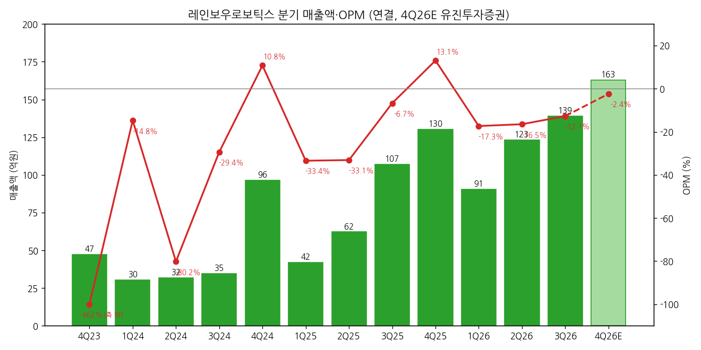
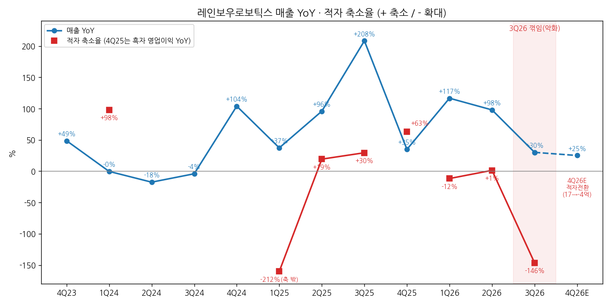
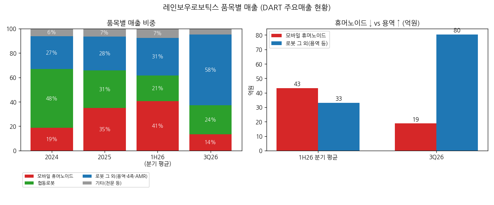

> 모드: 실적 리뷰 (v11)
> 종목: 레인보우로보틱스 (277810)
> 섹터: 로봇
> 서브섹터: 휴머노이드 완성체
> 분기: 2026-Q3
> 발표일: 2026-11-16 (3Q26 분기보고서, rcept 20261116001655 — 코스닥, 잠정실적 공시 없음)
> 작성 시각: 2026-11-23 11:50 KST
> 분석 소스: DART 3Q26 분기보고서(2026-11-16) + 2026 반기보고서(2026-08-14) + OpenDART 분기 재무(1Q21\~3Q26 연결) + 레인보우로보틱스 기업개요(2026-11-14) / 셀사이드 첨부 1건: 유진투자증권 「조용히 돌아온 대장」(양승윤, 2026-11-23, BUY 신규·TP 570,000원, 커버리지 재개) / 웹 공개 정보 보완: 지디넷코리아(2026-11-16·11-17), 비즈니스워치(2026-11-09), 서울경제(RX·CES 2027 보도, stockhub 전재)
> 리뷰 깊이: 풀 (리서치 첨부 1건 — 2번 쟁점은 유진 1건 + 회사 공시 + 언론으로 구성, 증권사 간 편차 비교 불가)
> 비영업 요인: 없음 (영업이익 = 매출총이익 − 판관비, 기타영업손익 없음. 참고: 3Q25 영업손실 -7억이 최근 8개 분기 중 가장 작아 YoY 적자 확대율이 크게 보이는 기저 효과)

# 레인보우로보틱스 3Q26 실적 리뷰

## 0. 한 줄 판정

> 성장 델타: 꺾임(악화) | 내러티브: 유지 → 매매 제외 구간 (주가는 삼성 휴머노이드 이벤트로 움직이는 구간 — 실적 모멘텀은 4Q 흑자 복귀와 휴머노이드 매출 회복 확인 전까지 없음)

→ 숫자: 매출 139억(+30.1% YoY, +13.0% QoQ), 영업이익 -18억(전년 -7억 대비 적자 2.5배), OPM -12.8%. **적자 기업이라 영업이익 YoY 대신 "적자 축소율"로 판정** — 2Q26 +1.4%(적자 소폭 축소) → 3Q26 **-146.4%(적자 확대)**, -147.8%p. 마이너스 YoY 구간에서 폭이 커지면 "꺾임(악화)"로 표기하는 규칙(2026-11-22) 적용
→ 매출 YoY도 +116.6%(1Q) → +97.9%(2Q) → **+30.1%(3Q)**로 2개 분기 연속 둔화. 유진 4Q26E는 매출 +25%, 영업이익 -4억(4Q25 +17억 대비 적자전환) — 적자전환 분기 규칙(2026-11-23, 직전 분기 감소 → 꺾임)상 4Q도 꺾임 경로
→ 쟁점 1: **휴머노이드(RB-Y1) 매출이 3Q 19억으로 1H 분기 평균(43억)의 절반 이하** — 1H 수출 65억이 3Q 0.6억으로 사라졌다. 성장은 삼성향 용역(3Q 약 75억)이 메웠다
→ 쟁점 2: 적자 확대는 "양산 회사 전환 비용" — 임직원 161명(2025말) → 247명(2026.09), 3Q 인건비 4.6배·원재료비 2.2배(지디넷), 판관비 +68% YoY. 유진은 2027E 흑자전환(영업이익 10억), 2028E 337억을 제시
→ 다음 분기 관건: 4Q는 2년 연속 흑자 분기(4Q24 +10억, 4Q25 +17억, 국공립 예산 집행 계절성). **4Q26 흑자 17억 초과면 델타 반전, 적자면 꺾임 확정**

## 1. 숫자

① 연결 분기 표 (억원)

| 항목 | 4Q23 | 1Q24 | 2Q24 | 3Q24 | 4Q24 | 1Q25 | 2Q25 | 3Q25 | 4Q25 | 1Q26 | 2Q26 | **3Q26** | 4Q26E |
|---|---|---|---|---|---|---|---|---|---|---|---|---|---|
| 매출액 | 47 | 30 | 32 | 35 | 97 | 42 | 62 | 107 | 130 | 91 | 123 | **139** | 163 |
| 영업이익 | -218 | -4 | -25 | -10 | 10 | -14 | -21 | -7 | 17 | -16 | -20 | **-18** | -4 |
| OPM | -461.5% | -14.8% | -80.2% | -29.4% | 10.8% | -33.5% | -33.1% | -6.7% | 13.1% | -17.3% | -16.5% | **-12.8%** | -2.4% |
| 매출 YoY | +48.7% | -0.3% | -17.5% | -4.1% | +103.9% | +37.3% | +95.9% | +208.2% | +34.9% | +116.6% | +97.9% | **+30.1%** | +25.1% |
| 영업이익 YoY (적자폭 변화, 억원) | 적전 | +230 | 적전 | 적전 | 흑전 | -10 | +5 | +3 | +7 | -2 | +0 | **-11** | 적전 (-21) |
| 적자 축소율 / 영업이익 YoY | — | +98.1% | — | — | — | -211.8% | +19.3% | +29.5% | +63.3% (흑자) | -11.7% | +1.4% | **-146.4%** | 적전 |
| **매출 YoY 델타 (%p)** | — | -49.0 | -17.2 | +13.4 | +108.0 | -66.6 | +58.6 | +112.3 | -173.3 | +81.7 | -18.7 | **-67.8** | -5.0 |
| **적자 축소율 델타 (%p)** | — | — | — | — | — | — | +231.1 | +10.2 | — | — | +13.1 | **-147.8** | — |

→ (출처: 4Q23\~3Q26 OpenDART 연결 fnlttSinglAcntAll(4Q = 연간 − 3Q 누적), 3Q26은 분기보고서 2026-11-16. 4Q26E: 유진투자증권 2026-11-23 실적 테이블 — 컨센 집계 1건, 소수 의견)
→ **적자 기업 델타 판정 방식**: 영업이익 YoY(%)는 적자 구간에서 부호가 뒤집혀 의미가 없으므로 "적자 축소율 = (이번 분기 영업이익 − 전년 동기 영업이익) ÷ |전년 동기 영업이익|"으로 대체(+ = 적자 축소, − = 확대, 두산로보틱스 3Q26 리뷰와 동일 방식). 흑자 ↔ 적자 전환 분기는 비율 계산 불가로 "—", 적자전환 분기는 직전 분기 방향으로 판정(2026-11-23 규칙)
→ 4Q23 영업손실 -218억과 2023 연간 -446억은 CB 매도청구권 임직원 지정에 따른 주식보상비용 460.6억(일회성) 영향 (기업개요). 판정 구간(2Q26→3Q26)에는 영향 없음
→ 컨센 대비: FnGuide 컨센 미확보 — 서프라이즈 판정 불가. 3Q 누적 매출 353억(+67.2% YoY), 영업이익 -54억(전년 -42억 대비 적자 28.4% 확대)
→ [판단] 적자 축소율은 2025년(+19%, +30%) 축소 → 2026년(-12%, +1%, -146%) 확대로 돌아섰다. 매출은 전년의 1.3\~2.2배인데 적자는 줄지 않는다 — 1H26까지는 "매출 2배, 적자 유지"였다면 3Q는 "매출 +30%, 적자 2.5배"로 질이 나빠졌다. 컨센(유진) 경로상 매출 YoY는 2026E +51% → 2027E +54% → 2028E +122%로 정점이 2028년이지만, 분기 YoY는 1Q26 +117%가 단기 정점

→ (출처: OpenDART 연결, 4Q26E 유진투자증권. 4Q23 OPM -461.5%는 축 범위 밖)

→ (출처: OpenDART 연결. 흑자↔적자 전환 분기는 축소율 계산 불가로 공란, 1Q25 -211.8%는 축 범위 밖)

② 품목별 매출 (사업부 영업이익은 미공개)

(1) 품목별 — DART 분기보고서 「주요매출 현황」 (억원)

| 품목 | 2024 | 2025 | 1H26 | **3Q26 단독** | 3Q26 누적 | 누적 ÷ 2025 연간 | 3Q26 단독 비중 | 1H26 비중 |
|---|---|---|---|---|---|---|---|---|
| 모바일 휴머노이드 (RB-Y1) | 36 | 120 | 87 | **19** | 105 | 88% | **13.5%** | 40.5% |
| 협동로봇 (RB 시리즈) | 93 | 105 | 45 | **33** | 78 | 75% | 23.8% | 21.1% |
| 로봇 그 외 (용역·4족·AMR 등) | 52 | 95 | 66 | **80** | 147 | 155% | **57.8%** | 31.0% |
| 기타 (천문마운트 등) | 12 | 22 | 16 | **7** | 23 | 101% | 4.9% | 7.5% |
| 합계 | 193 | 341 | 214 | **139** | 353 | 103% | 100% | 100% |

→ (출처: DART 3Q26 분기보고서 Ⅱ-2 주요매출 현황(3Q 누적·2025·2024, 천원 단위), 2026 반기보고서 동 항목(1H26). 3Q26 단독 = 3Q 누적 − 1H. 2025·2024 품목 분리는 3Q26 분기보고서에서 처음 소급 기재 — 반기보고서에서는 2025 용역 매출이 "기타"로 분류돼 있었음)
→ 유진 분류(3Q26): 협동로봇 33 / 모바일 휴머노이드 19 / 용역(자동화 구축) 75 / 기타(4족·AMR·천문 등) 12 — DART 품목과 합계 일치(유진 2026-11-23)
→ **휴머노이드는 3Q에 꺾였다**: 1H 87억(분기 평균 43억) → 3Q 19억(-57% vs 1H 평균). 3Q 누적으로도 2025 연간(120억)에 못 미침. 유진 4Q26E 67억(2026E 172억)은 3Q의 3.5배 회복을 전제한다
→ **델타를 끈 것은 "로봇 그 외" = 삼성향 용역**: 3Q 단독 80억, 이미 2025 연간의 155%. 협동로봇은 3Q 33억으로 1H 분기 평균(23억)보다 늘었다

(2) 매출 유형·지역·고객 (억원)

| 항목 | 1Q26 | 2Q26 | **3Q26** | 비고 |
|---|---|---|---|---|
| 제품 매출 | 140 (1H 합) | | **63** | DART 매출실적 |
| 용역 매출 | 72 (1H 합) | | **76** | 2025 연간 91억 → 3Q 누적 148억 |
| 수출 매출 | 17 | 47 | **1** | 1H 합 65억(DART), 분기 분할은 유진 |
| 삼성향 매출 | 24 | 33 | **61** | 비중 26.6% → 26.5% → **44.0%** (유진) |

→ (출처: DART 3Q26 분기보고서·반기보고서 「매출실적」(제품·상품·용역 / 내수·수출), 분기별 수출·삼성향은 유진투자증권 2026-11-23 실적 테이블. 지디넷(2026-11-17)은 3Q 삼성향 비중을 37.6%로 보도 — 산정 기준 차이로 보이며 본 리뷰는 유진 수치 사용)
→ [판단] 1H 휴머노이드 매출의 상당 부분은 해외 연구기관향 RB-Y1 수출이었을 가능성이 높다 — 1H 수출 65억과 휴머노이드 87억이 함께 움직였고, 3Q엔 수출 0.6억·휴머노이드 19억이 함께 빠졌다 (품목 × 지역 교차표는 미공시)

(3) 손익·비용·현금 보조 지표 (억원)

| 항목 | 3Q25 | 1Q26 | 2Q26 | **3Q26** | QoQ | YoY |
|---|---|---|---|---|---|---|
| 매출총이익 | 28 | 31 | 46 | **41** | -5 | +13 |
| GPM | 26.1% | 34.6% | 37.6% | **29.5%** | -8.1%p | +3.4%p |
| 판관비 | 35 | 47 | 67 | **59** | -8 | **+24 (+68%)** |
| 영업이익 | -7 | -16 | -20 | **-18** | +3 | -11 |
| 세전이익 | -0.3 | -9 | -16 | **-19** | -3 | -19 |
| 현금성자산 + 단기금융상품 (기말) | — | — | 559 | **491** | -68 | (2025말 691) |
| 임직원 (기말, 명) | — | — | — | **247** | | (2025말 161) |

→ (출처: OpenDART 연결 손익·재무상태표, DART 3Q26 분기보고서 Ⅷ 직원 현황(2026-09-30, 등기임원 제외). 3Q 누적 영업활동현금흐름 -109억, 유형자산 취득 92억)
→ 3Q 영업손실 확대(-11억 YoY)는 매출총이익 증가(+13억)보다 판관비 증가(+24억)가 컸기 때문. 지디넷(2026-11-17): 3Q 총비용 157억(+37.7%), 원재료비 87억(2.2배 이상), 인건비 42억(4.6배 이상)
→ GPM 29.5%는 2Q 37.6%에서 8.1%p 하락 — 고마진으로 추정되는 휴머노이드 비중이 40% → 14%로 줄고 용역 비중이 늘어난 믹스 효과 `[판단: 품목별 GPM 미공시]`
→ 연구개발비 3Q 누적 109억(매출 대비 31%, 정부보조금 51억 차감 전), 연구인력 113명 (DART 3Q26 분기보고서)
→ 세전손실이 영업손실보다 큰 건 금융수익 감소(3Q25 5.8억 → 3Q26 1.4억) — 현금 감소에 따른 이자수익 축소. 순현금 491억으로 유동성 문제는 없으나 분기 70억 안팎 감소 속도

③ 연간 (억원)

| 항목 | 2022 | 2023 | 2024 | 2025 | 2026E | 2027E | 2028E |
|---|---|---|---|---|---|---|---|
| 매출액 | 136 | 153 | 193 | 341 | 516 | 795 | 1,766 |
| 영업이익 | 13 | -446 | -30 | -25 | -58 | 10 | 337 |
| OPM | 9.6% | -292.2% | -15.4% | -7.3% | -11.2% | 1.3% | 19.1% |
| 매출 YoY | +51.8% | +12.1% | +26.8% | +76.4% | +51.1% | +54.2% | +122.0% |
| 영업이익 YoY | 흑전 | 적전 | 적지 | 적지(축소) | 적지(확대) | 흑전 | +3,206% |

→ (출처: 2022\~2025 OpenDART 연결, 2026E\~2028E 유진투자증권 2026-11-23. 2023 영업손실에 주식보상비용 460.6억 포함)
→ 발표 전후 연간 컨센 변화: 유진이 커버리지 재개 리포트라 직전 추정 없음, FnGuide 컨센 미확보 — 변화 비교 불가
→ 유진 2026E 영업이익 -58억 = 3Q 누적 -54억 + 4Q -4억. 2025(-25억) 대비 적자 2.3배 — 연간 기준으로도 적자 확대

→ (출처: DART 3Q26 분기보고서·2026 반기보고서 주요매출 현황. 1H26은 분기 평균)

## 2. 시장 쟁점

> 분석 범위: 셀사이드 리포트 1건(유진투자증권 2026-11-23)뿐이라 증권사 간 해석 편차 비교가 불가하다. 쟁점별 표는 "유진 / 회사 공시 / 언론" 소스 대비로 구성했다. 컨퍼런스콜·IR 자료는 없음(코스닥, irgo 실적 자료 0건 — 기업개요 기준)

① 2-0 지난 분기 체크

→ 첫 리뷰 — 직전 리뷰 없음. 참고로 실적 캘린더에 걸려 있던 3Q 시그널(2026-11-14 기업개요 작성 시점) 체크:

| 직전 시그널 | 이번 분기 결과 | 판정 |
|---|---|---|
| 휴머노이드 RB-Y1 매출 비중 40%+ 유지 | 3Q 단독 13.5%, 3Q 누적 29.8% (1H 40.5%) | **반대로 나옴** |
| 적자폭 | 3Q -18억, 전년 -7억 대비 2.5배 (QoQ는 -20억 → -18억 소폭 축소) | **반대로 나옴** (YoY 확대) |
| 삼성향 매출 | 3Q 61억(QoQ +85%), 비중 44.0%, 3Q 누적 118억 > 2025 연간 104억 | **확인** |

② 이번 분기 쟁점 4개

| # | 쟁점 | 근거 소스 |
|---|---|---|
| (1) | 휴머노이드 매출은 왜 3Q에 19억으로 급감했나 — RB-Y1 수요 소진인가, RB-Y2 전환기 공백인가 | DART 품목별·수출, 유진, 비즈니스워치 |
| (2) | 매출 +30%에 적자 2.5배 — 양산 회사 전환 비용은 언제 정점인가 | DART 손익·직원, 지디넷, 유진 |
| (3) | 삼성 캡티브 매출(용역) 비중 44% — 성장의 질과 지속성 | 유진, DART 매출실적, 지디넷 |
| (4) | PSR 160배 밸류에이션 — 2030년 매출로 정당화되나 | 유진 밸류에이션, 기업개요 |

③ 쟁점별 분해

(1) **휴머노이드 매출 급감 — 수요 소진인가 제품 전환 공백인가**

(1-1) 회사 설명
→ "당사는 현재 모바일 휴머노이드 로봇을 연구ㆍ개발 및 실증 단계의 플랫폼으로 운영하고 있으며 … 향후 제품화 및 사업화를 위한 기술적 기반을 단계적으로 구축" (DART 3Q26 분기보고서 Ⅱ 사업의 내용)
→ "모바일 휴머노이드는 주로 대학, 정부 산하 연구소, 공공기관 등을 대상으로 직판 방식으로 공급 … 국가 주도의 R&D 과제나 특수 목적의 프로젝트에서 활용" (같은 보고서 판매경로)
→ 생산 CAPA: 협동로봇 연 900대, 모바일 휴머노이드 연 약 120대 (같은 보고서)
→ RB-Y2: 2026-11-04 로보월드에서 공개, "내년 초 현장 검증을 거쳐 중반께 안전인증을 받고 양산·판매" (비즈니스워치 2026-11-09)

(1-2) 소스별 해석

| 소스 | 핵심 가정·추정 | 논리 |
|---|---|---|
| 유진투자증권 | 휴머노이드 4Q26E 67억, 2026E 172억 → 2027E 309억 → 2028E 1,040억 | RB-Y1이 연구용 외에 자동차 부품 공장 이송·조립에 투입되며 쓰임새 입증, RB-Y2는 가반하중 약 2배·산업 안전규격으로 산업 현장 진입 |
| 회사 공시 | 3Q 단독 19억, 3Q 누적 105억(2025 연간 120억 미달), 수출 3Q 0.6억 | 여전히 "연구·실증 단계 플랫폼" — 산업용 본판매는 아직 |
| 언론 (지디넷 11-16) | 3Q 누적 휴머노이드 비중 29.8%, 2025 대비 -5.2%p | 성장 중심축이 "로봇 그 외"로 이동 |

(1-3) 공통 결론 vs 갈리는 지점
→ 공통: 휴머노이드 본격 성장은 RB-Y2 양산(2027 중반 안전인증 이후)부터 — 2026년은 RB-Y1 연구용 판매의 마지막 해
→ 갈림: 4Q26 회복 폭. 유진은 4Q 67억(3Q의 3.5배)을 넣었지만 회사 공시에는 수주잔고가 없어("P/O 단납기로 수주잔고 의미 없음") 확인 수단이 없다

(1-4) [판단]
→ 3Q 급감은 1H 수출(65억) 소멸과 겹쳐 "해외 연구기관 RB-Y1 일괄 납품 후 공백"으로 보는 게 숫자와 맞다. RB-Y2 출시 전 RB-Y1 구매를 미루는 대기 수요도 가능 `[판단]`
→ 4Q 휴머노이드가 40억 이하면 2027 상반기까지 "RB-Y2 전환 공백"이 이어진다는 신호. 60억 이상이면 유진 경로 유효

(2) **매출 +30%에 적자 2.5배 — 양산 회사 전환 비용**

(2-1) 회사 설명
→ 회사는 분기보고서에서 적자 원인을 별도 설명하지 않음. 연구인력 113명, 연구개발비 3Q 누적 109억(매출 대비 31%) 공시 (DART 3Q26 분기보고서)
→ 임직원 247명(2026-09-30) — 2025말 161명 대비 +86명 (DART 직원 현황)

(2-2) 소스별 해석

| 소스 | 핵심 가정·추정 | 논리 |
|---|---|---|
| 유진투자증권 | 2026E 영업이익 -58억 → 2027E +10억 → 2028E +337억(OPM 19.1%) | "조직은 양산 회사 체제로 전환 중" — 직원 98명(2024말) → 247명(3Q26), R&D 외 생산기술·구매·현장운영 인력 대규모 확보. 매출 레버리지가 2028년에 나온다 |
| 회사 공시 | 3Q 판관비 59억(+68% YoY), GPM 29.5%(QoQ -8.1%p) | 비용은 이미 늘었고 매출은 아직 따라오지 않음 |
| 언론 (지디넷 11-17) | 3Q 인건비 42억(4.6배 이상), 원재료비 87억(2.2배 이상) | "비용 증가 속도가 매출 증가보다 빨랐다" — 인건비 증가는 R&D 확대로 풀이 |

(2-3) 공통 결론 vs 갈리는 지점
→ 공통: 2026년은 의도된 비용 선투입 구간. 인력은 1년 만에 100명 이상 늘었다
→ 갈림: 손익분기 시점. 유진은 2027년(매출 795억, OPM 1.3%)을 제시. 현재 분기 비용(매출원가 + 판관비 157억)이 고정이라면 분기 매출 160억 수준에서 손익분기 — 4Q 계절 매출(유진 163억)이면 근접 `[판단]`

(2-4) [판단]
→ 2Q 판관비 67억 → 3Q 59억으로 QoQ는 줄었다 — 채용 피크가 2Q였을 가능성. 4Q 판관비가 60억 이내로 유지되고 GPM이 33% 이상 회복되면 유진의 4Q -4억 경로가 현실화된다
→ 다만 "4Q 흑자"가 나와도 4Q25(+17억)보다 작으면 YoY로는 꺾임. 델타 반전에는 4Q 영업이익 17억 초과가 필요하다

(3) **삼성 캡티브 매출 44% — 성장의 질과 지속성**

(3-1) 회사 설명
→ 용역 매출 2025 연간 91억 → 3Q26 누적 148억, 3Q 단독 약 76억 (DART 매출실적). 회사는 고객별 매출을 분기보고서에 기재하지 않음

(3-2) 소스별 해석

| 소스 | 핵심 가정·추정 | 논리 |
|---|---|---|
| 유진투자증권 | 삼성향 2026E 152억 → 2027E 303억 → 2028E 570억, 용역 2027E 266억 | 삼성전자 생산라인 RB-Y1 투입·데이터 축적, 양팔로봇 대량 구매, 삼성전기 A8 프로젝트, 삼성디스플레이 공정 특화 휴머노이드 등 그룹 전반으로 수요 확대. 3Q26 누적 삼성향 118억 > 전년 연간 104억 |
| 회사 공시 | 3Q 용역 76억 = 3Q 매출의 54% | 품목상 "로봇 그 외"로 집계 |
| 언론 (지디넷 11-17, 비즈니스워치 11-09) | 삼성 7월 RX 사업추진실 신설(노태문 대표 직속), 삼성 출신 임원 3명 합류 | 삼성 로봇 전략의 실행 법인 구도 강화 |

(3-3) 공통 결론 vs 갈리는 지점
→ 공통: 삼성 캡티브가 2026 매출 성장의 바닥을 받친다. 비삼성 고객(쿠팡·CJ대한통운·HD현대중공업·셰플러·현대로템)도 확대 중 (유진)
→ 갈림: 용역(자동화 구축) 매출이 반복 매출인지 프로젝트성인지. 유진은 2026E 222억 → 2027E 266억으로 완만한 증가만 넣어 용역의 성장 기여를 보수적으로 봤다 — 성장 축은 결국 휴머노이드 제품

(3-4) [판단]
→ 용역은 GPM이 낮아(3Q GPM 29.5%로 하락) 매출 레버리지가 약하다. 삼성향이 늘어도 이익 개선으로 이어지려면 제품(휴머노이드·협동로봇) 비중이 다시 올라와야 한다
→ 확인 포인트: 4Q 삼성향 매출(유진 4Q26E 34억, 3Q 61억에서 감소 가정)과 삼성 휴머노이드 공개(CES 2027) 시 레인보우의 역할

(4) **PSR 160배 밸류에이션 — 2030년 매출로 정당화되나**

(4-1) 사실 관계
→ 주가 408,000원(2026-11-20), 시가총액 7.9조. 52주 고가 979,000원 / 저가 300,500원 (유진). 11-13 종가 363,500원(기업개요) → 3Q 분기보고서 공시(11-16) 후 11-20 408,000원(+12.2%) — 적자 확대에도 주가는 올랐다
→ 최근 4개 분기 매출 483억 기준 PSR 약 164배 `[추정: 시총 7.9조 ÷ (4Q25 130 + 1Q26 91 + 2Q26 123 + 3Q26 139)]`

(4-2) 소스별 해석

| 소스 | 핵심 가정·추정 | 논리 |
|---|---|---|
| 유진투자증권 | TP 570,000원 = 2030E 매출 3,128억 × Target PSR 44.8배(피어 유니트리·리더드라이브 PSR 49.8배 × (1 − 할인 30%)) → 적정 시총 14.0조를 COE 8%로 3년 할인 | 2030년 모바일 휴머노이드 2,139억. 삼성 콜옵션 전량 행사 시 지분 58.62%, 삼성 휴머노이드 관련 미확인 협력이 추가 업사이드 |
| 기업개요 (2026-11-14) | 분류 "꿈"(Pre-profit 로봇 플랫폼) — 주가는 삼성 지분 이벤트·휴머노이드 테마에 연동 | 실적이 아닌 옵션 가치 |

(4-3) 공통 결론 vs 갈리는 지점
→ 공통: 현재 실적으로는 밸류에이션 설명 불가 — 2028\~2030년 매출 경로에 대한 베팅
→ 갈림: 2028E 매출 1,766억(+122%)이 가능한가. 이는 휴머노이드 1,040억(2026E의 6배)을 전제 — RB-Y2 양산 성공과 삼성 대량 구매가 동시에 필요

(4-4) [판단]
→ 3Q 적자 확대에도 공시 후 주가가 오른 건 시장이 분기 실적이 아니라 RB-Y2 공개(11/4)·삼성 RX·CES 2027 기대에 반응하고 있다는 뜻. BT 프레임상 "이벤트·테마로 움직이는 구간"이며 실적 기반 모멘텀 구간이 아니다

④ 2-3 낙관 vs 보수 — 논리 대비

→ 리포트 1건으로 증권사 간 대비 불가. 유진(낙관 측 논리) vs 회사 공시 숫자(보수 측 근거)로 대비하면:
→ 낙관(유진): 2027 흑자전환 → 2028 OPM 19% — 양산 체제 전환 비용은 선투입이고, 삼성 캡티브 + RB-Y2 산업 현장 + RBQ 군 입찰(RB-01K, 2027 초 입찰공고 예상, 수백\~1천 대)이 매출을 3배로 만든다
→ 보수(공시 숫자): 휴머노이드 매출은 3Q에 오히려 급감, 수출 소멸, GPM 하락, 비용 2배 — 2027 흑자전환은 RB-Y2가 2027 중반 인증 후 하반기에야 매출화되므로 시점이 빠듯하다 `[판단]`
→ 셀사이드 vs 바이사이드: 적자 확대 공시 후에도 주가 +12% — 시장 심리는 실적보다 이벤트에 더 낙관적

⑤ 2-4 추정치·TP 변화

| 증권사 | 직전 TP | 현재 TP | 4Q26E 영업이익 | 2026E / 2027E 영업이익 | 핵심 변화 한 줄 |
|---|---|---|---|---|---|
| 유진투자증권 (2026-11-23) | — (커버리지 재개) | **570,000원** (BUY 신규) | -4억 | -58억 / +10억 | 2030E 매출 PSR 방식, 상승여력 40% (현재가 408,000원) |

→ 평균 TP 변화율·상향/하향 건수: 산출 불가 (리포트 1건, 신규 커버리지)
→ 실적 하향 vs 멀티플 하향 구분: 해당 없음 (직전 추정 부재). 참고로 2026E 영업이익 -58억은 2025(-25억)보다 적자 확대를 이미 반영한 숫자

## 3. 내러티브 점검

→ 성장 스토리: "삼성전자 휴머노이드·제조 자동화 전략의 실행 법인 — 이동형 양팔로봇(RB-Y1 → RB-Y2)으로 산업 현장 휴머노이드를 먼저 상용화하고, 삼성 캡티브 수요로 양산 규모를 확보"
→ 이번 분기: ① 삼성향 매출(61억, 44%)과 용역 확대로 **캡티브 축은 강화** ② 그러나 핵심 제품인 휴머노이드 매출은 19억으로 급감하고 ③ 비용 선투입으로 적자가 2.5배 커져 **숫자로는 스토리를 확인하지 못했다**
→ 내러티브를 "유지"로 본 이유: 스토리의 전제(삼성 지원·RB-Y2 양산 계획)는 깨지지 않았고, 셀사이드가 신규 BUY로 2028\~2030년 경로를 다시 그렸다. 다만 이번 분기 숫자가 그 경로를 지지하지 않아 "강화"는 아니다
→ 판정: 델타 **꺾임(악화)** (적자 축소율 +1.4% → -146.4%, 매출 YoY 2개 분기 연속 둔화) + 내러티브 **유지** → **매매 제외 구간** — 주가는 이벤트성(삼성 RX·CES)으로 움직일 수 있으나 BT 기준 실적 모멘텀 구간이 아님
→ 내러티브를 다시 강하게 만들 트리거: ① CES 2027(1월) 삼성 휴머노이드 공개에서 레인보우 플랫폼·부품 채택 확인 ② 4Q26 흑자 17억 초과(델타 반전) ③ RB-Y2 현장 검증 고객·초도 물량 공개, RB-01K 군 입찰공고
→ 깨뜨릴 리스크: ① RB-Y2 안전인증·양산 일정 지연(2027 중반 → 하반기 이후) ② 삼성향 매출 2개 분기 연속 감소 ③ 4Q26 적자전환(유진 -4억 경로)으로 2026년 4개 분기 모두 적자

## 4. 향후 봐야 할 것

| 순위 | 무엇을 (변수·임계값) | 어떤 데이터로 | 언제 |
|---|---|---|---|
| 1 | **4Q26 영업이익 흑자 17억 초과** (4Q25 +17억 대비 증가) — 델타 반전 조건. 적자(유진 -4억)면 적자전환 = 꺾임 확정 | DART 사업보고서 연결 손익(코스닥, 잠정공시 없음 — 매출·손익 30% 변동 공시 시 2월) | 2027-03 중순 (2025 사업보고서 2026-03-20) |
| 2 | **휴머노이드 분기 매출 60억 이상 회복 + 수출 재개** (유진 4Q26E 67억). 40억 이하면 RB-Y2 전환 공백 장기화 | 사업보고서 「주요매출 현황」 품목별, 「매출실적」 수출 | 2027-03 |
| 3 | **삼성향 매출 분기 60억 수준 유지** (유진 4Q26E 34억 가정) + CES 2027 삼성 휴머노이드 공개 시 레인보우 역할 | 셀사이드 삼성향 집계, CES 2027 발표·언론 | 2027-01 (CES) / 2027-03 |
| 4 | **판관비 분기 60억 이내 + GPM 33% 이상 회복** — 비용 선투입 정점 확인 | 사업보고서 손익계산서, 직원 수(247명 → ?) | 2027-03 |
| 5 | **RB-Y2 현장 검증 고객·안전인증 일정, RB-01K 군 입찰공고** | 회사 보도자료, 방위사업청 입찰 공고, 언론 | 2027 초\~중반 |

→ 다음 분기 리뷰 2-0의 체크 대상 = 위 5개
