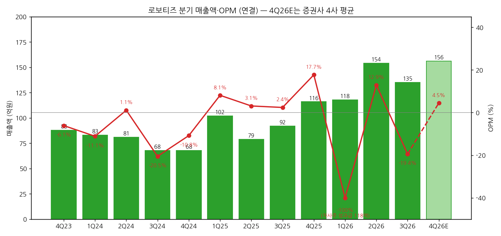
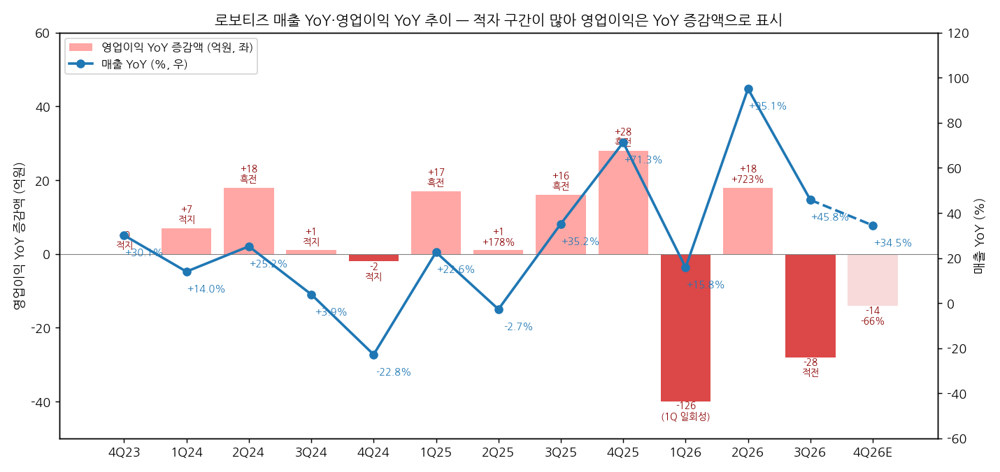

> 모드: 실적 리뷰 (v11)
> 종목: 로보티즈 (108490)
> 섹터: 로봇
> 서브섹터: 로봇 부품
> 분기: 2026-Q3
> 발표일: 2026-11-16 (3Q26 분기보고서, rcept 20261116000816 — 코스닥, 잠정실적 공시 없음, 분기 IR 자료 미발간)
> 작성 시각: 2026-11-23 13:40 KST
> 분석 소스: DART 3Q26 분기보고서(2026-11-16) + OpenDART 분기 재무(1Q19\~3Q26 연결) + 로보티즈 기업개요 / 셀사이드 첨부 5건: 삼성증권 「확대되는 레퍼런스, 수익성은 숨고르기」(서지현, 2026-11-17, BUY·TP 330,000원) · KB증권 「외형 성장에도 아쉬웠던 수익성」(김선봉·성현동, 2026-11-17, Not Rated) · 미래에셋증권 「수요는 견조, 공급 병목 해소가 관건」(박선영, 2026-11-17, 매수·TP 320,000원) · 한화투자증권 「분기 적자 전환 아쉬우나 실적 성장 전망은 유효」(김성래, 2026-11-18, Buy·TP 350,000원) · 유진투자증권 「많은 것이 바뀔 2027년」(양승윤, 2026-11-23, BUY 신규·TP 320,000원) / 웹서치 보완 없음
> 리뷰 깊이: 풀 | 리서치 첨부 5건
> 비영업 요인: 인수(JST 지분 80% 편입, 2026-07-15 — 3Q 매출 3.75억·순손실 -2.07억·취득원가 1.36억 판관비) · 일회성 여부 미확인 비용(임직원 성과급·인센티브 — 경상연구개발비 +16.5억 YoY, 회사 미분리) · 고기저/저기저(1Q26 자사주 성과급 117.8억 일회성, 2Q25·3Q25 영업이익 2억대 저기저)

# 로보티즈 3Q26 실적 리뷰

## 0. 한 줄 판정

> 성장 델타: 꺾임 | 내러티브: 약화 → 매매 제외 구간 (수요·수주잔고 스토리는 살아 있으나 공급 병목·우즈벡 지연으로 이익 성장이 2027년 2Q 이후로 밀림)

> ⚠ 비영업 요인 플래그: 적자전환(영업이익 +2억 → -26억, YoY -28억)의 주된 원인 = 판관비 +39억 YoY(97억, +68%) — 그중 경상연구개발비 +16.5억은 한화·삼성이 "임직원 성과급·인센티브 증가"로 설명(회사 일회성 분리 공시 없음, 영업비용으로 판정 그대로). JST 인수 편입 효과는 매출 +3.75억(2.8%)·순손실 -2.07억으로 작음 — 인수 제외 매출 YoY 약 +41.7%. 판정 조정 없음

→ 숫자: 매출 135억(+45.8% YoY, -12.4% QoQ), 영업이익 -26억(적자전환, 3Q25 +2억), OPM -19.4%. FnGuide 컨센(매출 153억·영업이익 10억, 한화·미래 인용) 대비 매출 -12%, 영업이익 적자로 크게 하회
→ 판정 방식: 적자전환 분기라 영업이익 YoY 계산 불가 → **직전 분기 방향 규칙(2026-11-23)** 적용. 직전 2Q26은 +722.9%(증가)라 기본은 "둔화"지만, **4Q26E 컨센(4사 명시치 평균 7억)이 4Q25 20.6억 대비 -67%** — 4사 모두 4Q25 하회 → 다음 분기 YoY 꺾임이 컨센에 반영돼 **꺾임 확정**
→ 쟁점 1: 적자전환은 "믹스 악화(GPM 64.8% → 52.6%) + 인건비·성과급(판관비 +68%)"의 이중 타격 — 매출총이익은 +11억 늘었지만 판관비가 +39억 늘었다
→ 쟁점 2: 수요가 아니라 공급이 문제 — 모터·희토류 수급 차질로 고가 Y시리즈·북미 방산향이 막히고 저가 X시리즈 비중 확대. 수주잔고 약 100만개(미래·유진), 3Q 누적 출하 약 32\~33만개
→ 다음 분기 관건: **4Q26 영업이익이 4Q25 20.6억을 넘는지** (컨센 -2\~14억) + 북미 이연 물량 인도로 매출 160억대 회복

## 1. 숫자

① 연결 분기 표 (억원)

| 항목 | 4Q23 | 1Q24 | 2Q24 | 3Q24 | 4Q24 | 1Q25 | 2Q25 | 3Q25 | 4Q25 | 1Q26 | 2Q26 | **3Q26** | 4Q26E |
|---|---|---|---|---|---|---|---|---|---|---|---|---|---|
| 매출액 | 88 | 83 | 81 | 68 | 68 | 102 | 79 | 92 | 116 | 118 | 154 | **135** | 156 |
| 영업이익 | -5 | -9 | 1 | -14 | -7 | 8 | 2 | 2 | 21 | -118 | 20 | **-26** | 7 |
| OPM | -6.1% | -11.1% | 1.1% | -20.5% | -10.8% | 8.1% | 3.1% | 2.4% | 17.7% | -100.0% | 12.9% | **-19.4%** | 4.5% |
| 매출 YoY | +30.1% | +14.0% | +25.2% | +3.9% | -22.8% | +22.6% | -2.7% | +35.2% | +71.3% | +15.8% | +95.1% | **+45.8%** | +34.5% |
| 영업이익 YoY | 적지 | 적지 | 흑전 | 적지 | 적지 | 흑전 | +177.8% | 흑전 | 흑전 | 적전 | +722.9% | **적전** | -66% |
| 영업이익 YoY 증감액 | 0 | +7 | +18 | +1 | -2 | +17 | +1 | +16 | +28 | -126 | +18 | **-28** | -14 |
| **매출 YoY 델타 (%p)** | +33.6 | -16.1 | +11.2 | -21.3 | -26.7 | +45.4 | -25.3 | +37.9 | +36.1 | -55.5 | +79.3 | **-49.3** | -11.3 |
| **영업이익 YoY 델타 (%p)** | — | — | — | — | — | — | — | — | — | — | — | **— (적전)** | — |

→ (출처: OpenDART 연결 fnlttSinglAcntAll — 1\~3Q 분기 3개월, 4Q = 연간 − 3Q 누적. 3Q26은 분기보고서 2026-11-16. 4Q26E = 증권사 4사 명시치 평균: KB 166억/11억, 미래 165억/4억, 한화 157억/14억, 유진 135억/-2억. 삼성은 분기 추정 미제시 — 연간 2026E(매출 590억·OPM -15.2%) 역산 시 4Q 약 183억/35억 `[추정: 십억원 반올림 오차 큼]`)
→ 컨센 대비: 매출 -12.2%, 영업이익 10억 → -26억 (FnGuide 컨센, 한화 2026-11-18·미래 2026-11-17 인용 — 집계 증권사 수 미기재). KB는 "매출 컨센 부합"으로 표기해 컨센 기준이 다름
→ 영업이익 YoY(%)는 흑자·적자가 자주 바뀌어 대부분 계산 불가 — 델타 판정은 YoY 증감액 행과 적자전환 규칙으로 했다. 1Q26 -118억은 자사주 성과급 117.8억(2026-01-26 교부, 1Q 판관비) 일회성, 이를 빼면 1Q26 약 0억
→ [판단] 매출 YoY는 2Q26 +95.1%가 단기 정점, 3Q +45.8% → 4Q26E +34.5%로 2개 분기 연속 둔화 경로. 컨센이 그리는 YoY 재가속은 2027년(한화 1Q27E +71% → 3Q27E +127%) — 우즈벡 공장(2Q27 가동) 전제. 영업이익은 4Q25(20.6억, OPM 17.7%)가 최근 정점이고 4Q26E가 이를 밑돌아 2027 2Q 전까지 YoY 플러스 전환 근거가 약하다

→ (출처: OpenDART 연결, 4Q26E 증권사 4사 평균. 1Q26 OPM -100%는 축 범위 밖)

→ (출처: OpenDART 연결, 4Q26E 증권사 4사 평균 — 점선·연한 색. 1Q26 -126억은 축 범위 밖)

② 사업부·지역별 매출 (사업부 영업이익은 미공개)

(1) 사업부별 매출 (억원)

| 사업부 | 3Q25 | 4Q25 | 1Q26 | 2Q26 | **3Q26** | 3Q26 YoY | 비중 |
|---|---|---|---|---|---|---|---|
| 액추에이터(다이나믹셀) | 90 | 111 | 115 | 151 | **132** | +46.7% | 98% |
| 자율주행로봇 | 2 | 5 | 3 | 2 | **2** | -3.4% | 2% |
| 합계 | 92 | 116 | 118 | 154 | **135** | +45.8% | 100% |

→ (출처: KB증권 2026-11-17 표1·한화투자증권 2026-11-18 표4 — 사업부 분기 분리는 증권사 집계, DART 분기보고서는 누적만 공시: 3Q26 누적 액추에이터 399억·자율주행로봇 8억, 연결조정 후)
→ 사업부 영업이익 미공개. 액추에이터가 98%라 사실상 단일 사업 — 델타는 액추에이터의 물량·믹스가 결정한다
→ 3Q 액추에이터 출하 약 12만개, ASP 10만원 초반으로 하락 추정 (KB). 3Q 누적 출하 약 32만개(미래)\~33만개(한화), 연간 목표 45만개

(2) 지역별 매출 (억원)

| 지역 | 3Q25 | **3Q26** | YoY | 3Q26 비중 | 9M25 | 9M26 | 9M YoY |
|---|---|---|---|---|---|---|---|
| 국내 | 27.8 | **41.0** | +47.8% | 30% | 80.1 | 118.4 | +47.8% |
| 북미 | 30.5 | **29.9** | -2.1% | 22% | 103.2 | 119.3 | +15.6% |
| 유럽 | 8.7 | **23.7** | +172.0% | 18% | 25.5 | 65.8 | +158.5% |
| 일본 | 6.6 | **12.4** | +89.1% | 9% | 20.8 | 28.4 | +36.4% |
| 중국 | 5.1 | **5.0** | -0.8% | 4% | 12.9 | 26.9 | +108.8% |
| 기타 | 13.8 | **22.7** | +64.5% | 17% | 31.0 | 48.0 | +54.9% |
| 합계 | 92.4 | **134.7** | +45.8% | 100% | 273.4 | 406.8 | +48.8% |

→ (출처: DART 3Q26 분기보고서 연결 주석 — 지역별 매출정보, 원 단위를 억원 환산)
→ **델타를 끈 곳 = 유럽·국내·일본** (연구개발용 휴머노이드 초기 시장, KB). 유럽은 Hugging Face 산하 Pollen Robotics의 Reachy Mini(다이나믹셀 9개)·Microduck(15개)향 (삼성)
→ **꺾인 곳 = 북미·중국**: 북미는 2Q26 약 54억 → 3Q 30억(QoQ -44.6%, 삼성) — 대형 고객사(북미 방산) 물량 납기가 4Q로 이연(삼성·KB). 중국은 1H 약 22억 → 3Q 5억, 저ASP 수주를 의도적으로 조절(미래·KB)
→ 10% 이상 매출 고객: 3Q25 누적 A사 22.5억 → 3Q26 누적 해당 없음 (DART) — 고객 집중도 하락
→ 판매경로: 3Q26 누적 해외 직판 122억(수출 액추에이터 직판 121억, 2025 연간 93억) — 유진은 "글로벌 개발 수요가 직접 유입" 근거로 제시

(3) 손익·비용 보조 지표 (억원)

| 항목 | 3Q25 | 2Q26 | **3Q26** | QoQ | YoY |
|---|---|---|---|---|---|
| 매출총이익 | 59.9 | 86.5 | **70.8** | -15.6 | +11.0 |
| GPM | 64.8% | 56.2% | **52.6%** | -3.6%p | -12.2%p |
| 판관비 | 57.6 | 66.7 | **96.9** | +30.3 | **+39.3 (+68%)** |
| 판관비율 | 62.4% | 43.3% | **72.0%** | +28.7%p | +9.6%p |
| (판관비 중) 경상연구개발비 | 25.6 | 약 29 | **42.1** | +13 | +16.5 |
| (판관비 중) 급여·퇴직·복리 | 13.8 | — | **25.1** | — | +11.3 (+81%) |
| 영업이익 | 2.2 | 19.8 | **-26.1** | -45.9 | -28.4 |
| 이자수익 | 3.8 | — | **12.3** | — | +8.5 |

→ (출처: OpenDART 연결 손익, DART 3Q26 분기보고서 주석 23 판매비와관리비·25 금융손익. 2Q26 경상연구개발비는 한화(QoQ +13억) 역산 `[추정]`)
→ 성격별(매출원가+판관비): 종업원급여 45.7억(+112% YoY), 원재료 사용액 45.0억(+75%), 지급수수료 26.9억(+223%), 외주가공비 16.8억(+164%) (DART 주석 22). 본사 임직원 175명(+67% YoY, KB)
→ YoY 영업이익 -28.4억 분해: 매출 증가 효과(+45.8%)로 매출총이익 +11.0억, 그러나 GPM 하락(-12.2%p)이 약 -16억을 깎았고, 판관비 +39.3억이 그 위에 얹혔다 `[판단: GPM 유지 가정 대비 단순 계산]`
→ 순손실은 -21억으로 영업손실보다 작음 — 2025 유상증자 자금(순현금 약 1,700억, 2025말) 이자수익 12.3억 (영업외, 판정 무관)

③ 연간 (억원)

| 항목 | 2022 | 2023 | 2024 | 2025 | 2026E | 2027E |
|---|---|---|---|---|---|---|
| 매출액 | 258 | 292 | 300 | 389 | 568 | 1,087 |
| 영업이익 | -21 | -53 | -30 | 33 | -112 | 161 |
| OPM | -8.1% | -18.2% | -9.9% | 8.6% | -19.8% | 14.8% |
| 매출 YoY | +18.6% | +13.2% | +2.9% | +29.6% | +46.0% | +91.4% |
| 영업이익 YoY | 적지 | 적지 | 적지 | 흑전 | 적전 | 흑전 |

→ (출처: 2022\~2025 OpenDART 연결, 2026E·2027E = 증권사 5사 평균 — 삼성 590/-90·910/170, KB 572/-114·1,160/151, 미래 572/-120·1,108/160, 한화 564/-111·1,125/147, 유진 542/-127·1,134/178)
→ 3Q26 누적 영업이익 -124.7억 중 1Q 자사주 성과급 117.8억 일회성 — 제외 시 약 -7억 `[참고: 판정 미사용]`
→ 발표 전후 연간 컨센 변화(직전 추정 공개 2사): 2026E 영업이익 한화 -73억 → -111억, 미래 -49억 → -120억 / **2027E 영업이익 한화 198억 → 147억(-26%), 미래 222억 → 160억(-28%)**. 2027E 매출 미래 1,233억 → 1,108억(-10%) — 우즈벡 공장 가동 지연 반영. 삼성은 2027E EPS 939원 → 976원(+3.9%)으로 소폭 상향

## 2. 시장 쟁점

① 2-0 지난 분기 체크

→ 첫 리뷰 — 직전 리뷰 없음. 참고로 실적 캘린더 "추적 종목"에 걸려 있던 3Q 시그널 체크:

| 직전 시그널 | 이번 분기 결과 | 판정 |
|---|---|---|
| 3Q 분기보고서(11/16) 영업흑자 유지 | 영업손실 -26억, 적자전환 | **반대로 나옴** |
| 액추에이터 매출 YoY 50%+ | 132억, +46.7% YoY (3Q 누적 +49%대) | **미확인 (근접 미달)** |
| AI Worker 수주 | 자율주행로봇·AI Worker 매출 2억으로 정체, 수주 공시 없음 | **미확인** |

② 이번 분기 쟁점 4개

| # | 쟁점 | 언급 증권사 |
|---|---|---|
| (1) | 매출 +46%에 적자전환 — 믹스 악화인가, 성과급·인력 비용인가 (정상 마진은?) | 5/5 |
| (2) | 수요 > 공급 — 모터·희토류 병목과 저가 X시리즈 믹스는 언제 풀리나 | 5/5 |
| (3) | 우즈벡 공장 2Q27 지연 — 2027년 "매출 2배" 경로는 유효한가 | 5/5 |
| (4) | 레퍼런스 확장 — Pollen(유럽)·AI Sapiens·Q시리즈가 2027 믹스를 바꾸나 | 4/5 (삼성·KB·한화·유진) |

③ 쟁점별 분해

(1) **매출 +46%에 적자전환 — 믹스인가 비용인가**

(1-1) 회사 설명
→ "중장기 성장 동력 확보 및 핵심 R&D 인력 유치를 위해 2026년 1월 26일자로 자기주식 교부(11,781백만 원)를 완료하였으며, 해당 내역은 당 1분기 판매비와 관리비로 계상" (DART 3Q26 분기보고서 Ⅱ 사업의 내용) — 3Q 비용 증가에 대한 별도 설명은 없음
→ "전자자재의 가격변동은 반도체수급 불균형에 따른 원재료 가격 상승이 원인이며, 공급망 다원화 및 판매가격 조정 등을 통해 복원 노력" (같은 보고서 원재료)
→ 시사점: 회사는 3Q 성과급을 일회성으로 분리하지 않았다 → 판정은 보고 기준 그대로 → 1Q(자사주)·3Q(현금 성과급 추정)로 올해만 두 번 보상 비용이 이익을 깎았다

(1-2) 증권사별 해석 편차

| 증권사 | 핵심 가정·추정 | 논리 |
|---|---|---|
| 삼성 | GPM 52.6%(-12.2%p), 판관비 97억(QoQ +30억) | 믹스(원재료↑·저ASP X시리즈↑·Y시리즈 희토류 제한)도 있지만 "적자 전환의 주된 이유는 판관비 급증" — 임직원 인센티브 |
| KB | 급여 46억·외주용역비 17억, 임직원 175명(+67%) | 인력 채용 확대 + 우즈벡 증설 전 수주 물량 외주 처리 — 구조적 비용 증가에 가까움 |
| 미래에셋 | 원재료 사용액·외주공비 각각 매출 증가율의 1.6배·3.6배 증가, 연구개발비 42억(+64%)·인건비 25억(+81%)·지급수수료 27억(+223%) | 믹스 + 비용의 동시 확대 |
| 한화 | 경상연구개발비 42억(+16억 YoY, +13억 QoQ)에 성과급 증가분 반영 | 핵심 R&D 인력 확보/유지 차원에서 "불가피", 물량 증가 시 비용 민감도 하락 |
| 유진 | 3Q GPM 52.6% → 4Q26E 54.1%, 4Q26E 영업이익 -2억 | 비용 구조가 4Q에도 유지된다고 봄 (5사 중 가장 보수적) |

(1-3) 공통 결론 vs 갈리는 지점
→ 공통: 적자전환 = 판관비 급증(성과급·인력) + 저가 믹스. 매출 추정은 대체로 부합(한화 133억 추정 vs 실제 135억)
→ 갈림: 성과급이 3Q 일회성인지 분기 반복 비용인지. 한화·삼성은 보상성 비용으로 보고 4Q 흑자(11\~14억)를 넣었고, 유진은 4Q에도 적자(-2억), 미래는 4억으로 비용이 쉽게 안 빠진다고 봤다

(1-4) [판단]
→ 경상연구개발비 증가분(+16.5억)을 모두 일회성으로 빼도 3Q 영업이익은 약 -10억 — 성과급만의 문제가 아니다. 급여·외주가공비·지급수수료가 매출보다 빠르게 늘었고, GPM 12%p 하락이 더 큰 구조 변수
→ 4Q 판관비가 2Q 수준(67억)으로 돌아오면 성과급 일회성, 80억 이상이면 인력 확대에 따른 비용 레벨업으로 결론이 바뀐다

(2) **수요 > 공급 — 모터·희토류 병목과 믹스**

(2-1) 회사 설명
→ "급증하는 글로벌 액츄에이터 수요 대응과 원가 경쟁력 확보를 위해 현재 우즈베키스탄 생산 기지를 구축 중 … 내년(2027년) 2분기 가동을 목표" (DART 3Q26 분기보고서)
→ 생산 가동률(총공수 기준) 2025 86.9% → 3Q26 누적 78.9% (같은 보고서) — 수요가 넘치는데 가동률이 떨어진 건 부품(모터) 투입 제약과 맞는다 `[판단]`
→ 중국지사 영업을 2026년 2월부로 재개 (같은 보고서)

(2-2) 증권사별 해석 편차

| 증권사 | 핵심 가정·추정 | 논리 |
|---|---|---|
| 삼성 | 북미 대형 고객사 납기 4Q 이연, Y시리즈 희토류 수급 차질 | 중국 희토류 수출 허가제 유지, 추가 통제 2027년 1월까지 유예에 불과 — 공급 불확실성 리스크 |
| KB | 3Q 출하 약 12만개, ASP 10만원 초반 | 모터 수급 차질로 북미 방산 납품 감소 → 믹스 악화. 마곡 공장은 최대 가동 추정 |
| 미래에셋 | 수주잔고 약 100만대, 통상 1\~3개월 리드타임 | "3Q26 실적 부진은 수요 둔화보다 공급 병목과 제품 믹스" — 저ASP 수주 조절, 믹스 개선 추진 |
| 한화 | 3Q 누적 출하 약 33만개, 연간 45만개 목표 달성 가능 | 모터 수급 차질 지속으로 저가형 중심 판매, 높은 수요 기반 물량 증가 |
| 유진 | 수주잔고 100만개 돌파 | "수요가 공급을 앞서고 있음" — 국내 생산만으로 대응 불가 |

(2-3) 공통 결론 vs 갈리는 지점
→ 공통: 수요 문제 아님 — 수주잔고(약 100만개)가 연간 출하 목표(45만개)의 2배 이상. 병목은 모터·희토류와 국내 CAPA(연 50만개)
→ 갈림: 4Q 북미 이연 물량이 얼마나 돌아오나. KB·미래는 4Q 매출 165\~166억(QoQ +23%)으로 회복을 넣었고, 유진은 135억(QoQ 0%)으로 병목 지속을 가정

(2-4) [판단]
→ 수주잔고는 2.2년치 출하분이지만, 저가 X시리즈(Microduck용 XL330 대당 약 2.6만원, KB)가 잔고의 상당 부분이면 물량 증가가 ASP·GPM을 오히려 낮춘다. "잔고 100만개 = 매출 1,000억+"로 읽으면 안 된다
→ 확인 포인트: 4Q GPM 55% 이상 회복(Y시리즈·북미 방산 재개) 여부. 50% 아래면 병목이 믹스 문제로 고착

(3) **우즈벡 2Q27 지연 — 2027년 매출 2배 경로**

(3-1) 회사 설명
→ "향후 해당 거점의 생산 안정화가 이루어질 경우 연간 최대 수백만 개 단위의 액츄에이터 양산 능력을 확보" — 공장 가동 시기·CAPA는 "변동될 수 있습니다" 단서 (DART 3Q26 분기보고서)
→ 우즈벡 공장: 타슈켄트 Yangi Avlod 특구, 부지 10.98ha, 투자 6,926만 달러, 60개월 2단계 (유진 인용)

(3-2) 증권사별 해석 편차

| 증권사 | 핵심 가정·추정 | 논리 |
|---|---|---|
| 삼성 | 2027E 매출 910억, 영업이익 170억 | 우즈벡 당초 2026년 중 일부 가동 → 2Q27로 연기, 5사 중 2027 매출 가장 보수적 |
| KB | 2027E 매출 1,160억(+103%), 영업이익 151억 | 우즈벡 증설 지연이 핵심 리스크 — 마곡 최대 가동 |
| 미래에셋 | 2027F 매출 1,233억 → 1,108억(-10%), 영업이익 222억 → 160억(-28%) | 가동 시점 지연·믹스 변화 반영, 1Q27 램프업 계획 지연, 2Q27 본격 양산, 연간 능력 100\~130만대 |
| 한화 | 2027E 매출 1,125억(+99.5%), 영업이익 198억 → 147억 | 국내 50만개 + 우즈벡 50만개 = 연 100만개, 낮은 우즈벡 인건비·OH로 흑자 전환 |
| 유진 | 2027E 매출 1,134억, 영업이익 178억 → 2028E 2,574억·763억 | 우즈벡 + Q시리즈 맞물리는 2027년부터 외형 한 단계 가속, 2028E 매출 기준 밸류 |

(3-3) 공통 결론 vs 갈리는 지점
→ 공통: 2027 매출 약 2배(910\~1,160억), 영업이익 150\~180억 흑자 — 5사 모두 "2027 성장"은 유지
→ 갈림: 가동 시점의 신뢰도. 삼성은 2027 매출을 가장 낮게(910억) 잡아 지연 리스크를 반영, 미래는 이번에 2027 이익을 28% 깎았다. 한화의 분기 경로(1Q27E 영업이익 14억 → 2Q27E 63억)는 2Q27 가동이 정확히 맞아야 성립

(3-4) [판단]
→ 2026 연중 → 2Q27로 이미 한 번 밀렸다. 2027 하반기로 한 번 더 밀리면 2027E 영업이익 컨센(평균 161억)은 다시 20\~30% 하향될 수 있다 — 매출 YoY 재가속 시점이 2027 3Q 이후로 이동
→ 확인 포인트: 2027 초 시운전·인력 채용·장비 반입 뉴스, 1Q27 실적의 우즈벡 관련 비용(초기 가동 비용은 이익을 먼저 깎음)

(4) **레퍼런스 확장 — Pollen·AI Sapiens·Q시리즈**

(4-1) 회사 설명
→ "QDD 원천 설계를 적용한 하이엔드 관절 부품을 바탕으로 글로벌 로봇 제조사 및 빅테크향 표준 구동 모듈 납품을 본격화" / "AI 사피엔스 1대로 다채로운 산업 작업을 수행할 수 있도록 하드웨어 기구 설계와 소프트웨어를 전면 개방(오픈소스)" (DART 3Q26 분기보고서 중장기 전략)
→ 2026-11-19 Pollen Robotics향 DYNAMIXEL-X 공급계약 40억 체결 (유진 인용) — 2025 연간 매출의 약 10%

(4-2) 증권사별 해석 편차

| 증권사 | 핵심 가정·추정 | 논리 |
|---|---|---|
| 삼성 | AI Sapiens 4,500만원대, 2027년 1월 정식 납품 | Unitree G1 SDK 모델(약 6,000만원) 대비 가격 경쟁력 + 오픈소스 차별화, Microduck 사전 주문 4Q 출하 개시 |
| KB | 2027 AI Sapiens 400대 × 5천만원 = 200억, Q시리즈 120억(중국 점유율 1.2%) | 마곡 120대 + 정부 조달 250대 중 80대 + 우즈벡 200대. Q시리즈 ASP는 X시리즈의 3배 이상 → 믹스 개선. "주가는 마이크로덕이, 실적은 Q 시리즈가" |
| 한화 | (휴머노이드 별도 추정 없음) | 액추에이터 물량(연 100만개) 중심 |
| 유진 | Microduck 1만\~10만대 시나리오 → 다이나믹셀 매출 22.5\~375억, 데이터 사업 Base 1,840억(잠재) | 오픈소스로 개발자 저변 확대 → 다이나믹셀 수요로 회수, 부품사 → 플랫폼사 |

(4-3) 공통 결론 vs 갈리는 지점
→ 공통: 고객 다변화(유럽·일본·국내 연구기관)가 이번 분기 성장의 실체. 2027년 신제품(Q시리즈·AI Sapiens)이 믹스를 바꿀 카드
→ 갈림: Microduck의 이익 기여. KB는 XL330 저ASP로 "매출 기여 크지 않음", 유진은 물량 시나리오로 큰 업사이드를 그렸다

(4-4) [판단]
→ Pollen·Microduck은 물량은 크지만 저가 X시리즈 — 이번 분기 GPM 하락과 같은 방향. 이익 레버리지는 Q시리즈(고ASP)·AI Sapiens가 실제로 매출화되는 2027년에야 확인 가능
→ Q시리즈 초도 납품처(특히 중국 휴머노이드 업체) 공개가 믹스 개선의 첫 증거

④ 2-3 낙관 vs 보수 — 논리 대비

→ 낙관(한화·KB): "분기 적자는 보상·채용 비용, 수요는 넘친다" — 4Q 흑자(11\~14억), 2027 매출 2배·영업이익 150억 흑자. 한화는 TP 350,000원 유지, 근거는 Unitree·리더드라이브 멀티플(목표 P/S 53.1배)
→ 보수(유진·미래): 유진은 4Q26E도 적자(-2억)·4Q 매출 135억(QoQ 정체)으로 병목 지속을 가정, 대신 2028E(매출 2,574억)에 가치를 둔다. 미래는 2027 이익을 28% 깎고 TP 10% 하향 — "공급 병목 해소가 관건"
→ 차이의 본질: 4Q에 북미 이연 물량과 비용 정상화가 동시에 오느냐(낙관) vs 병목·비용이 2027 2Q 우즈벡 가동까지 이어지느냐(보수)
→ 셀사이드 vs 바이사이드: 11/17 주가 -8.6%(231,500 → 211,500원) 후 11/19 Pollen 40억 계약으로 11/20 233,500원 회복 — 시장은 실적보다 레퍼런스 뉴스에 반응. 6개월 수익률 -29.5%(삼성 기준)로 기대는 이미 상당 부분 빠진 상태

⑤ 2-4 추정치·TP 변화

| 증권사 | 직전 TP | 현재 TP | 4Q26E 영업이익 | 2026E / 2027E 영업이익 | 핵심 변화 한 줄 |
|---|---|---|---|---|---|
| 삼성 (11-17) | 350,000원 | **330,000원** (-5.7%, BUY) | 미제시 (역산 약 35억 `[추정]`) | -90억 / 170억 | 국내 로봇 피어 밸류 하락 반영, Target PSR 38배로 하향 — 2027E EPS는 +3.9% |
| KB (11-17) | — | **N/A** (Not Rated) | 11억 | -114억 / 151억 | 휴머노이드 2027 200억·Q시리즈 120억 체크포인트 |
| 미래에셋 (11-17) | 356,000원 | **320,000원** (-10%, 매수) | 4억 | -120억 / 160억 | 27F SPS 8,408 → 7,551원, P/S 42.3배 유지 — 우즈벡 지연·믹스 반영 |
| 한화 (11-18) | 350,000원 | **350,000원** (유지, Buy) | 14억 | -111억 / 147억 | 2027E 영업이익 198 → 147억에도 TP 유지 (P/B 12.6배·P/S 53.1배 평균) |
| 유진 (11-23) | — (커버리지 재개) | **320,000원** (BUY 신규) | -2억 | -127억 / 178억 | 2028E 매출 2,574억 × PSR 19.8배, 1년 할인 |

→ TP 평균(TP 제시 4사) 330,000원, 직전 TP가 있는 3사 기준 352,000원 → 333,333원(-5.3%). 하향 2 · 유지 1 · 신규 1 · NR 1
→ 하향 원인: **미래 = 실적 하향**(멀티플 P/S 42.3배 유지, 2027 SPS -10%), **삼성 = 멀티플 하향**(2027 EPS 오히려 +3.9%, 피어 밸류 하락으로 Target PSR 하향). 한화는 2027 이익을 26% 깎고도 TP 유지 — 멀티플을 그대로 둔 셈
→ 발표 전 대비 연간 컨센: 2026E 영업이익 적자 확대(한화 -73 → -111억, 미래 -49 → -120억), 2027E 영업이익 -26\~-28% 하향(직전 공개 2사). 현재가 233,500원 기준 상승여력 37\~50%
→ 밸류 참고: 시총 약 3.4조, 최근 4개 분기 매출 523억 기준 PSR 약 66배 `[추정: 3.43조 ÷ (116+118+154+135)억]`

## 3. 내러티브 점검

→ 성장 스토리: "휴머노이드·피지컬 AI 개발 붐의 표준 관절 부품(다이나믹셀) 공급사 — 연구·개발용 레퍼런스를 오픈소스 생태계로 묶고, 우즈벡 대량 생산과 Q시리즈(휴머노이드 전용 QDD)로 양산 시장까지 가져간다"
→ 이번 분기: ① 수요는 확인 — 유럽 +172%·일본 +89%·국내 +48%, 수주잔고 약 100만개, Pollen 40억 계약 ② 그러나 공급 병목(모터·희토류) 때문에 저가 믹스로만 물량이 나가 GPM이 12%p 빠졌고 ③ 인력·성과급 비용이 매출보다 빨리 늘어 적자전환 ④ 우즈벡 가동이 2026 → 2Q27로 밀려 2027 이익 추정이 26\~28% 깎였다
→ 내러티브를 "약화"로 본 이유: 스토리의 핵심 전제(수요·레퍼런스)는 오히려 강해졌지만, 타이밍(우즈벡 지연)과 마진(저가 믹스·비용 레벨업)에 의문이 생겨 추정치·TP가 하향됐다 — 정의상 약화. "훼손"은 아님
→ 판정: 델타 **꺾임** (적자전환 + 4Q26E 컨센 YoY -67%) + 내러티브 **약화** → **매매 제외 구간**. 주가는 Pollen·AI Sapiens·정부 조달 같은 레퍼런스 뉴스로 움직이는 이벤트 구간이며, 실적 모멘텀은 우즈벡 가동(2Q27) 전후로 다시 볼 대상
→ 내러티브를 다시 강하게 만들 트리거: ① 4Q26 영업이익 20.6억 초과(델타 반전) + GPM 55% 회복 ② 우즈벡 공장 2Q27 정상 가동 확인 ③ Q시리즈 초도 대형 수주(중국 휴머노이드 업체·빅테크) 또는 정부 휴머노이드 조달(250대) 수주
→ 깨뜨릴 리스크: ① 중국 희토류 추가 통제 발효(2027-01 유예 종료) ② 우즈벡 가동 2027 하반기 이후로 추가 지연 ③ 4Q26도 적자(유진 -2억 경로) — 2026년 4개 분기 중 3개 분기 적자

## 4. 향후 봐야 할 것

| 순위 | 무엇을 (변수·임계값) | 어떤 데이터로 | 언제 |
|---|---|---|---|
| 1 | **4Q26 영업이익 20.6억(4Q25) 초과** — 넘으면 델타 반전, 컨센(-2\~14억)대면 YoY 마이너스 구간 진입 = 꺾임 지속(이후 마이너스 폭 축소/확대로 개선·악화 판정) | DART 사업보고서 연결 손익 (손익구조 30% 변동 공시 시 2월) | 2027-03 중순 |
| 2 | **북미 이연 물량 인도 + 4Q 매출 160억대** (QoQ +20%, 4사 평균 156억) — 북미 분기 매출 50억 회복 여부 | 사업보고서 지역별 매출, 셀사이드 4Q 리뷰 | 2027-03 |
| 3 | **판관비 분기 70억 이하 복귀** (3Q 97억, 2Q 67억) — 3Q 성과급 일회성 여부 판별. 80억 이상이면 비용 레벨업 | 사업보고서 판관비 주석(경상연구개발비·급여), 임직원 수(175명 → ?) | 2027-03 |
| 4 | **GPM 55% 이상 회복** (3Q 52.6%) — Y시리즈·고가 제품 판매 재개, 중국 희토류 추가 통제(2027-01 유예 종료) | 사업보고서 매출총이익, 중국 상무부 희토류 수출 통제 뉴스 | 2027-01 / 2027-03 |
| 5 | **우즈벡 공장 2Q27 가동 일정 + Q시리즈·AI Sapiens 초도 납품(2027-01)** — Pollen 외 단일판매·공급계약 공시 | 회사 공시(단일판매·공급계약), 언론(우즈벡 시운전), 정부 휴머노이드 조달 발표 | 2027-01\~2027-06 |

→ 다음 분기 리뷰 2-0의 체크 대상 = 위 5개
