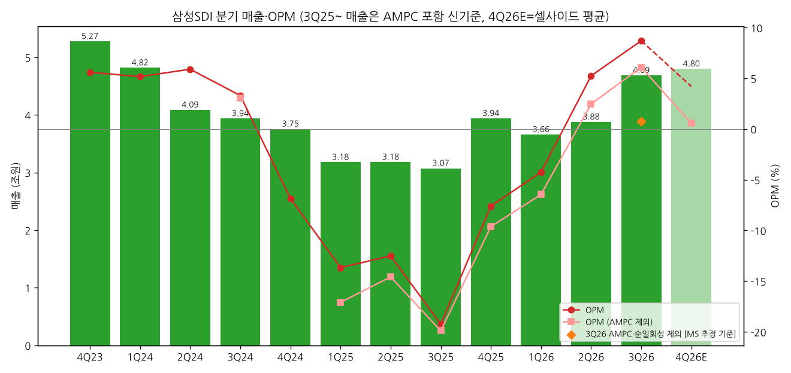
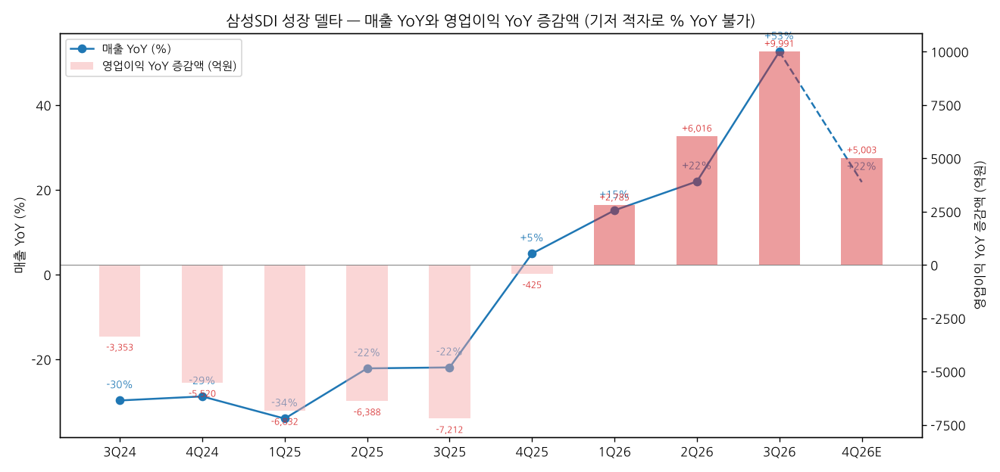
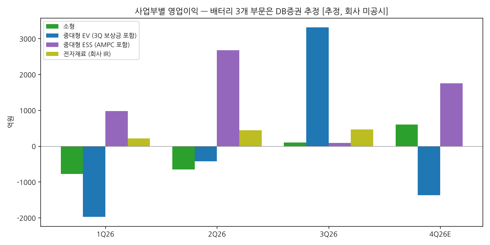

> 모드: 실적 리뷰 (v11)
> 종목: 삼성SDI (006400)
> 섹터: 배터리
> 서브섹터: 배터리 셀
> 분기: 2026-Q3
> 발표일: 2026-10-29 (실적 발표·컨퍼런스콜 동일일)
> 작성 시각: 2026-11-16 16:30 KST
> 분석 소스: 회사 「2026년 3분기 실적」 IR PT(2026-10-29) + 국내 7개사(삼성 10/29, 다올 10/29, 미래에셋 10/29, 하나 10/30, 신한 10/30, 유안타 10/30, DB 11/16) + 해외 7개사 8건(J.P. Morgan 10/29, Morgan Stanley 10/29, Citi 10/29, Bernstein 10/29·Battery Weekly 11/2, Goldman Sachs 10/30, BofA 10/30) — 첨부 15건 전부 / 과거 분기는 본 세션 기업개요(회사 IR·OpenDART) / 직전 리뷰 2026-Q2
> 리뷰 깊이: 풀 | 리서치 첨부 15건

# 삼성SDI 3Q26 실적 리뷰

## 0. 한 줄 판정

> 성장 델타: 가속 | 내러티브: 강화 → 적극 구간 (단, 4Q 이익은 보상금 소멸로 반토막 — 숫자 확인보다 수주가 주가를 끄는 구간)

→ 숫자: 매출 4조 6,856억 (YoY +52.6%, QoQ +20.9%), 영업이익 4,078억 (YoY 흑전, QoQ +100.1%, OPM 8.7%). 매출 YoY가 +15.1% → +21.9% → **+52.6%** 로 3개 분기 연속 가속, 영업이익은 2분기 연속 흑자. FnGuide 컨센 1,913억 대비 **+113%**
→ 쟁점 ①: 서프라이즈의 절반은 일회성 — GM 등 자동차 고객 최소구매수량 보상금(DB 약 4,000억)에서 ESS·소형 충당금을 뺀 **순일회성 이익 약 2,500억**(MS). 이를 빼도 본업(AMPC 포함) 1,000\~2,000억으로 2Q(관세환급 제외 약 80억)보다 확실히 좋아졌다
→ 쟁점 ②: ESS 수주가 내러티브를 바꿨다 — 10월까지 누적 **60GWh+**, 연말까지 **추가 60GWh+ 목표(연 120GWh+)**, 2030 북미 ESS 시장 전망 150 → **190GWh+** 상향. 국내 최대 경쟁사(LGES) 연간 목표 90GWh를 넘는다(신한)
→ 다음 분기 관건: 4Q26 영업이익은 셀사이드 평균 약 2,000억(QoQ −51%)으로 줄지만, 일회성을 뺀 기준으로 증익인지 — **미국 LFP(SPE) 첫 라인 12월 출하**와 연말 60GWh 추가 수주 실현 여부

---

## 1. 숫자

① 연결 분기 표 (억원, 3Q25부터 매출은 **AMPC를 매출에 포함한 신기준**(3Q26 IR 재작성), 이전은 구기준·편광필름 제외 재작성)

| 항목 | 4Q23 | 1Q24 | 2Q24 | 3Q24 | 4Q24 | 1Q25 | 2Q25 | 3Q25 | 4Q25 | 1Q26 | 2Q26 | **3Q26** | 4Q26E |
|---|---|---|---|---|---|---|---|---|---|---|---|---|---|
| 매출액 | 52,735 | 48,162 | 40,859 | 39,357 | 37,545 | 31,768 | 31,794 | 30,714 | 39,385 | 36,568 | 38,765 | **46,856** | 47,960 |
| 영업이익 | 2,953 | 2,491 | 2,410 | 1,299 | −2,567 | −4,341 | −3,978 | −5,913 | −2,992 | −1,556 | 2,038 | **4,078** | 2,011 |
| OPM | 5.6% | 5.2% | 5.9% | 3.3% | −6.8% | −13.7% | −12.5% | −19.3% | −7.6% | −4.3% | 5.3% | **8.7%** | 4.2% |
| AMPC | — | (1\~3Q 합 649) | ← | 103 | [미확보] | 1,090 | 660 | 200 | 798 | 805 | 1,077 | **1,225** | 1,742 (DB) |
| AMPC 제외 영업이익 | — | — | — | 1,196 | — | −5,431 | −4,638 | −6,113 | −3,790 | −2,361 | 961 | **2,853** | 269 (DB 기준) |
| 매출 YoY | — | — | — | −29.8% | −28.8% | −34.0% | −22.2% | −22.0% | +4.9% | +15.1% | +21.9% | **+52.6%** | +21.8% |
| 영업이익 YoY | — | — | — | −72.1% | 적전 | 적전 | 적전 | 적전 | 적지 | 적지 | 흑전 | **흑전** | 흑전 |
| 영업이익 YoY 증감액 | — | — | — | −3,353 | — | −6,832 | −6,388 | −7,212 | −425 | +2,785 | +6,016 | **+9,991** | +5,003 |
| **매출 YoY 델타 (%p)** | — | — | — | — | +1.0 | −5.2 | +11.8 | +0.2 | +26.9 | +10.2 | +6.8 | **+30.7** | −30.8 |

→ (출처: 회사 IR — 4Q23·4Q24 = 4Q24 IR, 1Q24·2Q24·1Q25·2Q25 = 2Q25 IR, 3Q24 = 3Q25 IR, 3Q25\~3Q26 = 3Q26 IR(2026-10-29) p.4·7 재작성치, 3Q23R(56,030 / 4,652)은 편광필름 제외 재작성. AMPC = 본 세션 기업개요(다올·IBK·삼성·뉴스토마토 인용, 2Q26 AMPC 제외 961억은 미국 상호관세 환급 1,960억 포함). 4Q26E 매출 = DB·유안타 평균, 영업이익 = 삼성·하나·유안타·DB 4개사 평균)
→ 컨센 대비: 영업이익 **+113%** (FnGuide 1,913억, 신한·유안타 인용 / Bloomberg 2,220\~2,320억), 매출 +16.0% (FnGuide 4.04조)
→ 영업이익 기저가 7개 분기(4Q24\~2Q26 전년 동기) 적자라 % YoY는 계산 불가 → **영업이익 YoY 증감액**으로 델타를 본다. 4Q25\~2Q26 매출 YoY는 신기준(AMPC 포함) vs 구기준 비교라 2\~3%p 과대

**해석**
→ 매출 YoY는 4Q25 플러스 전환 이후 4개 분기 연속 상승, 3Q26에 +52.6%로 급가속. 영업이익 YoY 증감액도 +2,785 → +6,016 → **+9,991억**으로 3개 분기 연속 확대 → **델타 가속**
→ 일회성 조정 후에도 방향은 같다: 2Q26 본업(관세환급·AMPC 제외) 약 −999억 → 3Q26 AMPC·순일회성 제외 약 +350억(MS 순일회성 2,500억 기준) \~ −1,000억(다올 기준) [추정]. 판정을 바꿀 정도의 왜곡은 아님
→ 4Q26E는 보상금 소멸로 QoQ −51%, 매출 YoY는 +22%로 내려온다 — **분기 매출 델타의 정점은 3Q26**. 2027은 셀사이드 평균 영업이익 1.62조(2026E 6,400억 대비 +153%)로 연간 이익 YoY는 2027에도 가속 경로 [전망]

→ (출처: 회사 IR, 셀사이드 평균 — 4Q26E 연한 막대·점선. 주황 마름모 = AMPC·순일회성 제외 3Q26 OPM [추정])

→ (출처: 회사 IR. 영업이익은 기저 적자로 % 대신 YoY 증감액(억원))

② 사업부별 매출·영업이익

(1) 회사 공시 — 배터리 / 전자재료 (억원)

| 사업부 | 3Q25 | 2Q26 | **3Q26** | 매출 YoY | 매출 QoQ | 매출 비중 |
|---|---|---|---|---|---|---|
| 배터리 매출 | 28,396 | 36,267 | **44,099** | +55.3% | +21.6% | 94% |
| 배터리 영업이익 (OPM) | −6,301 (−22.2%) | 1,593 (4.4%) | **3,619 (8.2%)** | 흑전 | +127% | |
| 전자재료 매출 | 2,318 | 2,498 | **2,757** | +18.9% | +10.4% | 6% |
| 전자재료 영업이익 (OPM) | 388 (16.7%) | 445 (17.8%) | **459 (16.6%)** | +18.3% | +3.1% | |

→ (출처: 회사 3Q26 IR p.4)

(2) 배터리 내부 — 소형 / EV / ESS (**회사 미공시**, 셀사이드 추정) [추정]

| 부문 (억원) | 1Q26 | 2Q26 | **3Q26** | 4Q26E | 비고 |
|---|---|---|---|---|---|
| 소형 매출 | 13,250 | 15,370 | **15,960** | 15,820 | BBU·전동공구 원통형 + 폴더블 파우치 |
| 소형 영업이익 | −780 | −650 | **100** | 600 | 충당금 반영에도 2년 만에 BEP |
| 중대형 EV 매출 | 12,710 | 13,060 | **18,790** | 13,500 | 보상금이 매출로 인식 |
| 중대형 EV 영업이익 | −1,970 | −430 | **3,310** | −1,370 | 보상금 약 4,000억 포함 → 4Q 적자 복귀 |
| 중대형 ESS 매출 | 7,590 | 6,760 | **9,350** | 14,130 | 4Q LFP 출하 개시로 +50%+ |
| 중대형 ESS 영업이익 (AMPC 포함) | 980 | 2,670 | **90** | 1,750 | 3Q 소화시스템 충당금, 2Q는 관세환급 포함 |

→ (출처: DB증권 2026-11-16 도표 70. 증권사마다 부문 매출 정의가 달라 편차 큼 — 3Q26 ESS 매출: DB 0.94조 / 신한 1.1조 / 유안타 1.20조, 하나는 ESS 매출 비중 23%·EV 39%로 추정)
→ 신한: ESS 영업이익 278억(OPM 3%), 충당금 제외 시 "두 자릿수 수익성" / DB: ESS 일회성 제외 시 "low-teen 흑자" / 하나: ESS는 충당금으로 AMPC 제외 적자폭 확대 [추정]

→ (출처: DB증권 추정, 전자재료는 회사 IR)

**해석**
→ 델타를 끈 건 **EV의 일회성 보상금 + 소형(BBU)의 흑자 전환**. ESS는 매출은 QoQ +32\~40%로 성장했지만 3Q 이익은 충당금으로 거의 0 — 이번 분기 숫자만 보면 ESS가 아니라 보상금과 BBU가 만든 서프라이즈
→ 4Q부터 역할이 바뀐다: EV는 보상금 소멸로 다시 적자, ESS는 LFP 출하·AMPC 증가(1,742억, DB)로 이익 주력(1,750억)으로 올라선다는 게 셀사이드 기본 경로. BofA는 **4Q26에 ESS 매출(1.3조)이 처음으로 EV(1.2조)를 넘는다**고 본다

③ 연간 (억원)

| 항목 | 2023R | 2024 | 2025 | 2026E | 2027E |
|---|---|---|---|---|---|
| 매출액 | 214,368 (R) | 165,922 | 132,667 | 약 166,000 | 약 205,000 |
| 영업이익 | 15,455 (R) | 3,633 | −17,224 | 6,400 | 16,180 |
| OPM | 7.2% | 2.2% | −13.0% | 3.9% | 7.9% |
| 매출 YoY | — | −22.6% | −20.0% | +25% | +23% |
| 영업이익 YoY | — | −76.5% | 적전 | 흑전 | +153% |

→ (출처: 2023R·2024 회사 4Q24 IR 재작성(편광필름 제외, 2023R = 본 세션 기업개요 재작성치), 2025 DART. 2026E·2027E 영업이익 = 발표 후 7개사 평균(삼성 0.72/1.58조, 하나 0.57/1.47조, 신한 0.62/1.57조, 유안타 0.72/1.31조, DB 0.62/1.50조, Citi 0.53/2.19조, 미래 0.70/1.69조), 매출은 DB·유안타·신한·Citi 범위 중간값 반올림)
→ 발표 전 FnGuide 컨센(하나 표기) 2026 4,676억 / 2027 1.504조 → 발표 후 7개사 평균 6,400억 / 1.618조 — **2026 +37%, 2027 +8% 상향**

---

## 2. 시장 쟁점

### 2-0. 지난 리뷰(2Q26)에서 "봐야 할 것"으로 남긴 항목

| 2Q26 리뷰 4번 항목 | 3Q26 결과 | 판정 |
|---|---|---|
| 관세환급·AMPC 제외 본업 흑전 (DS 주장) | AMPC 제외 2,853억 흑자 — 보상금·충당금 순일회성 약 2,500억 제외 시 +350억(MS 기준)\~−1,000억(다올 기준)으로 증권사마다 부호가 갈림 | 일부 확인 (BEP 근처까지 개선) |
| 테슬라 메가팩3 ESS 약 20GWh 추가 수주 | 10월까지 누적 60GWh+(주로 미국 유틸리티), 테슬라 특정 수주는 미공개 | 미확인 (수주 총량은 기대 이상) |
| 미국 LFP ESS 10월 양산 → 4Q 매출 인식 | SPE 첫 LFP 라인 10월 가동, 12월 완제품 인도 개시, 1H27 2개 라인 추가 | 확인 |
| EV — BMW·VW 점유율 회복 | 유럽 볼륨모델 판매는 회복, 그러나 최대 고객 BMW는 2028년 신규 프로젝트 전까지 물량 감소 지속(하나). 유럽 LFP·미드니켈 신규 프로젝트 수주 | 반대로 나옴 (BMW) / 신규 수주는 확인 |
| SDC 잔여 지분 처리 | 지분 일부 매각 대금으로 차입금 3.6조 상환(12.1조 → 8.5조), 순부채 2026E 4.8조로 개선(삼성). 잔여 지분 회계 처리는 분기보고서로 확인 필요 | 진행 중 |

### 2-1. 이번 분기 쟁점

① **서프라이즈의 질 — 보상금·충당금을 빼면 본업은 얼마인가** (14건 중 13건)
② **ESS 수주 120GWh 목표 — 점유율 탈환인가, 수주 경쟁 과열인가** (12건)
③ **ESS 수익성 — 충당금 일회성인가, 반복될 비용인가** (8건)
④ **EV 회복 지연과 BBU·로봇 신사업 — 원통형이 EV를 대신할 수 있나** (9건)

### 2-2. 쟁점별 분해

#### ① 서프라이즈의 질

(1) 회사 설명
→ 3Q26 영업이익 4,078억, EBITDA 9,834억. 배터리 영업이익 3,619억(OPM 8.2%), 전자재료 459억 (IR p.3·4)
→ 컨콜에서 자동차 고객의 최소구매수량 미달 보상금과 ESS(기설치 사업장 안전 시스템 업그레이드)·소형 관련 충당금을 함께 반영했다고 설명 (하나·신한·DB·GS 인용). 금액은 미공개
→ 4Q 가이던스: 영업이익 흑자 유지, ESS·소형이 주도, EV는 기존 프로젝트 감소로 부담 (GS 인용)

(2) 증권사별 해석 편차

| 증권사 | 일회성 추정 | 일회성 제외 본업 | 4Q26E 영업이익 |
|---|---|---|---|
| DB (11/16) | GM 보상금 **약 4,000억** (예상보다 훨씬 큼) | "보상금·충당금 제거해도 견조한 이익 체력" | 1,639억 (AMPC 1,742억) |
| Morgan Stanley (10/29) | **순일회성 이익 약 2,500억** | 본업 약 1,500억(AMPC 포함) — 당초 가이던스 소폭 상회 | — |
| 유안타 (10/30) | 보상금·충당금 | AMPC 포함 **1,000\~2,000억** | **2,666억** |
| 다올 (10/29) | 보상금 (매출 인식) | AMPC·보상금 제외 시 **약 1,000억 적자** — 1Q·2Q의 −2,000억대에서 축소 | — |
| 하나 (10/30) | EV 물량 보전 보상금 | "제외하더라도 흑자 기조" | **1,136억** (OPM 2.6%) |
| 삼성 (10/29) | 최소구매수량 보상금 "시장 예상보다 훨씬 크게" | — | 2,601억 |
| BofA (10/30) | 미국 JV 구조 개편(지분 49.99% 인수) 관련 일회성 매출·이익 | EV 부문 손실 확대 분석 | — |
| Goldman Sachs (10/30) | EV 일회성 이익이 약한 ESS를 상쇄 | 서프라이즈의 원천은 소형(BBU) 마진 | — |

(3) 공통 결론 vs 갈리는 지점
→ 공통: 3Q 숫자의 상당 부분이 일회성이고, 4Q 영업이익은 3Q보다 줄어든다(평균 약 2,000억, −51% QoQ)
→ 갈림: 본업의 **부호** — AMPC까지 빼면 +350억(MS 역산)이냐 −1,000억(다올)이냐. 4Q26E도 1,136억(하나)\~2,666억(유안타)으로 2.3배 차이 — 차이는 ESS 충당금 재발 여부와 LFP 램프업 비용 가정

(4) [판단]
→ 2Q26도 관세환급 1,960억이라는 일회성이 있었다. 두 분기 연속 일회성이 숫자를 키웠다는 점은 경계 요소지만, **일회성을 걷어낸 본업 손익이 −2,000억대(1Q) → −999억(2Q) → −1,000억\~+350억(3Q)으로 개선 추세**인 건 모든 증권사 분해가 동의한다
→ 결론을 바꿀 데이터: 4Q26 영업이익이 1,500억 이상(AMPC 1,700억 수준 가정 시 AMPC 제외 BEP 근접)이면 본업 정상화 확인. 1,000억 아래면 3Q가 일회성 착시였다는 해석이 힘을 얻는다

#### ② ESS 수주 120GWh 목표

(1) 회사 설명
→ 10월까지 북미 ESS 누적 수주 **60GWh+**(주로 미국 유틸리티), 연말까지 **추가 60GWh+ 목표**. 확보 물량으로 SPE·울산 라인 2028년(일부 증권사 2029년)까지 풀가동
→ 2030 북미 ESS 시장 전망 150 → **190GWh+** (2026 130GWh+ → 2035 240GWh+), BTM(데이터센터)·FTM 모두 성장 (IR p.5, 삼성 인용)
→ Capa: SPE LFP 첫 라인 10월 가동, 1H27 2개 라인 추가, 옛 GM JV(시너지셀즈, 8월 단독 인수)는 2H28\~2029초 LFP 양산 (GS·JPM·BofA 인용)

(2) 증권사별 해석 편차

| 증권사 | 해석 | 숫자 |
|---|---|---|
| 신한 | 국내 최대 경쟁사 연간 수주 목표(90GWh) 상회, 비중국계 유일 미국 각형 LFP | TP 74만 → **80만** (EV/EBITDA 11.5 → 13.4배) |
| 미래에셋 | "중국 점유율을 가져오기 시작" — 미국 ESS뿐 아니라 유럽 EV LFP 각형 1건 수주 추정 | ESS 매출 2026 4.8조 → 2027 7.9조 → 2028 11.0조, TP 100만 유지 |
| 다올 | 수주 모멘텀 가세 | TP 90만 → **110만** (2027 EPS +14.8%, P/E 40배) |
| 유안타 | 북미 각형 LFP 선호 + 현지 셀 부족 → 연말 누적 120GWh 돌파, 현지 ESS Capa 32GWh+ | TP 91.3만 유지 |
| 삼성 | 북미 ESS 전망 상향·증설 모멘텀, 연내 전력망 행정명령 세부 규정 | TP 64만 → **68만** |
| Citi (LGES 리뷰 11/3) | 연중 ESS 잔고 증가: SDI 60GWh+ vs LGES 약 20GWh | 셀이 소재보다 미국 ESS 테마에 유리 |
| Bernstein | AIDC 수요 사이클의 지속 기간과 업계 Capa 확대가 불확실 | Market-Perform, TP 56만 → 57만 |

(3) 공통 결론 vs 갈리는 지점
→ 공통: 2026년 ESS 수주 속도는 SDI가 LGES를 앞섰다. 수주가 곧 2028년까지 가동률을 보장
→ 갈림: 연말 추가 60GWh가 **실제 장기 계약으로 전환되느냐**(유안타·미래 낙관 vs Bernstein 지속성 의문), 그리고 업계 Capa(셀 3사 합 600GWh+) 대비 수요가 남느냐

(4) [판단]
→ "60GWh 추가"는 아직 목표다. 2개월 만에 연간 누적을 두 배로 만드는 숫자라, 실현되면 주가 재평가의 가장 큰 트리거지만 미달 시 실망도 크다 [판단]
→ 결론을 바꿀 데이터: 12월까지 대형 수주 공시·보도 합계 30GWh 이상이면 목표 달성 경로로 본다

#### ③ ESS 수익성 — 충당금

(1) 회사 설명
→ 기존 설치 사업장의 안전성 관련 시스템(소화 시스템) 업그레이드 충당금 설정 (하나·DB 인용)
→ 4Q: SPE NCA 라인 풀가동, LFP 첫 출하, AMPC 증가로 ESS 마진 개선 (GS·다올 인용)

(2) 증권사별 해석 편차

| 증권사 | 3Q26 ESS 수익성 | 4Q26 이후 |
|---|---|---|
| 신한 | 영업이익 278억(OPM 3%), 충당금 제외 두 자릿수 | 4분기 ESS 수익성 정상화 → "증명의 시간은 4분기부터" |
| DB | AMPC 포함 BEP, 일회성 제외 low-teen | 4Q AMPC 포함 10%대 회복, ESS 출하 17GWh(2026) → 35GWh(2027) |
| 하나 | AMPC 제외 적자폭 확대 | 4Q ESS 매출 +60%+ QoQ |
| Bernstein | 본업 OPM(AMPC 제외) 2.5% → 6.3% | 4Q 6.6%로 추가 개선 — 단 장기 마진 지속성은 의문 |

(3) 공통 결론 vs 갈리는 지점
→ 공통: 충당금은 기존 설치분에 대한 일회성 성격, 4Q ESS 이익은 회복
→ 갈림: 충당금이 **반복될 리스크** — 안전 이슈 대응 비용이 신규 프로젝트에도 붙으면 ESS 정상 마진이 낮아진다(하나 톤) vs 일회성으로 끝난다(신한·DB)

(4) [판단]
→ 금액이 공개되지 않아 판단 근거가 약하다. 4Q ESS 영업이익이 AMPC 포함 10% 안팎(DB 1,750억/1.41조 = 12%)으로 나오면 일회성 해석이 맞다 [판단]

#### ④ EV 회복 지연과 BBU·신사업

(1) 회사 설명
→ BBU 시장 2030년까지 연 30% 성장(AI 데이터센터), 고용량 Tabless 2170·LFP 원통형 추가 (GS·JPM 인용)
→ 휴머노이드·우주항공 신규 고객 확보 — 2028년 원통형 매출의 10%+, 전고체 2H27 상용화 목표 (신한·JPM)
→ EV: 유럽 볼륨모델 회복(고유가·보조금), 미국 EV 수요 약세 지속, 헝가리 공장은 EU IAA 현지 조달 요건 대비 (GS)

(2) 증권사별 해석 편차

| 증권사 | 판단 |
|---|---|
| BofA | EV 부문 손실 확대·외형 둔화 분석 → 2027\~28 EPS −5\~6%, **PO 75만 → 70만** (유일한 하향) |
| 하나 | 최대 고객 BMW는 2028년 초 신규 프로젝트 전까지 물량 감소 지속, EV 일회성 제외 적자 |
| Goldman Sachs | 3Q 서프라이즈의 원천은 BBU가 이끈 소형 턴어라운드. P/B가 장기 평균 +1SD → **Neutral 유지** (LG화학·LGES 선호) |
| J.P. Morgan | 유럽 볼륨모델 EV, BBU/UPS, 한국 ESS 정책 지원으로 본업 이익 상승 지속 — OW, TP 64만 유지 |
| Citi | 약한 EV 수요로 2027\~28 이익 소폭 조정(0.5\~1.1%)만, ESS·BBU 전망으로 TP 90만 유지 |

(3) 공통 결론 vs 갈리는 지점
→ 공통: EV는 2027년까지 이익 기여가 없다(DB 2027 EV 영업손실 −4,900억). 성장은 ESS + BBU
→ 갈림: EV 적자가 ESS 이익을 얼마나 깎느냐 — BofA·GS는 EV를 무게로 보고, JPM·미래는 유럽 LFP·미드니켈 신규 수주로 회복 경로를 본다

(4) [판단]
→ 2027E 영업이익 1.6조의 구성(DB 기준: ESS 1.40조 + 소형 0.28조 − EV 0.49조 + 전자재료)상 **EV 적자 축소 속도가 2027E 편차의 핵심**. ESS는 수주로 보이지만 EV는 2028년 BMW 신규 프로젝트 전까지 바닥을 확인하기 어렵다 [판단]

### 2-3. 낙관 vs 보수 — 논리 대비

→ **가장 낙관: 다올(TP 110만)·미래에셋(100만)** — "ESS가 중국 점유율을 가져오기 시작했다". 2027·2028 영업이익이 매년 2배 이상(미래), 2027 EPS에 P/E 40배(다올). 가정의 핵심은 **연말 120GWh 수주 → 2028년 ESS 매출 11조, 매출 비중 43%**
→ **가장 보수: Bernstein(Market-Perform, 57만)·Goldman Sachs(Neutral, 63만)** — 마진 회복은 인정하지만 AIDC 수요 사이클의 지속 기간과 업계 Capa 확대, P/B +1SD 밸류에이션 부담. 가정의 핵심은 **ESS 마진이 Capa 경쟁 속에 장기 유지되기 어렵다**
→ 둘을 가르는 변수: 연말 추가 60GWh 수주의 실현 + 2027 ESS 마진 지속성
→ 셀사이드 vs 시장: 발표일(10/29) 주가 538,000원 → 11/13 480,000원(**−10.8%**, DB 표기). 셀사이드는 TP를 4곳 올렸는데 주가는 빠졌다 — 보상금 의존과 4Q 감익을 시장이 먼저 반영 [판단]

### 2-4. 추정치·TP 변화

| 증권사 | 의견 | 직전 TP | 현재 TP | 4Q26E 영업이익 | 2026E / 2027E 영업이익 | 핵심 변화 한 줄 |
|---|---|---|---|---|---|---|
| 다올 (10/29) | BUY | 900,000 | **1,100,000** | — | — | 2027 EPS +14.8%, P/E 40배, 업종 최선호 |
| 미래에셋 (10/29) | 매수 | 1,000,000 | 1,000,000 | — | 0.70조 / 1.69조 | ESS 매출 2027 7.9조, 2026 ESS 수주 목표 2배 |
| 유안타 (10/30) | BUY | 913,000 | 913,000 | 2,666억 | 0.72조 / 1.31조 | 일회성 제외 4Q 큰 폭 증익, 연말 수주 120GWh |
| Citi (10/29) | Buy | 900,000 | 900,000 | — | 0.53조 / 2.19조 | 2027\~28 이익 0.5\~1.1% 조정만 |
| DB (11/16) | Buy | 840,000 | 840,000 | 1,639억 | 0.62조 / 1.50조 | 보상금 약 4,000억, ESS 출하 17 → 35GWh |
| 신한 (10/30) | 매수 | 740,000 | **800,000** | 약 1,630억 [연간 역산] | 0.62조 / 1.57조 | 실적 하향·밸류 상향(EV/EBITDA 13.4배) |
| BofA (10/30) | Buy | 750,000 | **700,000** | — | — | 2027\~28 EPS −5\~6% (EV 손실 확대) |
| 삼성 (10/29) | BUY | 640,000 | **680,000** | 2,601억 | 0.72조 / 1.58조 | 2027 EPS +34.1%, 순부채 7.6 → 4.8조 |
| Morgan Stanley (10/29) | Overweight | (미표기) | 670,000 | — | — | 순일회성 약 2,500억, 컨센 EPS 소폭 상향 방향 |
| 하나 (10/30) | BUY | 667,000 | 667,000 | 1,136억 | 0.57조 / 1.47조 | 4Q 일회성 소멸, ESS +60% QoQ |
| J.P. Morgan (10/29) | Overweight | 640,000 | 640,000 | — | — | 2026 EPS +11.1%, 본업 상승 지속 |
| Goldman Sachs (10/30) | Neutral | (미표기) | 630,000 | — | — | P/B +1SD, LGES·LG화학 선호 |
| Bernstein (10/29) | Market-Perform | 560,000 | **570,000** | — | — | 추정치·TP 상향, 지속성 의문 |

→ 평균 TP(13개사) **약 778,000원**. 직전 TP 확인 11개사 평균 777,000원 → 801,000원(**+3.0%**). 상향 4건(다올·신한·삼성·Bernstein), 하향 1건(BofA), 유지 6건
→ 상향의 원인은 **멀티플·재무구조** 쪽이 크다 — 신한은 실적 추정을 내리면서도 EV/EBITDA를 올렸고, 삼성은 SDC 지분 매각에 따른 순부채 축소로 순자산 가치를 올렸다. 다올·삼성은 2027 EPS도 상향
→ 발표 전 대비 연간 컨센: 2026E +37%(4,676억 → 6,400억), 2027E +8%(1.504조 → 1.618조)

---

## 3. 내러티브 점검

① 스토리 정의
→ **"EV 회사에서 북미 ESS·AI 데이터센터 전력(BBU) 회사로의 전환 — 비중국계 유일 미국 각형 LFP와 수주 가속"** — 시장이 SDI를 사는 이유는 ESS 수주 속도와 SDC 지분 매각으로 확보한 재무 여력

② 이번 분기가 스토리에 준 영향
→ 강화: 수주 목표 120GWh(국내 경쟁사 상회), 2030 북미 ESS 전망 190GWh+ 상향, 미국 LFP 양산 일정 이행(10월 가동·12월 출하), BBU 흑자 전환, 휴머노이드·우주항공 신규 고객, 차입금 3.6조 상환
→ 약점: 이익의 질(두 분기 연속 일회성 의존), ESS 충당금, EV 회복 지연(BMW 물량 감소)
→ 판정: 숫자가 스토리를 확인했고, 추정치·TP 상향이 이어졌다 → **내러티브 "강화"**
→ 국면: 매출 델타 가속 + 영업이익 증감액 확대 + 내러티브 강화 → **"적극 구간"**. 단, 4Q 영업이익은 QoQ 반토막이 컨센이라 분기 숫자 모멘텀보다 **연말 수주 뉴스가 주가를 끄는 구간** [판단]

③ 다시 강해질 트리거
→ 연말까지 ESS 추가 수주 30GWh+ 공시·보도 (목표 60GWh)
→ 미국 전력망 안보 행정명령 세부 규정(연내) — 중국산 배제 범위 확정
→ 4Q ESS 영업이익(AMPC 포함) 10% 안팎 + 충당금 재발 없음

④ 스토리를 깨뜨릴 리스크
→ 연말 수주 목표 대폭 미달 → "120GWh" 기대가 꺼지면 이번 TP 상향분이 되돌려질 수 있음
→ ESS 안전 관련 충당금의 반복, LFP 라인 수율 지연
→ EV 적자 확대(BofA 경로) + AMPC 정책 축소(2030 이후 단가 협의 중)

---

## 4. 향후 봐야 할 것

① **연말 ESS 추가 수주 60GWh** — 1순위 (내러티브 판정을 바꾸는 변수)
→ 무엇을: 11\~12월 신규 수주 공시·보도 합계(30GWh 이상이면 경로 확인), 장기 공급계약 전환 여부, 고객(유틸리티 vs 데이터센터)
→ 어떤 데이터로: DART 단일판매·공급계약 공시, 업계 보도, 4Q 컨콜 수주잔고
→ 언제: 2026-12 \~ 2027-01 말(4Q 컨콜)

② **4Q26 일회성 없는 영업이익**
→ 무엇을: 영업이익 1,500억 이상(셀사이드 평균 약 2,000억, 범위 1,136\~2,666억), AMPC 제외 BEP 근접 여부
→ 어떤 데이터로: 4Q26 실적 IR(1월 말), 사업부 코멘트
→ 언제: 2027-01 말

③ **미국 LFP ESS 램프업과 ESS 마진**
→ 무엇을: SPE LFP 첫 라인 12월 출하 → 4Q ESS 매출 +50%+ QoQ, ESS OPM(AMPC 포함) 10% 안팎, 충당금 재발 여부, 1H27 2개 라인 추가
→ 어떤 데이터로: 4Q IR, AMPC 수취액(DB 4Q 1,742억 추정), LGES·Panasonic DC ESS 마진 비교
→ 언제: 2027-01 말

④ **EV 바닥 확인 — BMW 물량과 유럽 신규 프로젝트**
→ 무엇을: 4Q EV 적자폭(DB −1,370억 추정), 유럽 LFP·미드니켈 신규 프로젝트 양산 시점, 헝가리 가동률
→ 어떤 데이터로: 컨콜, ACEA 유럽 EV 판매, BMW 노이에클라쎄 일정
→ 언제: 2027-01 말 \~ 2027 상반기

⑤ **정책 — 미국 전력망 행정명령 세부 규정과 AMPC**
→ 무엇을: 중국산 ESS 장비·부품 배제 범위(연내 발표 예정), AMPC 단가 고객 분담 협의
→ 어떤 데이터로: 미국 상무부·에너지부 발표, 컨콜
→ 언제: 2026-12
