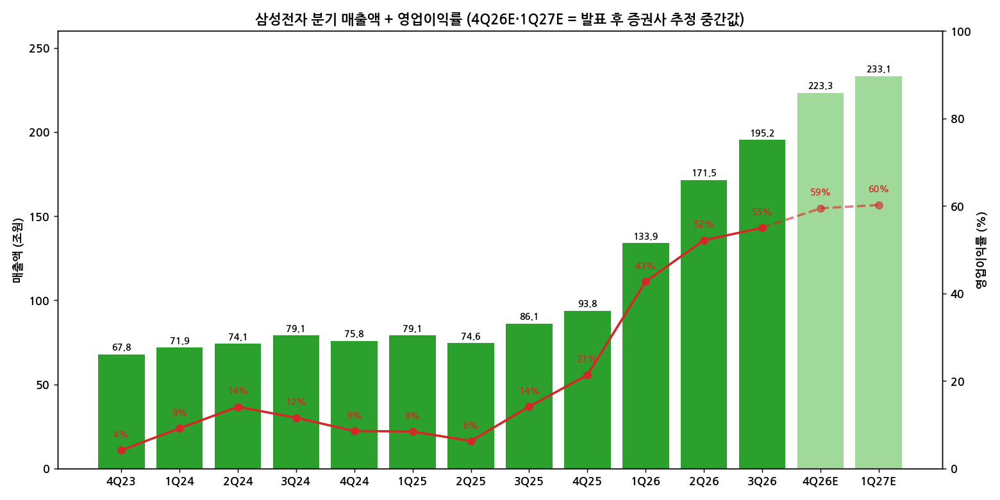
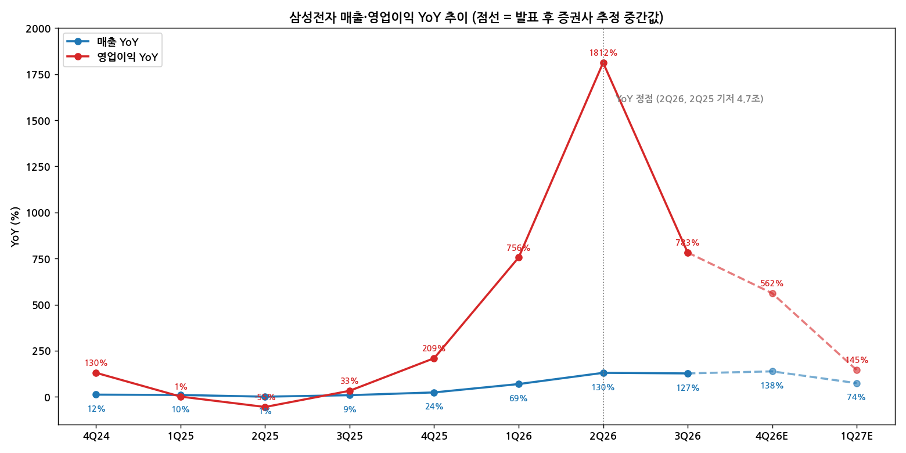

> 모드: 실적 리뷰 (v11)
> 종목: 삼성전자 (005930)
> 섹터: 반도체
> 서브섹터: 메모리
> 분기: 2026-Q3
> 발표일: 2026-10-29 (확정실적·컨콜, 잠정실적은 10월 초 선발표)
> 작성 시각: 2026-11-01 KST
> 분석 소스: 삼성전자 2026년 3분기 실적발표 IR 자료(10/29) + 첨부 셀사이드 10개 — BNK투자증권(10/29), DS투자증권(10/29), 메리츠증권(10/29), 유안타증권(10/29), KB증권(10/30), 다올투자증권(10/30), 대신증권(10/30), 키움증권(10/30), 하나증권(10/30), 한화투자증권(10/30, 동일 리포트 2부 첨부). 웹서치 보완 없음

# 삼성전자 3Q26 실적 리뷰 — 숫자는 한 단계 더 올라섰고, 시장은 자사주를 기다렸다

## 0. 한 줄 판정

> 성장 델타: **둔화 (영업이익 YoY 정점 2Q26 통과, 단 4Q26 QoQ 재가속 예상)** | 내러티브: **강화** → **메모리 3사 중 델타 수명이 가장 긴 종목 — 주가는 주주환원 '타이밍' 실망으로 눌린 '경계 속 선별 구간'** [판단]

→ 숫자: 매출 195.3조원(+127% YoY), 영업이익 107.4조원(+783% YoY), OPM 55.0%. 글로벌 테크 최초 분기 영업이익 100조원. 영업이익 YoY는 1,812%(2Q26, 2Q25 기저 4.7조원) → 783%로 축소 = 둔화
→ 다만 QoQ는 +56% → +20% → 4Q26E 약 +24%로 **4Q에 다시 빨라진다** (DRAM 출하 가이던스 10% 중후반). SK하이닉스(4Q26E +23% 후 1Q27E +3%)·마이크론(4Q26G +14%)보다 델타가 길게 유지 [판단]
→ 쟁점 ①: HBM4 경쟁력 회복 — HBM 내 HBM4 비중 60%, HBM4 매출 3배 이상, 점유율 40%(KB). 2027 HBM 물량은 목표 가격에 완판
→ 쟁점 ②: 주주환원 — 잔여 재원 55~75조원은 확인됐지만 즉각적 자사주 발표 없이 "2027년 1월 말 이사회"로 미룸 → 발표일 주가 −4.1% (24.2만원 → 23.2만원)
→ 다음 분기 관건: 4Q26 영업이익 130조원대(중간값 132.8조원) 달성, 1Q27 모바일 DRAM 가격 인상, 1월 말 차기 주주환원 정책 규모

---

## 1. 숫자

① 연결 기준 분기 표

단위: 조원, %. K-IFRS 연결

| 항목 | 4Q23 | 1Q24 | 2Q24 | 3Q24 | 4Q24 | 1Q25 | 2Q25 | 3Q25 | 4Q25 | 1Q26 | 2Q26 | **3Q26** | 4Q26E | 1Q27E |
|---|---|---|---|---|---|---|---|---|---|---|---|---|---|---|
| 매출액 | 67.78 | 71.92 | 74.07 | 79.10 | 75.79 | 79.14 | 74.57 | 86.06 | 93.84 | 133.87 | 171.50 | **195.25** | 223.3 | 233.1 |
| 영업이익 | 2.82 | 6.61 | 10.44 | 9.18 | 6.49 | 6.69 | 4.68 | 12.17 | 20.07 | 57.23 | 89.49 | **107.42** | 132.8 | 140.4 |
| OPM | 4.2 | 9.2 | 14.1 | 11.6 | 8.6 | 8.5 | 6.3 | 14.1 | 21.4 | 42.8 | 52.2 | **55.0** | 59.5 | 60.2 |
| 매출 YoY | −3.8 | +12.8 | +23.4 | +17.4 | +11.8 | +10.0 | +0.7 | +8.8 | +23.8 | +69.2 | +130.0 | **+126.9** | +138.0 | +74.1 |
| 영업이익 YoY | −34.6 | +933 | +1,458 | +277.8 | +130.1 | +1.2 | −55.2 | +32.6 | +209.3 | +755.5 | +1,812 | **+782.8** | +561.7 | +145.3 |
| **매출 YoY 델타 (%p)** | — | +16.6 | +10.6 | −6.0 | −5.6 | −1.8 | −9.3 | +8.1 | +15.0 | +45.4 | +60.8 | **−3.1** | +11.1 | −63.9 |
| **영업이익 YoY 델타 (%p)** | — | n.m. | n.m. | n.m. | −147.7 | −128.9 | −56.4 | +87.8 | +176.7 | +546.2 | +1,056.7 | **−1,029.4** | −221.1 | −416.4 |

→ (출처: 회사 공시·IR, 키움증권 분기 정리. 4Q26E = 발표 후 9개사 영업이익 추정 중간값(범위 126.1~140.5조원), 매출 8개사 중간값. 1Q27E = BNK·하나·대신 3개사 중간값 [계산])
→ 1Q24~3Q24 영업이익 YoY 델타는 2023년 저기저(분기 0.6~2.4조원)로 n.m.

서프라이즈: 영업이익은 10월 초 잠정실적으로 이미 공개 — 확정치 107.4조원은 FnGuide 컨센 106.0조원 대비 **+1.4%**, 매출 195.3조원은 컨센 200.3조원 대비 **−2.5%** (유안타·메리츠 인용). 세전이익은 금융손익 −9.5조원(환율)으로 컨센 대비 −11%. 서프라이즈의 무게는 3Q가 아니라 **4Q 가이던스**에 있었다 — 4Q26 영업이익 중간값 132.8조원은 1M 컨센 116.0조원(유안타)·116.8조원(다올) 대비 **+14%**

(1) YoY 위치
→ 영업이익 YoY는 2Q26 +1,812%가 정점. 단 2Q25 영업이익이 4.68조원(재고평가손 등으로 이례적 저점)이었던 기저 왜곡이 크다
→ 매출 YoY는 2Q26 +130% → 3Q26 +127%로 거의 횡보, 4Q26E +138%로 오히려 한 번 더 확대 → 매출 기준으로는 아직 정점이 오지 않았다
→ 컨센 경로상 영업이익 YoY는 4Q26E +562% → 1Q27E +145%로 수렴

(2) 기저효과 조정 — QoQ로 다시 보기
→ 영업이익 QoQ: +185%(1Q26) → +56%(2Q26) → **+20%(3Q26)** → **약 +24%(4Q26E)** → 약 +6%(1Q27E)
→ 분기 증가액: +37.2조원 → +32.3조원 → +17.9조원 → **약 +25.4조원** → 약 +7.6조원
→ 3Q26은 DRAM 출하가 +3%에 그쳐 가이던스를 하회(하나: "공정 선단화 과정에서 출하량이 예상보다 적었다")한 일시 감속. 4Q는 출하 만회로 QoQ가 재가속 → **판정은 '둔화'지만 4Q 실적이 중간값을 넘으면 '유지'로 상향 가능** [판단]

→ (출처: 회사 공시·IR, 4Q26E·1Q27E = 발표 후 증권사 추정 중간값 [계산])

→ (출처: 동일. 점선 = 증권사 추정 중간값 경로)

② 사업부별 매출·영업이익

단위: 조원, %. 부문 매출은 내부매출 포함 (회사 기준)

(1) 이번 분기 스냅샷

| 부문 | 3Q26 매출 | 매출 QoQ | 매출 YoY | 3Q26 영업이익 | OPM | 2Q26 영업이익 | 3Q25 영업이익 | 영업이익 YoY |
|---|---|---|---|---|---|---|---|---|
| **DS (반도체)** | **147.1** | +15 | +344 | **106.5** | 72.4 | 89.2 | 7.0 | +1,421 |
| └ 메모리 | 140.7 | +16 | +427 | 약 108.3 [추정] | 약 77 | 약 91.2 | — | — |
| └ S.LSI·Foundry | 약 6.3 [추정] | −4 | +2 | 약 −1.3~−2.0 [추정] | 적자 | — | — | 적자 지속 |
| SDC (디스플레이) | 8.0 | +7 | −1 | 1.1 | 13.8 | 0.7 | 1.2 | −8 |
| MX/네트워크 | 37.7 | +14 | +11 | −0.6 | 적자 | −0.7 | 3.6 | 적자 전환 |
| VD/DA 등 | 13.9 | −4 | 0 | −0.2 | 적자 | −0.01 | −0.1 | 적자 지속 |
| Harman | 4.3 | −5 | +9 | 0.6 | 14.0 | 0.4 | 0.4 | +50 |
| **전사** | **195.3** | +14 | +127 | **107.4** | 55.0 | 89.5 | 12.2 | +783 |

→ (출처: IR 별첨 2. 메모리 영업이익은 하나증권 추정(BNK 108.6조원, KB 108조원, 메리츠 108조원으로 편차 작음), S.LSI·Foundry 매출은 키움 추정, 영업손실은 메리츠 −1.3조원 / DS투자·BNK 약 −2.0조원)

(2) 메모리 세부 [추정]

| 항목 | 3Q26 | 4Q26 가이던스·추정 | 출처 |
|---|---|---|---|
| DRAM 영업이익 / OPM | 81.8조원 / 83% | — | DS투자 |
| NAND 영업이익 / OPM | 26.7조원 / 64% | — | DS투자 |
| DRAM Bit QoQ | +3% (가이던스 하회) | **10% 중후반 (회사 가이던스)** | 하나·DS·유안타, 대신 +18% 추정 |
| DRAM ASP QoQ | +20~21% | +5~17% | 하나 +12% / DS +5% / 키움 +17% |
| NAND Bit QoQ | +4~5% | **10% 중반 (회사 가이던스)** | 하나·DS |
| NAND ASP QoQ | +17~18% | +6~19% | 하나 +9% / 키움 +19% |
| HBM | HBM4 매출 3배 이상, HBM 내 HBM4 비중 60%. HBM은 DRAM 매출의 10% 미만 | 4Q HBM·서버 DRAM·SSD 판매 비중 추가 확대 | 한화·유안타·IR |

(3) 해석 — 누가 델타를 끌고 누가 꺾이나
→ **메모리가 전사 이익의 100% 이상.** 메모리 영업이익 약 108조원 > 전사 107.4조원 — 비메모리·DX 합산이 마이너스. 삼성전자는 이제 "세트가 붙은 메모리 회사"다 [판단]
→ **이익 개선의 대부분은 범용 DRAM 가격.** HBM은 DRAM 매출의 10% 미만이어서(유안타) HBM4 3배 성장이 전사 숫자를 움직이진 못했다. HBM 회복은 2027 이익의 '질'에, 범용 가격은 2026 이익의 '양'에 기여
→ **꺾이는 곳 = DX.** MX 영업이익 3.6조원(3Q25) → −0.6조원, 메모리 원가 상승이 세트 마진을 잠식(키움: 4Q DX 적자 확대 예상). 메모리 호황이 세트 사업에는 역풍 — 사업 포트폴리오 내 자연 헤지가 이번 사이클엔 오히려 상쇄 요인
→ Foundry는 가동률 상승(8나노 이하 Full capa, DS투자)과 HBM4 베이스 다이 수요로 적자 축소 중이나, 성과급 비용으로 3Q 적자 지속

③ 연간

단위: 조원, %

| 항목 | 2023 | 2024 | 2025 | **2026E** | 2027E | 2028E |
|---|---|---|---|---|---|---|
| 매출액 | 258.9 | 300.9 | 333.6 | **약 722** (713.4~758.6) | 약 986 (838.2~1,413.9) | 571.3 (BNK) |
| 영업이익 | 6.57 | 32.73 | 43.60 | **약 387** (380.3~394.6) | 614.5 (380.0~749.7) | 122.2 (BNK) / 337.4 (키움) |
| OPM | 2.5 | 10.9 | 13.1 | **약 54** | 약 62 | — |
| 매출 YoY | −14 | +16 | +11 | **+116** | +37 | — |
| 영업이익 YoY | −85 | +398 | +33 | **+788** | +59 | — |

→ (출처: 2023~2025 회사 공시. 2026E·2027E = 발표 후 8개사 중간값, 괄호는 범위 [계산]. 2028E는 2개사만 제시)
→ 연간 컨센 변화: FnGuide 컨센(하나 인용) 2026 영업이익 371.7조원 → 발표 후 중간값 387.3조원(**+4%**), 2027 560.8조원 → 614.5조원(**+10%**). 하나 2027 +20.1%, 메리츠 654조원으로 재상향, DS투자 612 → 632조원
→ **2027E 범위 380~750조원으로 2배 차이.** 키움(−4%)·BNK(+15%)는 2027 증익 둔화를, 유안타(+92%)는 2027 매출 1,414조원을 가정 — SK하이닉스와 같은 구도로 "2027 하반기 이후"에서 갈린다

---

## 2. 시장 쟁점

① 2-0. 지난 리뷰에서 "봐야 할 것"으로 남긴 항목 체크

> 직전 분기(2026-Q2) 리뷰는 작성되지 않음. 2026-Q1 리뷰 기반 팔로업(`earnings-followup/2026-Q2_삼성전자_팔로업.md`) ④번 항목을 두 분기 누적 체크

| 직전 팔로업 항목 | 이번까지 결과 | 판정 |
|---|---|---|
| 노조 파업 (5/21~6/7) | 파업 진행·타결 결과는 첨부 리포트에서 확인 불가. 3Q 비메모리 적자에 성과급 영향 언급(BNK), 4Q 파운드리·LSI 일회성 성과급 비용 예상(키움) | **미확인** (비용 측면 영향만 확인) |
| 2Q26 영업이익 87조원 + DS 80조원 | 2Q26 89.5조원 / DS 89.2조원 → 3Q26 107.4조원 / DS 106.5조원 | **확인** (기대 초과) |
| HBM4E 샘플 + HBM 점유율 회복 | HBM 점유율 1Q 21% → 2Q 33% → 3Q 40%(KB). HBM4E 긍정적 고객 피드백, 2027 상반기 양산 | **확인** (기대 초과) |
| Foundry 2nm 대형 수주 | "대형 Hyperscaler 포함 2나노 HPC 고객 중심 수주 지속", 美 Taylor 첫 Fab 2027 가동. 고객명·규모 미공개, 적자 지속 | **부분 확인** |
| 자사주 매입소각 추가 + 순현금 100조원 | 3Q 자기주식 취득 12.5조원, 순현금 197.6조원. 2026 총 환원 90~110조원 중 35조원 집행 | **확인** — 단 신규 자사주 발표는 1월로 연기 |

→ 펀더멘털 항목은 모두 기대 이상. 그런데 주가는 52주 고점 36.25만원 대비 23.2만원(**−36%**). 시장은 펀더멘털이 아니라 **주주환원의 '시점'과 2027 이후 사이클**을 문제 삼고 있다

② 2-1. 이번 분기 쟁점

| # | 쟁점 | 한 줄 정의 | 언급 증권사 |
|---|---|---|---|
| 1 | 4Q 물량 회복과 2027 추정치 상향 | 3Q 출하 부진은 일시적인가, 4Q DRAM +10% 중후반이 2027 이익을 얼마나 올리나 | 10/10 |
| 2 | HBM4 경쟁력 회복의 크기 | 점유율 40%·2027 완판이 이익에 언제, 얼마나 반영되나 | 9/10 |
| 3 | 주주환원 타이밍 | 왜 즉시 자사주를 발표하지 않았나, 1월 정책은 얼마나 클까 | 10/10 |
| 4 | 2027~28 사이클과 CapEx | LTA·공급 제약 vs 수요 모멘텀 정점, 2027 CapEx 100~108조원 | 8/10 |

③ 2-2. 쟁점별 분해

(1) 쟁점 1 — 4Q 물량 회복과 2027 추정치 상향

(1-1) 회사 설명
→ "제한된 가용량下 AI향 제품 중심 Product Mix 운영, 수요 모멘텀이 높은 서버 응용을 필두로 전 응용 시장 가격 상승" (IR p.7)
→ 4Q: "신규 GPU/CPU향 제품 위주로 메모리 수요 추가 확대, Personal AI Agent 확산과 연계해 QLC 수요 급증. HBM, 서버향 DRAM 및 SSD 판매 비중 추가 확대" (IR p.7). DRAM B/G 10% 중후반, NAND 10% 중반 가이던스(DS투자·대신 인용)
→ 2027: "AI 연관 제품 주도의 메모리 수요 증가폭이 매우 높아, **공급 부족 현상은 올해 대비 오히려 심화**" (IR p.7)

(1-2) 증권사별 해석 편차

| 증권사 | 4Q26 영업이익 E | 2027E 영업이익 | 논리 |
|---|---|---|---|
| 키움 | **140.5조원** (최고) | **380.0조원** (최저, −4%) | 4Q DRAM +17%·NAND +19% 가격. 그러나 "가격에서 출하로 사이클 이동" — 연말·연초 가격 탄력 둔화·중국 증설·YMTC 상장으로 조정 |
| 유안타 | 137.3조원 | **749.7조원** (최고) | DRAM·NAND 출하 +16%·+14%, 1cnm 수율 개선. 4Q 매출 258조원 |
| 하나 | 134.1조원 | 624.4조원 | 3Q 출하 부진 → 4Q 만회, 2027 +20.1% 상향 |
| 대신 | 133.4조원 | 604.5조원 | "최대 생산, 최대 판매". 1Q27 모바일 DRAM +30% 이상, 2027 범용 DRAM ASP +40% 중후반 가능 |
| DS투자 | 132.8조원 | 632.0조원 | 4Q·2027 상향 (612 → 632조원) |
| 다올 | 129.9조원 | — | 메모리 Bit·ASP 동시 견인 |
| KB | 128.0조원 | 555.4조원 | 메모리 영업이익 4Q 128.5조원 |
| BNK (보유) | 127.3조원 | 438.6조원 | 4Q DRAM B/G 17%(예상 7%)로 상향, 그러나 2027 하반기 급감 |
| 메리츠 | 126.1조원 | 654조원 | 1Q27 모바일 DRAM 판가 +50% 폭등 예상, 2027 재상향 |

(1-3) 공통 결론 vs 갈리는 지점
→ 공통: 3Q 출하 부진(+3%)은 선단 공정 전환에 따른 일시적 현상이고, 4Q 출하 회복으로 분기 영업이익 125~140조원. 10개사 모두 4Q 컨센(116조원) 상회 전망
→ 갈림: 2027년. 범위 380~750조원의 차이는 **1Q27 모바일 DRAM 가격(+30~50%)과 2027 하반기 범용 가격** 가정. 키움·BNK는 "가격 → 출하" 국면 전환을 이익 증가율 둔화로, 대신·메리츠·유안타는 출하와 가격의 동반 상승으로 해석

(1-4) [판단]
→ 4Q26 130조원대는 출하 가이던스만으로도 무리가 없다 (메모리 3Q 108조원 × DRAM 출하 +17% 효과, ASP 0% 가정 시에도 약 120조원+). 2027E 컨센이 중간값(615조원) 위로 올라가려면 **1Q27 모바일 DRAM 가격 인상 확인**이 첫 관문 — 메리츠·대신·SK하이닉스 커버 증권사들이 공통으로 지목한 1Q27 이벤트

(2) 쟁점 2 — HBM4 경쟁력 회복의 크기

(2-1) 회사 설명
→ "업계 최고의 제품 경쟁력을 갖춘 HBM4 판매 대폭 확대" (IR p.7)
→ 컨콜(한화 정리): 3Q HBM4 매출 전분기 대비 3배 이상, HBM 내 비중 60%. "전체 DRAM 점유율에 상응하는 HBM 입지 확보"라는 하반기 목표를 3분기에 조기 달성. 2027 HBM 공급 물량은 목표 가격 수준에서 협상 완료, 고객 추가 증량 요청 지속. HBM4E 2027 상반기 양산, 하반기 본격 확대
→ Foundry: "HBM B-Die 매출 성장과 선단 공정 확판으로 매출 및 실적 대폭 개선" (IR p.8)

(2-2) 증권사별 해석 편차

| 증권사 | 핵심 가정·추정 | 논리 |
|---|---|---|
| KB | HBM 점유율 40%, **2027 HBM ASP +150%** | 2027 HBM4 공급계약이 3사 중 가장 높은 가격에서 체결 |
| 대신 | 2027 HBM 점유율 1위 가능 | HBM4/4E 추가 공급 요청 쇄도, 일부 고객은 연내 추가 공급 시 2027 가격 선지급 의사 |
| 한화 | 경쟁력 우려 해소 | 실제 판매·점유율로 확인 |
| DS투자 | 가장 빠른 세대 전환 | HBM4 비중 60% = 업계 최고 수준 제품 경쟁력의 방증 |
| 유안타 | 이익 기여는 아직 작음 | HBM은 DRAM 매출의 10% 미만 — 이익 개선 대부분은 범용 DRAM |
| 키움 | 중장기 기대 | HBM·HBF 성장성은 연초 조정 이후 주가 회복의 근거 |

(2-3) 공통 결론 vs 갈리는 지점
→ 공통: HBM4 경쟁력 회복은 확인. 2027 물량·가격 협상 완료
→ 갈림: **크기**. KB(ASP +150%)·대신(점유율 1위)은 2027 이익의 핵심 동력으로, 유안타는 "아직 DRAM 매출의 10% 미만"으로 이익 기여를 제한적으로 본다

(2-4) [판단]
→ SK하이닉스 컨콜의 "HBM과 범용 DRAM 수익성 격차 축소"와 겹쳐 보면, 2027년 HBM은 **마진 희석 요인에서 마진 동등 요인**으로 바뀐다. 삼성전자는 범용 DRAM 캐파가 가장 크기 때문에 HBM 비중이 낮은 지금 구조가 오히려 범용 가격 상승을 가장 크게 누리는 구조이고, 2027 HBM 가격이 범용 수준까지 오르면 믹스 리스크도 사라진다 [판단]
→ 결론을 바꿀 데이터: NVIDIA Rubin 공급사별 물량 배분, 2027 HBM 가격의 3사 비교(KB 주장 "삼성 최고가" 검증)

(3) 쟁점 3 — 주주환원 타이밍

(3-1) 회사 설명
→ "3분기 현금배당 총 30조원(주당 4,601원). 2026년 총 주주환원 90~110조원에서 이미 집행·확정된 35조원을 감안하면 잔여 재원은 55~75조원. 잔여 재원 환원은 현금배당과 함께 상당 규모의 자기주식 매입·소각 포함" (IR 별첨 4)
→ "보통주·우선주 가격 차이에 대한 시장 관심을 인지, 자사주 매입·소각 시 우선주 매입 비중을 적극적으로 고민해 조정" (IR)
→ "**2027년 1월말 이사회**에서 차기 주주환원 정책과 2026년 잔여 재원 최종 규모·실행 방안 확정 발표" (IR)

(3-2) 증권사별 해석 편차

| 증권사 | 핵심 가정·추정 | 논리 |
|---|---|---|
| 대신 | 우선주 중심 매입 약 25조원, 2026 총 환원 109.8조원 | "시장 반응 다소 냉소적, 주주환원은 시점의 문제" |
| 메리츠 | 연말~연초 자사주 우선 실시 → 1월 잔여분 | 3개월간 주가 −12%에도 정책 변화 없어 아쉬움. 과거 3개년 정책 마지막 분기에 잔여 환원 집행 |
| 다올 | 우선주 매입·소각 11~15조원 | 우선주 시총 147.5조원의 8~10% 영향. 2027 환원 규모 2배 확대 전망 |
| KB | 1월 추가 환원 75조원 | 사상 최대 실적 + 사상 최대 환원 = 재평가 전환점 |
| 유안타 | 1월 차기 정책이 추가 모멘텀 | 2027 CapEx 108조원으로 자본집약도 높지만 메모리 FCF로 여력 충분 |
| BNK (보유) | 환원은 하방만 지지 | 수요 모멘텀 둔화로 상단 제한 박스권 |

(3-3) 공통 결론 vs 갈리는 지점
→ 공통: 잔여 55~75조원 + 2027년 차기 정책 강화 방향은 확정적. 우선주 비중 확대
→ 갈림: **시점**. 메리츠는 연말 자사주 선집행을 예상, 대신·KB·유안타는 1월 발표가 촉매. 그 사이 주가는 "기다림의 비용"을 치르고 있다

(3-4) [판단]
→ 발표일 주가 −4.1%(10/28 24.2만원 → 10/29 23.2만원, DS투자·KB 기준가)는 숫자가 아니라 **자사주 '지금 안 함'에 대한 반응**이다. DS투자는 전일 시장 반등의 기저와 Google 실적 실망을 함께 들었다. 같은 주 SK하이닉스가 100조원 환원·분기별 자사주로 발표일 +10.9% 반등한 것과 정반대 — 메모리 2사의 주가 차이는 실적이 아니라 환원 실행 속도에서 났다 [판단]
→ 1월 말 이사회가 이 쟁점의 결론. 보통주보다 우선주 중심 매입이면 보통주 주가에 대한 직접 효과는 제한적일 수 있다

(4) 쟁점 4 — 2027~28 사이클과 CapEx

(4-1) 회사 설명
→ 2027 공급 부족 "올해 대비 오히려 심화". 장기계약 기반 안정적 판매 기반 구축 (IR p.7)
→ 컨콜(유안타·한화·메리츠 정리): 10개 대형 고객과 LTA 체결 완료, 10개 고객 추가 협상 중. 메모리 LTA 매출 비중 60~70% 가이던스 차질 없이 진행. 2027 CapEx 증가하나 상당 부분이 신규 공간 확보와 장비 가격 상승 — Bit 증가 효과 제한적

(4-2) 증권사별 해석 편차

| 증권사 | 핵심 가정·추정 | 논리 |
|---|---|---|
| KB | 2027~28 DRAM 부족 2026보다 심화 | HBM 캐파 비중 18% → 22% → 30%(2027)로 범용 공급 구조적 제약. LTA가 2030년까지 생산능력의 70% |
| 한화 | 2028까지 타이트, 2028년 LTA 효과로 재평가 | CapEx 증가가 Bit 증가로 직결되지 않는 구조 |
| 유안타 | 2027 CapEx 108조원 (2026 84.2조원) | 파운드리 보유로 자본집약도 높음 — 그래도 FCF 여력 충분 |
| 다올 | 2027 CapEx 100조원, 잉여현금 400조원+ | 현 주가 2027 PER 2.6배, 조정은 과도 |
| 키움 | 2028E 영업이익 337조원 (−11%) | 중국 메모리 증설·YMTC 상장 |
| BNK (보유) | **2028E 영업이익 122조원 (−72%)** | 글로벌 경기선행지수 2Q26 정점, 메모리 원가 한계로 고객이 성능 유지·용량 축소, 하이퍼스케일러 투자 YoY 3Q26 정점, AI 기업 신용위험 |

(4-3) 공통 결론 vs 갈리는 지점
→ 공통: 2027년 공급 부족 지속, LTA로 이익 하방 상승
→ 갈림: 2028년. SK하이닉스와 동일하게 BNK·키움 vs 다수. 삼성전자 고유 변수는 **DX 적자 확대**(메모리 원가 상승이 세트 마진 잠식)와 **파운드리 CapEx 부담**

(4-4) [판단]
→ BNK의 "고객이 성능은 유지하되 용량을 낮춘다"는 관찰은 SK하이닉스 컨콜의 HBM 적층 단수 하향(de-spec)과 같은 현상을 수요 측에서 본 것. 공급사들은 이를 "더 많은 시스템을 만들기 위한 선택"으로, BNK는 "메모리 원가 한계 도달"로 해석한다. 1Q27 모바일 DRAM 가격 인상 수용 여부가 어느 해석이 맞는지를 가장 먼저 보여줄 데이터 [판단]

④ 2-3. 낙관 vs 보수 — 논리 대비

| 구분 | 증권사 | 무엇을 다르게 가정했나 |
|---|---|---|
| 가장 낙관 | 유안타 (TP 69만원) | 2027 매출 1,414조원·영업이익 750조원 — 출하·가격 동반 최대 반영, 2027E BPS × PBR 3.5배 |
| 낙관 | KB (TP 60만원) | 2026~27 영업이익 938조원 = 창립 후 56년 누적(620조원)의 1.5배. HBM ASP +150% |
| 보수 | 키움 | 2027 영업이익 380조원(−4%) — 가격 → 출하 국면 전환, 연말·연초 조정 |
| 가장 보수 | BNK (보유, TP 27만원) | 2Q27 정점 → 4Q27 영업이익 64.6조원, 2028 122조원. 메모리 OPM 4Q27 58% |

→ 차이는 SK하이닉스와 마찬가지로 **2027 하반기 메모리 가격 방향**으로 압축. 삼성전자 고유 변수는 주주환원 실행 시점
→ 셀사이드 vs 바이사이드: 8개 TP 평균 약 51.9만원(주가 대비 +124%)인데 주가는 고점 대비 −36%, 2027E PER 2.6~3.5배. 마이크론·SK하이닉스와 같은 "셀사이드는 레벨, 바이사이드는 델타·2028" 괴리에 더해 "환원 대기" 디스카운트 [판단]

⑤ 2-4. 추정치·TP 변화

단위: 원, 조원

| 증권사 | 의견 | 현재 TP | TP 변화 | 4Q26 영업이익 E | 2026E / 2027E 영업이익 | 핵심 변화 한 줄 |
|---|---|---|---|---|---|---|
| 유안타 | BUY | 690,000 | **상향** (630,000) | 137.3 | 391.5 / 749.7 | 2027E BPS × PBR 3.5배 |
| KB | Buy | 600,000 | 유지 | 128.0 | 382.4 / 555.4 | 2026 +3.9% 상향, 2027 유지 |
| 한화 | Buy | 580,000 | 유지 | — | — | HBM4 경쟁력 회복, 2028 LTA 효과로 재평가 |
| DS투자 | 매수 | 530,000 | 유지 | 132.8 | 387.0 / 632.0 | 2027 612 → 632조원 |
| 대신 | BUY | 500,000 | 유지 | 133.4 | 387.6 / 604.5 | 2026 +4.4%, 2027 +2.1% 상향 |
| 메리츠 | Buy | 500,000 | 유지 | 126.1 | 380.3 / 654 | 4Q26 +10.8%, 2027 시장 최고 수준 재상향 |
| 하나 | BUY | 480,000 | 유지 | 134.1 | 388.2 / 624.4 | 2027 +20.1% 상향, 피어 멀티플 하향으로 TP 유지 |
| BNK | 보유 | 270,000 | 유지 | 127.3 | 381.4 / 438.6 | 상단 제한 박스권 |
| 키움 | — (반도체 top pick) | 미기재 | — | 140.5 | 394.6 / 380.0 | 연말·연초 조정 후 회복 |
| 다올 | — (Spot Issue) | 미기재 | — | 129.9 | — | 우선주 매입·소각 힌트 |

→ 평균 TP 약 **518,750원** (8개사 단순평균 [계산]), KB 인용 컨센 TP 492,500원. 10/29 종가 23.2만원 대비 +124%
→ TP 상향 1건(유안타), 하향 0건, 유지 7건
→ 4Q26 영업이익: 1M 컨센 약 116조원 → 발표 후 중간값 132.8조원(**+14%**). 2027 영업이익: 컨센 560.8조원 → 중간값 614.5조원(**+10%**)
→ **추정치는 오르는데 TP는 대부분 유지 — 원인은 멀티플.** 하나는 "글로벌 반도체 업체들의 멀티플 하향을 반영해 TP 유지"를 명시. 실적 하향이 아닌 멀티플 하향 국면 [판단]

---

## 3. 내러티브 점검

① 성장 스토리 정의
→ "범용 DRAM 최대 캐파 보유자가 AI발 메모리 공급 부족의 가장 큰 수혜를 받고, 뒤처졌던 HBM에서 경쟁력을 회복해 **2027년 메모리 1위 이익**을 되찾는다. 넘치는 현금은 대규모 주주환원으로 돌아온다"

② 이번 분기 평가 — **강화**
→ HBM: 지난 1년간 가장 큰 약점이던 HBM4 경쟁력이 점유율 40%·HBM4 비중 60%·2027 완판으로 숫자로 확인
→ 이익: 4Q26 중간값 132.8조원(컨센 +14%), 2027 +10% 상향
→ 환원: 규모(잔여 55~75조원)와 방향(2027 정책 강화, 우선주 매입)은 확인 — **실행 시점만 1월로 이연**
→ 약점: DX 적자 확대(MX 3Q25 3.6조원 → −0.6조원), 파운드리 적자 지속. 비메모리가 스토리를 깎는 구조는 그대로

③ 국면 — 델타 둔화 × 내러티브 강화
→ 메모리 3사를 나란히 놓으면 마이크론(2Q26 정점, 4Q 가이던스 QoQ +14%) → SK하이닉스(3Q26 정점, 1Q27E QoQ +3%) → **삼성전자(YoY는 2Q26 정점이지만 4Q26E QoQ +24%로 재가속)**. 출하 여력이 가장 큰 삼성전자의 델타가 가장 늦게 꺾인다 [판단]
→ 비유하면 3명이 같은 오르막을 오르는데 삼성전자는 3Q에 신발 끈(선단 공정 전환)을 묶느라 잠시 느려졌고 4Q에 다시 속도를 낸다. 다만 오르막 자체(메모리 가격 상승률)가 완만해지고 있다는 점은 셋 모두 같다
→ BT 프레임: 둔화 + 강화 = 경계 구간이지만, 메모리 3사 중에서는 **델타 잔여 기간이 가장 길고, 1월 환원이라는 날짜가 정해진 촉매가 있는 종목** [판단]

④ 다시 강해질 트리거
→ 연말 자사주 선집행(메리츠 예상) 또는 1월 말 대규모 환원(KB: 75조원)
→ 4Q26 영업이익 135조원 이상 + 1Q27 모바일 DRAM 가격 +30% 이상 확인
→ NVIDIA Rubin향 HBM4 점유율 1위 시그널, 2나노 대형 고객 공개

⑤ 깨뜨릴 리스크
→ 1월 환원이 우선주 중심·기대 이하 규모 → "기다림의 비용"이 실망으로 확정
→ 1Q27 모바일 DRAM 가격 인상 거부·세트 수요 감소 → 범용 가격 탄력 둔화(키움 시나리오)
→ 중국 메모리 증설·YMTC 상장, AI 기업 신용위험 재부각(BNK)

---

## 4. 향후 봐야 할 것

| 순위 | 무엇을 (변수·임계값) | 어떤 데이터로 | 언제 |
|---|---|---|---|
| 1 | **4Q26 영업이익 130조원 이상 & DRAM 출하 10% 중후반 달성** — 중간값 132.8조원 상회 시 델타 '유지'로 상향, 120조원 미만이면 '꺾임' 경계 | 4Q26 잠정실적, 1월 말 확정실적·컨콜 B/G | 2027-01 초 (잠정) |
| 2 | **1월 말 이사회 주주환원** — 2026 잔여 55~75조원 중 자사주 비중, 보통주·우선주 배분, 2027~29 정책 규모 | 이사회 결의 공시, IR 발표 | 2027-01 말 (연말 선집행 여부는 12월) |
| 3 | **1Q27 모바일 DRAM 가격 인상 폭** — +30% 이상이면 2027 컨센 상향 지속 | TrendForce 계약가, 스마트폰 OEM 가격·출하 코멘트, 한국 반도체 수출 단가 | 2026-12 ~ 2027-01 |
| 4 | **HBM4 점유율·2027 가격** — 40% 유지, Rubin 공급 비중, 3사 가격 비교 | TrendForce HBM 보고서, NVIDIA 실적(11월 중순), SK하이닉스·마이크론 컨콜 | 2026-11 ~ 2027-01 |
| 5 | **DX 적자 확대 폭** — MX 4Q 영업손실 1조원 이상이면 비메모리 디스카운트 확대 | 4Q 부문별 실적, 갤럭시 S27 가격 정책 | 2027-01 말 |

→ 1순위가 델타 판정을 바꾸고, 2순위가 주가 촉매다. 마이크론 FQ1 27(12월 중하순)이 메모리 가격 방향의 첫 데이터

---

> Sources: 삼성전자 2026년 3분기 실적발표 IR 자료(2026-10-29), BNK투자증권·DS투자증권·메리츠증권·유안타증권(2026-10-29), KB증권·다올투자증권·대신증권·키움증권·하나증권·한화투자증권(2026-10-30) — 원문은 비공개 보관
