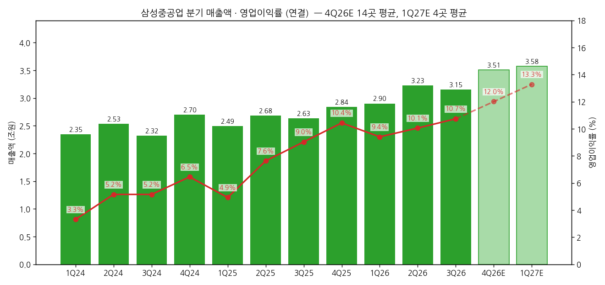
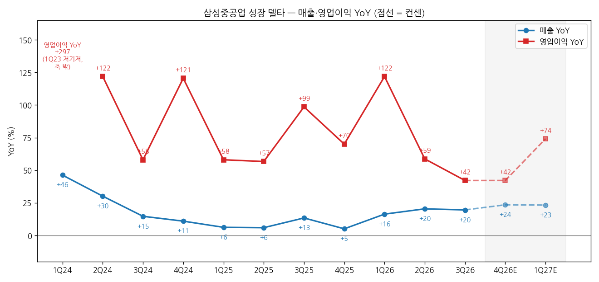
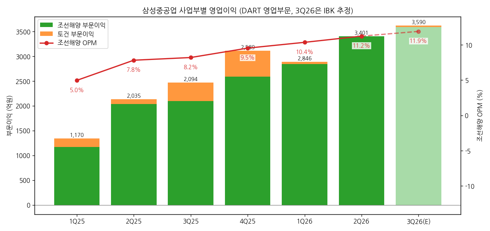

> 모드: 실적 리뷰 (v11)
> 종목: 삼성중공업 (010140)
> 섹터: 조선
> 서브섹터: 조선
> 분기: 2026-Q3
> 발표일: 2026-10-29 (잠정실적 + 컨퍼런스콜) / 3분기 분기보고서 미제출 (법정기한 11/16, 11/14 OpenDART 조회 기준 미공시) — 확정 전 작성, 3Q26 숫자는 잠정치
> 작성 시각: 2026-11-14 15:45 KST
> 분석 소스: 회사 3Q26 경영실적 IR(10/29 발표, irgo 수록본) + OpenDART 분기 재무(1Q23~2Q26) + DART 영업부문 주석 사업부별 분기(1Q23~2Q26, 기업개요 v1.2) + 셀사이드 국내 11개사 12건(삼성 10/29, 메리츠 10/29·11/6, KB 10/29, 다올 10/29, 대신·하나·NH·SK·신한·미래에셋 10/30, 유안타 11/12 — 미래에셋은 이미지형 PDF 렌더 판독) + IBK 10/30(기업개요 소스 폴더 보관본, 보조) + 해외 2개(BofA 10/29, J.P. Morgan 10/30). 회사 설명은 IR 자료와 증권사 리포트의 컨퍼런스콜 Q&A 정리(메리츠·신한·미래에셋·JPM)로 인용. 웹서치 보완 없음. 직전 분기 리뷰 없음 (첫 리뷰)

# 삼성중공업 3Q26 실적 리뷰 — 환율이 못 건드린 마진, 이제 FLNG·FDC가 값을 증명할 차례

> 성장 델타: 둔화 | 내러티브: 유지 → 델타 둔화 + 내러티브 유지 → 경계 구간 (이익 경로는 단단하나 주가 트리거인 델핀 2호기 FLNG·FDC 첫 본계약 확인 전까지 관망)

→ **숫자**: 매출 3조 1,504억원(+19.6% YoY), 영업이익 3,384억원(+42.1% YoY, OPM 10.7%) [잠정]. 영업이익 YoY가 1Q26 +121.9% → 2Q26 +58.7% → 3Q26 +42.1%로 2개 분기 연속 둔화했다. FnGuide 컨센(3,498억원) 대비 -3.3%로 부합이다. 다만 OPM은 9.4% → 10.1% → 10.7%로 3개 분기 연속 올랐다. 한화오션(상선 OPM 22.7% → 17.4%)과 달리 원화 강세 영향이 없었다
→ **쟁점 ①**: 100% 환헤지 덕에 마진이 환율과 무관하게 오른다. 2022년 저선가·저환율 물량(3Q 매출의 15%)이 빠지면서 2027E OPM 컨센은 13.2%(14곳)다. 다만 범위가 11.4%(BofA)~17.3%(메리츠)로 넓다
→ **쟁점 ②~④**: 상선은 2029년 LNG선 슬롯을 75% 채웠지만 최근 선가 2.47억달러가 시장 눈높이를 밑돌았다(메리츠). 해양 수주는 목표의 54%(44억/82억달러)에 머물러 델핀 2호기 연내 본계약이 필요하다. FDC는 50MW급 첫 본계약 시점(4Q26, SK)을 시장이 주가 트리거로 본다
→ **TP**: 직전 TP가 확인된 13곳 평균이 33,846원 → 26,923원(-20.5%)이다. 14곳 중 12곳이 하향했다. 반면 2026·2027년 영업이익 추정은 발표 전 대비 -0.9%, -3.2%에 그쳤다. 따라서 TP 하향은 멀티플(업종 공통 PER·P/O 하향) 요인이다
→ **다음 분기 관건**: 4Q26 영업이익 컨센은 4,210억원(14곳 평균, YoY +42%, OPM 12.0%)이다. 임단협·성과급을 월할로 미리 반영해 4Q 일회성이 없다고 회사가 밝혔으므로, 4Q 숫자가 마진 궤적을 깨끗하게 보여줄 것이다. 주가 방향은 FLNG·FDC 계약 공시가 정한다

---

## 1. 숫자

① 연결 기준 분기 표 (단위: 억원, %)

| 항목 | 1Q24 | 2Q24 | 3Q24 | 4Q24 | 1Q25 | 2Q25 | 3Q25 | 4Q25 | 1Q26 | 2Q26 | **3Q26** | 4Q26E | 1Q27E |
|---|---|---|---|---|---|---|---|---|---|---|---|---|---|
| 매출액 | 23,478 | 25,320 | 23,230 | 27,004 | 24,943 | 26,830 | 26,348 | 28,379 | 29,023 | 32,307 | **31,504** | 35,053 | 35,777 |
| 영업이익 | 779 | 1,307 | 1,199 | 1,742 | 1,231 | 2,048 | 2,381 | 2,962 | 2,731 | 3,250 | **3,384** | 4,210 | 4,755 |
| OPM | 3.3 | 5.2 | 5.2 | 6.5 | 4.9 | 7.6 | 9.0 | 10.4 | 9.4 | 10.1 | **10.7** | 12.0 | 13.3 |
| 매출 YoY | +46.3 | +30.1 | +14.7 | +11.0 | +6.2 | +6.0 | +13.4 | +5.1 | +16.4 | +20.4 | **+19.6** | +23.5 | +23.3 |
| 영업이익 YoY | +297.4 | +121.9 | +58.0 | +120.5 | +58.0 | +56.7 | +98.6 | +70.0 | +121.9 | +58.7 | **+42.1** | +42.1 | +74.1 |
| **매출 YoY 델타 (%p)** | — | -16.1 | -15.4 | -3.7 | -4.7 | -0.3 | +7.5 | -8.3 | +11.3 | +4.1 | **-0.8** | +4.0 | -0.2 |
| **영업이익 YoY 델타 (%p)** | — | n.m. | -63.9 | +62.5 | -62.5 | -1.3 | +41.9 | -28.5 | +51.8 | -63.2 | **-16.6** | 0.0 | +32.0 |

→ (출처: 1Q24~2Q26은 OpenDART 연결 재무(분기 3개월 금액, 4Q = 연간 - 3Q 누적). 3Q26은 10/29 잠정실적·IR [잠정] — DART 분기보고서 미제출. 4Q26E는 국내 11곳(메리츠는 11/6 추정)·IBK·JPM·BofA의 분기 추정 단순평균(14곳). 삼성·KB·유안타·JPM·BofA는 연간 추정에서 9개월 실적(매출 92,834억원, 영업이익 9,365억원)을 빼 역산했다. 1Q27E는 메리츠·다올·SK·IBK 4곳 평균이라 소수 의견이다. YoY는 [계산])
→ 1Q24 영업이익 YoY +297%는 1Q23 기저(196억원, OPM 1.2%) 효과다. 2Q24 델타는 의미가 없다(n.m.)
→ 3Q26 서프라이즈: 매출은 컨센 대비 -1.0%, 영업이익은 -3.3%다(컨센 매출 3조 1,834억원·영업이익 3,498억원, FnGuide, 삼성·KB·메리츠·신한 인용). 조업일수가 2Q 60일에서 3Q 55일로 줄었는데도(IR p.1) 영업이익은 QoQ +4.1%다. 세전이익은 6,107억원으로 컨센(4,421억원) 대비 +38.1%, 지배순이익은 4,706억원으로 +40.2%다. 러시아 프로젝트(계약 해지) 관련 매매목적 선물환 청산이익 약 2,800억원 때문이다. 상반기 평가손실 약 2,200억원과 합치면 연간 약 +600억원으로 종결됐고, 4Q부터 관련 평가손익은 없다 (신한·미래에셋 Q&A)
→ 영업이익 YoY는 4Q25 +70% → 1Q26 +122% → 2Q26 +59% → 3Q26 +42%다. 2Q25~3Q25에 OPM이 7.6% → 9.0%로 뛴 기저가 YoY를 누르고 있다. 반면 분기 영업이익 절대액은 1Q26 이후 매 분기 늘었다(2,731 → 3,250 → 3,384억원)
→ 컨센 경로상 4Q26E 영업이익 YoY는 +42%(3Q와 동일), 1Q27E는 +74%(1Q26 OPM 9.4% 저기저)다. 연간으로는 2026E +57.8% → 2027E +42.8% → 2028E +18.1%다. 즉 컨센은 YoY 정점을 2027년 상반기까지 넓게 그리고 있다. 같은 경로에서 한화오션 2027E 영업이익 YoY는 +6.7%에 그친다(한화오션 3Q26 리뷰)
→ **[판단] 델타 = 둔화**: 영업이익 YoY가 2개 분기 연속 축소됐다. 그러나 플러스 성장이고, 컨센 경로상 YoY 정점이 아직 지나지 않았다(1Q27E +74%). 따라서 "꺾임" 조건은 충족하지 않는다. 둔화의 원인도 기저(2H25 마진 급등)이지 이익 감소가 아니다. 4Q26 영업이익이 컨센 하단(NH 3,620억원 = YoY +22%)을 밑돌거나 4Q OPM이 3Q(10.7%)보다 낮으면 "꺾임" 쪽으로 다시 본다

→ (출처: OpenDART, 삼성중공업 IR(3Q26 잠정). 4Q26E는 14곳 평균, 1Q27E는 4곳 평균이며 연한 막대·점선으로 표시)

→ (출처: 동일. 1Q24 영업이익 YoY(+297%)는 1Q23 저기저 효과라 선에서 빼고 수치만 표기)

② 사업부별 매출·영업이익 (단위: 억원, %. DART 연결 주석 '영업부문', 부문 순매출 기준)

| 사업부 | 항목 | 1Q25 | 2Q25 | 3Q25 | 4Q25 | 1Q26 | 2Q26 | **3Q26 [추정]** |
|---|---|---|---|---|---|---|---|---|
| 조선해양 | 매출 | 23,552 | 26,025 | 25,534 | 27,156 | 27,488 | 30,279 | **30,160 (IBK) / 29,270 (미래)** |
| 조선해양 | 영업이익 | 1,170 | 2,035 | 2,094 | 2,589 | 2,846 | 3,401 | **3,590 (IBK) / 3,420 (미래)** |
| 조선해양 | OPM | 5.0 | 7.8 | 8.2 | 9.5 | 10.4 | 11.2 | **11.9 / 11.7** |
| 조선해양 | 매출 YoY | +8.8 | +18.0 | +15.1 | +7.1 | +16.7 | +16.3 | **+18.1 / +14.6** |
| 조선해양 | 영업이익 YoY | +40.6 | 흑전 | +72.9 | +57.7 | +143.2 | +67.1 | **+71.4 / +63.3** |
| 토건 | 매출 | 1,390 | 804 | 814 | 1,223 | 1,535 | 2,028 | **2,150 / 2,230** |
| 토건 | 영업이익 | 169 | 96 | 373 | 521 | 40 | -5 | **30 / 110** |
| 미배분·조정 | 영업이익 | -108 | -83 | -86 | -148 | -155 | -146 | **-236 / -146** |

→ (출처: 1Q25~2Q26은 DART 분기·반기·사업보고서 연결 주석 '영업부문' 누계의 분기 차분(삼성중공업 기업개요 v1.2). 3Q26 부문 손익은 회사 미공시 — IR에 조선해양/토건 손익이 없고 분기보고서는 미제출이다. 그래서 IBK(10/30)·미래에셋(10/30) 추정치를 병기한다 [추정]. IBK 매출은 기타 조정(-800억원) 전 수치다. 미배분 = 연결 영업이익 - 부문이익 합 [계산])
→ 회사는 상선 대 해양·하이테크 매출 비중을 약 75:25로 공개했다(기존과 동일, 메리츠·신한·미래 Q&A). 상선/해양 손익 분리는 공시하지 않는다

→ (출처: DART 영업부문 주석, 3Q26은 IBK 추정. 위 표와 동일)

(1) 델타를 끄는 곳 = 조선해양, 이익의 100% 이상
→ 2Q26 누적 조선해양 부문이익 6,247억원은 연결 영업이익(5,981억원)보다 많다. 토건(35억원)과 미배분(-301억원)을 합치면 마이너스다. 즉 전사 델타 = 조선해양 델타다 [계산]
→ 조선해양 영업이익 YoY: 1Q26 +143% → 2Q26 +67% → 3Q26E +63~71%로, 2Q 이후에는 둔화가 멈춘 모습이다 [추정]. 조선해양 OPM은 1Q25 5.0%에서 3Q26E 11.7~11.9%까지 6개 분기 연속 올랐다. 이 구간에 원/달러는 1,452원(1Q25)에서 1,418원(3Q26)으로 내렸지만(대신), 환헤지 때문에 마진에 반영되지 않았다

(2) 수주 빈티지 — 마진 상승의 엔진
→ 3Q26 매출 내 수주연도 비중: 2022년 약 15%, 2023년 약 30%, 2024년 이후 약 55%다(2Q26 20% / 30%대 중반 / 40%+ → 3Q26, JPM·메리츠 Q&A). 매출 적용 평균환율은 약 1,300원이다 (신한·미래 Q&A)
→ 2022년 수주분은 낮은 환율·선가로 헤지돼 있어 2024년 이후 수주분보다 이익률이 낮다 (IR p.2). 다올 선표 모델은 2022년 빈티지 건조 비중이 4Q26 7% → 1Q27 0%로 소멸하고, 2025년 이후 빈티지가 3Q26 11% → 4Q27 83%로 커진다고 본다
→ 3Q는 LNG선 건조 비중이 90%까지 올랐고(다올, 2Q 67%), 4Q26E는 68%다. 유안타는 상선 매출 내 LNG선 기여도가 2027년 60% 이상으로 다시 오른다고 본다(2H25 이후 LNG선 수주 74억달러)

(3) 토건 — 작지만 변동성이 크다
→ 토건(삼성전자 평택캠퍼스 FAB 마감 등 하이테크 공사)은 2025년 부문이익 1,158억원(OPM 27%)에서 2026년 상반기 35억원으로 내려왔다. 회사는 2027년 매출을 "올해 수준에서 소폭 증가"로 본다 (미래 Q&A)

③ 연간 (단위: 억원, %)

| 항목 | 2023 | 2024 | 2025 | 2026E | 2027E | 2028E |
|---|---|---|---|---|---|---|
| 매출액 | 80,095 | 99,032 | 106,500 | 127,887 | 147,601 | 157,708 |
| 영업이익 | 2,334 | 5,027 | 8,622 | 13,605 | 19,429 | 22,955 |
| OPM | 2.9 | 5.1 | 8.1 | 10.6 | 13.2 | 14.6 |
| 매출 YoY | +34.7 | +23.6 | +7.5 | +20.1 | +15.4 | +6.8 |
| 영업이익 YoY | 흑전 | +115.4 | +71.5 | +57.8 | +42.8 | +18.1 |

→ (출처: 2023~2025는 OpenDART 연결 분기 합산. 2026E~2028E는 14곳 단순평균 [계산])
→ 발표 전 → 발표 후 연간 컨센(영업이익): 2026E는 1조 3,728억원에서 1조 3,605억원으로 -0.9%, 2027E는 2조 73억원에서 1조 9,429억원으로 -3.2%다. 발표 전은 FnGuide 3M(KB·하나·SK 인용), 발표 후는 14곳 평균이다. 2027E 범위는 1조 6,441억원(신한)~2조 5,262억원(메리츠)이다
→ 회사 2026년 가이던스는 매출 12.8조원, 수주 139억달러다. 4Q 내재 매출은 3조 5,166억원 [계산]이며, 컨센 4Q26E(3조 5,053억원)와 거의 같다. 회사는 "4분기 조업일수 증가로 12.8조원 무난히 달성"을 예상한다 (신한 Q&A)

---

## 2. 시장 쟁점

① 지난 분기 체크

→ 첫 리뷰 — 직전 체크 없음 (2Q26 리뷰·팔로업 미작성)

② 이번 분기 쟁점

| # | 쟁점 | 한 줄 정의 | 언급 |
|---|---|---|---|
| 1 | 환헤지 마진의 궤적 | 원화 강세에도 OPM이 오른 구조는 2027년까지 몇 %로 이어지는가, 피어와 마진 격차는 언제 좁혀지나 | 14곳 전부 |
| 2 | LNG선 슬롯·선가와 중국 경쟁 | 2029년 슬롯을 낮은 선가로 미리 채운 것이 리스크 관리인가 선가 약세 신호인가 | 8곳 |
| 3 | FLNG 수주 타이밍 | 해양 수주 목표 82억달러 중 44억달러 — 델핀 2호기·웨스턴 LNG가 언제 계약되나 | 14곳 전부 |
| 4 | FDC 첫 본계약 | 부유식 데이터센터가 내러티브에서 숫자로 넘어오는 시점은 언제인가 | 12곳 |

③ 쟁점별 분해

(1) 쟁점 1 — 환헤지 마진의 궤적

(1-1) 회사 설명
→ 3분기 매출 감소에도 영업이익률이 오른 이유는 매출을 구성하는 선박의 원화 선가 상승이다. 100% 환헤지 정책을 유지 중이다. 2022년 수주분은 낮은 환율·신조선가가 적용돼 이익률이 낮고, 그 비중은 줄고 2024년 이후 수주분 비중이 늘고 있다 (IR p.2)
→ 일회성 요인은 없다. 성과급 성격 비용은 연초 예상치를 월별로 분할 반영 중이라 3Q 임단협 타결금 지급에도 변화가 없다. 폭우 복구비는 일부 반영됐으나 금액이 크지 않다 (메리츠·미래 Q&A). JPM 체크리스트도 "노사 협상 리스크 없음, 분기 충당금으로 모두 커버"로 정리했다
→ 환율이 1,500원대에서 1,300원대로 약 200원 내렸지만, 2022년 수준과 비교하면 여전히 높다. 수주부터 인도까지 3년 이상 걸려 지금 환율로 정책을 바꾸기는 어렵다. 2026년 수주는 대부분 상반기와 3분기 초에 집중돼 상선 대부분이 높은 환율에 헤지됐다. 단기적으로 검토는 해볼 것이다 (메리츠 Q&A)

(1-2) 증권사별 해석

| 증권사 | 2027E OPM | 핵심 논리 |
|---|---|---|
| 메리츠 (11/6) | 17.3% | 환율 변동성에도 2028년까지 "무풍지대". 2026년 → 2028년 영업이익 +98%. 4Q27E 분기 OPM 19.7% |
| 유안타 | 14.2% | FY27 매출 인식 물량의 수주 평균환율이 1,400원 수준에 근접. 환헤지 100%의 수혜 가능 |
| 대신 | 14.0% | 2027F 영업이익 추정 +4.8% 상향. 매출원가율 83.8% → 81.2% |
| SK | 13.5% | 환헤지 100%·분기별 충당금으로 "조선 3사 중 유일하게 QoQ OPM 개선". 2도크·글로벌 오퍼레이션 효과 |
| 삼성 | 13.4% | 고선가·고환율에 헤지한 물량의 매출 비중 증가로 경쟁사와 수익성 격차 축소. 보수적 비용 가정이 이미 회계에 반영 |
| 다올 | 13.0% | 빈티지 효과로 3Q 나홀로 증익. 단 2027E 영업이익 -10% 하향(2Q27E OPM 15.5% → 12.6%) |
| 미래에셋 | 13.0% | 2026년 말 상선 OPM 12.5%, 2028년 15%. 경쟁 2사와 OPM 격차 축소 시점은 2Q27 — 평균 헤지환율이 1,398원까지 오르는 시점 |
| KB | 12.8% | 2022년 수주물량 비중 감소로 수익성 개선. 추정 거의 유지 |
| 하나 | 12.7% | 2024년 이후 수주 선박 건조 비중이 높아져 마진이 계속 상승 |
| JPM | 12.6% | 믹스 개선과 2도크 재가동으로 마진 궤적이 2027년까지 연장. 코어 OPM 전망을 12% → 13% 수준으로 상향 |
| IBK | 12.4% | 7월까지 환율 1,400원 이상에서 102억달러 수주(목표의 73%). 이 물량이 2H27부터 매출 확대, 2028년 최대 비중 |
| NH | 12.1% | 100% 헤지로 2028년까지 추정 변화 제한적. 다만 금리 상승·상선 경쟁 심화로 Target PBR -14% |
| 신한 | 12.0% | 2027F 영업이익 -4.0%. 영업외 손실을 과거 평균 수준으로 보수적으로 가정 |
| BofA | 11.4% | 추정 변경 없음. 2027 가스선 수주·신조선가 반등이 이익 상향 촉매 |

→ (출처: 각사 3Q26 리뷰. OPM = 2027E 영업이익 / 매출 [계산]. 14곳 평균 13.2%)

(1-3) 공통 결론 vs 갈리는 지점
→ 공통: 환헤지 100% 덕에 3Q 원화 강세가 마진에 영향을 주지 않았고, 4Q~2027년 마진 개선 경로도 환율에 크게 흔들리지 않는다 (14곳 전부). 4Q는 성과급 일회성이 없어 한화오션(4Q 타결금·성과급 반영 예정)과 다르다
→ 갈림: ① 마진 상승의 속도 — 2027E OPM이 11.4%(BofA)부터 17.3%(메리츠)까지 6%p 갈린다. 메리츠는 빈티지 교체를 가파르게 보고, BofA·신한·NH는 완만하게 본다 ② 원화 강세의 시차 — IBK는 2029년 실적부터 환율 하락 영향이 생긴다며 P/E를 16.5배로 낮췄다. 미래는 반대로 2Q27에 헤지환율 상승이 피어 격차를 좁힌다고 본다

(1-4) [판단]
→ 숫자는 "마진이 환율과 무관하게 계단식으로 오른다"는 쪽과 맞는다. 조업일수 -8%, 원화 강세라는 두 악재 속에서 OPM이 +0.6%p 올랐다. 같은 분기 한화오션 상선 OPM은 -5.3%p였다(22.7% → 17.4%). 피어 대비 마진 격차는 3Q26 전사 OPM 기준 3.5%p(한화오션 14.2% vs 10.7%)다
→ 다만 레벨은 아직 피어보다 낮고, 상승 속도는 분기 +0.6~0.7%p다. 2027E 컨센 13.2%는 이 속도(4개 분기 +2.5%p 내외)와 대체로 맞는다. 메리츠 17%대는 빈티지 교체 외 추가 가정(선가 상승 등)이 필요하다 [판단]
→ 결론을 바꿀 데이터: 4Q26 OPM이 12%대(컨센 12.0%)면 궤적이 확인된다. 11% 미만이면 하단(BofA·신한) 쪽으로 기운다. 회사가 헤지 정책을 바꾸면(단기 검토 언급) 2028년 이후 마진 가정이 달라진다

(2) 쟁점 2 — LNG선 슬롯·선가와 중국 경쟁

(2-1) 회사 설명
→ 2026년 1~10월 상선 수주는 80억달러로 목표(57억달러)의 140%다. 9월 말 인도기준 수주잔고는 363억달러(상선 280억달러, LNG선 71척 170억달러 47%, 해양 83억달러 23%)이고, 매출기준으로는 35조원이다 (IR p.3)
→ LNG선 스팟 운임은 4만달러 이하로 내렸지만 7~10년 장기용선은 8만달러대를 유지한다. 2029년 슬롯은 대부분 판매했다. 남은 슬롯은 내년 1분기까지 채우고 이후 미국 물량을 높은 선가로 수주한다 (신한 Q&A). 내년 수주 목표는 최소 올해 수준이다. 컨테이너선·탱커·LPG선 발주는 줄겠지만 LNG선·FLNG는 견조하다 (신한·메리츠 Q&A)
→ 클락슨 LNG선 발주 전망은 2025년 37척 → 2026E 95척 → 2027E 105척이다. 2030년까지 선령 20년 초과 LNG선이 약 270척(현 선대의 35%)으로 교체 수요가 있다 (IR p.6)

(2-2) 증권사별 해석

| 증권사 | 시각 | 논리 |
|---|---|---|
| 메리츠 | 리스크 관리 (긍정) | 2029년 LNG선 잔고 15척으로 이론 캐파 20척의 75%. 최근 선가 2.47억달러는 눈높이 하회지만, 2030년 슬롯(2027년 수주)부터 북미발 선가 상승 압력 재개 |
| SK | 긍정 | 2029년 슬롯을 채워둔 상태에서 2027년 북미향 발주를 두고 선가를 올리는 선별 수주 |
| BofA | 긍정 | 글로벌 수주잔고/조선소 383k CGT(2007년 슈퍼사이클 211k). 2027년 가스선 수주와 신조선가 변곡이 이익 상향 촉매 |
| 하나 | 중립~긍정 | 중국 점유율 확대에 따른 경쟁 우려보다 신규 LNG 수출 프로젝트에 따른 발주 증가에 방점 |
| 미래에셋 | 중립 | 연내 중동 유휴 LNG선 스팟 출회로 선가 하방 전망. 29년 잔여 슬롯(5척)은 1Q27까지 소진, 이후 북미 물량을 고선가 수주 |
| JPM | 중립 | 미국 물량은 내년 발주. 신조선가는 내년 내내 보합 — 주가에 중립 |
| NH | 부정 | 낮은 가격·자국 발주로 기술을 쌓는 중국과의 중장기 경쟁 심화. 2027년 발주 감소 불가피(2026년 1.45억GT로 2007년 1.73억GT에 근접). Target PBR -14% 하향 |
| 유안타 | 중립 | 상선 업황을 보수적으로 보고 Target P/O 0.7배로 하향(업종 공통) |

→ (출처: 각사 3Q26 리뷰)

(2-3) 공통 결론 vs 갈리는 지점
→ 공통: 2029년까지 상선 슬롯이 대부분 차 있어 2027~2028년 매출 가시성은 높다. 2027년 상선 발주는 2026년 고점보다 줄어든다 (NH·JPM·회사)
→ 갈림: 2030년 이후 슬롯 선가. 메리츠·SK·BofA는 북미 LNG 발주로 선가가 오른다고 보고, NH·미래는 중국 경쟁과 스팟 출회로 선가가 약하다고 본다. 이 차이가 업종 멀티플 하향(유안타 P/O 0.7배, 다올 업종 PER 15배)의 근거다

(2-4) [판단]
→ 이번 분기 숫자에는 선가 리스크가 보이지 않는다. 2027~2028년 매출은 이미 헤지된 2024~2026년 수주분이기 때문이다. 이 쟁점은 2029년 이후 이익과 멀티플의 문제다
→ 결론을 바꿀 데이터: 2030년 인도 LNG선 수주 공시의 척당 선가가 2.5억달러를 넘는지, 클락슨 174K LNG선 신조선가 방향, 중국 조선소의 LNG선 수주 점유율

(3) 쟁점 3 — FLNG 수주 타이밍

(3-1) 회사 설명
→ 1~10월 해양 수주는 44억달러로 목표(82억달러)의 54%다. 델핀 2호기(미국, 4.3Mtpa)와 웨스턴 LNG(캐나다, 6.0Mtpa)를 협상 중이다. 글로벌 FLNG 신조 11기 중 7기를 수주했다(점유율 64%) (IR p.3·9)
→ 델핀 2호기는 연내 FID 후 본계약을 예상한다. 웨스턴 FLNG는 발주처가 FID 마무리 단계로, 델핀 다음 계약이다. 1기는 2027년으로 넘어갈 수 있으나 연내 최소 1기 계약을 추진한다. 아르헨티나·아프리카 FEED 입찰과 단독 FEED 협상도 다수다 (신한·미래 Q&A)
→ 진행 안건 중 한화오션과 직접 경쟁하는 건은 없다. 연 2기 이상 계약·생산 캐파를 보유한다. 건조 중인 FLNG는 4기다(ZLNG 공정률 80% 이상, Coral Norte·Cedar 약 50%, 델핀 1호기 설계 단계) (메리츠·미래 Q&A)

(3-2) 증권사별 해석

| 증권사 | 가정 | 논리 |
|---|---|---|
| 다올 | 연내 델핀 2호기 → 연간 150억달러 | 이후 Ksi Lisims·YPF-Eni·Golar Mk III·베네수엘라 등 파이프라인 수두룩. 수년간 FLNG 독식 구조 |
| SK | 델핀 #2 25억달러 2H26, 웨스턴 #2 2027년 | 연평균 FLNG 2기 수주로 해양 부문 안정 성장 |
| 메리츠 | 2기 중 1기 2027년 이연 가능 | 수주 이연이지 실적 전망 순연이 아니다. 파이프라인은 2028년까지 단단 |
| 삼성 | 2기면 연 매출의 40% | FLNG는 단가가 높아 상선 시황과 무관하게 일감 확보 가능 |
| 미래에셋 | 델핀 2호기 연내, 웨스턴은 2027년 이연 가능성 높아짐 | — |
| KB | 2026E 수주 140~160억달러가 Base | 160억달러 상회·해양 80억달러 상회 시 Bull(30,000원), 140억달러 하회 시 Bear(20,000원) |
| JPM | 추정 변경 없음 | 해양 중심 포트폴리오라 이익 개선이 상대적으로 느림 → 할인 근거 |

→ (출처: 각사 3Q26 리뷰. 유안타·대신·하나·NH·신한·BofA·IBK도 연내 1기를 기본 가정)

(3-3) 공통 결론 vs 갈리는 지점
→ 공통: 연내 델핀 2호기 1기 계약이 기본 시나리오이고, 그러면 연간 수주 목표(139억달러)를 넘는다. FLNG에서 경쟁사(한화오션)와 직접 경쟁하는 안건은 없다
→ 갈림: 웨스턴의 시점(2H26 SK vs 2027년 미래·메리츠)과 FLNG의 이익 기여 속도. JPM은 해양 비중이 높아 이익 개선이 느리다며 할인하고, 삼성·다올은 일감 안정성으로 할증 근거를 삼는다

(3-4) [판단]
→ FLNG는 2026~2028년 숫자보다 2029년 이후 잔고와 멀티플에 더 중요하다. 연내 델핀 2호기가 계약되지 않으면 해양 목표 미달(54%)이 확정되고, KB 기준 Bear 시나리오(수주 140억달러 하회)에 가까워진다
→ 결론을 바꿀 데이터: 델핀 2호기 FID·본계약 공시(연내), 웨스턴 LNG(Ksi Lisims) FID 시점

(4) 쟁점 4 — FDC 첫 본계약

(4-1) 회사 설명
→ 2028년 상업화를 목표로 구체 프로젝트를 협의 중이다. 약 40건의 특허를 출원했고, 50MW급(2026.4)·200MW급(2026.7) AiP를 확보했다. 미국 Mousterian·ABB와 MOU를 맺었다 (IR p.5)
→ 50MW급으로 복수 프로젝트를 협의 중이고, 일부 투입 선박은 상세설계에 들어갔다. 계약하면 2028년 인도로 건조를 준비한다. 200MW급은 AiP만 확보한 단계다. 건조는 상선을 짓지 않는 유휴 1도크를 활용해 기존 매출에 더해지는 순증 효과다. 물량이 커지면 외부(해외 포함) 생산시설 확보도 검토한다 (미래·신한 Q&A)

(4-2) 증권사별 해석

| 증권사 | 시점 가정 | 밸류에이션 반영 |
|---|---|---|
| SK | '프로젝트 제우스'향 50MW EPC 본계약 4Q26 내 — 첫 상업 서비스 2Q28 역산 | 안정적 FDC 수요 확보 시 리레이팅. "개화 전 선제 매수" |
| 메리츠 (11/6) | 미국 중간선거 이후 Mousterian 테넌트 계약 확정 → 다음이 삼성중공업 계약 | 육상 AI 데이터센터 정치적 부담이 커질수록 해상 FDC 주목 |
| 다올 | M3 상세설계 마무리 → 첫 수주 개시 기대 | 선호주 유지의 첫 번째 이유 |
| 유안타 | — | 주가 트리거는 FDC. Nearshore를 넘어 Offshore FDC 수주가 부각되면 해양 밸류 방법론이 완전히 달라진다 |
| 미래에셋 | M3향 100MW 상세설계 진입. 28년 인도·공기 14개월 고려 시 연내 계약 가시화 필요 | 본계약으로 단가 확인, 200MW급 대형화 확인 후 기업가치 가산 |
| NH | 연말 신규 수주 기대 | FLNG와 함께 중국 대비 경쟁우위 영역 |
| JPM | 계약 시점·규모 미정 | "still in narrative phase" — 가치 미반영 |

→ (출처: 각사 3Q26 리뷰)

(4-3) 공통 결론 vs 갈리는 지점
→ 공통: FDC는 아직 어느 증권사 추정치에도 숫자로 들어가지 않았다. 첫 본계약이 주가 리레이팅의 1순위 트리거다 (SK·유안타·미래·다올·NH)
→ 갈림: 계약 시점(SK 4Q26 "매우 높다" vs 미래 "연내 가시화 필요")과 가치 부여 방식(유안타 해양 밸류 재평가 vs JPM 가치 0)

(4-4) [판단]
→ FDC는 지금 "내러티브 형성 직전" 단계다. 첫 본계약 공시가 나오면 내러티브 판정을 "형성"으로 올릴 근거가 된다. 연말을 넘기면 2028년 인도 일정(공기 14개월)이 빠듯해져 시점 리스크가 커진다 [판단]
→ 결론을 바꿀 데이터: 50MW급 첫 본계약 공시(계약금액 = 단가 확인), Mousterian 테넌트 계약 뉴스

④ 낙관 vs 보수 — 논리 대비

| 구분 | 증권사 | TP | 무엇을 다르게 가정했나 |
|---|---|---|---|
| 낙관 | 메리츠 (11/6) | 35,000원 | 2028E ROE 24.2%, COE 7.8% → 적정 PBR 3.1배. 2027E 영업이익 2.53조원(OPM 17.3%) — 14곳 중 최고 |
| 낙관 | BofA | 34,000원 | 해군 함정 피어 2027 P/E 21.5배에 10% 할인한 19.5배. 2027년 가스선 수주·신조선가 변곡 |
| 보수 | JPM | 17,000원 (Neutral) | 2028E EPS × 8배(중국 조선사 동급, 내재 P/O 0.33배). 방산 부재·해양 중심 포트폴리오 할인. EPS는 오히려 26E +27%, 27E +18% 상향 |
| 보수 | 미래에셋 | 24,000원 | 목표 P/E 16배 → 12배(LNG선 경쟁 심화·선가 하락 반영). 프리미엄은 FDC 단가·대형화로 증명 필요 |

→ 핵심 차이는 이익이 아니라 멀티플이다. 2028E 영업이익은 JPM 2.14조원 vs 메리츠 2.83조원으로 32% 차이인데, TP는 2배 차이다. "방산·MASGA 없는 순수 조선사"를 중국 조선사처럼 볼지(JPM 8배), 해군 피어 수준으로 볼지(BofA 19.5배)가 갈린다
→ 셀사이드 vs 바이사이드: 국내 11곳·IBK·BofA는 전원 매수다. 주가는 발표일(10/29) 15,720원으로 52주 최저였다(6개월 -52%, 고점 34,400원 대비 -54%). 이후 11/5 16,960원(+7.9%), 11/11 16,490원(+4.9%)으로 소폭 반등했다 [계산]. 지난 1개월 낙폭(-18.7%)은 HD현대중공업(-35.4%)·한화오션(-34.4%)보다 작았다(대신 피어 표). JPM은 "지난 1개월 -22%(코스피 -14%) 언더퍼폼, FDC 업데이트 대기"로 요약했다. 이번 첨부에는 세일즈 데스크 코멘트가 없어 바이사이드 심리는 주가 반응으로만 판단했다

⑤ 추정치·TP 변화

| 증권사 | 의견 | 직전 TP | 현재 TP | 4Q26E OP | 2026E / 2027E OP | 핵심 변화 |
|---|---|---|---|---|---|---|
| 삼성 | BUY | 27,000 | 27,000 | 4,645 [역산] | 14,010 / 20,050 | 유지(발표 직전 10/26에 40,000 → 27,000 선반영). 2026E EPS +14.5% |
| KB | Buy | 31,000 | 25,000 | 4,115 [역산] | 13,480 / 18,910 | 12M Fwd EPS × 18.3배(조선·기자재 평균) |
| 메리츠 (11/6) | Buy | — | 35,000 | 4,950 | 14,315 / 25,262 | 2028E PBR 3.1배. 10/29 코멘트에는 TP 미기재 |
| 다올 | BUY | 41,000 | 29,000 | 3,970 | 13,340 / 18,300 | 업종 공통 적정 PER 15배로 하향, 2027E OP -10% |
| 대신 | 매수 | 40,000 | 26,000 | 4,080 | 13,850 / 20,750 | 2028F EPS × 글로벌 피어 12.8배. 2027F OP +4.8% |
| 하나 | BUY | 40,000 | 30,000 | 4,520 | 13,885 / 18,317 | 2028 BPS × P/B 2.8배 |
| NH | Buy | 32,000 [역산] | 26,000 | 3,620 | 12,990 / 19,230 | 영구성장률 하향, Target PBR -14%(2028 BPS × 2.7배) |
| SK | 매수 | 35,000 | 27,000 | 4,250 | 13,620 / 19,690 | 2028E EPS × 12배 |
| 신한 | 매수 | 32,000 | 25,000 | 3,870 | 13,234 / 16,441 | 27·28 평균 EPS -19.3%(영업외 보수화) × PER 22배 유지 |
| 유안타 (11/12) | BUY | 34,000 | 31,000 | 4,225 [역산] | 13,590 / 20,110 | 상선 P/O 0.7배(업종 공통) + 해양 P/E 10배. 10/30에 38,000 → 34,000 1차 하향 |
| 미래에셋 | 매수 | 33,000 | 24,000 | 4,030 | 13,400 / 19,910 | 목표 P/E 16배 → 12배 |
| IBK | 매수 | 37,000 | 29,000 | 4,410 | 13,770 / 19,600 | 장기 환율 1,450 → 1,400원, P/E 16.5배 |
| BofA | Buy | 37,000 | 34,000 | 3,925 [역산] | 13,290 / 17,030 | 추정 불변, 목표 P/E 21배 → 19.5배 |
| JPM | Neutral | 21,000 | 17,000 | 4,335 [역산] | 13,700 / 18,410 | 수주잔고 기준 → P/E 8배로 방법론 변경 |

→ (출처: 각사 3Q26 리뷰. 단위 원·억원. 대신·NH 직전 TP는 하향률에서 역산 [계산]. 역산 4Q26E = 연간 추정 - 9개월 실적(9,365억원))
→ 평균 TP 27,500원(14곳). 직전 TP가 확인된 13곳 평균은 33,846원 → 26,923원(-20.5%)이다. 하향 12곳, 유지 1곳(삼성 — 발표 직전 이미 하향), 상향 0곳이다. 투자의견 변경은 없다 [계산]
→ 4Q26E 영업이익 평균 4,210억원(발표 전 Quantiwise 컨센 4,180억원 대비 +0.7%, SK 인용). 2026E 1조 3,605억원(-0.9%), 2027E 1조 9,429억원(-3.2%)
→ **TP 하향의 원인은 멀티플이다**: 이익 추정은 2026E -0.9%, 2027E -3.2%에 그쳤고, 대신·미래·JPM·IBK는 오히려 올렸다. 그런데 TP는 21% 내렸다. 멀티플 하향 사유는 셋이다. ① 업종 공통 밸류 하향(다올 "조선업 공통 PER 15배", 유안타 "업종 공통 P/O 0.7배", KB·대신 피어 멀티플) ② 중국 경쟁·선가 피크아웃 반영(미래 16 → 12배, NH Target PBR -14%) ③ 평가 방식 변경(JPM 수주잔고 → 중국 조선사 수준 P/E 8배). 회사 고유의 이익 훼손은 아니다

---

## 3. 내러티브 점검

① 이 종목의 성장 스토리
→ "100% 환헤지 + 고선가 빈티지 교체로 피어보다 늦게 시작했지만 더 오래 가는 마진 개선, 그리고 FLNG 독점(점유율 64%)에서 FDC로 이어지는 해양 옵션"이 시장이 이 종목을 사는 이유다. 방산(특수선)이 없다는 점은 한화오션·HD현대중공업 대비 할인 요인이자, MASGA 기대가 꺼질 때 주가 변동이 작은 이유이기도 하다(유안타 "특수선 기대감의 반영과 하락에서 자유로워")

② 이번 분기가 스토리에 한 일
→ **마진 축 — 확인**: OPM 9.4% → 10.1% → 10.7%로 원화 강세 분기에도 올랐다. 일회성도 없었다. 이익 추정은 사실상 유지됐다(2027E -3.2%)
→ **해양 옵션 축 — 대기**: FLNG(해양 수주 54%)와 FDC(첫 본계약 전)는 둘 다 "연내 계약"이라는 기대 단계에 머물러 있다. 이번 분기에 새로 확인된 것은 없지만 일정이 훼손된 것도 없다
→ **멀티플 — 업종 공통 하향**: TP -21%는 중국 경쟁·선가 피크아웃 우려와 MASGA 할증 소멸에 따른 조선 업종 전체의 재평가다. 이 종목 스토리의 핵심 전제(헤지 마진, FLNG 독점)는 그대로다
→ 합치면 델타 둔화(기저 효과) + 내러티브 유지다. 0번 판정의 근거다. 한화오션(델타 둔화 + 내러티브 약화)과 비교하면 이익 경로의 질은 더 좋다(2027E 영업이익 YoY +43% vs +7%). 하지만 주가를 다시 올릴 새 스토리(FDC)는 아직 숫자로 오지 않았다

③ 스토리를 다시 강하게 만들 트리거
→ FDC 50MW급 첫 본계약(SK 4Q26 전망) — 내러티브 "형성" 전환 근거
→ 델핀 2호기 FLNG 본계약(연내) → 2026년 수주 150억달러(다올), 웨스턴 LNG 2027년 연속 수주
→ 2030년 인도 LNG선 수주 선가가 2.5억달러 이상으로 반등 — 업종 멀티플 하향 논리(선가 피크아웃)의 반박

④ 스토리를 깨뜨릴 리스크
→ 4Q26 OPM이 3Q(10.7%)보다 낮아짐 — 일회성이 없다고 한 분기라 마진 궤적 자체에 대한 의문으로 번진다
→ FDC·FLNG 계약이 모두 2027년으로 미뤄짐 — 해양 목표 미달 확정, 주가 트리거 부재 장기화
→ 중국 조선소의 LNG선 점유율 확대에 따른 2030년 이후 선가 하락(NH) — 헤지 마진의 다음 빈티지 훼손

---

## 4. 향후 봐야 할 것

(1) **4Q26 영업이익 4,210억원과 OPM 12%대 진입** — 델타 판정 1순위
→ 무엇을: 4Q26 영업이익이 컨센 평균 4,210억원(14곳, 범위 3,620~4,950억원, YoY +42%)을 넘는지, OPM이 12%대(컨센 12.0%)로 올라서는지. 영업이익이 3,620억원(YoY +22%)을 밑돌거나 OPM이 10.7% 미만이면 "꺾임" 쪽으로 본다. 회사가 성과급·타결금을 월할 선반영했다고 했으므로 4Q 일회성 비용이 나오면 그것 자체가 신호다
→ 어떤 데이터로: 4Q26 잠정실적, 컨콜 Q&A의 수주연도별 매출 비중(2022년분 15% → 한 자릿수), 연간 매출 가이던스 12.8조원 달성 여부(4Q 내재 3조 5,166억원)
→ 언제: 2027년 1월 말~2월 초

(2) **FDC 첫 본계약** — 내러티브 판정 1순위
→ 무엇을: 50MW급 FDC EPC 본계약(SK '프로젝트 제우스' 4Q26 전망), 계약금액(단가), 200MW급 대형화 진척, Mousterian 테넌트 계약
→ 어떤 데이터로: 단일판매·공급계약 공시, 뉴스 키워드 "삼성중공업 부유식 데이터센터 계약", "Mousterian tenant", "Project Zeus floating data center"
→ 언제: 미 중간선거 이후~연말, 늦어도 1Q27(2028년 인도 공기 역산)

(3) **델핀 2호기 FLNG 본계약과 해양 수주 목표**
→ 무엇을: 델핀 2호기(약 25억달러, SK) 연내 FID·본계약, 웨스턴 LNG(Ksi Lisims) FID 시점. 해양 수주가 44억달러에서 목표 82억달러에 다가가는지, 연간 수주 139억달러 초과 여부
→ 어떤 데이터로: 수주 공시, 뉴스 키워드 "Delfin FLNG FID", "Ksi Lisims FID", 4Q IR 수주 표
→ 언제: 4Q26~1H27

(4) **LNG선 2030년 슬롯 선가**
→ 무엇을: 2029년 잔여 슬롯(5척, 미래) 1Q27 소진 여부, 이후 북미향 LNG선 수주 선가가 최근 2.47억달러(메리츠)보다 높은지, 중국 조선소 LNG선 수주 점유율
→ 어떤 데이터로: 수주 공시(척당 선가), 클락슨 174K LNG선 신조선가·발주 통계, 피어(한화오션·HD현대중공업) LNG선 수주 단가
→ 언제: 월간, 1Q27

(5) **헤지 환율 상승과 피어 마진 격차**
→ 무엇을: 매출 적용 평균환율(3Q 약 1,300원)이 1,398원(미래, 2Q27)으로 오르는 경로, 헤지 정책 변경 여부(회사 "단기 검토"), 한화오션과의 전사 OPM 격차(3Q26 3.5%p) 축소
→ 어떤 데이터로: 4Q 컨콜 적용환율·헤지 코멘트, 피어 4Q 실적, 증권사 2027E OPM 수정
→ 언제: 4Q 실적(2027년 1월 말~2월 초), 상시
