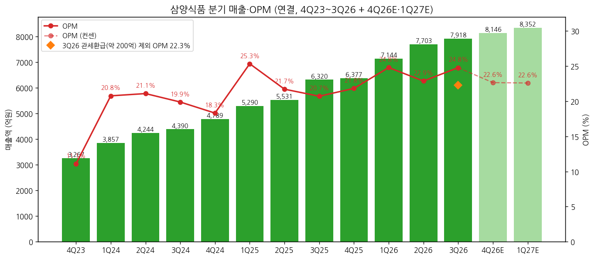
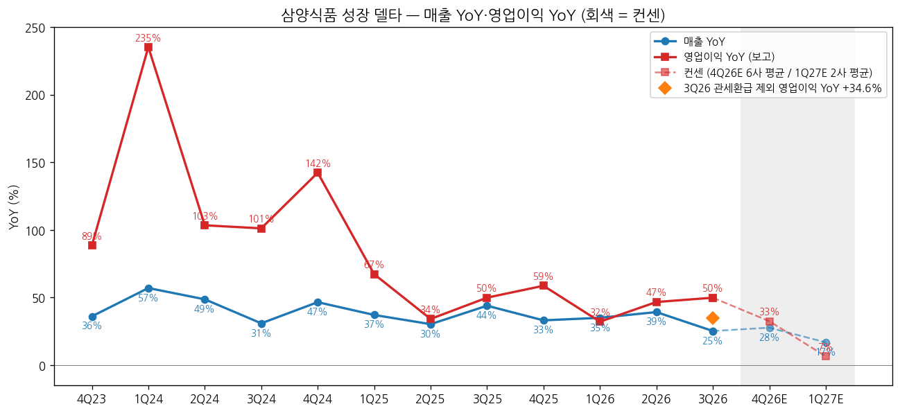
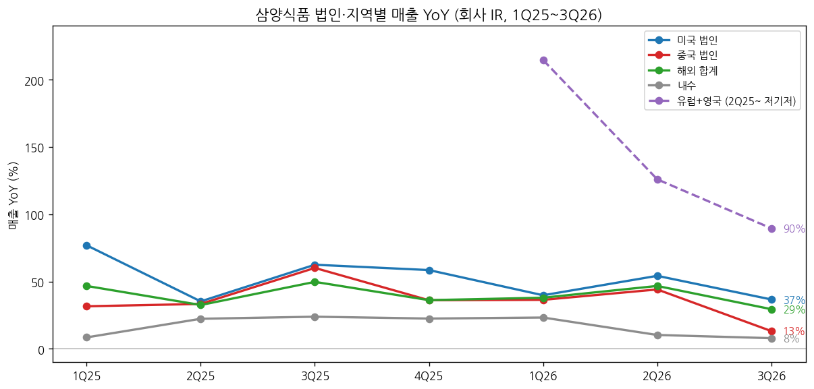

> 모드: 실적 리뷰 (v11)
> 종목: 삼양식품 (003230)
> 섹터: 개별주
> 서브섹터: 음식료 (개별주 카드 — 섹터 리뷰 대상 아님, 단독 판정)
> 분기: 2026-Q3
> 발표일: 2026-11-06 (IR 「26년 3분기 경영실적」 게시) / 분기보고서 2026-11-16
> 작성 시각: 2026-11-16 22:10 KST
> 분석 소스: 회사 IR 「26년 3분기 경영실적」(2026-11-06, FnGuide 경유 PDF 첨부 + irgo 원본) + 3Q26 분기보고서(OpenDART, 2026-11-16) + 국내외 6개사(KB 11/06, 다올 11/08, Macquarie 11/09, 신한 11/09, 메리츠 11/11 「2027 Outlook」, DS 11/16 「2027 Outlook」) — 첨부 7건(회사 IR 1 + 증권사 6) 전부 삼양식품 자료 / 과거 분기 = OpenDART 분기 시계열(2026-11-16 조회)·본 세션 기업개요 v1.0 / 웹서치 보완: 베트남 공장 공시(2026-11-11), 주가(Yahoo 일봉)
> 리뷰 깊이: 풀 | 리서치 첨부 7건 (회사 IR 1 + 증권사 6)
> 비영업 요인: 일회성 — 미국 관세 환급금 약 190\~200억 (매출원가 차감으로 영업이익에 반영, 영업이익의 약 10%) / 영업외 — 원화 강세 외화자산 평가손실 약 400억(KB) (순이익만 영향)

# 삼양식품 3Q26 실적 리뷰

## 0. 한 줄 판정

> 성장 델타: 유지 | 내러티브: 유지 → 델타 유지(실질은 둔화) + 내러티브 유지 → 경계 구간 (CAPA 공백기 — 1월 中 자싱 본생산과 4Q·1Q27 이익 경로 확인 전까지)

> ⚠ 비영업 요인 플래그: 보고 영업이익 YoY +49.9%(2Q26 +46.7% → +3.2%p, '유지')를 만든 데 **미국 관세 환급금 약 200억**(일회성, 매출원가 차감)이 들어 있다. 제외 시 영업이익 약 1,762억, **YoY +34.6%(−12.1%p, 판정상 '둔화')**, OPM 22.3% — 2Q26(22.9%)과 같은 수준. 순이익 −35% QoQ는 외화자산 평가손실(영업 외)

→ 숫자: 매출 7,918억 (YoY +25.3%, QoQ +2.8%), 영업이익 1,962억 (YoY +49.9%, OPM 24.8%). 매출 YoY가 39.3% → **25.3%**(−14.0%p)로 3Q23 이후 12개 분기 중 가장 낮아졌고, 영업이익 YoY는 환급금 덕에 유지. FnGuide 컨센(매출 8,117억 / 영업이익 1,844억) 대비 매출 −2.4%, 영업이익 +6.4% — 환급금 제외 시 −4.5%(KB)
→ 쟁점 ①: "beat인가 in-line인가" — 6개사 모두 관세 환급을 빼고 봤고, 결론은 **본업 이익은 2Q 수준 정체(OPM 22% 초반), 원가·원화 강세를 판관비 절감으로 막았다**
→ 쟁점 ②: 매출 둔화의 원인은 수요가 아니라 **공급(CAPA 풀가동)과 유럽 거래선 교체** — 유럽+영국 995억(−12% QoQ), 출항 지연으로 100\~110억 이연(메리츠). 美 법인 +36.6%·中 +13.2%
→ 쟁점 ③: 2027 성장 경로 — 1월 中 자싱 본생산으로 CAPA 28억 → 39.3억식(+40%, DS), 11/11 베트남 공장(2,186억, 2029.01) 발표. 6개사 2027E 영업이익 평균 8,741억(+19%) — 성장률은 2026E(+40%)의 절반, 범위 8,120억(다올) \~ 9,182억(Macquarie)
→ 다음 분기 관건: 4Q26 영업이익 컨센 1,845억(YoY +32.5%)과 1Q27(2사 평균 YoY +6.5%) — **컨센 경로상 영업이익 YoY는 4Q26 → 1Q27 연속 둔화**. 자싱 본생산이 1Q27 해외 물량을 실제로 끌어올리는지가 델타 재가속의 열쇠

---

## 1. 숫자

① 연결 분기 표 (억원, K-IFRS 연결)

| 항목 | 4Q23 | 1Q24 | 2Q24 | 3Q24 | 4Q24 | 1Q25 | 2Q25 | 3Q25 | 4Q25 | 1Q26 | 2Q26 | **3Q26** | 4Q26E | 1Q27E |
|---|---|---|---|---|---|---|---|---|---|---|---|---|---|---|
| 매출액 | 3,267 | 3,857 | 4,244 | 4,390 | 4,789 | 5,290 | 5,531 | 6,320 | 6,377 | 7,144 | 7,703 | **7,918** | 8,146 | 8,352 |
| 영업이익 | 362 | 801 | 895 | 873 | 877 | 1,340 | 1,201 | 1,309 | 1,392 | 1,771 | 1,762 | **1,962** | 1,845 | 1,887 |
| OPM | 11.1% | 20.8% | 21.1% | 19.9% | 18.3% | 25.3% | 21.7% | 20.7% | 21.8% | 24.8% | 22.9% | **24.8%** | 22.6% | 22.6% |
| 관세환급 제외 영업이익 [계산] | — | — | — | — | — | — | — | — | — | — | — | **약 1,762** (OPM 22.3%) | — | — |
| 매출 YoY | +36.1% | +57.0% | +48.7% | +31.0% | +46.6% | +37.2% | +30.3% | +44.0% | +33.2% | +35.0% | +39.3% | **+25.3%** | +27.7% | +16.9% |
| 영업이익 YoY | +88.5% | +235.1% | +103.4% | +101.2% | +142.3% | +67.3% | +34.2% | +49.9% | +58.7% | +32.2% | +46.7% | **+49.9%** | +32.5% | +6.5% |
| **매출 YoY 델타 (%p)** | −22.4 | +20.9 | −8.3 | −17.7 | +15.6 | −9.4 | −6.9 | +13.7 | −10.8 | +1.8 | +4.3 | **−14.0** | +2.4 | −10.8 |
| **영업이익 YoY 델타 (%p)** | −36.4 | +146.6 | −131.7 | −2.2 | +41.1 | −75.0 | −33.1 | +15.7 | +8.8 | −26.5 | +14.5 | **+3.2** (환급 제외 −12.1) | −17.4 | −26.0 |
| 해외 매출 비중 | 67.9% | 74.9% | 78.3% | 77.7% | 78.1% | 80.2% | 79.6% | 80.8% | 79.8% | 81.9% | 83.8% | **83.5%** | — | — |

→ (출처: 4Q23\~3Q26 = OpenDART 연결 분기 시계열(4Q = 연간 − 3Q 누적, 2026-11-16 조회, 3Q26은 분기보고서 확정치) — 회사 IR 요약손익과 일치. 해외 비중 = 사업보고서 매출실적 '수출 합계' 누적 차분 = IR '해외'. 4Q26E = 6개사 평균(KB 8,083/1,784 · 다올 8,000/1,806 · Macquarie 8,038/1,835 · 신한 8,180/1,890 · 메리츠 8,515/1,944 · DS 8,061/1,809). 1Q27E = 분기 추정을 낸 2개사 평균(다올 8,260/1,720 · DS 8,442/2,054) — 표본이 작아 참고용. 관세환급 제외 = 환급금 약 200억(KB·메리츠, 다올 190억·Macquarie c.190억) 차감)
→ 컨센 대비: 매출 **−2.4%**, 영업이익 **+6.4%** (FnGuide QuantiWise 8,117억 / 1,844억 — 신한·메리츠 인용, 집계 증권사 수 미표기). 다올 집계 시장컨센(8,052억 / 1,829억) 대비는 +7.2%. **관세 환급 제외 시 −4.5%**(KB) — 헤드라인은 beat, 본업은 소폭 하회 \~ 부합
→ 3Q26 세전이익 1,274억(−30.1% QoQ), 순이익 892억(−35.1% QoQ, −18.9% YoY): 원화 강세에 따른 외화자산 평가손실(미실현) — KB 약 400억, 메리츠는 외화 관련 손실 681억으로 집계

**해석**
→ 영업이익 YoY 정점은 4Q24(+142.3%) — 이후 +30\~60% 밴드에서 등락. 2Q26 +46.7% → 3Q26 +49.9%로 보고 기준은 '유지'지만, 환급금을 빼면 +34.6%로 1Q26(+32.2%)과 비슷한 수준까지 내려온다 [계산]
→ 매출 YoY는 2Q26 +39.3% → 3Q26 **+25.3%** — 3Q23 이후 12개 분기 중 가장 낮다. 원인은 ① 밀양2공장 포함 국내 면류 가동률 약 96%(3Q26 누적, 원주 101%·익산 119%)로 **팔 물건이 더 없는 상태** ② 유럽·영국 거래선 교체로 약 100\~110억 이연(메리츠) ③ 원화 강세로 원화 환산 판가 하락
→ 컨센 경로: 4Q26E 영업이익 YoY +32.5%, 1Q27E +6.5%(2사) — **YoY는 3Q26(환급 포함)을 국지 고점으로 2개 분기 연속 둔화가 컨센 경로**. 1Q27은 1Q26(OPM 24.8%) 고기저 + 1Q27 원재료 연간 계약 단가 상승(메리츠) + 자싱 초기 비용(다올)이 겹치는 구간. 재가속은 2Q27 이후 자싱 램프업에 달렸다 [전망]

→ (출처: OpenDART 연결, 4Q26E 6사 평균·1Q27E 2사 평균(연한 막대·점선). 주황 마름모 = 관세 환급 약 200억 제외 OPM [계산])

→ (출처: OpenDART 연결, 셀사이드 컨센 평균. 주황 마름모 = 관세 환급 제외 영업이익 YoY [계산])

② 사업부·법인별 매출 (영업이익은 사업부·법인별 **회사 미공시**)

(1) 법인·지역별 매출 (억원, 회사 IR)

| 구분 | 3Q25 | 2Q26 | **3Q26** | 매출 YoY | 매출 QoQ | 비중 | 회사·셀사이드 코멘트 |
|---|---|---|---|---|---|---|---|
| 미국 법인 (멕시코 포함) | 1,555 | 2,036 | **2,125** | +36.7% | +4.4% | 26.8% | 월마트 +26% · 크로거 +9% QoQ, 메인스트림 비중 64%(+5%p), 멕시코 14.6% (메리츠·KB) |
| 중국 법인 | 1,846 | 1,810 | **2,089** | +13.2% | +15.4% | 26.4% | 중추절·광군제 선적, 간식 채널 비중 37\~38% (메리츠) |
| 유럽 법인 | 525 | 806 | **869** | +65.5% | +7.8% | 11.0% | 네덜란드·독일·폴란드 확대, 프랑스·이탈리아 거래선 교체 |
| 영국 법인 | — | 326 | **126** | 신규 | −61.3% | 1.6% | 거래선·거래조건 변경으로 매출 이연 (IR) |
| (유럽+영국) | 525 | 1,132 | **995** | +89.5% | −12.1% | 12.6% | 출항 지연 100\~110억 이연, 4Q까지 일시 둔화 (메리츠) |
| 일본 법인 | 80 | 112 | **111** | +38.8% | −0.9% | 1.4% | CVS 벤더 매출 견조 |
| 인니 법인 | 64 | 103 | **51** | −20.3% | −50.5% | 0.6% | 르바란 이후 계절성·현지 소비 위축 |
| 기타 (법인 外 수출·자회사 3자매출) | 1,035 | 1,266 | **1,237** | +19.5% | −2.3% | 15.6% | |
| **해외 합계** | 5,105 | 6,458 | **6,608** | **+29.4%** | +2.3% | 83.5% | |
| 내수 | 1,215 | 1,245 | **1,311** | +7.9% | +5.3% | 16.6% | 고ASP 신제품('짜르르' 7월) |
| **합계** | 6,320 | 7,703 | **7,918** | +25.3% | +2.8% | 100% | |

→ (출처: 회사 IR 「26년 3분기 경영실적」 p.5 분기별 매출 실적 요약. 비중은 합계 대비 [계산])

(2) 제품별 — 면스낵 수출 (억원, OpenDART 분기·반기 보고서 매출실적 누적 차분)

| 항목 | 3Q25 | 1Q26 | 2Q26 | **3Q26** | YoY | QoQ |
|---|---|---|---|---|---|---|
| 면스낵 수출 | 4,950 | 5,657 | 6,175 | **6,338** | +28.0% | +2.6% |

→ 3Q26 누적 매출 비중: 면스낵 90.6%, 소스·조미소재 3.4%, 냉동 2.4%, 기타(뉴트리션·용역) 3.6% (IR). 소스는 3Q26 누적 768억 — 해외 소스 매출은 Macquarie 추정 3Q −3% QoQ로 정체 [추정]

→ (출처: 회사 IR 1Q24\~3Q26 법인별 매출. 유럽+영국은 2024 하반기 설립으로 저기저 — 1Q26부터 표시)

**해석**
→ 델타를 끄는 건 **미국**(+36.7%, 1Q24 이후 10회 중 8회 QoQ 성장) — 4Q25 이후 4개 분기 연속 최대 법인. 꺾이는 건 **중국**(2Q26 +44% → 3Q26 +13%, 3Q25 고기저 1,846억)과 **유럽**(거래선 교체)
→ 해외 합계 YoY 46.7% → 29.4%, 내수 +7.9%. 해외 성장률 둔화의 대부분이 중국 고기저와 유럽 공백으로 설명된다 [판단]
→ 이익 측면: GPM 46.6%(−1.5%p QoQ, 환급 포함). 환급 약 200억을 빼면 GPM 약 44.1% [계산] — 팜유·LNG·유가 원가와 원화 강세가 2Q26 48.1% 대비 약 4%p를 깎았고, 판관비율 21.8%(−3.4%p: 2Q 일회성 기저, 마케팅비 −70억, 운임 −110억 — KB)가 이를 상쇄

③ 연간 (억원)

| 항목 | 2023 | 2024 | 2025 | 2026E | 2027E |
|---|---|---|---|---|---|
| 매출액 | 11,929 | 17,280 | 23,518 | 30,912 | 37,133 |
| 영업이익 | 1,475 | 3,446 | 5,242 | 7,339 | 8,741 |
| OPM | 12.4% | 19.9% | 22.3% | 23.7% | 23.5% |
| 매출 YoY | +31.2% | +44.9% | +36.1% | +31.4% | +20.1% |
| 영업이익 YoY | +63.2% | +133.6% | +52.1% | +40.0% | +19.1% |

→ (출처: 2023\~2025 OpenDART 연결, 2026E·2027E = 발표 후 6개사 평균 — 영업이익 KB 7,280/8,579 · 다올 7,300/8,120 · Macquarie 7,330/9,182 · 신한 7,383/9,135 · 메리츠 7,439/8,705 · DS 7,304/8,724)
→ 발표 전 → 후: FnGuide 컨센(신한 인용, 발표 전) 2026E 7,267억 / 2027E 8,941억 → 6사 평균 7,339억(**+1.0%**) / 8,741억(**−2.2%**). 2026은 3Q 환급금으로 소폭 상향, **2027은 하향** (KB −3.9%, 다올 1Q27 −5.7%, Macquarie EPS −8%). 순이익은 외화평가손실로 2026E 10% 안팎 하향(KB −10.5%, 신한 −10.0%, Macquarie EPS −12%)
→ 2027E 영업이익 범위 8,120억(+10.6%, 다올) \~ 9,182억(+25.1%, Macquarie) — 증권사 간 차이 1,060억(13%)

---

## 2. 시장 쟁점

### 2-0. 지난 리뷰에서 "봐야 할 것"으로 남긴 항목

→ 첫 리뷰 — 직전 체크 없음 (2026-11-16 기업개요 v1.0 작성 후 첫 실적 리뷰)

### 2-1. 이번 분기 쟁점

① **환급금을 빼면 beat인가 — 본업 마진은 몇 %인가** (6건 중 6건)
② **원화 강세·원가 상승 — 마진을 지킬 수단(판관비·가격 인상)이 있나** (6건)
③ **유럽 거래선 교체 — 매출 공백은 언제 메워지나** (5건 — KB·다올·Macquarie·메리츠·DS)
④ **CAPA 공백기와 2027 성장률 — 자싱(2027.01)·베트남(2029)이 성장률을 얼마나 되살리나** (6건)
⑤ **미국 메인스트림·중국 채널 — 수요는 여전히 공급보다 강한가** (6건)

### 2-2. 쟁점별 분해

#### ① 환급금 제외 본업 마진

(1) 회사 설명
→ "관세환급금 등 비경상적 수익 반영" / "고ASP 해외 매출 확대와 비용 통제를 통해 비우호적 대외환경 속 수익성 개선" / "관세환급금 인식 및 광고선전비 등 비용 통제를 통한 안정적인 판관비 지출로 수익성 유지" (IR p.4·6)

(2) 증권사별 해석 편차

| 증권사 | 환급금 규모·처리 | 환급 제외 영업이익 / OPM | 해석 |
|---|---|---|---|
| KB (11/06) | 200억 | 약 1,761억 | 환급 제외 시 컨센 **4.5% 하회** — 그래도 음식료 탑픽 유지 |
| 메리츠 (11/11) | 약 200억 | **1,762억 / 22.3%** | "전분기 수준" — 원가·원화를 판관비율 −3.4%p로 상쇄 |
| 다올 (11/08) | 190억, 매출원가 차감 반영 | 당사 추정 1,798억에 부합 | 환급 제외 원가율 55.8%(+3.9%p QoQ) — 풀가동으로 레버리지 제한, 환율·전쟁 관련 비용 상승 |
| Macquarie (11/09) | c.190억 | OPM **22.4%** | "In-line" — 원가 압박을 마케팅비 통제로 상쇄 |
| 신한 (11/09) | 언급 약함 | — | 헤드라인 컨센 +6.4% 상회로 표기 |
| DS (11/16) | — | — | 분기보다 2027 전망 중심 |

(3) 공통 결론 vs 갈리는 지점
→ 공통: 환급 약 200억은 일회성 — 본업 OPM은 22% 초반으로 2Q26(22.9%)과 비슷, **늘지 않았다**
→ 갈림: 컨센 대비 평가 — KB는 '하회', 메리츠·Macquarie·다올은 '부합'. 기준 컨센(QuantiWise 1,844억 vs 자사 추정)의 차이

(4) [판단]
→ 본업 영업이익은 1Q26 1,771억 → 2Q26 1,762억 → 3Q26 약 1,762억으로 **3개 분기 정체** [계산]. 매출은 늘었지만 원가·원화 부담으로 이익 레벨이 올라가지 않았다. 보고 기준 '유지' 판정 아래에 숨은 실질 '둔화'를 4Q 숫자로 다시 확인해야 한다
→ 결론을 바꿀 데이터: 4Q26 영업이익이 일회성 없이 1,900억 이상(OPM 23%+)이면 본업 레벨업 재개, 1,750억 이하면 정체 고착

#### ② 원화 강세·원가 상승과 마진 방어 수단

(1) 회사 설명
→ "원화 강세와 팜유 등 주요 원재료 투입 비용 상승과 에너지 가격 인상에 따른 원가 부담 확대" / "원화 강세에 따른 외화 자산에 대한 평가손실(미실현) 발생으로 당기순이익 감소" (IR p.6)
→ 시장별 가격 인상 검토 (Macquarie·메리츠, 컨콜 인용)

(2) 증권사별 해석 편차

| 증권사 | 가정 | 논리 |
|---|---|---|
| KB | 2027 원/달러 평균 1,315원(−8% YoY), 2027 OPM 23.4% | 원화 강세로 P 하락 우려 있으나 **강한 수요로 가격 전가 가능** — "30%대 Q 증가가 강력한 무기" |
| 신한 | 2027 GPM 46.9%, OPM 24.7% | 높은 GPM·낮은 가격 민감도·브랜드 파워로 원화 영향 **최소화** — 가격 인상으로 수익성 개선 |
| 메리츠 | 2027 OPM 23.8% (2026과 동일) | 부담 요인은 **1Q27 밀가루 등 원재료 연간 계약 단가 상승 + 원화 강세**, 국가별 가격 인상 검토 |
| 다올 | 2027 OPM 21.7% (가장 낮음) | 1Q27 OPM 20.9% — 중국 신공장 관련 비용 1Q27부터 집행, 원가율 상승 |
| Macquarie | EPS 2026 −12%, 2027 −8%, 2028 −6% (FX 가정 변경) | 마케팅비 통제 + 시장별 가격 인상으로 대응 |
| DS | 2027 OPM 23.4% | 환율 하락에 따른 외형·수익성 둔화 반영, 지역 믹스(미주·유럽 ASP)로 일부 상쇄 |

(3) 공통 결론 vs 갈리는 지점
→ 공통: 원화 강세는 2027 매출·이익 추정치를 깎는 1순위 변수, 순이익은 외화평가로 2026E 10% 안팎 하향
→ 갈림: **가격 인상이 실제로 나오느냐** — 신한·KB는 브랜드력으로 전가 가능(2027 OPM 24%대), 다올은 1Q27 비용 집중으로 OPM 21%대. 2027 OPM 추정 범위 21.7\~24.7% (3%p 차이 = 영업이익 약 1,100억)

(4) [판단]
→ 3Q는 판관비 절감(마케팅·운임)으로 막았지만 이 수단은 반복성이 낮다. 2027 마진을 지키는 실제 수단은 **가격 인상**뿐이고, 아직 발표 전이다 — 가격 인상 공지가 없는 채로 1Q27 원재료 계약가가 오르면 다올 시나리오(OPM 21%대)에 가까워진다 [판단]

#### ③ 유럽 거래선 교체

(1) 회사 설명
→ "유럽 유통망 최적화 위한 거래선 변경 지속" — 네덜란드·독일·폴란드 등 기존 권역 매출 확대, 프랑스·이탈리아 등 거래선 교체. 영국은 "K-Food 관심 확대에 따른 불닭 브랜드 수요 증가에도 불구, 거래선 및 거래조건 변경에 의한 매출 이연 발생" (IR p.5)

(2) 증권사별 해석 편차

| 증권사 | 4Q26E 유럽(+영국) | 2027E 유럽 | 논리 |
|---|---|---|---|
| Macquarie | 1,050억 | 5,170억 | 약한 유통사를 강한 파트너로 교체 — **1H27까지 조정 지속 가능**, 이를 반영해 TP −11% |
| 메리츠 | — | — | 출항 지연으로 100\~110억 이연, **4Q까지 일시 둔화**, 정비 후 반등 |
| KB | [표 판독 불가] | 5,030억 | 영국 포함 995억(−11%), 거래처 교체 영향 |
| DS | 유럽 835억 + 영국 271억 | 유럽 4,056억 + 영국 1,198억 | 정비 후 성장, 유럽은 ASP 높은 믹스 개선 축 |
| 다올 | — | — | 유럽 물량 선적 지연·거래선 변경에 따른 매출 공백에도 중국·미국이 상쇄 |

(3) 공통 결론 vs 갈리는 지점
→ 공통: 수요 문제가 아니라 **유통 구조 정비**(직거래·강한 파트너 전환) — 일시적
→ 갈림: 공백 기간 — 메리츠 '4Q까지' vs Macquarie '1H27까지'

(4) [판단]
→ 유럽+영국은 매출 비중 12.6%로 작지 않다. 2Q26 1,132억 → 3Q26 995억 역성장이 4Q에도 이어지면 매출 YoY 회복(4Q26E +27.7%)이 어렵다. 4Q 유럽+영국이 1,100억을 회복하는지가 Macquarie 시나리오 판별 기준

#### ④ CAPA 공백기와 2027 성장률

(1) 회사 설명
→ 中 저장성 자싱공장(8라인, 약 2,072억) 2027-01 완공 목표, 시생산 진행 중 (Macquarie·KB) / 2026-11-11 베트남 박닌성 생산법인 1,311억 출자, 총 2,186억 투자 — 투자 기간 2029-01-31까지 (공시)
→ 회사 관계자: 베트남 공장으로 권역별 생산 거점을 분리해 지정학·물류·관세 등 단일 지역 위험을 분산 (딜사이트)

(2) 증권사별 해석 편차

| 증권사 | CAPA 가정 | 2027E 매출 / 영업이익 (YoY) | 1Q27E 영업이익 YoY | 논리 |
|---|---|---|---|---|
| Macquarie | 자싱 1Q27 가동 | 37,790 / **9,182억 (+25%)** | — | 가장 낙관 — 2027 해외 +24%, 미국 +31% |
| 신한 | 밀양2 +39%, 자싱 +43% | 37,009 / 9,135억 (+24%) | — | 추가 생산기지로 2030 공급 부족 대응, **해외 모멘텀 확대 초입** |
| DS | 28억 → 39.3억식 (+40%), 베트남 포함 2029 50.6억식 | 37,351 / 8,724억 (+19%) | **+15.9%** | 1H27 중국 공장 가동률 상승·ASP 믹스 확인 시 주가 반등 |
| 메리츠 | 1월 본생산으로 병목 해소 | 36,606 / 8,705억 (+17%) | — | 미국 점포당 매출·멕시코→남미·캐나다(법인 설립 완료) |
| KB | 해외 법인 판매량 2026 +22% → 2027 +35% | 36,677 / 8,579억 (+18%) | — | "30%대 Q 증가" — 연내 신규 공장 발표로 2028+ 불확실성 완화 |
| 다올 | 밀양2 8.2억식, 자싱 11.3억식 | 37,360 / **8,120억 (+11%)** | **−2.8%** | 가장 보수 — 국내→중국 생산 이전 과정 공백, 4Q27에야 1Q27 대비 매출 +2,200억 |

(3) 공통 결론 vs 갈리는 지점
→ 공통: 2026은 공급 제약 해, 2027 1월 자싱 가동으로 물량 증가 재개. 2027E 매출 +17\~23%로 2026E(+31%)보다 낮다는 데 6개사 모두 동의
→ 갈림: **램프업 속도와 국내 물량 재배치** — 자싱 물량이 중국 수출을 대체하는 동안 국내 여유분을 미국·유럽 고ASP로 얼마나 빨리 돌리느냐. 다올은 1Q27 이익 역성장, DS는 +16%

(4) [판단]
→ 수요가 공급보다 강하다는 전제는 6개사 공통이다(미국 +37%, 3Q 해외 +29%). 문제는 타이밍 — **1Q27 영업이익 YoY가 한 자릿수 이하로 떨어지면 델타는 '꺾임' 판정 조건(2개 분기 연속 둔화 + YoY 정점 통과)에 들어간다**. 베트남 발표(2029)는 2028+ 공급 공백을 줄였지만 2027 숫자에는 영향이 없다 [판단]

#### ⑤ 미국 메인스트림·중국 채널

(1) 회사 설명
→ 미국: "Walmart·Kroger 등 Mainstream과 Mexico 매출 성장 지속" / 중국: "권역 대리상 및 간식 채널 매출 성장" (IR p.5)

(2) 증권사별 해석 편차

| 증권사 | 미국 | 중국 |
|---|---|---|
| KB | 월마트 +26%, 메인스트림 비중 64%, 멕시코 15% | 중추절·광군제 물량 효과로 견조 |
| 메리츠 | 메인스트림 64%(+5%p), 멕시코 14.6%, 캐나다 법인 설립 완료 | 간식 채널 비중 37\~38% |
| 다올 | 월마트 +29%·크로거 +9% — 반복구매 수요 재차 확인, 매대 회전율 상승·멕시코 등 지역 침투 | 중국 생산 시 국내 CAPA를 미국·유럽 고ASP로 대체 |
| Macquarie | 라틴아메리카 확장 이니셔티브, 4Q26E 미국 2,500억(+43%) | 간식 채널 우선, 4Q26E 중국 1,870억(−11% QoQ) |
| 신한 | 미국 내 역성장 중인 경쟁사 대비 높은 성장 | 2027 1선 → 2·3선 도시 침투 가속 |
| DS | 4Q26F 2,288억(+31%), 2027F +37% | 2027F +12% (가장 보수) |

(3) 공통 결론 vs 갈리는 지점
→ 공통: 미국은 메인스트림 침투(월마트 점포당 매출)로 수요 견조 — 성장의 주 엔진
→ 갈림: **중국 2027 성장률** — KB +34%(자싱 효과) vs DS +12%. 자싱 물량이 순증인지, 기존 수출 대체인지에 대한 가정 차이

(4) [판단]
→ 미국은 3분기 연속 +35% 이상으로 델타의 하단을 받치고 있다. 중국은 3Q25 고기저(1,846억)로 3Q26 +13%에 그쳤고, 4Q25(1,482억)가 낮은 기저라 4Q26 YoY는 반등할 수 있다(Macquarie 4Q26E 1,870억 → +26%) [계산]

### 2-3. 낙관 vs 보수 — 논리 대비

→ **가장 낙관: Macquarie(2027E 영업이익 9,182억, +25%)·신한(9,135억)** — 가정의 핵심은 2027 해외 +24%(미국 +31%), 가격 인상과 지역 믹스로 OPM 24%대 유지. 신한은 "해외 모멘텀 확대 구간의 초입", 12개월 선행 PER 13.8배로 밸류 부담 완화. 단 Macquarie는 유럽 거래선 정비를 반영해 TP는 −11% 하향(낙관적 이익 + 보수적 멀티플)
→ **가장 보수: 다올(2027E 8,120억, +11%)** — 1Q27 영업이익 −2.8% YoY, 2027 OPM 21.7%. 가정의 핵심은 중국 신공장 비용 1Q27부터 집행 + 국내→중국 생산 이전 공백. 그래도 TP 190만 유지 — 이익은 보수, 멀티플(24배)은 높게
→ 둘을 가르는 변수: 2027 OPM(21.7% vs 24.3%)과 자싱 램프업 속도 — 영업이익 차이 1,060억(13%)
→ 셀사이드 vs 시장: TP 평균 182.5만원 vs 주가 1,285,000원(11/16) — 괴리 +42%. 주가는 실적 다음 거래일 11/09 1,152,000원(−5.6%)으로 하락 → 11/11 베트남 공장 공시 → 11/12 1,265,000원(+4.5%) → 11/16 1,285,000원(+6.2%). **시장은 3Q 숫자보다 증설(베트남) 뉴스에 반응** [판단]

### 2-4. 추정치·TP 변화

| 증권사 | 의견 | 직전 TP | 현재 TP | 4Q26E 영업이익 | 2026E / 2027E 영업이익 | 핵심 변화 한 줄 |
|---|---|---|---|---|---|---|
| KB (11/06) | Buy | 1,950,000 | 1,950,000 | 1,784억 | 7,280 / 8,579억 | 2027E 영업이익 −3.9%, 순이익 2026E −10.5% / 27E PER 23배 (Toyo Suisan·Nissin 대비 50% 할증) |
| 다올 (11/08) | Buy | 1,900,000 | 1,900,000 | 1,806억 | 7,300 / 8,120억 | 4Q26E −4.3%, 1Q27E −5.7% 하향 / 27E EPS 74,294원 × 24배 |
| Macquarie (11/09) | Outperform | 1,900,000 | **1,700,000** | 1,835억 | 7,330 / 9,182억 | EU 거래선·FX 반영 EPS 26/27/28 −12/−8/−6% / FY26 PER 25배 유지 |
| 신한 (11/09) | 매수 | 1,750,000 | 1,750,000 | 1,890억 | 7,383 / 9,135억 | 영업이익 2026E +0.7%·2027E −0.5%, 순이익 2026E −10.0% / 27E PER 20배 (일본 라면 5년 평균) |
| 메리츠 (11/11) | Buy | [미확보] | 1,750,000 | 1,944억 | 7,439 / 8,705억 | 2027 Outlook — 2027E 영업이익 +17%, 1Q27 원재료 계약가·원화 부담 |
| DS (11/16) | 매수 | 1,900,000 | 1,900,000 | 1,809억 | 7,304 / 8,724억 | 27F PER 22배 (2024\~25 역사적 평균) / 베트남 포함 CAPA 2029 50.6억식 |

→ 평균 TP(6개사) **1,825,000원** (KB 집계 컨센 TP 1,864,615원, 11/06). 직전 TP 확인 5개사 평균 1,880,000원 → 1,840,000원(**−2.1%**). 하향 1건(Macquarie), 유지 4건, 직전 미확보 1건(메리츠). 범위 170만 \~ 195만원
→ TP 하향의 원인: Macquarie는 **실적 하향**(EPS −12/−8%)에 멀티플(25배) 유지. 나머지는 실적 소폭 하향(주로 순이익·2027)에도 멀티플 유지 → 셀사이드는 아직 내러티브를 깎지 않았다
→ 밸류에이션 위치: 2027E PER 13.3\~14.4배(KB·신한·Macquarie), 12개월 선행 13.8배(신한) — 2025 말 23.8배에서 절반 수준으로 디레이팅. TP 적용 멀티플 20\~25배와의 차이가 업사이드의 근원

---

## 3. 내러티브 점검

① 스토리 정의
→ **"불닭이라는 글로벌 브랜드는 수요가 공급보다 크다 — CAPA를 늘릴 때마다 미국·유럽 고ASP 채널로 물량이 팔려 나가며 매출과 마진이 계단식으로 오른다"** — 시장이 삼양을 사는 이유는 증설 = 성장이 거의 1:1로 연결된다는 점과, 국내 음식료에서 유일한 해외 80%+ 고성장 구조

② 이번 분기가 스토리에 준 영향
→ 강화: 미국 +36.7%(메인스트림 64%, 월마트 +26% QoQ), 베트남 공장 확정(2,186억, 2029) — 2027 자싱 → 2029 베트남으로 증설 계단이 이어짐, 신용등급 AA-·순현금 −1,223억으로 투자 여력 충분
→ 약화: 매출 YoY 25%로 12개 분기 내 최저, 본업 이익 3개 분기 정체(환급 제외 약 1,760억), 유럽 거래선 공백, 원화·원가로 GPM 하락, 2027 추정치 소폭 하향(−2.2%)·Macquarie TP −11%
→ 판정: 스토리의 핵심 전제(수요 > 공급)는 깨지지 않았다 — 둔화의 원인이 공급·유통 정비·환율이라 **내러티브 '유지'**. 다만 '증설 → 즉시 성장'이 2026에는 작동하지 않는 공백기
→ 국면: 보고 델타 유지(환급 제외 시 둔화) + 내러티브 유지 → **"경계 구간"**. 컨센 경로대로 1Q27 영업이익 YoY가 한 자릿수로 내려가면 '꺾임' 조건 충족 — 재진입 신호는 '1Q27 자싱 램프업 + 가격 인상 발표 + 유럽 회복' [판단]

③ 다시 강해질 트리거
→ 2027-01 자싱 본생산 개시 공시와 1Q27 중국 법인·해외 물량 급증 (KB 해외 법인 판매량 +35%)
→ 국가별 가격 인상 발표 — 원화 강세 상쇄, 2027 OPM 24%대 유지
→ 유럽+영국 4Q 1,100억 이상 회복, 미국 메인스트림 신규 채널(캐나다·남미) 입점

④ 스토리를 깨뜨릴 리스크
→ 자싱 램프업 지연 + 1Q27 영업이익 역성장(다올 −2.8%) → 델타 '꺾임'
→ 원화 강세 지속(원/달러 1,300원 이하)에 가격 인상 실패 → 2027 OPM 21%대
→ 미국 수요 둔화 신호(메인스트림 점포당 매출 정체) — 현재까지는 없음

---

## 4. 향후 봐야 할 것

① **4Q26 영업이익과 본업 OPM** — 1순위 (델타 판정을 바꾸는 변수)
→ 무엇을: 영업이익이 컨센 1,845억(YoY +32.5%, 범위 1,784\~1,944억)을 넘는지, 일회성 없이 OPM 22% 이상인지, 본업 이익이 1,760억 정체를 벗어나는지
→ 어떤 데이터로: 4Q26 잠정·IR(분기별 손익 요약), 관세청 월간 라면 수출(10\~12월), 원/달러
→ 언제: 2027-01 말 \~ 02 초 (캘린더 \~2027-01-28 추정)

② **中 자싱 본생산 개시와 1Q27 해외 물량**
→ 무엇을: 2027-01 본생산 개시 여부, 1Q27 해외 매출 YoY(2026 1Q +38%), 중국 법인 매출, 1Q27 영업이익 YoY(다올 −2.8% \~ DS +15.9%) — 한 자릿수 이하면 델타 '꺾임'
→ 어떤 데이터로: 회사 공시·보도자료, 관세청 중국향 라면 수출(현지 생산 대체로 감소 시 정상), 4Q 컨콜 가이던스
→ 언제: 2027-01 \~ 2027-05 (1Q27 실적)

③ **원화 강세·원가와 가격 인상**
→ 무엇을: 원/달러(KB 2027 평균 1,315원 가정), 팜유·LNG 가격, 1Q27 밀가루 연간 계약 단가, **국가별 가격 인상 발표 여부·폭**
→ 어떤 데이터로: 환율, 팜유 선물(말레이시아 BMD), 회사·현지 유통 가격 인상 뉴스, 4Q GPM(3Q 환급 제외 약 44%)
→ 언제: 2026-12 \~ 2027-03

④ **유럽 거래선 정비 완료**
→ 무엇을: 유럽+영국 매출이 3Q 995억에서 4Q 1,100억 이상으로 회복하는지(Macquarie 4Q 1,050억), 프랑스·이탈리아·영국 신규 거래선 가동, 정비 기간 '4Q까지(메리츠)' vs '1H27까지(Macquarie)'
→ 어떤 데이터로: 회사 IR 유럽·영국 법인 매출, 관세청 EU·영국향 라면 수출
→ 언제: 2027-01 말(4Q26) \~ 2027-05(1Q27)

⑤ **미국 메인스트림 확장**
→ 무엇을: 미국 법인 4Q 2,288억(DS) \~ 2,500억(Macquarie), 월마트·크로거 QoQ, 메인스트림 비중 64% → 70%, 멕시코·캐나다·남미 확장
→ 어떤 데이터로: 회사 IR 미국 법인, 관세청 미국향 라면 수출, 미국 유통 채널 입점 뉴스
→ 언제: 매월(수출 통계) / 2027-01 말(4Q26)

---

### 참고 — 일정·자료

→ 4Q26 잠정실적: 2027-01 말 추정 (노션 실적 캘린더 \~2027-01-28)
→ 기업개요: company-overview/삼양식품_기업개요.md (v1.0, 2026-11-16)
→ 셀사이드 원문 PDF는 비공개 폴더 보관 (공개 레포 미포함)
