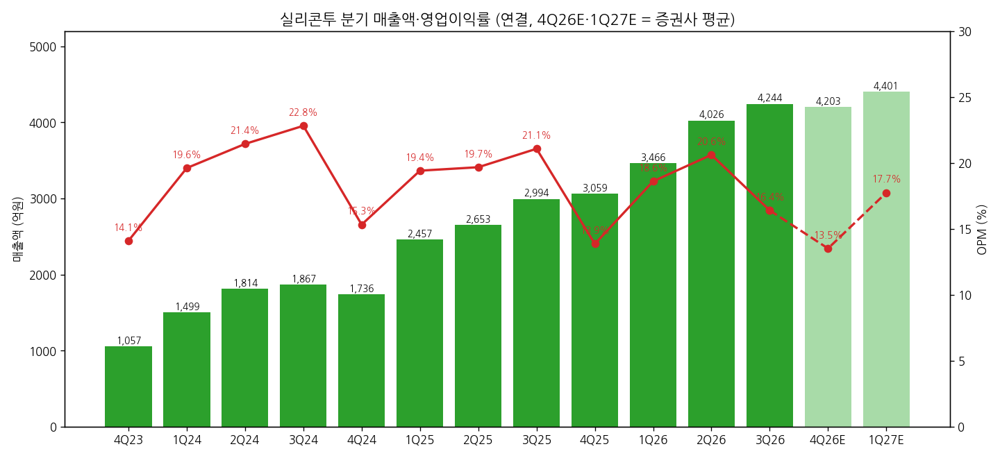
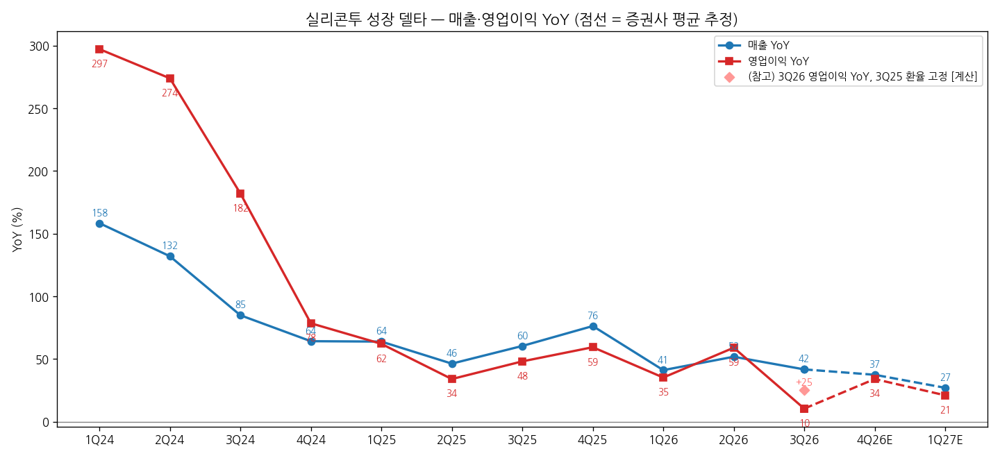
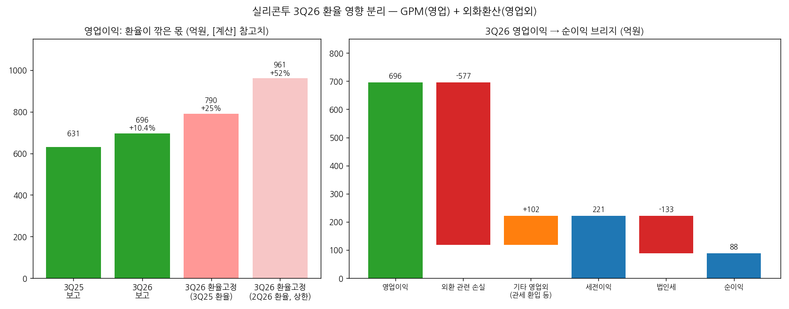
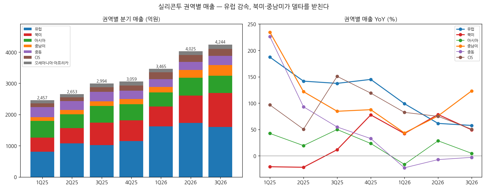

> 모드: 실적 리뷰 (v11)
> 종목: 실리콘투 (257720)
> 섹터: 뷰티
> 서브섹터: 유통
> 분기: 2026-Q3
> 발표일: 2026-11-11 (연결 잠정실적 공시 + IR 자료「2026년 3분기 경영실적」), 분기보고서 2026-11-13
> 작성 시각: 2026-11-22 20:29 KST
> 분석 소스: 회사 IR「2026년 3분기 경영실적」(2026-11-11) + 셀사이드 6건 첨부 — 다올투자증권(11/12, 이미지 PDF 판독, Not Rated), 삼성증권(11/12), 하나증권(11/12), 한화투자증권(11/12), NH투자증권(11/13), 유안타증권(11/16). 6건 모두 첫 페이지에서 실리콘투(257720) 확인 — 제외 없음. 과거 분기 숫자·권역 시계열은 실리콘투 기업개요(2026-11-15, OpenDART 연결 + IR)로 교차검증. 환율(원/달러·원/유로 분기 평균)은 NH 그림4·5(우리은행). 웹서치 보완 없음
> 리뷰 깊이: 풀 | 리서치 첨부 6건
> 비영업 요인: 원화 강세 — 영업 내(GPM -3.3%p QoQ, 환산 매출 감소)와 영업외(외환 관련 손실 577억원, 그중 미실현 환산손실 약 390억원) 동시 · 일회성 해외 거래처 대손상각비 23억원(판관비, 영업이익 포함) · 미국 관세 환입 일회성 이익(영업외, 금액 미공개) — 판정은 보고 기준 그대로

# 실리콘투 3Q26 실적 리뷰 — 매출은 7분기 연속 최대, 영업이익 YoY +59% → +10%로 급감속

> 성장 델타: 둔화 | 내러티브: 약화 → 델타 둔화 + 내러티브 약화 → 경계 구간 (매매 제외 근접 — 4Q26 GPM 30% 회복과 영업이익 YoY +30%대 재확대 확인 전까지)
>
> ⚠ 비영업 요인 플래그: 둔화의 주된 원인 = 원화 강세(영업 내). 주요 통화 평균 환율이 QoQ 6% 내려가며(IR) GPM이 32.0% → 28.7%로 빠졌다. 3Q25 환율(원/달러 1,446원·원/유로 1,682원)을 그대로 적용하면 3Q26 영업이익은 약 790억원, YoY +25%다([계산], 참고). 일회성 대손상각비 23억원을 빼도 +14%다. 두 보정치 모두 2Q26(+59.0%)보다 낮아 "둔화" 판정은 같다. 별도로 영업외에서 외환 관련 손실 577억원(그중 약 68% = 390억원이 미실현 환산손실)이 나와 순이익은 88억원(YoY -84.9%)으로 급감했다 — 영업이익 판정에는 영향 없음

→ **숫자**: 매출 4,244억원(+41.7% YoY, +5.4% QoQ), 영업이익 696억원(+10.4% YoY, -16.1% QoQ), OPM 16.4%(-4.7%p YoY). 영업이익 YoY는 2Q26 +59.0%에서 -48.6%p 내려왔고, 매출 YoY도 51.8% → 41.7%로 -10.1%p 줄었다. FnGuide 컨센 대비 매출 -0.3%(부합), 영업이익 -14.9%(818억원 대비 미스)
→ **쟁점 ①**: OPM 하락 4.2%p(QoQ) 중 3.3%p가 GPM이다(IR). 원가는 원화로 사고 매출은 외화로 받는 구조라 환율이 그대로 마진을 깎았다. 순수 환율만 계산하면 GPM이 4.3%p 빠졌어야 하는데 실제 -3.3%p라, 판가 조정이 약 1%p를 막았다([계산]). 판관비율도 +0.9%p(인건비 QoQ +27%, 대손 23억원) 올라 "환율만의 문제는 아니다"라는 지적이 함께 나왔다
→ **쟁점 ②**: 권역 믹스가 바뀌었다. 최대 권역 유럽은 YoY +99% → +62% → +58%로 3개 분기 연속 감속하고 QoQ -7%였다. 북미(+49%, QoQ +24%)와 중남미(+123%)가 유럽 공백을 메웠다. 아시아(+5%)·중동(-3%)은 정체다
→ **쟁점 ③**: 5곳 모두 TP를 내렸다(평균 5.36만원 → 3.96만원, -26.1%). 2027E 영업이익 추정 하향은 평균 -6% 수준인데 목표 PER은 11~13배 → 8~10.5배로 내려갔다. 하향의 주원인은 멀티플이다. 유안타는 "일부 대형 브랜드의 직접 유통 전환"(조선미녀 비중 하락)을 멀티플 할인 근거로 들었다
→ **다음 분기 관건**: 컨센 4Q26 영업이익 568억원(6곳 평균)은 YoY +34%로, 4Q25 저기저(OPM 13.9%) 덕에 숫자상 다시 커진다. 4Q 영업이익이 469억원(+10.4%)만 넘어도 보고 기준 "가속"이 되므로, 판단의 무게는 GPM이 29.5~30%로 돌아오는지(환율 효과 소멸 + 판가 조정)에 둬야 한다. 424억원(YoY 0%) 아래면 "꺾임"이다

---

## 1. 숫자

① 연결 기준 분기 표 (단위: 억원, %)

| 항목 | 4Q23 | 1Q24 | 2Q24 | 3Q24 | 4Q24 | 1Q25 | 2Q25 | 3Q25 | 4Q25 | 1Q26 | 2Q26 | **3Q26** | 4Q26E | 1Q27E |
|---|---|---|---|---|---|---|---|---|---|---|---|---|---|---|
| 매출액 | 1,057 | 1,499 | 1,814 | 1,867 | 1,736 | 2,457 | 2,653 | 2,994 | 3,059 | 3,466 | 4,026 | **4,244** | 4,203 | 4,401 |
| 영업이익 | 149 | 294 | 389 | 426 | 266 | 477 | 522 | 631 | 424 | 645 | 830 | **696** | 568 | 781 |
| OPM | 14.1 | 19.6 | 21.5 | 22.8 | 15.3 | 19.4 | 19.7 | 21.1 | 13.9 | 18.6 | 20.6 | **16.4** | 13.5 | 17.7 |
| GPM | 36.2 | 33.7 | 34.0 | 34.5 | 32.4 | 31.6 | 32.9 | 31.6 | 28.5 | 30.0 | 32.0 | **28.7** | 28.6~29.8 | |
| 매출 YoY | +126.7 | +158.4 | +131.9 | +84.9 | +64.2 | +63.9 | +46.3 | +60.4 | +76.3 | +41.1 | +51.8 | **+41.7** | +37.4 | +27.0 |
| 영업이익 YoY | +232.4 | +297.1 | +275.1 | +181.5 | +78.7 | +62.1 | +34.0 | +48.1 | +59.4 | +35.2 | +59.0 | **+10.4** | +34.0 | +21.0 |
| **매출 YoY 델타 (%p)** | | +31.7 | -26.5 | -47.0 | -20.7 | -0.3 | -17.6 | +14.1 | +15.9 | -35.2 | +10.7 | **-10.1** | -4.3 | -10.4 |
| **영업이익 YoY 델타 (%p)** | | +64.7 | -22.0 | -93.6 | -102.8 | -16.6 | -28.1 | +14.1 | +11.3 | -24.2 | +23.8 | **-48.6** | +23.6 | -13.0 |
| (참고) 영업이익, 3Q25 환율 고정 | | | | | | | | | | | | 약 790 (YoY +25) | | |
| (참고) 영업이익, 대손 23억원 제외 | | | | | | | | | | | | 719 (YoY +14) | | |
| 순이익 | 100 | 255 | 333 | 299 | 320 | 388 | 356 | 584 | 358 | 543 | 723 | **88** | | |

→ (출처: 4Q23~2Q26 = OpenDART 연결(실리콘투 기업개요 분기 시계열, 4Q = 연간 − 3Q 누적), 3Q26 = 회사 IR·분기보고서(2026-11-13). YoY는 기업개요·IR 표기값(원 단위 기준) 사용. 4Q26E = 다올·삼성·하나·한화·NH·유안타 6곳 평균(매출 4,111~4,299억원, 영업이익 520~625억원), 1Q27E = NH·한화·다올 3곳 평균(소수 의견). 4Q26E GPM = NH·다올·삼성 범위)
→ **YoY 계산 기준**: K-IFRS 연결, 3Q25 원공시치(매출 2,994억원, 영업이익 631억원) 대비. 3Q25 재작성·연결범위 변경 공시는 없다(2026년 일본 법인 연결 편입은 규모 미미 — [판단]). IFRS 18 미적용으로 외환차손·외화환산손실은 영업외에 있다(IR 손익표에 영업외손익 -475억원 별도 표기). 따라서 보고 영업이익에 들어간 환율 영향은 "환산 매출 감소 → GPM 하락" 경로뿐이다. IFRS 18을 조기적용해 외화 매출채권 환손실까지 영업이익에 넣은 에이피알과는 영업이익 범위가 다르다
→ 3Q26 서프라이즈: 매출 컨센 대비 -0.3%, 영업이익 -14.9% (컨센 매출 4,257억원·영업이익 818억원, FnGuide — 다올·하나·유안타·삼성 인용. 한화 인용 컨센은 4,260억원·820억원. 커버 증권사 14곳, 삼성 표기)
→ 영업이익 YoY는 1Q24(+297%)가 정점이다. 이후 2025년 +34~62% 박스권, 2026년 1Q +35% → 2Q +59% → 3Q +10%로 출렁였다. 매출 YoY는 2023~2024년 세 자릿수에서 2025년 +46~76%, 2026년 +41~52%로 계단식으로 내려오는 중이다. 컨센은 4Q26 +37%, 1Q27 +27%로 감속을 이어 그린다
→ 컨센 경로상 영업이익 YoY는 4Q26(+34%)에 다시 커지지만 이는 4Q25 저기저(OPM 13.9%, 성과급·운반비 집중) 효과다. 1Q27E는 +21%로 다시 내려간다. **컨센 경로상 영업이익 YoY 정점은 2Q26(+59%)이고, 매출 YoY는 이미 정점(1Q24)을 한참 지난 감속 국면**이다
→ **[판단] 델타 = 둔화**: 보고 영업이익 YoY가 +59.0% → +10.4%로 크게 줄었지만 여전히 플러스다. 직전 분기(2Q26)는 확대(+23.8%p)였으므로 "2개 분기 연속 둔화" 요건도 아니다. 그래서 기준표상 "둔화"다. 다만 낙폭(-48.6%p)이 커서 꺾임에 가까운 둔화다

→ (출처: OpenDART 연결, 회사 IR, 4Q26E 증권사 6곳 평균, 1Q27E NH·한화·다올 평균. 연한 막대·점선 = 추정)

→ (출처: 동일. 점선 = 추정. 분홍 마름모 = 3Q25 평균 환율을 적용한 3Q26 영업이익 YoY [계산] — 환율 효과를 걷어낸 참고치)

② 환율 영향 분리 — 영업(GPM)과 영업외(외화환산)

(1) 환율 수준 (분기 평균, 원)

| 통화 | 3Q25 | 4Q25 | 1Q26 | 2Q26 | **3Q26** | QoQ | YoY |
|---|---|---|---|---|---|---|---|
| 원/달러 | 1,446 | 1,454 | 1,469 | 1,504 | **1,421** | -5.5% | -1.7% |
| 원/유로 | 1,682 | 1,692 | 1,718 | 1,749 | **1,635** | -6.5% | -2.8% |

→ (출처: NH 그림4·5(우리은행 분기 평균). 회사 IR은 "주요 통화 평균 6% 하락(QoQ)")
→ 핵심은 **QoQ로 크게, YoY로는 작게** 움직였다는 점이다. 2Q26에 원화가 크게 약했다가(고환율 → GPM 32.0%) 3Q에 되돌아왔다. 그래서 QoQ 마진 낙폭은 크고, YoY 기준 환율 영향은 그보다 작다

(2) 영업이익에 들어간 환율 영향 — 3개 방법 비교 (단위: 억원, [계산], 참고)

| 방법 | 가정 | 3Q26 영업이익 | YoY | 환율 영향 |
|---|---|---|---|---|
| 보고 | — | **696** | **+10.4%** | — |
| A. YoY 기준 환율 고정 | 매출의 98%가 외화, 가중 평균 통화 -2.2% YoY, 원가는 원화로 고정 | 약 790 | 약 +25% | 약 -94 |
| B. GPM 하락분 전부 = 환율 | 2Q26 GPM 32.0% 유지 가정 (QoQ -3.3%p × 매출) | 약 836 | 약 +32% | 약 -140 |
| C. QoQ 기준 환율 고정 (상한) | 2Q26 환율로 환산 (통화 -6%) | 약 961 | 약 +52% | 약 -265 |

→ 계산 방식: 매출 98%(DART 수출 비중 97.9%)가 외화로 잡히고 매출원가 3,025억원은 원화 매입가라 환율과 무관하다고 본다. 통화가 x% 내리면 매출과 매출총이익이 같은 금액만큼 줄어든다. 판가·거래조건 조정, 현지 법인 원가의 외화 부분, 헤지는 반영하지 못한 근사치다
→ 방법 C로 보면 순수 환율 효과는 GPM을 32.0%(2Q) → 27.7%로 4.3%p 깎았어야 한다. 실제 GPM은 28.7%라 약 1.0%p는 판가 조정·믹스로 방어됐다. 회사 IR의 "판가 조정, 거래 조건 재협상 등 수익성 개선 노력 지속"과 맞는 숫자다
→ YoY로는 다르다. 3Q25 대비 GPM -2.9%p 중 환율(방법 A) 몫은 약 -1.6%p(환율 고정 GPM 30.3%)다. 나머지 약 -1.3%p는 환율 밖이다. NH가 지적한 "중동 전쟁 이후 공급가 상승 대비 선제적 재고 확보"(2Q 재고 +33% QoQ)로 비싸게 산 재고가 3Q에 팔린 영향, 유럽 내셔널 리테일러·중남미 대형 거래선의 낮은 마진 믹스가 후보다 [판단]
→ **판정 영향**: 어느 방법으로 걸러도 3Q26 영업이익 YoY(+25~52%)는 2Q26(+59.0%)보다 낮다. 환율이 둔화의 주원인이지만 환율만으로 "유지"가 되지는 않는다

(3) 영업이익 → 순이익 브리지 (단위: 억원)

| 항목 | 3Q25 | 2Q26 | **3Q26** | 비고 |
|---|---|---|---|---|
| 영업이익 | 631 | 830 | **696** | 대손상각비 23억원(일회성) 포함 |
| 영업외손익 | +77 | +90 | **-475** | 외환 관련 손실 577억원(하나·한화·유안타) + 기타 약 +102억원(미국 관세 환입 등, [계산]) |
| ├ 그중 미실현 외화환산손실 | | | 약 -390 | 외환 손실의 약 68% — 환율 회복 시 환입 가능 (IR·유안타·한화) |
| 법인세차감전순이익 | 708 | 920 | **221** | YoY -68.8% |
| 법인세비용 | 124 | 197 | **133** | 유효세율 60% — 손실 일부의 비공제 효과로 보인다 [판단] |
| 순이익 | 584 | 723 | **88** | YoY -84.9%, 컨센(664억원) 대비 -86.7% |

→ (출처: 회사 IR 4쪽 손익표(십억원 → 억원), 외환 관련 손실 577억원·미실현 68%는 하나·한화·유안타 인용. 기타 +102억원은 -475 − (-577) 역산)
→ 외화 10% 변동 시 세전이익 ±423억원(2026.09말 화폐성 외화자산·부채 기준, DART 주석 — 기업개요)이다. 3Q26 분기말 원화 강세가 외화 현금·매출채권·현지 법인 채권을 한꺼번에 깎은 것이다. RCS 3,000억원(2026.09 발행)의 조기상환권 파생상품 평가손익도 매 분기 당기손익에 들어간다(기업개요) — 3Q 영향 금액은 첨부 자료로 확인되지 않는다 (불확실)

→ (출처: 회사 IR, NH 환율, 하나·한화·유안타 외환 손실 분해. 왼쪽 분홍 막대 = [계산] 참고치, 판정에 쓰지 않음)

③ 사업부별·권역별 매출 (단위: 억원, %)

(1) 사업 부문 — 단일 영업부문(K-뷰티 유통). 부문별 영업이익은 공시하지 않는다. 매출유형별(CA·PA·풀필먼트)과 권역별 **매출만** 공개한다

| 매출 유형 | 1Q26 | 2Q26 | **3Q26** | 3Q26 YoY | 3Q26 누적 (DART) | 누적 비중 |
|---|---|---|---|---|---|---|
| CA (기업 바이어, 도매) | 3,278 | 3,788 | **4,004** | +42% | 11,046 | 94.1 |
| PA (개인, StyleKorean 역직구) | 135 | 170 | **174** | +60% | 545 | 4.6 |
| 풀필먼트 | 53 | 67 | **65** | 0% | 144 | 1.2 |

→ (출처: 분기값 = NH 표3 "당사 추정치" `[추정]`, 누적 = DART 2026 3분기보고서(기업개요). NH 분기 추정 합(PA 479억원·풀필먼트 185억원)은 DART 누적과 다소 다르다)
→ 매출의 94%가 CA라 권역별 분해가 실질적인 "사업부" 분해다

(2) 권역별 — 8개 권역 (IR 관리회계)

| 권역 | 3Q25 | 4Q25 | 1Q26 | 2Q26 | **3Q26** | 3Q26 YoY | 3Q26 QoQ | 3Q26 비중 | YoY 기여 | 권역 YoY 추이 (4Q25 → 1Q26 → 2Q26 → 3Q26) |
|---|---|---|---|---|---|---|---|---|---|---|
| 유럽 | 1,019 | 1,154 | 1,618 | 1,734 | **1,606** | +57.7 | -7.4 | 37.8 | +587 (47%) | +145 → +99 → +62 → **+58** |
| 북미 | 726 | 663 | 643 | 873 | **1,085** | +49.4 | +24.3 | 25.6 | +359 (29%) | +78 → +42 → +79 → **+49** |
| 아시아 | 528 | 515 | 444 | 575 | **553** | +4.8 | -3.8 | 13.0 | +25 (2%) | +24 → -16 → +29 → **+5** |
| 중남미 | 153 | 162 | 179 | 244 | **342** | +123.3 | +40.2 | 8.1 | +189 (15%) | +88 → +44 → +76 → **+123** |
| 중동 | 305 | 267 | 250 | 260 | **297** | -2.8 | +14.1 | 7.0 | -8 (-1%) | +33 → -23 → -7 → **-3** |
| CIS | 148 | 173 | 219 | 224 | **223** | +50.6 | -0.8 | 5.2 | +75 (6%) | +119 → +83 → +75 → **+51** |
| 오세아니아 | 82 | 85 | 76 | 79 | **105** | +27.7 | +31.9 | 2.5 | +23 (2%) | +13 → +12 → +18 → **+28** |
| 아프리카 | 33 | 40 | 36 | 36 | **33** | +1.8 | -7.4 | 0.8 | 0 (0%) | +21 → +33 → +20 → **+2** |
| **합계** | **2,994** | **3,059** | **3,466** | **4,026** | **4,244** | **+41.7** | **+5.4** | 100 | **+1,250** | +76 → +41 → +52 → **+42** |

→ (출처: 3Q25·2Q26·3Q26 = 회사 IR 5쪽(십억원 → 억원), 4Q25·1Q26 = 삼성증권 표(IR 기반, 4Q25는 연결 합 3,059억원에 맞춘 값 — 기업개요의 연간 역산치 3,091억원과 약 30억원 차이), 권역 YoY 추이 = 삼성증권 성장률 표. YoY 기여 = 3Q26 − 3Q25 [계산])
→ **델타를 끌어내린 권역은 유럽이다.** 매출의 38%인데 YoY가 3개 분기 연속 내려왔고(+99% → +62% → +58%), QoQ 128억원 감소는 다른 권역 증가분의 37%를 지웠다. 회사 설명은 "유럽 휴가 시즌 영향". 원/유로가 QoQ -6.5%라 유로 기준으로는 QoQ 약 -1%로 거의 보합이다 ([계산], 환율 효과 근사)
→ **델타를 받친 권역은 북미·중남미다.** 북미는 QoQ +212억원으로 전사 QoQ 증가(+218억원)의 거의 전부다. 원/달러 -5.5%를 되돌리면 달러 기준 QoQ 약 +31%다 [계산]. Ulta·Target 기존 거래처와 Sam's Club·Nordstrom·SalonCentric 신규 채널 덕이다(IR·삼성·NH). 중남미는 멕시코 법인(2026.06 가동)과 브라질·파라과이 신규 거래선으로 전 권역 최고 성장(+123%)이다
→ 아시아(+5%, "동남아 수요 둔화")·중동(-3%, "지정학적 영향 지속")·아프리카(+2%)는 정체다. 셋(비중 20.8%)은 합쳐서 YoY +2%다. 나머지 5개 권역은 +58%였으니, 셋이 같은 속도였다면 전사 YoY는 +58%였다 — 정체 권역이 전사 YoY를 약 16%p 끌어내린 셈이다 [계산]
→ YoY 기여로 보면 유럽 47%, 북미 29%, 중남미 15%다. 2025년 유럽 하나(+149%)가 끌던 구조에서 유럽·북미·중남미 3축 구조로 바뀌었다

→ (출처: 회사 IR(관리회계), 삼성증권 권역 표, 기업개요 권역 시계열)

(3) 판관비 — OPM 하락의 나머지 0.9%p (단위: 억원, 매출 대비 %)

| 항목 | 3Q25 | 2Q26 | **3Q26** | QoQ | 매출 대비 3Q25 → 2Q26 → 3Q26 |
|---|---|---|---|---|---|
| 급여(퇴직급여 포함) | 70 | 94 | **119** | +27.1% | 2.3 → 2.3 → 2.8 |
| 운반비 | 60 | 135 | **132** | -2.8% | 2.0 → 3.4 → 3.1 |
| 지급수수료 | 62 | 62 | **71** | +13.4% | 2.1 → 1.6 → 1.7 |
| 광고선전비 | 47 | 48 | **47** | -1.3% | 1.6 → 1.2 → 1.1 |
| 감가상각비 | 23 | 43 | **47** | +9.7% | 0.8 → 1.1 → 1.1 |
| 기타(대손상각비 23억원 포함) | 41 | 66 | **89** | +35.3% | 1.4 → 1.6 → 2.1 |
| **판관비 합계** | **314** | **460** | **522** | +13.5% | 10.5 → 11.4 → **12.3** |

→ (출처: 회사 IR 7쪽(십억원 → 억원), 복리후생비·지급임차료는 표에서 생략. 대손상각비 23억원 = 삼성·NH·유안타·다올 인용)
→ 운반비율은 해상 운송 비중 확대로 2Q 3.4% → 3.1%로 내려왔다(IR·NH). 반면 인건비(MOIDA 해외 매장·라이브 방송 신규 사업·해외 법인 채용)와 대손상각비가 판관비율을 +0.9%p 올렸다. 4Q는 성과급이 일괄 인식되는 계절이라(다올: 4Q 인건비 290억원 추정, 4Q25 196억원) 판관비율이 더 오른다

④ 연간 (단위: 억원, %)

| 항목 | 2022 | 2023 | 2024 | 2025 | 2026E | 2027E |
|---|---|---|---|---|---|---|
| 매출액 | 1,653 | 3,429 | 6,915 | 11,163 | 15,938 | 20,148 |
| 영업이익 | 142 | 478 | 1,376 | 2,054 | 2,739 | 3,504 |
| OPM | 8.6 | 13.9 | 19.9 | 18.4 | 17.2 | 17.4 |
| 매출 YoY | +26.2 | +107.5 | +101.7 | +61.4 | +42.8 | +26.4 |
| 영업이익 YoY | +61.4 | +236.6 | +187.8 | +49.3 | +33.3 | +28.0 |

→ (출처: 2022~2025 = OpenDART 연결(기업개요). 2026E·2027E = 다올·삼성·하나·한화·NH·유안타 6곳 발표 후 추정치 단순평균. 2026E 영업이익 범위 2,691~2,796억원, 2027E 3,160~3,822억원)
→ 3Q 누적 영업이익 2,171억원(+33.2%)이라 2026E 평균은 4Q 568억원을 내재한다. 2027E는 매출 +26%, 영업이익 +28%로 "고성장 → 지속성장" 경계(기업개요 기준: 매출 YoY 20%대 + OPM 16~18%)에 정확히 걸쳐 있다
→ 발표 전후 컨센 변화: 수정 전후를 모두 낸 5곳(NH·하나·한화·유안타·다올) 기준 2026E 영업이익 평균 -5.0%(-4.0~-7.0%), 2027E -5.8%(+0.9~-10.0%). 매출은 2026E +0~+2%로 거의 그대로다. FnGuide 발표 전 컨센(2026E 2,889억원·2027E 3,743억원, 하나 인용)과 비교하면 6곳 평균은 2026E -5.2%, 2027E -6.4%다. 순이익은 2026E -20~-23%(삼성 EPS -20.7%, 한화 -23.2%, NH EPS -21.1%)로 훨씬 크게 내려갔다

---

## 2. 시장 쟁점

① 지난 분기 체크
→ 첫 리뷰 — 직전 리뷰·팔로업 없음. 대신 기업개요(2026-11-15)의 "분기 재평가 트리거"로 점검한다 (참고)

| 기업개요 재평가 트리거 | 3Q26 결과 | 판정 |
|---|---|---|
| 매출 YoY 30% 아래로 내려가는지 | +41.7% (2Q26 +51.8%) | 확인 (30% 위 유지, 감속은 진행) |
| GPM 30% 회복 | 28.7% (QoQ -3.3%p) | 반대로 나옴 |
| 북미 성장 지속 | 1,085억원, +49% YoY, +24% QoQ | 확인 |
| RCS 3,000억원 사용처 | IR "글로벌 인프라 확장 및 시장 점유율 확대" 외 구체 공시 없음 | 미확인 |
| 주요 브랜드 이탈 | 조선미녀(구다이글로벌) 비중 하락, 닥터엘시아 2위로 상승(IR·하나·다올) | 반대로 나옴 (이탈 진행, 다른 브랜드로 공백 상쇄) |
| 재고 회전 | 재고 3,649억원(QoQ -19%), 회전일수 150일 → 약 110일(삼성) | 확인 |

② 이번 분기 쟁점 5개

| # | 쟁점 | 언급 증권사 수 |
|---|---|---|
| (1) | 영업이익 -15% 미스 — 얼마가 환율이고 얼마가 비용인가, 4Q GPM은 돌아오나 | 6/6 |
| (2) | 순이익 -85% — 외화환산손실 577억원과 환입 가능성 | 6/6 |
| (3) | 권역 믹스 — 유럽 감속 vs 북미·중남미 재가속, 2027 신규 채널 | 6/6 |
| (4) | 브랜드 이탈과 매출채권 — 조선미녀 직유통 전환, 대손 23억원 | 5/6 |
| (5) | TP 평균 -26% — 실적 하향인가 멀티플 하향인가 | 6/6 (TP 제시 5곳) |

③ 쟁점별 분해

(1) 영업이익 -15% 미스 — 얼마가 환율이고 얼마가 비용인가

(1-1) 회사 설명 (IR 4쪽)
→ "3분기 매출총이익률 28.7%, 3분기 누적 30.2%. 원화 강세로 전 분기 대비 주요 통화 평균 6% 하락 영향. 판가 조정, 거래 조건 재협상 등 수익성 개선 노력 지속"
→ "전분기 대비 4.2%p 하락 중 3.3%p가 매출총이익률 하락. 판관비율 12.3%(QoQ +0.9%p)는 해외사업 확대에 따른 인건비 증가 등의 영향"

(1-2) 증권사별 해석 편차

| 증권사 | 4Q26 영업이익 E (OPM) | 논리 |
|---|---|---|
| 삼성 | 625억원 (15.2%) | "프리뷰 당시 예상했던 대로" 환율 영향. 4Q는 환율 변동성 완화·판가 조정으로 GPM 29.8%로 점진 회복. 재고·운송비 부담 완화 확인 → **"단기 저점을 통과하는 중"** |
| 한화 | 602억원 (14.0%) | "분기 중 환율 변동폭이 이례적으로 확대". 4Q GPM은 개선되나 해외 인프라 확장 비용을 보수적으로 반영해도 컨센 부합 가능 |
| 다올 | 559억원 (13.2%) | 원화 강세 지속 시 **1H27까지 GPM 기저 부담**. 성과급 4Q 일괄 인식. 2026E·2027E 영업이익 -133억·-280억원 |
| NH | 554억원 (13.5%) | 수익성 하락은 "대부분 환율 영향", 매출원가율 71.3%가 예상(70.5%) 하회. 4Q GPM 28.6%로 가장 보수적 |
| 하나 | 550억원 (12.9%) | "환율 하락 영향이 애초 예상보다 크다". 4Q GPM 회복 가능하지만 인건비·인센티브 일회성으로 OPM QoQ 하락 불가피 |
| 유안타 | 520억원 (12.4%) | 원화 매입 → 외화 판매 구조라 환율 6% 하락이 그대로 마진 축소. 선제적 인력 채용 + 대손 23억원. 2027E OPM 16.6%로 가장 낮음 |

(1-3) 공통 결론 vs 갈리는 지점
→ 공통: 6곳 모두 GPM 하락의 1차 원인을 원화 강세로 본다. 6곳 모두 4Q OPM이 3Q(16.4%)보다 더 낮아진다고 본다(12.4~15.2%) — 4Q 성과급 계절성 때문이다
→ 갈림: GPM이 언제 돌아오느냐다. 삼성(4Q 29.8%)·한화는 4Q부터 회복을, 다올은 "1H27까지 기저 부담", NH는 4Q 28.6%로 3Q 수준 지속을 가정한다. 이 차이가 4Q 영업이익 추정 520~625억원(폭 105억원)으로 이어진다

(1-4) **[판단]**
→ QoQ 마진 낙폭은 환율로 거의 다 설명된다. 1번 ②의 계산으로 순수 환율 효과는 GPM -4.3%p였고 실제는 -3.3%p였다. 판가 조정이 이미 1%p를 막고 있다
→ 그러나 YoY로는 환율 밖의 마진 하락(약 -1.3%p)과 판관비율 상승(+1.8%p YoY, 10.5% → 12.3%)이 같이 있다. 3Q25 환율로 고정해도 OPM은 약 18.2%(790/4,338)로 3Q25(21.1%)보다 낮다 [계산]. "환율만 돌아오면 원래 마진"이 아니라, **환율을 빼도 OPM은 1년 전보다 약 3%p 낮은 체질**로 내려와 있다. 유럽 대형 리테일러·중남미 신흥 거래선 비중 확대(낮은 마진 믹스)와 해외 인력·매장 투자(MOIDA)가 구조적 요인이다 [판단]
→ 결론이 바뀌는 조건: 4Q 평균 환율이 3Q(원/달러 1,421원) 수준에 머무는데도 GPM이 29.5% 이상으로 돌아오면 판가 조정이 먹히는 것이고, 삼성의 "단기 저점" 해석이 맞다. 4Q GPM이 28%대에 머물면 다올의 "1H27까지 기저 부담"이 맞다

(2) 순이익 -85% — 외화환산손실 577억원과 환입 가능성

(2-1) 회사 설명 (IR 4쪽)
→ "원화 강세에 따른 외환차손·외화환산손실 등 환 영향으로 인한 영업외 손실 증가. 분기말 원화 강세로 외화자산 환산손실 반영, 환산손실 중 미실현분은 환율 변동에 따라 환입 가능. 미국 관세 환입 등 일회성 이익이 일부 상쇄"

(2-2) 증권사별 해석 편차

| 증권사 | 핵심 숫자 | 논리 |
|---|---|---|
| 유안타 | 외환 관련 손실 577억원, 그중 약 68%(약 390억원)가 미실현 환산손실 | 환율 회복 시 환입 가능. (2026F 영업외손익 +408억원·지배순이익 2,390억원으로 3Q 실적 반영 전 숫자로 보임 — 불확실) |
| 한화 | 577억원, 약 68% 미실현 | 2026E 순이익 -23.2%, 2027E -3.8%. 환율 노이즈가 과도하게 반영 |
| 하나 | 외환 관련 손실 577억원 | 2026E 순이익 1,883억원. "환율 불확실성 해소가 확인되면 주가 회복이 클 것" |
| NH | 영업외손실 475억원 — 관세 환입에도 외화환산손실이 주요 | 2026E EPS -21.1%, 2027E -6.1%. 원화 강세 "변동 폭이 잦아들고 있다" |
| 삼성 | 순이익 컨센 -85.4% | 2026E EPS -20.7%, 2027E +0.3% — 내년 이익은 거의 안 건드림 |
| 다올 | 지배순이익 88억원, 컨센 -86.7% | 4Q 순이익 427억원, 2026E 1,782억원 |

(2-3) 공통 결론 vs 갈리는 지점
→ 공통: 순이익 쇼크는 영업 밖(환산) 요인이고, 미실현분은 되돌아올 수 있다는 데 모두 동의한다. 2026E 순이익은 모두 -20% 이상 내렸다
→ 갈림: 2027E 순이익을 얼마나 건드렸느냐다. 삼성(+0.3%)·한화(-3.8%)는 거의 유지, NH(-6.1%)는 연평균 환율 하락을 반영했다

(2-4) **[판단]**
→ 미실현 390억원은 분기말 환율이 9월 말보다 원화 약세로 가면 4Q에 일부 환입된다. 반대로 원화가 더 강해지면 손실이 한 번 더 난다. 외화 10% 변동 = 세전이익 ±423억원(DART 주석)이라 분기말 환율 한 줄이 순이익을 수백억원 흔드는 구조다. 이 종목의 순이익은 당분간 환율 파생 지표로 봐야 한다
→ 영업이익 판정에는 영향이 없지만, PER 기반 TP가 순이익 하향을 그대로 맞았다. 쟁점 (5)의 TP 하향 폭이 영업이익 하향보다 큰 이유 중 하나다
→ 결론이 바뀌는 조건: 12/31 원/달러·원/유로 분기말 환율이 9/30보다 높으면(원화 약세) 4Q 순이익에 환입이 붙어 순이익 컨센(다올 427억원)을 넘는다. 낮으면 2분기 연속 환산손실이다

(3) 권역 믹스 — 유럽 감속 vs 북미·중남미 재가속

(3-1) 회사 설명 (IR 5쪽)
→ 유럽: "비중 38%로 최대 권역 유지. 유럽 휴가 시즌 영향 있으나 내셔널 리테일러에서 연말 수요 대비 상품 출하"
→ 북미: "QoQ 증가액 기준 성장 1위, Ulta Beauty·Target 등 기존 거래처 고성장 및 신규 채널 진입 확대"
→ 중남미: "전년 대비 2배 이상 성장, 멕시코 법인 안정적 운영, 브라질·파라과이 신규 거래선 확대". 아시아: "동남아시아 수요 둔화, 일본 법인 설립 완료"

(3-2) 증권사별 해석 편차

| 증권사 | 4Q26 유럽 / 북미 E | 논리 |
|---|---|---|
| 한화 | 1,820억원 (+58%) / 930억원 (+41%) | 유럽·CIS 고성장 지속, 북미 재가속, 중남미 신규 기여로 "지역 다변화 강화". 2027E 유럽 +31% |
| 하나 | 1,739억원 (+51%) / 964억원 (+45%) | 4Q 유럽 QoQ 회복. 미국은 월마트·코스트코로 채널 확대. 브라질·일본 법인 2Q27 본격화 |
| 다올 | 1,600억원 (+40%) / 1,080억원 (+66%) | 북미는 얼타·타겟 + 백화점 등 채널 확대, 중남미는 홀세일러 중심 초기라 채널 고도화 여지 큼. 2027E 유럽 +20%로 가장 보수적 |
| 삼성 | 1,702억원 (+48%) / 856억원 (+29%) | 미주 성장과 유럽·아시아 둔화가 겹친 시즌. 북미는 바디·헤어로 카테고리 확장. 2027 더글라스 직거래·브라질/일본 법인·월마트/코스트코 |
| NH | 1,713억원 (+48%) / 901억원 (+36%) | 유럽은 비수기에도 리테일러 수요+연말 출하로 감소폭 완화. 2027 Costco·Walmart, Douglas 협업 강화, 일본 재진출, 남미 수출 본격화 |
| 유안타 | 1,600억원 (+39%) / 1,100억원 (+66%) | 북미가 성장 주도. 2027년 북미 신규 채널·일본·브라질 법인이 성장 견인 |

(3-3) 공통 결론 vs 갈리는 지점
→ 공통: 6곳 모두 북미·중남미를 이번 분기 가장 긍정적인 숫자로, 2027 성장축으로 미국 대형 리테일(월마트·코스트코)·유럽 더글라스·일본·브라질을 꼽는다
→ 갈림: 4Q 유럽(1,600~1,820억원, YoY +39~58%)과 북미(856~1,100억원, +29~66%) 추정이 넓게 벌어져 있다. 유럽이 4Q에 QoQ 회복하는지(하나·한화·삼성) vs 보합인지(다올·유안타), 북미 3Q 급증이 연말 선적 당김인지가 갈린다

(3-4) **[판단]**
→ 유럽 감속은 환율·계절만으로는 다 설명되지 않는다. 유로 기준 QoQ는 약 -1%로 보합이지만, YoY는 +99% → +62% → +58%로 환율 영향이 작은 구간(YoY 원/유로 -2.8%)에서도 3개 분기 연속 내려왔다. 2025년 유럽 +149% 고성장의 기저가 커지는 자연 감속이다 [판단]
→ 북미는 진짜 재가속이다. 달러 기준 QoQ 약 +31%, YoY 약 +52%로 2Q26(+79%)보다는 낮지만 2025년 정체(+5%)에서 확실히 벗어났다. 다만 3Q25 북미가 QoQ +48%였던 계절 패턴(3Q 출하 집중, 4Q -9%)을 보면 4Q 북미는 QoQ로 빠질 수 있다 — 삼성(856억원, QoQ -21%) 추정이 이 패턴을 따른다
→ 결론이 바뀌는 조건: 4Q 유럽이 1,700억원(+47%) 이상으로 QoQ 회복하고 북미가 900억원 이상을 지키면 "3축 성장"이 확인된다. 유럽이 1,600억원 아래(+39% 미만)면 최대 권역의 감속이 4개 분기로 늘어나 전사 매출 YoY가 30%대로 내려간다

(4) 브랜드 이탈과 매출채권 — 조선미녀 직유통 전환, 대손 23억원

(4-1) 회사 설명 (IR 6쪽)
→ "메디큐브 1위 유지, 닥터엘시아 2위로 상승, 셀리맥스 상승세. 브랜드 다변화 및 신규 브랜드 성장 지속". 브랜드별 금액은 IR 이미지로만 제공되어 미확보
→ 대손상각비는 IR에 따로 설명이 없다 (IR 판관비 표 "기타" 항목에 포함 — [판단])

(4-2) 증권사별 해석 편차

| 증권사 | 핵심 관찰 | 논리 |
|---|---|---|
| 다올 | "기존 2위 고객사 자체 유통 전환에도 매출 QoQ +5%" | 차순위 고객사 순위 상승·신규 브랜드 유입으로 공백 상쇄. 단, 내셔널 리테일러 중심 여신 거래 확대로 **매출채권 리스크 처음 부각** |
| 하나 | 조선미녀 비중 하락 "아쉬운 감", 톱10 비중 하락 | 센텔리안24·리쥬란 등 중소형 브랜드 유입이 넉넉해 "우려할 만한 이슈는 아니다" |
| 유안타 | "일부 대형 브랜드의 직접 유통 전환" | 환율 민감도와 함께 **목표 PER을 8배로 낮춘 근거** |
| NH | 특정 고객사 일회성 매출채권 대손상각비 23억원 | 메디큐브 1위 유지, 닥터엘시아·셀리맥스 순위 상승, 상위 10위 집중도 점진적 하락 |
| 삼성 | 해외 거래처 대상 대손상각비 23억원 | OPM 하락 요인 중 하나로만 언급 |

(4-3) 공통 결론 vs 갈리는 지점
→ 공통: 상위 브랜드 집중도는 내려가고 있고, 이번 분기는 신규 브랜드로 공백을 메웠다
→ 갈림: 이것을 "분산(하나·NH)"으로 읽느냐 "대형 브랜드가 떠나는 구조적 리스크(유안타·다올)"로 읽느냐다. 유안타는 이를 멀티플에 반영했다

(4-4) **[판단]**
→ 구다이글로벌(조선미녀 등)은 3Q25 연결 매출의 23.6%였고(KB증권, 기업개요 인용), 2026.02 한성USA를 인수해 자체 유통을 키우고 있다. 이번 분기 2위 브랜드가 바뀌었는데도 전사 매출이 +42%였다는 점은 플랫폼의 대체력이 아직 강하다는 뜻이다
→ 다만 메디큐브(APR)도 미국·유럽 직진출을 늘리는 중이다(에이피알 3Q26 리뷰: 유럽 +738%, 미국 오프라인 확대). 1위 브랜드마저 같은 길을 가면 공백이 한 분기 매출의 두 자릿수 %가 될 수 있다. 브랜드 이탈은 이 종목의 성장 상한을 정하는 변수다 [판단]
→ 대손 23억원 자체는 작다(OPM 0.5%p). 그러나 다올 지적대로 내셔널 리테일러 여신 거래가 늘수록 매출채권(3Q26 1,112억원, 2024말 422억원) 리스크가 같이 커진다
→ 결론이 바뀌는 조건: 4Q IR 브랜드 순위에서 메디큐브 비중이 떨어지거나 상위 브랜드의 해외 직유통 발표가 이어지면 유안타 쪽 해석이 맞다. 신규 브랜드 비중 확대와 함께 매출 +35% 이상이 유지되면 하나 쪽이 맞다

(5) TP 평균 -26% — 실적 하향인가 멀티플 하향인가

(5-1) 회사 설명
→ 해당 없음 (밸류에이션 쟁점). IR은 "7분기 연속 최대 매출", "3분기 누적 매출 1조 1,735억원으로 2025년 연간 매출 상회", RCS 3,000억원으로 기말 현금 4,475억원 확보를 강조했다

(5-2) 증권사별 해석 편차

| 증권사 | 적용 멀티플 | 하향 이유 |
|---|---|---|
| 한화 | 2027E PER 10.5배 (국내 화장품 업종 평균 30% 할인) | 최근 주가 하락에 따른 **피어 멀티플 하락만** 반영. 2027E 영업이익은 오히려 +0.9% |
| NH | 12MF PER 13배 → **10배** (업종 평균 20% 할인) | 연평균 환율 하락으로 2027E EPS -6%, 멀티플 -23% |
| 삼성 | 12MF PER 10.3배 (글로벌 화장품 + 국내 면세 평균) | 프리뷰 이후 **업종 멀티플 -13.4%** 반영. 2027E EPS +0.3%로 이익은 유지 |
| 하나 | 12MF PER 11배 → **9배** | 실적 추정치(2027E 영업이익 -7.3%)와 밸류에이션 동시 하향 |
| 유안타 | 12MF PER **8배** (직전 TP 5.6만원) | 환율 이익 민감도 + 대형 브랜드 직유통 전환 → 멀티플 할인. 2027E 영업이익 -10% |
| 다올 | Not Rated (PER 10~15배 시나리오: 2026E 2.7~4.1만원, 2027E 3.6~5.4만원) | 2026E·2027E 영업이익 -133억·-280억원 |

(5-3) 공통 결론 vs 갈리는 지점
→ 공통: TP를 낸 5곳 모두 매수 유지·TP 하향이다. 2027E 영업이익 하향(평균 -6%)보다 TP 하향(-15~-45%)이 훨씬 크다
→ 갈림: 한화·삼성은 이익을 거의 그대로 두고 피어 멀티플만 내렸다. 유안타는 이익(-10%)과 멀티플(8배)을 함께 가장 크게 내렸다. 하나·NH는 그 중간이다

(5-4) **[판단]**
→ 이번 TP 하향은 **멀티플 하향이 주원인**이다. 2027E EPS가 -6~+0%인데 TP가 평균 -26%다. 멀티플이 내려간 이유는 ① 화장품 업종 전체 멀티플 압축(에이피알·달바 리뷰와 같은 흐름) ② 이 종목 고유의 환율 민감도와 브랜드 이탈 할인이다
→ 주가는 52주 고가 5.42만원(1/29) 대비 -56%(11/13 24,000원, 52주 최저)다. 12MF PER 5.9~6배(하나·유안타)로 역사적 하단이다. 셀사이드 평균 TP 3.96만원은 +65% 상승여력을 말하지만, 시장은 "델타 둔화 + 환율 + 브랜드 이탈"을 가격에 넣고 있다

④ 낙관 vs 보수 — 논리 대비
→ **가장 낙관(한화 TP 4.6만원, 삼성 4.0만원)**: 한화는 2027E 영업이익 3,640억원(+31%)·4Q 602억원으로 "보수적으로 보아도 컨센 부합"을 가정하고, 이익 하향 없이 피어 멀티플만 낮췄다. 삼성은 2027E 영업이익 3,813억원(+36%)으로 6곳 중 가장 높고, 4Q GPM 29.8% 회복·재고/운송비 부담 완화로 "단기 저점 통과"를 주장한다
→ **가장 보수(유안타 TP 3.1만원, 다올 Not Rated)**: 유안타는 2027E 매출 1조 9,000억원(+19%)·OPM 16.6%로 성장·마진을 모두 가장 낮게 잡고, 대형 브랜드 직유통 전환을 멀티플(8배)에 반영했다. 다올은 원화 강세 지속 시 1H27까지 GPM 기저 부담과 매출채권 리스크를 처음 부각했다
→ 차이의 핵심은 **2027년 OPM 가정(16.3~18.2%)과 브랜드 이탈을 멀티플로 볼지**다. 매출 성장률 가정(+19~+33%)도 넓게 벌어져 있다
→ 셀사이드 vs 시장: 5곳 모두 매수, 평균 TP는 11/13 종가 대비 +65%다. 그런데 주가는 발표 후에도 26,700원(11/11) → 24,000원(11/13)으로 -10% 더 내려 52주 최저에서 마감했다(기업개요, Yahoo). 셀사이드는 "환율 노이즈(한화)·저점 매수(하나)"를, 시장은 "영업이익 YoY +10%와 환율에 묶인 이익"을 가격에 넣고 있다

⑤ 추정치·TP 변화 (단위: 원, 억원)

| 증권사 (발간일) | 직전 TP | 현재 TP | 4Q26 영업이익 E | 2026 / 2027 영업이익 E | 핵심 변화 한 줄 |
|---|---|---|---|---|---|
| 한화 (11/12) | 55,000 | 46,000 (-16.4%) | 602 | 2,770 / 3,640 | 피어 멀티플 하락 반영, 2027E 영업이익 +0.9% |
| NH (11/13) | 58,000 | 41,000 (-29.3%) | 554 | 2,725 / 3,402 | 2027E EPS -6%, 목표 PER 13배 → 10배 |
| 삼성 (11/12) | 47,000 | 40,000 (-14.9%) | 625 | 2,796 / 3,813 | 업종 멀티플 -13.4%, 2027E EPS +0.3% |
| 하나 (11/12) | 52,000 | 40,000 (-23.1%) | 550 | 2,721 / 3,822 | 2027E 영업이익 4,124 → 3,822억원, PER 11배 → 9배 |
| 유안타 (11/16) | 56,000 | 31,000 (-44.6%) | 520 | 2,691 / 3,160 | 2027E 영업이익 -10%, PER 8배, 브랜드 직유통 할인 |
| 다올 (11/12) | Not Rated | Not Rated | 559 | 2,730 / 3,190 | 2026E·2027E 영업이익 -133억·-280억원 |

→ 평균 TP(5곳): 5.36만원 → 3.96만원 (-26.1%). 하향 5건, 유지·상향 0건
→ 연간 컨센: 수정 전후를 공개한 5곳 기준 2026E 영업이익 -5.0%, 2027E -5.8%. 매출은 거의 유지(2026E +0~+2%). 순이익은 2026E -20~-23%
→ TP 하향 원인: **멀티플 하향이 주원인** (목표 PER 11~13배 → 8~10.5배). 실적 하향은 순이익(외화환산손실) 쪽이 크고, 영업이익 하향은 -5~-6%에 그친다

---

## 3. 내러티브 점검

① 성장 스토리 정의
→ "K-뷰티 인디 브랜드 수만 SKU를 사서 175개국 바이어에 파는 유일한 글로벌 B2B 플랫폼. 브랜드사가 직접 못 가는 지역(유럽·중남미·중동·CIS)과 채널(내셔널 리테일러)을 먼저 열어 매출 +40~60%와 OPM 18~20%를 같이 낸다". 시장은 이 종목을 "K-뷰티 수출 전체에 대한 가장 넓은 베타"로 사 왔다

② 이번 분기가 스토리에 준 영향
→ **강화된 부분 (외형·지역)**: 매출 7분기 연속 최대, 3Q 누적이 이미 2025년 연간을 넘었다. 북미가 2025년 정체에서 벗어나 재가속했고(+49%, QoQ +24%), 중남미가 +123%로 새 성장축이 됐다. 유럽·북미·중남미 3축이 YoY 증가의 91%를 만들었다. 재고는 -19%로 운전자본 부담이 줄었다
→ **약화된 부분 (마진·이익 질)**: 영업이익 YoY +10%로 급감속했다. 환율을 걷어내도 OPM은 1년 전보다 약 3%p 낮다. 순이익은 분기말 환율에 수백억원씩 흔들리는 구조가 드러났다. 2위 브랜드의 직유통 전환이 현실이 됐고, 매출채권 대손이 처음 나왔다
→ **판정 = 약화**: 스토리의 전제(K-뷰티 수출 수요·지역 확장)는 숫자로 살아 있다. 그러나 "고성장 + 고마진" 중 마진 쪽이 흔들리면서 영업이익 추정(-5~-6%)과 멀티플(-20~-30%)이 함께 내려갔다. 훼손이 아니라 약화다

③ 국면
→ 델타 둔화 + 내러티브 약화 → **경계 구간 (매매 제외 근접)**. 매출 YoY는 계단식 감속, 영업이익 YoY는 +59% → +10%로 크게 내려왔다. 4Q는 저기저 덕에 숫자상 YoY가 다시 커질 가능성이 높아, 보고 기준 "가속"이 나와도 그것만으로는 내러티브 회복 신호가 아니다. GPM 회복(29.5~30%)이 같이 확인돼야 한다
→ 뷰티 섹터 비교 [판단]: 같은 분기에 에이피알(꺾임·약화)·달바글로벌(가속·약화)·실리콘투(둔화·약화) 모두 원화 강세를 맞았고 모두 TP 하향의 주원인이 멀티플이다. 실리콘투는 원가가 원화·매출이 외화인 "순수 수출 유통" 구조라 브랜드사보다 환율 민감도가 가장 크다(외화 10% = 세전이익 ±423억원, 연간 영업이익의 약 15%)

④ 트리거와 리스크
→ **트리거 (스토리 재강화)**: (1) 4Q26 GPM 29.5% 이상 + 영업이익 YoY +30% 이상 — 판가 조정이 환율을 이긴다는 증거 (2) 2027 북미 월마트·코스트코 입점, 유럽 더글라스 직거래 전환, 일본·브라질 법인 2Q27 매출 본격화 (3) 원화 약세 전환 — 분기말 환산이익 환입과 GPM 동시 회복
→ **리스크 (스토리 훼손)**: (1) 메디큐브 등 1위권 브랜드의 해외 직유통 확대 — 플랫폼 공백이 신규 브랜드로 안 메워지는 경우 (2) 원화 강세 지속 — 1H27까지 GPM 28%대 고착(다올 시나리오) (3) 유럽 감속이 +40% 아래로 내려가면서 매출 YoY 30% 하회 — "고성장 → 지속성장" 재분류

---

## 4. 향후 봐야 할 것

(1) **4Q26 영업이익 YoY와 GPM — 델타 판정을 바꾸는 1순위 변수**
→ 무엇을: 4Q 영업이익 469억원(YoY +10.4%) 이상이면 보고 기준 "가속"(단, 4Q25 OPM 13.9% 저기저 — 플래그 대상), 컨센 568억원(+34%)이면 가속, 424억원(YoY 0%) 미만이면 "꺾임". 질 판단은 GPM — 29.5% 이상이면 회복, 28%대면 환율 기저 부담 지속. 4Q OPM 컨센 12.4~15.2%
→ 어떤 데이터로: 4Q26 잠정실적·IR(GPM·판관비 세부), 증권사 4Q 프리뷰(1월), 관세청 월간 화장품 수출(국가별)
→ 언제: 2027년 2월 말 (4Q26 실적, 캘린더 ~2027-02-26 추정 — 노션 실적 캘린더 확인 필요)

(2) **환율 — 분기 평균(GPM)과 분기말(외화환산 환입)**
→ 무엇을: 4Q 평균 원/달러·원/유로가 3Q(1,421원·1,635원)보다 높으면 GPM 회복 순풍. 12/31 분기말 환율이 9/30보다 원화 약세면 미실현 환산손실 약 390억원 일부 환입, 원화 강세면 2분기 연속 환산손실. 외화 10% = 세전이익 ±423억원
→ 어떤 데이터로: 서울외국환중개 고시 환율(분기 평균·분기말), 3Q 분기보고서 주석(외화환산손실·RCS 파생상품 평가손익 내역), 4Q IR 영업외손익
→ 언제: 12월 말(분기말 환율) / 2027년 2월(실적)

(3) **권역 — 유럽 QoQ 회복과 북미 유지**
→ 무엇을: 4Q 유럽 1,700억원(+47%) 이상이면 회복, 1,600억원(+39%) 미만이면 감속 4개 분기째. 북미 900억원(+36%) 이상 유지, 중남미 300억원+ 유지. 아시아·중동 YoY 플러스 전환 여부
→ 어떤 데이터로: 4Q IR 권역별 매출, 관세청 대EU·대미 화장품 수출(월간), Ulta·Target·Sam's Club 리테일 K-뷰티 입점 뉴스
→ 언제: 12월~1월(월간 수출) / 2027년 2월(실적)

(4) **브랜드 이탈과 매출채권**
→ 무엇을: IR 브랜드 순위에서 메디큐브 1위 유지 여부와 톱10 집중도, 상위 브랜드(APR·구다이글로벌)의 해외 직유통 발표. 대손상각비 재발 여부, 매출채권(3Q26 1,112억원) 증가 속도가 매출 증가보다 빠른지
→ 어떤 데이터로: 4Q IR 브랜드 TOP10, 에이피알·구다이글로벌 해외 유통 뉴스, 분기보고서 매출채권·대손충당금 주석
→ 언제: 수시(뉴스) / 2027년 2월(IR) / 3월(사업보고서)

(5) **2027 신규 채널 — 월마트·코스트코, 더글라스, 일본·브라질 법인**
→ 무엇을: 미국 월마트·코스트코 입점 시점, 유럽 더글라스 직거래 전환, 일본 3대 총판 납품·브라질 법인 매출 개시(하나: 2Q27 본격화), RCS 3,000억원 사용처(물류 허브·M&A). 2027E 매출 컨센 +26%(범위 +19~+33%)를 지킬 근거인지
→ 어떤 데이터로: 회사 보도자료·IR, 리테일러 입점 뉴스, 투자·M&A 공시
→ 언제: 1H27
