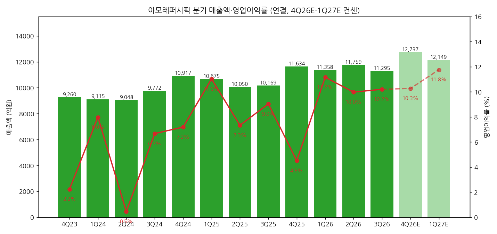
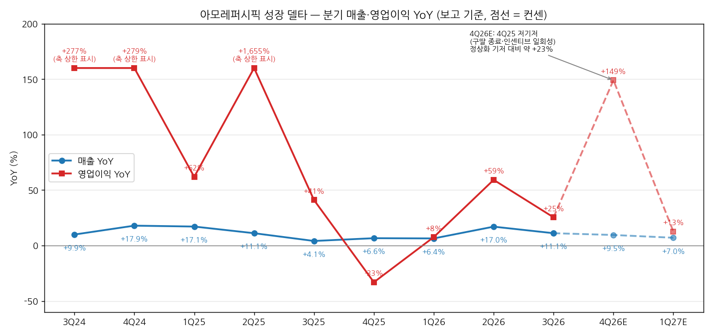
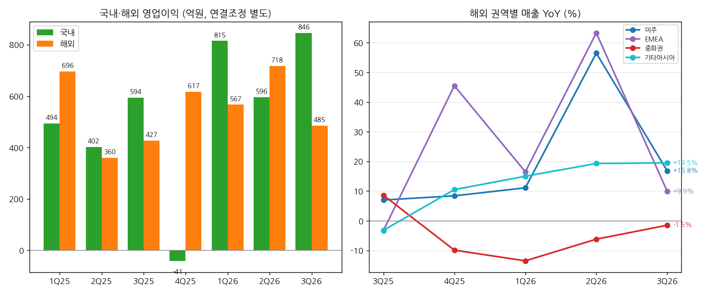

> 모드: 실적 리뷰 (v11)
> 종목: 아모레퍼시픽 (090430)
> 섹터: 뷰티
> 서브섹터: 브랜드사
> 분기: 2026-Q3
> 발표일: 2026-10-29 (연결 잠정실적 공정공시 + IR 자료 + 컨퍼런스콜)
> 작성 시각: 2026-11-17 17:20 KST
> 분석 소스: 회사 IR「2026년 3분기 실적」(2026-10-29) + 셀사이드 첨부 11건 중 아모레퍼시픽 리포트 10건 — 씨티(10/29), 골드만삭스(10/29), 모건스탠리(10/29), BofA(10/29), JP모건 2건(11/04 개별·11/05 Korea First to Market 중 아모레퍼시픽 부분), 하나증권(10/30), NH투자증권(10/30), DB증권(11/04), 메리츠증권(11/13, 2027 Outlook). **다올투자증권 첨부 파일(파일명 "아모레퍼시픽_국내 성장 고무적_20261030")은 내용이 달바글로벌 3Q26 리뷰(11/13)라 제외 — 다올의 아모레퍼시픽 리포트 미확보**. 과거 분기 숫자는 아모레퍼시픽 기업개요(2026-11-15, OpenDART 분기 시계열·IR 국내/해외·권역 시계열)로 교차검증. 웹서치 보완 없음
> 리뷰 깊이: 풀 | 리서치 첨부 10건 (유효 9개 증권사)
> 비영업 요인: 영업외 외환손실(3Q26 영업외손익 -442억원 — 순이익만 -14%, 영업이익 무관) · 4Q25 일회성(구딸 사업 종료 비용·연말 인센티브 충당금, MS 추정 약 -530억원)으로 인한 4Q26 저기저 예고 — 판정은 보고 기준 그대로

# 아모레퍼시픽 3Q26 실적 리뷰 — 국내가 끌고 해외가 쉬었다, 영업이익 YoY +59% → +25%

> 성장 델타: 둔화 | 내러티브: 유지 → 델타 둔화 + 내러티브 유지 → 경계 구간 (4Q26 YoY 급반등은 저기저 효과, 1Q27 정상 기저에서 +10%대 이상 유지 확인 필요)
>
> ⚠ 비영업 요인 플래그: 3Q26 보고 영업이익 1,152억원에는 확인된 일회성이 없다 (회사·증권사 9곳 모두 언급 없음). 순이익 585억원(-14.3% YoY)은 영업외손익 -442억원(대부분 원화 강세 외환손실, NH·하나)이 끌어내린 것으로 영업이익 판정과는 무관하다. 다음 분기 주의: 4Q25 영업이익 525억원에 일회성 약 530억원(MS: 일회성 제외 시 1,060억원)이 있어, 4Q26 컨센(1,307억원)의 보고 YoY는 +149%로 기계적으로 커진다. 정상화 기저 대비로는 약 +23%다 ([계산], 참고)

→ **숫자**: 매출 1조 1,295억원(+11.1% YoY, -3.9% QoQ), 영업이익 1,152억원(+25.4% YoY, -1.8% QoQ), OPM 10.2%(+1.2%p YoY). 영업이익 YoY는 2Q26 +59.2%에서 +25.4%로 -33.8%p 줄었지만 플러스라 "둔화"다. FnGuide 컨센(매출 1조 1,360억원·영업이익 1,160억원) 대비 각각 -0.6%·-0.7%로 부합. 2Q26에는 아마존 프라임데이 실적이 들어가 있었다(하나) — 2Q+3Q 합산 영업이익 YoY는 +40.4%다 ([계산], 참고)
→ **쟁점 ①**: 국내가 이익을 끌었다. 국내 영업이익 846억원(+42% YoY), OPM 13.6%(+2.9%p)로 3분기 기준 최고 수준이다. 면세 +17%, MBS +15%, 크로스보더 +27% 등 고마진 채널 비중이 커졌다. 9곳 모두 이 숫자를 첫 줄에 썼고, JPM만 "방한 관광객 효과라 지속성 의문"을 달았다
→ **쟁점 ②**: 해외는 매출 +12.4%에도 영업이익 485억원(+13.6% YoY, -32% QoQ), OPM 9.8%로 기대에 못 미쳤다(BofA 추정 대비 -28%, JPM -17%). 서구권 디지털 마케팅 확대, 유럽 라네즈 역성장(AP 브랜드 EMEA -11~12%), 코스알엑스 마케팅비 증가(OPM 약 20~22%, QoQ 하락)가 원인이다
→ **쟁점 ③**: 멀티브랜드 전환은 북미에서 숫자로 확인됐다. 라네즈 -10%에도 미주 +16.9%(에스트라 해외 +100%, 이니스프리·일리윤 고성장). 중화권은 -1.5%로 낙폭이 줄었고 회사는 4Q 플러스 전환을 가이던스로 냈다. TP는 9곳 중 7곳 유지, 2곳 하향(JPM -16%, MS -4%), 평균 -2.3%로 추정치보다 멀티플 조정이다
→ **다음 분기 관건**: 회사 4Q 가이던스(매출 +10%, OPM 10%, 내재 영업이익 약 1,280억원)대로 나오면 보고 YoY는 +140% 이상으로 "가속" 판정이 나오지만 저기저 효과다. 진짜 시험은 기저가 정상인 1Q27(1Q26 1,267억원)이다 — 메리츠 1Q27E 1,428억원(+12.7%)이 유일한 분기 추정이고, 이 경로가 맞으면 YoY는 10%대로 내려온다

---

## 1. 숫자

① 연결 기준 분기 표 (단위: 억원, %)

| 항목 | 4Q23 | 1Q24 | 2Q24 | 3Q24 | 4Q24 | 1Q25 | 2Q25 | 3Q25 | 4Q25 | 1Q26 | 2Q26 | **3Q26** | 4Q26E | 1Q27E |
|---|---|---|---|---|---|---|---|---|---|---|---|---|---|---|
| 매출액 | 9,260 | 9,115 | 9,048 | 9,772 | 10,917 | 10,675 | 10,050 | 10,169 | 11,634 | 11,358 | 11,759 | **11,295** | 12,737 | 12,149 |
| 영업이익 | 207 | 727 | 42 | 652 | 785 | 1,177 | 737 | 919 | 525 | 1,267 | 1,173 | **1,152** | 1,307 | 1,428 |
| OPM | 2.2 | 8.0 | 0.5 | 6.7 | 7.2 | 11.0 | 7.3 | 9.0 | 4.5 | 11.2 | 10.0 | **10.2** | 10.3 | 11.8 |
| 매출 YoY | -14.9 | -0.2 | -4.3 | +9.9 | +17.9 | +17.1 | +11.1 | +4.1 | +6.6 | +6.4 | +17.0 | **+11.1** | +9.5 | +7.0 |
| 영업이익 YoY | -63.7 | +12.9 | -28.8 | +276.9 | +279.2 | +61.9 | +1,654.8 | +41.0 | -33.1 | +7.6 | +59.2 | **+25.4** | +149.0 | +12.7 |
| **매출 YoY 델타 (%p)** | -9.8 | +14.6 | -4.1 | +14.2 | +7.9 | -0.8 | -6.0 | -7.0 | +2.5 | -0.2 | +10.6 | **-5.9** | -1.6 | -2.5 |
| **영업이익 YoY 델타 (%p)** | -55.7 | +76.6 | -41.7 | +305.7 | +2.3 | -217.3 | +1,592.9 | -1,613.8 | -74.1 | +40.8 | +51.5 | **-33.8** | +123.6 | -136.2 |
| (참고) 2Q+3Q 합산 영업이익 YoY | | | | | | | | | | | | +40.4 | | |
| (참고) 4Q26E 정상화 기저(1,060억원) 대비 YoY | | | | | | | | | | | | | +23.3 | |

→ (출처: 4Q23~2Q26 = OpenDART 연결(아모레퍼시픽 기업개요 분기 시계열, 4Q = 연간 − 3Q 누적), 3Q26 = 2026-10-29 잠정실적 공시·IR [잠정]. 4Q26E = 하나·DB·NH·메리츠·JPM 분기 추정 + 씨티·GS·MS·BofA 연간 추정에서 3Q 누적(매출 3조 4,412억원·영업이익 3,592억원)을 뺀 내재치, 9곳 단순평균. 1Q27E = 메리츠 단독 추정(분기 추정 공개 1곳뿐 — 소수 의견 좌우 가능))
→ **YoY 계산 기준**: K-IFRS 연결 보고 영업이익, DART 원공시 대 원공시(재작성 없음). 2026년 1~3Q는 분기보고서·잠정 기준, 전년 동기는 같은 기준의 2025 분기. 코스알엑스는 2024-05 연결 편입이라 2Q24~1Q25 YoY에는 인수 효과가 섞여 있다(2Q25 이후 YoY는 동일 연결 범위). 2Q25 +1,655%는 2Q24 영업이익 42억원 저기저 탓이다
→ 3Q26 서프라이즈: 매출 컨센 대비 -0.6%, 영업이익 -0.7% (FnGuide 컨센 매출 1조 1,360억원·영업이익 1,160억원, NH 인용. 블룸버그 컨센 1,160억원 대비 -0.7%, JPM. DB 집계 컨센 1,170억원 대비 -1.8%). 회사가 2Q 실적 때 낸 3Q 가이던스(매출 +10% 이상, OPM 약 10%)에 정확히 맞다 (씨티·GS)
→ 영업이익 YoY는 정점을 따지기 어려운 흐름이다. 2024~2025년은 중국 구조조정·코스알엑스 편입으로 기저가 크게 흔들렸고, 2026년에는 +7.6% → +59.2% → +25.4%로 들쭉날쭉하다. 2Q26의 +59%에는 아마존 프라임데이 매출(2025년 3Q → 2026년 2Q 인식)이 있었다. 이를 평탄화한 2Q+3Q 합산은 +40.4%, 1~3Q 누적은 +26.8%다 ([계산], 참고)
→ 컨센 경로: 4Q26 +149%(저기저) → 1Q27 +12.7%(메리츠) → 2027년 연간 +18.3%(9곳 평균). **보고 기준 YoY의 정점은 4Q26E에 찍히지만 기저 효과로 만들어진 정점**이다. 기저가 정상인 분기만 보면 이익 성장률은 20%대(2026년 1~3Q 누적 +27%)에서 2027년 10%대로 완만하게 내려가는 경로다 [판단]
→ **[판단] 델타 = 둔화**: 영업이익 YoY가 직전 분기보다 33.8%p 줄었지만 +25.4%로 플러스이고, 2개 분기 연속 둔화가 아니다(1Q26 → 2Q26은 확대). 매출 YoY도 +17.0% → +11.1%로 둔화했다. 4Q26E에 보고 기준 YoY가 다시 커질 것이 거의 확실해 "꺾임" 기준에는 해당하지 않는다

→ (출처: OpenDART 연결(기업개요 시계열), 3Q26 잠정실적 공시. 4Q26E = 증권사 9곳 평균, 1Q27E = 메리츠증권. 연한 막대·점선 = 추정)

→ (출처: 동일. 영업이익 YoY 160% 초과 구간(3Q24·4Q24·2Q25)은 축 상한에 표시하고 실제 값을 라벨로 적음. 4Q26E 정상화 기저 = MS 언급 4Q25 일회성 제외 영업이익 1,060억원)

② 사업부별 매출·영업이익

(1) 국내 / 해외 (회사 IR 공시, 단위: 억원, %)

| 구분 | 항목 | 1Q25 | 2Q25 | 3Q25 | 4Q25 | 1Q26 | 2Q26 | **3Q26** |
|---|---|---|---|---|---|---|---|---|
| 국내 | 매출 | 5,773 | 5,536 | 5,566 | 5,876 | 6,264 | 6,108 | **6,205** |
| 국내 | 매출 YoY | +2.4 | +8.1 | +4.1 | +7.4 | +8.5 | +10.3 | **+11.5** |
| 국내 | 영업이익 | 494 | 402 | 594 | -41 | 815 | 596 | **846** |
| 국내 | OPM | 8.6 | 7.3 | 10.7 | -0.7 | 13.0 | 9.8 | **13.6** |
| 국내 | 영업이익 YoY | +0.6 | +164.5 | +23.8 | 적전 | +65.0 | +48.3 | **+42.4** |
| 해외 | 매출 | 4,696 | 4,324 | 4,408 | 5,662 | 4,971 | 5,516 | **4,955** |
| 해외 | 매출 YoY | +39.4 | +13.3 | +2.2 | +7.0 | +5.9 | +27.6 | **+12.4** |
| 해외 | 영업이익 | 696 | 360 | 427 | 617 | 567 | 718 | **485** |
| 해외 | OPM | 14.8 | 8.3 | 9.7 | 10.9 | 11.4 | 13.0 | **9.8** |
| 해외 | 영업이익 YoY | +120.3 | +605.9 | +72.9 | +43.8 | -18.5 | +99.4 | **+13.6** |
| 기타·연결조정 | 영업이익 | -13 | -25 | -102 | -51 | -115 | -141 | **-179** |
| 영업이익 기여 (3Q26) | | | | | | | | 국내 64% / 해외 36% (조정 전) |

→ (출처: 회사 IR(3Q26 2·3쪽), 기업개요 국내/해외 분기 시계열(IR 판독치). 기타·연결조정 = 전사 − 국내 − 해외 [계산]. 코스알엑스 실적은 국내·해외에 지역별로 나뉘어 들어간다(NH 주2))
→ **델타를 끈 쪽은 국내**: 국내 매출 YoY는 +2.4%(1Q25)에서 +11.5%로 7개 분기 동안 거의 꾸준히 커졌고, 영업이익은 3개 분기 연속 +40% 이상이다. 국내 OPM 13.6%는 IR 시계열(4Q17~) 중 1Q(성수기)를 빼면 최고다 (기업개요 시계열)
→ **델타를 끌어내린 쪽은 해외**: 해외 영업이익 YoY가 +99.4%에서 +13.6%로 가장 크게 둔화했다. 2Q26의 프라임데이 효과가 빠진 데다(하나), 서구권 디지털 마케팅을 늘렸다(회사: "서구권 디지털채널 투자 확대로 영업이익 소폭 감소했으나 두 자릿수 수익성 유지")
→ 기타·연결조정 손실이 -102억원(3Q25)에서 -179억원으로 커졌다. 회사·증권사 설명이 없다 — 내부거래 제거 증가(씨티 표 "Internal transaction" -10 → -18십억원)로만 확인된다

(2) 해외 권역별 매출 (회사 IR, 단위: 억원, %) — 권역별 영업이익은 미공개

| 권역 | 3Q25 | 4Q25 | 1Q26 | 2Q26 | **3Q26** | 3Q26 YoY | 3Q26 QoQ | 해외 내 비중 |
|---|---|---|---|---|---|---|---|---|
| 미주 | 1,568 | 1,826 | 1,747 | 2,104 | **1,832** | +16.8 | -12.9 | 37.0 |
| EMEA | 527 | 889 | 644 | 720 | **579** | +9.9 | -19.6 | 11.7 |
| 서구권 계 | 2,095 | 2,715 | 2,391 | 2,824 | **2,411** | +15.1 | -14.6 | 48.7 |
| 중화권 | 1,060 | 1,410 | 1,149 | 1,245 | **1,044** | -1.5 | -16.1 | 21.1 |
| 기타 아시아 | 1,254 | 1,537 | 1,431 | 1,447 | **1,499** | +19.5 | +3.6 | 30.3 |
| 해외 계 | 4,408 | 5,662 | 4,971 | 5,516 | **4,955** | +12.4 | -10.2 | 100.0 |

| 권역 매출 YoY | 3Q25 | 4Q25 | 1Q26 | 2Q26 | **3Q26** |
|---|---|---|---|---|---|
| 미주 | +7.0 | +8.4 | +11.1 | +56.5 | **+16.8** |
| EMEA | -3.3 | +45.5 | +16.5 | +63.3 | **+9.9** |
| 중화권 | +8.6 | -9.9 | -13.5 | -6.2 | **-1.5** |
| 기타 아시아 | -3.2 | +10.5 | +15.0 | +19.3 | **+19.5** |

→ (출처: 회사 IR 3쪽(3Q25·3Q26), 기업개요 권역 분기 시계열(2025 3Q 일본 매출 인식 기준 변경 소급 재작성치). YoY·QoQ·비중 [계산])
→ 서구권 미주·EMEA YoY는 2Q26 +56~63%(프라임데이 효과)에서 +10~17%로 정상화했다. 기타 아시아(일본 +30%, 인도·인도네시아 +60%, BofA·NH)만 4개 분기 연속 YoY가 커졌다. 중화권은 -13.5% → -6.2% → -1.5%로 낙폭이 3개 분기 연속 줄었다
→ 권역별 영업이익 [추정] (하나증권, 3Q26, 코스알엑스 포함 배분): 북미 92억원(OPM 5.0%, 3Q25 157억원), EMEA 127억원(21.9%), 중화권 52억원(5.0%), 기타 아시아 228억원(15.2%). 하나 기준 북미 영업이익이 YoY -41%로 가장 크게 줄었다. 씨티(코스알엑스 제외 AP 브랜드 기준)도 북미 영업이익 100억원(-14% YoY), 아시아 90억원(-3%), EMEA 40억원(-1%)으로 같은 방향이다

(3) 코스알엑스 — 회사 미공시, 증권사 추정 (단위: 억원, %)

| 증권사 | 3Q26 매출 | 매출 YoY | 3Q26 영업이익 | OPM | 영업이익 YoY | 2Q26 영업이익 | 2026E 매출 / 영업이익 |
|---|---|---|---|---|---|---|---|
| NH | 1,386 | +31 | 284 | 20.5 | +9 | 370 | 5,703 / 1,346 |
| JPM | 1,350 | +30 | 300 | 22.0 | +20 | 380 | 5,700 / 1,350 |
| 씨티 | 1,280 | +30 | 260 | 20.3 | +41 | 340 | 5,630 / 1,220 |
| DB | 1,370 | +32 | — | — (마케팅비율 +3%p YoY) | — | — | 5,680 / — |
| MS | 매출 +32% (전사 매출의 15%) | | — | | | | — |

→ (출처: NH 표3·표4, JPM Table 2, 씨티 Figure 1·2, DB 도표 4, MS Exhibit 2. 모두 [추정])
→ 코스알엑스 매출은 +30%대로 4곳이 일치한다. 권역별로는 미주 +8%(GS·MS), EMEA +35%(MS)로 유럽·아시아가 끌었다. 영업이익은 2Q26 340~380억원에서 260~300억원으로 QoQ -22~-25% 줄었고, OPM은 2Q 약 25%에서 20~22%로 내려왔다. 마케팅비 집행 확대 때문이다(DB·NH·JPM)
→ 해외 영업이익 485억원 중 코스알엑스가 260~300억원으로 절반 이상(54~62%)이다. 이를 빼면 AP 브랜드 해외 영업이익은 약 185~225억원(OPM 약 5~6%)이다 ([계산], 씨티 220억원 -8% YoY)

(4) 국내 세부 — 화장품 / 데일리뷰티(생활용품) / 채널 [증권사 추정·회사 서술]

| 항목 | 3Q25 | 3Q26 | YoY | 출처 |
|---|---|---|---|---|
| 국내 화장품 매출 | 4,477 | 4,985~5,029 | +11~12% | BofA·DB·NH |
| 국내 화장품 영업이익 | 485~490 | 750~780 | +53~61% | BofA(OPM 15.6%), DB(15.0%) |
| 데일리뷰티 매출 | 1,089 | 1,176~1,220 | +8~12% | NH·BofA·DB |
| 데일리뷰티 영업이익 | 109~110 | 66~100 | -39~-9% | BofA·DB |
| 면세 | | | +17% (국내 매출 대비 비중 18%) | 회사 IR·NH |
| MBS(올리브영 등) | | | +15% | 하나·NH |
| 온라인 | | | +12~14% | NH·DB |
| 크로스보더 | | | +27% | 하나 |

→ (출처: 회사 IR 4쪽, 각 증권사 표. 국내 화장품·데일리뷰티 분리 영업이익은 회사 미공시라 증권사마다 배분이 달라 범위로 적음)
→ 씨티: 면세·크로스보더 +17%, 이를 뺀 순수 국내 +10%. 국내 이익 개선은 관광객 수요(면세·크로스보더)와 순수 내수(MBS·온라인·추석 선물) 양쪽에서 나왔다
→ 브랜드: 설화수가 추석 선물·여행객 수요로 두 자릿수 성장, 국내 매출 비중 29%(3Q25 28%) (IR 5쪽). 국내 브랜드 성장률 1위는 에스트라 (NH 그림4 "에스트라 강세" — 브랜드별 수치는 차트 판독이 불확실해 생략)

→ (출처: 회사 IR, 기업개요 국내/해외·권역 분기 시계열)

③ 연간 (단위: 억원, %)

| 항목 | 2022 | 2023 | 2024 | 2025 | 2026E | 2027E |
|---|---|---|---|---|---|---|
| 매출액 | 41,349 | 36,740 | 38,851 | 42,528 | 47,149 | 51,469 |
| 영업이익 | 2,142 | 1,082 | 2,205 | 3,358 | 4,899 | 5,794 |
| OPM | 5.2 | 2.9 | 5.7 | 7.9 | 10.4 | 11.3 |
| 매출 YoY | -15.0 | -11.1 | +5.7 | +9.5 | +10.9 | +9.2 |
| 영업이익 YoY | -37.6 | -49.5 | +103.8 | +52.3 | +45.9 | +18.3 |

→ (출처: 2022~2025 OpenDART 연결(기업개요). 2026E·2027E = 하나·DB·NH·메리츠·씨티·GS·MS·BofA·JPM 9곳 발표 후 추정 단순평균 [계산])
→ 회사 목표: 4Q26 매출 +10%·OPM 10%, BY27(2027년) 매출 +10%·OPM 11~12% 유지 (씨티·GS·JPM 컨콜 정리). 9곳 평균 2027E OPM 11.3%는 회사 목표 범위 하단이다
→ 발표 전후 컨센 변화: 2026E 영업이익 WiseFn 4,890억원(MS·하나 인용) → 9곳 평균 4,899억원(+0.2%), 2027E 5,720억원 → 5,794억원(+1.3%). 증권사별 2027E 영업이익은 5,442억원(하나)~6,260억원(GS)으로 15% 벌어져 있다
→ 순이익은 하향: 영업외 외환손실 반영으로 2026E 순이익·EPS가 GS -14%, JPM -13%, NH -7.8%, MS -5.9% 내려갔다. 2027E는 씨티 +8%, BofA +3%, NH +1.3%로 소폭 상향이다

---

## 2. 시장 쟁점

① 지난 분기 체크
→ 첫 리뷰 — 직전 체크 없음 (2026-Q2 아모레퍼시픽 리뷰·팔로업 미작성)

② 이번 분기 쟁점 5개

| # | 쟁점 | 언급 증권사 수 |
|---|---|---|
| (1) | 국내 OPM 13.6% — 관광객 효과인가 구조적 체질 개선인가 | 9/9 |
| (2) | 해외 OPM 9.8% — 왜 매출 +12%에도 해외 이익은 기대에 못 미쳤나 (서구권 마케팅·코스알엑스 마진) | 9/9 |
| (3) | 라네즈 이후 — 멀티브랜드가 북미에선 통했는데 유럽에선 왜 안 보이나 | 8/9 |
| (4) | 중화권 — 4Q 플러스 전환 가이던스는 믿을 만한가 | 8/9 |
| (5) | 4Q·BY27 가이던스와 밸류에이션 — 영업이익은 유지, 순이익·멀티플은 하향 | 9/9 |

(분모는 유효 증권사 9곳. JPM 2건은 1곳으로 센다)

③ 쟁점별 분해

(1) 국내 OPM 13.6% — 관광객 효과인가 구조적 체질 개선인가

(1-1) 회사 설명 (IR 2·4쪽, 컨콜 — 씨티·GS 정리)
→ "고수익 채널 매출 확대로 수익 구조 개선되며 영업이익 증가", "매출 성장에 따른 영업 레버리지 효과로 판관비 효율화" (IR 2쪽)
→ 면세 채널은 공항 입출국객 증가로 국내 면세 10% 중반 성장, 국내 매출 대비 면세 비중 18% (IR 4쪽). 면세는 이제 두 자릿수 마진을 낸다 — 방한 관광객이 늘었는데 고정비 증가는 제한적이다 (GS 컨콜 정리)
→ 국내 수익성 개선은 "당분간 지속"된다 (씨티 컨콜 정리). 전사 매출총이익률은 할인 축소·브랜드 믹스로 +0.9%p (IR 1쪽)

(1-2) 증권사별 해석 편차

| 증권사 | 핵심 가정·추정 | 논리 |
|---|---|---|
| 씨티 | 국내 영업이익 2027E 3,520억원 (+21% 상향), 2028E +30% 상향 | 국내 OPM 가정을 올린 것이 전사 2027E 영업이익 +6% 상향의 전부다 |
| 메리츠 | 2027E 국내 매출 2조 6,804억원(+7%), 영업이익 3,421억원(+11%), 2026E 국내 이익 기여 62% | 희망퇴직·점포 철수 등 구조조정으로 고정비가 낮아졌다. "10년 만에 가장 탄탄한 수익 구조", 원화 강세 국면에서 환율 민감도가 낮다 |
| NH | 2027F 국내 영업이익 3,234억원 (+10%) | 달러 약세로 방한 관광객의 국내 채널 가격 메리트가 생겼다. 원화 강세가 이어지면 국내 비중 50%가 수익성 방어 |
| 하나 | 2027F 국내 영업이익 2,804억원 (+1.8%), OPM 10.3% | 2026년 개선은 인정하나 2027년 국내 이익은 정체로 가장 보수적 |
| DB | 국내 화장품 OPM 15.0%, 2027E 국내 화장품 영업이익 2,570억원 (+8%) | 온라인·MBS·면세 고마진 채널 화장품 매출 호조 |
| BofA | 국내 화장품 영업이익 780억원 (자체 추정 457억원 대비 +71%), OPM 15.6% | 수년간의 비용 절감이 매출 성장과 맞물려 마진으로 연결. 국내 OPM 약 12% 안착 가정 |
| GS | 2027E 국내 매출 2조 5,930억원 (+5%), 국내 추정 -1% 하향 | 면세 두 자릿수 마진. 국내 매출 추정은 오히려 소폭 내렸다 |
| MS | 국내 OPM +3%p YoY (자체 추정 대비 +23%) | 제품 리더십 강화(내부) + 외국인 인바운드(외부) 둘 다 기여 |
| JPM | 국내 영업이익 850억원 (자체 추정 대비 +20%) | "강한 방한 관광객이 이끈 성장이라 지속될지 우려". 국내 강세로는 밸류에이션 리레이팅이 안 된다 |

(1-3) 공통 결론 vs 갈리는 지점
→ 공통: 9곳 모두 국내가 이번 분기 서프라이즈의 원천이라고 본다. 증권사 자체 추정 대비 국내 영업이익이 +16~71% 높게 나왔다(씨티 +16%, JPM +20%, MS +23%, BofA +71%)
→ 갈림: 2027년 국내 이익 성장률. 씨티(+21% 상향)·메리츠(+11%)·NH(+10%)는 "체질 개선"으로 이어진다고 보고, 하나(+1.8%)·JPM은 관광객 효과가 정점이라 성장이 멈춘다고 본다. 2027E 국내 영업이익 범위는 2,804억원(하나)~3,520억원(씨티)으로 700억원 차이 — 전사 2027E 컨센 분산(5,442~6,260억원)의 상당 부분이다

(1-4) **[판단]** — 숫자로 분해
→ 국내 OPM 개선 +2.9%p YoY 중 매출총이익률 +0.9%p(전사), 판관비 레버리지가 나머지다. 감가상각비가 -7.5% YoY(508 → 470억원) 줄어 전사 OPM에 +0.8%p 기여했다 (IR 1쪽). 고정비 절감은 구조적이라 되돌려지지 않는다
→ 반면 매출 성장의 상당 부분은 면세(+17%)·크로스보더(+27%) — 외국인 수요다. 순수 국내는 +10%(씨티)로 이것도 추석 시점 효과가 섞여 있다 (9월 추석, NH)
→ 그래서 "OPM 수준"은 구조적(고정비 절감), "OPM 상승 속도"는 관광객 의존이라고 본다. 13%대 국내 OPM이 비성수기(4Q 인센티브 제외)에도 유지되면 체질 개선 쪽이 맞다
→ 결론이 바뀌는 조건: 월간 면세점 매출(면세점협회)이 YoY 한 자릿수로 꺾이는데 국내 OPM이 1Q27에 13%(1Q26)를 밑돌면 관광객 효과 해석이 맞다

(2) 해외 OPM 9.8% — 왜 매출 +12%에도 해외 이익은 기대에 못 미쳤나

(2-1) 회사 설명 (IR 2쪽, 컨콜 — GS·JPM 정리)
→ "서구권: 디지털채널 투자 확대로 영업이익 소폭 감소했으나 두 자릿수 수익성 유지", "아시아: 중화권 흑자기조 유지, APAC 브랜드 믹스 개선으로 두 자릿수 수익성 기록" (IR 2쪽)
→ 북미 온라인 매출(주로 아마존)이 +50% YoY. 틱톡 인지도 → 아마존 구매 전환이 개선되고 있다 (GS 컨콜 정리). 다만 마케팅 투자의 매출 전환은 "아직 더 확인이 필요하다" (GS)
→ 4Q 코스알엑스 매출은 전년 EMEA 셀인(sell-in) 고기저로 YoY 보합, 마케팅비 증가로 마진 소폭 하락 (JPM·DB 컨콜 정리)

(2-2) 증권사별 해석 편차

| 증권사 | 해외 영업이익 (3Q26 실제 485억원) 대비 | 논리 |
|---|---|---|
| BofA | 자체 674억원 대비 -28% | 마케팅비 증가로 해외 수익성이 예상보다 약했다 |
| 씨티 | AP 브랜드 해외 330억원 추정 대비 -33%, 코스알엑스 -8% | 해외 영업이익 추정 2026E -25%, 2027E -20% 하향 — 국내 상향을 해외가 깎았다 |
| MS | 자체 600억원 대비 -19% | 해외 마진은 일시 하락, 2027년 OP +20% 이상 성장 지속 |
| JPM | 자체 580억원 대비 -17% | 유럽 라네즈 부진과 코스알엑스 QoQ 마진 하락. 서구권 온라인 중심 전략이 언제 마진에 의미 있게 기여할지가 리레이팅의 핵심 |
| DB | 해외 화장품 영업이익 490억원 (YoY +13.6%), 유럽/북미 OPM 9.5% (2Q 17.2%) | 코스알엑스 마케팅비율 +3%p. 4Q 코스알엑스·서구권 눈높이를 낮추라 |
| NH | 해외 485억원, 서구권 본업 96억원 (+1%), 아시아 본업 119억원 (+32%) [추정] | 코스알엑스 영업이익 +9%에 그침 — 이익률 하락 |
| 하나 | 해외 OPM 10.1%, 4Q 9.7% | 프라임데이가 2Q로 당겨진 효과. 해외 2027F OPM 11.3% |
| GS·메리츠 | 해외 추정 소폭 상향(GS 2027E 해외 매출 +1%) / 2027E 해외 OPM 11.8% | 서구권 성장은 견조, 마케팅 투자는 성장 투자로 본다 |

(2-3) 공통 결론 vs 갈리는 지점
→ 공통: 해외 이익이 기대보다 약했던 원인은 마케팅비(서구권 디지털·코스알엑스)라는 데 9곳 모두 동의한다. 매출은 대부분 추정에 부합했다(BofA -1%, JPM +1%)
→ 갈림: 이 마케팅비가 "성장 투자(매출로 회수)"인지 "구조적 비용 상승"인지. MS·GS·메리츠는 전자, 씨티(해외 OP 2027E -20%)·JPM은 후자 쪽에 가깝다

(2-4) **[판단]**
→ 해외 OPM 9.8%는 3Q25(9.7%)와 같다. YoY로는 마진이 떨어진 게 아니라 2Q26(13.0%, 프라임데이)보다 낮을 뿐이다. 따라서 "해외 마진 훼손"이 아니라 "해외 마진 개선이 멈췄다"가 정확하다
→ 문제는 구성이다. 해외 영업이익의 절반 이상이 코스알엑스인데 코스알엑스 OPM이 25% → 20~22%로 내려왔고, AP 브랜드 해외 영업이익(약 185~225억원, OPM 5~6%)은 YoY 감소다(씨티 -8%, 하나 북미 -41%). 매출은 멀티브랜드로 늘지만 이익은 아직 따라오지 않는다
→ 결론이 바뀌는 조건: 4Q 해외 OPM이 10%를 넘고(4Q25 10.9%), BY27 가이던스에서 서구권 마케팅비율 하락이 나오면 "성장 투자" 해석이 맞다. 4Q 해외 영업이익이 600억원(4Q25 617억원) 밑이면 구조적 비용 쪽이다

(3) 라네즈 이후 — 멀티브랜드가 북미에선 통했는데 유럽에선 왜 안 보이나

(3-1) 회사 설명 (IR 6~8쪽, 컨콜)
→ 미주: "핵심 제품 및 라인업 전반으로 고객 수요 확산, 성장 동력 다변화" — 이니스프리 PDRN, 에스트라 아토베리어365(온·오프라인 모두 세 자릿수 성장), 틱톡샵 전용 상품 (IR 6·7쪽)
→ 설화수·에스트라·이니스프리가 북미 매출의 25% 이상(1년 전 20% 미만). 라네즈는 립 카테고리·오프라인 부진으로 -10%대 (GS 컨콜 정리)
→ EMEA: 에스트라 영국 Boots·북유럽 MATAS 신규 입점, 라네즈 영국 아마존 입점. 유럽 성장은 라네즈·세포라·서남유럽 집중 때문에 변동성이 크다 — 브랜드·채널·지역을 BY27에 다변화 (IR 8쪽, GS 컨콜 정리)

(3-2) 증권사별 해석 편차

| 증권사 | 핵심 숫자 | 논리 |
|---|---|---|
| 하나 | 북미 +17% (라네즈 -10%에도) | "라네즈/세포라 퍼스트"에서 분명히 탈피. 2027년 남미와 유럽이 핵심 성장 지역. 독일·동유럽·북유럽·터키·러시아까지 확장 |
| GS | 에스트라 글로벌 +80% (해외 +100%), 일리윤 글로벌 7배, 코스알엑스 미주 +8% | 북미가 라네즈·세포라 의존에서 벗어나고 있다는 증거. 유럽에서 같은 구조를 복제하는 게 중기 기회 |
| BofA | 더마 브랜드 비중 20% → 25% | 지역·브랜드·카테고리 분산으로 매출 성장 궤적이 "더 길고 안정적" |
| NH | 더마(코스알엑스+에스트라+일리윤+아이오페) 비중 전사 25% | 2027년 아마존·틱톡샵 신채널 외형 확대 + 신규 브랜드 서구권 오프라인 진입 |
| DB | AP 브랜드 북미 +23%, EMEA -11% | 2026년 고성장한 코스알엑스·라네즈가 2027년 기저 부담. 전략 브랜드 성과가 이를 상쇄해야 |
| JPM | AP 브랜드 북미 약 +20%, 유럽 매출 감소 | 북미는 에스트라·이니스프리가 라네즈를 상쇄했지만 유럽은 다변화가 아직 안 보인다. 기존 대표 브랜드(라네즈·코스알엑스)가 감속, 라네즈는 두 자릿수 역성장 시작 |
| MS | AP 브랜드 미주 +20%, EMEA -12%, 코스알엑스 EMEA +35% | 온라인 행사 없이도 미국 매출 모멘텀 유지 — 포트폴리오 확장 덕 |

(3-3) 공통 결론 vs 갈리는 지점
→ 공통: 북미에서는 멀티브랜드 전환이 숫자로 확인됐다(AP 브랜드 +20~23%, 라네즈 -10%대). 유럽 AP 브랜드는 -11~12%로 라네즈 의존이 그대로라는 데도 다수가 동의한다
→ 갈림: 라네즈 감속을 "포트폴리오 교체 과정"(하나·GS·BofA)으로 볼지, "기존 대표 브랜드 피로 + 2027 고기저"(JPM·DB)로 볼지

(3-4) **[판단]**
→ 미주 매출은 1,568억원 → 1,832억원(+264억원)으로 늘었는데, 라네즈가 -10%면 신규 브랜드의 기여는 그 이상이다. "다변화"는 매출로는 확인됐다
→ 그러나 (2)에서 본 것처럼 북미 영업이익은 줄었다(하나 -41%, 씨티 AP 브랜드 -14%). 신규 브랜드는 인큐베이팅 단계라 마케팅비를 먼저 쓴다. 라네즈(BY25 글로벌 OPM high-teen, NH)가 빠지고 저마진 신규 브랜드가 채우는 구조라, 매출 다변화와 마진 개선 사이에 시차가 있다
→ 결론이 바뀌는 조건: 유럽 EMEA 매출 YoY가 4Q에 두 자릿수 플러스(4Q25 889억원 고기저, 코스알엑스 셀인)를 유지하면 다변화가 유럽에서도 작동한다는 신호다. 증권사 4Q EMEA 추정은 843억원(NH, -5%)~973억원(하나, +9%)이다

(4) 중화권 — 4Q 플러스 전환 가이던스는 믿을 만한가

(4-1) 회사 설명 (IR 6·9쪽, 컨콜)
→ "려·헤라 고성장으로 신성장 동력 다변화, 설화수는 오프라인 채널 효율화 지속" (IR 6쪽). 설화수 중국 핵심 백화점 매장은 두 자릿수 성장, 려 샘스클럽 전용 상품 샴푸 카테고리 1위 (IR 9쪽)
→ 4Q 중화권 매출 YoY 플러스 전환 기대 — 려·헤라·에스트라·코스알엑스 기여, 수익성 중심 전략 유지 (GS·씨티·MS 컨콜 정리)

(4-2) 증권사별 해석 편차

| 증권사 | 4Q26 중화권 매출 E | 논리 |
|---|---|---|
| GS | — (플러스 전환을 "점진적 긍정"으로) | 당초 -10% 예상 대비 -2%로 낙폭 축소. 4Q·BY27 추가 성장 동력 |
| MS | — | 구조조정 효과 소멸 + 신규 브랜드 기여로 4Q26부터 턴어라운드 |
| 하나 | 1,405억원 (-0.4%), 영업이익 59억원 | 매출은 보합, 고정비 감소로 OPM 5%까지 상승 |
| 메리츠 | 1,413억원 (+0.2%), 2027E -9% | 마몽드 철수·설화수 백화점 축소로 2027년에도 감소. OPM 5% 내외 유지 |
| NH | 중국 본업 1,009억원 (+6%) | 4Q 중국 매출 턴어라운드 예상, 비중 확대 추천 근거 |
| DB | 중국 990억원 (+3%) | 브랜드·채널 구조조정 마무리 국면, 4Q 아시아 성장 전환·수익성 의미 있게 개선. 중국 눈높이를 높이자 |
| 씨티 | — (3Q 중화권 -10% YoY, 2Q -18%로 서술) | 회사가 4Q 플러스 전환을 예상. 리스크는 중국 사업의 구조적 적자 전환 |
| JPM | 중국 910억원 (-10%) | 중국은 안정적 이익 구조 — 매출 회복은 가정하지 않음 |

(4-3) 공통 결론 vs 갈리는 지점
→ 공통: 중화권은 흑자(분기 약 50억원대, 하나)를 유지하고 낙폭이 줄고 있다. 4Q 매출은 보합 근처라는 데 대부분 동의한다
→ 갈림: "플러스 전환"을 4Q 추정에 넣은 곳(NH +6%, DB +3%)과 안 넣은 곳(JPM -10%, 하나 -0.4%)이 갈린다. 메리츠는 2027년에도 -9%로 본다
→ 주의: 씨티의 "3Q 중화권 -10%, 2Q -18%"는 회사 IR(3Q -1.5%, 2Q -6.2%)과 맞지 않는다. 씨티 표의 기준(코스알엑스 제외 AP 브랜드 아시아 또는 현지통화 등)이 불명확해 본문 판단에 쓰지 않는다 [불확실]

(4-4) **[판단]**
→ 중화권은 매출 비중 9%, 영업이익은 분기 50억원 안팎이라 전사 델타를 바꿀 크기가 아니다. 의미는 "해외 성장률의 마이너스 요인이 사라진다"는 데 있다. 4Q25 중화권 1,410억원이 비교 기저다
→ 결론이 바뀌는 조건: 광군제(11/11) 이후 4Q 중화권이 1,410억원을 넘으면 회사 가이던스 신뢰도가 오른다. 다시 -5% 이하로 벌어지면 메리츠의 "2027년에도 감소" 쪽이다

(5) 4Q·BY27 가이던스와 밸류에이션 — 영업이익은 유지, 순이익·멀티플은 하향

(5-1) 회사 설명
→ 4Q26 가이던스: 매출 +10% YoY, OPM 10% (현재 환율 가정 반영). BY27 목표 매출 +10%, OPM 11~12% 유지 (씨티·GS·JPM 컨콜 정리)
→ 4Q 성장은 중남미·유럽, 더마·헤어케어가 이끈다. 라네즈 비중은 줄고 설화수·에스트라·이니스프리 글로벌 더마 매출이 커진다 (JPM 컨콜 정리)

(5-2) 증권사별 해석 편차

| 증권사 | 4Q26 영업이익 E | 적용 멀티플 | 논리 |
|---|---|---|---|
| 하나 | 1,381억원 | 12MF PER 25배 | 글로벌 멀티브랜드(로레알·에스티로더 12MF PER 30배 내외)로 수렴하는 밸류에이션 프리미엄 국면 |
| DB | 1,360억원 | 2027E PER 25배 | 더마 포트폴리오가 강점, 2027년 코스알엑스·라네즈 기저 부담 |
| 메리츠 | 1,346억원 | — (적정주가 18만원) | 원화 강세로 이익 하향 우려가 큰 시장에서 실적 안정성 부각 |
| GS | 약 1,318억원 [계산] | NTM PER 23배 | 가이던스 불변이 이익 가시성을 지지 |
| BofA | 약 1,328억원 [계산] | 2027E PER 26배 (10년 평균 -1SD) | 지역·브랜드·카테고리 분산으로 성장 궤적이 길어짐 |
| NH | 1,286억원 | 12MF PER 26배 (글로벌 피어 평균) | 국내 수익성 + 4Q 중국 턴어라운드 |
| MS | 약 1,278억원 [계산] | RI 모델, 내재 NTM PER 27배 → 25배 | Top Pick. NTM PER 17배로 5년 최저, 2027년 OP +20% 이상 |
| JPM | 1,260억원 | 2027E PER 20배 (2014~16 평균, 하향 — 직전 배수 미기재) | 국내 강세로는 리레이팅 불가, 서구권 지속성 확인 필요 |
| 씨티 | 약 1,208억원 [계산] | 2027E PER 25배 (27배에서 하향, 10년 평균 -1SD) | 이익 추정 변화·주가 반영해 멀티플만 하향, TP 유지 |

(5-3) 공통 결론 vs 갈리는 지점
→ 공통: 4Q 영업이익 1,208~1,381억원(평균 1,307억원)으로 회사 가이던스(약 1,280억원) 근처에 모여 있다. 9곳 모두 매수(Buy·OW)를 유지했다
→ 갈림: 멀티플. 하나(25배, 피어 30배로 수렴)·BofA(26배)·NH(26배)는 프리미엄 회복을, JPM(20배)은 "국내 주도 성장은 리레이팅 근거가 아니다"를 주장한다

(5-4) **[판단]**
→ 영업이익 추정은 사실상 그대로(2026E +0.2%, 2027E +1.3%)이고, 바뀐 것은 순이익(외환손실)과 일부 멀티플(JPM·MS·씨티)이다. TP 하향 2건 중 JPM은 멀티플, MS는 영업외 추정(EPS -3~6%) 때문이다
→ 4Q 가이던스는 매출 +10%·OPM 10%로, 4Q25 일회성 기저 때문에 영업이익 YoY가 +140% 안팎으로 보고된다. BT 판정 기준(보고 YoY)에서는 4Q26이 "가속"으로 찍힐 가능성이 크지만, 정상화 기저(1,060억원, MS) 대비는 +20%대라 실질 성장률은 3Q와 비슷하다

④ 낙관 vs 보수 — 논리 대비
→ **가장 낙관 (MS TP 19.2만원 Top Pick, GS 18만원)**: MS는 국내 제품 리더십 + 해외 브랜드·채널 확장으로 2027년 영업이익 +20% 이상(5,920억원)을 가정한다. GS는 2027E 영업이익 6,260억원(9곳 중 최고, OPM 12.1%)으로 BY27 목표 상단을 넘게 본다. 둘 다 "서구권 주도 성장 + 중국 턴어라운드"가 2027년에 합쳐진다는 전제다
→ **가장 보수 (JPM TP 16만원, 하나 2027F 영업이익 5,442억원)**: JPM은 국내 강세가 관광객 효과라 지속성이 의문이고, 라네즈·코스알엑스 감속을 더 무겁게 본다. 2027E 영업이익은 6,150억원으로 높게 잡았지만 멀티플을 20배로 내렸다 — 이익이 아니라 질(국내 vs 해외)을 문제 삼는다. 하나는 TP는 높지만(17만원, PER 25배) 2027F 영업이익을 +9.4%로 가장 낮게 본다(국내 +1.8%)
→ 셀사이드 vs 시장: 9곳 매수, 평균 TP 17.7만원 대비 현재가 12.6만원(11/13)은 상승여력 +40%다. 주가는 발표일(10/29) 12.44만원에서 11/13 12.62만원으로 +1.4% — 시장은 "부합"으로 받고 움직이지 않았다(JPM: "카탈리스트 부재로 횡보"). 52주 고점(16.5~16.9만원) 대비 -24~-25%다

⑤ 추정치·TP 변화 (단위: 원, 억원)

| 증권사 (발간일) | 직전 TP | 현재 TP | 4Q26 영업이익 E | 2026 / 2027 영업이익 E | 핵심 변화 한 줄 |
|---|---|---|---|---|---|
| 모건스탠리 (10/29) | 200,000 | 192,000 (-4.0%) | 약 1,278 [계산] | 4,870 / 5,920 | 영업이익 ±2% 이내, 영업외 보수화로 EPS -3~6% |
| JPM (11/04) | 190,000 | 160,000 (-15.8%) | 1,260 | 4,850 / 6,150 | 추정 대체로 유지(2026E EPS -13%는 영업외), 목표 PER 20배로 하향 |
| 씨티 (10/29) | 167,000 | 167,000 (유지) | 약 1,208 [계산] | 4,800 / 5,820 | 국내 OP 2027E +21%·해외 -20%, 전사 2027E +6%, 목표 PER 27 → 25배 |
| 골드만삭스 (10/29) | 180,000 | 180,000 (유지) | 약 1,318 [계산] | 4,910 / 6,260 | OP -2%, 순이익 2026E -14%(외환손실) |
| BofA (10/29) | 180,000 | 180,000 (유지) | 약 1,328 [계산] | 4,920 / 5,710 | EPS 2026E +1%, 2027E +3%, 기준연도 FY27로 이동 |
| NH (10/30) | 185,000 | 185,000 (유지) | 1,286 | 4,879 / 5,745 | OP +0.4% / +1.3%, 순이익 2026E -7.8% |
| 하나 (10/30) | 170,000 | 170,000 (유지) | 1,381 | 4,974 / 5,442 | 4Q YoY +163%, 12MF PER 25배 |
| DB (11/04) | 180,000 | 180,000 (유지) | 1,360 | 4,950 / 5,500 | 4Q 코스알엑스·서구권 눈높이 하향, 중화권 상향 |
| 메리츠 (11/13) | 180,000 | 180,000 (유지) | 1,346 | 4,939 / 5,600 | 2027 Outlook — 국내 이익 기여 62%, 환율 민감도 낮음 |

→ 평균 TP: 18.1만원 → 17.7만원 (-2.3%). 하향 2건, 유지 7건, 상향 0건
→ 연간 컨센: 2026E 영업이익 4,890억원 → 4,899억원 (+0.2%), 2027E 5,720억원 → 5,794억원 (+1.3%). 발표 전은 WiseFn(MS·하나 인용), 발표 후는 9곳 평균
→ TP 하향 원인: **실적 하향이 아니라 멀티플(JPM)과 영업외 추정(MS)**. 영업이익 추정은 오히려 소폭 올랐다
→ 씨티·GS·MS·BofA의 4Q E는 2026E 영업이익에서 3Q 누적 3,592억원을 뺀 값이다 ([계산])

---

## 3. 내러티브 점검

① 성장 스토리 정의
→ "중국 리셋 이후, 국내 고정비 절감으로 마진 바닥을 높이고 + 서구권·일본에서 라네즈 의존을 벗어난 멀티브랜드(에스트라·이니스프리·코스알엑스·일리윤) 성장으로 2027년 OPM 11~12%까지 가는 이익 회복주". 시장은 이 종목을 고성장주가 아니라 "환율 민감도 낮은 안정적 이익 성장(영업이익 +20% 안팎)"으로 산다 (메리츠·NH)

② 이번 분기가 스토리에 준 영향
→ **강화된 부분**: 국내 OPM 13.6%로 "마진 바닥 상승"이 숫자로 확인됐다. 북미에서 라네즈 -10%에도 +17%로 멀티브랜드 전환이 매출로 확인됐다. 중화권 낙폭 축소와 4Q 플러스 전환 가이던스. 2027E 영업이익 컨센은 +1.3% 올랐다
→ **약화된 부분**: 해외 이익이 매출을 따라오지 못했다. 코스알엑스 마진이 마케팅비로 내려왔고, AP 브랜드 해외 영업이익은 YoY 감소다. 유럽은 라네즈 의존이 그대로다. JPM은 이를 이유로 멀티플을 낮췄다
→ **판정 = 유지**: 스토리의 두 축 중 국내는 강화, 해외는 "매출은 확인, 이익은 미확인"이다. 추정치는 거의 변하지 않았고 TP도 7곳이 유지했다. 약화(추정치·멀티플 동반 하향)라고 할 만큼 숫자가 움직이지 않았다

③ 국면
→ 델타 둔화(영업이익 YoY +59% → +25%) + 내러티브 유지 → **경계 구간**. 성장률 자체가 +20%대 안팎이라 BT가 찾는 "고성장 델타 확대" 종목은 아니다. 2026년 1~3Q 누적 영업이익 YoY +27%, 2027E +18%의 "안정 성장주" 경로다 [판단]
→ 4Q26 보고 YoY는 +140% 안팎으로 "가속" 판정이 나올 가능성이 크지만 저기저 효과다(정상화 기저 대비 +20%대). 1Q27(기저 1,267억원, 1Q26 OPM 11.2%)에서 YoY가 두 자릿수를 유지하는지가 실질 델타를 판단할 첫 분기다 [판단]

④ 트리거와 리스크
→ **트리거 (스토리 재강화)**: (1) 4Q26 해외 OPM 10% 이상 + 서구권 마케팅 회수 신호 (2) BY27 가이던스 상향(매출 +10% 초과 또는 OPM 12% 이상) — 2027년 1월 말~2월 초 (3) 중화권 4Q YoY 플러스 + 유럽 비(非)라네즈 브랜드 성과
→ **리스크 (스토리 훼손)**: (1) 방한 관광객·면세 수요 둔화로 국내 OPM 하락 (2) 라네즈·코스알엑스 2027 고기저 부담(DB) — 대표 브랜드 감속이 신규 브랜드보다 빠른 경우 (3) 2027년 IFRS 18 의무 적용 시 외화 관련 손익 일부가 영업이익으로 들어와 원화 강세 국면에서 보고 영업이익 변동성이 커질 가능성 [판단 — 회사 언급 없음]

---

## 4. 향후 봐야 할 것

(1) **4Q26 영업이익 1,300억원 안팎 — 보고 YoY "가속"과 정상화 YoY를 함께 본다** — 델타 판정 1순위
→ 무엇을: 4Q 영업이익 1,300억원(컨센 1,307억원, 보고 YoY +149%) 수준이면 보고 기준 "가속"(⚠ 저기저 플래그 필수). 정상화 기저(1,060억원) 대비 YoY가 +20%대를 유지하는지. 회사 가이던스 매출 +10%(약 1.28조원)·OPM 10% 달성 여부. 국내 4Q 인센티브 충당금 반영 후 국내 영업이익이 흑자(4Q25 -41억원)인지
→ 어떤 데이터로: 4Q26 잠정실적 공시·IR, 증권사 4Q 프리뷰(1월)
→ 언제: 2027년 1월 말~2월 초 예상 (4Q26 잠정실적 발표, 정확한 일정 미확인)

(2) **국내 OPM 13%대 지속 — 관광객 효과 vs 체질 개선**
→ 무엇을: 월간 면세점 매출 YoY 두 자릿수 유지 여부, 국내 OPM(4Q 제외 시 13% 이상), 순수 국내(MBS·온라인) +10% 지속
→ 어떤 데이터로: 한국면세점협회 월간 매출, 한국관광공사 방한 외래객 통계, 올리브영 행사(11월 올영세일) 뉴스
→ 언제: 매월 말(면세·관광 통계) / 2월(실적)

(3) **해외 수익성 — 서구권 마케팅 회수와 코스알엑스 마진**
→ 무엇을: 해외 OPM 10% 이상(4Q25 10.9%), 해외 영업이익 600억원 이상, 코스알엑스 OPM 20%대 초반 방어, 블프·사이버먼데이 아마존 순위(라네즈·에스트라·코스알엑스)
→ 어떤 데이터로: 관세청 월간 화장품 수출(미국·영국), 아마존 US/UK 뷰티 순위, 증권사 4Q 프리뷰의 코스알엑스 추정
→ 언제: 12월 1일·1월 1일 수출입 통계 / 2월 실적

(4) **중화권 4Q YoY 플러스 전환 + 유럽 비(非)라네즈 성과**
→ 무엇을: 4Q 중화권 매출 1,410억원(4Q25) 초과, EMEA 4Q 매출 YoY(4Q25 889억원 고기저 — 코스알엑스 셀인) 방어, 에스트라 Boots·MATAS 성과
→ 어떤 데이터로: 광군제(11/11) 티몰 순위, 중국 국가통계국 화장품 소매판매(월간), 영국 리테일러 뉴스
→ 언제: 11월 중순(광군제) / 매월 중순(중국 소매판매) / 2월 실적

(5) **BY27 가이던스 — 매출 +10%·OPM 11~12% 유지 또는 상향**
→ 무엇을: 4Q 실적과 함께 나올 2027년 목표(현재 매출 +10%, OPM 11~12%), 9곳 평균 2027E OPM 11.3% 대비 상·하단, 주주환원(2023~2025 순이익 35% 배당 정책 이후 신규 정책)
→ 어떤 데이터로: 4Q 실적 IR·컨콜, 기업가치 제고 계획 공시
→ 언제: 2027년 1월 말~2월 초
