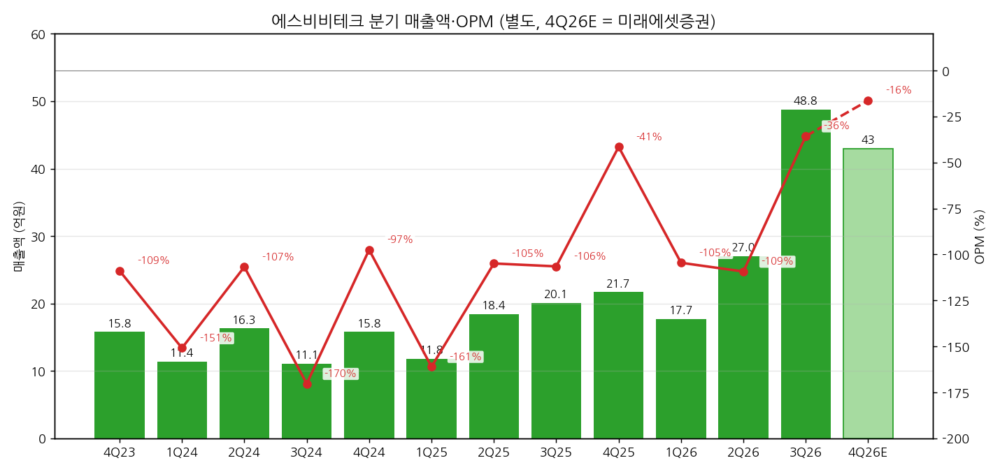
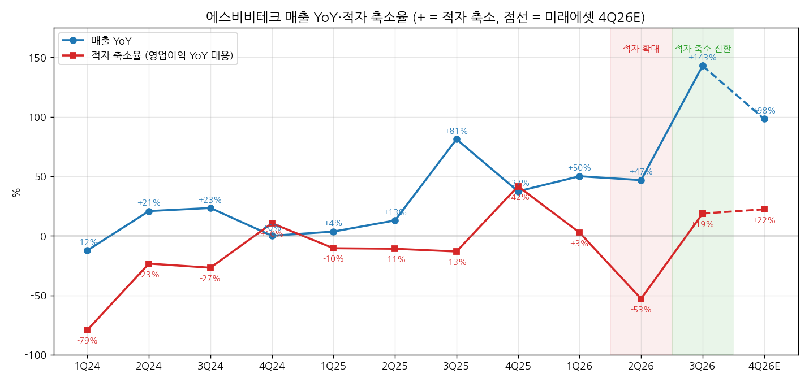
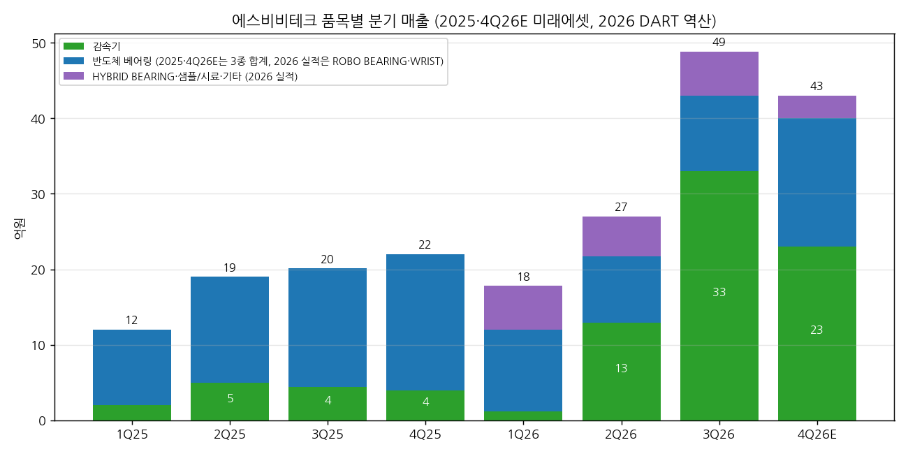

> 모드: 실적 리뷰 (v11)
> 종목: 에스비비테크 (389500)
> 섹터: 로봇
> 서브섹터: 로봇 부품
> 섹터 합산: 제외 (트래킹 피어)
> 분기: 2026-Q3
> 발표일: 2026-11-12 (3Q26 분기보고서, rcept 20261112000519 — 코스닥, 잠정실적 공시 없음)
> 작성 시각: 2026-11-23 13:40 KST
> 분석 소스: DART 3Q26 분기보고서(2026-11-12) + OpenDART 별도(OFS) 분기 재무(1Q23\~3Q26, 연결 종속회사 없음) + 에스비비테크 기업개요 v1.0(2026-11-14) / 셀사이드 첨부 1건: 미래에셋증권 「감속기 부문 성장 궤도 진입」(박선영, 2026-11-16, 매수 유지·TP 47,000 → 52,000원) / 웹 공개 정보 보완: 파이낸스스코프(2026-11-13), 이투데이(2026-07-22 대표 인터뷰), 아시아경제(2026-04-16)
> 리뷰 깊이: 풀 (리서치 첨부 1건 — 2번 쟁점은 미래에셋 1건 + 회사 공시 + 언론으로 구성, 증권사 간 편차 비교 불가)
> 비영업 요인: 없음 (영업이익 = 매출총이익 − 판관비. 참고: 순이익은 CB 공정가치 평가손익이 흔들었으나 — 1Q26 평가손실 72.4억 — 2026.02 CB 전액 소멸로 3Q26엔 해당 없음, 영업이익 판정과 무관)

# 에스비비테크 3Q26 실적 리뷰

## 0. 한 줄 판정

> 성장 델타: 가속 (적자 축소 전환) | 내러티브: 강화 → 턴어라운드 관심 구간 (적자 축소 1개 분기째 — 4Q26 연속 축소와 12월 차입 만기·자금조달 확인 전까지 적극 구간 아님)

→ 숫자: 매출 48.8억(+142.9% YoY, +80.6% QoQ, 상장 후 분기 최대), 영업이익 -17.4억(전년 -21.4억), OPM -35.6%(전년 -106.4%). **적자 기업이라 영업이익 YoY 대신 "적자 축소율"로 판정** (두산로보틱스·레인보우로보틱스 3Q26 리뷰와 동일 방식) — 2Q26 **-52.8%(적자 확대)** → 3Q26 **+18.7%(적자 축소)**, +71.5%p. 매출 YoY도 +47.0% → +142.9%(+95.9%p)로 동반 확대 = 가속
→ 다만 적자 축소율은 +41.6%(4Q25) → +2.6%(1Q26) → -52.8%(2Q26) → +18.7%(3Q26)로 출렁인다. 마이너스 폭 2개 분기 연속 축소 = 턴어라운드 규칙(2026-11-22)상 이번은 1개 분기째 — 미래에셋 4Q26E -7억(4Q25 -9.0억 대비 +22%)이 나오면 2개 분기 연속
→ 쟁점 1: **성장은 감속기 한 품목** — 감속기 33.0억(매출의 67.6%, 2Q 12.9억), 국내 로봇 제조사향 휴머노이드용 하모닉 감속기 공급계약 2건(합산 42억)이 견인. 베어링은 12억(-23% YoY)
→ 쟁점 2: **매출은 컨센 +39% 상회, 적자는 컨센보다 컸다** — 영업이익 -17억 vs 컨센 -13억. GPM 15.3%로 흑자전환했지만 판관비 24.8억(+27% YoY)이 그대로
→ 다음 분기 관건: ① 4Q26 영업손실 -9.0억 이내(4Q25 대비 축소) ② 감속기 분기 20억대 유지 ③ **현금 2.6억·단기차입 80억(50억 2026-12-27 만기)** — 증자·CB 등 조달 방식

## 1. 숫자

① 별도 분기 표 (억원)

| 항목 | 4Q23 | 1Q24 | 2Q24 | 3Q24 | 4Q24 | 1Q25 | 2Q25 | 3Q25 | 4Q25 | 1Q26 | 2Q26 | **3Q26** | 4Q26E |
|---|---|---|---|---|---|---|---|---|---|---|---|---|---|
| 매출액 | 15.8 | 11.4 | 16.3 | 11.1 | 15.8 | 11.8 | 18.4 | 20.1 | 21.7 | 17.7 | 27.0 | **48.8** | 43 |
| 영업이익 | -17.2 | -17.2 | -17.4 | -18.9 | -15.4 | -19.0 | -19.3 | -21.4 | -9.0 | -18.5 | -29.5 | **-17.4** | -7 |
| OPM | -108.8% | -150.1% | -106.6% | -169.8% | -98.0% | -161.0% | -104.7% | -106.4% | -41.5% | -104.3% | -109.2% | **-35.6%** | -16.3% |
| 매출 YoY | — | -12.1% | +20.9% | +24.1% | -0.6% | +2.9% | +12.6% | +80.6% | +37.9% | +50.5% | +47.0% | **+142.9%** | +98.2% |
| 영업이익 YoY (적자폭 변화, 억원) | — | -7.6 | -3.3 | -4.0 | +1.8 | -1.8 | -1.9 | -2.5 | +6.4 | +0.5 | -10.2 | **+4.0** | +2.0 |
| 적자 축소율 (영업이익 YoY 대용) | — | -79.2% | -23.4% | -26.8% | +10.5% | -10.5% | -10.9% | -13.2% | +41.6% | +2.6% | -52.8% | **+18.7%** | +22.2% |
| **매출 YoY 델타 (%p)** | — | — | +33.0 | +3.2 | -24.7 | +3.5 | +9.7 | +68.0 | -42.7 | +12.6 | -3.5 | **+95.9** | -44.7 |
| **적자 축소율 델타 (%p)** | — | — | +55.8 | -3.4 | +37.3 | -21.0 | -0.4 | -2.3 | +54.8 | -39.0 | -55.4 | **+71.5** | +3.5 |

→ (출처: 4Q23\~3Q26 OpenDART 별도 fnlttSinglAcntAll(4Q = 연간 − 3Q 누적, 연결 종속회사 없음 → OFS), 3Q26은 분기보고서 2026-11-12. 1Q24\~4Q24 적자 축소율은 1Q23\~4Q23 대비. 4Q26E: 미래에셋증권 2026-11-16 분기 실적 표(십억원 → 억원, 반올림 단위 10억))
→ **적자 기업 델타 판정 방식**: 영업이익 YoY(%)는 적자 구간에서 의미가 없으므로 "적자 축소율 = (이번 분기 영업이익 − 전년 동기 영업이익) ÷ |전년 동기 영업이익|"으로 대체 (+ = 적자 축소, − = 확대). 적자 축소율이 직전 분기보다 확대되면 가속 — 2Q26 -52.8% → 3Q26 +18.7%, 마이너스에서 플러스로 전환
→ 컨센 대비: 매출 48.8억 vs 컨센 35억 **+39%**, 영업이익 -17.4억 vs 컨센 -13억 **적자 33% 더 큼** (컨센: 미래에셋 표1 인용 FnGuide 컨센서스, 집계 증권사 수 미기재 — 소수 의견 좌우 가능). 미래에셋 자체 추정(매출 35억·영업이익 -17억)과는 영업이익이 일치
→ [판단] 4Q는 2년 연속 연중 적자가 가장 작은 분기(4Q24 -15.4억, 4Q25 -9.0억 — 연말 원가 조정으로 4Q GPM 22.7%·40.4%, 기업개요). 4Q26E -7억은 이 계절성을 반영한 숫자라 "축소 2개 분기 연속"의 문턱은 -9.0억이다. 매출 YoY는 3Q26 +142.9%가 단기 정점 — 미래에셋 경로상 4Q26 +98%, 2027E +68%, 2028E +33%로 연간 성장률은 내려간다

→ (출처: OpenDART 별도, 4Q26E 미래에셋증권 2026-11-16)

→ (출처: OpenDART 별도, 4Q26E 미래에셋증권. 적자 축소율 + = 전년 동기 대비 적자 축소)

② 품목별 매출 (단일 보고부문 '구동장치 및 부품' — 품목별 영업이익 미공개)

(1) 품목별 분기 매출 (억원)

| 품목 | 3Q25 | 1Q26 | 2Q26 | **3Q26** | QoQ | YoY | 3Q26 비중 | 3Q26 누적 |
|---|---|---|---|---|---|---|---|---|
| 감속기 (ROBO DRIVE) | 4.4 | 1.2 | 12.9 | **33.0** | +156% | 약 7.5배 | **67.6%** | 47.1 |
| ROBO BEARING | 5.9 | 6.3 | 3.9 | **5.3** | +37% | -10% | 10.9% | 15.5 |
| WRIST | 4.1 | 4.5 | 4.9 | **4.7** | -4% | +15% | 9.6% | 14.1 |
| HYBRID BEARING·샘플/시료·기타 | 5.7 | 5.8 | 5.3 | **5.8** | +9% | +2% | 11.9% | 16.9 |
| 합계 | 20.1 | 17.7 | 27.0 | **48.8** | +81% | +143% | 100% | 93.6 |

→ (출처: DART 2026.09 분기보고서·반기보고서·1분기보고서 'II-4 매출실적' 누적치 → 분기 역산, 기업개요 v1.0. 3Q25는 2025 3분기보고서 기준)
→ 미래에셋 분류(3Q26): 감속기 33억(+655% YoY) / 베어링 12억(-23% YoY) / 샘플·시료 4억(+3,790% YoY), 지역별 내수 45억(+215% YoY) / 수출 4억(-38% YoY)
→ **델타를 끈 건 감속기 하나**: 감속기 3Q 누적 47.1억은 2025 연간(14.7억)의 3.2배, 전액 내수. 3Q 누적 매출 증가분(+43.3억) 대부분이 국내 감속기 고객에서 나왔다 (기업개요 지역별 주석)
→ **반도체 베어링 3종은 꺾였다**: 3Q26 누적 베어링 수출 11.7억 — 아시아(중화권 반도체 장비향) 매출 3Q 누적 11.4억으로 전년 12.6억 대비 감소 (DART 지역별 주석). 파이낸스스코프(11-13)는 3Q 누적 베어링 +18.1%로 보도 — 누적 기준과 분기 기준 차이
→ 감속기 생산실적 3Q26 누적 12,934개(2025 연간 3,056개의 4.2배), 가동률 4.4% → 24.6%. CAPA 연 7만개(하모닉 5만·유성 2만) — 4배 이상 여력 (DART, 미래에셋)

(2) 손익·비용·현금 보조 지표 (억원)

| 항목 | 3Q25 | 1Q26 | 2Q26 | **3Q26** | QoQ | YoY |
|---|---|---|---|---|---|---|
| 매출총이익 | -1.9 | 1.7 | -3.8 | **7.5** | +11.3 | +9.4 |
| GPM | -9.2% | 9.4% | -14.2% | **15.3%** | +29.5%p | +24.5%p |
| 판관비 | 19.5 | 20.2 | 25.7 | **24.8** | -0.9 | +5.3 (+27%) |
| 영업이익 | -21.4 | -18.5 | -29.5 | **-17.4** | +12.1 | +4.0 |
| 감속기 수주잔고 (기말) | — | — | — | **106.7** | | (12,962개, 납기 \~2028.03) |
| 현금및현금성자산 (기말) | — | — | — | **2.6** | | (2025말 93.5) |
| 단기차입금 (기말) | — | — | — | **80.0** | | (2025말 50.0) |

→ (출처: OpenDART 별도, DART 2026.09 분기보고서 매출 및 수주상황·재무제표, 기업개요 v1.0. 1Q26 판관비는 매출총이익 − 영업이익으로 역산)
→ 3Q 적자 축소(+4.0억 YoY)는 전부 매출총이익 개선(+9.4억)에서 나왔고, 판관비는 +5.3억 늘어 절반을 다시 깎았다. 미래에셋: "차세대 감속기 개발을 위한 연구개발비와 초기 양산에 따른 원가 부담"
→ 3Q26 누적 영업CF -71.9억, 유형자산 취득 40.7억(감속기 생산능력 증대), 재고자산 37.3억(2025말) → 71.7억 — 양산 대응 원재료 선확보 (기업개요)

③ 연간 (억원)

| 항목 | 2022 | 2023 | 2024 | 2025 | 2026E | 2027E | 2028E |
|---|---|---|---|---|---|---|---|
| 매출액 | 74.7 | 51.3 | 54.7 | 72.0 | 137 | 230 | 306 |
| 영업이익 | -18.4 | -55.7 | -68.9 | -68.6 | -73 | -8 | 30 |
| OPM | -24.6% | -108.5% | -126.1% | -95.3% | -53.3% | -3.4% | 9.8% |
| 매출 YoY | +10.2% | -31.3% | +6.5% | +31.7% | +89.7% | +68.3% | +33.1% |
| 적자 축소율 / 영업이익 YoY | — | -202.7% | -23.7% | +0.4% | -6.4% (확대) | +89% (축소) | 흑전 |

→ (출처: 2022\~2025 OpenDART 별도, 2026E\~2028E 미래에셋증권 2026-11-16 표3. 미래에셋 리포트 내 2027E 영업이익이 표마다 다름 — 표3·1면 요약 -8억(-1십억) vs 표2 수익예상 변경표 +11억(흑자전환). 본 리뷰는 손익계산서(8면)와 일치하는 표3 사용)
→ 발표 전후 추정 변화(미래에셋): 2026E 매출 118 → 137억(+15.7%), 2027E 205 → 230억(+12.1%), 2027E 영업이익 -17 → +11억(표2 기준, 흑전). FnGuide 2026E 영업이익 컨센 -70억(1면)
→ 미래에셋 2026E 영업이익 -73억 = 3Q 누적 -65.4억 + 4Q -7억 — 연간으로는 2025(-68.6억)보다 소폭 적자 확대 (1H26 -48.0억 영향)

→ (출처: 2025·4Q26E 미래에셋증권 표3(십억원, 감속기·베어링·기타 3분류), 1Q26\~3Q26 DART 매출실적 역산)

## 2. 시장 쟁점

> 분석 범위: 셀사이드 리포트 1건(미래에셋증권 2026-11-16)뿐이라 증권사 간 해석 편차 비교가 불가하다. 쟁점별 표는 "미래에셋 / 회사 공시 / 언론" 소스 대비로 구성했다. 분기 실적 IR·컨퍼런스콜 없음(irgo 게시 IR은 2026-07 '주요 사업 소개' 1건 — 기업개요 기준)

① 2-0 지난 분기 체크

→ 첫 리뷰 — 직전 리뷰 없음. 참고로 실적 캘린더에 걸려 있던 3Q 시그널(기업개요 작성 시점) 체크:

| 직전 시그널 | 이번 분기 결과 | 판정 |
|---|---|---|
| 3Q 감속기·액추에이터 매출 | 감속기 33.0억(QoQ +156%). 액추에이터(구동모듈)는 별도 품목 공시 없음 | 감속기 **확인** / 액추에이터 **미확인** |
| 적자폭 | -17.4억, 전년 -21.4억 대비 18.7% 축소 (QoQ -29.5억 → -17.4억) | **확인** |
| 모베드 감속기 공급 | 현대차 MobED 9월 말 양산 돌입(파이낸스스코프 11-13), DnL 모듈 조향·편심부 공급(계양전기 계약 6.7억, 2025.10\~2026.10) — 매출 규모 미공시 | **부분 확인** |

② 이번 분기 쟁점 4개

| # | 쟁점 | 근거 소스 |
|---|---|---|
| (1) | 감속기 33억은 반복되는 매출인가 — 국내 로봇 제조사 1곳 의존과 수주잔고 정체 | DART 매출·수주·주요 고객, 미래에셋 공급계약 표, 파이낸스스코프 |
| (2) | GPM 흑자전환에도 적자가 컨센보다 컸다 — 손익분기 매출은 얼마인가 | DART 손익, 미래에셋 추정, 이투데이 대표 인터뷰 |
| (3) | 현금 2.6억·12월 차입 만기 50억 — 자금조달과 희석 | DART 재무상태표·차입금 주석, 미래에셋 |
| (4) | 고점 대비 -73% 주가 — 27F P/S 9배는 싼가 | 미래에셋 밸류에이션·피어 표, 기업개요 |

③ 쟁점별 분해

(1) **감속기 33억의 지속성 — 고객 1곳 의존과 수주잔고 정체**

(1-1) 회사 설명
→ 감속기 수주: 2024.01\~2026.09 누적 수주 26,058개·182.8억, 기납품 13,096개·76.1억, **잔고 12,962개·106.7억**(납기 \~2028.03). "판매는 P/O 단납기 형태로 잔고 외 매출도 발생" (DART 2026.09 분기보고서)
→ 10% 이상 고객 A사 3Q26 누적 35.1억(매출의 37.5%) — 3Q 누적 감속기 매출(47.1억)의 75% (DART 재무제표 주석)
→ 회사: "휴머노이드 분야의 공급 경험을 기반으로 고객사와 제품 포트폴리오를 확대", 국내 휴머노이드 고객사와 올해 총 42억 감속기 공급계약 확보 후 추가 개발·공급 협의 중 (파이낸스스코프 2026-11-13)

(1-2) 소스별 해석

| 소스 | 핵심 가정·추정 | 논리 |
|---|---|---|
| 미래에셋증권 | 감속기 4Q26E 23억(QoQ -30%) → 2026E 70억 → 2027E 155억 → 2028E 229억 | 4Q25부터 차세대 로봇향 발주 증가, 반도체 베어링 중심 → 감속기·액추에이터로 성장축 이동. 7\~8월 공급계약 2건(합산 42억)으로 국내 로봇 제조사향 휴머노이드용 하모닉 감속기 납품 본격화 |
| 회사 공시 (공급계약) | 국내 로봇 제조사: 2026-05-19 12.1억 → 07-28 22.8억으로 증액 / 08-24 19.2억 (계약기간 \~2028-04-29). 계양전기(MobED DnL) 6.7억, STS인터내셔널(TSMC향 베어링) 14.7억 | 상대방 실명 비공개. 휴머노이드향 2건 합계 42.0억 |
| 언론 (파이낸스스코프 11-13) | 3Q 누적 감속기 +331.9%, MobED 9월 말 양산 | 2027년 고객사 양산 확대에 따른 모빌리티 매출 증가 전망 |

→ (출처: 미래에셋 2026-11-16 표6 'DART 주요 공급계약 공시 내역', 그림 2 수주잔고)

(1-3) 공통 결론 vs 갈리는 지점
→ 공통: 2026 성장의 실체는 국내 로봇 제조사 1곳향 휴머노이드용 하모닉 감속기. 미래에셋도 4Q26 감속기를 3Q보다 낮게(23억) 잡았다 — 3Q 33억은 초도 물량이 몰린 분기라는 해석
→ 갈림: 2027E 감속기 155억(분기 평균 39억, 3Q26의 1.2배)이 가능한가. 수주잔고는 1Q26 113억 → 2Q26 111억 → 3Q26 107억으로 정체(3Q 신규수주 44억 ≈ 출하분, 미래에셋 그림 2) — 잔고가 늘지 않는 한 2027E는 신규 고객·추가 계약을 전제

(1-4) [판단]
→ A사 3Q 누적 35.1억과 휴머노이드향 계약 합계 42.0억이 근접 — A사가 이 국내 로봇 제조사라면 두 계약 물량의 상당 부분이 이미 매출로 인식됐을 가능성이 있다 `[판단: 회사가 A사 실명·계약별 잔량을 공시하지 않아 확인 불가]`
→ 4Q 감속기 20억 이상 + 신규 공급계약 공시(휴머노이드 2번째 고객 또는 방산 RCWS 양산)가 나오면 "1회성 초도 물량" 우려가 풀린다. 4Q 감속기가 10억대로 떨어지고 신규 계약이 없으면 3Q는 피크

(2) **GPM 흑자전환에도 컨센보다 큰 적자 — 손익분기 매출**

(2-1) 회사 설명
→ IR(2026-07): "27년 손익분기 매출 달성" 목표 / 대표 인터뷰: "2027년 말\~2028년 전후 흑자 전환 기대", "예상 수요를 감당하려면 지금보다 5\~10배 매출을 뒷받침할 생산능력 필요", M&A 검토 (이투데이 2026-07-22)
→ 2026년을 액추에이터 회사 전환 원년으로 — 천안 입장면 액추에이터 전용 공장, 생산라인 천안 이전 중 (파이낸스스코프 11-13)

(2-2) 소스별 해석

| 소스 | 핵심 가정·추정 | 논리 |
|---|---|---|
| 미래에셋증권 | GPM 2026E 9.8% → 2027E 30.2% → 2028E 40.8%, 영업이익 2027E -8억(표3) / +11억(표2) → 2028E 30억 | 감속기 가동률 4% → 25%, 4배 이상 가동률 확대 여력 — 고정비 흡수로 매출총이익률 레버리지 |
| 회사 공시 | 3Q GPM 15.3%, 판관비 24.8억(+27% YoY), 3Q 누적 R&D 32.8억(매출 대비 35%) | 원가는 좋아졌지만 판관비가 매출총이익(7.5억)의 3.3배 |
| 컨센서스 (FnGuide, 미래에셋 인용) | 3Q26 영업이익 -13억 → 실제 -17억 | 매출 서프라이즈(+39%)가 이익으로 이어지지 않음 |

(2-3) 공통 결론 vs 갈리는 지점
→ 공통: 감속기 가동률 상승이 GPM을 끌어올리는 구조는 3Q에 처음 숫자로 확인됐다 (GPM -14.2% → +15.3%)
→ 갈림: 손익분기 시점. 판관비가 분기 25억 수준이면 GPM 15%에선 분기 매출 약 160억, GPM 30%에선 약 83억이 필요 `[판단: 판관비 ÷ GPM 단순 계산]`. 미래에셋 2027E(매출 230억, 분기 평균 58억)로는 적자가 남고, 표2의 흑자전환과 표3의 적자가 한 리포트 안에서 엇갈린다 — 2027 BEP는 "경계선"이라는 뜻

(2-4) [판단]
→ 3Q 적자 축소는 "매출 2.4배 → 적자 19% 축소"로 레버리지가 약하다. 4Q는 계절적으로 GPM이 높은 분기(4Q25 40.4%)라 적자 축소가 쉬운 분기 — 진짜 시험대는 1Q27 (1Q26 -18.5억 대비 축소 여부)
→ 판관비가 분기 25억 이내로 묶이고 GPM 25% 이상이 1Q27까지 유지되면 2027 BEP 경로 유효. 판관비가 30억대로 올라가면(천안 이전·인력 확대) 2028로 밀린다

(3) **현금 2.6억·12월 차입 만기 — 자금조달과 희석**

(3-1) 사실 관계 (회사 공시)
→ 현금및현금성자산 2025말 93.5억 → 2026.09 **2.6억**. 단기차입금 80억(하나은행 운전 37억·시설 13억·수출입은행 온렌딩 30억) 중 **50억 2026-12-27 만기**(토지·건물 담보), 유동비율 100.5% (DART 2026.09, 기업개요)
→ 3Q 누적 영업CF -71.9억 + CapEx 40.7억을 기존 현금과 차입 증액 30억으로 메움. CB는 2026.02 전액 전환으로 소멸, 자기주식 0주(2025년 전량 처분) — 남은 조달 수단은 차입 연장·유상증자·신규 CB

(3-2) 소스별 해석

| 소스 | 핵심 가정·추정 | 논리 |
|---|---|---|
| 미래에셋증권 | "작년 말 이후 현금성 자산이 빠르게 줄어들고 있어 추가 자금조달 가능성은 리스크 요인" | 추정 재무제표 2026E 기말 현금 110억, 2026E 자본의 증가 200억(십억원 표 20) — 조달 방식은 본문에 없음 |
| 회사 (최대주주) | (주)케이피에프 39.66% — 2023 CB 100억 인수 후 2026.02 전환 | 최대주주가 과거 CB를 인수·전환한 이력 (DART) |
| 언론 (이투데이 07-22) | 대표 "M&A 적극 검토", 생산능력 5\~10배 필요 | 성장 투자 자금 수요가 추가로 생길 수 있음 |

(3-3) 공통 결론 vs 갈리는 지점
→ 공통: 4Q26 중 자금 유입 이벤트가 필요하다. 영업CF가 분기 -20억대인 상태에서 현금 2.6억으로는 운영이 어렵다
→ 갈림: 방식과 규모. 차입 롤오버(담보 기반)면 희석 없음, 유상증자·CB면 시총 약 2,062억(11-13) 대비 규모에 따라 희석 — 미래에셋 추정 재무제표는 연말 현금 110억을 넣어 4Q 중 100억 안팎 유입을 가정한 것으로 읽힌다 `[판단: 리포트에 조달 가정 설명 없음]`

(3-4) [판단]
→ BT 매매 프레임상 이 쟁점은 델타보다 먼저 확인할 "이벤트 리스크". 12월 만기 연장 공시 또는 증자 공시가 4Q 실적보다 먼저 주가를 움직일 가능성이 높다
→ 최대주주(KPF) 참여 제3자배정이면 시장 부담이 덜하고, 일반공모 유상증자면 테마 소형주 특성상 단기 충격이 클 수 있다

(4) **고점 대비 -73% — 27F P/S 9배는 싼가**

(4-1) 사실 관계
→ 주가 30,950원(2026-11-13, 3Q 공시 다음 거래일), 시가총액 약 2,062억. 52주 종가 최고 106,400원 / 최저 23,100원, 1M -10.7%·6M -70.9%·12M +25.8% (미래에셋 1면). 최근 4분기 매출 115.2억 기준 PSR 약 17.9배 (기업개요)
→ 3Q 공시(11-12) 직후에도 반등 제한 — 매출 +143%에도 주가는 1개월 -10.7% (미래에셋 1면, 11-13 기준)

(4-2) 소스별 해석

| 소스 | 핵심 가정·추정 | 논리 |
|---|---|---|
| 미래에셋증권 | TP 52,000원 = 27F SPS 3,449원 × Target P/S 15.1배 (글로벌 핵심 부품 Peer 평균 대비 20% 할증 — 리포트 표기), 상승여력 68% | 현 주가는 27F P/S 9.0배로 지난 1년 평균(13.9배) 대비 할인 |
| 피어 (미래에셋 표5, 블룸버그 컨센 11/13) | Leaderdrive 26F P/S 59.2배·로보티즈 59.1배·Harmonic Drive(일본) 6.0배·Nidec 0.8배, 에스비비테크 26F 13.8배 / 27F 8.5배 | 감속기 순수 플레이 중국·한국 피어는 고멀티플, 일본 HDS는 한 자릿수 |

(4-3) 공통 결론 vs 갈리는 지점
→ 공통: 실적이 아닌 매출 멀티플 — 이익 기반 밸류 불가(2027E까지 적자)
→ 갈림: 적용 피어. Leaderdrive(흑자, OPM 21.7%)·로보티즈 수준을 주면 상승여력, HDS(일본 1위, P/S 6배)를 기준으로 하면 현 수준(27F 8.5배)이 이미 할증

(4-4) [판단]
→ 2026.05 고점은 휴머노이드 테마 + 감속기 국산화 기대였고, 3Q 실적이 숫자로는 그 기대를 일부 확인했는데도 주가는 반응하지 않았다 — 시장이 "고객 1곳 초도 물량 + 자금조달 임박"을 먼저 가격에 넣고 있다는 뜻. 자금조달 이벤트가 정리된 뒤가 실적 반영 구간

④ 2-3 낙관 vs 보수 — 논리 대비

→ 리포트 1건으로 증권사 간 대비 불가. 미래에셋(낙관 측 논리) vs 회사 공시 숫자(보수 측 근거)로 대비하면:
→ 낙관(미래에셋): 13년 하모닉 감속기 국산화 첫 기업으로 로봇·방산 국내 레퍼런스 확보 → 휴머노이드·모빌리티(MobED)·방산 RCWS로 고객 확대, 가동률 25% → 4배 여력, 2028E OPM 9.8%
→ 보수(공시 숫자): 감속기 매출의 75%가 A사 1곳, 수주잔고 3개 분기 연속 감소(113 → 111 → 107억), 컨센보다 큰 적자, 현금 2.6억 — 매출 레벨업이 "고객 다변화"가 아니라 "고객 1곳 초도 물량"일 수 있다 `[판단]`
→ 셀사이드 vs 바이사이드: 미래에셋은 TP 상향(+11%)인데 주가는 6개월 -71% — 바이사이드는 실적보다 자금조달·테마 소멸을 더 무겁게 보고 있다

⑤ 2-4 추정치·TP 변화

| 증권사 | 직전 TP | 현재 TP | 4Q26E 영업이익 | 2026E / 2027E 영업이익 | 핵심 변화 한 줄 |
|---|---|---|---|---|---|
| 미래에셋증권 (2026-11-16) | 47,000원 (2026-08-21) | **52,000원** (매수 유지, +10.6%) | -7억 | -73억 / -8억 (표2 기준 -65억 / +11억) | 27F SPS 3,081 → 3,449원(+12%), 27F 매출 205 → 230억 — 로봇용 감속기 수요 증가 반영 |

→ 평균 TP 변화율: +10.6% (1건, 상향 1·하향 0)
→ TP 상향의 원인 = **실적(매출 추정) 상향** — Target P/S 15.1배는 유지, 27F SPS만 +12% 상향. 멀티플 변화 없음
→ 발표 전후 연간 컨센: FnGuide 2026E 영업이익 -70억(미래에셋 1면) — 발표 전 컨센 미확보로 변화 비교 불가

## 3. 내러티브 점검

→ 성장 스토리: "국내 최초 하모닉 감속기 국산화 기업 — 반도체 베어링 부품사에서 휴머노이드·모빌리티·방산 감속기와 액추에이터(통합 구동모듈) 회사로 전환, 감속기 가동률이 올라가며 적자에서 벗어난다"
→ 이번 분기: ① 감속기 매출 33억·가동률 25%로 **"감속기 회사로의 전환"이 처음 숫자로 확인** ② GPM 흑자전환(15.3%)으로 고정비 흡수 구조 확인 ③ 미래에셋 추정·TP 상향 → **강화**
→ 다만 ① 고객 1곳 의존(A사 37.5%) ② 수주잔고 정체 ③ 현금 고갈이 스토리의 "지속성"을 아직 담보하지 못한다. 셀사이드 기준 강화, 주가(6M -71%) 기준으로는 시장이 믿지 않는 강화
→ 판정: 델타 **가속**(적자 축소율 -52.8% → +18.7%, 매출 YoY +47% → +143%) + 내러티브 **강화** → **턴어라운드 관심 구간** — 적자 기업의 첫 적자 축소 분기이고 실적이 분기마다 출렁여, 4Q26 연속 축소(턴어라운드 규칙 2개 분기)와 자금조달 정리 전까지는 적극 구간으로 보지 않음
→ 내러티브를 다시 강하게 만들 트리거: ① 휴머노이드 2번째 고객 또는 방산 RCWS 양산 공급계약 공시 ② 4Q26 영업손실 -9억 이내 + 1Q27 -18.5억 대비 축소 ③ 액추에이터(구동모듈) 매출의 별도 공시·MobED 후속 모빌리티 모듈 수주
→ 깨뜨릴 리스크: ① 일반공모 유상증자 등 대규모 희석 ② 4Q 감속기 매출 10억대 급감(초도 물량 소진) ③ 국내 로봇 제조사 고객의 휴머노이드 양산 지연

## 4. 향후 봐야 할 것

| 순위 | 무엇을 (변수·임계값) | 어떤 데이터로 | 언제 |
|---|---|---|---|
| 1 | **4Q26 영업손실 -9.0억 이내** (4Q25 대비 축소 = 적자 축소 2개 분기 연속 → 턴어라운드). 미래에셋 -7억. -9억 초과 적자면 축소 1개 분기로 끝나 델타 꺾임 | DART 사업보고서 별도 손익 (코스닥, 잠정공시 없음 — 매출·손익 30% 변동 공시 시 2월) | 2027-03 하순 (2025 사업보고서 2026-03-23) |
| 2 | **12월 만기 차입 50억 처리 + 자금조달 방식·규모** — 차입 연장 vs 유상증자·CB, 최대주주(KPF) 참여 여부 | DART 주요사항보고서(유상증자·CB), 단기차입금 증감 공시 | 2026-12 (만기 12-27) |
| 3 | **감속기 분기 매출 20억 이상 유지** (미래에셋 4Q26E 23억) + 수주잔고 107억 이상 회복. 10억대면 3Q가 초도 물량 피크 | 사업보고서 매출실적·수주상황, 공급계약 공시 | 2027-03 / 계약 공시 수시 |
| 4 | **신규 감속기·액추에이터 공급계약** — 휴머노이드 2번째 고객, 방산 RCWS 양산(9월 예정), 협동로봇 신규 메이커, MobED 후속 모듈(2027.03 시양산) | DART 단일판매·공급계약 공시, 회사 보도자료, 현대차그룹 로보틱스랩 뉴스 | 4Q26\~1Q27 |
| 5 | **판관비 분기 25억 이내 + GPM 25% 이상** — 손익분기 경로 확인 (천안 공장 이전 비용 주의) | 사업보고서 손익계산서·연구개발비 | 2027-03 |

→ 다음 분기 리뷰 2-0의 체크 대상 = 위 5개
