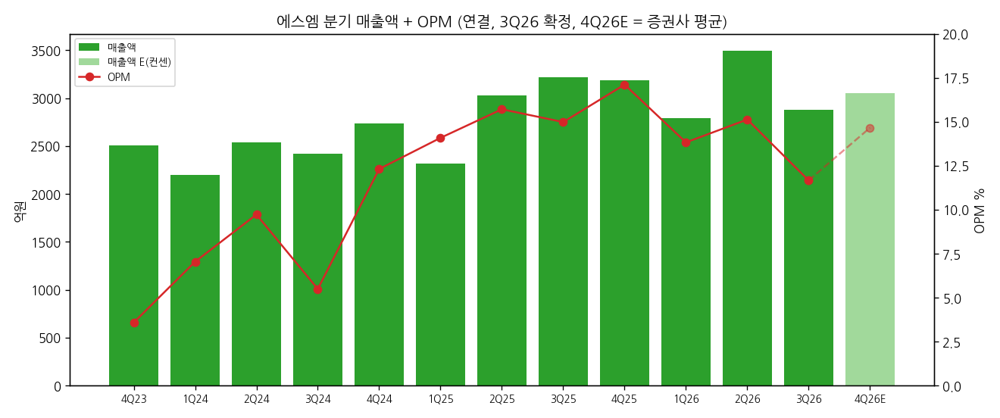
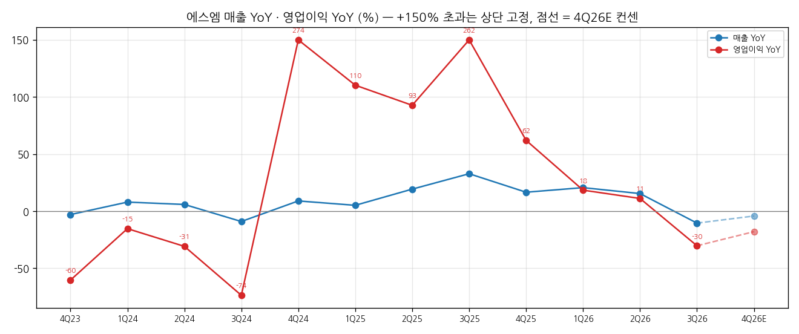
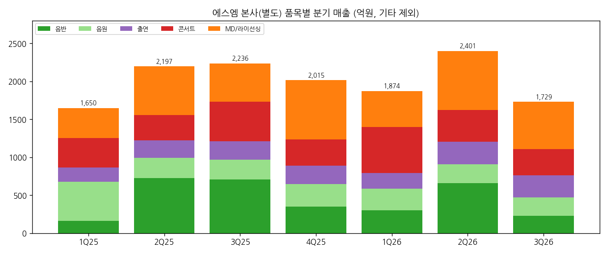

> 모드: 실적 리뷰 (v11)
> 종목: 에스엠 (041510)
> 섹터: 엔터
> 서브섹터: 기획사
> 분기: 2026-Q3
> 발표일: 2026-11-04 (IR 잠정실적) / 2026-11-13 (분기보고서 — 확정치)
> 작성 시각: 2026-11-23 00:10 KST
> 분석 소스: 에스엠 2026년 3분기 실적 IR(2026-11-04) + OpenDART 분기 재무(company-data MCP `dart_quarterly_summary`, 3Q26 분기보고서 2026-11-13 확정치 포함) + 셀사이드 9건 — KB(11/4, 11/12 업종)·삼성(11/5)·하나(11/5)·상상인(11/5)·신한(11/11)·키움(11/17)·교보(11/17)·HSBC(10/21 업종, 발표 전) / 같은 폴더 `company-overview/에스엠_기업개요.md` 참고. 웹서치 보완 없음
> 리뷰 깊이: 풀 | 리서치 첨부 10건 (IR 1 + 증권사 9)
> 비영업 요인: 연결 범위 변경(디어유 2Q25부터 연결 — 분기 영업이익 약 90억, 1Q26 YoY는 편입 효과 포함, 2Q26·3Q26은 동일 기저) · 영업외(3Q26 원화 강세 외화평가손실·디어유 아티스트 선급금 관련 비용 → 순손실 −28억, 영업이익 무관) · 참고(1Q25 순이익 2,527억은 디어유 지배력 획득 재평가이익 2,282억 — 영업이익 무관)

# 에스엠 3Q26 실적 리뷰

## 0. 한 줄 판정

> 성장 델타: 꺾임 | 내러티브: 유지 → 매매 제외 구간 (2027년 재가속 대기 — 영업이익 YoY +18.4% → +11.1% → **−30.3%**로 2개 분기 연속 둔화 끝에 마이너스 전환. 셀사이드는 2027년 'Full Cycle' 증익(+14\~38%)을 유지해 TP는 대부분 유지)

> ⚠ 비영업 요인 플래그: 1Q26 영업이익 YoY +18.4%에는 디어유 연결 편입 효과(1Q25 미연결) 포함 — 별도(본사) 영업이익은 이미 1Q26 −6%, 2Q26 −5%, 3Q26 −29%로 3개 분기 연속 감익 (신한 분해) → 꺾임은 편입 효과가 빠지면서 드러난 본업 둔화. 3Q26 순손실(−28억)은 외화평가손실·디어유 영업외 비용으로 영업이익 판정과 무관. 확정치(매출 2,880억·영업이익 336억)가 IR 잠정치(2,911억·355억)보다 각각 −31억·−19억 낮다 — 차이 원인 미공시

→ 숫자: 매출액 2,880억 (−10.4% YoY, −17.6% QoQ), 영업이익 336억 (−30.3% YoY, OPM 11.7%) [확정]. 매출 YoY 20.6%(1Q26) → 15.4% → **−10.4%**, 영업이익 YoY 18.4% → 11.1% → **−30.3%**
→ 컨센 대비: 증권사가 쓴 컨센이 369억(하나·상상인·삼성 "부합")\~398억(KB·Bloomberg, "−10.7% 하회")으로 갈린다. 확정치 336억 기준으로는 컨센 369억 대비 **−8.9%** [계산]
→ 쟁점 ①: **본사 활동 공백** — 신보 판매량 550만 장(3Q25) → 167만 장, 공연은 팬미팅·팬콘 위주 소규모 회차로 별도 매출 −22.8%. 증권사 전원 "예상된 감익, 2027년 정상화"
→ 쟁점 ②: **2027년 증익 폭** — 2027E 영업이익 1,925억(하나)\~2,306억(키움, +38%)으로 갈림. 변수는 NCT WISH·RIIZE 투어 체급, SMTR25 데뷔(1Q27\~1H27), 에스파 유럽 투어
→ 다음 분기 관건: 4Q26 영업이익 컨센 평균 약 448억(증권사 7곳, 397\~501억) = YoY −18% [계산] — 4Q에도 YoY 마이너스가 확실해 델타 반전은 **1Q27(기저 386억)**이 첫 시험대

## 1. 숫자

① 연결 분기 표 (억원, K-IFRS 영업이익. 3Q26은 분기보고서 확정치, 4Q26E는 증권사 7곳 영업이익 평균·매출은 5곳 평균)

| 항목 (억원) | 4Q23 | 1Q24 | 2Q24 | 3Q24 | 4Q24 | 1Q25 | 2Q25 | 3Q25 | 4Q25 | 1Q26 | 2Q26 | **3Q26 [확정]** | 4Q26E (컨센) |
|---|---|---|---|---|---|---|---|---|---|---|---|---|---|
| 매출액 | 2,511 | 2,201 | 2,539 | 2,422 | 2,736 | 2,314 | 3,029 | 3,216 | 3,190 | 2,791 | 3,496 | 2,880 | 3,055 |
| 영업이익 | 90 | 155 | 247 | 133 | 337 | 326 | 476 | 482 | 546 | 386 | 529 | 336 | 448 |
| OPM | 3.6% | 7.0% | 9.7% | 5.5% | 12.3% | 14.1% | 15.7% | 15.0% | 17.1% | 13.8% | 15.1% | 11.7% | 14.7% |
| 매출 YoY | -3.0% | +7.9% | +5.9% | -9.0% | +9.0% | +5.1% | +19.3% | +32.8% | +16.6% | +20.6% | +15.4% | -10.4% | -4.2% |
| 영업이익 YoY | -60.4% | -15.3% | -30.8% | -73.7% | +274.4% | +110.3% | +92.7% | +262.4% | +62.0% | +18.4% | +11.1% | -30.3% | -17.9% |
| **매출 YoY 델타** | n.m. | +10.9%p | -2.1%p | -14.9%p | +18.0%p | -3.8%p | +14.2%p | +13.5%p | -16.2%p | +4.0%p | -5.2%p | -25.9%p | +6.2%p |
| **영업이익 YoY 델타** | n.m. | +45.1%p | -15.5%p | -42.9%p | +348.1%p | -164.1%p | -17.6%p | +169.7%p | -200.4%p | -43.6%p | -7.3%p | -41.4%p | +12.3%p |
| 참고: IR 잠정치 |  |  |  |  |  |  |  |  |  |  |  | 매출 2,911 / 영업이익 355 |  |
| 참고: 별도(본사) 영업이익 |  | 201 | 293 | 271 | 358 | 413 | 460 | 402 | 395 | 388 | 438 | 284 | 269 (KB) |

→ IR 잠정 vs 확정: 매출 2,911 → **2,880억**(−31억), 영업이익 355 → **336억**(−19억), 순이익 −11 → **−28억** (IR 2026-11-04 vs OpenDART 분기보고서 2026-11-13). 아래 셀사이드 숫자는 모두 잠정치(355억) 기준
→ [판단] 영업이익 YoY의 정점은 3Q25(+262.4%, 저기저)이고, 정상 기저 구간에서는 4Q25 +62% → 1Q26 +18.4%(디어유 편입 효과 포함) → 2Q26 +11.1% → 3Q26 **−30.3%**로 하강. 컨센 경로상 4Q26E도 −18%, YoY 재반등은 2027년 1분기부터(증권사 공통 2027E 증익) — **정점은 이미 지났고, 다음 상승 사이클은 2027년 1H 확인 사항**
→ OPM: 11.7%로 2024년 3분기(5.5%) 이후 최저. 매출총이익률 32.0%(3Q25 37.0%, IR 잠정 기준 [계산])로 하락 — 본사 음반 매출 급감에 앨범 제작비(저연차 일본 발매 집중) 부담

→ (출처: OpenDART 분기 재무 4Q22\~3Q26 — 3Q26 분기보고서 확정치, 4Q26E 증권사 평균 [계산])

→ (출처: 같은 자료로 계산. 점선 = 4Q26E 컨센)

② 사업부별 (억원, 회사 IR 잠정 — 본사 품목별 매출 + 본사·종속법인 영업이익)

| 구분 | 3Q25 | 2Q26 | **3Q26** | QoQ | YoY | 비고 |
|---|---|---|---|---|---|---|
| **별도(본사) 매출** | 2,245 | 2,406 | **1,734** | −27.9% | −22.8% | |
| 음반/음원 | 967 | 909 | 471 | −48.2% | −51.3% | 신보 판매량 550만 → 167만 장 |
| 출연(방송·광고·행사) | 241 | 297 | 292 | −1.8% | +21.3% | 광고·행사 증가 |
| 콘서트 | 525 | 416 | 345 | −16.9% | −34.2% | 팬미팅·팬콘 위주, 약 77만 명(하나) |
| MD/라이선싱 | 503 | 779 | 621 | −20.3% | **+23.5%** | 팝업·캐릭터(EXO-MUNGCHIZ)·aespa×PUBG |
| **별도 영업이익** | 402 | 438 | **284** | −35.1% | −29.2% | OPM 16.4% (−1.5%p YoY) |
| **종속법인 매출(단순 합산)** | 1,468 | 1,777 | **1,646** | −7.4% | +12.1% | |
| 종속법인 영업이익(단순 합산) | 135 | 130 | 122 | −6.4% | −9.9% | |
| └ 디어유 | 87 | 94 | 92 | −2.1% | +5.6% | 매출 228억(+2.4%) |
| └ DREAM MAKER | −1 | 45 | 10 | −77.4% | 흑전 | 매출 274억(+223%) — 공연 제작 증가 |
| └ KEYEAST | −10 | −10 | 5 | 흑전 | 흑전 | 신작 드라마 매출 158억 |
| └ SM ENT JAPAN | 26 | 15 | 3 | −81.2% | −89.4% | 엔화 약세·소규모 공연 |
| └ SM C&C | −2 | −16 | −17 | 적지 | 적지 | 음악 콘텐츠 제작 비용 |
| └ SM LDG (앨범 인쇄) | 23 | 22 | 3 | −86.3% | −87.2% | 앨범 인쇄 매출 감소 |
→ (출처: 에스엠 3Q26 IR. 별도+종속 단순 합산 406억과 연결 영업이익 355억(잠정)의 차이 −51억은 연결 조정 [계산])
→ 델타를 끄는 건 **본사 음반·콘서트의 동시 급감**(본사 매출 감소 511억 중 음반/음원 −496억). MD/라이선싱(+23.5%)과 출연(+21.3%)만 성장
→ 본사 영업이익 추이(신한 분해, 십억원): 4Q25 39.5 → 1Q26 38.8 → 2Q26 43.8 → 3Q26 28.5 — YoY로 3개 분기 연속 감익. 연결 증익(1H26)은 디어유 편입·DREAM MAKER 등 종속법인이 만든 것

→ (출처: 에스엠 IR·KB증권 분기 분해 1Q25\~3Q26)

③ 연간 (억원)

| 항목 | 2023A | 2024A | 2025A | 2026E | 2027E |
|---|---|---|---|---|---|
| 매출액 | 9,611 | 9,898 | 11,749 | 12,305 | 13,679 |
| 영업이익 | 1,135 | 872 | 1,830 | 1,718 | 2,091 |
| OPM | 11.8% | 8.8% | 15.6% | 14.0% | 15.3% |
| 매출 YoY | +13.0% | +3.0% | +18.7% | +4.7% | +11.2% |
| 영업이익 YoY | +24.6% | −23.2% | +109.9% | −6.1% | +21.7% |
→ (출처: 2023\~2025 OpenDART 분기 합산, 2026E·2027E 증권사 7곳 평균 — 삼성·하나·상상인·KB·신한·키움·교보 [계산])
→ 발표 전 → 후 연간 영업이익: 발표 전 컨센 2026E 1,878억·2027E 2,161억(Bloomberg, KB 11/4 인용) → 발표 후 증권사 평균 1,718억(**−8.5%**)·2,091억(**−3.2%**) [계산, 집계 기준 상이 주의]. 2026E는 크게, 2027E는 소폭 하향

## 2. 시장 쟁점

① 지난 분기 체크
→ 첫 리뷰 — 직전 체크 없음

② 이번 분기 쟁점 (증권사 리포트 9건 기준)

(1) **3분기 감익의 성격 — 일시적 공백인가, 본사 체력 저하인가** — 8건 언급
(2) **컨센 부합 vs 하회 — 기준이 다른 컨센** — 6건. 같은 숫자에 "부합"과 "10.7% 하회"가 공존
(3) **MD/라이선싱 — 활동 공백을 메우는 상시 수익원** — 8건
(4) **2027년 'Full Cycle' 증익 폭** — 9건 전부. +15%냐 +38%냐
(5) **디레이팅·히트 분산과 영업외 손실** — 6건. 2027E P/E 10\~13배에도 주가가 52주 저점권인 이유

③ 쟁점별 분해

(1) **3분기 감익의 성격**

(1-1) 회사 설명: "본사 음반/음원 및 콘서트 매출 감소, 일부 주요 종속법인 영업이익 감소" — 신보 판매량 550만 → 167만 장(NCT 127 'BLINGY' 97만 장, WayV 24만 장 등), 공연은 aespa 북미·중남미 13회 외 U-KNOW·EXO·NCT 127 소규모 회차 (IR)

(1-2) 증권사별 해석 편차

| 증권사 | 핵심 가정·추정 | 논리 |
|---|---|---|
| 삼성 (11/5) | "예상된 감익" | 개별 앨범 규모가 작은 신보 다수 + 저연차 일본 발매 집중으로 제작비 확대, 팬미팅·팬콘 등 소규모 공연 |
| KB (11/4) | 별도 고정비 부담 | 아티스트 활동 부재로 고정비 부담, 콘서트 33회차에 그쳐 −20% QoQ |
| 신한 (11/11) | "27년 성과를 위한 일보 후퇴" | 앨범 −67%(비중 13.1%), 투어는 회차 대비 작은 venue로 MG·수익성 하락 |
| 하나 (11/5) | 구조적 우려 일부 | 북미 투어를 키울 아티스트가 제한적, 역사적 엔저로 일본 수익성 훼손 |
| 상상인 (11/5) | 일시적 | 주요 IP 음반 활동이 일본·서구권으로 분산, 순손실은 영업 체력과 무관 |

(1-3) 공통 결론 vs 갈리는 지점: 전원 "아티스트 활동 공백에 따른 일시적 감익"에 동의. 갈리는 변수는 **본사 수익성의 구조적 요인** — 하나만 엔저(일본)와 북미 확장 한계를 구조적 요인으로 짚었다
(1-4) [판단] 본사 영업이익이 이미 1Q26부터 YoY 감익이었다는 점(신한 분해)은 '3분기만의 공백'보다 넓은 둔화다. 다만 4Q26 NCT WISH·NCT DREAM 컴백, 1Q27 대형 투어 일정이 확정돼 있어 **2027년 1H 본사 OPM이 18%대로 돌아오는지**가 일시/구조를 가를 숫자

(2) **컨센 부합 vs 하회**

(2-1) 같은 잠정치 355억에 대해: 하나·상상인 "컨센 369억 부합", 삼성 "부합", 신한 "컨센 383억 대비 −7.3%", KB "Bloomberg 컨센 398억 대비 −10.7% 하회"
(2-2) [판단] 집계 시점·소스(FnGuide vs Bloomberg) 차이. 확정치 336억은 어느 컨센으로 봐도 하회(−9\~−16%) — "부합"으로 읽기 어렵다

(3) **MD/라이선싱 — 상시 수익원**

(3-1) 회사 설명: 팝업스토어(NCT 127 BLINGY 팝업), EXO 캐릭터 'EXO-MUNGCHIZ' 굿즈, 콘서트·팬미팅 MD, aespa×PUBG 협업 라이선싱으로 MD/라이선싱 621억(+23.5%) (IR)

(3-2) 증권사별 해석 편차

| 증권사 | 핵심 가정·추정 | 논리 |
|---|---|---|
| HSBC (10/21) | MD·라이선싱 매출 비중 30%(2025) vs 피어 22% | 업계 최고 IP 수익화 역량이 콘텐츠 비용 상승에 따른 마진 압박을 상쇄 |
| 키움 (11/17) | 상시 팬덤 소비 구조 | 앨범 주기에 좌우되던 구조가 상시 팬덤 소비로 전환, 팝업 비용 통제·예약 서비스로 효율 개선 |
| 교보 (11/17) | 브랜드 파트너십 확대 | 향후 의류 등 소프트 MD·캐릭터·외부 브랜드 협업으로 추가 성장 |
| 하나 (11/5) | EXO 캐릭터·PUBG 콜라보 | 공연 외 라이선싱이 3분기 실적의 버팀목 |

(3-3) 공통 결론: MD가 활동 공백기 실적을 받치는 구조라는 데 전원 동의. 갈림 없음
(3-4) [판단] MD 621억은 QoQ로는 −20%(2Q26 779억) — 공연·팝업과 연동된 매출이라 '활동 무관 상시 수익'까지는 아직 아니다. 본사 매출 감소분(−511억)을 메우기엔 증가분(+118억)이 작다 [계산]

(4) **2027년 'Full Cycle' 증익 폭**

(4-1) 회사 일정(IR): 4Q26 NCT WISH 미니(10/12)·NCT DREAM 정규(11/9)·RIIZE 정규 등 신보 재개. 1Q27 NCT WISH 2nd 투어 17회, aespa 유럽 9회, CHANGMIN 일본 11회, Hearts2Hearts 미니

(4-2) 증권사별 해석 편차

| 증권사 | 2027E 영업이익 | 핵심 가정·논리 |
|---|---|---|
| 키움 (11/17) | 2,306억 (+38%) | NCT WISH 4연속 밀리언셀러·RIIZE 투어 체급 확대·aespa 2Q 컴백, 매출 1.43조(+15.5%) |
| HSBC (10/21) | 2,280억 (+37%) | NCT WISH 2nd 투어(회당 관객 전작의 70\~80%)·RIIZE 2nd 투어, 1기 계약 아티스트 비중 상승이 마진에 긍정 |
| 삼성 (11/5) | 2,156억 | 레거시·저연차 IP 균형, SMTR25 늦어도 내년 초 데뷔, 태국·일본·중국 신규 그룹 |
| 상상인 (11/5) | 2,150억 | 1Q27 공연 규모 재확대, 소녀시대 20주년, SMTR25 데뷔 |
| 신한 (11/11) | 2,117억 | 27년 Full Cycle: NCT WISH·RIIZE·NCT 완전체 컴백·aespa 아시아 집중·신규 보이그룹 |
| KB (11/4) | 2,001억 | SMTR25 데뷔 1Q27로 이연, 단기 추정치 하향(2027E −7.1%) |
| 교보 (11/17) | 1,979억 (+14.8%) | 레거시 IP 활동 확대(소녀시대 20주년·EXO 15주년) + 중·저연차 성장 |
| 하나 (11/5) | 1,925억 | 업종 디레이팅으로 2027E EPS 소폭 하향, SMTR25 상반기 데뷔 |

(4-3) 공통 결론 vs 갈리는 지점: 2027년 증익(+14\~38%, 각사 2026E 대비)에는 전원 동의. 갈리는 변수는 **저연차 IP(NCT WISH·RIIZE)의 투어 체급 확대 폭과 신인 SMTR25 기여** — 영업이익 기준 약 380억 차이(하나 vs 키움)
(4-4) [판단] 발표 후 추정치 방향은 하향(KB −7.1%, 하나 소폭 하향)이고 상향은 없다. 1Q27 투어 일정은 확정이라 1Q27 YoY 반등 가능성은 높지만, +38% 수준의 체급 확대는 RIIZE·NCT WISH 월드투어 규모 발표 전까지 낙관 쪽에 가깝다

(5) **디레이팅·히트 분산과 영업외 손실**

(5-1) 하나: 하이브가 2027E 15배 내외까지 내려오며 기획사 업종 디레이팅 지속 → TP 124,000 → 110,000원. HSBC: 2026년 이수만 전 총괄의 A2O LITE 초기 흥행(멜론 29시간 만에 1위) 등 히트 분산이 대형사 신인 프리미엄을 잠식할 수 있으나 이미 밸류에이션에 반영(업종 12M Fwd P/E 15배 vs 2026년 초 31배)
(5-2) 영업외: 원화 강세 외화평가손실(금융비용 177억)과 디어유 아티스트 선급금 관련 비용으로 순손실 — 상상인·신한 "영업 체력과 무관"
(5-3) [판단] 2027E P/E 10.5배(키움)\~13배(신한)로 역사적 하단이라는 데 이견이 없지만, 모멘텀 관점에서 밸류에이션은 델타가 돌아선 뒤의 이야기

④ 낙관 vs 보수

→ 가장 낙관: **키움**(TP 130,000원, 2027E 2,306억·+38%) — 상시 팬덤 소비 구조로 MD 레버리지, 2027년 PER 10.5배 역사적 저점. **HSBC**(120,000원, 2027E +37%, 발표 전) — 1기 계약 아티스트 비중 상승이 마진 방어
→ 가장 보수: **하나**(110,000원 하향, 2027E 1,925억) — 업종 디레이팅·엔저·북미 확장 한계. **KB**(100,000원, 2027E 2,001억) — SMTR25 이연, 단기 추정치 하향
→ 다르게 가정한 것: 저연차 IP 투어 체급 + 적용 멀티플(목표 P/E 16배(상상인)\~19.4배(교보), 키움은 −30% 할인 17.5배)
→ 셀사이드 vs 시장: 리포트 전원 BUY·평균 상승여력 약 50%인데 주가는 7만 원대(11/16 75,200원)로 52주 고점(135,000원) 대비 −44% — 시장은 2026년 하반기 감익과 업종 디레이팅을 먼저 반영

⑤ 추정치·TP 변화

| 증권사 | 직전 TP | 현재 TP | 4Q26E 영업이익 | 2026E / 2027E 영업이익 | 핵심 변화 한 줄 |
|---|---|---|---|---|---|
| 키움 (11/17) | 130,000 | 130,000 | 397 | 1,666 / 2,306 | 2027E +38%, 목표 P/E 17.5배 |
| HSBC (10/21, 발표 전) | 120,000 | 120,000 | — | 1,660 / 2,280 | 2H26 활동 공백으로 2026E 영업이익 1,970 → 1,660억 |
| 하나 (11/5) | 124,000 | **110,000 ↓** | 420 | 1,693 / 1,925 | 업종 디레이팅, 2027E EPS 소폭 하향 |
| 상상인 (11/5) | 110,000 | 110,000 | 468 | 1,737 / 2,150 | 12M Fwd P/E 16배 |
| 신한 (11/11) | 110,000 | 110,000 | 501 [계산] | 1,771 / 2,117 | 27년 PER 13배 저평가, 추정 유지 |
| 교보 (11/17) | 미기재 | **110,000 ↓** | 450 [계산] | 1,720 / 1,979 | 추정치 소폭 하향, 목표 P/E 19.4배 |
| 삼성 (11/5) | 105,000 | 105,000 | 483 | 1,752 / 2,156 | 영업이익 추정 유지, 2026E EPS −23.6%(영업외) |
| KB (11/4, 11/12) | 100,000 | 100,000 | 417 | 1,687 / 2,001 | 2026E·2027E 영업이익 −8.5%·−7.1%, SMTR25 1Q27 이연 |
→ (출처: 각 리포트. [계산] = 2026E − 9M26 잠정 실적 1,270억)
→ 평균 TP(직전 TP 확인 7곳) 114,143원 → **112,143원 (−1.8%)**, 하향 2(하나·교보)·유지 6 [계산]. 2027E 영업이익 평균 2,091억 — 발표 전 컨센 2,161억 대비 −3%
→ TP 하향의 원인: 하나는 **멀티플 하향**(업종 디레이팅, 이익은 소폭 하향), KB는 **실적 하향**(추정치 −7\~9%)인데 TP 유지 — 실적과 멀티플이 모두 조금씩 깎이는 국면

## 3. 내러티브 점검

→ 성장 스토리: **SM 3.0 이후 멀티 레이블·IP 다변화로 특정 아티스트 의존 없이 이익을 키우는 '실적 가시성' + MD/라이선싱 업계 최고 수익화 역량** — 시장이 에스엠을 사는 이유는 분산된 포트폴리오의 안정 증익
→ 이번 분기: 분산 포트폴리오도 활동 사이클이 한쪽으로 몰리면 본사 이익이 −29% 꺾인다는 게 확인됐다. 다만 셀사이드는 2027년 'Full Cycle' 증익 스토리를 그대로 유지(TP 대부분 유지) → 스토리는 유지, 델타는 꺾임 → **델타 꺾임 + 내러티브 유지 → 매매 제외 구간 (2027년 1H 재가속 확인 대기)**
→ 다시 강하게 만들 트리거: 1Q27 영업이익 YoY 플러스 복귀(NCT WISH 투어 17회·aespa 유럽 9회) / SMTR25 데뷔 초동 흥행 / RIIZE·NCT WISH 월드투어 규모 발표
→ 깨뜨릴 리스크: 1Q27에도 본사 감익 지속(앨범 판매 회복 실패) / 엔저 장기화로 일본 수익성 훼손 / 히트 분산(A2O LITE 등)으로 신인 SMTR25 초기 흥행 부진

## 4. 향후 봐야 할 것

① **1Q27 영업이익 YoY 플러스 복귀** — 1Q26 386억 기저(디어유 연결 동일 기저) 대비 플러스면 델타 '꺾임' 해제 (1순위) / 1Q27 잠정실적 / 2027년 5월
② **4Q26 영업이익 컨센 448억 달성** — YoY −18% 수준에 머무는지, 400억 하회로 추가 하향되는지. NCT WISH(KB 가정 160만 장)·NCT DREAM(100만 장) 판매량 / 4Q26 잠정실적·써클차트 / 2027년 2월
③ **본사(별도) OPM 회복** — 16.4%에서 18% 이상으로, 분기 신보 판매량 300만 장 이상 회복 여부 / 분기 IR 별도 손익 / 분기별
④ **SMTR25 데뷔 시점·초동** — 1Q27(KB)\~1H27(하나) 데뷔, 초동 판매량·음원 차트 진입 (A2O LITE 등 경쟁 신인 대비) / 회사 공지·써클차트·멜론 / 2027년 1H
⑤ **엔화·원화** — SM ENT JAPAN 영업이익(3Q26 3억), 외화평가손익(분기 순이익 변동) / 엔/원·원/달러 환율 / 분기별
