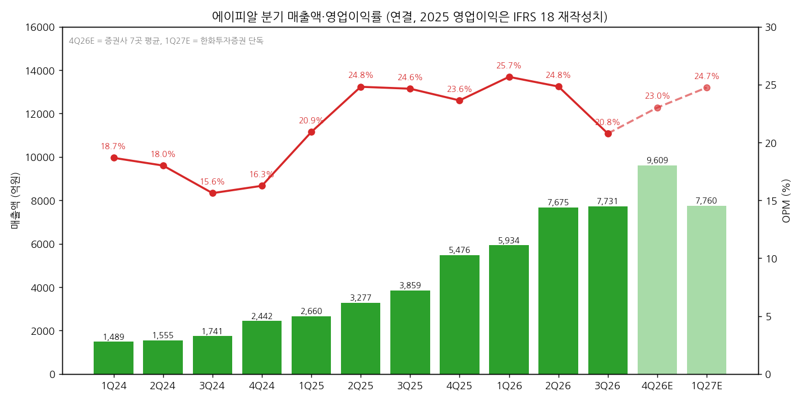
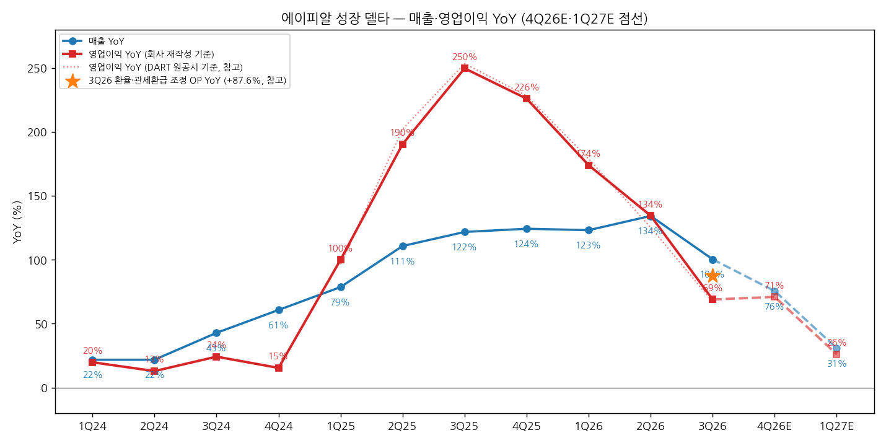
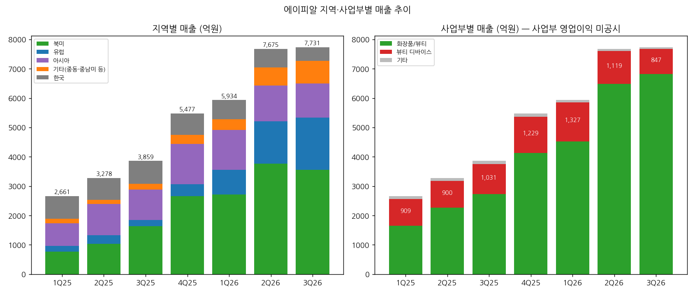

> 모드: 실적 리뷰 (v11)
> 종목: 에이피알 (278470)
> 섹터: 뷰티
> 서브섹터: 브랜드사
> 분기: 2026-Q3
> 발표일: 2026-10-30 (연결 잠정실적 공정공시 + IR 자료 + 컨퍼런스콜)
> 작성 시각: 2026-11-17 17:10 KST
> 분석 소스: 회사 IR「2026년 3분기 경영실적」(2026-10-30) + 셀사이드 11건 첨부 — 모건스탠리 2건(10/30 First Take·10/30 Idea), 씨티(10/30), JP모건 2건(10/31 개별·11/02 Korea First to Market 중 에이피알 부분), 한화투자증권(10/30), 하나증권(11/02, 파일명 10/30), NH투자증권(11/02), DB증권(11/02), 흥국증권(11/10), 교보증권(11/16) + (추가 참고) HSBC「EastSpenders: K-food going global」(10/22, 발표 전 — 에이피알 선호주 부분, 집계 제외). 과거 분기 숫자는 에이피알 기업개요(2026-11-15, OpenDART 분기 시계열)로 교차검증. 웹서치 보완 없음
> 리뷰 깊이: 풀 | 리서치 첨부 11건
> 비영업 요인: IFRS 18 조기적용(외화 매출채권 환손실이 영업이익에 반영, 약 -147~161억원)·원화 강세 환산 효과(약 -131억원)·미국 관세 환급(일회성 +100억원) — 판정은 보고 기준 그대로

# 에이피알 3Q26 실적 리뷰 — 매출은 지켰지만 마진이 처음 무너졌다, 영업이익 YoY +134% → +69%

> 성장 델타: 꺾임 | 내러티브: 약화 → 델타 꺾임 + 내러티브 약화 → 매매 제외 구간 (4Q26 영업이익 2,400억원대 재가속 확인 전까지)
>
> ⚠ 비영업 요인 플래그: 3Q26 보고 영업이익 1,606억원에는 환율 영향 -278억원(회사 집계: IFRS 18로 영업이익에 들어온 외화 매출채권 환손실 OPM -1.9%p + 원화 환산 매출 감소·원가율 상승 OPM -1.7%p)과 미국 관세 환급 +100억원(일회성, NH·DB)이 같이 들어 있다. 둘 다 조정한 영업이익은 약 1,784억원, YoY +87.6%다 ([계산], 참고). 조정치로 봐도 2Q26(+134.4%)보다 크게 낮아 판정은 같다

→ **숫자**: 매출 7,731억원(+100.3% YoY, +0.7% QoQ), 영업이익 1,606억원(+68.9% YoY, -15.7% QoQ), OPM 20.8%. 영업이익 YoY는 3Q25 +250%에서 4개 분기 연속 줄었고, 이번 분기에 -65.5%p로 가장 크게 내려왔다. FnGuide 컨센(영업이익 1,814억원) 대비 -11.5%로, 해외 확장이 본격화된 2025년 이후 첫 미스다
→ **쟁점 ①**: 마진 하락 4.0%p(2Q 24.8% → 20.8%)의 대부분은 환율이다. 다만 환율과 관세 환급을 다 빼도 OPM은 약 23.1%로 2Q 수준(약 24.2%)에 못 미친다. 유럽 항공 운송 때문에 운반비율이 +1.6%p 올랐고, 이건 1H27까지 이어진다
→ **쟁점 ②**: 매출은 강했다. 대형 행사가 없었는데도 분기 최대 매출을 냈다. 유럽 1,778억원(+738% YoY, +23% QoQ)과 미국 오프라인(북미 매출의 약 30%)이 북미 온라인 공백(-5.5% QoQ)과 디바이스 역성장(-18% YoY)을 메웠다. 회사는 2026년 영업이익 7,400~7,500억원 가이던스를 유지했다. 4Q 내재 영업이익은 2,365~2,465억원으로, 증권사 7곳 평균(2,211억원)보다 높다
→ **쟁점 ③**: 9곳 중 7곳이 TP를 내렸다(평균 49.7만원 → 44.0만원, -11.4%). 연간 영업이익 추정은 2~5%만 내려갔고 목표 PER은 27~28배에서 18.5~25배로 낮아졌다. 하향의 주원인은 멀티플이다. 주가는 고점 46.45만원 대비 -49%(11/13 23.6만원, 12MF PER 약 12배)다
→ **다음 분기 관건**: 4Q26 영업이익이 가이던스 하단(2,365억원, YoY +83%)을 넘으면 YoY가 다시 커져 "가속"으로 돌아간다. 컨센 수준(2,211억원, +71%)이면 "유지", 2,000억원(+55%)을 밑돌면 꺾임이 확정된다. 2월 4Q 실적 발표 때 같이 나올 2027 가이던스가 그 다음 관문이다

---

## 1. 숫자

① 연결 기준 분기 표 (단위: 억원, %)

| 항목 | 4Q23 | 1Q24 | 2Q24 | 3Q24 | 4Q24 | 1Q25 | 2Q25 | 3Q25 | 4Q25 | 1Q26 | 2Q26 | **3Q26** | 4Q26E | 1Q27E |
|---|---|---|---|---|---|---|---|---|---|---|---|---|---|---|
| 매출액 | 1,520 | 1,489 | 1,555 | 1,741 | 2,442 | 2,660 | 3,277 | 3,859 | 5,476 | 5,934 | 7,675 | **7,731** | 9,609 | 7,760 |
| 영업이익 (보고·회사 기준) | 344 | 278 | 280 | 272 | 397 | 556 | 813 | 951 | 1,294 | 1,523 | 1,906 | **1,606** | 2,211 | 1,920 |
| OPM | 22.6 | 18.7 | 18.0 | 15.6 | 16.3 | 20.9 | 24.8 | 24.6 | 23.6 | 25.7 | 24.8 | **20.8** | 23.0 | 24.7 |
| 매출 YoY | +18.7 | +21.8 | +21.8 | +42.8 | +60.7 | +78.6 | +110.7 | +121.7 | +124.2 | +123.1 | +134.2 | **+100.3** | +75.5 | +30.8 |
| 영업이익 YoY | +65.7 | +19.8 | +12.9 | +24.2 | +15.4 | +100.0 | +190.4 | +249.6 | +225.9 | +173.9 | +134.4 | **+68.9** | +70.9 | +26.1 |
| **매출 YoY 델타 (%p)** | -9.3 | +3.1 | 0.0 | +21.0 | +17.9 | +17.9 | +32.1 | +11.0 | +2.5 | -1.1 | +11.1 | **-33.9** | -24.8 | -44.7 |
| **영업이익 YoY 델타 (%p)** | -8.0 | -45.9 | -6.9 | +11.3 | -8.8 | +84.6 | +90.4 | +59.2 | -23.7 | -52.0 | -39.5 | **-65.5** | +2.0 | -44.8 |
| (참고) 영업이익 DART 원공시 | 344 | 278 | 280 | 272 | 397 | 546 | 846 | 961 | 1,303 | 1,523 | 1,906 | 1,606 | | |
| (참고) 영업이익 YoY, DART 원공시 기준 | | | | | | +96.4 | +202.1 | +253.3 | +228.2 | +178.9 | +125.3 | +67.1 | +69.7 | |
| (참고) 3Q26 조정 영업이익 | | | | | | | | | | | | 1,784 (YoY +87.6) | | |

→ (출처: 2023~2024 분기·2026 분기 = OpenDART 연결(에이피알 기업개요 시계열), 2025 분기 영업이익 = 회사 IFRS 18 재작성치(IR 3Q25 950.9억원, NH 주석 1Q25 556·2Q25 813억원, 흥국 표1 4Q25 1,294억원, 합계 3,614억원 = 회사 FY25 재작성치와 일치). 4Q26E = 한화·하나·NH·DB·흥국·교보·씨티 7곳 평균, 1Q27E = 한화투자증권 단독 추정)
→ **YoY 계산 기준**: 판정은 **회사 재작성 기준**(2026 IFRS 18 vs 2025 IFRS 18 재작성)으로 한다. 3Q26 +68.9%, 2Q26 +134.4%다. DART 원공시(재작성 전 2025)로 계산하면 3Q26 +67.1%, 2Q26 +125.3%로 델타가 -58.2%p다. 어느 기준이든 판정은 같다. 2025 분기 YoY는 재작성 2025 대 원공시 2024(2024는 재작성 없음)로 계산했다. 구 기준끼리(IFRS 18 적용 전 3Q26 1,767억원 vs 3Q25 961억원) 비교하면 +83.9%다
→ 3Q26 서프라이즈: 매출은 컨센 대비 -1.6%, 영업이익은 -11.5% (컨센 매출 7,860억원·영업이익 1,814억원, FnGuide, 한화·하나·NH 인용. 블룸버그 컨센은 1,800억원으로 -11%, JPM·MS)
→ 영업이익 YoY의 정점은 3Q25(+250%)였다. 이후 +226% → +174% → +134% → +69%로 4개 분기 연속 줄었다. 매출 YoY도 2Q26(+134%)에서 고점을 찍고 +100%로 내려왔다
→ 컨센 경로는 4Q26 +71%로 3Q와 비슷하게 유지한 뒤, 1Q27 +26%(한화), 2027년 연간 +38%로 내려간다. **컨센 경로상 YoY 정점은 이미 지났다**. 2026년 1~3Q 영업이익 YoY의 기저(2025년 OPM 21~25%)가 높아지는 구간이라, 앞으로 YoY 확대는 4Q26 한 분기 정도가 마지막 기회다 [판단]
→ **[판단] 델타 = 꺾임**: 영업이익 YoY는 여전히 +69%로 플러스다. 그러나 4개 분기 연속 둔화했고 컨센 경로상 정점(3Q25)이 이미 지나 기준상 "꺾임"이다. 환율·관세 환급 조정치(+87.6%)로 봐도 2Q26(+134.4%)보다 46.8%p 낮다

→ (출처: OpenDART, 에이피알 IR(2025 영업이익 IFRS 18 재작성치), 4Q26E 증권사 7곳 평균, 1Q27E 한화투자증권. 연한 막대·점선 = 추정)

→ (출처: 동일. 별표 = 3Q26 환율 영향 278억원 가산·관세 환급 100억원 차감 조정 영업이익 YoY, [계산]. 점선 = DART 원공시 기준)

② 사업부별·지역별 매출 (단위: 억원, %)

(1) 사업부별 — 회사는 사업부별 영업이익을 공시하지 않는다

| 사업부 | 항목 | 1Q25 | 2Q25 | 3Q25 | 4Q25 | 1Q26 | 2Q26 | **3Q26** |
|---|---|---|---|---|---|---|---|---|
| 화장품/뷰티 | 매출 | 1,650 | 2,271 | 2,723 | 4,128 | 4,526 | 6,483 | **6,823** |
| 화장품/뷰티 | 매출 YoY | +152 | +217 | +220 | +255 | +174 | +185 | **+151** |
| 화장품/뷰티 | 비중 | 62.0 | 69.3 | 70.6 | 75.4 | 76.3 | 84.5 | **88.3** |
| 뷰티 디바이스 | 매출 | 909 | 900 | 1,031 | 1,229 | 1,327 | 1,119 | **847** |
| 뷰티 디바이스 | 매출 YoY | +36 | +32 | +39 | +19 | +46 | +24 | **-18** |
| 뷰티 디바이스 | 비중 | 34.2 | 27.5 | 26.7 | 22.4 | 22.4 | 14.6 | **11.0** |
| 기타(널디·포토그레이) | 매출 | 101 | 106 | 105 | 120 | 81 | 74 | **61** |
| 기타 | 매출 YoY | | | | | -20 | -31 | **-42** |

→ (출처: 회사 IR(3Q25·3Q26), 에이피알 기업개요 사업부 시계열, 흥국 표1)
→ 영업이익: 재무제표 주석의 영업부문은 화장품부문과 의류패션부문 둘뿐이다. 3Q26 누적 화장품부문 영업이익 5,098억원, 의류패션부문 2억원(내부거래 제거 전)으로, 전사 이익이 사실상 화장품부문에서 나온다 (분기보고서, 기업개요 인용). 화장품과 디바이스의 영업이익은 따로 볼 수 없다. 셀사이드도 사업부 영업이익을 추정하지 않는다
→ 델타를 끌어내린 사업부는 디바이스다. 3분기 대형 행사가 없어 매출이 1,119억원에서 847억원으로 QoQ -24% 줄었고, 첫 YoY 역성장이다. 화장품은 YoY가 +185% → +151%로 둔화했지만 QoQ로는 +5.3% 늘어 분기 최대를 다시 썼다

(2) 지역별 — 2Q26부터 북미·유럽 분리 공시

| 지역 | 1Q25 | 2Q25 | 3Q25 | 4Q25 | 1Q26 | 2Q26 | **3Q26** | 3Q26 YoY | 3Q26 QoQ | 3Q26 비중 |
|---|---|---|---|---|---|---|---|---|---|---|
| 북미 | 765 | 1,032 | 1,635 | 2,655 | 2,716 | 3,763 | **3,556** | +117.5 | -5.5 | 46.0 |
| 유럽 | 193 | 302 | 212 | 418 | 838 | 1,451 | **1,778** | +738.4 | +22.6 | 23.0 |
| 아시아 | 780 | 1,058 | 1,042 | 1,360 | 1,358 | 1,211 | **1,160** | +11.3 | -4.2 | 15.0 |
| 기타(중동·중남미 등) | 149 | 145 | 188 | 313 | 369 | 617 | **773** | +311.2 | +25.3 | 10.0 |
| 한국 | 774 | 741 | 782 | 731 | 653 | 633 | **464** | -40.7 | -26.7 | 6.0 |

→ (출처: 회사 IR(3Q26 지역 비중), 하나증권 도표 1·NH 표3·JPM Table 1 분기 지역 매출. 회사 IR의 "국내" 매출 502억원은 지역 구분 "한국" 464억원과 집계 기준이 달라 차이가 난다. 교보·하나는 502억원을 쓴다)
→ 북미+유럽 비중은 3Q25 47%에서 3Q26 69%로 올라갔다 (회사 IR). 이번 분기 매출 QoQ 증가분 56억원은 유럽(+327억원)과 기타(+156억원)가 만들었다. 북미(-207억원)·한국(-169억원)·아시아(-51억원)는 줄었다

→ (출처: 회사 IR, 하나·NH·JPM 분기 지역 매출, 기업개요 사업부 시계열)

③ 연간 (단위: 억원, %)

| 항목 | 2022 | 2023 | 2024 | 2025 | 2026E | 2027E |
|---|---|---|---|---|---|---|
| 매출액 | 3,977 | 5,238 | 7,228 | 15,273 | 30,950 | 41,835 |
| 영업이익 | 392 | 1,042 | 1,227 | 3,655 (재작성 3,614) | 7,242 | 9,969 |
| OPM | 9.9 | 19.9 | 17.0 | 23.9 (23.7) | 23.4 | 23.8 |
| 매출 YoY | +53.5 | +31.7 | +38.0 | +111.3 | +102.6 | +35.2 |
| 영업이익 YoY | +174.1 | +165.8 | +17.8 | +197.9 | +100.4 (재작성 대비) | +37.7 |

→ (출처: 2022~2025 OpenDART, 2025 재작성치 = 회사 IR. 2026E·2027E = 한화·하나·NH·DB·흥국·교보·MS·씨티·JPM 9곳 발표 후 추정치 단순평균)
→ 회사 가이던스: 2026년 매출 3조원 초과, 영업이익 7,400~7,500억원(OPM 24~25%)을 유지했다 (MS·JPM·하나 컨콜 정리). 2027 가이던스는 4Q26 실적과 함께 낸다 (MS)
→ 발표 전후 컨센 변화: 2026E 영업이익은 발표 전 7,423억원(WiseFn, 하나·MS 인용)에서 9곳 평균 7,242억원(-2.4%), 2027E는 1조 471억원에서 9,969억원(-4.8%)으로 내려갔다. 증권사별 2027E 영업이익은 8,540억원(JPM)에서 1조 1,220억원(MS)까지 31% 벌어져 있다
→ 9곳 평균 2026E 기준 4Q26 내재 영업이익은 2,207억원이다 (3Q 누적 5,035억원 차감, [계산]). 회사 가이던스 내재치(2,365~2,465억원)보다 160~260억원 낮다. 셀사이드가 회사 가이던스를 다 믿지 않는다는 뜻이다

---

## 2. 시장 쟁점

① 지난 분기 체크
→ 첫 리뷰 — 직전 체크 없음 (2Q26 리뷰·팔로업 미작성)

② 이번 분기 쟁점 5개

| # | 쟁점 | 언급 증권사 수 |
|---|---|---|
| (1) | OPM 20.8% — 환율을 빼면 정상 마진은 몇 %인가, 물류비는 구조적인가 | 9/9 |
| (2) | 매출 QoQ +0.7% — 성장 둔화인가 행사 공백인가 (4Q 가이던스와 북미 오프라인) | 9/9 |
| (3) | 유럽·기타 지역 — 다음 성장 엔진은 얼마나 큰가 | 9/9 |
| (4) | 디바이스 -18% — 행사 공백인가 구조적 역성장인가 | 8/9 |
| (5) | TP 하향은 실적 때문인가 멀티플 때문인가 — 단일 브랜드 할인 | 9/9 |

(언급 수 분모는 개별 리포트 기준 9곳. MS 2건과 JPM 2건은 각각 1곳으로 센다)

③ 쟁점별 분해

(1) OPM 20.8% — 환율을 빼면 정상 마진은 몇 %인가

(1-1) 회사 설명 (IR 7쪽, 컨콜 — JPM·MS 정리)
→ "3Q26 원화 강세로 외화매출채권 관련 손실과 원화환산 매출 감소가 동시에 발생하며 수익성에 일시적 영향." 원/달러는 약 1년간 오른 14.8%를 3Q26 한 분기에 12.6% 반납했다. 영향은 ① 기타영업비용(IFRS 18) OPM -1.9%p ② 원화 환산 매출 감소·원가율 상승 OPM -1.7%p, 합계 영업이익 -278억원, OPM -3.6%p다 (IR)
→ IFRS 18 적용 전 기준 영업이익은 1,767억원(OPM 22.9%)이다 (IR)
→ 마케팅비는 매출의 약 20%를 유지한다. 물류비는 1H27부터 점진적으로 개선된다 (JPM 컨콜 정리)

(1-2) 증권사별 해석 편차

| 증권사 | 핵심 가정·추정 | 논리 |
|---|---|---|
| 한화 | 환손실 147억원 제외 OPM 22.7%, 환산 영향 131억원까지 제외 24.4% | 해외법인 손익을 누적평균환율로 다시 환산하는 구조라 3Q에 누적 환율 하락이 몰렸다. 4Q OPM 23.8% |
| 하나 | 외환 관련 손익 -117억원, 동일 환율 기준 영업이익 1,884억원 | 마케팅 20%·수수료 17%·운반비 9%로 비용 구조는 "큰 변화 없음". 4Q OPM 23.8% |
| NH | 매출채권 환손실 -160억원, 관세 환급 100억원에도 원가율 -1.7%p. 운반비율 9%(+1.6%p QoQ) | "미리 맞은 매(IFRS 18)". 유럽 수요 대응 항공 운송·풀필먼트 비용이 주요 부담. 4Q OPM 23.0% |
| DB | 관세 환급 100억원 반영 후 OPM 20.8% | 원화 강세 추세와 유럽 운반비 부담이 단기에 해소되기 어렵다. 4Q OPM 21.0%로 가장 보수적 |
| MS | 실질 영업이익 1,770억원(22.8%), 실질 OPM 24.4% 가능 | 실질 OPM 24%는 유지 가능하다. 매출 믹스와 영업 레버리지가 마진을 방어 |
| 씨티 | 조정 영업이익 1,770억원(22.9%) — 컨센 대비 -3%로 사실상 부합 | 2027년 추가 마진 희석 여지 제한적, 유럽 비용 구조는 2027년부터 개선 |
| JPM | 환손실 150억원(1.9%p) + 환산 130억원(1.7%p), 물류비 상승 | 마진 전망 우려가 커졌다. 2027E OPM 22.3%로 9곳 중 가장 낮게 잡았다 |
| 교보·흥국 | 환산 영향 약 130억원 / 일시적 영향 278억원 | 물류비는 1~2Q27 해상 운송 재고로 완화 가능(교보) |

(1-3) 공통 결론 vs 갈리는 지점
→ 공통: 9곳 모두 마진 하락의 1차 원인을 원화 강세로 본다. 환율 효과는 일시적이라는 데도 대부분 동의한다
→ 갈림: 환율을 뺀 "남은 하락분"을 어떻게 보느냐다. MS·씨티·하나는 실질 마진이 24% 안팎으로 유지됐다고 본다. NH·DB·JPM은 유럽 항공 물류비로 구조적인 마진 하락이 생겼다고 본다. 4Q OPM 추정도 21.0%(DB)에서 23.8%(한화·하나)까지 벌어져 있다

(1-4) **[판단]** — 숫자로 분해
→ 보고 OPM 20.8%에 회사가 밝힌 환율 영향 3.6%p를 더하면 24.4%다. 그런데 이 안에는 미국 관세 환급 100억원(OPM +1.3%p, 일회성)이 들어 있다. 관세 환급까지 빼면 조정 OPM은 약 23.1%다 ([계산], 1,784억원 / 7,731억원)
→ 비교 대상인 2Q26 OPM 24.8%에도 IFRS 18 외환 이익이 들어 있다. 씨티 조정치 기준 2Q26은 24.2%다. 같은 잣대로 놓으면 **3Q 실질 OPM은 2Q 대비 약 1.1%p 낮다**. 운반비율 +1.6%p(NH)가 이 차이를 대부분 설명한다
→ 즉 OPM 하락 4.0%p 중 약 3%p는 환율(일시적), 약 1%p는 유럽 물류비(1H27까지 지속되는 비용)다. "실질 OPM 24% 유지"(MS·씨티)보다 "물류비로 1%p 내외 구조적 부담"(NH·DB·JPM) 쪽이 숫자와 더 맞다
→ 불확실: 회사가 밝힌 "-1.7%p(환산 매출·원가율)"이 관세 환급 100억원을 상계한 순액인지 따로인지는 자료로 확인되지 않는다. 상계된 순액이라면 조정 OPM은 24.4% 안팎이 되고 MS·씨티 해석에 가까워진다
→ 결론이 바뀌는 조건: 4Q26에 환율이 안정됐는데도(한화 가정 4Q 평균 1,340원) OPM이 23%를 밑돌면, 물류·채널 비용이 구조적이라는 해석이 확정된다

(2) 매출 QoQ +0.7% — 성장 둔화인가 행사 공백인가

(2-1) 회사 설명
→ "대형 이벤트 부재에도 전분기 대비 성장하며 분기 최고 매출 경신" (IR 3쪽)
→ 2026년 매출 3조원 초과 가능성에 자신을 보였다. 10월 아마존 Prime Big Deal Days에서 미국·유럽 모두 역대 최대 일매출을 기록했다. 오프라인은 리테일러 셀스루가 좋아 SKU 확대와 함께 성장이 이어질 것이라고 했다 (JPM·한화·하나 컨콜 정리)
→ 영업이익 7,400~7,500억원 연간 목표를 유지했다. 이는 4Q 영업이익 2,400억원 이상을 뜻한다 (MS)

(2-2) 증권사별 해석 편차

| 증권사 | 4Q26 매출 / 영업이익 E | 논리 |
|---|---|---|
| 하나 | 1조 395억원 / 2,471억원 (OPM 23.8%) | 환율로 떨어진 가격(P)을 물량(Q)으로 극복. 코스트코·CVS 입점 후 긴급 발주. 가이던스 달성 |
| 한화 | 9,644억원 / 2,297억원 | 셀스루가 환율에 가려지기엔 너무 강하다. 아마존 뷰티 Top100에 13개 진입, 상위 10개 SKU 비중 약 40%·최대 SKU 10% 미만으로 다변화 |
| 씨티 | 9,600억원 / 2,250억원 | 3Q 북미 오프라인 1,010억원(+50% QoQ), 그중 타겟 300억원. 4Q 북미 4,750억원 |
| NH | 9,864억원 / 2,270억원 | 북미 오프라인 비중 30%로 유통망 다변화. 4Q 글로벌 프로모션으로 외형 가속 |
| 흥국 | 9,506억원 / 2,162억원 | 아마존 빅딜데이 일매출 최대와 코스트코·CVS 신규 입점이 연내 성장을 이끈다 |
| 교보 | 9,123억원 / 2,107억원 | 판매량 성장은 꺾이지 않았다 |
| DB | 9,130억원 / 1,920억원 (OPM 21.0%) | 매출은 다시 가팔라지지만 수익성 눈높이는 낮춰야 한다 |
| MS | 4Q 매출 QoQ +30% 이상, 영업이익 2,400억원+ (가이던스) | 시장이 QoQ 정체에 과잉 반응했다. 오프라인은 강한 sell-in(입고) 사이클 초입 |
| JPM | 연간 영업이익 7,110억원 → 4Q 약 2,075억원 내재 [계산] | 연말 판매 모멘텀과 환산 손실 부재로 4Q 반등. 다만 2027E 매출 +26%로 가장 보수적 |

(2-3) 공통 결론 vs 갈리는 지점
→ 공통: 3Q 매출 정체는 행사 공백 때문이다. 4Q에는 QoQ +18~34% 반등한다는 데 9곳 모두 동의한다. 매출 추정은 대부분 올렸다(JPM +2%, MS·씨티 소폭 상향)
→ 갈림: 4Q 영업이익이다. 1,920억원(DB)부터 2,471억원(하나)까지 550억원 차이가 난다. 회사 가이던스(2,400억원+)를 그대로 따른 곳은 하나·MS 두 곳뿐이다

(2-4) **[판단]**
→ 북미 -5.5% QoQ는 2Q의 아마존 Prime Day 효과가 빠진 결과다. 씨티 숫자로 오프라인이 +50% QoQ(약 +340억원)였으니, 북미 온라인은 QoQ 약 -18%(약 3,090억원 → 2,546억원)였다 ([추정]). 행사 공백 설명과 맞는다
→ 다만 MS가 "sell-in 사이클"이라고 부른 오프라인 성장에는 리테일러 매대 채우기(초도 입고)가 섞여 있다. 회사 재고가 2025말 1,655억원에서 3Q26 4,980억원으로 3배가 됐다 (기업개요). 오프라인 초도 물량이 끝난 뒤 리오더가 이어지는지가 2027년 성장률(컨센 +35%)의 핵심이다 [판단]
→ 결론이 바뀌는 조건: 4Q 매출이 9,000억원(YoY +64%)을 밑돌면 행사 공백이 아니라 북미 성장 둔화로 해석이 바뀐다

(3) 유럽·기타 지역 — 다음 성장 엔진은 얼마나 큰가

(3-1) 회사 설명
→ 북미·유럽 합산 비중이 47%에서 69%로 확대됐다 (IR 6쪽). 유럽은 온라인 성장 위에 오프라인 채널 확장이 더해지고 있다 (한화)
→ 9~10월 미국·유럽 릴레이 팝업(뉴욕·LA → 런던·파리)을 진행했다 (흥국)

(3-2) 증권사별 해석 편차

| 증권사 | 유럽 4Q26E / 2027E | 논리 |
|---|---|---|
| NH | 2,180억원 / 1조 2,450억원 (+99%) | 8월 아마존 유럽 최대 매출. 영국 부츠에 이어 프랑스·독일 오프라인 확장. 유럽 5개국 아마존 판매 SKU 25개(3월) → 82개(10월) |
| 교보 | 2,118억원 / 1조 1,820억원 (+91%) | 유럽은 아마존 진출 1Q26 기준으로 북미보다 2배 빠르다. 기타 지역은 중남미가 끈다(실리콘투 중남미 QoQ +40%, 브라질 법인) |
| 한화 | 1,930억원 / 1조 1,030억원 (+84%) | 유럽 5개국 Top100 진입 제품 수가 2Q 대비 2배 이상 |
| 하나 | 2,008억원 / 1조 935억원 (+80%) | 빅딜데이 유럽 5개국 Top100 국가별 평균 17개(Prime Day 7개). 3Q 영국 수출 +250%, 네덜란드 +450%. 2027년 중남미, 그다음 중국·인도 |
| 씨티 | 2,130억원 / — | 유럽은 아직 초기 성장 단계 |
| DB | 2,300억원 / 8,630억원 (+35%) | 유럽 주요 5개국 채널 확장은 맞지만 2027년 성장률은 가장 보수적 |
| MS·JPM | — | 유럽 +23% QoQ는 브랜드 인지도 상승과 채널 확장 덕(MS). 영국·프랑스·독일·이탈리아·스페인 아마존 스킨케어 Top100에서 메디큐브가 최다 SKU 브랜드(JPM, 10/26 기준) |

(3-3) 공통 결론 vs 갈리는 지점
→ 공통: 유럽은 이번 분기 가장 강한 숫자다(분기 매출 1,778억원으로 1년 전 북미 3Q25 수준인 1,635억원을 넘었다). 9곳 모두 유럽이 2027년 성장의 1번 엔진이라고 본다
→ 갈림: 2027년 유럽 성장률이 +35%(DB)에서 +99%(NH)까지 벌어져 있다. 유럽 매출 2027E 범위는 8,630억원~1조 2,450억원으로 약 3,800억원 차이다. 이 차이가 2027 컨센 영업이익 분산의 큰 부분을 차지한다

(3-4) **[판단]**
→ 유럽 매출의 QoQ 증가율은 +101%(1Q26) → +73%(2Q26) → +23%(3Q26)로 이미 내려오고 있다 ([계산], 418 → 838 → 1,451 → 1,778억원). 유럽도 "초기 폭발" 구간을 지나 "채널 확장" 구간에 들어섰다
→ 유럽 성장의 대가가 항공 물류비다. 유럽 매출이 늘수록 1번 쟁점의 물류비 부담도 같이 커진다. 해상 운송 전환(교보, 1~2Q27)이 이루어져야 유럽 성장이 마진을 깎지 않는다
→ 결론이 바뀌는 조건: 4Q 유럽 매출이 2,000억원을 넘으면 NH·교보 쪽(2027 +90%대) 경로가 힘을 얻는다. 1,800억원 수준에서 정체하면 DB 쪽(+35%)이 맞다

(4) 디바이스 -18% — 행사 공백인가 구조적 역성장인가

(4-1) 회사 설명
→ "글로벌 누적 판매량 800만대 돌파, 대형 글로벌 이벤트 부재 영향으로 전년 동기 대비 매출 감소" (IR 5쪽)
→ 회사가 내부 마케팅 자원을 화장품 쪽에 우선 배분했다 (JPM 컨콜 정리)
→ 의료미용 사업을 2027년부터 시작한다. HIFU 장비는 빠르면 2026년 말, RF 장비는 2H27, PN 스킨부스터는 2028년 초 국내 출시가 목표다 (씨티)

(4-2) 증권사별 해석 편차

| 증권사 | 4Q26 디바이스 매출 E | 2027E 디바이스 | 논리 |
|---|---|---|---|
| 하나 | 2,591억원 (+111%) | 4,296억원 (-27%) | 4Q 블프 집중 후 2027년 감소 |
| 한화 | 1,500억원 (+22%) | 5,920억원 (+24%) | 블프·사이버먼데이와 3Q 행사 부재 기저로 회복 |
| NH | 1,400억원 (+14%) | 4,880억원 (+4%) | 성장률 둔화를 TP 하향에 반영 |
| 씨티 | 1,140억원 (-7%) | — | 3Q는 비수기 영향 |
| 흥국 | 1,014억원 (-17%) | 4,630억원 | — |
| DB | 920억원 (-25%) | — | 회복 가정 없음 |
| MS | — | — | 3Q 디바이스가 MS 추정 대비 -31%, 미국 매출 미스의 원인 |

(4-3) 공통 결론 vs 갈리는 지점
→ 공통: 디바이스는 이제 매출의 11%다. 전사 성장의 방향을 바꿀 크기는 아니다
→ 갈림: 4Q 추정이 920억원~2,591억원으로 2.8배 차이 난다. 쟁점 5개 중 증권사 간 분산이 가장 크다

(4-4) **[판단]**
→ 디바이스 YoY는 +46%(1Q) → +24%(2Q) → -18%(3Q)로 3개 분기 연속 둔화했다. 3Q25에도 대형 행사가 없었는데 1,031억원을 냈으니, "행사 공백"만으로는 -18%를 다 설명할 수 없다. 회사가 마케팅을 화장품으로 돌렸다는 설명(JPM) 쪽이 더 맞다 [판단]
→ 디바이스는 화장품 고객을 끌어오는 입구 역할을 해 왔다(기업개요). 입구가 줄어드는 것이 화장품 재구매에 영향을 주는지는 아직 숫자로 보이지 않는다
→ 결론이 바뀌는 조건: 4Q 블프 시즌에도 디바이스가 YoY 역성장(1,229억원 미만)하면 구조적 둔화로 판정한다

(5) TP 하향은 실적 때문인가 멀티플 때문인가

(5-1) 회사 설명
→ 해당 없음 (밸류에이션 쟁점). 최대주주·특수관계인이 실적 발표 직후 장내매수했다 (2026-10-30 소유상황보고서, 기업개요 — 수량 미확보)

(5-2) 증권사별 해석 편차

| 증권사 | 적용 멀티플 | 하향 이유 |
|---|---|---|
| MS | RI 모델, 내재 NTM PER 27배 → 23배 | 2026E 영업이익 -6%(환산 손실), 원거리 이익 하향. 시장의 "단일 브랜드 한계"와 마진 우려 반영. 약세 시나리오 35만원 → 25만원 |
| JPM | 2027E PER 27배 → 24배 (글로벌 피어 +20%) | 글로벌 피어 밸류에이션 하락, 물류비로 OP -3% |
| 씨티 | 12MF PER 25배 (피어 +30%) | NP 추정은 소폭 상향, 목표 멀티플만 하향 |
| 흥국 | 12MF PER 28.1배 → 18.5배 | "적정한 시장 괴리율 반영". 2027E 영업이익은 +5.3% 상향 |
| DB | 2027E PER 20배 | 실적 가시성 하락으로 타깃 멀티플 하향 |
| 한화 | 2027E PER 22.7배 (글로벌 피어 -20%) | 2027E 영업이익 -11.6%로 9곳 중 실적 하향 폭이 가장 크다 |
| NH | 2027E PER 24배 (글로벌 브랜드사 평균) | 디바이스 둔화·연평균 환율 하락 반영, 영업이익 -1% |
| 하나 | 12MF PER 20배 (10/14 51만원 → 41만원 기 하향) | "매출이 커질수록 밸류에이션 하락 압력이 커지는 역설". 그래도 성장 둔화 조짐은 없다 |
| 교보 | 50만원 유지 | 12MF PER 12배는 과도하다 |
| (참고) HSBC (10/22, 발표 전) | 2026E EV/EBITDA 26.2배 — 아모레퍼시픽 2014~16년 고성장기(매출·영업이익 CAGR 22%/32%) 밴드 상단, TP 56만원 | 3Q 미반영. 2025~28E 매출·영업이익 CAGR 50%/51%를 근거로 "공정하고 보수적인 멀티플"이라 본다. 선호주 이유 "해외 엔진이 확실히 주도", 리스크로 메디큐브 브랜드·제품 의존과 대주주 지분 매각 가능성 |

(5-3) 공통 결론 vs 갈리는 지점
→ 공통: 9곳 모두 매수(Buy·OW)를 유지했다. 연간 영업이익 하향은 2026E -2.4%, 2027E -4.8%에 그친다. TP 하향 폭(평균 -11.4%, 최대 -26%)이 훨씬 크다
→ 갈림: 하나·흥국·MS는 "단일 브랜드가 3조원 규모가 됐다"는 점을 멀티플 할인 사유로 직접 언급한다. 교보·씨티는 성장률 대비 PER이 과도하게 낮다고 본다

(5-4) **[판단]**
→ 이번 TP 하향은 **실적 하향보다 멀티플 하향이 주원인**이다. 한화(2027E -11.6%)만 실적 하향이 의미 있는 크기다
→ 멀티플이 내려가는 이유는 1번 판정과 같다. 영업이익 YoY가 +250%에서 +69%로, 2027년에는 +38%로 내려가는 성장률 정상화 구간이라 PER이 따라 내려간다. MS 약세 시나리오(25만원)는 "2H27 성장 성숙 + OPM 20~21%"를 가정한다. 현 주가 23.6만원은 시장이 이 약세 시나리오에 가깝게 가격을 매기고 있다는 뜻이다

④ 낙관 vs 보수 — 논리 대비
→ **가장 낙관(MS TP 50만원, 교보 50만원)**: MS는 실질 OPM 24%가 유지되고 2025~28년 영업이익 CAGR 54%(글로벌 피어 11%)를 가정한다. 2027E 영업이익 1조 1,220억원으로 9곳 중 최고다. 교보는 2027E 매출 4.35조원(+43%)으로 매출 성장을 가장 높게 보고, 물류비는 1H27에 완화된다고 본다
→ **가장 보수(JPM TP 41만원, DB 40만원, 흥국 37만원)**: JPM은 2027E 매출 +26%, OPM 22.3%, 영업이익 8,540억원(블룸버그 컨센 대비 -17%)으로 성장 둔화와 마진 압박을 함께 가정한다. DB는 4Q OPM 21.0%로 "수익성 회복 추이를 보며 저점 매수 시기를 고려하라"고 썼다. 흥국은 이익 추정을 올리고도 TP를 가장 낮게 잡아, 이익보다 멀티플을 보수적으로 본다
→ 셀사이드 vs 시장: 9곳 모두 매수지만 주가는 프리뷰 콜(10/12) 이후 -26%(MS), 고점 대비 -49%다. 현재가는 평균 TP(44만원) 대비 +86% 상승여력이다. 셀사이드는 "환율은 일시적"을, 시장은 "성장률 정점 통과"를 가격에 넣고 있다

⑤ 추정치·TP 변화 (단위: 원, 억원)

| 증권사 (발간일) | 직전 TP | 현재 TP | 4Q26 영업이익 E | 2026 / 2027 영업이익 E | 핵심 변화 한 줄 |
|---|---|---|---|---|---|
| 모건스탠리 (10/30) | 560,000 | 500,000 (-10.7%) | 약 2,415 [계산] | 7,450 / 11,220 | 2026E OP -6%, 실질 OPM 24% 유지 가정 |
| 한화 (10/30) | 550,000 | 460,000 (-16.4%) | 2,297 | 7,330 / 10,130 | 2027E 매출 -8.6%·OP -11.6% |
| NH (11/02) | 500,000 | 460,000 (-8.0%) | 2,270 | 7,305 / 9,898 | 디바이스 둔화·환율, 2027E PER 24배 |
| 씨티 (10/30) | 470,000 | 450,000 (-4.3%) | 2,250 | 7,300 / 10,090 | 추정 +2% 상향, 목표 PER 25배로 하향 |
| 하나 (11/02) | 410,000 | 410,000 (유지, 10/14 기 하향) | 2,471 | 7,505 / 10,404 | 가이던스 7,500억원 달성 전망 |
| JPM (10/31) | 480,000 | 410,000 (-14.6%) | 약 2,075 [계산] | 7,110 / 8,540 | 목표 PER 27배 → 24배, OP -3% |
| DB (11/02) | 500,000 | 400,000 (-20.0%) | 1,920 | 6,840 / 9,220 | 실적 가시성 하락, 멀티플 하향 |
| 흥국 (11/10) | 500,000 | 370,000 (-26.0%) | 2,162 | 7,196 / 10,158 | 목표 PER 28.1배 → 18.5배, 2027E OP +5.3% |
| 교보 (11/16) | 500,000 | 500,000 (유지) | 2,107 | 7,142 / 10,065 | 환율 우려 과도, 2027년 유럽+기타 성장 |

→ 평균 TP: 49.7만원 → 44.0만원 (-11.4%). 하향 7건, 유지 2건, 상향 0건
→ 연간 컨센: 2026E 영업이익 7,423억원 → 7,242억원 (-2.4%), 2027E 1조 471억원 → 9,969억원 (-4.8%). 발표 전 컨센은 WiseFn(하나·MS 인용), 발표 후는 9곳 평균
→ TP 하향 원인: **멀티플 하향이 주원인**. 목표 PER이 27~28배에서 18.5~25배로 내려갔다. 실적 하향이 의미 있는 곳은 한화 1곳이다
→ MS 4Q E는 2026E 7,450억원에서 3Q 누적 5,035억원을 뺀 값, JPM 4Q E는 2026E 7,110억원에서 뺀 값이다 ([계산])
→ (참고, 발표 전 시각) HSBC「EastSpenders」(10/22, K-소비재 테마 리포트)는 에이피알을 아시아 소비재 선호주에 넣고 Buy·TP 56만원(10/21 종가 31.9만원, 2026E PER 20.5배)을 제시했다. 3Q 실적(10/30) 이전 자료라 위 평균 TP·쟁점 집계(9곳)에는 넣지 않았다. 같은 리포트에서 달바글로벌(TP 30만원, EV/EBITDA 20배)을 에이피알보다 낮은 성장(CAGR 38%/47%)에 맞춰 할인했다 — 해외 IB도 브랜드사 멀티플을 "성장률 차이"로 줄 세운다는 점에서 (5-4) 판단과 같은 방향이다

---

## 3. 내러티브 점검

① 성장 스토리 정의
→ "메디큐브가 미국 온라인 → 미국 오프라인 → 유럽 → 중남미로 릴레이 확장하면서, 분기 매출 YoY +100% 이상과 OPM 24~25%를 동시에 내는 K뷰티 최고 성장주". 시장은 이 종목을 매출 성장(Q)과 마진(P)이 함께 올라가는 이익 고성장주로 사 왔다

② 이번 분기가 스토리에 준 영향
→ **강화된 부분 (Q)**: 유럽 1,778억원(+738%), 기타 지역 +311%, 북미 오프라인 +50% QoQ, 아마존 미국·유럽 Top100 최다 SKU 브랜드(JPM). 상위 10개 SKU 비중 약 40%, 최대 SKU 10% 미만으로 "단일 히트 제품" 리스크는 줄었다 (한화). 매출 추정은 오히려 올라갔다
→ **약화된 부분 (P)**: OPM 24~25% 전제가 처음 깨졌다. 환율은 일시적이지만 유럽 물류비 약 1%p는 1H27까지 남는다. 해외 매출이 94%인데 환헤지가 없다(기업개요, DART "파생거래 해당사항 없음"). 이 때문에 원화 강세가 이어지면 같은 일이 다시 일어날 수 있다
→ **성장률 정상화**: 영업이익 YoY가 +250% → +69%로 내려왔다. 컨센 경로는 2027년 +38%다. "+100% 성장주"에서 "+30~40% 성장주"로 넘어가는 구간이고, 시장은 이 전환을 멀티플 하향(PER 27배 → 12배)으로 먼저 반영했다
→ **판정 = 약화**: 스토리의 핵심 전제(해외 수요·점유율)는 유지됐다. 그러나 마진 의문과 성장률 정상화로 추정치(-2~5%)와 멀티플(-15~35%)이 함께 내려갔다. 훼손이 아니라 약화다

③ 국면
→ 델타 꺾임(YoY 4개 분기 연속 둔화, 정점 통과) + 내러티브 약화 → **매매 제외 구간**. BT 프레임에서 지금은 "성장 델타가 꺾이기 시작한" 구간이다. 셀사이드가 말하는 "과매도"는 밸류에이션 논리로, 델타 판정과는 다른 축이다
→ 다만 4Q26은 기저(4Q25 OPM 23.6%)와 환율 정상화로 YoY가 다시 커질 수 있는 마지막 분기다. 4Q 영업이익이 가이던스(2,400억원+)를 넘으면 델타는 "가속(+83% 이상)"으로 한 분기 돌아선다. 그것이 일시 반등인지 재가속인지는 2027 가이던스로 판단해야 한다 [판단]

④ 트리거와 리스크
→ **트리거 (스토리 재강화)**: (1) 4Q26 영업이익 2,400억원+, OPM 24% 복귀 (2) 2027 가이던스 매출 +35% 이상·OPM 24%+ (2월) (3) 의료미용(HIFU 장비) 출시 — 화장품 단일 브랜드 할인을 풀 수 있는 포트폴리오 다변화 (씨티)
→ **리스크 (스토리 훼손)**: (1) 원화 강세 지속 — 4Q 분기말 환율이 3Q말(1,358원)보다 더 내려가면 IFRS 18 환손실이 다시 생긴다 (2) 북미 오프라인 초도 입고 이후 리오더 둔화, 재고 4,980억원의 할인 판매 (3) 유럽 항공 물류비가 1H27 이후에도 이어지는 경우

---

## 4. 향후 봐야 할 것

(1) **4Q26 영업이익 2,400억원 이상 / OPM 24% 복귀** — 델타 판정을 바꾸는 1순위 변수
→ 무엇을: 4Q 영업이익 2,365억원(가이던스 하단, YoY +83%) 이상이면 "가속", 컨센 2,211억원(+71%)이면 "유지", 2,000억원(+55%) 미만이면 "꺾임 확정". 4Q 매출 9,600억원(+75%) 대비 실적
→ 어떤 데이터로: 4Q26 잠정실적 공시·IR, 블프·사이버먼데이 아마존 순위, 증권사 4Q 프리뷰 (1월)
→ 언제: 2027년 2월 초 (4Q26 실적 발표)

(2) **환율과 물류비 — OPM 하락분 중 "일시적 3%p"와 "구조적 1%p"가 맞는지**
→ 무엇을: 4Q 분기말 원/달러·원/유로(3Q말 1,358원 대비), 운반비율 9% → 8% 이하로 내려오는지, 기타영업손익(IFRS 18 외환 항목)의 부호
→ 어떤 데이터로: 서울외국환중개 고시 환율(12/31), 4Q IR 판관비율 공개분, 해상 운송 전환 코멘트(교보)
→ 언제: 12월 말(환율) / 2월(실적)

(3) **유럽 분기 매출 2,000억원 이상** — 2027 컨센 분산(유럽 8,630억원~1조 2,450억원)의 핵심
→ 무엇을: 4Q 유럽 매출 2,000억원+(증권사 평균 약 2,100억원), 유럽 5개국 아마존 뷰티 Top100 진입 SKU 수, 프랑스·독일 오프라인 입점 확대
→ 어떤 데이터로: 관세청 월간 화장품 수출(영국·네덜란드·프랑스·독일), 아마존 EU 순위(NH·하나 트래킹), 뉴스 키워드 "메디큐브 유럽", "medicube Boots"
→ 언제: 12월 1일·1월 1일 수출입 통계, 2월 실적

(4) **북미 오프라인 리오더와 재고 정상화**
→ 무엇을: 코스트코·CVS(약 3,000개 매장) 입점 후 셀스루와 리오더, 북미 매출 4Q 4,500억원+(씨티 4,750억원), 재고자산 4,980억원 → 매출 대비 비율 하락
→ 어떤 데이터로: 리테일러 매대 확대 뉴스, 2026 사업보고서 재고·매출채권, 미국 화장품 수입 통계
→ 언제: 11~12월 블프 시즌 / 3월 사업보고서

(5) **2027 가이던스와 주주환원 신규 정책, 디바이스·의료미용**
→ 무엇을: 2027 매출 성장률 가이던스(컨센 +35%)와 OPM 가이던스(24% 이상 여부), 2024~2026 주주환원 정책(순이익 25% 이상) 종료 후 신규 정책, 4Q 디바이스 YoY 플러스 복귀(1,229억원 이상), HIFU 출시
→ 어떤 데이터로: 4Q 실적 IR·컨콜, 주주환원 공시, 식약처 의료기기 허가·뉴스
→ 언제: 2027년 2월 (4Q 실적과 동시), HIFU는 2026년 말~2027년 초
