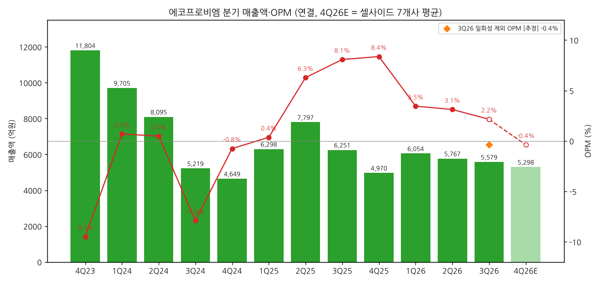
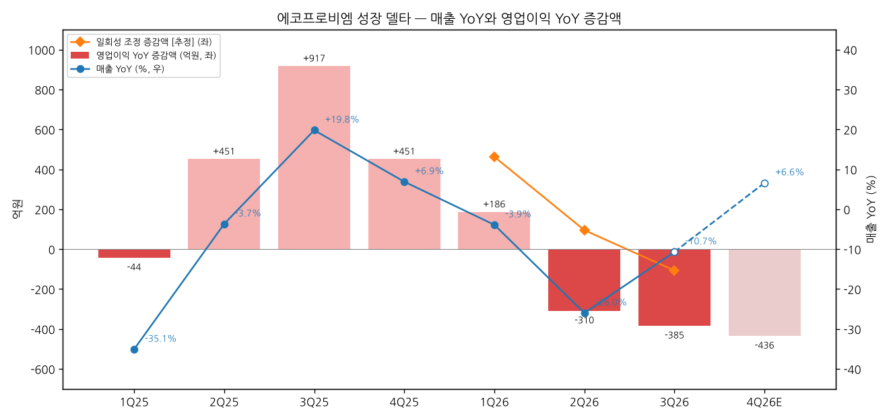
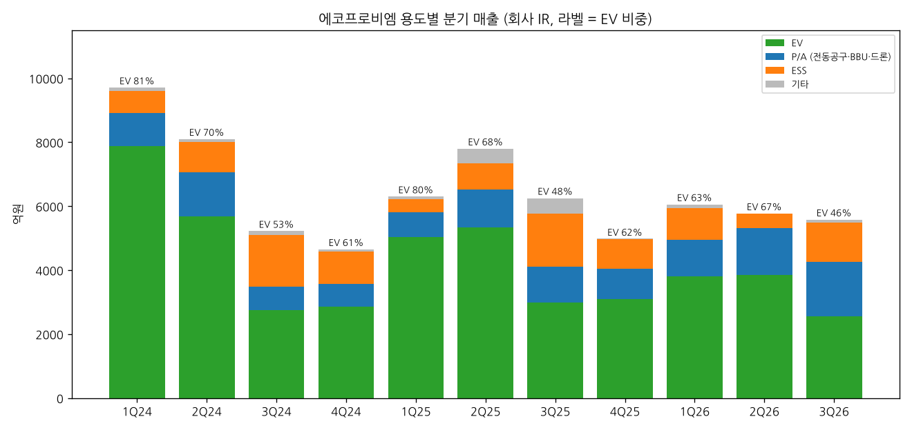

> 모드: 실적 리뷰 (v11)
> 종목: 에코프로비엠 (247540)
> 섹터: 배터리
> 서브섹터: 양극재
> 분기: 2026-Q3
> 발표일: 2026-11-05 (잠정실적·IR 발표 — 같은 날 유상증자 신주 상장)
> 작성 시각: 2026-11-16 17:30 KST
> 분석 소스: 회사 「2026년 3분기 실적발표자료」 IR PT(2026-11-05) + 국내 6개사(DS투자 11/06, 삼성 11/06, 신한 11/06, 유진 11/06, 하나 11/10, DB 11/16) + 해외 1개사(J.P. Morgan 11/05) — 첨부 8건 전부 / 과거 분기는 본 세션 기업개요(회사 IR·OpenDART) / 직전 리뷰 2026-Q1 (2Q26 리뷰 없음) / 중국 피어는 같은 날 리뷰(688005.SS·300073.SZ) — 웹서치 보완 없음
> 리뷰 깊이: 풀 | 리서치 첨부 8건 (회사 IR 1 + 증권사 7)

# 에코프로비엠 3Q26 실적 리뷰

## 0. 한 줄 판정

> 성장 델타: 꺾임 | 내러티브: 약화 → 델타 꺾임 + 내러티브 약화 → 매매 제외 구간 (헝가리 정상 가동·신규 OEM 본계약 확인 전까지)

→ 숫자: 매출 5,579억 (YoY −10.7%, QoQ −3.3%), 영업이익 120억 (YoY −76.2%, QoQ −33.3%, OPM 2.2%). 영업이익 YoY 증감액이 +186 → −310 → **−385억**으로 2개 분기 연속 마이너스, 4Q26E는 셀사이드 7개사 평균 **−20억(적자전환)**. FnGuide 컨센(123억) 대비로는 부합(−2%)이지만 매출은 −6% 미달
→ 쟁점 ①: 120억의 질 — 개발비 자산화(약 140억, DB)·재고평가손실 환입(약 40억, DS)이 헝가리 가동중단 비용(30\~40억)을 덮었다. **일회성을 빼면 본업은 소폭 적자**(삼성·신한·DB 공통)
→ 쟁점 ②: EV 공백 — 고객사(삼성SDI) 유럽 BMW향 재고조정·북미 EV 정체로 EV향 매출 **−34% QoQ**. ESS(+173%)·P/A(+16%)가 대부분 막았지만 셀사이드는 2027 출하를 6.8\~7.1만톤으로 낮췄다. 출하 회복은 **2028년**으로 밀렸다
→ 쟁점 ③: 새 카드는 LFP 5만톤(인니) 진출 예고와 BNSI 니켈 제련소(27년 상반기 가동) — 그러나 7개사 TP **전부 하향**(평균 16.6만 → 12.4만원, −25%)
→ 다음 분기 관건: 4Q26 적자 폭(−116억\~+120억)보다 **헝가리 2개 라인 정상 가동**과 **글로벌 OEM 수조원 공급계약 본계약 공시** 여부

---

## 1. 숫자

① 연결 분기 표 (억원, K-IFRS 연결)

| 항목 | 4Q23 | 1Q24 | 2Q24 | 3Q24 | 4Q24 | 1Q25 | 2Q25 | 3Q25 | 4Q25 | 1Q26 | 2Q26 | **3Q26** | 4Q26E |
|---|---|---|---|---|---|---|---|---|---|---|---|---|---|
| 매출액 | 11,804 | 9,705 | 8,095 | 5,219 | 4,649 | 6,298 | 7,797 | 6,251 | 4,970 | 6,054 | 5,767 | **5,579** | 5,298 |
| 영업이익 | −1,119 | 67 | 39 | −412 | −35 | 23 | 490 | 505 | 416 | 209 | 180 | **120** | −20 |
| OPM | −9.5% | 0.7% | 0.5% | −7.9% | −0.8% | 0.4% | 6.3% | 8.1% | 8.4% | 3.5% | 3.1% | **2.2%** | −0.4% |
| 일회성 조정 영업이익 [추정] | — | — | — | — | — | −284 | 85 | 87 | 98 | 약 179 | 180 | **약 −20** | — |
| 매출 YoY | −39.3% | −51.7% | −57.5% | −71.1% | −60.6% | −35.1% | −3.7% | +19.8% | +6.9% | −3.9% | −26.0% | **−10.7%** | +6.6% |
| 영업이익 YoY | 적전 | −93.8% | −96.6% | 적전 | 적지 | −65.7% | +1,156% | 흑전 | 흑전 | +809% | −63.3% | **−76.2%** | 적전 |
| 영업이익 YoY 증감액 | −2,072 | −1,006 | −1,108 | −871 | +1,084 | −44 | +451 | +917 | +451 | +186 | −310 | **−385** | −436 |
| **매출 YoY 델타 (%p)** | — | −12.4 | −5.8 | −13.6 | +10.5 | +25.5 | +31.4 | +23.5 | −12.9 | −10.8 | −22.1 | **+15.3** | +17.3 |

→ (출처: 4Q23\~2Q26 = OpenDART 연결(본 세션 기업개요, 4Q = 연간 − 3Q 누적), 3Q26 = 회사 IR 2026-11-05 p.4 [잠정 — 분기보고서 미공시], 2024·2025 분기는 IR p.10 Appendix와 일치 확인. 4Q26E = JPM·DS·삼성·신한·유진·하나·DB 7개사 평균(매출 5,102\~5,830억, 영업이익 −116\~+120억). 3Q26 매출 YoY는 십억원 단위 원값(557.9 / 625.1) 기준 −10.7%, 억원 반올림값으로는 −10.8%)
→ 일회성 조정 [추정]: 1Q25 재고평가충당금 환입 307억 제외, 2Q25·3Q25 인니 투자 관련 이익 405억·418억 제외(회사 IR 「기타」 매출), 4Q25 내용연수 변경 318억 제외(기업개요), 1Q26 충당금 환입 약 30억 제외(BT 1Q26 리뷰), 3Q26 = 120억 − 개발비 자산화 약 140억(DB) — 재고 환입 약 40억과 헝가리 비용 30\~40억은 상쇄(DS)
→ 컨센 대비: 영업이익 **−2.4%** (FnGuide 123억, 삼성·신한·유진 인용), 매출 **−6.0%** (FnGuide 5,935억, 유진). Bloomberg 기준으로는 매출 −11%, 영업이익 −36% (BBG 6,290억 / 190억, JPM 인용)
→ 영업이익 % YoY는 2025년 저기저(23억·−35억)와 일회성 때문에 ±1,000%대로 튀어 판정에 쓸 수 없다 → **영업이익 YoY 증감액**으로 델타를 본다

**해석**
→ 영업이익 YoY 증감액은 3Q25(+917억)가 정점, 이후 +451 → +186 → −310 → **−385억**으로 4개 분기 연속 축소, 2개 분기 연속 마이너스. 일회성 조정 기준으로도 +463(1Q26) → +95(2Q26) → 약 −107억(3Q26)으로 방향이 같다 → **델타 꺾임**
→ 매출 YoY 델타가 +15.3%p로 반등한 건 2Q26(−26.0%)의 저점에서 돌아온 것일 뿐, 매출 절대치는 3개 분기 연속 QoQ 감소(6,054 → 5,767 → 5,579억). 4Q26E 매출 YoY +6.6%는 4Q25(4,970억) 저기저 효과
→ 컨센이 그리는 경로상 영업이익은 4Q26 적자(−20억) → 2027E 연간 1,003억(+105% YoY)이지만 2027년 증익의 상당 부분은 BNSI 니켈 제련소 연결(삼성 2027E BNSI 영업이익 1,149억)이다. **양극재 본업 기준 이익 YoY가 다시 플러스로 돌아서는 시점은 2028년**(헝가리·신규 고객 출하)으로 셀사이드가 모인다 [전망]

→ (출처: OpenDART·회사 IR, 4Q26E = 셀사이드 7개사 평균 — 연한 막대·점선. 주황 마름모 = 개발비 자산화 제외 3Q26 OPM [추정])

→ (출처: OpenDART·회사 IR. 영업이익은 저기저·일회성으로 % 대신 YoY 증감액(억원). 주황선 = 일회성 조정 기준 [추정])

② 사업부별(용도별) 매출 — 영업이익은 회사 미공시

(1) 회사 공시 — 용도별 매출 (억원)

| 용도 | 3Q25 | 2Q26 | **3Q26** | YoY | QoQ | 3Q26 비중 |
|---|---|---|---|---|---|---|
| EV | 2,980 | 3,853 | **2,561** | −14% | −34% | 46% |
| P/A (전동공구·BBU·UPS·드론) | 1,130 | 1,464 | **1,697** | +50% | +16% | 30% |
| ESS | 1,653 | 453 | **1,236** | −25% | +173% | 22% |
| 기타 | 488 | −3 | **85** | — | — | 2% |
| 합계 | 6,251 | 5,767 | **5,579** | −11% | −3% | 100% |

→ (출처: 회사 3Q26 IR p.5. 3Q25 기타 488억에는 인니 투자 관련 이익 418억 포함(기업개요). IR 표는 「기타」를 ESS에 합산해 표기 — 위 표는 기업개요의 분리 기준. 사업부(용도)별 영업이익은 **미공개**, 셀사이드도 추정치 미제시)

(2) 용도별 매출 YoY 추이 (%)

| 용도 | 1Q25 | 2Q25 | 3Q25 | 4Q25 | 1Q26 | 2Q26 | **3Q26** |
|---|---|---|---|---|---|---|---|
| EV | −36% | −6% | +8% | +8% | −24% | −28% | **−14%** |
| P/A | −23% | −13% | +53% | +35% | +44% | +22% | **+50%** |
| ESS | −41% | −13% | +3% | −8% | +141% | −44% | **−25%** |

→ (출처: 기업개요 용도별 분기 매출(회사 IR) [계산]. 신한 표기와 ±1%p 차이는 기타 포함 여부)

→ (출처: 회사 IR(기업개요 정리), 라벨 = EV 매출 비중)

**해석**
→ 델타를 끌어내린 건 **EV**. 2Q26 3,853억 → 3Q26 2,561억(−1,292억)으로 전사 매출 감소분(−188억)의 7배를 혼자 뺐고, 이를 ESS(+783억)와 P/A(+233억)가 대부분 메웠다. EV 비중은 1Q25 80% → 3Q26 **46%**로 사상 최저
→ 델타를 받치는 건 **P/A(BBU·데이터센터)** — 4개 분기 연속 +20% 이상 YoY, 3Q26 1,697억으로 분기 최대. 다만 ESS는 분기마다 ±100%를 오가는 프로젝트성 물량이고(DS: "단기 프로젝트 물량"), 미국 BESS가 LFP로 이원화되며 NCA ESS 수요가 줄고 있다(유진)
→ 판매량: 3Q26 양극재 판매량 **−10% QoQ**(DB). 분기 출하 톤수는 회사 미공시 **[미확보]** — 셀사이드 연간 출하 2026E 6.0\~6.9만톤(하나·DB 6만, 유진 6.9만)

(3) 재무 — 유상증자 직전 레버리지 최고치

| 항목 (억원) | 3Q25 | 2Q26 | **3Q26** | QoQ |
|---|---|---|---|---|
| 재고자산 | 5,045 | 7,919 | **6,834** | −14% |
| 차입금 | 23,005 | 28,901 | **26,822** | −7% |
| 순차입금비율 | 102% | 116% | **122%** | +6.7%p |
| 유동비율 | 70% | 79% | **76%** | −3.3%p |

→ (출처: 회사 3Q26 IR p.6. 하나: 재고일수 130일(2Q 127일), 재고회전율 0.75회로 「재고 지표 악화」)
→ 유상증자 신주 9,900,990주 11/05 상장, 발행가 89,500원, 조달 **8,861억**(BNSI 지분 7,650억 + 헝가리 1,211억) — 3Q26말 재무상태표에는 미반영. 증자 반영 pro forma 순차입금비율 약 52% [계산, 기업개요]. 단, 자금 대부분이 투자 목적이라 차입 상환 효과는 제한

③ 연간 (억원)

| 항목 | 2022 | 2023 | 2024 | 2025 | 2026E | 2027E |
|---|---|---|---|---|---|---|
| 매출액 | 53,576 | 69,009 | 27,668 | 25,316 | 22,721 | 27,440 |
| 영업이익 | 3,807 | 1,560 | −341 | 1,433 | 489 | 1,003 |
| OPM | 7.1% | 2.3% | −1.2% | 5.7% | 2.2% | 3.7% |
| 매출 YoY | +260.6% | +28.8% | −59.9% | −8.5% | −10.3% | +20.8% |
| 영업이익 YoY | +230.9% | −59.0% | 적전 | 흑전 | −65.9% | +105% |

→ (출처: 2022\~2025 = DART·회사 IR(기업개요, 유진 도표 2 교차확인), 2026E·2027E = 발표 후 7개사 평균 — 2027E 영업이익: JPM 1,270 / DS 910 / 삼성 1,651 / 신한 860 / 유진 1,140 / 하나 583 / DB 610억. **삼성·JPM은 BNSI 연결 이익 포함, DS·하나는 BNSI 미반영**이라 편차가 2.8배)
→ 연간 컨센 변화: FnGuide 2026E 영업이익 693억(신한 11/06 표기, 발표 전) → 543억(하나 11/10 표기) **−22%**, 2027E 1,445억 → 1,043억 **−28%**

④ 중국 피어 대비 — 같은 분기, 반대 방향의 매출

| 항목 (3Q26) | 에코프로비엠 | Ronbay (688005.SS) | Easpring (300073.SZ) |
|---|---|---|---|
| 매출 (원화 환산) | 5,579억 | 약 1조 2,364억 (58.83억위안) | 약 1조 4,669억 (69.8억위안) |
| 매출 YoY | **−10.7%** | +114.9% | +135.3% |
| GPM | 7.7% | 5.3% | 7.5% |
| 영업이익 (한국식) / OPM | 120억 / 2.2% | 0.19억위안 / 0.3% | 2.71억위안 / 3.9% |
| 영업이익 YoY | −76.2% | 흑전(−1.41 → 0.19억위안) | +78.1% |
| 판매량 | −10% QoQ (DB), 톤수 [미확보] | 삼원 3.8만톤+ (+81% YoY) | 다원계 2.2만톤 + LFP 4.5\~4.8만톤 |
| 판정 (v11) | 꺾임 / 약화 | 꺾임 / 약화 | 꺾임 / 약화 |

→ (출처: 에코프로비엠 회사 IR, 피어는 BT 같은 날 리뷰 `2026-Q3_688005.SS_리뷰.md`·`2026-Q3_300073.SZ_리뷰.md`(회사 공시, 원화 환산 = 3Q26 평균 CNY/KRW 210.16 [계산]). 피어 영업이익은 한국식 근사(매출총이익 − 세금 − 판관·R&D), 에코프로비엠 GPM = (매출 − 매출원가) / 매출 [계산])
→ 세 회사 모두 마진은 2\~4%대로 같이 눌렸다 — 하이니켈·LFP 가릴 것 없이 **메탈가 래깅 + 가공 마진 경쟁**이 업종 공통. 차이는 매출: 중국 피어는 LFP·ESS 볼륨과 메탈 연동 판가로 2배 이상 커졌는데, 에코프로비엠은 LFP가 없고 EV 고객(삼성SDI 유럽) 재고조정에 묶여 역성장 [판단]
→ 래깅 방향도 엇갈린다: 중국 피어는 9월 리튬 반락으로 **재고평가손실**, 에코프로비엠은 **재고평가손실 환입**(하나: 「메탈가 상승 래깅 반영」). 회사 IR 기준 수산화리튬 22.0$(26.03) → 18.0$(26.09)/kg로 내려오는 중이라, 4Q부터는 에코프로비엠도 래깅 역풍 쪽으로 넘어갈 가능성 [판단]

---

## 2. 시장 쟁점

### 2-0. 지난 리뷰(1Q26)에서 "봐야 할 것"으로 남긴 항목

(2Q26 리뷰 없음 — 1Q26 리뷰 「다음 분기 핵심 모니터링」 5개 항목을 3Q26 시점에서 체크)

| 1Q26 리뷰 항목 | 3Q26 결과 | 판정 |
|---|---|---|
| 헝가리 가동률 — 2Q말 30%+, 3Q말 50%+ | 1라인 6월 가동(당초 5월), 2라인 9월 가동 준비 중 현지 안전·환경당국 점검으로 **가동 중단** → 10월 말 재개. 회사는 「26.4Q 2개 라인 본격 양산」으로 일정 재설정 (IR p.7, DS·유진) | 반대로 나옴 |
| 2Q26 OPM 3% 유지 — 일회성 빠진 본업 검증 | 2Q26 3.1%로 유지, 그러나 3Q26 2.2%에 일회성 제외 시 **본업 소폭 적자**(삼성·신한·DB) | 2Q 확인 → 3Q 반대로 나옴 |
| 메탈가 — 코발트 55$ 추세 | 코발트 55.6$(26.06) → 55.0$(26.09) 보합, 수산화리튬 20.3 → 18.0$ 하락. 3Q는 재고평가손실 환입(래깅 수혜), 4Q는 「메탈 가격 하락으로 매출 감소」(신한) | 일부 확인 (4Q 역풍 전환) |
| 신규 고객 수주 — 헝가리 2공장 증설 트리거 | 컨콜: 글로벌 OEM과 **수조원대 공급계약 최종 마무리 단계**, 비중국 셀 메이커 하이니켈 9억달러 LOI는 2028년부터 헝가리·한국 출하 (DS·DB) — 본계약 공시는 아직 | 미확인 (진행 중) |
| 재무건전성 — 순차입금비율 110% 도달 시 자본 조달 우려 | 2Q26 116% → 3Q26 122%(사상 최고), **유상증자 8,861억** 실행(당초 1.2조에서 26% 축소, 11/05 상장) | 확인 (우려가 현실화) |

### 2-1. 이번 분기 쟁점

① **영업이익 120억의 질 — 일회성을 빼면 본업은 적자인가, 4Q 적자전환 폭은** (7건 중 6건)
② **EV 공백과 헝가리 — 출하 회복은 언제, 2027년 3만톤은 가능한가** (7건 중 7건)
③ **LFP 5만톤 진출 — 늦은 진입인가, 미국 ESS·EU IAA용 새 성장축인가** (7건 중 5건)
④ **BNSI 니켈 제련소와 유상증자 — 2027년 이익과 밸류에이션의 앵커가 되나** (7건 중 7건)

### 2-2. 쟁점별 분해

#### ① 영업이익 120억의 질

(1) 회사 설명
→ 「분기 영업이익은 헝가리 공장 일시 가동 중지 및 환율 하락 영향으로 전분기 대비 소폭 하락한 120억원 달성」 (IR p.4)
→ 4Q 전망: 「북미 소비자 보조금 폐지에 따른 EV 시장침체 지속, 유럽 OEM의 차종 변경 진행에 따른 감소 영향 지속」, 「Power Application, ESS 등 Non-EV 섹터 개선 추세 — AI 데이터센터 증축, 드론, UPS·BBU 수요 증가」 (IR p.4)
→ EBITDA 393억(마진 7.0%), 세전이익 −240억, 순이익 −18억 (IR p.4·10)

(2) 증권사별 해석 편차

| 증권사 | 3Q26 일회성 분해 | 본업 판단 | 4Q26E 영업이익 |
|---|---|---|---|
| DB (11/16) | 개발비 자산화 **약 140억** + 재고평가손실 환입 vs 헝가리 중단 비용 상쇄 | 「본업은 소폭 적자 구간」 | **−116억** (헝가리 10월 비용 70\~80억) |
| DS (11/06) | 재고 충당금 환입 **약 40억** + 개발비 자산화 확대 vs 헝가리 중단 30\~40억 | 컨센 부합 | **50억** (재고 환입·비용 통제가 일부 상쇄) |
| 삼성 (11/06) | LFP 양극재 개발비 자산화 등 | 「일회성 제외 시 본업 적자」 | 49억 |
| 신한 (11/06) | 일회성 + 헝가리 중단·원화 강세 부담 | 「실질 영업이익은 적자」 | −97억 |
| 하나 (11/10) | 메탈가 상승 래깅에 따른 재고평가손실 환입 + 개발비 자산화 | 재고일수 130일로 재고 지표 악화 | −103억 (8개 분기 만에 적자) |
| 유진 (11/06) | 헝가리 관련 비용 3·4Q 반영 | 매출 예상 하회가 핵심 | −44억 |
| JPM (11/05) | — | 「negative operating leverage」 — OP가 JPMe 260억 대비 −54% | 120억 |

(3) 공통 결론 vs 갈리는 지점
→ 공통: 3Q 120억은 개발비 자산화가 떠받친 숫자이고, 본업은 BEP 아래. 4Q는 헝가리 10월 중단 비용(70\~80억)이 3Q보다 커서 이익이 더 나빠진다 — 7개사 중 4개사가 적자전환
→ 갈림: 4Q 적자 폭(DB −116억 vs JPM +120억, 2.4배 이상 편차) — 차이는 재고 환입 지속 여부(DS)와 메탈가 하락의 판가 반영 속도(신한·하나)

(4) [판단]
→ 1Q26 리뷰에서 「본업 흑자 안착」이라고 봤던 가설은 3Q에 깨졌다. 일회성 조정 영업이익이 약 179억(1Q) → 180억(2Q) → 약 −20억(3Q)으로 한 분기 만에 200억이 빠졌고, 그 원인(EV 물량 −34%, 헝가리 고정비)은 4Q에도 남아 있다 [판단]
→ 결론을 바꿀 데이터: 4Q26 영업이익이 개발비 자산화 같은 일회성 없이 0 이상이면 「3Q가 바닥」 해석이 가능. −100억 이하면 2027년 상반기까지 적자 지속 경로(삼성 1Q27E 47억 / DB 1Q27E 30억 — 둘 다 OPM 1% 이하)

#### ② EV 공백과 헝가리

(1) 회사 설명
→ 3Q: 「북미시장의 EV 수요 정체에 따른 판매물량 감소」, 「유럽 OEM의 차종 변경 계획에 따른 고객사 재고소진 지속」 (IR p.4)
→ EV 시장 전망: 유럽은 「TCA 등 정책에 따른 역내공급 필요로, 헝가리 공장 수혜 기대」, 북미는 「EV 시장 침체로 주요 OEM 전략 조정 등 제한적 수요」 (IR p.5)
→ 헝가리: 「글로벌 OEM(H사, A사, B사) 공급량 확대 (26.4Q 2개 라인 본격 양산)」 (IR p.7), 2027년 출하 목표 3만톤 유지 (JPM 인용)

(2) 증권사별 해석 편차

| 증권사 | 2027 양극재 출하 가정 | 헝가리·EV 해석 |
|---|---|---|
| JPM | 2027 매출 −16% 하향 | 헝가리 3만톤 목표에 **하방 리스크** — 한국산이 헝가리산보다 원가 경쟁력이 높고, 원가 압박 속 역내 조달 규제가 완화될 수 있어 고객이 한국 조달을 유지할 유인 |
| 삼성 | **6.8만톤** (기존 대비 −22%) | 고객사 EV향 판매 환경 반영 |
| DS | **7만톤** (+17% YoY) | 헝가리 3만톤 중 일부는 포항 유럽향 물량 이전 → **전사 순증은 더 작다** |
| 하나 | 2026 6만 → 2027 **6.8만** → 2028 9.9만톤 | 2028년 삼성SDI 유럽 신규 프로젝트 + EU 산업가속화법(IAA) → 유럽 공장 출하 급증 가능 |
| DB | 2026 6만 → 2027 **7만톤** | 삼성SDI BMW향 재고조정, 헝가리(지분 100%) 가동으로 지배주주 이익엔 긍정 |
| 유진 | 2026 6.9만 → 2027 **7.1만** → 2028 10.6만톤 | 본업 증가는 2028년부터 — 기존 고객 신규 EV 모델용 생산이 헝가리·국내에서 시작, 헝가리 신규 고객도 2028년 |
| 신한 | 2027 출하 **+18%** | 「헝가리 가동 본격화, 회복의 출발점」 — 2028 외형 +75% |

(3) 공통 결론 vs 갈리는 지점
→ 공통: 2027년 출하는 +13\~18% 정도의 완만한 회복, **본격 성장은 2028년**(삼성SDI 유럽 신규 프로젝트 + IAA). 2027년은 「기다리는 해」
→ 갈림: 헝가리가 **순증 물량**이냐(신한·DB) **한국 물량의 이전**이냐(DS·JPM). JPM은 고객이 원가가 싼 한국 조달을 유지해 3만톤 목표 자체가 위험하다고 본다

(4) [판단]
→ 3Q EV −34%의 원인은 고객사(삼성SDI 헝가리 → BMW) 재고조정이라 수요 소멸보다 타이밍 문제에 가깝다. 그러나 같은 고객 삼성SDI도 3Q 리뷰에서 「최대 고객 BMW는 2028년 신규 프로젝트 전까지 물량 감소」(하나 SDI 리포트)라고 밝혀, **2027년 EV 회복을 기대할 근거는 약하다** [판단]
→ 결론을 바꿀 데이터: 4Q26\~1Q27 헝가리 2개 라인 가동률(회사 코멘트), 그리고 EU IAA 역내 조달 요건 확정 — JPM의 「규제 완화」 시나리오가 틀리면 헝가리 가치가 다시 부각된다

#### ③ LFP 5만톤 진출

(1) 회사 설명 (컨콜, 셀사이드 인용)
→ 국내 4천톤 LFP 파일럿 라인은 장기계약을 조건으로 즉시 가동 가능 (JPM)
→ 인도네시아에 최대 연 5만톤 LFP 양산 라인 증설 결정 — 기존 파트너사의 2만톤 LFP 라인 이전으로 **빠르면 2027년 3분기** 양산 (삼성), 국내 대비 capex 20\~30% 절감, 2028년 판매 시작 목표 (DB)

(2) 증권사별 해석 편차

| 증권사 | 해석 | 추정 반영 |
|---|---|---|
| JPM | 경쟁이 이미 자리 잡았다 — 엘앤에프·포스코퓨처엠이 한국 셀 3사 모두와 LFP 공급계약 확보. 중국 업체의 아세안 생산이 미국 조달 규정을 통과하는지도 불확실 | Underweight 근거 중 하나 |
| 유진 | 하이니켈 중심이던 회사가 입장을 바꿨다 — 미국 BESS의 비중국 LFP 수요 급증 + EU IAA의 중국산 LFP 제한 가능성 | 「미국 LFP BESS 시장 진입」으로 중장기 기대 유지 |
| 삼성 | 포트폴리오 다변화로 중장기 성장 기조 유지 — BUY 유지의 이유 | 「업황 개선이 더딘 상황에 LFP로 다변화」 |
| DS | 투자 규모·시점 확정 시 추가 상향 여지 | **미반영 상방 요인** |
| DB | 이번 발표에서 새로운 내용은 LFP 5만톤 사업 예고 | 미반영, 2028년 판매 |

(3) 공통 결론 vs 갈리는 지점
→ 공통: 아직 숫자(추정치)에 들어간 곳이 없다 — 투자 규모·고객·시점이 확정되지 않았다
→ 갈림: 후발 진입의 경쟁력 — JPM은 엘앤에프·포스코퓨처엠이 셀 3사를 선점했다고 보고, 유진·삼성은 미국 ESS 수요가 비중국 LFP 공급을 더 필요로 한다고 본다

(4) [판단]
→ 중국 피어 Easpring의 3Q26 LFP 판매가 분기 4.5\~4.8만톤(동오증권 추정)이다. 에코프로비엠의 5만톤은 **연간** 기준이고 2028년 판매 시작이라, 2027년 이익 델타를 바꾸는 변수는 아니다. 의미는 「EV 단일 노출에서 ESS로 스토리를 옮길 수 있느냐」의 옵션 [판단]
→ 결론을 바꿀 데이터: 장기계약(고객사·물량) 공시와 인니 투자 규모 확정 — 이게 나오면 DS·DB가 「미반영 상방」을 추정에 넣기 시작한다

#### ④ BNSI 니켈 제련소와 유상증자

(1) 회사 설명
→ 「인니 니켈 제련소 투자를 통한 Upstream 진출 — 수직계열화를 통한 사업 경쟁력 극대화, 26년 4Q 순차 출자 예정, 26년말 시운전 개시 후 27년 상반기 순차 가동」 (IR p.7)
→ 2027년 9만톤 캐파의 가동률 50%, 영업이익률 10% 수준 가이던스 (유진 인용), 풀 가동 시 연매출 약 17억달러·두 자릿수 수익성 (DB 인용)
→ 유상증자 8,861억 중 7,650억이 BNSI 지분 취득 (기업개요)

(2) 증권사별 해석 편차

| 증권사 | BNSI 처리 | 밸류에이션 영향 |
|---|---|---|
| 삼성 | 2027 연결 반영 — 영업이익 1,370억 → **1,149억** 하향(니켈 가격 하락 + 유황 가격 상승) | P/B 6.1 → 4.8배로 하향(Peer 대비 프리미엄 163% → 최소 105%) |
| JPM | 2028E EBITDA 3,010억에 EV/EBITDA 6배 → BNSI EV 1.8조(지분 80%는 비지배) | SOTP — 양극재 EV 8.0조(다운사이클 25배) |
| 하나 | **미반영** — 해외 첫 제련 사업이라 수익성 불확실, 계획대로면 연 9만톤 기준 최소 3,000억+ 연결 영업이익 | 「기존 삼원계 캐파 최대가치 11조원 내 밴드 트레이딩」 |
| DS | **미반영** — 정상 가동 시 OPM 10%+ 목표, 2027 하반기 연결 반영 시점부터 상향 요인 | EV/EBITDA 81배(2019\~2022 성장기 평균) |
| 유진 | 2027년 실적 성장의 대부분이 BNSI 계상 | 10% 유증 희석 반영해 TP 하향 |
| 신한 | 니켈 제련소 원가 경쟁력이 중장기 이익 체력 | 「현재 주가는 유증 발행가 부근 — 희석 우려 상당 부분 반영」 |

(3) 공통 결론 vs 갈리는 지점
→ 공통: 2027년 연결 이익 증가의 주 원천은 양극재가 아니라 BNSI. 유증 희석(약 10%)은 TP 하향의 공통 요인
→ 갈림: BNSI 이익을 **지금 추정에 넣느냐** — 삼성(2027E 영업이익 1,651억)과 하나(583억)의 2.8배 차이가 대부분 이 선택에서 나온다

(4) [판단]
→ BNSI는 니켈 가격·MHP 페이어블(3Q26 IR: 니켈 88.0%, 코발트 65.0%)에 연동되는 원자재 이익이다. 양극재 성장 델타와는 다른 사이클이라, BT 프레임에서는 「양극재 델타 회복」의 대체재가 아니라 **이익 바닥을 받치는 완충재**로 보는 게 맞다 [판단]
→ 결론을 바꿀 데이터: 27년 상반기 시운전·가동 일정 준수와 첫 분기 연결 OPM(가이던스 10%)

### 2-3. 낙관 vs 보수 — 논리 대비

→ **가장 낙관: 유진(TP 18만)·DS(16만)** — 「2028년 양극재 판매 증가는 가시성이 높다」(유진), 「글로벌 OEM 수조원 계약 최종 단계 + BNSI·LFP는 미반영 상방」(DS). 가정의 핵심은 **2028년 출하 10.6만톤(유진) + 성장기 멀티플(EV/EBITDA 81배, DS)**
→ **가장 보수: JPM(Underweight, 5.6만)·하나(BUY지만 11.2만, 「밴드 내 트레이딩」)** — 경쟁 심화(LFP 후발), 헝가리 3만톤 하방 리스크, 다운사이클 멀티플(25배). 하나는 BNSI·2028 성장 모두 「아직 주가에 반영하기 이르다」
→ 둘을 가르는 변수: **2028년 출하 가시성을 지금 값으로 줄 것인가**. 수조원 공급계약 본계약 공시가 나오면 낙관 쪽, 헝가리 가동률이 4Q에도 낮으면 보수 쪽
→ 셀사이드 vs 시장: 11/04 97,200원(JPM) → 11/05 89,700원(실적·신주 상장일) → 11/09 **75,900원**(52주 최저, 하나) — 유증 발행가 89,500원을 15% 하회. 이후 11/13 91,100원(DB)으로 반등. 7개사 중 6개가 매수 의견이지만 주가는 실적 직후 신주 물량과 함께 먼저 빠졌다 [판단]
→ 참고: 하나증권은 이번 유상증자의 인수 관련 법인(인수 후 3개월 적용)으로 컴플라이언스에 공시

### 2-4. 추정치·TP 변화

| 증권사 | 의견 | 직전 TP | 현재 TP | 4Q26E 영업이익 | 2026E / 2027E 영업이익 | 핵심 변화 한 줄 |
|---|---|---|---|---|---|---|
| 유진 (11/06) | BUY | 200,000 | **180,000** | −44억 | 467억 / 1,140억 | 10% 유증 희석 반영, 2028 출하 10.6만톤 |
| DS (11/06) | 매수 | 250,000 | **160,000** | 50억 | 560억 / 910억 | 2027 OP −47%, 양극재 본업만 반영 |
| DB (11/16) | Buy | 210,000 | **130,000** (11/06 하향 후 유지) | −116억 | 390억 / 610억 | 헝가리 10월 비용 70\~80억, LFP 5만톤 |
| 신한 (11/06) | 매수 | 160,000 | **120,000** | −97억 | 413억 / 860억 | 실적 하향 + 유증, EV/EBITDA 49.5배 유지 |
| 하나 (11/10) | BUY | 151,576 (수정) | **112,000** | −103억 | 407억 / 583억 | 출하 하향, 11조원 밴드 트레이딩 |
| 삼성 (11/06) | BUY | 130,000 | **110,000** | 49억 | 559억 / 1,651억 | 2027 출하 6.8만톤(−22%), P/B 4.8배 |
| JPM (11/05) | Underweight | 62,000 | **56,000** | 120억 | 630억 / 1,270억 | 2027/28 OP −20%/−9%, 경쟁·헝가리 |

→ 평균 TP(7개사) **124,000원** ← 직전 166,225원(**−25.4%**). 상향 0건, 하향 7건(DB는 11/06 하향 후 11/16 유지). FnGuide 커버 12개사 평균 TP 162,403원(삼성 11/06 표기, 하향 반영 전)
→ 하향의 원인은 **실적 하향과 멀티플 하향이 함께** — 실적: 2027E 영업이익 DS −47%, 신한 −60%, 삼성 −38%, 유진 −21%, JPM −20%. 멀티플: 삼성 P/B 6.1 → 4.8배, 유진·신한은 유증 희석. DS·신한은 멀티플을 유지하고 이익만 낮췄다
→ 발표 전 대비 연간 컨센: 2026E −22%(693억 → 543억), 2027E −28%(1,445억 → 1,043억) (FnGuide, 신한·하나 표기)

---

## 3. 내러티브 점검

① 스토리 정의
→ **「하이니켈 양극재 1위 + 헝가리(유럽 역내 생산)로 IAA·TCA 수혜 → 2028년 출하 재성장, 니켈 제련소로 수직계열화」** — 시장이 에코프로비엠을 사는 이유는 메탈가 회복기의 래깅 이익과 유럽 현지화 프리미엄

② 이번 분기가 스토리에 준 영향
→ 약화: 헝가리 가동 중단(9\~10월)으로 램프업 지연, EV 물량 −34%, 일회성 제외 본업 적자, 2027 출하 하향(삼성 −22%), 유증 희석. 7개사 TP 전부 하향, 연간 컨센 −22\~28%
→ 유지·보강: 글로벌 OEM 수조원 계약 「최종 마무리 단계」, 9억달러 LOI 2028 출하, BNSI 27년 상반기 가동, LFP 5만톤 신규 — 모두 **2028년 이후**에 숫자가 되는 이야기
→ 판정: 스토리의 핵심 전제(유럽 역내 수요·2028 성장)는 깨지지 않았지만, 타이밍이 1년 밀리고 추정치·멀티플이 같이 내려갔다 → **내러티브 「약화」**. 「훼손」이 아닌 이유는 헝가리 일정 지연이 규제 점검에 따른 일시 중단이고, 고객 이탈 신호는 없기 때문
→ 국면: 영업이익 YoY 증감액 2개 분기 연속 마이너스 + 4Q 적자전환 컨센 + 내러티브 약화 → **「매매 제외 구간」**. 같은 날 리뷰한 중국 피어 2곳도 「꺾임 + 약화」로, 양극재 서브섹터 전체가 같은 국면 [판단]

③ 다시 강해질 트리거
→ 글로벌 OEM 수조원 공급계약 본계약 공시 (DS·DB 「최종 마무리 단계」)
→ 헝가리 2개 라인 정상 가동 + EU IAA 역내 조달 요건 확정
→ LFP 장기계약(고객·물량) 확정, 또는 메탈가(리튬·코발트) 재상승에 따른 래깅 이익

④ 스토리를 깨뜨릴 리스크
→ 헝가리 3만톤 목표 미달 — 고객이 원가가 싼 한국 조달 유지(JPM 시나리오)
→ 메탈가 하락 지속 → 4Q 이후 재고평가손실(중국 피어가 3Q에 이미 경험)
→ BNSI 시운전 지연·니켈 가격 하락, CB 4,400억 풋 행사 구간 진입(2026.07\~, 기업개요)과 높은 단기차입 의존

---

## 4. 향후 봐야 할 것

① **4Q26 영업이익과 일회성 제외 본업** — 1순위 (델타 판정을 바꾸는 변수)
→ 무엇을: 4Q26 영업이익(셀사이드 평균 −20억, 범위 −116\~+120억), 개발비 자산화·재고 환입 제외 본업이 0 이상인지, 헝가리 중단 비용 70\~80억 외 추가 비용
→ 어떤 데이터로: 4Q26 실적 IR(회사 p.4 코멘트), 3Q26 분기보고서(11월 중순 — 개발비 자산화 금액 확인)
→ 언제: 2026-11 중순(분기보고서) / 2027-02 초(4Q26 IR, 전년 2026-02-05 발표)

② **헝가리 2개 라인 정상 가동과 2027 출하 3만톤 목표**
→ 무엇을: 「26.4Q 2개 라인 본격 양산」 이행, 2027 헝가리 출하 3만톤 유지 여부, 포항 물량 이전 비중
→ 어떤 데이터로: 4Q 컨콜, 삼성SDI 헝가리 공장 가동률(SDI 4Q 컨콜), EU IAA 역내 조달 요건 발표
→ 언제: 2027-01 말(SDI) \~ 2027-02 초(에코프로비엠)

③ **글로벌 OEM 수조원 공급계약 본계약**
→ 무엇을: 공급 기간·물량·금액, 헝가리 2공장(EA2) 증설 연계 여부, 9억달러 LOI 본계약 전환
→ 어떤 데이터로: DART 단일판매·공급계약 체결 공시, 업계 보도
→ 언제: 2026-12 \~ 2027 상반기

④ **EV 고객 물량 — 삼성SDI 유럽(BMW) 재고조정 종료**
→ 무엇을: EV향 매출이 2,561억(3Q26)에서 반등하는지, P/A(BBU) 1,700억 수준 유지, ESS 프로젝트 물량 지속
→ 어떤 데이터로: 회사 IR 용도별 매출, 한국 양극재 수출물량·단가(KITA·산업부 월간), 삼성SDI EV 부문 코멘트
→ 언제: 매월 중순(수출입 통계), 2027-02 초(4Q IR)

⑤ **메탈가 래깅 방향과 BNSI·LFP 일정**
→ 무엇을: 수산화리튬 18$/kg(26.09) 이하 하락 지속 시 재고평가손실 전환, 코발트 55$ 유지, BNSI 연말 시운전, LFP 투자 규모·장기계약
→ 어떤 데이터로: 회사 IR Appendix 메탈 가격, Fastmarkets·LME, 중국 피어(Ronbay·Easpring) 4Q 재고손실, BNSI 공시
→ 언제: 2026-12(BNSI 시운전) \~ 2027 상반기(가동)
