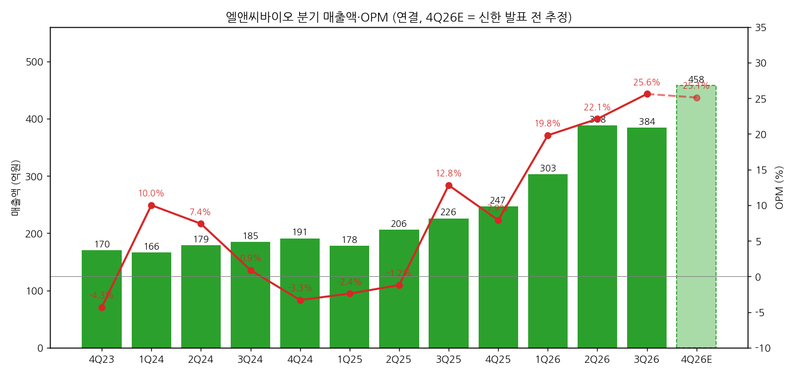
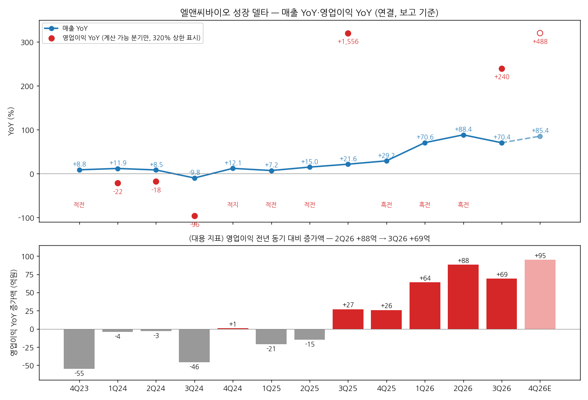
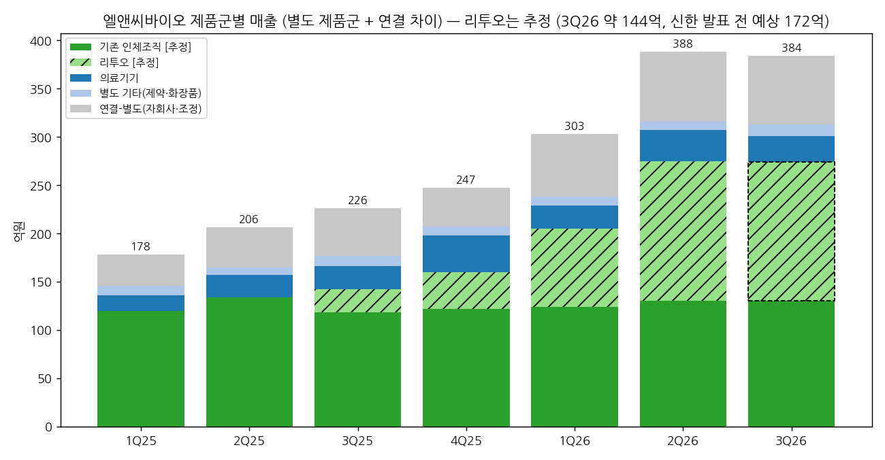

> 모드: 실적 리뷰 (v11)
> 종목: 엘앤씨바이오 (290650)
> 섹터: 뷰티
> 서브섹터: 미용의료
> 분기: 2026-Q3
> 발표일: 2026-11-09 (회사 실적 보도자료, 같은 날 CB 콜옵션·소각 이사회 결의) / 2026-11-13 3Q26 분기보고서 확정
> 작성 시각: 2026-11-22 20:45 KST
> 분석 소스: OpenDART 연결·별도 재무(dart_quarterly_summary, 2026.09 분기보고서 rcept 20261113000736) + 엘앤씨바이오 기업개요(2026-11-15, 별도 제품군 분기 매출) + 회사 IR「회사소개 및 주요 경영현황」(2026-11-17) + 셀사이드 2건 첨부, **모두 3Q 발표 전**: 신한투자증권「미국 공급계약 체결完」(2026-10-13, Not Rated), 신한투자증권 섹터 리포트 내「3Q 리투오 기대치 하회 vs. 미국 공급계약 체결」(2026-10-19, 10/13 리포트 요약 1쪽) + 웹서치 보완(데일리팜 2026-11-09 실적 기사, 발표 후 셀사이드 리포트 검색 — 미발견)
> 리뷰 깊이: 풀(셀사이드 축소판) | 리서치 첨부 2건(같은 증권사·같은 애널리스트, 모두 발표 전)
> 비영업 요인: 저기저(1Q25·2Q25 영업적자, 3Q25 OPM 12.8%) — 영업이익 안에는 확인된 일회성 없음. 순이익은 CB 파생상품 평가손익·법인세 추정이 지배(3Q26 금융손익 순 -20억원으로 노이즈 축소)

# 엘앤씨바이오 3Q26 실적 리뷰 — OPM은 사상 최고 25.6%, 그런데 리투오가 처음으로 멈췄다

> 성장 델타: 둔화 | 내러티브: 약화 → 델타 둔화 + 내러티브 약화 → 경계 구간 (CAPA 월 15만개 가동 후 4Q26 인체조직 매출 300억원 이상 재가속 확인 전까지)
>
> ⚠ 비영업 요인 플래그: 영업이익 98억원 자체에는 일회성이 없다. 다만 YoY 기저가 비정상적으로 낮다. 1Q25·2Q25가 영업적자(-4억원·-2억원)여서 1Q26·2Q26 영업이익 YoY는 "흑전"으로만 표시되고 %가 나오지 않는다. 3Q26 +239.8%는 리투오 출시 후 첫 흑자 분기(3Q25 29억원, OPM 12.8%)를 기저로 한 숫자다. 4Q26은 기저 4Q25가 20억원(OPM 7.9%)이라 신한 추정치 115억원만 나와도 보고 YoY가 +488%로 커진다 → 기계적 "가속"이 될 가능성이 높다 (4번 (2) 참고)

→ **숫자**: 매출 384억원(+70.4% YoY, -0.9% QoQ), 영업이익 98억원(+239.8% YoY, +14.7% QoQ), OPM 25.6%(+3.5%p QoQ, 사상 최고). 매출 YoY는 2Q26 +88.4% → +70.4%로 -18.0%p 둔화했다. 영업이익 YoY는 2Q26이 흑전이라 %p 델타를 계산할 수 없다. 대용 지표인 전년 동기 대비 영업이익 증가액은 +88억원 → +69억원으로 줄었다. 별도 영업이익 YoY도 +625% → +174%로 줄었다
→ **서프라이즈**: FnGuide 컨센(신한 10/13 인용, 매출 448억원·영업이익 100억원) 대비 매출 -14.3%, 영업이익 -1.6%. 매출은 크게 빠졌고 이익은 판관비 축소(150억원 → 141억원)로 맞췄다
→ **쟁점 ①**: 별도 인체조직이식재 매출이 275억원 → 274억원으로 처음 QoQ 정체했다. 기존 인체조직(약 130억원)을 빼면 리투오는 약 144억원 [추정]으로 2Q26(145억원)과 같다. 신한의 발표 전 예상(172억원, QoQ +19%)보다 약 28억원 낮다. 회사와 신한 모두 원인을 공급으로 본다. 월 8만개 CAPA를 대부분 판매 중이고, 생산 수량을 늘려 줄 파인 믹스 개선이 제한적이었으며, 태국 공급이 4Q로 이연됐다
→ **쟁점 ②**: 스토리의 다음 단계는 3가지 공급 이벤트다. ① 10월 CAPA 월 15만개(+87.5%) ② 10월 리투오 V 출시 ③ 10/12 미국 조직은행과 맺은 5년 최소 6,000만달러(약 820억원) 독점 공급계약. 미국 매출은 2027년부터 나오고, FDA 361 HCT/P 체계 요건이 변수다. 주가는 수정주가 52주 고점 60,441원 대비 -67%(11/13 20,150원)다. 유상증자 1,447억원과 1:1 무상증자 신주 상장(11/4·11/12) 수급까지 겹쳤다
→ **다음 분기 관건**: 4Q26 별도 인체조직 매출이 300억원 이상(신한 발표 전 추정 346억원)으로 QoQ 재가속하는지가 핵심이다. 274억원 근처에 머물면 "CAPA가 아니라 수요" 쪽으로 해석이 바뀐다. 4Q 영업이익은 115억원이 나와도 보고 YoY는 저기저 효과로 +488%다. 판정은 보고 기준으로 하되 QoQ 이익 증가(98억원 → 115억원)를 함께 확인한다

---

## 1. 숫자

① 연결 기준 분기 표 (단위: 억원, %)

| 항목 | 4Q23 | 1Q24 | 2Q24 | 3Q24 | 4Q24 | 1Q25 | 2Q25 | 3Q25 | 4Q25 | 1Q26 | 2Q26 | **3Q26** | 4Q26E |
|---|---|---|---|---|---|---|---|---|---|---|---|---|---|
| 매출액 | 170 | 166 | 179 | 185 | 191 | 178 | 206 | 226 | 247 | 303 | 388 | **384** | 458 |
| 영업이익 | -7 | 17 | 13 | 2 | -6 | -4 | -2 | 29 | 20 | 60 | 86 | **98** | 115 |
| OPM | -4.3 | 10.0 | 7.4 | 0.9 | -3.3 | -2.4 | -1.2 | 12.8 | 7.9 | 19.8 | 22.1 | **25.6** | 25.1 |
| 매출 YoY | +8.8 | +11.9 | +8.5 | -9.8 | +12.1 | +7.2 | +15.0 | +21.6 | +29.2 | +70.6 | +88.4 | **+70.4** | +85.4 |
| 영업이익 YoY | 적전 | -21.5 | -17.8 | -96.3 | 적지 | 적전 | 적전 | +1,556 | 흑전 | 흑전 | 흑전 | **+239.8** | +488 |
| **매출 YoY 델타 (%p)** | -52.0 | +3.1 | -3.4 | -18.3 | +21.9 | -4.9 | +7.8 | +6.6 | +7.6 | +41.4 | +17.8 | **-18.0** | +15.0 |
| **영업이익 YoY 델타 (%p)** | n/m | n/m | +3.7 | -78.5 | n/m | n/m | n/m | n/m | n/m | n/m | n/m | **n/m** | +248 |
| (참고) 영업이익 YoY 증가액 (억원) | -55 | -4 | -3 | -46 | +1 | -21 | -15 | +27 | +26 | +64 | +88 | **+69** | +95 |
| (참고) 별도 영업이익 | | | | | | 10 | 12 | 38 | 24 | 65 | 88 | **104** | |
| (참고) 별도 영업이익 YoY | | | | | | | | | | +547 | +625 | **+174** | |
| (참고) GPM | 43.4 | 49.8 | 51.6 | 49.0 | 48.0 | 55.4 | 45.5 | 58.4 | 53.1 | 60.6 | 60.9 | **62.2** | 62.4 |
| (참고) 판관비 | 81 | 66 | 79 | 89 | 98 | 103 | 96 | 103 | 111 | 124 | 150 | **141** | 171 |

→ (출처: OpenDART 연결 CFS — 1~3Q는 분기 3개월, 4Q는 연간 − 3Q 누적. 별도 영업이익은 OpenDART OFS 분기 3개월, 4Q25 = 연간 84.6억원 − 3Q 누적 60.3억원. 4Q26E = 신한투자증권 2026-10-13 추정(발표 전, 단독). 1Q27E는 공개 추정 없음 — 신한은 2027 연간만 제시)
→ **YoY 계산 기준**: K-IFRS **연결 보고 영업이익**, OpenDART 원공시 대 원공시. 3Q26은 분기보고서 확정치(2026-11-13)이고, 전년 동기 3Q25는 2025 3Q 분기보고서 원공시(중단영업 분리 반영본)다. 3Q26 +239.8% = 98.4억원 / 29.0억원. **2Q26 이전 3개 분기는 전년 동기가 영업적자(흑전)라 YoY %도, YoY 델타(%p)도 산출할 수 없다.** 그래서 판정에는 ① 보고 연결 영업이익 YoY 증가액(억원)과 ② 매출 YoY 델타를 대용으로 쓰고, ③ 별도 영업이익 YoY는 참고로만 둔다. 2024 분기는 2024 원공시다. 회사 IR(2026-11-17)과 신한은 2024 연간 영업이익을 39억원(OPM 5.4%)으로 적어 DART 2024 원공시 25억원과 다르다 — 2025 사업보고서의 비교 재작성(중단영업 재분류)으로 보이나 원인은 미확인이다. 이 차이는 2025 분기 YoY에만 영향을 주고 3Q26 판정과는 무관하다
→ 3Q26 서프라이즈: 매출은 FnGuide 컨센 대비 -14.3%, 영업이익은 -1.6% (컨센 매출 448억원·영업이익 100억원·OPM 22.3%, FnGuide QuantiWise — 신한 10/13 리포트 인용. 발표 직전 최신 컨센과 집계 증권사 수는 미확인이며, 커버리지가 적어 **소수 의견 좌우 가능**). 신한 추정(418억원·99억원) 대비로는 매출 -8.0%, 영업이익 -0.6%
→ 매출 YoY 정점은 2Q26(+88.4%)이었다. 3Q26에 -18.0%p 내려왔고, 신한 경로상 4Q26(+85.4%)에 다시 오른다. 다만 4Q26E 458억원은 발표 전 추정이고, 3Q26 실제 매출이 추정보다 34억원 낮았다. 4Q 추정도 하향 여지가 있다 [판단]
→ 영업이익 YoY는 2025년 내내 적자·저기저 구간이라 % 비교가 무의미하다. 이번 3Q26이 처음으로 "흑자 대 흑자" YoY가 나온 분기다. 4Q26 기저(20억원) → 1Q27 기저(60억원) → 2Q27 기저(86억원)로 기저가 빠르게 높아진다. **영업이익 YoY %는 4Q26(+488% 예상)이 정점이 되고, 1Q27부터 기계적으로 세 자릿수 아래로 내려온다** [판단]
→ **[판단] 델타 = 둔화**: 영업이익은 QoQ +14.7%로 늘었고 OPM도 사상 최고다. 그러나 ① 매출 YoY -18.0%p ② 영업이익 YoY 증가액 +88억원 → +69억원(-22%) ③ 별도 영업이익 YoY +625% → +174%가 모두 같은 방향(축소)이다. 영업이익 YoY는 여전히 플러스라 "꺾임"이 아니라 "둔화"다. %p 델타를 계산할 수 없는 분기라 대용 지표로 판정했다는 점을 명시한다

→ (출처: OpenDART 연결, 4Q26E 신한투자증권 2026-10-13. 연한 막대·점선 = 추정)

→ (출처: OpenDART 연결. 위: 영업이익 YoY는 전년 동기가 흑자인 분기만 표시하고 320%에서 잘라 표시했다. 3Q25 +1,556%, 4Q26E +488%(빈 원). 아래: 영업이익 전년 동기 대비 증가액, 4Q26E 연한 색)

② 사업부별 매출·영업이익 (단위: 억원, %)

(1) 제품군별 매출 — 회사는 단일 보고부문이다. 별도 제품군 매출만 공시하고 사업부별 영업이익은 공시하지 않는다

| 제품군 | 항목 | 1Q25 | 2Q25 | 3Q25 | 4Q25 | 1Q26 | 2Q26 | **3Q26** |
|---|---|---|---|---|---|---|---|---|
| 인체조직이식재 (별도) | 매출 | 120 | 134 | 142 | 160 | 205 | 275 | **274** |
| | YoY | +10.1 | +18.6 | +22.4 | +25.0 | +70.8 | +105.2 | **+93.0** |
| | QoQ | -6.3 | +11.7 | +6.0 | +12.7 | +28.1 | +34.1 | **-0.4** |
| | 연결 매출 비중 | 67.4 | 65.0 | 62.8 | 64.8 | 67.7 | 70.9 | **71.4** |
| ├ 리투오 `[추정]` | 매출 | 0 | 0 | 24 | 38 | 81 | 145 | **약 144** |
| ├ 기존 인체조직 `[추정]` | 매출 | 120 | 134 | 118 | 122 | 124 | 130 | **약 130** |
| 의료기기 (별도) | 매출 | 16 | 23 | 24 | 38 | 24 | 32 | **27** |
| | YoY | +33 | +53 | +50 | +100 | +50 | +39 | **+13** |
| 별도 기타 (제약·화장품, 차감) | 매출 | 10 | 8 | 11 | 9 | 9 | 9 | **12** |
| **별도 합계** | 매출 | 146 | 165 | 177 | 207 | 238 | 316 | **313** |
| | 영업이익 (OPM) | 10 (6.9) | 12 (7.4) | 38 (21.5) | 24 (11.8) | 65 (27.2) | 88 (28.0) | **104 (33.3)** |
| 연결 − 별도 (자회사·연결조정) | 매출 | 32 | 41 | 49 | 40 | 65 | 72 | **71** |
| | 영업이익 | -14 | -14 | -9 | -4 | -5 | -3 | **-6** |

→ (출처: 인체조직이식재·의료기기 분기 매출 = DART 분기·반기·사업보고서 누적치 차감(기업개요 2026-11-15 정리). 별도 합계·별도 영업이익 = OpenDART OFS. 리투오 1Q25~2Q26 = 신한투자증권 2026-10-13 표(상상인증권 추정치와 동일). **3Q26 리투오 약 144억원은 [추정: 인체조직 274억원 − 기존 인체조직 2Q26 수준 약 130억원 가정]이다. 회사는 리투오 매출을 공시하지 않는다**)
→ 델타를 끌던 인체조직이식재(리투오)가 이번 분기 QoQ -0.4%로 처음 멈췄다. YoY는 +105% → +93%로 둔화했다. 의료기기도 YoY +39% → +13%로 낮아졌다(4Q25 38억원 고기저가 다음 분기 부담). 연결 매출 둔화의 거의 전부가 인체조직의 QoQ 정체에서 나왔다
→ 이익 쪽은 반대다. 별도 OPM이 28.0% → 33.3%로 5.3%p 올라 연결 OPM을 끌어올렸다. 매출이 늘지 않았는데 별도 영업이익이 +16억원 늘었다. 연결 판관비가 150억원 → 141억원으로 줄었고(2Q26 대비 -9억원), GPM은 60.9% → 62.2%로 개선됐다. 판관비 감소의 항목별 원인(광고선전비·지급수수료 등)은 분기보고서 주석으로 분해하지 못했다 — **미확인**
→ 자회사·연결조정은 분기 -3~-6억원으로 안정적이다. 엘앤씨차이나(연 -34억원, 2025) 손실이 계속되고 있다

→ (출처: DART 별도 제품군 매출, OpenDART 연결·별도, 리투오 1Q25~2Q26 신한·상상인 추정, 3Q26 리투오는 차감 추정. 점선 박스 = 3Q26 리투오 추정 구간)

③ 연간 (단위: 억원, %)

| 항목 | 2022 | 2023 | 2024 | 2025 | 2026E | 2027E |
|---|---|---|---|---|---|---|
| 매출액 | 526 | 689 | 721 | 855 | 1,533 | 2,093 |
| 영업이익 | 95 | 77 | 25 (재작성 39) | 44 | 359 | 538 |
| OPM | 18.0 | 11.3 | 3.5 | 5.2 | 23.4 | 25.7 |
| 매출 YoY | +15.1 | +31.0 | +4.7 | +18.6 | +79.3 | +36.5 |
| 영업이익 YoY | -28.0 | -18.9 | -67.5 | +76 (재작성 대비 +13) | +716 | +49.9 |

→ (출처: 2022~2025 OpenDART 연결 원공시. 2024 재작성 39억원은 회사 IR·신한 표기. 2026E = 9M26 실제 1,075억원·244억원 + 신한 4Q26E 458억원·115억원(발표 전 추정 유지 가정) [계산]. 2027E = 신한 2026-10-13(2,093억원·538억원))
→ 발표 전 → 발표 후 연간 컨센 변화: **발표 후 셀사이드 리포트 미확보**(웹서치 결과 없음)라 산출하지 못했다. 신한 2026E(1,567억원·360억원)에 3Q 실제치를 넣으면 2026E는 1,533억원·359억원이다. 매출은 -2.2%, 영업이익은 거의 그대로다 [계산]. 신한은 10/13 리포트에서 이미 추정치를 "하향" 표시했다(하향 전 수치는 미기재)

---

## 2. 시장 쟁점

> 자료 한계: 첨부 셀사이드 2건은 같은 증권사·같은 애널리스트의 **3Q 발표 전 프리뷰**다(10/19 자료는 10/13 리포트를 섹터 리포트에 1쪽으로 다시 실은 것). 발표 후 리뷰 리포트는 웹서치로도 찾지 못했다. 따라서 "증권사 해석 편차"는 신한(발표 전) vs 회사 설명 vs 3Q 실제 숫자 vs 언론 인용 추정(상상인증권) 대비로 구성했다. 컨콜 트랜스크립트는 없다(회사가 IR 자료만 공개)

① 지난 분기 체크 (2-0)

→ 첫 리뷰 — 직전 체크 없음 (2026-Q2 엘앤씨바이오 리뷰·팔로업 미작성)

② 이번 분기 쟁점 (2-1)

| # | 쟁점 | 한 줄 정의 | 다룬 자료 |
|---|---|---|---|
| (1) | 리투오 QoQ 정체 — 공급인가 수요인가 | 인체조직 매출 275억원 → 274억원. CAPA 상한인지, 스킨부스터 경쟁·수요 둔화인지 | 신한 2건, 회사 IR·보도자료, 기업개요 |
| (2) | 매출 미스에도 OPM 25.6% — 지속 가능한 마진인가 | 판관비 -9억원과 GPM +1.3%p가 만든 사상 최고 마진. 4Q 증설·신제품 비용 반영 후에도 유지되나 | 신한(OPM 경로 23.7% → 25.1%), 회사(별도 OPM 30% 강조) |
| (3) | 미국 공급계약과 해외 확장 타이밍 | 5년 최소 6,000만달러 독점계약. FDA 361 HCT/P 요건, 2027 해외 비중 15% 목표 | 신한 2건, 회사 IR, 데일리팜 |
| (4) | 자본 이벤트와 영업권 — 오버행 해소인가, 추가 리스크인가 | 유상증자 1,447억원·1:1 무상증자·CB 150억원 소각, 중국 영업권 1,239억원 손상 가능성 | 신한 2건, 회사 공시, 기업개요 |

③ 쟁점별 분해 (2-2)

(1) 리투오 QoQ 정체 — 공급인가 수요인가

(1-1) 회사 설명
→ "리투오의 국내 의료기관 공급 확대가 실적을 주도했다. 신규 GTP 시설 승인으로 생산능력을 월 8만개로 확대했고, 연내 월 15만개 생산 설비 준비를 마무리해 내년부터 본격 가동한다" (데일리팜 2026-11-09, 회사 측)
→ 회사 IR(2026-11-17)은 리투오 라인업을 3종으로 제시했다. 리투오 파인(50μm·50mg), 리투오(75μm·150mg), **리투오 V(250μm 초과·300mg, 2026.10 출시)**다. 연혁에는 "2025.09 Re2O 해외 진출 시작"이 있다. 분기별 리투오 매출과 수량은 공개하지 않았다
→ 9M26 별도 분말 라인(MegaFill·Re2O) 가동률은 87.7%(생산 631,126 EA / 능력 720,000 EA, 3Q26 분기보고서)다. 공급 제약은 숫자로도 확인된다

(1-2) 해석 편차

| 출처 | 3Q26 리투오 가정 | 논리 |
|---|---|---|
| 신한 (10/13, 발표 전) | 172억원 (QoQ +18.9%) — "시장 기대치 하회" 예상 | 월 8만개 CAPA를 대부분 판매 중. 생산 수량 확대에 기여할 파인 믹스 개선이 제한적이었고, 태국 공급이 4Q로 이연. 4Q26 209억원, 2026 연간 608억원(회사 목표 700억원 미달) |
| 상상인증권 (언론 인용, 발간일 미확인) | 2026 연간 696억원 | 1Q26 81억원·2Q26 145억원 경로 — 하반기 가속 가정 |
| 회사 목표 | 2026 리투오 500억원(2월, 이데일리) → 700억원(신한이 인용한 회사 목표) | 상향된 목표 자체가 하반기 가속을 전제 |
| **3Q26 실제 (차감 추정)** | **약 144억원 (QoQ 약 0%)** | 인체조직 274억원 − 기존 약 130억원. 9M 누적 약 370억원 → 연 608억원을 맞추려면 4Q에 약 238억원 필요 [계산] |

(1-3) 공통 결론 vs 갈리는 지점
→ 공통: 정체의 1차 원인은 공급(CAPA 8만개 상한)이다. 가동률 87.7%, 신한·회사 설명이 모두 같다
→ 갈림: 신한은 같은 CAPA에서도 QoQ +19%가 가능하다고 봤다. 파인(50mg, 원료 사용량 1/3) 믹스가 늘면 같은 원료로 개수가 늘어난다는 논리다. 실제는 0%였다. 즉 **믹스 개선도, 해외(태국) 출하도 3Q에는 없었다.** 남는 질문은 두 가지다. 기존 인체조직이 130억원을 유지했는가(줄었다면 리투오는 더 컸다는 뜻)와, 국내 병·의원 재고 조정이나 경쟁(리쥬란·쥬베룩)에 따른 수요 둔화가 섞였는가다. 둘 다 공시 데이터로는 분리할 수 없다

(1-4) [판단]
→ "공급 제약" 해석이 숫자와 더 맞다. 가동률 87.7%이고, 매출이 멈춘 동안 OPM이 오른 것도 근거다. 수요 둔화로 할인 판매를 했다면 GPM이 떨어졌어야 하는데 60.9% → 62.2%로 올랐다
→ 결론이 바뀌는 조건: CAPA 15만개가 10~11월에 가동됐는데도 4Q26 인체조직 매출이 300억원을 밑돌면 "수요" 쪽으로 넘어간다. 확인 데이터는 4Q 잠정실적(2월)과 2026 사업보고서의 분말 라인 생산실적(3월)이다

(2) 매출 미스에도 OPM 25.6% — 지속 가능한 마진인가

(2-1) 회사 설명
→ "별도 기준 약 30%에 달하는 영업이익률은 기술 경쟁력과 사업구조의 수익성을 보여주는 성과" (데일리팜 2026-11-09, 회사 관계자). 중장기 목표는 OPM 2027년 23% → 2030년 32%, 2030년 매출 1조원·영업이익 3,000억원이다 (2026.03 밸류업 공시)

(2-2) 해석 편차

| 출처 | 3Q26 OPM 가정 | 4Q26 / 2027 OPM | 논리 |
|---|---|---|---|
| 신한 (발표 전) | 23.7% (GPM 61.5%, 판관비 158억원) | 25.1% / 25.7% | 리투오 비중 상승에 따른 GPM 개선 + 판관비율 하락(37.8% → 37.0%) |
| FnGuide 컨센 (발표 전) | 22.3% | 미확인 | — |
| **3Q26 실제** | **25.6% (GPM 62.2%, 판관비 141억원)** | — | 판관비가 신한 추정보다 17억원 적었다. 매출 미달(-34억원 × GPM 약 62% ≈ -21억원)을 거의 다 상쇄 [계산] |

(2-3) 공통 결론 vs 갈리는 지점
→ 공통: 리투오 믹스 상승으로 GPM 60%대 초반은 구조적이다(2024 49.6% → 9M26 61.3%)
→ 갈림: 판관비 141억원이 새 기준인지, 일시적 집행 지연인지다. 2Q26 150억원에는 유상증자·리투오 V 출시 준비 비용이 섞였을 수 있다 [판단]. 4Q에는 리투오 V 마케팅, 미국 프리마케팅, CAPA 15만개 가동 초기 고정비(인력 113명 → 206명 증가 추세)가 들어온다

(2-4) [판단]
→ OPM 25%대는 매출이 다시 늘면 유지 가능하다. 다만 3Q의 25.6%는 매출이 정체된 분기에 판관비를 줄여 만든 숫자라, 다음 분기 OPM의 "바닥"이 아니라 "상단"에 가깝다. 4Q26 OPM이 23% 아래로 내려오면 이번 분기 마진은 일시적이었다는 뜻이다. 회사의 2027 목표(23%)와 비교하면 이미 초과 달성 구간이다

(3) 미국 공급계약과 해외 확장 타이밍

(3-1) 회사 설명
→ 10/12 미국 현지 인체조직 전문 조직은행과 2031년 말까지 최소 6,000만달러(약 820억원) 독점 공급계약을 맺었다(신한 인용 언론 보도). 4Q26 현지 프리마케팅 후 2027년부터 공급을 확대한다 (데일리팜). 싱가포르·태국·홍콩 등 아시아도 리투오 시리즈 중심으로 확장 중이다
→ IR은 리투오를 의약품·의료기기가 아닌 **"인체조직" 카테고리(인체조직법·MFDS/FDA 인체조직 규제)**로 분류한다. "미용 목적 사용 동의가 진행된 Donor만 사용"한다는 점을 별도 페이지로 강조했다 — 규제 쟁점을 의식한 설명으로 보인다 [판단]

(3-2) 해석 편차

| 출처 | 해외 가정 | 논리 |
|---|---|---|
| 신한 (발표 전) | 리투오 해외 매출 2026E 42억원 → 2027E 157억원(리투오 1,010억원 중 15.5%). 미국 MOQ 연도별 26F 9 → 27F 72 → 31F 162(십만달러) | 리쥬란 유럽 계약(5년 880억원)과 비슷한 규모. 레귤러 기준이라 파인·V 추가 공급 여지. 다만 FDA 361 HCT/P 진출 요건과 추가 절차 가능성 유의 |
| 회사 | 2027 해외 매출 비중 15%, 2030년 38% (밸류업) | 미국·중국 수출 기반은 동탄 글로벌 생산공장 |
| **3Q26 실제** | 리투오 해외 약 10억원 이하 [추정] — 별도 인체조직 수출은 9M26 31억원(전체 수출, DART) | 태국 공급이 4Q로 이연됐고, 해외 매출은 아직 의미 있는 규모가 아니다 |

(3-3) 공통 결론 vs 갈리는 지점
→ 공통: 미국 계약은 2027년 이후의 이야기이고, 4Q26 숫자에는 거의 영향이 없다
→ 갈림: FDA 361 HCT/P(최소 조작·동종 사용 요건) 적용 여부다. 리투오가 361 대상으로 인정되면 별도 승인 없이 판매할 수 있다. 미용 목적(비동종 사용)으로 판단되면 351 생물학적제제 경로(임상 필요)로 넘어갈 위험이 있다. 신한은 "추가 절차 가능성"만 언급하고 확률은 제시하지 않았다

(3-4) [판단]
→ 미국 계약은 내러티브를 "국내 CAPA 스토리"에서 "글로벌 스킨부스터 스토리"로 넓혔다. 하지만 숫자 확인은 2027년이다. 4Q26에 확인할 수 있는 것은 프리마케팅 진행 뉴스, 첫 선적, FDA 관련 공시 정도다. 성장 델타 판정에는 아직 기여하지 않는다

(4) 자본 이벤트와 영업권 — 오버행 해소인가, 추가 리스크인가

(4-1) 회사 설명
→ 유상증자 370만주(발행가 39,100원) 1,447억원이 10/22 실권주 없이 납입됐다. 용도는 동탄 시설투자 1,050억원, CB 상환 150억원, 운영자금 247억원이다(신한). 1:1 무상증자 신주는 11/12 상장됐다
→ 11/09 제3회 CB 잔액 150억원 콜옵션 행사를 결정했고, 11/23 취득 후 전량 소각한다. "자사주 매입·소각, 배당 등 추가 주주환원 방안도 검토" (데일리팜)

(4-2) 해석 편차

| 출처 | 판단 | 논리 |
|---|---|---|
| 신한 (발표 전) | 증설 재원 확보 긍정, 단기 수급 유의 | 유·무상 신주 상장(11/4·11/12) 전후 수급 변동성. 중국 생산허가 지연 시 4Q 영업권 추가 손상 가능성 |
| 기업개요 (DART 기반) | CB 노이즈 소멸 | 3Q26 금융손익 순 -20억원(3Q25 -547억원). CB 소각 후 2027부터 파생손익 노이즈가 사실상 사라진다 |

(4-3) 공통 결론 vs 갈리는 지점
→ 공통: CB 소각으로 잠재 희석(무상 후 약 141만주, 약 2.3%)이 제거됐다. 순이익이 처음으로 영업이익을 따라가기 시작했다(3Q26 순이익 49억원 흑자, 법인세 30억원)
→ 갈림: 중국 영업권 1,239억원이다. 엘앤씨차이나는 매출이 사실상 0이고, 현지생산 허가는 2026.03 신청 후 미결이다. 4Q 손상 테스트(2025 기준 할인율 +1%p → 손상 +227억원 민감도)가 순이익을 다시 흔들 수 있다. 영업이익 판정에는 무관하다

(4-4) [판단]
→ 수급 이벤트(신주 상장)는 11/12로 끝났다. 남은 자본 리스크는 4Q 영업권 손상(순이익)뿐이다. 주가 -67%(수정 52주 고점 대비)에는 리투오 정체 + 신주 물량 + 고점 멀티플 해소가 함께 반영됐다. 어느 쪽이 더 컸는지는 분리할 수 없다

④ 낙관 vs 보수 — 논리 대비 (2-3)

→ 발표 후 셀사이드가 없어 증권사 간 대비는 할 수 없다. 대신 같은 숫자에 대한 두 해석을 대비한다
→ **낙관 논리 (회사·신한 중장기)**: 정체는 순수 공급 문제다. CAPA가 +87.5% 늘면 4Q~1Q27 매출이 계단식으로 오른다. OPM 25%가 증명됐고, 미국 계약으로 2027 해외가 열린다. 2027E 영업이익 538억원(신한) 기준이면 현 시총(약 1.23조원) 대비 약 23배 [계산]
→ **보수 논리 (신한 단기 + 숫자)**: 회사 목표(700억원)는 이미 미달이 유력하다(신한 608억원도 4Q 238억원이 필요). 파인 믹스·태국 출하처럼 "같은 CAPA로 더 판다"는 가정이 3Q에 하나도 안 맞았다. 미국은 FDA 경로 불확실성이 있고, 중국 영업권이 남아 있다. 스킨부스터 경쟁(리쥬란·쥬베룩·신규 ECM 부스터)도 있다
→ 셀사이드 vs 시장: 신한은 10/12(56,900원, 무상증자 전) 시점에 "미국 진출 확장성이 핵심"으로 중장기 긍정 프레임을 유지했다. 반면 주가는 수정 기준 고점 대비 -67%까지 내려왔다. 시장은 단기 매출 정체와 신주 물량을 더 무겁게 반영했다 [판단]

⑤ 추정치·TP 변화 (2-4)

| 증권사 | 직전 TP | 현재 TP | 4Q26 영업이익 E | 2026 / 2027 영업이익 E | 핵심 변화 한 줄 |
|---|---|---|---|---|---|
| 신한투자증권 (10/13, 발표 전) | Not Rated | Not Rated | 115억원 | 360억원 / 538억원 | 실적추정 "하향" 표시 — 3Q 리투오 172억원, 2026 리투오 608억원(회사 목표 700억원 미달) |
| 발표 후 리포트 | — | — | 미확보 | 미확보 | 웹서치로 11/09 이후 엘앤씨바이오 리포트 미발견 |

→ 평균 TP 변화율·상향·하향 건수: 산출 불가(TP 제시 증권사 0곳, 발표 후 리포트 0건)
→ 발표 전 대비 연간 컨센 변화: 미확인. 3Q 실제치를 반영하면 신한 2026E 매출은 -2.2%, 영업이익은 거의 그대로다 [계산]
→ 실적 하향 vs 멀티플 하향: TP가 없어 직접 구분할 수 없다. 주가 하락(수정 고점 대비 -67%)이 이익 추정 변화(2026E 영업이익 거의 유지)보다 훨씬 크다. 따라서 **멀티플 하향(+ 수급)이 주원인** [판단]

---

## 3. 내러티브 점검

→ **성장 스토리 정의**: "국내 1위 인체조직 회사가 인체 유래 ECM 스킨부스터(리투오)로 미용의료에 진입했다. CAPA를 늘리는 만큼 매출과 OPM이 계단식으로 오르고, 2027부터 미국·아시아로 확장한다 — 파마리서치(리쥬란) 2021~2023 초입의 재현"
→ **이번 분기의 영향**: 스토리의 두 축 중 "마진" 축은 강화됐다(OPM 25.6%, 별도 33.3%, 순이익 정상화). "매출 계단" 축은 처음으로 멈췄다. 신한이 기대한 파인 믹스·태국 출하가 모두 3Q에 나오지 않아, 회사 연간 리투오 목표(700억원) 달성 가능성이 낮아졌다. 스토리의 핵심 전제(수요 초과·공급 제약)는 깨지지 않았다. 다만 성장 타이밍이 한 분기 이상 밀렸다 → **약화**(타이밍 지연)
→ **국면**: 델타 둔화(매출 YoY -18%p, 영업이익 YoY 증가액 축소) + 내러티브 약화 → **경계 구간**. 4Q26은 저기저 때문에 보고 영업이익 YoY가 +400%대로 커질 가능성이 높다. 기계적 "가속" 판정이 나와도 인체조직 매출의 QoQ 재가속이 함께 확인돼야 스토리 회복으로 볼 수 있다 [판단]
→ **스토리를 다시 강하게 만들 트리거**: ① 4Q26 인체조직 매출 300억원 이상(CAPA 15만개 효과 확인) ② 리투오 V 초기 판매·ASP(300mg 고용량) 데이터 ③ 미국 첫 선적·FDA 361 경로 확인
→ **스토리를 깨뜨릴 리스크**: ① CAPA 증설 후에도 매출 정체(= 수요 문제) ② 식약처의 인체조직 미용 사용 규제 강화(신한 "국내 식약처 규제 불확실성") ③ 중국 영업권 추가 손상과 추가 자금 조달

---

## 4. 향후 봐야 할 것

(1) **리투오 재가속 — 별도 인체조직이식재 분기 매출 300억원 이상**
→ 무엇을: 4Q26 인체조직이식재 매출이 274억원 → 300억원 이상(신한 발표 전 추정 346억원)으로 QoQ +10% 이상 늘어나는가. 리투오 기준으로는 약 144억원 → 170억원 이상 [추정]. 274억원 근처면 "공급이 아니라 수요" 쪽으로 해석을 바꾼다
→ 어떤 데이터로: 4Q26 잠정실적·보도자료, 2026 사업보고서 제품군 매출·분말 라인 생산실적(CAPA 15만개 반영 가동률), 리투오 네이버 트렌드(신한 활용 지표)
→ 언제: 2027년 2월 말 (4Q 잠정), 2027년 3월 (사업보고서)

(2) **4Q26 영업이익 115억원·OPM 25% — 저기저를 감안한 델타 판정**
→ 무엇을: 보고 영업이익 YoY는 기저 20억원이라 100억원이면 +410%, 115억원이면 +488%다 → 보고 기준 "가속" 판정이 거의 확실하다(⚠ 저기저 플래그 필수). 실질 판단은 QoQ로 한다. 98억원 → 110억원 이상이면 스토리 회복, 100억원 미만이면 이익도 정체. OPM 23% 아래면 3Q 판관비 축소가 일시적이었다는 뜻이다
→ 어떤 데이터로: 4Q 잠정실적, 판관비(3Q 141억원)·GPM(62.2%)
→ 언제: 2027년 2월

(3) **CAPA 월 15만개 실가동과 리투오 V**
→ 무엇을: 10~11월 증설 설비의 실제 가동 시점·수율(회사는 "내년부터 본격 가동"이라 해 4Q 기여가 작을 수 있다), 리투오 V(300mg) 출시 후 판매 비중, 동탄 공장 착공
→ 어떤 데이터로: 회사 보도자료·IR, GTP 시설 승인 뉴스, 신규시설투자 공시, 뉴스 키워드 "리투오 V", "엘앤씨바이오 동탄"
→ 언제: 2026년 12월~2027년 1분기

(4) **해외 — 미국 프리마케팅·FDA 361, 태국 이연분 선적**
→ 무엇을: 미국 파트너 프리마케팅 개시, 첫 선적(MOQ 2026년 90만달러 규모, 신한), FDA 361 HCT/P 등록 또는 추가 절차 여부, 태국 공급(3Q → 4Q 이연) 실현, 리투오 해외 매출 분기 20억원 이상(신한 4Q26E)
→ 어떤 데이터로: 회사 공시·보도자료, FDA HCT/P 등록 DB, 관세청 품목별 수출(인체조직 HS코드)
→ 언제: 4Q26~1Q27

(5) **중국 영업권 손상 테스트와 주주환원**
→ 무엇을: 엘앤씨차이나 영업권 1,239억원의 4Q 손상 여부(메가덤플러스 현지생산 NMPA 허가 지연 시), 11/23 CB 150억원 소각 완료, 자사주 매입·배당 확대 발표
→ 어떤 데이터로: 2026 사업보고서 영업권 손상 주석, NMPA 허가 뉴스, 자기주식 취득 결정 공시
→ 언제: 2027년 3월(사업보고서), 수시 공시
