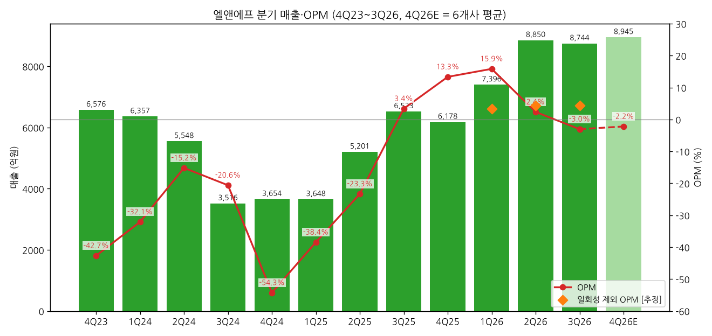
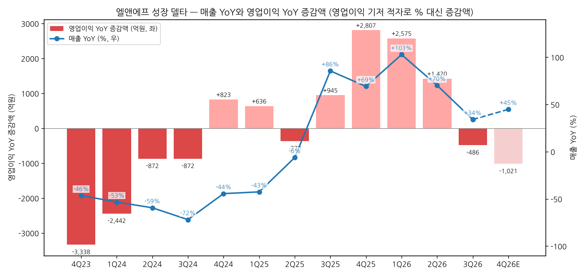
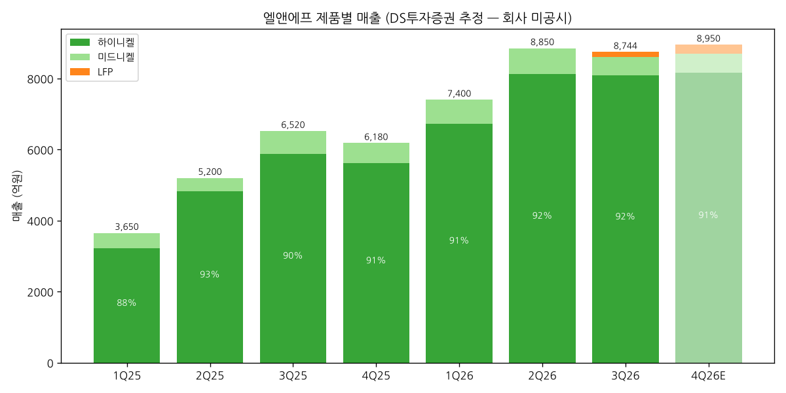

> 모드: 실적 리뷰 (v11)
> 종목: 엘앤에프 (066970)
> 섹터: 배터리
> 서브섹터: 양극재
> 분기: 2026-Q3
> 발표일: 2026-11-05 (잠정실적 공정공시·IR 「2026년 3분기 경영실적 현황」·컨퍼런스콜 동일일)
> 작성 시각: 2026-11-16 15:50 KST
> 분석 소스: 회사 「2026년 3분기 경영실적 현황」 IR PT(2026-11-05, FnGuide 경유 이미지 PDF) + 국내 6개사(대신 11/06, DS투자 11/06, NH투자 11/06, 하나 11/13, 메리츠 11/13 「2027 Outlook」, DB 11/16) — 첨부 7건 전부 엘앤에프 자료(타사 자료 혼입 없음) / 과거 분기는 OpenDART 분기 시계열(2026-11-16 조회)·회사 IR p.8 요약손익·본 세션 기업개요(2026-11-14) / 중국 피어는 같은 날 Ronbay·Easpring 리뷰 / 3Q26 분기보고서 OpenDART 미반영(2026-11-16 조회) → 3Q26은 잠정치
> 리뷰 깊이: 풀 | 리서치 첨부 7건 (회사 IR 1 + 증권사 6)

# 엘앤에프 3Q26 실적 리뷰

## 0. 한 줄 판정

> 성장 델타: 꺾임 | 내러티브: 약화 → 델타 꺾임 + 내러티브 약화 → 매매 제외 구간 (LFP 100GWh 수주로 새 스토리는 형성 중 — 4Q 재고손실 축소·1H27 흑자 정착 확인 전까지)

→ 숫자: 매출 8,744억 (YoY +34.1%, QoQ −1.2%), 영업이익 **−265억** (OPM −3.0%, 적자전환) [잠정]. 매출 YoY가 +102.8% → +70.2% → **+34.1%** 로 2개 분기 연속 둔화, 영업이익 YoY 증감액은 +2,575 → +1,420 → **−486억** 으로 마이너스 전환. FnGuide 컨센(매출 9,447억 / 영업이익 21억) 대비 매출 −7.4%, 영업이익 적자
→ 쟁점 ①: 적자의 대부분은 메탈·환율 — 재고평가손실 426억 + 환율 하락 손실 약 220억. 이 둘을 빼면 381억(OPM 4.4%)으로 2Q26(재고평가·LFP 초기비용 제외 약 388억)과 같다. 본업이 꺾인 건 아니지만 **늘지도 않았다**
→ 쟁점 ②: 4Q에도 재고손실이 반복되나 — 탄산리튬 3Q말 $19.1/kg → 11월 $13.5/kg(DB). 4Q26 영업이익 추정이 DS +34억 \~ NH −400억으로 갈리고 6개사 평균은 **−196억**(2개 분기 연속 적자)
→ 쟁점 ③: 새 스토리는 LFP — 셀 3사 + 해외 1사 확정 25만톤(ESS 약 100GWh), 6만톤 → 12만톤(2H28) 증설. 대신 그 자금(대신 추정 Capex 3,600억)과 1위 고객 공급 이원화 우려가 TP를 깎았다 (6개사 중 3곳 하향, 비교 가능한 5개사 평균 −20.5%)
→ 다음 분기 관건: 4Q26 재고평가손실이 426억보다 줄어드는지, 2027 NCM 물량(이원화 70:30 가정 시 +10%, 없으면 +40% — NH)과 LFP 2027 4만톤 경로

---

## 1. 숫자

① 연결 분기 표 (억원, K-IFRS 연결)

| 항목 | 4Q23 | 1Q24 | 2Q24 | 3Q24 | 4Q24 | 1Q25 | 2Q25 | 3Q25 | 4Q25 | 1Q26 | 2Q26 | **3Q26 [잠정]** | 4Q26E |
|---|---|---|---|---|---|---|---|---|---|---|---|---|---|
| 매출액 | 6,576 | 6,357 | 5,548 | 3,516 | 3,654 | 3,648 | 5,201 | 6,523 | 6,178 | 7,396 | 8,850 | **8,744** | 8,945 |
| 영업이익 | −2,805 | −2,038 | −842 | −724 | −1,982 | −1,403 | −1,212 | 221 | 825 | 1,173 | 208 | **−265** | −196 |
| OPM | −42.7% | −32.1% | −15.2% | −20.6% | −54.3% | −38.4% | −23.3% | 3.4% | 13.3% | 15.9% | 2.4% | **−3.0%** | −2.2% |
| 재고평가·환율 등 일회성 | −2,508 (재고) | −832 (재고) | — | — | 손실 [금액 미확보] | — | — | 환입 [금액 미확보] | 환입 약 +779 | 환입 +926 | 재고 −140, LFP 초기 −40 | **재고 −426, 환율 약 −220** | 재고 약 −100(DS) \~ 확대(DB) |
| 일회성 제외 영업이익 [계산] | — | — | — | — | — | — | — | — | 약 46 | 247 | 388 | **381** | — |
| 매출 YoY | −46.5% | −53.4% | −59.4% | −72.0% | −44.4% | −42.6% | −6.3% | +85.5% | +69.1% | +102.8% | +70.2% | **+34.1%** | +44.8% |
| 영업이익 YoY | 적전 | 적전 | 적전 | 적전 | 적지 | 적지 | 적지 | 흑전 | 흑전 | 흑전 | 흑전 | **적전** | 적전 |
| 영업이익 YoY 증감액 | −3,338 | −2,442 | −872 | −872 | +823 | +636 | −370 | +945 | +2,807 | +2,575 | +1,420 | **−486** | −1,021 |
| **매출 YoY 델타 (%p)** | −47.5 | −6.9 | −6.1 | −12.5 | +27.6 | +1.8 | +36.4 | +91.8 | −16.4 | +33.7 | −32.6 | **−36.1** | +10.7 |

→ (출처: 4Q23 = OpenDART 분기 시계열(2026-11-16 조회), 1Q24\~3Q26 = 회사 3Q26 IR p.8 요약손익(백만원 → 억원 반올림), 3Q26은 2026-11-05 잠정 공정공시 — 분기보고서 OpenDART 미반영. 일회성 = 회사 IR p.4(3Q26), 기업개요(4Q23 IR p.6, 1Q24 보도자료, 4Q25 디지털데일리 2026-02-06, 1Q26·2Q26 IR p.4). 4Q26E = 대신·DS·NH·하나·메리츠(연간 − 1\~3Q 역산)·DB 6개사 평균)
→ 컨센 대비: 매출 **−7.4%**, 영업이익 적자 vs 컨센 +21억 (FnGuide 9,447억 / 21억 — NH·DS 인용). 대신은 "최근 1개월 컨센 −291억에 부합"으로 표현 — 컨센 집계 기간에 따라 '하회'와 '부합'이 갈림
→ 영업이익 기저가 4Q23\~2Q25 적자 → 3Q25부터 흑자라 % YoY는 3Q26부터 '적전'으로만 표기됨 → **영업이익 YoY 증감액**으로 델타 판단

**해석**
→ 매출 YoY 정점은 1Q26(+102.8%). 이후 +70.2% → +34.1%로 2개 분기 연속 둔화하고, 영업이익 YoY 증감액은 4Q25(+2,807억)를 정점으로 3개 분기 연속 축소 끝에 3Q26 마이너스 전환 → **델타 꺾임**
→ 일회성 조정 후에도 판정은 같다: 일회성 제외 영업이익 247 → 388 → **381억** (OPM 3.3% → 4.4% → 4.4%) [계산]으로 2Q26 이후 정체. 1Q26 OPM 15.9%는 재고 환입 926억이 만든 숫자였고, 본업 체력은 OPM 4% 안팎
→ 컨센 경로상 4Q26 매출 YoY는 +44.8%로 소폭 재가속하지만(3Q25·4Q25 저기저), 영업이익은 2개 분기 연속 적자. 1Q27E 매출 YoY는 대신 +10.5% / NH +13.2% / DB +26.4% — **분기 매출 델타의 정점은 1Q26으로 이미 지났다**. 이익 회복은 2Q27 이후(재고 소진·LFP 램프업)가 셀사이드 공통 경로 [전망]

→ (출처: 회사 IR p.8, OpenDART, 셀사이드 6개사 평균 — 4Q26E 연한 막대·점선. 주황 마름모 = 재고평가·환율·LFP 초기비용 제외 OPM [계산])

→ (출처: OpenDART·회사 IR. 영업이익은 기저 적자로 % 대신 YoY 증감액(억원))

② 제품별 매출·출하 (단일 사업 — 양극활물질 100%, 제품별 매출·톤수·ASP 절대값은 회사 미공시)

(1) 회사 공시 — 출하·판가 증감률 (회사 IR p.4)

| 항목 | 1Q26 | 2Q26 | **3Q26** | 4Q26 회사 코멘트 |
|---|---|---|---|---|
| NCM 출하량 QoQ | +12% | +8% (분기 최대) | **−5%** (YoY +10%) | +6% 이상 (컨콜, 대신 Q&A) |
| 하이니켈 / 미드니켈 출하 QoQ | — | — | **−3% / −32%** | 하이니켈 분기 최대 경신 전망 (IR p.7) |
| 하이니켈 / 미드니켈 비중 | 87 / 13 | 88 / 12 | **90 / 10** | — |
| 46파이 비중 (NCM 출하 내) | — | 약 6% (2026 연간 기준) | **10%** | 2027 최대 40% |
| Blended 판가 QoQ | +4% | +12% | **+7%** (Hi-Ni +7%, Mid-Ni +6%) | −3% (DS·하나 추정, 리튬 도급단가 하락) |
| LFP | — | 공장 준공 | **3Q 말 북미 ESS향 첫 공급** | 4Q 2,000\~3,000톤 (대신·DS / 하나) |

→ (출처: 회사 3Q26 IR p.4·7, 1Q26·2Q26은 기업개요(회사 IR p.4). 하이니켈 QoQ "3%"를 회사 IR은 감소 문맥으로 썼고 DS도 −3%로 해석, 하나는 +3%로 기재 — 합산 −5%와 맞는 쪽은 −3% [판단])
→ 원화 판가: 달러 판가 +7%지만 원/달러 하락(대신 −5% QoQ)으로 원화 기준 상승은 2%대 (DS) → 물량 −5% × 원화 판가 +2%대 + LFP 첫 매출로 매출 −1.2%
→ 미드니켈 −32%는 유럽 EV향 한국 셀 고객 수요 둔화 (DS·하나·대신). DB는 9월 추석 연휴로 인한 일부 출하 지연도 원인으로 봄

(2) 제품별 매출 (**회사 미공시**, DS투자증권 추정) [추정]

| 제품 (억원) | 3Q25 | 2Q26 | **3Q26** | 4Q26E | 매출 YoY | 매출 QoQ | 비중 |
|---|---|---|---|---|---|---|---|
| 하이니켈 (NCMA95·NCMA90) | 5,880 | 8,130 | **8,084** | 8,160 | +37.5% | −0.6% | 92% |
| 미드니켈 (NCM523 등) | 640 | 720 | **520** | 530 | −19.0% | −27.8% | 6% |
| LFP | 0 | 0 | **140** | 260 | 신규 | 신규 | 2% |
| 영업이익 | 221 | 208 | **−265** | 34 | 적전 | 적전 | — |

→ (출처: DS투자증권 2026-11-06 표1·표3. NH는 3Q26 LFP 매출 40억, 4Q26E 350억 / DB 4Q26E LFP 350억으로 추정 — LFP 매출 규모는 증권사마다 다름. 제품별 영업이익은 회사·증권사 모두 미제시)

→ (출처: DS투자증권 추정, 회사 미공시)

**해석**
→ 매출을 끈 건 여전히 **하이니켈(울트라 하이니켈 단독 공급 + 46파이)** — YoY +37.5%. 꺾인 건 미드니켈(유럽)과 원화 판가(환율). LFP는 아직 매출의 2%
→ 이익은 제품이 아니라 **메탈가·환율 방향**이 결정했다 — 1Q26은 환입 926억으로 OPM 15.9%, 3Q26은 재고손실·환율로 −3.0%. 본업 OPM 4% 안팎은 3개 분기째 변하지 않음 [계산]

(3) 재무 — 3Q26 말 (회사 IR p.5·6)

| 항목 (억원) | 3Q25 | 2Q26 | **3Q26** | QoQ |
|---|---|---|---|---|
| 재고자산 | 5,458 | 7,640 | **7,447** | −193 (−3%) — 원재료 재고 수량 −19% |
| 부채총계 / 자본총계 | 25,998 / 3,758 | 29,051 / 7,794 | **27,838 / 7,477** | −4% / −4% |
| 부채비율 / 차입금 의존도 | 692% / 58% | 373% / 48% | **372% / 47%** | 차입금 640억 상환 |
| 기말 현금 | 3,157 | 3,606 | **2,825** | −781 (−22%) |
| 영업활동 / 투자활동 현금흐름 | 624 / −550 | 702 / −521 | **636 / −546** | LFP 투자로 유형자산 +289억 |

→ 셀사이드 2026E 말 부채비율: NH 495% / DB 491% / 메리츠 468% / DS 392% — 순손실·증설 차입으로 다시 오를 것이라는 추정이 다수

③ 연간 (억원)

| 항목 | 2022 | 2023 | 2024 | 2025 | 2026E | 2027E |
|---|---|---|---|---|---|---|
| 매출액 | 38,873 | 46,441 | 19,075 | 21,549 | 33,934 | 42,083 |
| 영업이익 | 2,663 | −2,223 | −5,587 | −1,568 | 920 | 1,418 |
| OPM | 6.9% | −4.8% | −29.3% | −7.3% | 2.7% | 3.4% |
| 매출 YoY | +300.4% | +19.5% | −58.9% | +13.0% | +57.5% | +24.0% |
| 영업이익 YoY | +501% | 적전 | 적지 | 적지 | 흑전 | +54% |

→ (출처: 2022\~2025 OpenDART 연결(기업개요), 2026E·2027E = 발표 후 6개사 평균(대신 980/1,327, DS 1,150/2,043, NH 720/1,000, 하나 861/1,283, 메리츠 1,082/1,097, DB 730/1,760), 매출도 6개사 평균. 2026E 영업이익 920억 = 1\~3Q 실적 1,116억 + 4Q 평균 −196억)
→ 발표 전 → 후 (수정 전후를 공개한 3개사 평균, 대신·DS·NH): 2026E 영업이익 1,783억 → 950억(**−46.7%**), 2027E 1,983억 → 1,457억(**−26.5%**). FnGuide 컨센(하나 표기, 11/13)은 아직 2026 1,118억 / 2027 1,719억으로 셀사이드 평균보다 높다 — 컨센 추가 하향 여지

---

## 2. 시장 쟁점

### 2-0. 지난 리뷰에서 "봐야 할 것"으로 남긴 항목

→ 첫 리뷰 — 직전 체크 없음

### 2-1. 이번 분기 쟁점

① **3Q 적자의 성격 — 재고·환율을 빼면 정상 이익은 얼마인가** (6건 중 6건)
② **4Q 재고평가손실 반복 여부 — 리튬 하락이 이어지는 동안 이익 바닥은 어디인가** (6건)
③ **1위 고객(테슬라향 울트라 하이니켈) 공급 이원화 — 2027 NCM 물량은 늘어나나** (6건)
④ **LFP 25만톤(100GWh) 수주 — 물량 가이던스와 수익성** (6건)
⑤ **12만톤 증설 자금조달과 재무구조** (4건 — 대신·DB·메리츠·NH)

### 2-2. 쟁점별 분해

#### ① 3Q 적자의 성격

(1) 회사 설명
→ "원/달러 환율 및 주요 원재료 가격 급락에 따른 손실 발생 — 리튬 등 주요 원재료 재고평가손실 약 426억원, 환율 하락 손실 약 220억원" / "외부 요인 제거 시 가동률 상승에 따른 견조한 수익성 지속" (IR p.4)
→ 재고평가손실은 대부분 기존 원재료 재고에서 발생 (컨콜, 대신 Q&A)

(2) 증권사별 해석 편차

| 증권사 | 일회성 제외 기준 | 정상 영업이익 | 해석 |
|---|---|---|---|
| DS (11/06) | 재고 426 + 환율 220 제외 | **381억** | "2분기와 같은 수준" — 일회성 적자보다 LFP에 주목 |
| NH (11/06) | 재고·환율 제외 | OPM **약 4%** | "전분기와 유사" — 단 4Q도 −400억 적자 예상 |
| 하나 (11/13) | 재고평가만 제외 | **161억** (OPM 1.8%) | 재고 제외 기준 4개 분기 연속 흑자 |
| DB (11/16) | 재고·환율 제외 | "견조" | 판매량 감소는 추석 연휴 출하 지연 |
| 대신 (11/06) | — | — | 최근 1개월 컨센(−291억)에 부합, 부진은 환율(−5%)·미드니켈 수요 |
| 메리츠 (11/13) | — | — | 리튬가 하락으로 추정치 조정 영향권 |

(3) 공통 결론 vs 갈리는 지점
→ 공통: 3Q 적자는 메탈가·환율 요인이고 본업 손익은 2Q와 비슷하다
→ 갈림: **환율 손실을 '일회성'으로 볼지** — 하나는 환율을 본업에 남겨 161억(OPM 1.8%), DS는 빼서 381억(4.4%). 환율 하락은 판가에도 래깅으로 남아(DS "4Q 환율 래깅") 4Q에도 이어지는 변수라 전액 일회성으로 보기 어렵다

(4) [판단]
→ 정상 이익은 OPM 2\~4% 범위이고, 2Q26 이후 **늘지 않았다**. 1Q26 15.9%는 환입 효과였다. 델타 판정을 '일회성 탓'으로 되돌릴 근거는 약하다
→ 결론을 바꿀 데이터: 4Q26 재고·환율 제외 영업이익이 400억 이상(OPM 4.5%+)이면 본업 개선 재개, 200억 이하면 본업도 둔화

#### ② 4Q 재고평가손실 반복 여부

(1) 회사 설명
→ "4Q26 원재료 가격 QoQ 소폭 하락세로 추가 재고평가손실 발생 가능성 존재. 다만 하락 폭 축소와 LFP 생산 확대에 따른 재고 소진으로 4Q26 재고평가손실 규모 QoQ 축소 전망" / "1H27 이후 기존 재고로 인한 손익 변동성 대부분 해소, 이후 고객사 도급 방식으로 원재료 조달" (컨콜, 대신 Q&A)

(2) 증권사별 해석 편차

| 증권사 | 4Q26 재고손실 가정 | 4Q26E 매출 / 영업이익 | 근거 |
|---|---|---|---|
| DS | **약 100억으로 축소** | 8,952억 / **+34억** (흑전) | 재고가 LFP 생산에 투입되며 소진. 단 판가 −3%·환율 래깅으로 경상 OPM 1%대 |
| 메리츠 | — | 약 8,998억 / 약 −34억 [역산] | 연간 1,082억 − 1\~3Q 1,116억 |
| 대신 | 축소 | 9,049억 / −136억 | 출하 증가·재고 하락으로 적자 축소 |
| 하나 | 3Q 대비 감소하나 불가피 | 8,733억 / −254억 | 판가 하락(Hi-Ni −3%, Mid-Ni −5%)·환율이 물량 효과 상쇄 |
| DB | **3Q보다 클 것** | 9,043억 / −387억 | 탄산리튬 3Q말 $19.1/kg → 11월 $13.5/kg (−29%) |
| NH | 재고·환손실 추가 | 8,892억 / **−400억** | NCM +5%, 판가 −3%, 컨센(9,221억 / 235억) 하회 |

(3) 공통 결론 vs 갈리는 지점
→ 공통: 4Q 판가 하락(−3%)과 추가 재고손실은 피하기 어렵고, 재고 리스크는 1H27 소진 후 도급 전환으로 구조적으로 줄어든다
→ 갈림: **4Q 리튬 하락 폭** — 회사·DS는 '하락 폭 축소'를, DB는 11월까지 −29% 추가 하락을 근거로 '손실 확대'를 본다. 4Q26E 영업이익 범위 +34 \~ −400억(차이 434억)이 거의 전부 이 가정 차이

(4) [판단]
→ DB가 인용한 11월 탄산리튬 −29%는 3Q 손실을 낸 하락 폭(중국 피어 Easpring 리뷰 기준 8월 고점 → 9월 −28%)과 비슷한 크기다. 회사 가이던스("축소")보다 DB·NH 쪽이 숫자와 맞는다 — 4Q도 적자 쪽에 무게 [판단]
→ 결론을 바꿀 데이터: 12월 탄산리튬이 11월 대비 반등하거나, 4Q 재고평가손실이 200억 미만으로 공시되면 DS 경로(흑전)

#### ③ 1위 고객 공급 이원화와 2027 NCM 물량

(1) 회사 설명
→ "4Q26 울트라 하이니켈 안정적 단독공급 지속. 단기간 내 공급 구조 변화 가능성은 제한적. 향후 공급 구조 관련 구체적인 사항은 공개 어려움" / "2027 NCM 출하 두 자릿수 성장, 역대 최대 출하 갱신 기대 — 46파이가 주도, NCM 출하 중 46파이 최대 40%(현재 10%)" (컨콜, 대신 Q&A · IR p.7)
→ 1위 고객 비중 88%(2025, DART "외부고객1" — LGES의 테슬라향 원통형 셀로 추정, 기업개요)

(2) 증권사별 해석 편차

| 증권사 | 이원화 가정 | 2027 출하 전망 | 논리 |
|---|---|---|---|
| NH | **보수적 70:30 가정** | NCM 10.5만톤 (+10%) / 이원화 없으면 13.4만톤 (+40%) | 북미 최대 고객 46파이 공급 효과가 '28년까지 가파름 |
| DB | 기존 고객 울트라 하이니켈 **20\~30% 감소 가능** | 총 출하 10만톤 → 14만톤 | 리비안·삼성SDI LFP·**테슬라 직납 개시**로 총 물량 증가. 연말까지 이원화 영향 없음 |
| DS | 이원화돼도 46파이가 상쇄 | NCM +10% 이상, 출하 99kt → 146kt(LFP 포함) | 단독 공급 4Q에도 지속 |
| 메리츠 | "이원화 우려 크지 않을 것" | — | T사 1차 공급사 지위 재확인, R사·EU 고객 저변 확대 |
| 하나 | 언급 없음 | 46파이 NCM95 7,600톤 → 14,200톤 | 리비안 신차 판매 호조(3Q EV 인도 +46% YoY), 테슬라 FSD 승인 국가 확대 |
| 대신 | — | NCM 2027 +10% (회사 가이던스) | 경쟁사 LFP 진출로 프리미엄 축소 → 멀티플 30% 할인 |

(3) 공통 결론 vs 갈리는 지점
→ 공통: 2027 NCM 출하는 늘고(+10% 이상), 성장 동력은 46파이(리비안 R2 등)와 테슬라 신규 프로젝트
→ 갈림: 이원화의 **크기** — 증권사 다수가 20\~30% 물량 이전을 이미 추정에 넣었고(NH·DB), 회사는 "단기간 내 제한적"으로 답을 피했다. 이원화 없으면 NCM +40%, 있으면 +10% — 2027 매출 편차(38,300억 NH \~ 46,231억 하나)의 큰 축

(4) [판단]
→ 회사가 2027 NCM 가이던스를 '+10%'로 준 것 자체가 이원화를 일부 반영한 숫자로 읽힌다(NH 70:30 가정과 같은 +10%) [판단]. 상단 시나리오(+40%)는 이원화 지연이 확인돼야 열린다
→ 결론을 바꿀 데이터: 1Q27 울트라 하이니켈 출하가 QoQ 유지 이상이면 이원화 지연, 20% 이상 감소면 DB 시나리오 현실화

#### ④ LFP 25만톤(100GWh) 수주 — 물량과 수익성

(1) 회사 설명
→ "국내 주요 셀 3사 + 해외 고객 1곳 — 확정 물량 기준 최대 25만톤, ESS 배터리 환산 약 100GWh 중장기 공급계약. 기존 계약 기반 2027 약 4만톤 → 2028 6만톤 이상" (컨콜, 대신 Q&A) / IR p.7은 "기존 수주 기반 '27년 5만 톤, '28년 6만 톤, Full Capa" — **IR 문구(5만톤)와 컨콜 답변(약 4만톤)이 다르다**
→ 11/3 LGES와 2028\~31년 1조원 LFP 공급계약 공시 → "28년 이후 연간 3만톤 이상 추가" / 2026 LFP 출하 약 3\~4천톤 / 2027 가동률 90% 수준으로 손익 기여 본격화 (컨콜)
→ 4Q26 삼성SDI향 출하 개시, SK온·LGES 순차 (메리츠)

(2) 증권사별 해석 편차

| 증권사 | 2027 LFP 물량 | 2027 LFP 매출 / 이익 | 해석 |
|---|---|---|---|
| 대신 | 4만톤 | 매출 4,600억 / **영업이익 90억** (OPM 약 2%) | LGES 계약 = 약 8만톤 [추정]. 경쟁사 LFP 진출로 프리미엄 가능성 낮아짐 |
| DS | 4만톤 (가이던스 "하향"으로 표현) | 매출 5,270억 | 할인율 40 → 50% 확대 — 추정 가시성 저하 |
| NH | 3.5만톤 (+1,100%) | 매출 4,160억 | LFP 초기 램프업 비용 반영, '29년까지 실적 가시성 |
| 하나 | 4만톤 (2Q27 연산 6만톤 Capa) | — | 수주잔고 3\~4년 소화 → 2028 Full Capa 6만톤 |
| DB | — | 매출 2,690억 | 셀 3사 모두 고객 확보, 6 → 12만톤 증설 |
| 메리츠 | — | — | 셀 3사의 북미 ESS 계획상 2\~3년 성장 둔화 우려 적음 |

(3) 공통 결론 vs 갈리는 지점
→ 공통: 2028년까지 6만톤 Capa는 수주로 채워졌고, 비중국 LFP 양극재(북미 FEOC 규제)라는 포지션은 유효
→ 갈림: **수익성** — 대신은 2027 LFP OPM 약 2%로 "물량은 확실, 이익 기여는 작다", 회사는 "높은 초기 가동률과 안정적 수익성". 2027 LFP 매출 추정도 2,690억(DB) \~ 5,270억(DS)으로 2배 차이

(4) [판단]
→ 100GWh는 국내 셀사 ESS 수주(삼성SDI 연말 목표 120GWh, LGES — 같은 날 셀 리뷰)와 맞물린 물량이라 수요 근거는 탄탄하다. 다만 **2026 LFP 출하가 3\~4천톤에 그치고 2027 물량 표현이 5만 → 4만톤으로 내려온 것**은 램프업이 계획보다 느리다는 신호 [판단]
→ 결론을 바꿀 데이터: 4Q26 LFP 출하 2,000톤 이상(대신·DS) + 1Q27 분기 5,000톤 이상이면 4만톤 경로, 그 아래면 추가 하향

#### ⑤ 12만톤 증설 자금조달과 재무구조

(1) 회사 설명
→ "2H28까지 연 6만톤 추가 증설 → 총 12만톤 (부지 확보). 재원은 L&F플러스(LFP 자회사)가 직접 조달하는 것이 기본 방향, 모회사 지원 부담 최소화. 정책금융 우선 검토, 필요시 일부 차입·재무적 투자자 유치 병행" (컨콜, 대신 Q&A) / "국민성장펀드 첨단전략산업기금 활용 LFP 증설 투자 지속" (IR p.5) / "잔여 Warrant 행사 시 자본 확충 기대" (IR p.5)

(2) 증권사별 해석 편차

| 증권사 | 판단 |
|---|---|
| 대신 | Capex 3,600억 + 운영비 400억 [추정]. "성장 기대와 자금조달 우려 공존" — 1H27 업황 개선·조달 방식 가시화 후 접근 추천 |
| DB | 필요 조달 약 2,000\~3,000억은 시총 대비 크지 않고 시장도 인지. 국민성장펀드는 대출뿐 아니라 지분 출자도 가능 |
| 메리츠 | 영구 CB 발행에 따른 주가 희석은 선반영 중 |
| NH | 오버행 점검 — 7회 BW 잔여 821억(164만주, 4.0%)·EB 잔여 5,095억(115만주, 2.8%). 2026E 부채비율 495% |

(3) 공통 결론 vs 갈리는 지점
→ 공통: 증설은 수주가 있는 투자라 방향은 맞고, 조달 방식이 주가 변수
→ 갈림: 자회사 단위 조달(정책금융·FI)로 모회사 희석 없이 끝나느냐(DB) vs 영구 CB 등 메자닌 희석이 반복되느냐(메리츠·대신 경계)

(4) [판단]
→ 부채비율 372%·현금 2,825억(−22% QoQ)에 4Q도 적자 추정이 다수라 4Q 말 재무비율은 다시 나빠질 가능성이 높다 [판단]. 엘앤에프플러스 단위 정책금융·FI 유치가 확정 공시되면 쟁점 해소

### 2-3. 낙관 vs 보수 — 논리 대비

→ **가장 낙관: DS(TP 30만)·DB(21만)** — "일회성 적자보다 LFP 100GWh". DS는 2027 영업이익 2,043억(+78%)·2027 EBITDA 3,120억에 외형·수익성 확장기(2020\~22) 멀티플 평균 50% 할인(45배), 2027 회사 가이던스(영업이익 120% 이상 증가)는 12월 사업계획 확정 후 반영 예정이라 상향 여지. DB는 2028 EBITDA 4,140억 × 25배 [역산], Peer 대비 낮은 멀티플. 가정의 핵심은 **4Q 재고손실 축소(DS) + 2027 출하 14만톤**
→ **가장 보수: NH(13만)·대신(15만)** — NH는 리튬·환율 하향 + LFP 초기 비용으로 2027 영업이익 1,000억(OPM 2.6%), 이원화 70:30 가정. 대신은 2027 LFP 이익 90억, 경쟁사 LFP 진출로 프리미엄 축소(멀티플 30% 할인), 자금조달 우려. 가정의 핵심은 **2027 마진 2\~3%대 + 이원화**
→ 둘을 가르는 변수: 2027 영업이익(1,000억 NH \~ 2,043억 DS, 2.0배 차이) — 이원화 크기와 LFP 마진
→ 셀사이드 vs 시장: TP 평균 약 18.3만원 vs 주가 79,200원(11/13, DB) — 괴리 +131%. 주가는 발표일(11/05 종가 85,700원) 이후 −7.6%, 발표 전 1개월 −24.8%(대신, 11/05 기준), 52주 고점 213,000원(2026-05-04) 대비 −63%. 셀사이드가 '매수'를 유지하는 동안 시장은 이원화·재고손실·조달을 먼저 반영 [판단]

### 2-4. 추정치·TP 변화

| 증권사 | 의견 | 직전 TP | 현재 TP | 4Q26E 영업이익 | 2026E / 2027E 영업이익 | 핵심 변화 한 줄 |
|---|---|---|---|---|---|---|
| DS (11/06) | 매수 | 350,000 | **300,000** | +34억 | 1,150 / 2,043억 | 할인율 40 → 50% (멀티플 하향), 추정치 −17.5% / −2.1% |
| DB (11/16) | Buy | 210,000 | 210,000 | −387억 | 730 / 1,760억 | 4Q 재고손실 확대, 2027 출하 14만톤 |
| 메리츠 (11/13) | Buy | [미확보] | 170,000 | 약 −34억 [역산] | 1,082 / 1,097억 | 실적 하향 반영, 2027E EV/EBITDA 41배 |
| 대신 (11/06) | 매수 | 310,000 | **150,000** | −136억 | 980 / 1,327억 | 타깃 멀티플 25배(30% 할인), 추정치 −62.6% / −42.2% |
| 하나 (11/13) | BUY | 140,000 (10/23) | 140,000 | −254억 | 861 / 1,283억 | 2028 EBITDA 2,692억 × 26.5배 |
| NH (11/06) | Buy | 160,000 | **130,000** | −400억 | 720 / 1,000억 | 리튬·환율·LFP 초기비용, 추정치 −46.4% / −35.9% (DCF) |

→ 평균 TP(6개사) **약 183,000원**. 직전 TP 확인 5개사 평균 234,000원 → 186,000원(**−20.5%**). 하향 3건(대신·DS·NH), 유지 2건(하나·DB), 직전 미확보 1건(메리츠). 범위 13만 \~ 30만원(2.3배)
→ TP 하향의 원인: **대신·DS는 멀티플 하향**(경쟁사 LFP 진출 프리미엄 축소 / 추정 가시성 저하로 할인율 확대), **NH는 실적 하향**(2026E −46%, 2027E −36%). 세 곳 모두 실적도 동시에 하향
→ 발표 전 대비 연간 컨센: 2026E −46.7%, 2027E −26.5% (수정 전후 공개 3개사 기준). 발표 후 6개사 평균 2026E 920억 / 2027E 1,418억 / 2028E 2,194억

---

## 3. 내러티브 점검

① 스토리 정의
→ **"테슬라향 울트라 하이니켈 단독 공급 + 46파이 신규 고객으로 NCM 물량 성장, 여기에 비중국 LFP로 북미 ESS 두 번째 성장축"** — 시장이 엘앤에프를 사는 이유는 원통형 하이니켈의 독점적 지위와, 국내 양극재 중 가장 먼저 시작한 LFP 양산

② 이번 분기가 스토리에 준 영향
→ 강화: LFP 셀 3사 + 해외 1사 25만톤(100GWh) 확정, LGES 1조원 추가 계약, 12만톤 증설 계획, 46파이 비중 10% → 2027 최대 40%, 3Q 말 북미 ESS향 첫 출하
→ 약화: 1위 고객 이원화 우려(증권사 2곳이 20\~30% 이전을 추정에 반영), 2026 LFP 3\~4천톤·2027 4만톤으로 물량 표현 하향, 재고손실 2개 분기 연속(4Q 포함 시), 증설 자금조달·부채비율, LFP 마진 2% 안팎(대신)
→ 판정: LFP라는 새 스토리는 셀사이드 추정에 들어가기 시작했지만(**형성**), 기존 NCM 스토리의 핵심 전제(단독 공급)가 흔들리고 TP 3곳 하향·연간 추정 −27\~−47% → 종합 **내러티브 "약화"**
→ 국면: 매출 델타 2개 분기 연속 둔화 + 영업이익 YoY 증감액 마이너스 전환 + 내러티브 약화 → **"매매 제외 구간"**. 단 LFP 수주가 탄탄해 1H27 재고 소진 후 이익 델타가 다시 플러스로 돌 수 있는 구조 — 재진입 신호는 '4Q 재고손실 축소 + 1Q27 흑자 + 이원화 크기 확인' [판단]

③ 다시 강해질 트리거
→ 4Q26 재고평가손실 200억 미만 + 1Q27 영업이익 흑자 (재고 소진·도급 전환 확인)
→ 2027 공급 구조 확정 — 울트라 하이니켈 단독 공급 연장 또는 테슬라 직납 개시
→ 12월 사업계획 확정 시 2027 영업이익 가이던스(DS 인용 "120% 이상 증가") 공식화, 엘앤에프플러스 정책금융·FI 조달 확정

④ 스토리를 깨뜨릴 리스크
→ 탄산리튬 추가 하락으로 4Q·1Q27 재고손실 연속 → 2026 연간 영업이익 1,000억 미만 고착
→ 이원화가 30% 이상 + 46파이 램프업 지연 → 2027 NCM 역성장
→ 모회사 단위 메자닌·유상증자 형태의 조달 → 희석

---

## 4. 향후 봐야 할 것

① **4Q26 재고평가손실과 영업이익** — 1순위 (델타 판정을 바꾸는 변수)
→ 무엇을: 재고평가손실이 3Q 426억보다 줄었는지(200억 미만이면 회사 설명 확인), 영업이익이 셀사이드 평균 −196억(범위 −400 \~ +34억)보다 나은지, 재고·환율 제외 영업이익 400억 이상 여부
→ 어떤 데이터로: 탄산리튬 가격(11월 $13.5/kg, DB) 12월 추이, 4Q26 잠정실적 공정공시·IR p.4, 원/달러 환율
→ 언제: 2026-12(메탈가) \~ 2027-02 초(4Q26 잠정, 전년 2026-02-06 선례)

② **1위 고객 공급 이원화 크기와 2027 NCM 물량**
→ 무엇을: 2027 울트라 하이니켈 공급 구조(단독 유지 / 20\~30% 이전), 테슬라 직납 개시(DB), 2027 NCM 출하 +10%(가이던스) vs +40%(이원화 없음) 경로
→ 어떤 데이터로: 4Q 컨콜, 테슬라·LGES 원통형 소재 벤더 보도, 1Q27 하이니켈 출하 QoQ
→ 언제: 2027-02 초 \~ 2027-05 초(1Q27)

③ **LFP 램프업 — 4Q 2,000톤 → 2027 4만톤**
→ 무엇을: 4Q26 LFP 출하 2,000\~3,000톤, 삼성SDI향 출하 개시·SK온·LGES 순차 공급, 2027 물량 4만톤(IR 5만톤) 중 어느 쪽으로 확정되는지, LFP 마진(대신 2027 OPM 약 2%)
→ 어떤 데이터로: 4Q IR LFP 출하, 삼성SDI·LGES 미국 ESS 라인 가동 뉴스, 산업부 LFP 양극재 수출 통계
→ 언제: 2027-02 초, 이후 분기마다

④ **12만톤 증설 자금조달**
→ 무엇을: 6만톤 추가 증설 Capex(대신 3,600억 추정) 조달 구조 — 엘앤에프플러스 단위 정책금융·FI 유치 vs 모회사 메자닌(영구 CB 등), 부채비율 372% → 4Q 말 수준
→ 어떤 데이터로: DART 주요사항보고서(사채·유상증자·타법인 출자), 국민성장펀드 집행 발표
→ 언제: 2026-12 \~ 2027 상반기

⑤ **46파이 출하 비중 10% → 2027 최대 40%**
→ 무엇을: 46파이 NCM95 출하(하나 2026 7,600톤 → 2027 14,200톤), 리비안 신차 판매, 테슬라 자체 셀 신규 46파이 프로젝트
→ 어떤 데이터로: 회사 IR 46파이 비중, 리비안 분기 인도량, 테슬라 4680 셀 생산 보도
→ 언제: 2027-02 초 \~ 2027 상반기

---

### 참고 — 중국 양극재 피어 3Q26 비교

| 항목 (3Q26) | **엘앤에프** | Ronbay (688005.SS) | Easpring (300073.SZ) | 에코프로비엠 | 포스코퓨처엠 |
|---|---|---|---|---|---|
| 매출 (억원) | **8,744** [잠정] | 약 12,364 | 약 14,669 | 5,579 | 8,348 (양극재 4,323) |
| 매출 YoY | **+34.1%** | +114.9% | +135.3% | −10.8% | −4.6% (양극재 −14.9%) |
| OPM (K-IFRS 기준·근사) | **−3.0%** | 약 −1.0% (재고손실 반영) | 약 3.1% (재고손실 반영) | 2.2% | 9.8% (보상금 포함) |
| 재고평가손실 (매출 대비) | **426억 (4.9%)** | 약 168억 (1.4%) | 약 118억 (0.8%) | [미확보] | — |
| 판매량 증가율 | NCM +10% YoY, −5% QoQ | 삼원 +81% YoY, +36% QoQ | LFP +40% QoQ (동오 추정), 다원계 보합 | [미공시] | [미공시] |

→ (출처: 엘앤에프 = 회사 IR. Ronbay·Easpring = 같은 날 각 사 3Q26 리뷰(분기보고서·동오증권 추정, 원화 환산 3Q26 평균 CNY/KRW 210.16 [계산]). 에코프로비엠·포스코퓨처엠 = Ronbay 리뷰 피어 표(각 사 기업개요 2026-11-14 인용))
→ 3Q 메탈가 반락은 한·중 양극재 공통 악재지만 **재고평가손실의 매출 대비 크기는 엘앤에프가 피어의 3\~6배** — 원재료를 직접 사서 쌓는 구조(도급 전환 전)라 리튬 하락에 가장 크게 노출 [판단]. 반대로 매출 YoY는 중국 피어(+115\~135%)의 1/4 수준 — 볼륨 성장의 중심이 중국 피어로 넘어갔다
